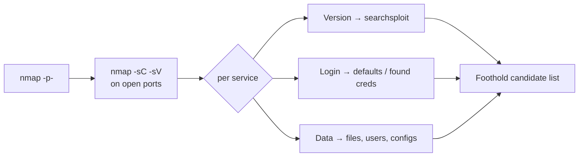

# 정찰과 정보 수집 { #recon-enumeration }

<div class="dfir-meta" markdown>
**적용 범위:** 모든 머신, 첫 1시간 · **우선순위:** 최상 · **최종 수정:** 2026-11-03
</div>

!!! abstract "한 문장 요약"
    열린 포트를 전부 찾고, 서비스와 버전을 하나하나 이름 붙이고, 인증 없이(또는 낮은 권한으로) 읽을 수 있는 건 다 가져옵니다. OSCP 발판의 대부분은 이 출력 안에 — 눈에 안 띈 채로 — 이미 있어요.

## 1. 개념 { #concept }

정보 수집은 두 단계입니다.

1. **발견** — 어떤 포트가 열려 있나(TCP 65,535개 전부 + 흔한 UDP).
2. **심문** — 포트마다: 무슨 소프트웨어, 무슨 버전, 크리덴셜 없이 뭘 볼 수 있나, *지금 가진* 크리덴셜로는 뭘 볼 수 있나?

2단계의 출력은 세 가지 질문으로 이어집니다. *이 버전에 공개 익스플로잇이 있나?* · *기본값이나 찾은 크리덴셜을 넣어 볼 로그인이 있나?* · *크리덴셜이 새는 데이터(파일, 사용자, 설정)가 있나?*



## 2. 주요 도구 { #tools }

| 도구 | 용도 | 시험 허용 여부 |
|---|---|---|
| **nmap** (+ NSE) | 포트 발견, 버전, 기본 스크립트 | 허용 (NSE는 명시적으로 허용) |
| **NetExec (`nxc`)** | SMB / WinRM / LDAP / MSSQL / RDP 확인, null·guest 세션, 공유, 사용자 | 허용 |
| **smbclient** | SMB 공유 탐색과 다운로드 | 허용 |
| **enum4linux-ng** | SMB/RPC/LDAP 한 번에 수집(사용자, 그룹, 정책, 공유) | 허용 |
| **snmpwalk / snmp-check** | SNMP로 사용자, 프로세스, 설치 소프트웨어 | 허용 |
| **showmount / mount** | NFS export | 허용 |
| **ftp / nc / curl** | 배너 확인, 익명 FTP, 프로토콜 직접 두드리기 | 허용 |

!!! danger "시험 규칙 — 대량 취약점 스캐너 금지"
    **Nessus, OpenVAS, NeXpose, Qualys 같은 도구** 는 금지이고, 같은 일을 하는 도구(예: 템플릿 기반 취약점 스캐너를 모든 호스트에 돌리기)도 금지입니다. `nmap -sV` 버전 확인, NSE 스크립트, **searchsploit** 는 괜찮아요 — "이 버전이 취약한가?"는 직접 판단하세요.

## 3. 시나리오 { #scenarios }

### 3.1 nmap — 새 대상, 아는 게 없음 { #nmap }

**상황:** 컨트롤 패널에 새 IP가 하나.

```bash
# 1) TCP 전 포트, 빠르게
sudo nmap -p- --min-rate 2000 -Pn -oN nmap/all.txt $IP

# 2) 열린 포트에 스크립트 + 버전
ports=$(grep -oP '^\d+(?=/tcp\s+open)' nmap/all.txt | paste -sd,)
sudo nmap -sC -sV -Pn -p$ports -oN nmap/svc.txt $IP

# 3) UDP 상위 포트 (SNMP, TFTP, IKE가 여기 숨음)
sudo nmap -sU --top-ports 25 -Pn -oN nmap/udp.txt $IP
```

**출력에서 볼 것:**

- `Service Info` / `OS` 줄, `ssl-cert` 의 `commonName`, `smb-os-discovery` → **호스트 이름과 도메인** → `/etc/hosts` 에 추가.
- `http-title`, `http-generator`, `http-robots.txt` → 앱 이름과 숨은 경로.
- `ftp-anon: Anonymous FTP login allowed` → 지금 바로 로그인.
- 낯선 높은 포트(8000, 8080, 8443, 9090, 5000 등) → 두 번째 웹 앱, 관리 패널, 자작 서비스.
- 버전 문자열 → `searchsploit <제품> <버전>`.

**다음:** UDP 스캔이 끝나기 전에 흥미로운 첫 포트부터 시작. `-sV` 가 `tcpwrapped` 나 `?` 를 주면 손으로 두드려 보기: `nc -nv $IP <port>`, `curl -i http://$IP:<port>/`.

!!! tip "상황이 바뀌면 다시 스캔"
    셸이나 피벗을 얻은 뒤에는 새 위치에서 다시 스캔하세요. Kali에서 filtered로 보이던 포트가 안쪽에서는 열려 있는 일이 흔합니다(터널 너머로 `nmap -sT -Pn` → [피벗팅](pivoting.md)).

nmap 더 보기: [Nmap 스캔](../../pentesting/recon/nmap/scanning.md) · [서비스와 NSE](../../pentesting/recon/nmap/service-nse.md) · [출력과 성능](../../pentesting/recon/nmap/output-performance.md).

### 3.2 NetExec — SMB(445)가 열린 Windows 호스트 { #netexec }

**상황:** 445가 열려 있음. OS, 도메인, 서명 여부, 익명 접근이 되는지 알고 싶음.

```bash
nxc smb $IP                                  # 배너: 이름, 도메인, OS 빌드, signing
nxc smb $IP -u '' -p '' --shares             # null 세션
nxc smb $IP -u 'guest' -p '' --shares        # guest
nxc smb $IP -u '' -p '' --users --pass-pol   # 사용자 + lockout 정책 (허용되면)
nxc smb $IP -u 'guest' -p '' --rid-brute     # RID cycling으로 사용자 이름
```

**볼 것:** `(name:FILES01) (domain:corp.local)` → `/etc/hosts`; `READ` 나 `WRITE` 가 붙은 공유; 사용자 이름(`users.txt` 로 저장); `Account Lockout Threshold`.

**다음:** 읽을 수 있는 공유 → smbclient(아래). 사용자 이름 → AS-REP roast / spray → [Active Directory](active-directory.md). 쓸 수 있는 공유 → 사용자가 나에게 접속하게 만드는 파일 심기를 고려([coercion](active-directory.md#coercion)).

### 3.3 smbclient — 읽을 수 있는 공유 { #smbclient }

```bash
smbclient -L //$IP -N                         # 익명으로 공유 목록
smbclient //$IP/Shared -N                     # 접속
smb: \> recurse ON
smb: \> prompt OFF
smb: \> mget *                                # 전부 가져오기
```

크리덴셜이 있으면: `smbclient //$IP/Shared -U 'corp.local/user%Password1'`.

**파일에서 찾을 것:** `*.config`, `web.config`, `*.ps1`, `*.bat`, `*.vbs`(하드코딩된 크리덴셜), `*.kdbx`(KeePass → [크랙](password-attacks.md#john)), 그룹 정책의 `*.xml`(`cpassword` → `gpp-decrypt`), 백업(`*.bak`, `*.zip`), 그리고 **쓰기 가능한** 디렉터리.

```bash
grep -RniE 'pass(word)?|pwd|secret|cred' ./loot/ 2>/dev/null
```

### 3.4 enum4linux-ng — SMB/RPC 한 번에 요약 { #enum4linux-ng }

**상황:** SMB/RPC 전체 그림을 한 번에 보고 싶음(Samba 리눅스 박스에도 좋음).

```bash
enum4linux-ng -A $IP -oA loot/e4l          # 익명
enum4linux-ng -A $IP -u user -p 'Password1'  # 인증
```

**볼 것:** `Domain/Workgroup`, `Users`(설명 필드 — 비밀번호가 남아 있는 경우가 많음), `Groups`, `Password policy`, `Mapping: OK` 인 `Shares`.

**다음:** 설명에 비밀번호 → 어디서나 시도. Samba 버전 → searchsploit.

### 3.5 SNMP (161/UDP) { #snmp }

**상황:** UDP 스캔에 `161/udp open snmp`.

```bash
onesixtyone -c /usr/share/seclists/Discovery/SNMP/common-snmp-community-strings.txt $IP
snmpwalk -v2c -c public $IP | tee loot/snmp.txt
snmpwalk -v2c -c public $IP 1.3.6.1.2.1.25.4.2.1.2    # 실행 중 프로세스
snmpwalk -v2c -c public $IP 1.3.6.1.4.1.77.1.2.25     # Windows 사용자
snmpwalk -v2c -c public $IP NET-SNMP-EXTEND-MIB::nsExtendObjects   # extend 스크립트 (크리덴셜이 보일 수 있음)
```

**볼 것:** 비밀번호가 들어간 프로세스 명령줄, 설치된 소프트웨어 버전, 사용자 이름. **다음:** 사용자 → 로그인 시도; 소프트웨어 → searchsploit.

### 3.6 NFS (2049) { #nfs }

```bash
showmount -e $IP
sudo mkdir -p /mnt/nfs && sudo mount -t nfs -o vers=3,nolock $IP:/home /mnt/nfs
ls -la /mnt/nfs
```

**볼 것:** SSH 키, 설정 파일, 그리고 export 옵션. 쓸 수 있는 export에 `no_root_squash` 가 있으면 고전적인 리눅스 권한 상승입니다 → [Linux 권한 상승 › NFS](privesc-linux.md#nfs).

### 3.7 FTP, SSH, 데이터베이스와 그 밖의 서비스 { #other-services }

```bash
ftp $IP                        # anonymous / anonymous 시도
nc -nv $IP 25                  # SMTP: VRFY / EXPN 사용자 확인
smtp-user-enum -M VRFY -U users.txt -t $IP
mysql -h $IP -u root -p        # 빈 값 / root / 찾은 크리덴셜
impacket-mssqlclient sa:'sa'@$IP          # MSSQL 기본값
ssh -v user@$IP                # 제공되는 인증 방식, 버전
```

포트 참고: [잘 알려진 포트](../../basics/well-known-ports.md).

## 4. 자주 하는 실수 { #mistakes }

- **상위 1000 포트만 스캔.** 8443의 웹 앱이나 50000의 서비스가 입구인 경우가 생각보다 많습니다. 항상 `-p-`.
- **UDP 건너뛰기.** SNMP로 비밀번호나 프로세스 명령줄이 새는 건 OSCP 단골 패턴이에요.
- **호스트 이름 안 넣기.** vhost 기반 사이트는 IP로 보면 기본 페이지, 이름으로 봐야 진짜 앱이 나옵니다.
- **스캔 기다리기.** 전체 스캔이 도는 동안 80번부터 시작.
- **"지루한" 결과 무시.** 비어 보이는 익명 FTP가 쓰기 가능하고 — 웹 서버가 그 폴더를 서빙하고 있을 수 있어요.
- **크리덴셜을 얻고 다시 안 훑기.** 새 크리덴셜마다 `nxc`, `smbclient`, `enum4linux-ng` 를 다시 — 보이는 게 달라집니다.

## 5. 시험 팁 { #exam-tips }

- 대상마다 `nmap/all.txt` 와 `nmap/svc.txt` 를 남겨 두세요 — 리포트에 바로 들어갑니다.
- 첫 1분부터 환경별로 `users.txt` 와 `creds.txt` 를 만들어 계속 채우세요.
- 취약해 보이는 버전은 시도하기 **전에** CVE와 익스플로잇 경로를 노트에 적어 두세요 — revert 후 다시 찾는 시간을 아낍니다.
- NetExec 출력의 `[+]` 는 유효한 크리덴셜, `(Pwn3d!)` 는 그 호스트의 **로컬 관리자** 라는 뜻입니다.

## 관련 페이지 { #related-pages }

- [시험 흐름](exam-workflow.md) · [웹과 초기 침투](web-initial-access.md) · [Active Directory](active-directory.md)
- [Nmap](../../pentesting/recon/nmap/index.md) · [잘 알려진 포트](../../basics/well-known-ports.md)
- 방어자 관점: [네트워크](../../network/index.md) (Zeek / Wireshark에서 스캔이 어떻게 보이는지)

## 참고 자료 { #references }

- [NetExec wiki](https://www.netexec.wiki/)
- [enum4linux-ng](https://github.com/cddmp/enum4linux-ng)
- [HackTricks — Pentesting network services](https://book.hacktricks.xyz/)
