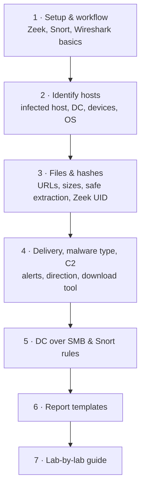

# PCAP 침해사고 분석 실습 { #pcap-ir-labs }

!!! abstract "이 섹션은"
    PCAP 하나씩을 주고 "네트워크의 한 컴퓨터가 이상하게 동작한다. 캡처를 분석해 질문에 답하고 명령어를 보여라"라고 묻는 침해사고 대응 실습 8개를 정리한 섹션입니다. 8개 실습의 질문은 70~80%가 겹치기 때문에, **공통 작업은 주제별 페이지로 합치고** **실습마다 다른 부분은 실습별 안내 페이지**에 따로 나눴습니다. 모든 단계를 **tshark**, **Zeek**(알림은 Snort 2), **Wireshark 화면** 세 가지 방법으로 보여 줍니다.

## 이 섹션 읽는 법 { #how-to-use }

1~6번 페이지를 순서대로 한 번 읽으면 반복해서 쓰는 분석 순서가 손에 익습니다. 실제 실습을 풀 때는 [실습별 안내](lab-guide.md)를 여세요. 질문마다 답이 있는 절로 바로 가는 링크가 걸려 있습니다.

위에서 아래로 읽습니다. 1~5번은 실제 조사 순서(준비 → 누구 → 무엇을 받았나 → 어떻게, 어디로 → 내부 전파)를 따르고, 6번은 찾은 내용을 짧은 영어 답안으로 바꾸고, 7번은 실습별 질문을 앞 페이지들과 연결합니다.

## 페이지 { #pages }

-   :material-play-circle-outline:{ .lg .middle } **1 · 준비와 표준 분석 순서**

    ---

    capinfos, Zeek 로그와 Snort 알림 만들기, 모든 작업에 쓰는 Wireshark 기본 기술 4가지, UTC 시간과 타임라인.

    [:octicons-arrow-right-24: 준비와 분석 순서](setup-and-workflow.md)

-   :material-account-search:{ .lg .middle } **2 · 호스트 신원 확인**

    ---

    감염 호스트의 IP·MAC·호스트 이름·사용자 계정, 도메인 컨트롤러, 활동 호스트, 휴대폰·태블릿·리눅스 기기 판별, 운영체제, 핵심 네트워크 정보, 공인 IP.

    [:octicons-arrow-right-24: 호스트 신원 확인](host-identification.md)

-   :material-file-search:{ .lg .middle } **3 · 다운로드·파일·해시**

    ---

    다운로드 목록, 전체 URL과 크기, HTTP·SMB·FTP에서 파일 꺼내기, 안전한 취급, 진짜 파일 종류, 해시, Zeek UID·fuid 연결, Word 문서 매크로.

    [:octicons-arrow-right-24: 파일과 해시](files-and-hashes.md)

-   :material-bug:{ .lg .middle } **4 · 전달 방식·악성코드 종류·C2**

    ---

    Snort 알림 읽기, 악성코드 종류 판단, 이메일·링크·익스플로잇 킷 구분, 다운로드를 시작한 도구, 내부/외부 출처, 감염 후 통신.

    [:octicons-arrow-right-24: 전달 방식과 C2](malware-delivery-and-c2.md)

-   :material-server-network:{ .lg .middle } **5 · DC SMB 공격과 Snort 규칙**

    ---

    SMB로 도메인 컨트롤러까지 퍼진 감염, TCP 445 실패 시도 구분, Snort 2 규칙 직접 쓰고 시험하기.

    [:octicons-arrow-right-24: DC, SMB, Snort 규칙](dc-smb-and-snort-rules.md)

-   :material-text-box-edit:{ .lg .middle } **6 · 답안 작성 틀**

    ---

    짧은 영어 답안 틀: 침해 요약, 네트워크 정보, 다운로드 정보, 안전한 취급 단계.

    [:octicons-arrow-right-24: 답안 작성 틀](report-templates.md)

-   :material-format-list-numbered:{ .lg .middle } **7 · 실습별 안내**

    ---

    8개 실습 각각의 핵심과, 질문별로 답이 있는 절 링크.

    [:octicons-arrow-right-24: 실습별 안내](lab-guide.md)

## 표기 { #notation }

- 명령어는 캡처 파일을 `case.pcap`, Zeek 로그 폴더를 `zeek_out/`, Snort 결과 폴더를 `snort_out/`으로 가정합니다.
- **이 섹션의 결과 예시는 모두 가짜 값입니다.** `172.xx.xx.xx`, `<감염IP>`, `Cxxxx` 같은 값은 출력의 *모양*만 보여 줍니다. 실제 답은 각자의 PCAP에서 명령을 돌려 얻습니다.
- 꺾쇠(`<DC_IP>`, `<감염IP>`) 안의 값은 앞 단계에서 찾은 값으로 바꿔 넣습니다.
- 답안의 시각은 항상 UTC로 씁니다.

!!! warning "실제 악성코드를 다룹니다"
    PCAP에서 꺼낸 파일은 진짜 악성코드입니다. 격리된 분석 VM에서만 다루고, 열거나 실행하지 말고, 파일 대신 해시만 조회합니다. [샘플 안전하게 다루기](files-and-hashes.md#safe-handling)를 보세요.

!!! note "이 섹션의 성격"
    직접 실습하며 정리한 개인 학습 노트입니다. 어떤 기관의 공식 지침도 아닙니다.
