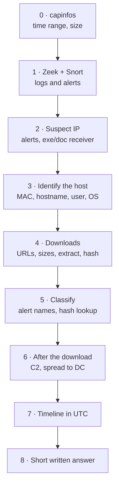

# 1 — 준비와 표준 분석 순서 { #setup-and-workflow }

!!! abstract "이 페이지의 범위"
    - 거의 모든 실습 질문에 답할 수 있는 고정된 작업 순서
    - 0단계: `capinfos`로 파일 훑어보기
    - PCAP을 Zeek 로그와 Snort 2 알림으로 바꾸고, `zeek-cut`과 `grep`으로 읽기
    - tshark 옵션 대부분을 대신하는 Wireshark 기본 기술 4가지
    - 답을 왜 UTC로 쓰는지, 타임라인 만드는 법

## 표준 분석 순서 { #workflow }

모든 실습은 같은 이야기입니다. 윈도우(또는 다른) PC 한 대가 받으면 안 되는 것을 받았고, 누가·무엇을·언제·어디서 받았고 그다음 무슨 일이 있었는지를 증명해야 합니다. 질문을 먼저 읽기보다 매번 같은 순서로 작업하는 편이 빠릅니다.



위에서 아래로 읽습니다. 2~3단계는 "누가", 4단계는 "무엇을 어디서", 5~6단계는 "그게 무엇이고 무엇을 했나"에 답하고, 7단계에서 모두 시간순으로 정리해 마지막 설명 문제에 씁니다.

## 0단계: 파일 훑어보기 { #capinfos }

```bash
capinfos case.pcap
```

- `capinfos`: Wireshark에 포함된 도구로, 패킷 수와 첫·마지막 패킷 시간, 크기를 요약해 줍니다.

```text
Number of packets:   xx k
First packet time:   ...
Last packet time:    ...
```

Wireshark: **Statistics → Capture File Properties**(같은 정보), **Statistics → Protocol Hierarchy**(HTTP, TLS, Kerberos, DHCP, SMB가 각각 얼마나 있는지).

## Zeek 로그 만들기 { #zeek }

```bash
mkdir zeek_out && cd zeek_out
zeek -C -r ../case.pcap local
ls *.log
cd ..
```

- `-r ../case.pcap`: 실시간 네트워크가 아니라 이 파일을 읽습니다.
- `-C`: 체크섬 오류를 무시합니다. 캡처할 때 네트워크 카드 오프로딩 때문에 체크섬이 틀리게 찍히는 경우가 많고, `-C`가 없으면 Zeek가 그 패킷을 버려 로그가 비어 나올 수 있습니다.
- `local`: 기본 분석 정책을 불러옵니다. `software.log`, `files.log`의 MD5·SHA1, `ssl.log`의 인증서 검증 결과가 이 옵션으로 생깁니다.

```text
conn.log  dhcp.log  dns.log  files.log  http.log  kerberos.log
ntlm.log  smb_files.log  smb_mapping.log  software.log  ssl.log  x509.log ...
```

### zeek-cut으로 Zeek 로그 읽기 { #zeek-cut }

`zeek-cut`은 이름을 적은 칸만 출력합니다.

```bash
zeek-cut id.orig_h query < zeek_out/dns.log
zeek-cut -u ts id.orig_h host uri < zeek_out/http.log
```

- `id.orig_h` / `id.orig_p`: 연결을 **시작한** 쪽(보통 클라이언트)의 IP와 포트.
- `id.resp_h` / `id.resp_p`: **응답한** 쪽(보통 서버)의 IP와 포트.
- `-u`: 숫자 시간(`ts`, epoch)을 읽기 쉬운 UTC 날짜·시각으로 바꿉니다.
- `zeek-cut`을 `grep` **앞에** 씁니다. `zeek-cut`은 로그 맨 위의 칸 이름 줄(헤더)을 보고 칸을 찾는데, `grep`이 먼저 오면 헤더가 사라져 아무것도 출력하지 못합니다.
- 버전마다 칸 이름이 조금 다릅니다(예: 예전 Bro/Zeek의 `files.log`는 `tx_hosts`/`rx_hosts`/`conn_uids`, Zeek 6 이상은 `id.orig_h`/`id.resp_h`/`uid`). `zeek --version`과 `head -8 files.log`로 확인합니다.

## Snort 알림 만들기 { #snort }

```bash
mkdir snort_out
sudo snort -q -k none -y -U -r case.pcap -c /etc/snort/snort.conf -A fast -l snort_out
cat snort_out/alert
```

- `-q`: 시작 안내문을 숨깁니다.
- `-k none`: 체크섬 검사를 끕니다(Zeek의 `-C`와 같은 이유).
- `-y`: 알림 시각에 연도를 넣습니다(없으면 월/일만 나옴).
- `-U`: 분석 PC의 시간대 대신 UTC로 시각을 찍습니다.
- `-r case.pcap`: 캡처 파일을 읽습니다. `-c`: 규칙을 불러오는 설정 파일.
- `-A fast`: 알림을 한 줄씩. `-l snort_out`: 결과를 이 폴더에 저장.

!!! warning "규칙이 있어야 잡힙니다"
    악성코드 알림(Emotet, IcedID, Trickbot, 익스플로잇 킷 등)은 `snort.conf`에 **ET Open** 같은 최신 룰셋이 들어 있어야 나옵니다. 기본 규칙만 있으면 아무것도 안 나올 수 있습니다.

fast 알림 한 줄(가짜 예시)입니다. `{TCP}` 뒤가 `출발지 -> 목적지`입니다.

```text
xx/xx/xx-xx:xx:xx.xxxxxx [**] [1:xxxxxxx:x] ET MALWARE ... CnC Beacon [**] [Classification: A Network Trojan was detected] [Priority: 1] {TCP} 172.xx.xx.xx:49xxx -> x.x.x.x:8080
```

자주 쓰는 한 줄 명령:

```bash
grep -oE "ET [A-Z_]+" snort_out/alert | sort | uniq -c | sort -rn
grep -oE "\] ET [^\[]*" snort_out/alert | sort | uniq -c | sort -rn
grep -oE "[0-9.]+:[0-9]+ -> [0-9.]+:[0-9]+" snort_out/alert | sort | uniq -c | sort -rn | head
```

- 1줄: 알림 **분류**(`EXPLOIT_KIT`, `MALWARE`, `TROJAN`, `POLICY`, `CURRENT_EVENTS` 등)별 개수.
- 2줄: 알림 **이름** 전체. `[^\[]*`는 "다음 `[`가 나오기 전까지 전부"라는 뜻입니다.
- 3줄: 가장 자주 나온 `출발지 -> 목적지` 쌍.

## Wireshark 기본 기술 { #wireshark }

tshark 옵션은 대부분 Wireshark 화면에 같은 기능이 있습니다. 아래 네 가지를 익히면 뒤 페이지들이 쉽게 읽힙니다.

**① 화면 필터 바 = tshark `-Y`.** "Apply a display filter…" 칸에 필터를 쓰고 Enter를 누릅니다. 초록색은 맞는 문법, 빨간색은 틀린 문법입니다. tshark의 `-Y "..."` 따옴표 안 내용을 그대로 넣으면 됩니다.

**② Apply as Column = tshark `-T fields -e`.**

1. 패킷 하나를 클릭합니다.
2. 가운데 상세 창(Packet Details)에서 ▶를 펼쳐 원하는 항목(예: `User-Agent`)을 찾습니다.
3. 우클릭 → **Apply as Column**. 열 제목을 클릭하면 정렬되므로 `sort` 역할도 합니다.

**③ Statistics 메뉴 = `sort | uniq -c`.**

- **Statistics → Endpoints**: IP별 패킷 수(`-z endpoints,ip`). IPv4, TCP, Ethernet 탭.
- **Statistics → Conversations**: 누가 누구와 통신했는지, 바이트와 지속 시간까지.
- **Statistics → HTTP → Requests**와 **Request Sequences**: 접속한 호스트와 URL, 어느 페이지가 어느 요청으로 이어졌는지.
- Endpoints·Conversations 창 아래의 **Limit to display filter**를 체크하면 지금 필터에 걸린 패킷만 셉니다. "`-Y` 필터 + `uniq -c`"와 같은 효과입니다.

**④ 우클릭 → Apply as Filter → Selected.** 상세 창의 아무 값이나 필터로 만들어 줍니다. 문법을 외우지 않아도 됩니다.

이 실습들에서 함께 쓰는 기능:

- **View → Time Display Format → UTC Date and Time of Day**: 실제 UTC 시각 표시.
- **File → Export Objects → HTTP / SMB / TFTP / IMF**: 오간 파일 꺼내기.
- **우클릭 → Follow → TCP/HTTP Stream**: 대화 전체 읽기. 빨간색은 클라이언트, 파란색은 서버.
- **Edit → Find Packet**(Ctrl+F), **String**, **Packet bytes**: 패킷 내용 안에서 글자 찾기.
- **우클릭 → Set/Unset Time Reference**: 그 패킷을 기준 시점(0초)으로 만들어 이후 패킷이 +초로 보이게 합니다.
- **Mark/Unmark Packet**(Ctrl+M): 보고서에 쓸 패킷 표시.
- **Edit → Configuration Profiles**: "IR-Lab" 같은 프로필을 만들어 추가한 열이 평소 화면을 어지럽히지 않게 합니다.

## 시간은 항상 UTC { #utc }

답안 시각은 UTC로 씁니다. 같은 패킷도 분석 PC의 시간대에 따라 현지 시각이 다르게 보여 오답이 나옵니다.

- tshark: `frame.time_utc` 필드, 또는 `-t ud` 옵션.
- Zeek: `zeek-cut -u`.
- Snort: `-U`(연도는 `-y`).
- Wireshark: **View → Time Display Format → UTC Date and Time of Day**.

!!! tip "awk로 시각 비교하기"
    `YYYY-MM-DDTHH:MM:SS` 형태의 UTC 시각은 글자 순서와 시간 순서가 같아서, `awk -F'\t' '$1 > "2019-01-01T10:00:00"'`처럼 쓰면 그 시각 이후 줄만 남습니다.

## 타임라인 만들기 { #timeline }

모든 실습의 마지막 질문("이 침해를 설명하라")은 문장으로 쓴 타임라인입니다. 감염 호스트의 웹 활동을 시간순으로 뽑습니다.

```bash
tshark -r case.pcap -Y "ip.src==<infected IP> && (http.request || tls.handshake.type==1)" \
  -T fields -e frame.time_utc -e ip.dst -e tcp.dstport -e http.host -e http.request.uri \
  -e tls.handshake.extensions_server_name
```

- `tls.handshake.type==1`: HTTPS 연결마다 첫 패킷(Client Hello)만 골라, HTTP 요청 옆에 HTTPS 목적지도 시간순으로 보이게 합니다.
- `tls.handshake.extensions_server_name`: 클라이언트가 요청한 도메인(SNI).

Wireshark: UTC 시각으로 바꾸고, 같은 필터를 넣고, Host와 Server Name 열을 위에서 아래로 읽습니다. 중요한 패킷은 그때그때 Mark 해 둡니다.

!!! note "이 섹션의 성격"
    개인 학습 노트입니다. 어떤 기관의 공식 지침도 아닙니다.
