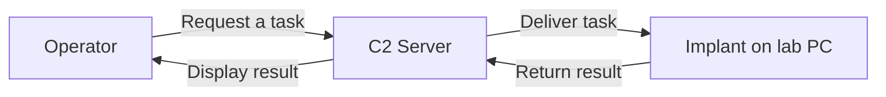

# 1강 — C2 기본 원리 { #lesson-1-c2-fundamentals }

**학습 목표:** C2가 하는 일을 설명하고, 서버에 연결됐다고 관리자 권한까지 얻는 것은 아님을 이해합니다.

## 강좌의 출발점 { #where-the-lecture-starts }

**강좌:** 이 워크숍은 **Assumed Breach**, 즉 이미 침해가 발생했다고 가정하는 방식을 사용합니다. 실습 워크스테이션에서 프로그램을 실행할 수 있는 상태로 시작하여 이후의 과정을 살펴봅니다. 이번 강의에서는 최초 침입 과정을 재현하지 않습니다.

**보충:** 프로그램을 실행하는 능력과 관리자 권한은 다릅니다. 일반 사용자가 실행한 프로그램은 대체로 그 사용자의 권한으로 시작합니다. Sliver를 사용한다는 사실만으로 이러한 제한이 사라지지는 않습니다.

## C2의 의미 { #what-c2-means }

**C2**는 **Command and Control**의 약자로, 원격 컴퓨터에 작업을 전달하고 통신을 관리하며 결과를 회수하는 체계입니다. C로 시작하는 단어가 두 개라 C2라고 부릅니다.

멀리 있는 실습 PC의 현재 사용자 이름을 확인한다고 생각해 보세요. 그 PC 안의 프로그램이 요청을 받아 작업을 수행한 뒤 결과를 돌려줘야 합니다. C2는 이 과정을 체계적으로 관리합니다.

화살표는 논리적인 작업 흐름을 나타냅니다. 실제 네트워크 연결을 누가 먼저 시작하는지 표시한 것은 아닙니다. Implant가 먼저 서버에 연락하고, 그 통신을 통해 작업을 받을 수도 있습니다.

| 용어 | 의미 | 비유 |
|---|---|---|
| 운영자 Operator | 작업을 지정하고 결과를 읽는 사람 | 업무를 요청하는 담당자 |
| C2 서버 | 통신·작업·결과를 관리하는 시스템 | 업무 관리실 |
| Implant | 실습 PC에서 실행되어 작업을 수행하는 소프트웨어 | 현장 작업자 |

여기서 Implant는 물리적인 장치가 아니라 소프트웨어입니다. C2는 일반적인 기능과 체계를 뜻하고, **Sliver**는 이를 구현한 프레임워크 중 하나입니다. Bishop Fox는 Sliver를 허가된 공격자 행동 재현과 레드팀 테스트를 위한 오픈소스 크로스플랫폼 프레임워크로 설명합니다. [공식 저장소](https://github.com/BishopFox/sliver)

## 리버스 셸 대신 프레임워크를 사용하는 이유 { #why-use-a-framework }

**셸 Shell**은 명령을 입력하고 출력을 받는 인터페이스입니다. **리버스 셸 Reverse Shell**에서는 대상 측이 운영자 측으로 연결을 시작하여 원격 명령 입출력을 제공합니다.

컴퓨터 한 대와 잠깐 통신한다면 수동으로 관리할 수 있습니다. 하지만 여러 컴퓨터를 다루려면 호스트를 구분하고, 작업을 추적하며, 결과를 구별하고, 연결 중단도 처리해야 합니다. C2 프레임워크는 이런 활동을 체계적으로 지원합니다.

| 비교 항목 | 단순한 리버스 셸 | C2 프레임워크 |
|---|---|---|
| 주요 목적 | 원격 명령 입출력 | 원격 작업과 연결의 체계적인 관리 |
| 여러 호스트 관리 | 따로 관리하는 경우가 많음 | 호스트 식별과 선택 기능 제공 |
| 작업 처리 | 직접 상호작용하는 연결에 의존하는 형태가 흔함 | 대화형 및 대기열 기반 작업 처리 등을 지원 |
| 기능 확장 | 구현과 추가 도구에 따라 달라짐 | 내장 기능과 확장 기능 활용 |

**보충 — 정정:** 리버스 셸에 반드시 암호화가 없는 것은 아닙니다. 암호화 여부는 구현과 통신 방식에 따라 달라집니다. 핵심 차이는 항상 암호화·비암호화로 나누는 데 있지 않고, 연결과 작업을 얼마나 폭넓게 관리하는지에 있습니다.

## 따로 생각해야 하는 네 가지 문제 { #four-separate-questions }

| 확보한 것 | 자동으로 따라오지 않는 것 |
|---|---|
| C2 통신 | 관리자 권한 |
| 한 PC에서의 코드 실행 | 다른 PC에 대한 접근 권한 |
| 현재 실행 중인 Implant | 재부팅 후 자동 실행 |

**연결, 권한, 도달 가능성·접근, 지속성**을 구분하세요. 예를 들어 브라우저도 일반 사용자 권한으로 서버에 접속할 수 있습니다. 외부 통신은 관리자 권한의 증거가 아닙니다.

## 방어자의 관점 { #the-defenders-view }

외부 연결만으로 악성 C2라고 판단할 수는 없습니다. 업데이트 프로그램·메신저·정상적인 원격 관리 도구도 서버에 연락하여 작업을 받을 수 있습니다.

주변 증거를 함께 살펴봐야 합니다.

- 어떤 프로세스가 연결했고, 어떻게 실행됐는가?
- 어떤 사용자 계정이 관여했는가?
- 어디로 연락했는가?
- 통신 전후에 어떤 행동이 발생했는가?

출처가 불분명한 프로그램이 새로운 목적지와 통신한 뒤 민감한 파일에 접근하는 상황은, 승인된 업데이트 프로그램이 정기 업데이트를 수행하는 상황과 다릅니다. 판단은 ‘C2’라는 단어나 통신의 존재 하나가 아니라, 여러 증거를 연결하여 내립니다.

## 확인 문제 { #review-questions }

1. 일반 사용자 권한으로 실행된 Implant가 C2 서버에 연락했습니다. 자동으로 관리자 권한을 얻은 것일까요?
2. 어떤 프로그램이 외부 서버에 주기적으로 연락합니다. 이 사실만으로 악성 C2라고 분류할 수 있을까요?

??? success "정답과 해설"
    **1. 아니요.** 일반 사용자 프로그램에도 네트워크 통신이 허용될 수 있습니다. 연결 성공이 권한 변경을 입증하지는 않습니다.

    **2. 아니요.** 정상 애플리케이션도 외부와 통신합니다. 프로세스·목적지·실행 맥락·연관 행동을 조사해야 합니다.

[2강 — 구성 요소와 명령어로 이동](lesson-2-components-and-commands.md)
