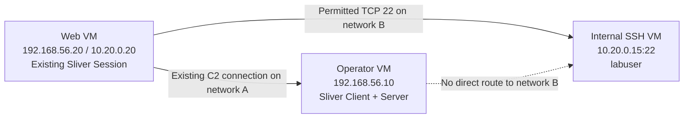
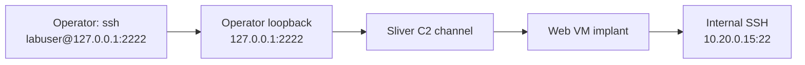
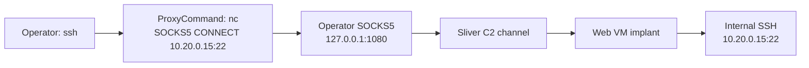

# 10강 — 웹 서버를 경유한 내부 SSH 가상환경 실습 { #lesson-10-web-server-to-internal-ssh-lab }

**학습 목표:** 웹 서버 VM의 기존 Sliver Session으로 내부 SSH 서비스에 접근하고, 터널 동작·서버 신원·사용자 인증·계정 권한을 구분합니다.

**보충 / 설명용 실습:** 학습자가 소유한 VM을 위한 명령 예시입니다. 예상 관찰 결과를 설명하며, 실제로 사용자의 컴퓨터에서 실행한 결과 보고서는 아닙니다.

## 시나리오와 시작 조건 { #scenario-and-starting-point }

외부에서 접근 가능한 웹 서버가 내부 서비스에도 통신할 수 있다면 중간 호스트가 될 수 있습니다. 현실적인 구조를 재현하는 시나리오지만, 웹 서버에서 내부 SSH에 접근할 수 있다는 것은 이번 실습의 명시적 조건입니다. 모든 웹 서버가 그런 것은 아닙니다.

**허가된 Linux Implant가 웹 VM에서 실행되어 Sliver Session이 정상적으로 연결된 시점**부터 시작합니다. 웹 관리 화면에 로그인했다는 사실만으로 이 조건이 성립하지는 않습니다. 이번 포워딩 실습을 위해 내부 SSH VM에 Implant를 추가할 필요는 없습니다.

이번 웹 VM은 Linux입니다. 앞에서 만든 Windows 실행 파일은 이 Linux VM에서 기본적으로 실행되지 않습니다. 웹 VM의 Implant가 권한이 낮은 웹 서비스 계정으로 실행될 수도 있습니다. 포워딩 성공이 그 계정을 `root`로 바꾸지는 않습니다.

## VM 3대와 가상 네트워크 2개 { #virtual-network-layout }

세 컴퓨터 모두 격리된 실습 환경에 있습니다. ‘외부’는 내부망에 대한 운영자의 위치를 뜻하며, 웹 서버를 실제 인터넷에 공개할 필요는 없습니다.

| VM | OS / 호스트 이름 | 네트워크 A | 네트워크 B | 역할 |
|---|---|---|---|---|
| 운영자 | Linux / `operator-lab` | `192.168.56.10/24` | 없음 | Sliver Client·Server, SSH 클라이언트 |
| 웹 서버 | Ubuntu / `web-lab` | `192.168.56.20/24` | `10.20.0.20/24` | 기존 Linux Implant Session; 중간 호스트 |
| 내부 SSH | Ubuntu / `ssh-lab` | 없음 | `10.20.0.15/24` | TCP 22의 OpenSSH; 일반 실습 계정 `labuser` |

서로 분리된 가상 스위치 2개를 사용합니다. 운영자는 A에만, 내부 SSH VM은 B에만, 웹 VM은 A와 B 모두에 연결합니다. 각 게스트 OS에 표의 주소를 설정합니다. 운영자에게 B로 가는 별도 경로를 주지 않습니다. 하이퍼바이저나 호스트의 라우팅으로 직접 연결 경로가 추가되지 않게 구성합니다.



이 구성에서는 웹 VM이 두 네트워크에 각각 직접 연결됩니다. 애플리케이션 포워딩은 Implant에서 나가는 연결을 만들므로, 이번 실습을 위해 웹 VM의 커널 IP 포워딩을 활성화할 필요는 없습니다. 라우터나 방화벽을 사용하는 구성이라면 웹 VM에서 `10.20.0.15:22`로 가는 연결과 기존 C2 연결이 허용되어야 합니다.

시작 전에 내부 VM에서 OpenSSH가 실행 중이어야 합니다. 학습자는 서버 정책에서 로그인을 허용하는 유효한 `labuser` 계정을 이미 가지고 있다고 가정합니다. 아래 예시는 실습용 암호 인증이 허용된 상태이며, 암호는 프롬프트에 입력합니다. 키 인증을 미리 구성한 경우를 위한 명령도 함께 제시합니다.

운영자와 웹 VM은 **OpenBSD 계열 `nc`**를 사용합니다. Ubuntu에서는 `netcat-openbsd` 패키지로 제공됩니다. 이름이 같은 다른 `nc` 프로그램은 옵션이 다를 수 있습니다.

## 각 VM에서 기본 연결 확인 { #baseline-checks }

**내부 SSH VM 자체 콘솔**에서 호스트 이름과 호스트 키 지문을 기록합니다.

```bash
hostname
ssh-keygen -lf /etc/ssh/ssh_host_ed25519_key.pub
```

설정 시 이름을 지정했다면 `ssh-lab`이 예상됩니다. 표시되는 `SHA256:...` 지문을 첫 SSH 연결 때 비교할 수 있도록 기록합니다. 서버에 Ed25519 호스트 키가 있다는 전제입니다. 다른 키 종류를 사용한다면 실제 서버가 사용하는 공개 호스트 키를 확인합니다. 지문은 SSH 서버의 신원을 확인하는 정보이며, 사용자의 암호나 로그인 키와는 별개입니다. [OpenSSH 지문 조회 옵션](https://man.openbsd.org/ssh-keygen)

**운영자 VM의 Linux 터미널**에서 직접 연결을 시도합니다.

```bash
nc -vz -w 3 10.20.0.15 22
```

의도한 분리가 구현되었다면 이 직접 연결은 실패합니다. 실습망 구성에 따라 경로 오류나 시간 초과가 표시될 수 있습니다. 실패했다는 사실만으로 방화벽이 차단했다고 확정할 수는 없습니다. 이 시도에서 연결이 성립하지 않았다는 관찰입니다.

**웹 VM 자체의 Linux 콘솔**에서 같은 목적지를 확인합니다.

```bash
nc -vz -w 3 10.20.0.15 22
```

성공 메시지는 웹 VM에서 해당 주소·포트로 TCP 연결이 가능했다는 증거입니다. `-z`는 연결을 확인하는 옵션이며, 로그인하거나 SSH 서버의 신원을 검증하지 않습니다. 여기서는 두 VM의 콘솔에서 각각 실행해 네트워크 경로 차이를 쉽게 비교합니다. [OpenBSD nc 옵션](https://man.openbsd.org/nc)

## 웹 VM의 Session 선택 { #select-web-session }

**운영자 VM의 Sliver 콘솔**에서 입력합니다.

```text
sessions
sessions --interact <Web_Session_ID>
info
help portfwd
help socks5
```

`<Web_Session_ID>`를 콘솔에 표시된 실제 Session ID로 바꾸며, 꺾쇠괄호는 입력하지 않습니다. 선택한 호스트가 웹 VM인지 확인합니다. 아래 두 방법은 이 살아 있는 Session을 사용합니다. Beacon만 있다면 [9강의 대화형 Session 단계](lesson-9-port-forwarding-and-socks.md#interactive-session)에 따라 추가 Session이 연결된 후 진행합니다.

## 방법 A: SSH로 가는 고정 포트포워딩 { #fixed-forward-to-ssh }

매핑은 **운영자 루프백 2222 포트 → 내부 SSH 22 포트**입니다. 두 포트 번호가 같을 필요는 없습니다.



**웹 Session을 선택한 Sliver 콘솔**에서 입력합니다.

```text
portfwd add --bind 127.0.0.1:2222 --remote 10.20.0.15:22
portfwd
```

`--bind`는 운영자의 콘솔 컴퓨터에서 대기할 로컬 주소입니다. `--remote`는 웹 Implant가 연결할 목적지를 고정합니다. 웹 VM에 SSH로 먼저 로그인할 필요는 없습니다. 이미 연결된 Implant Session이 통신을 전달합니다. [Sliver 포트포워딩 옵션](https://github.com/BishopFox/sliver/blob/master/client/command/portfwd/commands.go), [Client 측 포워딩 구현](https://github.com/BishopFox/sliver/blob/master/client/command/portfwd/portfwd-add.go)

**운영자의 별도 Linux 터미널**에서 실행합니다.

```bash
ssh -o ConnectTimeout=10 -p 2222 labuser@127.0.0.1
```

| 부분 | 의미 |
|---|---|
| `ssh` | 운영자 VM에서 SSH 클라이언트 시작 |
| `-o ConnectTimeout=10` | 연결 수립과 초기 SSH 협상에 제한 시간 적용; 로그인 세션 전체를 10초로 제한하는 것은 아님 |
| `-p 2222` | 로컬에 포워딩한 포트로 접속 |
| `labuser@127.0.0.1` | 로컬 연결 지점을 통해 내부 서버의 `labuser` 계정 요청 |

첫 연결 시 표시되는 호스트 키 지문을 **내부 VM**에서 기록한 지문과 비교합니다. 일치하는 경우에만 받아들입니다. 클라이언트가 `127.0.0.1:2222`를 지정했어도 이 매핑을 통해 응답하는 SSH 서버는 내부 VM입니다. OpenSSH는 `known_hosts`에 `[127.0.0.1]:2222`라는 이름으로 기록할 수 있습니다. [OpenSSH 클라이언트 동작](https://man.openbsd.org/ssh)

이후 암호 프롬프트에 내부 VM 실습 계정의 암호를 입력합니다. 네트워크 경로와 사용자 인증은 별개의 단계입니다. 유효한 암호나 서버가 받아들이는 사용자 키가 필요합니다. [SSH 인증 프로토콜](https://www.rfc-editor.org/info/rfc4252/)

실습에서 사용자 키 인증을 미리 구성했다면 운영자 측 명령은 다음과 같습니다.

```bash
ssh -i ./labuser_ed25519 -o IdentitiesOnly=yes -o ConnectTimeout=10 -p 2222 labuser@127.0.0.1
```

`./labuser_ed25519`는 **운영자 VM에 미리 준비한 사용자 개인 키**입니다. 서버의 공개 호스트 키 파일과 다르며, 포워딩 명령이 이 키를 생성해 주지도 않습니다.

로그인에 성공하면 **지금 열린 내부 VM의 SSH 셸**에서 다음을 입력합니다.

```bash
hostname
whoami
id
```

설명용 예상 결과는 `ssh-lab`, `labuser`, 해당 계정의 UID·그룹 정보입니다. 이 계정으로 로그인하고 명령을 실행했다는 증거입니다. `root` 권한이나 모든 파일의 수정 권한이 입증된 것은 아닙니다. SSH 셸을 마칠 때는 다음을 입력합니다.

```bash
exit
```

## 방법 B: SOCKS5를 통해 SSH 사용 { #ssh-through-socks5 }

같은 웹 Session을 사용하되, SOCKS5를 이해하는 보조 프로그램이 연결마다 최종 목적지를 전달합니다.



웹 Session을 선택한 **Sliver 콘솔**에서 입력합니다.

```text
socks5 start --host 127.0.0.1 --port 1080
socks5
```

운영자 VM에 로컬 SOCKS5 Listener를 만듭니다. 최종 목적지는 `socks5 start` 명령이 아니라 클라이언트 연결에서 전달합니다. [Sliver SOCKS5 옵션](https://github.com/BishopFox/sliver/blob/master/client/command/socks/commands.go), [Listener 구현](https://github.com/BishopFox/sliver/blob/master/client/command/socks/socks-start.go)

OpenBSD `nc`가 있는 **운영자의 별도 Linux 터미널**에서 실행합니다.

```bash
ssh -o 'ProxyCommand=nc -X 5 -x 127.0.0.1:1080 %h %p' labuser@10.20.0.15
```

| 부분 | 의미 |
|---|---|
| `ProxyCommand=...` | SSH 연결의 데이터 흐름에 이 보조 프로그램 사용 |
| `nc -X 5` | SOCKS 버전 5 사용 |
| `-x 127.0.0.1:1080` | 운영자의 로컬 SOCKS5 Listener에 연결 |
| `%h` | OpenSSH가 목적지 이름·IP로 바꿈: 여기서는 `10.20.0.15` |
| `%p` | OpenSSH가 SSH 목적지 포트로 바꿈: 여기서는 22 |
| `labuser@10.20.0.15` | 내부 서버와 그 서버의 실습 계정 요청 |

작은따옴표는 보조 프로그램 명령 전체를 하나의 SSH 옵션으로 전달하게 합니다. `%h`, `%p`는 OpenSSH가 치환하므로 직접 바꾸지 않습니다. 이 문법은 앞에서 지정한 OpenBSD `nc` 구현을 전제로 합니다. [OpenSSH ProxyCommand](https://man.openbsd.org/ssh_config#ProxyCommand), [OpenBSD nc SOCKS 옵션](https://man.openbsd.org/nc)

방법 A와 같이 내부 서버의 호스트 키 지문을 확인하고 그 서버의 실습 계정으로 인증합니다. 이번 명령은 `[127.0.0.1]:2222`가 아니라 `10.20.0.15`를 지정하므로, 실제 서버가 같아도 해당 주소의 호스트 키를 별도로 확인하라는 메시지가 나올 수 있습니다.

로그인 후 `hostname`, `whoami`, `id`를 확인하고 `exit`로 종료합니다. 키 인증을 사용하는 경우는 다음과 같습니다.

```bash
ssh -i ./labuser_ed25519 -o IdentitiesOnly=yes -o 'ProxyCommand=nc -X 5 -x 127.0.0.1:1080 %h %p' labuser@10.20.0.15
```

SOCKS5를 시작했다고 일반적인 `ssh labuser@10.20.0.15`가 자동으로 프록시를 사용하는 것은 아닙니다. 이 예시에서는 명시한 `ProxyCommand`가 그 역할을 합니다.

## 클라이언트가 지정하는 대상 비교 { #compare-client-targets }

| 관찰 | 고정 포트포워딩 | SOCKS5 |
|---|---|---|
| SSH 명령에 적는 주소 | `127.0.0.1`, 포트 2222 | `10.20.0.15`, 기본 포트 22 |
| 로컬 Listener | `127.0.0.1:2222` | `127.0.0.1:1080` |
| 내부 목적지를 정하는 곳 | Sliver 포워딩 설정 | 보조 프로그램에 전달하는 SSH 목적지 |
| 실제 SSH 서버 | 내부 VM | 내부 VM |
| 인증받는 계정 | 내부 VM의 `labuser` | 내부 VM의 `labuser` |

두 방법 모두 웹 VM에 SSH 세션을 먼저 여는 방식이 아닙니다. 웹 Implant는 연결을 전달하고, SSH 인증은 운영자의 SSH 클라이언트와 내부 SSH 서비스 사이에서 이루어집니다.

## 실패한 단계 구분 { #diagnose-the-stage }

| 결과 | 해석과 다음 확인 |
|---|---|
| 운영자의 직접 연결 실패 | 이 구성에서는 예상 결과; 특정 차단 원인을 단정하지 말고 기본 연결 조건 확인 |
| 웹 VM에서도 내부 TCP 22 연결 실패 | 게스트 주소, 가상 어댑터, 경로, 서비스, 방화벽 확인; 터널로 없는 경로를 복구할 수 없음 |
| Sliver가 bind/listen 오류 표시 | 운영자 측 선택 포트가 이미 사용 중인지 확인 |
| 로컬 2222 연결에서 SSH가 connection refused 표시 | 이 운영자 컴퓨터에 포워딩이 실제 대기 중인지 확인; 내부 서버가 거절했다고 바로 단정하지 않음 |
| 포워딩을 통한 SSH 시간 초과 | Session, 중간 호스트에서 내부 서버까지의 경로, 서비스 확인; 시간 초과만으로 실패 지점을 특정할 수 없음 |
| SSH가 호스트 키 확인 요청 표시 | SSH를 사용하는 엔드포인트와 키 교환 진행; 지문을 비교해 신원을 확인 |
| SSH가 `Permission denied (publickey,password)` 표시 | 사용자 인증이 받아들여지지 않음; 계정, 허용된 인증 방식, 제공한 자격 증명 확인 |
| 로그인 후 특정 파일 작업 거부 | 그 계정의 해당 동작·객체에 대한 권한 확인 |

인증 오류의 문구는 예시이며, 인증 방식 목록은 서버에 따라 다릅니다. 이 결과가 터널 전체의 실패를 입증하는 것은 아닙니다.

방어 관점에서는 **내부 Ubuntu VM의 관리자 콘솔**에서 최근 SSH 서비스 기록을 살펴봅니다.

```bash
sudo journalctl -u ssh.service --since "10 minutes ago" --no-pager
```

Ubuntu 설치 방식에 따라 인증 기록이 `/var/log/auth.log`에도 남을 수 있습니다. 이 네트워크 구성에서 웹 VM과 내부 VM 사이에 NAT가 없다면, 내부 서비스는 보통 웹 VM의 내부 주소인 `10.20.0.20`에서 연결이 온 것으로 봅니다. 시각, 인증 성공·실패, 실제 기록된 출발지를 함께 맞춰 보세요. 출발지 주소만으로 연결을 조작한 사람까지 식별되지는 않습니다. [Ubuntu OpenSSH 로그 안내](https://ubuntu.com/server/docs/how-to/security/openssh-server/)

## 종료와 실습 Listener 정리 { #cleanup }

열려 있는 SSH 셸부터 종료합니다. **Sliver 콘솔**에서 두 종류의 목록을 확인하고 이번 실습에서 만든 항목만 제거합니다.

```text
portfwd
portfwd rm --id <Forward_ID>
socks5
socks5 stop --id <Proxy_ID>
```

각 목록에 나온 실제 ID를 사용합니다. 이 항목 ID와 Session ID는 구분합니다. 로컬 Listener를 제거하면 새 연결에 사용할 수 없게 되며, 실습 계정을 삭제하거나 내부 SSH 서비스를 제거하는 것은 아닙니다.

## 확인 문제 { #review-questions }

1. 방법 A의 `labuser@127.0.0.1`은 왜 운영자 VM이 아니라 내부 VM의 계정으로 인증할까요?
2. 웹 VM에서 TCP 22 연결이 성공하면 Implant가 유효한 SSH 암호를 안다는 뜻일까요?
3. Sliver SOCKS5를 실행한 상태에서 이 실습의 일반적인 `ssh labuser@10.20.0.15` 명령에는 무엇이 빠져 있을까요?
4. `labuser`로 로그인에 성공했습니다. 관리자 권한까지 확인된 것일까요?

??? success "정답과 해설"
    **1. 로컬 포트가 내부 서비스에 매핑되었기 때문입니다.** SSH는 루프백 2222에 연결하고, Sliver는 웹 Implant를 거쳐 그 데이터 흐름을 `10.20.0.15:22`로 전달합니다. 호스트 키를 제시하고 사용자를 인증하는 주체는 내부 SSH 서비스입니다.

    **2. 아니요.** 웹 VM에서 TCP로 도달할 수 있다는 증거입니다. 내부 서비스는 여전히 유효한 인증을 요구합니다. 이번 실습은 알고 있는 계정을 미리 준비하고, 터널로 연결 경로를 제공합니다.

    **3. 명시적인 프록시 사용 설정입니다.** 예시의 `ProxyCommand`가 `nc`에게 SSH 데이터 흐름을 위한 SOCKS5 연결 협상을 요청합니다. Listener를 시작하는 것만으로 일반 클라이언트의 경로가 바뀌지 않습니다.

    **4. 아니요.** 받아들여진 계정과, 명령 실행 성공 후에는 그 로그인 컨텍스트에서의 실행까지 확인됩니다. 각각의 자원에 대한 권한은 별도로 판단해야 합니다.

[이전: 포트포워딩과 SOCKS5](lesson-9-port-forwarding-and-socks.md) · [다음: 피벗 연결과 SSH 증거](lesson-11-pivot-connections-and-ssh-evidence.md)
