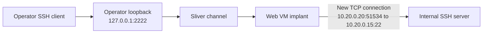

# 11강 — 피벗 연결과 SSH 증거 { #lesson-11-pivot-connections-and-ssh-evidence }

**학습 목표:** 내부 서버의 SSH 기록에서 네트워크 상대, 실제 조작한 사람, TCP 연결, 사용자 인증 성공을 구분합니다.

**보충:** [10강](lesson-10-web-server-to-internal-ssh-lab.md)의 VM 3대 실습을 이어갑니다. 아래 출력은 학습자의 컴퓨터에서 측정한 결과가 아닌 설명용 예시입니다.

## 실습 연결 유지 { #keep-the-lab-connection-open }

| 역할 | 주소 |
|---|---|
| 운영자 | `192.168.56.10` |
| 웹 VM 외부 측 | `192.168.56.20` |
| 웹 VM 내부 측 | `10.20.0.20` |
| 내부 SSH 서버 | `10.20.0.15:22` |

웹 VM의 Session을 선택한 **Sliver 콘솔**에서 포워딩을 만듭니다.

```text
portfwd add --bind 127.0.0.1:2222 --remote 10.20.0.15:22
```

**운영자의 별도 Linux 터미널**에서 미리 준비한 내부 실습 계정으로 연결·인증합니다. 10강에서 설명한 서버 호스트 키 확인도 진행합니다.

```bash
ssh -p 2222 labuser@127.0.0.1
```

이 연결을 유지한 채 내부 VM의 별도 관리자 콘솔에서 관찰합니다.

## 내부 서버가 보는 출발지 { #which-source-does-the-server-see }

웹 Implant가 내부 서버로 새 TCP 연결을 만듭니다. 이 구성처럼 중간에 NAT나 다른 프록시가 없다면 내부 서버는 보통 운영자의 주소가 아닌 웹 VM의 내부 주소를 봅니다.



`51534`는 설명용 임시 출발지 포트이며 실제 값은 달라집니다. SOCKS5 방식도 내부 측 원리는 같습니다. 웹 Implant가 요청받은 내부 서비스에 연결합니다. NAT나 프록시가 추가되면 서버가 관찰하는 출발지 주소도 바뀔 수 있습니다.

## SSH 인증 기록 조회 { #read-ssh-authentication-records }

**내부 Ubuntu VM의 관리자 콘솔**에서 실행합니다.

```bash
sudo journalctl -u ssh.service --since "10 minutes ago" --no-pager
```

`journalctl`은 저널 조회, `-u`는 서비스 선택, `--since`는 시간 범위, `--no-pager`는 바로 출력을 뜻합니다. 여기서 관리자 권한으로 로그를 조회한다고 일반 SSH 계정 `labuser`에도 관리자 권한이 있다는 뜻은 아닙니다. 설치 구성에 따라 `/var/log/auth.log`에도 인증 기록이 남을 수 있습니다. [Ubuntu OpenSSH 안내](https://ubuntu.com/server/docs/how-to/security/openssh-server/)

설명용 기록입니다.

```text
Oct 24 11:30:05 ssh-lab sshd[2401]: Accepted password for labuser from 10.20.0.20 port 51534 ssh2
```

| 부분 | 해석 |
|---|---|
| `ssh-lab` | 이벤트를 기록한 서버 |
| `sshd[2401]` | 기록한 프로세스 이름과 PID; OpenSSH 버전별로 이름이 달라질 수 있음 |
| `Accepted password` | 암호 인증을 받아들임 |
| `for labuser` | 인증받은 계정 |
| `from 10.20.0.20` | 서버가 관찰한 상대편 출발지 주소 |
| `port 51534` | 서버의 대기 포트가 아닌 상대편 출발지 포트 |
| `ssh2` | SSH 프로토콜 버전 관련 표시 |

입증되는 설명은 **이 서버가 `10.20.0.20`에서 온 것으로 관찰한 연결에서 `labuser`의 암호 인증을 받아들였다**는 것입니다. 조작한 사람, Sliver 경유 여부, 관리자 권한, 이후 명령은 이 기록만으로 확인되지 않습니다. 인증 수락만으로 대화형 셸 요청까지 정상 처리되었다고 확정할 수도 없습니다.

## 포트가 2222나 1080이 아닌 이유 { #different-ports-have-different-roles }

| 포트 | 이번 실습에서의 역할 |
|---|---|
| `2222` | 운영자 측 고정 포워딩 Listener |
| `1080` | 다른 방식에서 운영자 측 SOCKS5 Listener |
| `51534` | 웹 VM이 외부로 연결하며 사용하는 출발지 포트의 예 |
| `22` | 내부 SSH 서버의 대기 포트 |

인증 기록의 `port 51534`가 SSH 서비스의 대기 포트를 뜻하지는 않습니다. 어느 쪽을 설명하는 필드인지 읽어야 합니다.

## 현재 연결 관찰 { #observe-a-current-connection }

SSH 연결을 유지한 상태에서 **내부 VM의 관리자 콘솔**에 입력합니다.

```bash
sudo ss -tnp '( sport = :22 )'
```

`-t`는 TCP, `-n`은 숫자 주소, `-p`는 프로세스 정보 요청입니다. 필터는 로컬 22번 포트를 선택합니다. 대기 중인 소켓은 기본적으로 제외됩니다. [ss 매뉴얼](https://man7.org/linux/man-pages/man8/ss.8.html)

단순화한 설명용 출력입니다.

```text
State  Local Address:Port  Peer Address:Port
ESTAB  10.20.0.15:22       10.20.0.20:51534
```

`Local`은 명령을 실행한 내부 서버 쪽이고 `Peer`는 상대편입니다. `ESTAB`은 TCP 연결 수립 상태입니다. SSH 사용자 인증까지 입증하지는 않습니다. 연결을 종료해 현재 목록에서 사라져도 과거 로그인 증거가 없어지는 것은 아닙니다.

## 상세 해답 1: 출발지 주소와 실제 조작한 사람 { #answer-source-address-versus-person }

**질문:** 위 암호 인증 기록만으로 웹 VM을 사용하던 사람이 그곳에서 직접 SSH 명령을 입력했다고 확정할 수 있을까요?

**정답은 아니요입니다.** 다음 상황에서 같은 출발지가 보일 수 있습니다.

| 가능한 상황 | 내부 서버에 보일 수 있는 출발지 |
|---|---|
| 사람이 웹 VM 터미널에서 SSH 실행 | `10.20.0.20` |
| 웹 VM의 자동화 작업이 SSH 실행 | `10.20.0.20` |
| 다른 곳의 운영자가 웹 Implant를 통해 SSH 전달 | `10.20.0.20` |

마지막 TCP 연결을 만드는 컴퓨터와 사람이 작업을 지시한 위치는 다를 수 있습니다. 웹 VM에서 관련 프로세스, 실행 이력, 외부 연결, 시각을 함께 조사합니다. 프로그램에 연결을 귀속하는 것과 실제 조작한 사람을 식별하는 것도 별개의 판단입니다.

인증 수락은 셸 요청이나 특정 명령의 성공과도 다릅니다. 이후 단계는 그 단계의 증거가 뒷받침할 때 기록합니다.

## 상세 해답 2: ESTAB과 로그인 성공 { #answer-estab-versus-authentication }

**질문:** `ESTAB` 연결이 있지만 관련 인증 성공 기록은 아직 찾지 못했습니다. `labuser`의 로그인 성공을 확정할 수 있을까요?

**정답은 아니요입니다.** 일반적인 흐름은 다음과 같습니다.

```text
TCP connection established
    -> SSH negotiation and key exchange
    -> User authentication
    -> Shell or command request
    -> Requested operation
```

서버 호스트 키 승인을 기다리거나, 암호를 아직 입력하지 않았거나, 틀린 암호를 다시 입력하는 동안에도 TCP 연결은 수립될 수 있습니다. 로그인 성공 후에도 유지될 수 있으므로 `ESTAB`만으로 구분할 수 없습니다.

| 관찰 | 뒷받침하는 내용 |
|---|---|
| TCP `ESTAB` | TCP 연결 수립 |
| SSH 호스트 키 확인 메시지 | SSH 키 교환 단계까지 진행; 지문 확인 필요 |
| 해당 연결의 `Accepted password` | 암호 인증 수락 |
| 의도한 컨텍스트에서 확인한 명령 결과 | 그 명령의 실행 성공 |

**성공을 찾지 못한 것과 실패를 확인한 것은 다릅니다.** 시간 범위, 로그 위치, 수집 범위, 권한 때문에 증거가 제한될 수 있습니다. ‘TCP 연결 확인, SSH 인증 성공 여부 미확인’이 정확하며 성공·실패 어느 쪽도 단정하지 않습니다. 나중에 발견한 기록도 시각, 출발지 주소·포트, 계정, 프로세스로 현재 연결과 맞춰야 합니다. 어제의 인증 성공이 오늘의 성공을 입증하지는 않습니다.

## 실행 명령과 암호화 내용의 별도 증거 { #commands-and-encrypted-content }

일반적인 SSH 인증 기록은 모든 명령 실행을 감사한 기록이 아닙니다. `labuser`의 인증 수락만으로 이후 명령을 알 수 없습니다. 적절히 수집한 프로세스 실행이나 기타 감사 기록이 필요할 수 있습니다. 셸 히스토리는 참고할 수 있지만 빠짐없는 실행 기록으로 보장되지는 않습니다.

SSH는 전송 내용을 암호화합니다. 일반적인 패킷 캡처에서 주소·포트가 보인다고 내부의 명령 내용까지 읽을 수 있다는 뜻은 아닙니다. [SSH 전송 계층 명세](https://www.rfc-editor.org/info/rfc4253/)

## 여러 호스트의 증거 연결 { #correlate-across-hosts }

| 관찰 위치 | 비교할 증거 |
|---|---|
| 운영자 VM | 실습 SSH 명령과 시각 |
| 웹 VM | 내부로 나간 연결과 관련 프로세스 |
| 내부 SSH 서버 | 관찰한 상대편, 계정, 인증 결과 |
| 내부의 추가 감사 자료 | 수집된 경우 이후 동작 |

일반 웹 접근 로그는 웹 요청을 설명하므로 외부로 나간 SSH 연결을 설명하지 못할 수 있습니다. 운영체제의 프로세스·네트워크 증거도 확인합니다. 시각과 시간대, 주소, 포트, 계정, 프로세스를 함께 맞추세요. 발생 시각이 비슷하다는 사실만으로 같은 사건이라고 단정하지 않습니다.

[이전: SSH 가상환경 실습](lesson-10-web-server-to-internal-ssh-lab.md) · [다음: 인터페이스와 소켓](lesson-12-network-interfaces-and-sockets.md)
