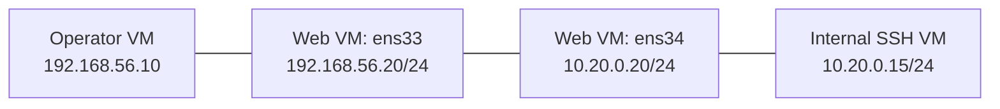

# 12강 — 인터페이스·소켓·연결 가능성 { #lesson-12-network-interfaces-and-sockets }

**학습 목표:** Sliver의 `ifconfig`와 `netstat`으로 선택한 호스트를 조사하고, 인터페이스 주소·대기 소켓·연결·애플리케이션 성공을 구분합니다.

**보충:** 기존 가상환경으로 강좌의 환경 파악 주제를 확장합니다. 출력은 설명용이며, 방화벽 외의 접속 실패 원인을 물었던 추가 질문도 상세 해답에 포함합니다.

## Local 해석 전에 대상 선택 { #select-the-host }

| 호스트·인터페이스 | 주소 |
|---|---|
| 운영자 | `192.168.56.10` |
| 웹 VM 외부 측 | `192.168.56.20` |
| 웹 VM 내부 측 | `10.20.0.20` |
| 내부 SSH VM | `10.20.0.15` |

**운영자의 Sliver 콘솔**에서 실제 ID로 웹 Session을 선택합니다.

```text
sessions
sessions --interact <Web_Session_ID>
info
```

| 명령 입력 위치 | 조사하는 호스트 |
|---|---|
| 웹 Session을 선택한 Sliver 콘솔 | 웹 VM |
| 운영자의 일반 Linux 터미널 | 운영자 VM |
| 내부 서버의 SSH 셸 | 내부 SSH VM |

Sliver의 기본 명령은 선택한 대상을 조회합니다. 이름이 같아도 입력 위치가 중요합니다.

## 인터페이스 주소 조회 { #inspect-interface-addresses }

**Sliver 콘솔**에서 입력합니다.

```text
help ifconfig
ifconfig
ifconfig --all
```

내장 명령이 인터페이스 설정을 가져옵니다. 기본 화면은 일부 어댑터·주소를 생략할 수 있고, `--all`은 더 넓은 표시를 요청합니다. 기본 화면에 없다고 실제로 존재하지 않는다고 단정하지 않습니다. [Sliver ifconfig 구현](https://github.com/BishopFox/sliver/blob/master/client/command/network/ifconfig.go)

단순화한 예시이며 인터페이스 이름은 게스트 설정에 따라 달라집니다.

| 인터페이스 | 주소 | 실습 역할 |
|---|---|---|
| `lo` | `127.0.0.1/8` | 루프백 |
| `ens33` | `192.168.56.20/24` | 운영자 측 네트워크 |
| `ens34` | `10.20.0.20/24` | 내부 네트워크 |



가운데 두 인터페이스는 같은 VM에 속합니다. 인터페이스는 네트워크 통신의 연결 지점이며, VM의 가상 네트워크 카드도 이를 제공합니다. 내부 주소 발견은 ‘주소가 설정되어 있다’는 증거이지 ‘모든 내부 서비스에 접근 가능하다’는 증거가 아닙니다. 링크 상태, 라우팅, 필터링, 대상 서비스도 영향을 줍니다.

## 현재 연결 조회 { #inspect-current-connections }

같은 웹 Session을 선택한 상태입니다.

```text
help netstat
netstat --numeric
```

`--numeric`은 이름으로 바꾸지 않고 주소를 숫자로 표시해 IP 비교를 쉽게 합니다. 확인한 기본 선택은 IPv4·TCP이므로 UDP·IPv6 전체를 조사한 것으로 해석하면 안 됩니다. [Sliver 네트워크 옵션](https://github.com/BishopFox/sliver/blob/master/client/command/network/commands.go)

포워딩한 SSH 연결이 유지되는 동안 볼 수 있는 설명용 예시입니다.

```text
Protocol  Local Address       Foreign Address  State        PID/Program name
tcp       10.20.0.20:51534     10.20.0.15:22    ESTABLISHED  2030/lab-implant
```

| 항목 | 의미 |
|---|---|
| Local Address | 선택한 웹 VM 쪽 연결 지점 |
| Foreign Address | 이 연결의 상대편 |
| ESTABLISHED | TCP 연결 수립 |
| PID/Program name | 확보할 수 있는 경우 관련 프로세스 정보 |

OS·권한에 따라 프로세스 식별이 제한될 수 있습니다. 예시는 Implant 관련 연결을 보여 주지만 SSH 인증이나 이후 명령의 성공을 입증하지는 않습니다. [Sliver netstat 구현](https://github.com/BishopFox/sliver/blob/master/client/command/network/netstat.go)

## 같은 연결을 반대편에서 관찰 { #local-and-foreign }

| 관찰 위치 | Local | 상대편 |
|---|---|---|
| 웹 VM | `10.20.0.20:51534` | `10.20.0.15:22` |
| 내부 SSH 서버 | `10.20.0.15:22` | `10.20.0.20:51534` |

Local은 조회 대상 호스트입니다. 무조건 연결을 시작한 쪽이라는 뜻이 아니며 Foreign도 공격자를 뜻하지 않습니다. 따라서 웹 Session을 선택했을 때 **‘Local은 웹 VM’이라는 학습자의 답이 정확합니다.**

## 대기 소켓은 다른 관찰 { #listening-sockets }

Sliver에서 입력합니다.

```text
netstat --listen --numeric
```

대기 소켓 정보를 요청합니다. 웹 서비스의 설명용 예시입니다.

```text
Local Address   State
0.0.0.0:80      LISTEN
```

해당 네트워크 환경의 모든 로컬 IPv4 주소를 대상으로 80번 포트에 바인딩한 소켓입니다. 방화벽 허용이나 원격 접속 성공을 뜻하지 않습니다. `127.0.0.1:8000 LISTEN`은 루프백 바인딩이므로 직접 접근 조건이 다릅니다. [Linux IPv4 소켓 설명](https://man7.org/linux/man-pages/man7/ip.7.html)

| 관찰 | 뒷받침하는 내용 |
|---|---|
| LISTEN | 해당 바인딩에서 연결 대기 |
| ESTABLISHED | 특정 TCP 연결 수립 |
| 예상한 애플리케이션 응답 | 해당 요청에 예상한 응답 수신 |
| 관련 인증 수락 | 서비스가 계정의 인증을 받아들임 |

## 조회 결과에는 수집 시점이 있음 { #snapshot-and-collection-time }

SSH 항목이 없다고 과거에도 연결하지 않았거나, 서버가 꺼졌거나, 방화벽이 차단했다고 확정할 수 없습니다. 이미 연결이 종료되었거나 필터가 제외했거나 수집에 제한이 있을 수 있습니다. Beacon 작업은 입력 시각보다 늦게 실행될 수 있으므로 체크인과 실제 수집 시점을 고려합니다.

기본 조회 순서입니다.

```text
info
ifconfig --all
netstat --numeric
netstat --listen --numeric
```

## 상세 해답 1: LISTEN이면 원격 웹 접속이 가능할까요? { #answer-listen-versus-access }

**질문:** 웹 VM에 `0.0.0.0:80 LISTEN`이 있습니다. 운영자가 웹 서비스를 정상적으로 사용할 수 있다고 확정할 수 있을까요?

**학습자 답:** ‘아닙니다. 방화벽에서 막힐 수 있습니다. 다른 경우도 자세히 설명해 주세요.’

**정확합니다.** 올바른 목적지, 요청이 도착할 경로, TCP 수립, 요청 처리, 응답 경로가 모두 필요합니다. Listener는 그중 일부입니다. 아래는 나머지 가능성입니다.

### 분리된 가상 네트워크·연결 해제된 어댑터 { #virtual-network-or-link }

운영자가 `192.168.56.10/24`, 웹 VM이 `192.168.56.20/24`여도 서로 연결되지 않은 가상 스위치에 붙어 있을 수 있습니다. 주소 대역을 맞추는 것만으로 스위치가 연결되지는 않습니다. 가상 NIC 연결 해제나 잘못된 어댑터에 주소 설정도 원인입니다. 게스트 주소와 실제 가상 네트워크 연결을 함께 확인합니다.

### 목적지·이름 해석·포트·주소 체계 오류 { #wrong-destination }

`192.168.56.30`에 요청하면 `.20`의 Listener를 검사한 것이 아닙니다. 호스트 이름이 오래되거나 다른 주소로 해석될 수도 있습니다. 80과 8080은 다르며 HTTP와 HTTPS도 다릅니다. `0.0.0.0:80`은 IPv4 대기 상태이므로 그 항목만으로 IPv6 접속까지 입증되지는 않습니다.

### 요청이나 응답 경로 문제 { #request-and-response-routes }

TCP는 양방향 통신이 필요합니다. 요청은 도착해도 서버 응답이 잘못된 경로로 나갈 수 있습니다. 다만 직접 연결된 같은 서브넷의 운영자 `.10/24`와 웹 VM `.20/24`가 서로 통신하는 데 **기본 게이트웨이가 반드시 필요한 것은 아닙니다.**

**운영자 Linux 터미널**에서 경로 선택을 조회합니다.

```bash
ip route get 192.168.56.20
```

**웹 VM 자체의 Linux 터미널**에서 돌아갈 경로를 조회합니다.

```bash
ip route get 192.168.56.10
```

라우팅 결정을 읽는 명령이며 실제 전달 성공을 검사하거나 경로를 변경하지 않습니다. [ip route 매뉴얼](https://man7.org/linux/man-pages/man8/ip-route.8.html)

### 컨테이너 대기 포트와 VM 공개 포트의 차이 { #container-port-mapping }

일반적인 Docker 브리지 구성에서 컨테이너의 `0.0.0.0:80 LISTEN`은 그 컨테이너의 네트워크 환경에 관한 정보입니다. VM의 8080으로 공개했다면 매핑은 다음과 같습니다.

```text
Web VM port 8080 -> Container port 80
Operator URL: http://192.168.56.20:8080/
```

컨테이너 80번 대기 상태만으로 VM의 80번에도 서비스가 있다고 판단하면 안 됩니다. 매핑과 접근 조건을 확인합니다. 이는 보충 구성 예이며 앞의 실습 VM이 반드시 Docker를 쓴다는 뜻은 아닙니다. [Docker 포트 공개 설명](https://docs.docker.com/engine/network/port-publishing/)

### 조회 후 상태 변경·처리 과부하 { #state-change-and-overload }

```text
11:00:00  Listener observed on port 80
11:00:02  Web-server process exits
11:00:05  Operator attempts a connection
```

앞의 관찰이 정확해도 나중의 접속은 실패할 수 있습니다. 프로세스가 살아 있어도 자원이 부족하면 연결 수락이나 요청 처리가 지연될 수 있습니다. Listener만으로 애플리케이션 전체의 정상 상태를 입증하지는 못합니다.

### TCP 연결 후 웹 요청 처리 실패 { #application-processing }

| 결과 | 해석 |
|---|---|
| TCP 연결 실패 | 해당 시도에서 HTTP 처리 단계에 도달하지 못함 |
| HTTP 403 | HTTP 응답으로 접근 거부 |
| HTTP 500 | HTTP 응답으로 서버 처리 오류 보고 |
| 예상과 다른 사이트 표시 | 다른 가상 호스트 설정이 요청을 처리했을 수 있음 |

웹 서버는 HTTP `Host` 헤더로 여러 사이트 중 하나를 선택할 수 있습니다. IP 요청에는 기본 사이트가, 의도한 도메인에는 원하는 사이트가 나올 수 있습니다. 403·500 수신은 네트워크 연결 자체가 안 된 상황과 다르며, 실제 응답 주체도 확인해야 합니다. [nginx 요청 처리 설명](https://nginx.org/en/docs/http/request_processing.html)

## 명시적인 HTTP 요청으로 진단 { #diagnose-with-curl }

**운영자의 일반 Linux 터미널**에서 실행합니다.

```bash
curl --noproxy "*" -v --connect-timeout 5 --max-time 10 http://192.168.56.20/
```

| 옵션 | 목적 |
|---|---|
| `--noproxy "*"` | 환경 변수의 프록시 대신 직접 요청 |
| `-v` | 연결과 요청·응답 정보 표시 |
| `--connect-timeout 5` | 연결 단계 제한 시간 |
| `--max-time 10` | 전체 시도 제한 시간 |

브라우저나 클라이언트에 설정한 프록시가 실제 경로를 바꿀 수도 있으므로 여기서는 직접 요청합니다. [curl 옵션 설명](https://curl.se/docs/manpage.html)

| 관찰 | 적절한 해석 |
|---|---|
| 연결 시간 초과 | 경로·필터링·서비스 상태 조사; 이것만으로 원인을 특정할 수 없음 |
| Connection refused | 연결 거절 발생; 대기 소켓 부재나 명시적인 거절 규칙 등이 원인일 수 있음 |
| Connected 후 대기 | TCP 연결 성립; HTTP 처리와 응답 추가 조사 |
| HTTP 상태와 본문 수신 | 상태·본문·응답 주체를 보고 요청 결과 판단 |

## 상세 해답 2: Local은 어느 컴퓨터일까요? { #answer-local-host }

**질문:** 웹 Session의 Sliver 출력에서 Local이 `10.20.0.20:51534`, Foreign이 `10.20.0.15:22`입니다. Local은 운영자일까요, 웹 VM일까요?

**학습자 답 ‘웹 VM’이 정확합니다.** 선택한 대상에서 소켓 기록을 가져옵니다. 운영자의 키보드로 입력했다고 출력되는 모든 연결의 Local이 운영자가 되지는 않습니다. 내부 서버에서 같은 연결을 보면 두 지점의 위치가 반대로 표시됩니다.

[이전: SSH 증거](lesson-11-pivot-connections-and-ssh-evidence.md) · [다음: Armory와 BOF 기본](lesson-13-armory-and-bof-basics.md)
