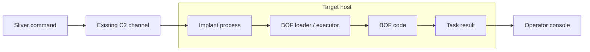

# 13강 — 기본 명령·Armory·BOF { #lesson-13-armory-and-bof-basics }

**학습 목표:** Sliver에 포함된 기능, Client의 패키지 준비, 선택한 대상에서의 코드 실행을 구분합니다.

## 서로 다른 역할 { #different-roles }

| 용어 | 역할 | 비유 |
|---|---|---|
| 기본 명령 | Sliver에 이미 포함된 기능 | 기본 공구 |
| Armory | 추가 도구 패키지 검색·설치·관리 | 공구 목록과 설치 관리자 |
| BOF | 지원되는 실행 규약에 맞춰 컴파일한 작업 코드 | 추가 작업 부품 |

Armory 자체가 BOF는 아니며 모든 Armory 패키지가 BOF인 것도 아닙니다. 공식 목록은 Alias와 Extension을 제공합니다. [공식 Armory](https://github.com/sliverarmory/armory)

## 기본 기능에서 출발 { #built-in-functionality }

앞에서 **Sliver 콘솔**에 사용한 예입니다.

```text
pwd
ifconfig
netstat --numeric
```

포함된 기능으로 질문에 답할 수 있다면 추가 도구가 필요하지 않습니다. 계정 그룹·특권을 더 자세히 조사하는 등 전문적인 작업에는 별도 도구를 사용할 수 있습니다. Armory는 이런 추가 명령을 준비하도록 돕습니다.

## 설치 후 대상에서 별도로 실행 { #installation-and-execution }

```text
Prepare a tool package on the operator side
    -> Register its command in the Sliver Client
    -> Request execution on a selected target
    -> Target performs the task
    -> Result returns
```

설치가 실행을 입증하지는 않습니다. 패키지를 설치·등록하는 위치는 **Sliver Client 컴퓨터**입니다. Client와 Server가 다르면 Server의 파일시스템을 Client의 것으로 간주하면 안 됩니다. 설치 구현은 패키지를 내려받고 명령을 등록하며, 대상에서의 실행은 별도의 동작입니다. [Armory 설치 구현](https://github.com/BishopFox/sliver/blob/master/client/command/armory/install.go)

| 이전에 구분한 단계 | 도구에서도 구분할 단계 |
|---|---|
| Implant 생성과 실행 | 도구 설치와 대상 실행 |
| Listener 시작과 Implant 연결 | 명령 등록과 작업 성공 |
| 작업 요청과 완료 | BOF 요청과 유효한 결과 반환 |

## 패키지 검색과 상세 조회 { #find-and-inspect-a-package }

아래 예시는 일반 OS 셸이 아닌 **Sliver 콘솔**에 입력합니다.

```text
help armory
armory
armory search whoami
armory info sa-whoami
```

확인한 버전에서 `armory`는 제공되는 패키지 표시, `search`는 정규표현식으로 명령 이름 검색, `info`는 설정한 저장소나 패키지의 상세 정보 조회입니다. 오래된 시연을 보고 문법을 추측하지 말고 설치된 도움말과 대조합니다. [현재 Armory 명령 정의](https://github.com/BishopFox/sliver/blob/master/client/command/armory/commands.go)

공식 목록에 예시인 `sa-whoami`가 등록되어 있습니다. 실제 결과는 설정한 저장소, 메타데이터 조회 가능 여부, 버전에 따라 달라집니다. 검색과 상세 조회가 대상의 사용자 정보 조사를 실행하지는 않습니다. [공식 패키지 목록](https://github.com/sliverarmory/armory/blob/master/armory.json)

## 설치와 명령 등록 확인 { #install-and-check-registration }

설명용 패키지 설치 순서입니다.

```text
armory install sa-whoami
help sa-whoami
```

| 관찰 | 확인한 내용 |
|---|---|
| 검색에 패키지 표시 | 일치하는 메타데이터 발견 |
| 설치 성공 메시지 | Client 측 설치 완료 보고 |
| 도움말 표시 | 현재 콘솔에 명령 등록 |
| 의도한 대상에서 예상 작업 결과 반환 | 해당 작업의 실행 결과에 대한 증거 |

도움말 등록이 대상 호환성을 입증하지는 않습니다. OS, Implant 프로세스 아키텍처, 지원 실행기, 의존성이 맞아야 합니다. 확장 기능은 대상 OS와 아키텍처에 따라 파일을 선택합니다. 앞의 Linux 웹 VM에서 Windows용 도구가 호환된다고 가정하면 안 됩니다. [확장 기능의 대상 선택](https://github.com/BishopFox/sliver/blob/master/client/command/extensions/load.go)

## Alias와 Extension { #aliases-and-extensions }

| 패키지 방식 | 입문 단계의 의미 |
|---|---|
| Alias | 외부 도구를 Sliver 명령으로 제공하는 설정과 도구 묶음 |
| Extension | 추가 실행 기능을 통합하는 확장 방식 |

Sliver의 Alias는 일반 셸의 짧은 별칭보다 많은 역할을 합니다. 도구와 실행 인자 등을 명령에 연결합니다. Extension에는 BOF 관련 실행 구성이 들어갈 수 있습니다. 패키지가 무엇을 실행하고, 어떤 대상 환경을 지원하며, 어떤 실행 방식을 요구하는지 확인합니다. 종류 이름 하나가 세 질문에 모두 답해 주지는 않습니다.

## BOF가 제공하는 기능 { #what-a-bof-contributes }

**BOF**는 **Beacon Object File**입니다. 전형적인 Windows BOF는 보통 C/C++로 작성하고 COFF 목적 파일로 준비한 작업 코드이며, 호환되는 실행 규약을 따릅니다. 목적 파일은 일반적인 완성형 EXE가 아니므로 적합한 로더나 실행기가 필요합니다.



COFFLoader는 한 구현 예입니다. 현재 Sliver에는 내장 BOF 실행기 경로도 있으므로 구체적인 로더 선택은 버전과 패키지 설정에 따라 달라집니다. 항상 같은 로더를 수동 설치해야 한다고 가정하면 안 됩니다. [COFFLoader 프로젝트](https://github.com/sliverarmory/COFFLoader), [Sliver 실행 경로](https://github.com/BishopFox/sliver/blob/master/client/command/extensions/load.go)

BOF 이름에 Beacon이 있어도 Sliver Beacon 모드에서만 사용하는 형식이라는 뜻은 아닙니다. BOF 형식과 Session·Beacon 통신 모드는 다른 개념입니다.

## 메모리 실행은 동작의 일부만 설명 { #memory-execution-and-behavior }

일반적인 BOF 실행은 기존 Implant 프로세스 안에서 코드를 준비합니다. 별도 완성형 EXE를 시작하는 방식과 차이가 있습니다. 하지만 이후 효과는 BOF의 작업 내용에 따라 달라집니다.

| 잘못된 일반화 | 더 정확한 이해 |
|---|---|
| BOF는 절대로 새 프로세스를 만들지 않음 | 작업 코드가 새 프로세스를 만들 수 있음 |
| 메모리 실행이면 파일 작업이 없음 | 작업이 파일을 읽거나 쓸 수 있음 |
| 메모리 실행은 탐지 불가능 | 메모리와 실행 중 행동이 관찰될 수 있음 |
| BOF를 쓰면 관리자 권한 획득 | 실행 방식만으로 권한이 상승하지 않음 |

파일을 읽는 BOF는 파일에 접근하고, 서버를 조회하는 BOF는 통신합니다. 실행 방식과 작업 행동을 함께 봅니다. 가장 쉬운 설명과 목적 파일 질문은 [BOF·COFF·OBJ 문답](bof-coff-and-object-files-questions.md)에서 이어집니다.

## 상세 해답 1: 도움말과 대상 결과의 차이 { #answer-help-versus-result }

**질문:** 설치가 성공하고 `help sa-whoami`가 표시되었습니다. 선택한 대상에서 사용자 정보를 조회한 것일까요?

**학습자 답:** ‘도움말 표시만으로 대상 OS 호환성이나 실행 성공을 보장할 수 없습니다.’

**정확합니다.** 앞 단계까지 더 분명히 구분하면, 설치와 도움말은 그 자체로 대상 조회를 요청한 것도 아닙니다. 대상의 결과는 아직 확인되지 않았습니다. 실행을 요청한 후에도 Beacon 체크인을 기다리거나 오류가 날 수 있으므로 요청과 정상 완료를 나눠야 합니다.

## 상세 해답 2: 프로세스 내부 실행과 관찰 가능성 { #answer-in-process-versus-effects }

**질문:** BOF가 기존 Implant 안에서 실행되었습니다. 파일 작업·통신이 없고 탐지도 불가능하다고 판단할 수 있을까요?

**학습자 답 ‘아니요’가 정확합니다.** 어디서 실행되는지와 무엇을 하는지는 다릅니다. 파일 조사는 파일에 접근하고, 서버 조회는 연결을 만들며, 설정 변경은 파일·레지스트리를 바꾸고, 프로그램 실행 작업은 자식 프로세스를 만들 수 있습니다. 보안 제품이 행동이나 메모리를 관찰할 수 있지만 실제 가시성은 설정과 기능에 달려 있습니다. BOF라는 말만으로 탐지 불가능이나 반드시 탐지됨 어느 쪽도 보장되지 않습니다.

[이전: 인터페이스와 소켓](lesson-12-network-interfaces-and-sockets.md) · [계속: BOF·COFF·OBJ 문답](bof-coff-and-object-files-questions.md)
