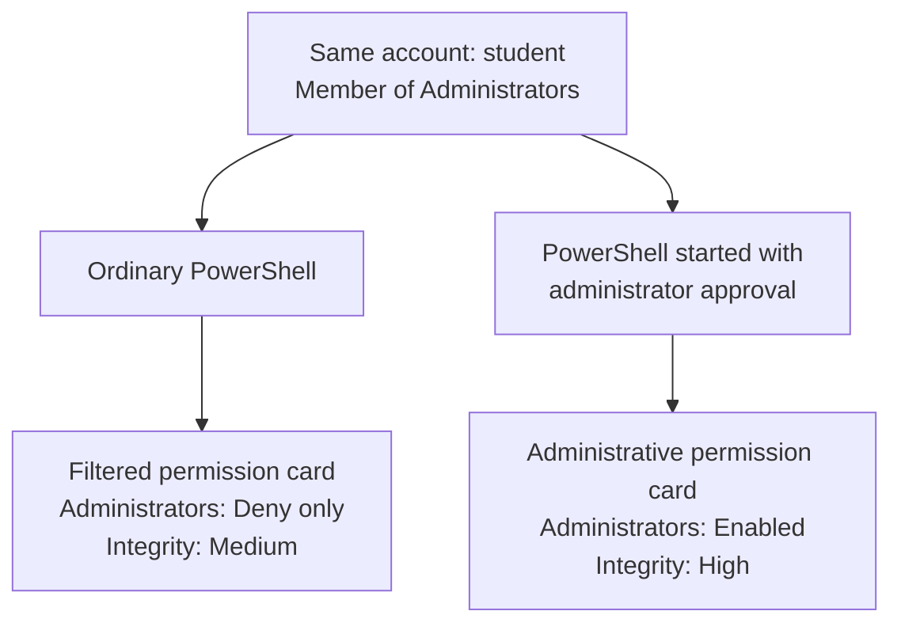
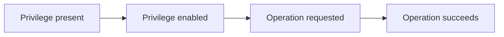

# 15강 — Windows 토큰·Deny only·특권 { #lesson-15-windows-tokens-and-privileges }

**학습 목표:** 계정·그룹·특권·무결성 정보를 읽고, 그룹 소속과 프로그램의 현재 권한, 실제 동작의 증거를 구분합니다.

Windows 실습 VM을 사용합니다. 출력은 설명용이며 학습자의 컴퓨터에서 측정한 결과가 아닙니다. 추가 질문, 상세 해답, 더 쉬운 권한 카드 설명을 함께 담았습니다.

## 한 계정과 두 프로그램 { #one-account-two-programs }

**같은 사람이 실행한 두 프로그램도 서로 다른 권한을 사용할 수 있습니다.**

`student`가 로컬 Administrators 그룹 소속이라고 하겠습니다. 일반 PowerShell을 하나 열고, 다른 하나는 **관리자 권한으로 실행**하여 정상 UAC 승인을 거쳤습니다. 일반적인 관리자 승인 구성에서는 다음과 같습니다.



사용자 이름은 같아도 **권한 카드**가 다를 수 있습니다. 이 카드가 **접근 토큰, Access Token**입니다. UAC에서는 일반 프로그램에 제한된 토큰을, 승인하여 승격한 프로그램에 관리용 토큰을 사용할 수 있습니다. [Microsoft UAC 설명](https://learn.microsoft.com/en-us/windows/security/application-security/application-control/user-account-control/how-it-works)

승격 PowerShell을 열었다고 이미 실행 중인 Implant까지 자동으로 승격되지는 않습니다. 실제 동작에 사용되는 프로그램과 컨텍스트를 확인합니다.

## 권한 카드에 들어 있는 정보 { #what-is-on-the-token }

접근 토큰은 프로세스·스레드의 보안 컨텍스트를 설명합니다. Windows는 관련 토큰과 자원의 규칙, 다른 통제를 함께 확인합니다. [Microsoft 접근 토큰](https://learn.microsoft.com/en-us/windows/win32/secauthz/access-tokens)

| 정보 | 쉬운 질문 |
|---|---|
| 사용자 신원 | 누구의 계정인가? |
| 그룹과 속성 | 이 그룹 정보를 접근 검사에 어떻게 사용할까? |
| 특권과 상태 | 어떤 시스템 작업 특권이 있고 활성 상태인가? |
| 무결성 수준 | 어떤 무결성 보호 수준을 적용하는가? |

다음 두 문장에는 서로 다른 증거가 필요합니다.

```text
The student account belongs to Administrators.
The implant is running with an administrative token.
```

첫 번째가 두 번째를 입증하지는 않습니다. 사용자 이름 하나가 모든 토큰 속성을 설명하지 않습니다. 토큰도 모든 자원의 접근 결과 목록은 아닙니다.

## Windows 실행 컨텍스트 조회 { #windows-whoami-commands }

**Windows 실습 VM의 PowerShell**에서 입력합니다.

```powershell
whoami.exe /all
```

나눠서 볼 수도 있습니다.

```powershell
whoami.exe /user
whoami.exe /groups
whoami.exe /priv
```

| 옵션 | 정보 |
|---|---|
| `/user` | 계정 이름과 SID |
| `/groups` | 그룹과 속성 |
| `/priv` | 특권과 상태 |
| `/all` | 현재 토큰의 관련 정보 함께 표시 |

**SID**는 Windows의 보안 식별자입니다. 이 명령은 해당 터미널에서 시작한 `whoami.exe`의 컨텍스트를 조회합니다. 별도 Implant의 사용자 이름이 같다는 이유로 같은 토큰이라고 판단하면 안 됩니다. [Microsoft whoami 설명](https://learn.microsoft.com/en-us/windows-server/administration/windows-commands/whoami)

## getprivs로 Implant 조회 { #sliver-getprivs }

**Sliver 콘솔**에서 실제 Windows Session을 선택합니다.

```text
sessions
sessions --interact <Windows_Session_ID>
info
help getprivs
getprivs
```

꺾쇠괄호 없이 실제 ID를 넣습니다. `getprivs`는 Armory 패키지가 필요 없는 Windows 대상 내장 명령입니다. 확인한 구현은 프로세스 특권과 무결성 수준을 표시합니다. 이 특권 목록이 모든 그룹 속성을 별도로 조사한 결과를 대신하지는 않습니다. [Sliver getprivs 구현](https://github.com/BishopFox/sliver/blob/master/client/command/privilege/getprivs.go)

단순화한 설명용 출력입니다.

```text
Privilege Information for lab-implant.exe (PID: 2030)

Process Integrity Level: Medium

Name                       Attributes
SeChangeNotifyPrivilege    Enabled
SeShutdownPrivilege        Disabled
```

실제 목록과 표시 형태는 달라집니다. 불완전한 정보나 수집 오류도 읽습니다. Beacon 작업은 체크인과 결과 반환을 기다려야 할 수 있습니다.

| 조회 | 설명하는 컨텍스트 |
|---|---|
| 터미널의 `whoami.exe /all` | 그 프로그램의 실행 컨텍스트 |
| 선택한 Implant의 `getprivs` | Implant 프로세스의 특권·무결성 정보 |

## Deny only는 무슨 뜻인가요? { #deny-only-explained }

학습자는 **‘아니요. 그런데 Deny only는 무슨 뜻인가요?’**라고 질문했습니다.

```text
Group: Administrators
Attribute: Deny only
```

이 그룹 정보는 **거부 규칙 검사에 사용하며**, 그 그룹에 허용한 규칙으로 접근 권한을 얻는 데는 사용하지 않는다는 뜻입니다.

| 자원의 규칙 | Deny only인 Administrators 정보 처리 |
|---|---|
| Administrators에게 읽기 허용 | 이 그룹 정보로 해당 허용 권한을 얻지 않음 |
| Administrators에게 수정 거부 | 거부 여부를 검사할 때 이 정보를 고려 |

비유하면 **관리자 명찰로 관리자 혜택을 받을 수 없지만, 그 명찰에 적용되는 제한은 여전히 확인하는 상태**입니다. [Microsoft 토큰 SID 속성](https://learn.microsoft.com/en-us/windows/win32/secauthz/sid-attributes-in-an-access-token)

**현재 토큰**의 속성입니다. 계정 삭제나 관리자 그룹 탈퇴를 뜻하지 않습니다. 모든 파일에 새로운 거부 규칙을 만드는 표시도 아닙니다.

## Deny only면 모든 파일 작업이 금지되나요? { #deny-only-file-example }

**아닙니다.** 토큰의 다른 신원 정보로 접근할 수 있습니다. 원리만 보기 위해 다른 허용·제약이 없는 단순한 예를 사용합니다.

| 파일 | 읽기 허용 |
|---|---|
| `notes.txt` | 사용자 `student`에게 직접 허용 |
| `admin.txt` | Administrators에만 허용 |

일반 실행 프로그램의 토큰입니다.

```text
User: student
Administrators: Deny only
```

| 파일 | 이 예시의 해석 |
|---|---|
| `notes.txt` | 사용자 자신의 신원으로 읽기 허용을 얻음 |
| `admin.txt` | Deny only인 그룹 정보로 그 허용을 얻을 수 없음 |

Deny only는 **특정 그룹 정보 하나를 어떻게 사용하는지** 설명합니다. 다른 활성 그룹이나 사용자 정보도 영향을 줄 수 있습니다. 실제 접근에는 다른 규칙·통제도 작용하며 이 예시는 완전한 ACL 평가 알고리즘이 아닙니다.

## 그룹 속성과 특권 상태는 다름 { #groups-versus-privileges }

| 예시 | 설명하는 것 |
|---|---|
| Administrators — `Deny only` | 그룹 정보의 속성 |
| SeShutdownPrivilege — `Disabled` | 특정 특권의 상태 |

**특권 Privilege**는 로컬 종료, 시스템 시간 변경 같은 시스템 작업에 관한 권리입니다. 파일 읽기·쓰기 권한은 해당 객체의 동작을 다룹니다. 같은 도메인 계정도 컴퓨터마다 특권이 다를 수 있습니다. [Microsoft 특권 설명](https://learn.microsoft.com/en-us/windows/win32/secauthz/privileges)

| 상태 | 의미 |
|---|---|
| Enabled | 조회한 토큰에 존재하고 현재 활성 상태 |
| Disabled | 조회한 토큰에 존재하지만 현재 비활성 상태 |

Disabled는 특권이 없다는 뜻이 아닙니다. Enabled는 사용했다거나 성공의 모든 조건이 갖춰졌다는 뜻이 아닙니다.

## 상태와 실제 동작 기록의 차이 { #privilege-state-versus-action }

다음 결과를 관찰했다고 하겠습니다.

```text
SeShutdownPrivilege    Enabled
```

조회한 토큰에서 특권이 활성 상태라는 증거입니다. 종료 요청, 요청 성공, 실제 종료를 입증하지는 않습니다.



특권이 필요한 작업의 단계이며 실제 종료를 수행하라는 명령이 아닙니다. 이후 주장에는 각각의 증거가 필요합니다.

| 질문 | Enabled만으로 알 수 있나요? |
|---|---|
| 특권이 활성 상태인가? | 네 |
| 종료를 요청했는가? | 아니요 |
| 요청이 성공했는가? | 아니요 |
| 컴퓨터가 종료되었는가? | 아니요 |

## 무결성 수준은 또 다른 보호 정보 { #integrity-level }

| 수준 | 입문 단계의 예 |
|---|---|
| Low | 제한된 실행 환경 |
| Medium | 일반 사용자 프로그램 |
| High | 승격 프로그램에서 흔히 관찰 |
| System | 시스템 서비스에서 흔히 관찰 |

무결성 제어는 객체 접근 규칙과 함께 작용합니다. 기본 보호 원리 중 하나는 낮은 무결성 코드가 높은 무결성 객체에 쓰는 것을 제한합니다. High도 모든 파일 접근이나 다른 서버의 관리자 권한을 입증하지는 않습니다. [Microsoft 무결성 제어](https://learn.microsoft.com/en-us/windows/win32/secauthz/mandatory-integrity-control)

이번 예에서 일반 PowerShell은 Medium, 승인하여 승격한 프로그램은 High입니다. 계정 소속만으로 추정하지 말고 실제 프로세스를 확인합니다.

## 전체 예시 읽기 { #worked-example }

관련 관찰을 모은 **학습용 메모**이며 한 명령의 실제 출력이 아닙니다.

```text
Account: student
Account membership: Administrators

Current implant:
    Administrators: Deny only
    Integrity: Medium
    SeShutdownPrivilege: Disabled
```

| 질문 | 뒷받침되는 답 |
|---|---|
| 어떤 계정인가? | `student` |
| 그룹 소속만으로 승격을 입증할까? | 아니요 |
| 이 Administrators 항목으로 그룹의 허용 권한을 얻을까? | 아니요. Deny only임 |
| 관찰한 무결성 수준은? | Medium |
| 표시된 종료 특권이 활성 상태일까? | 아니요. Disabled임 |
| 모든 파일을 읽거나 수정할 수 있을까? | 미확인. 해당 동작과 자원 규칙을 확인해야 함 |

관리자 그룹의 계정이 제한된 토큰으로 Implant를 실행하는 예입니다. 신원, 현재 토큰, 자원 권한, 실제 동작은 별개의 관찰입니다.

## 확인 문제 해답과 학습자의 판단 { #review-answers }

**문제 1:** Administrators가 있지만 Deny only이고 Medium입니다. 그룹 이름만 보고 승격된 프로세스라고 판단할까요?

**학습자 답:** ‘아니요. 그런데 Deny only는 무슨 뜻인가요?’

**정확합니다.** 이름과 속성을 함께 읽습니다. 해당 그룹 항목은 허용 규칙으로 접근 권한을 제공하지 않지만 일치하는 거부 규칙은 영향을 줄 수 있습니다. 모든 동작 금지라는 뜻이 아닌 이유는 [두 파일 예시](#deny-only-file-example)에서 확인합니다.

**문제 2:** SeShutdownPrivilege가 Enabled입니다. 실제 종료를 입증할까요?

**학습자 답:** ‘아니요. 특권이 있다는 것이지 실행 여부는 모르겠습니다.’

**정확하며 한 가지를 더 분명히 하면**, 조회한 토큰에 특권이 있고 **현재 활성 상태**라는 점까지 알 수 있습니다. 요청·사용 여부와 종료 결과에는 별도의 증거가 필요합니다. HTTP 200, TCP ESTABLISHED, 패키지 설치도 입증 범위가 한정된 것과 같습니다.

[이전: EXE·.NET·BOF 실행](lesson-14-exe-dotnet-and-bof-execution.md) · [학습 범위](course-coverage-and-next-steps.md) · [강좌 개요](index.md)
