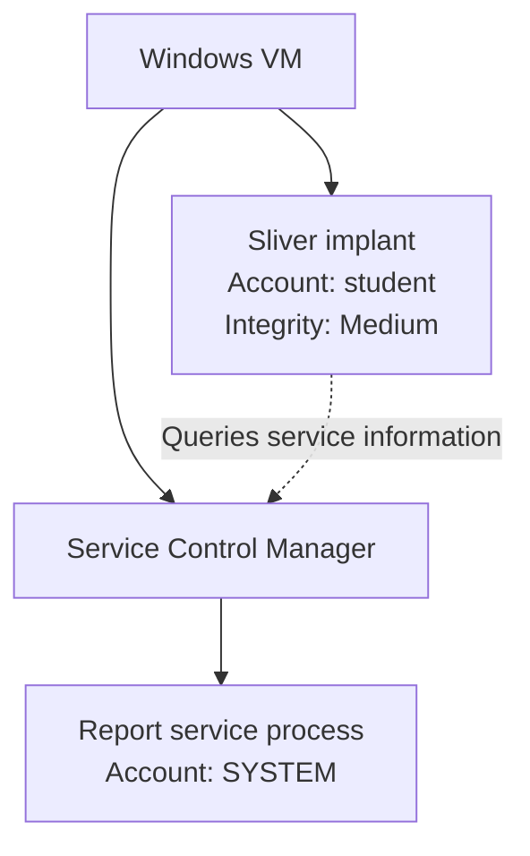
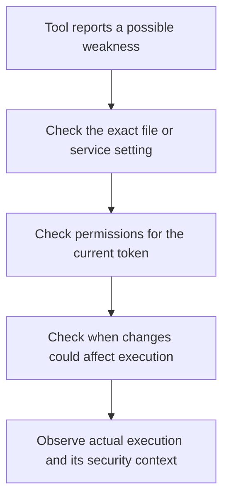
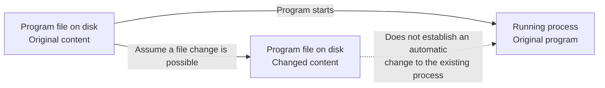

# 16강 — Windows 서비스·권한·진단 결과 { #lesson-16-windows-services-and-diagnostic-findings }

**학습 목표:** 서비스의 실행 계정, 서비스를 관리할 권한, 파일을 다룰 권한, 실제 동작의 증거를 구분합니다.

자신의 격리된 Windows 실습 VM을 사용합니다. 아래 이름·경로·프로세스 ID·출력은 설명용이며 학습자의 컴퓨터에서 측정한 결과가 아닙니다. 여기서 제시하는 명령은 정보를 조회합니다.

## Windows 서비스는 무엇인가요? { #service-basics }

Windows 서비스는 인쇄·업데이트·백업처럼 필요한 작업을 백그라운드에서 수행하는 프로그램입니다. 설정에 따라 사용자가 로그인하지 않은 상태에서도 실행될 수 있습니다. <strong>서비스 제어 관리자, SCM(Service Control Manager)</strong>가 서비스를 관리합니다.

| Windows의 구성 요소 | 회사에 비유하면 |
|---|---|
| 서비스 | 정해진 업무를 수행하는 직원 |
| 서비스 실행 파일 | 업무를 수행하는 프로그램 |
| 서비스 실행 계정 | 직원의 신원과 권한 카드 |
| 서비스 제어 관리자 | 업무 시작·중지를 관리하는 사무실 |

서비스는 자기 프로세스에서 실행되거나 다른 서비스와 호스팅 프로세스를 공유할 수 있습니다. 이번에는 쉽게 이해하도록 **독립된 프로세스에서 실행되는 서비스**를 가정합니다. [Microsoft 서비스 설명](https://learn.microsoft.com/en-us/windows/win32/services/service-programs)

설명을 위한 가상의 서비스입니다.

```text
Service name:  LabReportService
Program:       C:\LabApps\ReportService\report-service.exe
Run as:        LocalSystem
```

“Windows가 이 서비스를 시작할 때 지정된 프로그램을 **LocalSystem** 계정으로 실행하도록 설정했다”는 의미입니다. LocalSystem은 해당 컴퓨터에서 광범위한 권한을 가진 계정이며, 이 컨텍스트에서 실행되는 프로세스는 일반적으로 **NT AUTHORITY\SYSTEM**이라는 신원으로 확인됩니다. [Microsoft LocalSystem 설명](https://learn.microsoft.com/en-us/windows/win32/services/localsystem-account)

## 서로 다른 프로세스와 권한 카드 { #two-processes-two-tokens }

SYSTEM으로 실행하도록 설정된 서비스를 발견했다고 임플란트의 토큰이 바뀌지는 않습니다.



서비스 프로세스와 임플란트는 서로 다른 프로세스입니다. 다른 직원의 직급표를 읽었다고 내 권한 카드가 바뀌지는 않습니다.

| 관찰한 내용 | 알 수 있는 사실 |
|---|---|
| 서비스의 StartName이 LocalSystem | 서비스에 설정된 실행 계정 |
| 서비스의 State가 Running | 조회 시점에 서비스가 실행 중이라고 보고됨 |
| 임플란트의 신원이 student | 임플란트에서 관찰한 실행 계정 |
| 임플란트의 무결성 수준이 Medium | 임플란트에서 관찰한 무결성 수준 |

**StartName은 설정 속성입니다.** 특정 실행 중 프로세스의 실제 토큰을 확인하려면 그 프로세스를 따로 살펴봅니다. 서비스 목록은 내 임플란트가 SYSTEM이라는 증거가 아닙니다. [Microsoft Win32_Service 속성](https://learn.microsoft.com/en-us/windows/win32/cimwin32prov/win32-service)

## Windows PowerShell에서 서비스 조회하기 { #inspect-service }

**입력 위치: 확인하려는 Windows VM의 PowerShell.** Sliver 명령 입력창에 그대로 입력하는 명령이 아닙니다.

먼저 서비스 목록을 조회합니다.

```powershell
Get-CimInstance -ClassName Win32_Service |
    Select-Object Name, State, StartName
```

| 명령 요소 | 의미 |
|---|---|
| Get-CimInstance | Windows 관리 정보 조회 |
| Win32_Service | 서비스 정보 선택 |
| Select-Object | 표시할 항목 선택 |
| Name | 서비스 이름 |
| State | 보고된 현재 상태 |
| StartName | 설정된 실행 계정 |

원격 컴퓨터나 CIM 세션을 지정하지 않았으므로 명령을 실행한 로컬 Windows VM을 조회합니다. [Microsoft Get-CimInstance 설명](https://learn.microsoft.com/en-us/powershell/module/cimcmdlets/get-ciminstance)

특정 서비스를 자세히 조회합니다.

```powershell
Get-CimInstance -ClassName Win32_Service -Filter "Name='LabReportService'" |
    Select-Object Name, State, StartMode, StartName, PathName, ProcessId |
    Format-List
```

**LabReportService는 이 강의가 설치하는 서비스가 아니라 가상의 예시입니다.** VM에 없다면 첫 조회 결과에 있는 실제 서비스 이름으로 바꾸세요.

설명을 위한 출력입니다.

```text
Name      : LabReportService
State     : Running
StartMode : Auto
StartName : LocalSystem
PathName  : C:\LabApps\ReportService\report-service.exe
ProcessId : 4120
```

“서비스가 실행 중이라고 보고되며, 자동 시작·LocalSystem 계정으로 설정되어 있습니다. 실행 파일 경로와 현재 프로세스 ID도 확인했습니다”라고 읽습니다. **Auto는 시작 방식의 설정이고 Running은 보고된 현재 상태**입니다. 자동 시작으로 설정되어 있어도 현재 중지되어 있거나 시작에 실패했을 수 있습니다.

## 구분해야 하는 세 가지 권한 { #three-permissions }

| 확인 대상 | 질문 | 예시 |
|---|---|---|
| 서비스 프로세스 | 누구의 권한으로 실행되는가? | SYSTEM |
| 서비스 객체 | 내 현재 컨텍스트로 어떤 관리 작업을 요청할 수 있는가? | 조회·설정 변경·시작·중지 |
| 실행 파일과 폴더 | 내 현재 컨텍스트로 어떤 파일 작업을 할 수 있는가? | 읽기·실행·쓰기·삭제 |

서비스 관리 작업에는 각각 별도의 권한이 있습니다.

| 서비스 권한 | 허용하는 작업 |
|---|---|
| SERVICE_QUERY_CONFIG | 설정 조회 |
| SERVICE_QUERY_STATUS | 상태 조회 |
| SERVICE_CHANGE_CONFIG | 설정 변경 |
| SERVICE_START | 서비스 시작 |
| SERVICE_STOP | 서비스 중지 |

조회에 성공했다고 설정 변경이나 시작·중지 권한까지 확인된 것은 아닙니다. 파일 권한도 서비스 객체 권한과 별개입니다. 서비스 상태를 읽을 수 있어도 실행 파일을 수정하지 못할 수 있고, 폴더에 쓰기 권한이 있어도 서비스 시작·중지는 허용되지 않을 수 있습니다. [Microsoft 서비스 접근 권한 설명](https://learn.microsoft.com/en-us/windows/win32/services/service-security-and-access-rights)

## 실행 파일과 폴더 권한 조회하기 { #inspect-file-permissions }

가상의 경로에 대한 예시입니다. Windows VM의 PowerShell에서 실행하며, 직접 따라 할 때는 서비스 조회에서 확인한 실제 경로를 사용합니다.

```powershell
icacls "C:\LabApps\ReportService\report-service.exe"
```

```powershell
icacls "C:\LabApps\ReportService"
```

파일에서 다음과 같은 항목이 보였다고 가정합니다.

```text
BUILTIN\Users:(I)(RX)
```

| 표시 | 의미 |
|---|---|
| BUILTIN\Users | 이 항목이 적용되는 그룹 |
| I | 상속된 항목 |
| R | 읽기 |
| RX | 읽기 및 실행 |
| W | 쓰기 |
| M | 수정, 삭제 포함 |
| F | 모든 권한 |

이 항목은 Users 그룹에 읽기·실행을 부여하며 쓰기 권한 자체를 부여하지는 않습니다. 이는 전체 접근 판정이 아니라 **하나의 항목**입니다. 다른 항목, 현재 토큰, 부모 폴더 권한, 적용되는 다른 제어도 실제 작업에 영향을 줄 수 있습니다. [Microsoft icacls 설명](https://learn.microsoft.com/en-us/windows-server/administration/windows-commands/icacls)

15강도 떠올려 보세요. 토큰의 그룹이 **Deny only**라면 그 이름만으로 허용 권한을 얻는다고 판단할 수 없습니다.

## 진단 도구가 경고하면 무엇을 뜻하나요? { #diagnostic-warning }

가상의 도구가 다음처럼 표시합니다.

```text
Service: LabReportService
Runs as: LocalSystem
Warning: Service executable may be writable by ordinary users
```

쉽게 말하면 다음과 같습니다.

> 일반 사용자가, 서비스가 SYSTEM 권한으로 실행하도록 설정한 프로그램 파일을 바꿀 수 있을지도 모릅니다.

중요한 단서입니다. 낮은 권한의 사용자가 나중에 높은 권한으로 실행될 코드를 통제할 수 있다면 높은 권한의 동작에 영향을 줄 가능성이 있기 때문입니다. 하지만 경고만으로 파일 변경, 변경된 코드의 실행, 임플란트의 토큰 변경까지 확인된 것은 아닙니다.

도구의 Runs as도 보고된 정보로 읽습니다. 설정을 보여 준 것인지 실제 프로세스 토큰을 측정한 것인지 확인해야 합니다.



실제 서비스 설정과 경로가 일치하는지, 현재 토큰에 필요한 권한이 있는지, 파일 잠금이나 다른 제어가 영향을 주는지, 변경이 언제 반영되는지, 실제로 실행된 프로세스가 무엇인지 확인합니다.

## 더 쉬운 비유: 관리자가 따라 하는 작업 지시서 { #warning-analogy }

일반 직원에게는 중요한 회사 시스템을 변경할 권한이 없습니다. 관리자는 그 권한을 가지고 있으며 정해진 작업 지시서에 따라 일합니다.

일반 직원이 그 지시서를 수정할 수 있고 관리자가 나중에 바뀐 지시서대로 행동한다면, 일반 직원은 관리자의 권한으로 수행되는 일에 영향을 줄 수 있습니다.

| 회사 비유 | 서비스 예시 |
|---|---|
| 일반 직원 | 낮은 권한의 사용자 |
| 관리자의 작업에 영향을 주는 지시서 | 서비스 실행 파일 |
| 더 큰 권한을 가진 관리자 | SYSTEM으로 실행되는 서비스 프로세스 |
| 지시서를 고칠 수 있음 | 실행 파일을 수정할 수 있음 |

지시서는 실행 코드의 역할을 설명하는 비유입니다. EXE가 일반 텍스트 문서라는 뜻은 아닙니다.

문제가 되는 조합은 **낮은 권한의 사용자가 높은 권한의 프로세스가 실행할 내용을 통제할 가능성**입니다.

## 경고와 결과 사이의 세 가지 확인 { #three-checks }

**첫째, 현재 컨텍스트로 필요한 수정을 정말 할 수 있나요?** 도구가 의심스러운 권한 항목을 발견했을 수 있습니다. 정확한 파일, 현재 사용자의 토큰과 적용되는 권한, 해당 파일 작업의 허용 여부를 확인합니다. 사용 중인 파일이나 다른 제어가 그 작업에 영향을 줄 수도 있습니다.

**둘째, 변경된 내용이 실제로 실행되나요?** 디스크 파일을 변경할 수 있다고 가정해도 이미 실행 중인 프로세스가 자동으로 새 버전이 되지는 않습니다. 해당 프로그램이 변경된 내용을 언제 로드하고 실행하는지 확인합니다.

**셋째, 무엇이 누구의 토큰으로 실행됐나요?** 서비스 시작 메시지만으로 예상한 변경 파일이 실행되었는지, 특정 작업이 발생했는지, 예상한 토큰을 사용했는지 입증할 수 없습니다. 실제 프로세스·로드된 프로그램·관찰한 동작·보안 컨텍스트를 연결합니다.

문제의 가능성, 확인된 권한, 관찰된 결과를 서로 구분하는 과정입니다.

## 디스크 파일과 실행 중인 프로세스 { #disk-file-and-running-process }

서비스가 오전 9시에 시작했고 오전 10시에 디스크 파일을 바꿀 수 있었다고 가정합니다. 오전 9시부터 실행 중인 프로세스가 즉시 새 내용으로 바뀐다고 판단할 수는 없습니다.



회사 비유에서는 관리자가 오전 9시에 지시서를 복사해서 가져갔습니다. 누군가 오전 10시에 보관함의 원본을 바꾸더라도 관리자는 이전 사본을 보고 계속 일할 수 있습니다.

저장된 파일과 실행 중인 프로세스를 구분하는 개념 설명이며 Windows 실행 파일 로딩 전체를 설명하는 모형은 아닙니다. 해당 변경 내용이 실제로 언제 로드되어 사용되는지 확인합니다.

## 각 관찰로 어디까지 말할 수 있나요? { #evidence-ladder }

| 확인한 사실 | 뒷받침되는 결론 |
|---|---|
| 도구가 경고를 표시함 | 문제가 있을 가능성이 보고되었다 |
| 현재 토큰으로 필요한 파일 수정이 가능함을 확인함 | 확인한 조건에서 해당 파일 작업이 허용된다 |
| 디스크 파일이 변경됨 | 저장된 파일이 바뀌었다 |
| 서비스가 정상 시작을 보고함 | 서비스 시작 결과가 보고되었다 |
| 변경된 프로그램의 실행과 SYSTEM 토큰을 확인함 | 변경된 코드가 관찰한 토큰으로 실행되었다 |

각 행에는 각각의 증거가 필요합니다. 앞 단계만 보고 뒤 단계까지 성공했다고 판단하지 않습니다.

서비스 오류만으로 프로세스나 코드의 실행 여부를 단정할 수도 없습니다. 상태 보고와 코드 실행은 별개의 관찰입니다.

별도 프로세스가 변경된 코드를 SYSTEM으로 실행한 것을 확인했더라도 **기존 student 임플란트가 자동으로 그 토큰을 받는 것은 아닙니다.** 각 프로세스를 따로 확인합니다.

정확한 보고는 다음과 같습니다. “높은 권한의 실행으로 이어질 수 있는 설정이 보고되었습니다. 현재 권한·실행 조건·실제 결과는 추가 확인이 필요합니다.”

## 확인 문제와 상세 해답 { #review-answers }

### 문제 1: SYSTEM 서비스를 발견했습니다 { #answer-system-service }

**문제:** 임플란트는 student 계정, Medium 무결성 수준으로 실행 중입니다. 서비스 조회에서 LocalSystem으로 설정된 서비스를 발견했습니다. 임플란트도 SYSTEM일까요?

**정답은 아니요입니다.** 다른 서비스의 정보를 읽었을 뿐 임플란트의 계정이나 토큰이 바뀌지 않았습니다. 다른 직원의 높은 직급을 읽어도 내 권한 카드가 바뀌지 않는 것과 같습니다.

StartName은 설정된 실행 계정입니다. 실행 중 서비스 프로세스의 실제 토큰은 그 프로세스에서, 임플란트의 현재 권한은 임플란트 자체에서 확인합니다.

“LocalSystem으로 설정된 서비스를 발견했고, 관찰한 임플란트는 여전히 student·Medium입니다”라고 해석합니다.

### 문제 2: Users의 RX 항목을 발견했습니다 { #answer-users-rx }

**문제:** 서비스 실행 파일에 BUILTIN\Users:(RX)가 있습니다. 이 항목만으로 일반 사용자가 파일을 수정할 수 있다고 판단할까요?

**정답은 아니요입니다.** RX는 이 항목을 통해 읽기·실행을 허용합니다. 기존 프로그램을 실행하는 것과 그 파일을 변경하는 것은 다른 작업입니다.

반대로 “이 사용자는 어떤 경우에도 수정할 수 없다”고 단정해서도 안 됩니다. 다른 항목이 수정을 허용할 수 있기 때문입니다.

```text
BUILTIN\Users:(RX)
LAB\student:(M)
```

이 예시에서는 사용자에게 별도로 수정 권한이 부여되었습니다. 적용되는 다른 제한이 없다고 가정하면 Users 항목이 읽기·실행만 부여하더라도 사용자 직접 항목으로 수정 권한을 얻을 수 있습니다.

전체 관련 권한, 현재 토큰, 부모 폴더 권한을 함께 읽습니다. ACL 적용 순서 전체를 설명하는 알고리즘은 아닙니다.

## 참고 자료와 다음 학습 { #sources }

- [Microsoft 서비스 프로그램](https://learn.microsoft.com/en-us/windows/win32/services/service-programs)
- [Microsoft LocalSystem 계정](https://learn.microsoft.com/en-us/windows/win32/services/localsystem-account)
- [Microsoft Win32_Service](https://learn.microsoft.com/en-us/windows/win32/cimwin32prov/win32-service)
- [Microsoft Get-CimInstance](https://learn.microsoft.com/en-us/powershell/module/cimcmdlets/get-ciminstance)
- [Microsoft 서비스 보안과 접근 권한](https://learn.microsoft.com/en-us/windows/win32/services/service-security-and-access-rights)
- [Microsoft icacls](https://learn.microsoft.com/en-us/windows-server/administration/windows-commands/icacls)

[이전: Windows 토큰·특권](lesson-15-windows-tokens-and-privileges.md) · [학습 점검과 17~25강 계획](course-coverage-and-next-steps.md#lesson-plan) · [강좌 개요](index.md)
