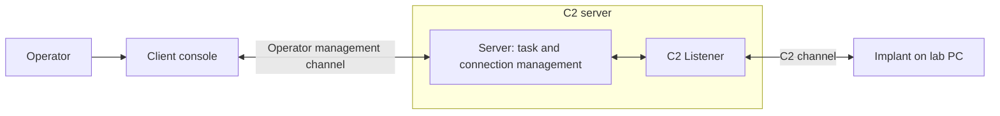

# 2강 — 구성 요소와 명령어 { #lesson-2-components-and-commands }

**학습 목표:** Sliver의 구성 요소를 구분하고, 운영체제 터미널과 Sliver 콘솔을 구별하며, 기본 명령의 결과로 어디까지 판단할 수 있는지 설명합니다.

## 네 가지 역할 { #the-four-roles }

| 구성 요소 | 역할 | 주로 실행되는 곳 |
|---|---|---|
| Client | 운영자가 요청을 입력하고 결과를 보는 인터페이스 | 운영자 컴퓨터 |
| Server | 통신·작업·결과를 중앙에서 관리 | 실습용 C2 서버 |
| Listener | Implant의 통신을 받는 서버 측 기능 | Server 내부 |
| Implant | 실습 대상에서 작업을 수행하는 프로그램 | 실습 대상 PC |



통신 경로는 **Client ↔ Server**와 **Implant ↔ C2 Listener**로 나뉩니다. 운영자가 서버에 정상 접속했다고 해서 대상 PC도 Listener에 도달할 수 있다는 뜻은 아닙니다.

클라이언트는 일반적인 네트워크 용어로도 쓰이지만, **Sliver Client**는 운영자가 사용하는 프로그램을 가리킵니다. Implant는 별도의 구성 요소입니다.

**보충:** Sliver는 서버 콘솔로 직접 조작하거나 별도의 Client로 접속해 조작할 수 있습니다. 네 가지 역할이 있다고 해서 물리적인 컴퓨터 네 대가 필요한 것은 아닙니다. [공식 구조 설명](https://github.com/BishopFox/sliver/wiki/Architecture/a1016f154840c2d9508e38a8201d887744ba5afb)

## 명령어를 입력하는 위치 { #where-to-type-commands }

| 화면 | 명령어 예시 | 명령을 해석하는 프로그램 |
|---|---|---|
| Linux 터미널 | `./sliver-server` | 운영체제의 셸 |
| Sliver 콘솔 | `jobs` | Sliver |

프롬프트는 입력을 기다리고 있다는 표시입니다. Linux에서는 `ubuntu@lab:~$`, Sliver에서는 `sliver >`와 비슷하게 보일 수 있습니다. **프롬프트 자체는 따라 입력하지 않습니다.** 아래 명령 블록에는 입력할 부분만 적습니다.

## 콘솔 열기 { #opening-a-console }

**강좌:** 이미 설치된 서버가 제공되며, 실습용 SSH 키로 Ubuntu 호스트에 접속한 뒤 Sliver Client를 실행합니다. 자막에는 완전한 SSH 명령과 모든 설정 단계가 남아 있지 않습니다.

**보충 — 서버 직접 실행 예시:** Linux용 서버 파일 이름이 `sliver-server`이고 현재 폴더에 있다면, **Linux 터미널**에서 실행합니다.

```bash
./sliver-server
```

`./`는 현재 폴더의 실행 파일이라는 뜻입니다. 정상적으로 실행되면 서버 콘솔이 나타납니다. 환경에 맞는 실행 파일이 이미 준비되어 있다는 전제이며, 설치 명령은 아닙니다.

**보충 — 설정이 준비된 Client 예시:** Server가 이미 실행 중이고 운영자 설정을 제공받아 가져온 상태라면, **Linux 터미널**에서 Client를 실행합니다.

```bash
./sliver-client
```

별도 Client에는 서버 연결과 인증 설정이 필요합니다. 실행 파일만 시작한다고 이러한 준비가 자동으로 끝나지는 않습니다. Server도 운영자 접속을 받도록 설정되어 있어야 합니다. 강좌의 실습 환경에서는 이런 준비가 되어 있으며, 실제 파일 이름과 설치 경로는 달라질 수 있습니다. [공식 운영자 접속 설명](https://github.com/BishopFox/sliver/wiki/Multiplayer-Mode/09c86574715cd1a1e792e0815d583550d6750eac)

이후에는 두 방법 중 하나로 Sliver 콘솔을 정상적으로 열었다고 가정합니다.

## HTTP Listener 시작 { #starting-an-http-listener }

**강좌:** 첫 Beacon을 생성하기 전에 HTTP Listener를 시작합니다. 화면에 입력한 Listener 명령 전체는 자막에 남아 있지 않습니다.

**보충 — 설명용 예시:** 격리 실습용 C2 서버에 `192.168.56.10`이라는 IP가 실제로 할당되어 있다고 가정합니다. TCP 8080번 포트에서 HTTP Implant 통신을 받으려면 **Sliver 콘솔**에 입력합니다.

```text
http --lhost 192.168.56.10 --lport 8080
```

| 부분 | 의미 |
|---|---|
| `http` | HTTP Listener 시작 |
| `--lhost` | 통신을 받을 서버의 로컬 주소 |
| `192.168.56.10` | C2 서버에 할당된 설명용 IP이며, 대상 PC 주소가 아님 |
| `--lport` | 수신 포트를 지정하는 옵션 |
| `8080` | 예시로 사용할 포트 |

IP·도메인은 목적지를, 포트는 통신 접점을, 프로토콜은 대화 규칙을 지정합니다. 해당 주소가 서버에 존재해야 하고 포트도 사용 가능해야 합니다. 네트워크 경로·방화벽 정책·호환되는 Implant 설정도 필요합니다.

이 Listener 명령은 **Implant를 생성·복사·실행하지 않습니다.** 서버가 통신을 받을 준비를 하는 명령입니다. 위 문법은 [공식 Listener 명령 정의](https://github.com/BishopFox/sliver/blob/master/client/command/jobs/commands.go)로 확인한 보충 예시이며, 강사가 입력한 내용을 그대로 복원한 것은 아닙니다.

## 서버 Job 확인 { #inspecting-server-jobs }

**Sliver 콘솔**에 입력합니다.

```text
jobs
```

**설명용으로 단순화한 출력이며, 실행 중인 실습에서 캡처한 결과가 아닙니다.**

```text
ID   Name   Protocol   Port
1    http   tcp        8080
```

HTTP Listener에 해당하는 서버 작업이 TCP 8080번 포트에서 실행 중이라는 뜻입니다. **대상 PC가 연결됐다는 뜻은 아닙니다.** 접수 창구를 여는 것과 실제로 방문자가 도착하는 것은 다릅니다.

**보충 — 정정:** 강좌에서는 Job을 수신 포트 중심으로 설명합니다. 더 정확히는 Listener 등을 포함하는, 서버에서 관리하는 실행 작업입니다. [공식 Job 목록 구현](https://github.com/BishopFox/sliver/blob/master/client/command/jobs/jobs.go)

## 생성된 빌드와 통신 중인 Implant 구분 { #created-builds-versus-communicating-implants }

다음 명령은 **Sliver 콘솔**에서 각각 실행합니다.

```text
implants
```

```text
sessions
```

```text
beacons
```

| 명령 | 확인하는 것 | 이것만으로 입증하지 못하는 것 |
|---|---|---|
| `implants` | 서버에 보관된 Implant 빌드 목록 | 생성된 파일이 대상에서 실행 중이라는 사실 |
| `sessions` | 서버가 관리하는 Session 목록과 상태 | 목록의 모든 항목이 현재 정상이라는 사실. 상태를 함께 확인해야 함 |
| `beacons` | 등록된 Beacon과 상태 | 과거에 등록된 Beacon이 지금도 연락한다는 사실. 체크인 정보를 확인해야 함 |

**강좌:** 자막에서 `implants`를 생성한 Implant 목록으로 직접 설명하며, 이후 `sessions`도 언급합니다. `beacons`와 함께 비교한 것은 이해를 돕기 위한 보충입니다. [공식 빌드 목록 구현](https://github.com/BishopFox/sliver/blob/master/client/command/generate/implants.go)

| 단계 | 나타날 수 있는 정보 |
|---|---|
| Listener 시작 | `jobs`의 Listener |
| Implant 생성 | `implants`의 빌드 |
| 대상 PC에 파일만 복사 | 아직 새로운 Session·Beacon이 없을 수 있음 |
| Implant 실행 후 C2 등록 성공 | 해당 Session·Beacon 정보 |

실행했더라도 잘못된 콜백 주소, 차단된 네트워크 경로, 프로세스 종료 등으로 통신에 실패할 수 있습니다. **생성 → 전달 → 실행 → 통신**은 별개의 단계입니다.

## 설치된 버전의 도움말 확인 { #asking-for-help }

```text
help http
```

```text
help jobs
```

옵션과 출력은 버전에 따라 바뀔 수 있습니다. 강좌 당시 문법에 의존하기 전에 설치된 콘솔의 도움말을 확인하세요.

## 확인 문제 { #review-questions }

1. `jobs`에 HTTP Listener가 나타납니다. 대상 PC에서 Implant가 실행됐다는 증거일까요?
2. `implants`에는 빌드가 있지만 새로운 Session·Beacon은 없습니다. 소프트웨어 오류가 아니어도 가능한 이유를 하나 말해 보세요.

??? success "정답과 해설"
    **1. 아니요.** Listener 작업이 실행 중이라는 사실만 알 수 있습니다. 대상에서의 실행과 통신은 아직 확인되지 않았습니다.

    **2. 파일을 생성하거나 복사했지만 아직 실행하지 않았을 수 있습니다.** 실행했지만 통신에 성공하지 못했을 수도 있습니다. 연결이 없다는 사실만으로 원인을 특정할 수는 없습니다.

[3강 — Session과 Beacon으로 이동](lesson-3-sessions-and-beacons.md)
