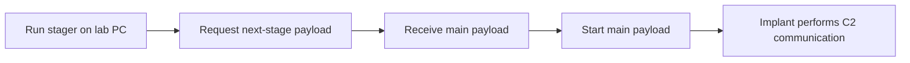

# 4강 — Payload, Stager, Loader { #lesson-4-payloads-stagers-and-loaders }

**학습 목표:** 전달할 코드, 대상에서 C2 작업을 수행하는 프로그램, 그 프로그램을 준비하고 시작하는 방식을 구분합니다.

## Payload와 Implant { #payload-versus-implant }

**Payload**는 특정 기능을 수행하도록 전달하거나 실행하는 코드입니다. 보안 도구마다 넓은 의미로 쓰이는 용어입니다. 이 강좌에서는 주로 Implant 코드나, 전달하고 실행할 생성 결과물을 가리킵니다.

**Implant**는 실습 대상에서 동작하며 C2 작업을 수행하는 프로그램입니다. 같은 소프트웨어도 전달 관점에서는 Payload, 대상에서의 역할 관점에서는 Implant라고 설명할 수 있습니다. 다만 모든 Payload가 C2 Implant인 것은 아닙니다.

| 용어 | 핵심 질문 |
|---|---|
| Payload | 어떤 코드를 전달하거나 실행할 것인가? |
| Implant | 대상에서 C2 작업을 수행하는 프로그램은 무엇인가? |

## Stageless: 처음부터 본체를 포함 { #stageless }

**Stageless Payload**는 처음부터 전체 Implant를 포함합니다. 작은 설치 프로그램이 본체를 추가로 받는 방식보다, 애플리케이션을 모두 담은 오프라인 설치 파일에 비유할 수 있습니다.

```text
Deliver the full implant
          ↓
Run it on the lab PC
          ↓
Communicate with the C2 server
```

**Stageless라고 네트워크가 필요 없는 것은 아닙니다.** 본체를 별도의 초기 단계에서 가져올 필요가 없다는 뜻입니다. 실행된 Implant가 원격 작업을 받고 결과를 보내려면 C2 서버와 통신할 수 있어야 합니다.

## Staged: 다음 단계의 코드를 가져오기 { #staged }

**Stager**는 다음 단계의 코드를 받아 실행하도록 준비하는 작은 초기 프로그램입니다. 애플리케이션 본체를 내려받는 온라인 설치 프로그램을 떠올려 보세요.



| 용어 | 역할 |
|---|---|
| Stage 1 | 먼저 실행되는 초기 단계 |
| Stage 2 | 초기 단계가 가져오는 다음 단계 |
| Stager | 다음 단계의 코드를 가져와 실행하는 데 초점을 둔 초기 프로그램 |

설계에 따라 단계가 더 많을 수도 있습니다. 지금은 **초기 프로그램 → 본체 Implant**의 두 단계로 이해하면 충분합니다. Sliver 공식 설명도 Staging 서버, 다음 단계 Payload, Stager의 역할을 구분합니다. [공식 Staging 설명](https://github.com/BishopFox/sliver/wiki/Stagers/e2b8417c1434c926daf746f9e85146566972a69e)

| 비교 항목 | Stageless | Staged |
|---|---|---|
| 처음 전달하는 것 | 전체 Implant 결과물 | 초기 Stager |
| 본체를 따로 가져오는 단계 | 필요 없음 | 이 모델에서는 필요함 |
| 초기 결과물 크기 | 상대적으로 클 수 있음 | 상대적으로 작을 수 있음 |
| 실패할 수 있는 지점 | 실행과 C2 통신 등 | 초기 실행, 본체 수신, 본체 실행, C2 통신 등 |

초기 프로그램이 작다고 자동으로 탐지되지 않는 것은 아닙니다. Stageless도 무조건 안정적으로 실행되는 것은 아닙니다. 플랫폼 불일치, 실행 차단, 통신 실패 등이 발생할 수 있습니다.

## Loader: 실행할 코드를 준비 { #loader }

**Loader**는 코드가 실행될 수 있도록 준비하고 실행 흐름을 넘기는 역할입니다. 로딩은 정상적인 운영체제와 애플리케이션에도 있는 개념이므로, 용어 자체가 악성 행위를 뜻하지는 않습니다.

이 강좌의 Loader는 디스크에서 Payload를 읽거나 원격에서 가져온 뒤 실행을 준비할 수 있습니다. 반드시 인터넷에서 내려받거나 메모리에서만 실행하는 것은 아닙니다.

| 용어 | 초점 |
|---|---|
| Payload | 무엇을 실행할 것인가? |
| Loader | 그 코드를 어떻게 준비하고 실행할 것인가? |
| Stager | 다음 단계의 코드를 어떻게 가져와 실행할 것인가? |

Stager는 다음 단계 전달에 특화된 Loader의 한 형태로 이해할 수 있지만, 도구별 용어 사용 범위에는 차이가 있습니다. 워크숍의 `gen_loader`는 별도의 교육용 보조 도구이며, 모든 Sliver 환경에 기본으로 존재하는 명령이 아닙니다.

## 전달 구조와 통신 방식은 별개의 선택 { #independent-choices }

| 설계 질문 | 선택지 |
|---|---|
| 시작할 때 본체를 어떻게 제공하는가? | Staged / Stageless |
| 실행된 Implant가 작업을 어떻게 주고받는가? | Session / Beacon |

**Stageless Beacon**은 처음부터 전체 Implant를 포함하고, 실행 후에는 주기적으로 체크인합니다. Beacon이라고 반드시 Stager가 필요한 것은 아닙니다.

마찬가지로 **다음 단계 코드를 제공하는 기능**과 **실행된 Implant의 C2 통신을 처리하는 기능**은 구분해야 합니다. 같은 인프라를 공유할 수 있으며, 모든 설계에서 별도 물리 서버나 다른 포트가 필요한 것은 아닙니다.

## 생성 도움말 확인 { #inspect-generation-help }

**Sliver 콘솔**에서 확인합니다.

```text
help generate
```

```text
help generate beacon
```

도움말을 보여 주는 명령입니다. Implant를 생성하거나 대상에서 실행하지 않습니다. 5강에서는 생성 옵션을 운영체제, CPU 아키텍처, 출력 형식, C2 주소에 연결합니다.

## 확인 문제 { #review-questions }

1. Stageless Beacon은 본체를 추가로 받지 않습니다. 그렇다면 C2 통신도 필요 없을까요?
2. Stager가 실행됐지만 본체를 받지 못했습니다. 초기 프로그램이 시작됐다는 사실만으로 전체 Implant가 실행됐다고 판단할 수 있을까요?
3. 이번에는 본체 다운로드까지 성공했습니다. 이것만으로 본체 실행도 확인된 것일까요?

??? success "정답과 해설"
    **1. 아니요.** 원격 작업을 받고 결과를 보내려면 체크인이 필요합니다. 본체 다운로드와 이후 C2 통신은 목적이 다릅니다.

    **2. 아니요.** 초기 프로그램은 실행됐지만, 설명한 실행 흐름은 본체 시작 전에 멈췄습니다. 온라인 설치 프로그램이 켜졌다는 사실과 실제 애플리케이션이 실행됐다는 사실은 다릅니다.

    **3. 아니요.** 다운로드, 실행, C2 등록, 작업 완료는 별개의 단계입니다. 새 Beacon 체크인은 그 시점에 Implant가 실행되어 통신했다는 근거가 됩니다. 과거 목록 항목만 보지 말고 마지막 체크인 정보를 확인해야 합니다. 체크인이 없다고 미실행을 단정할 수도 없습니다. 실행됐지만 통신에 실패했을 수 있습니다.

[5강 — 생성 명령 읽기로 이동](lesson-5-reading-generation-commands.md)
