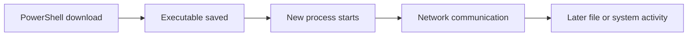

# 7강 — 백신·EDR과 탐지 증거 { #lesson-7-antivirus-edr-and-detection-evidence }

**학습 목표:** 탐지와 실행을 구분하고, 탐지 기록과 성공적인 보호 조치를 구분합니다.

## 관찰한 사실에서 시작 { #start-with-an-observation }

파일 요청은 성공했지만 실행하려고 보니 파일이 없고 Beacon도 나타나지 않는 상황을 생각해 보세요. 곧바로 다운로드 실패라고 단정하지 않습니다. 전달 후 보안 제품이 파일을 탐지·격리했을 수도 있습니다. 각 단계의 증거를 조사합니다.

## 백신과 EDR의 기능은 겹침 { #antivirus-and-edr-overlap }

**AV**는 Antivirus, 즉 백신입니다. 위협을 탐지하고 차단·격리·제거 같은 보호 조치를 수행할 수 있습니다.

**EDR**은 Endpoint Detection and Response, 즉 엔드포인트 탐지 및 대응입니다. Endpoint는 PC나 서버 같은 단말입니다. EDR은 서로 연관된 단말 활동을 조사하고 위협에 대응하도록 지원합니다.

| 기능 | 주요 관점 |
|---|---|
| 백신 | 파일·행동을 평가하고 보호 조치 수행 |
| EDR | 단말 활동을 연결하여 조사하고 대응 지원 |

기능이 겹치므로 ‘백신은 파일만 보고 EDR은 행동만 본다’고 나누면 부정확합니다. Microsoft Defender Antivirus도 실행 중 프로세스·파일·서비스 활동을 관찰합니다. [Microsoft 행동 모니터링 설명](https://learn.microsoft.com/en-us/defender-endpoint/behavior-monitor)

## 정적 검사와 실행 중 행동 { #static-inspection-and-runtime-behavior }

**정적 분석 Static Analysis**은 해당 코드를 실행하지 않고 살펴보는 방식입니다. 알려진 해시, 코드 패턴, 파일 구조, 포함된 문자열, 서명 정보 등이 단서가 될 수 있습니다.

따라서 **학습자가 파일을 직접 실행하지 않아도 탐지가 가능합니다.** 다운로드되거나 저장된 파일이 수동 실행 전에 검사될 수 있습니다.

실행 중 분석은 어떤 프로세스를 시작하고, 어디로 연락하며, 어떤 파일에 접근하고 시스템을 변경하는지 살펴봅니다. 실제 제품은 머신러닝·클라우드 분석 등 여러 방식을 결합합니다. 실행 전 경고만으로 정확한 탐지 기법을 특정할 수는 없습니다. [Microsoft Defender Antivirus 개요](https://learn.microsoft.com/en-us/defender-endpoint/microsoft-defender-antivirus-windows)

## 단서와 입증된 탐지 원인 { #clue-versus-proven-cause }

Go 관련 파일 특징이나 Sliver 관련 문자열은 분석 단서가 될 수 있습니다. 하지만 다음 문장은 다릅니다.

- ‘파일 안에 Sliver 관련 문자열이 있다.’
- ‘보안 제품이 바로 그 문자열 때문에 탐지했다.’

첫 번째는 관찰이고, 두 번째는 추가 검증이 필요한 원인 설명입니다. 정상 프로그램도 Go로 작성됩니다. 언어·파일 이름·문자열 하나만으로 악성 여부나 제품의 판단 원인을 확정할 수는 없습니다.

## 단말 활동을 연결하여 조사 { #correlate-endpoint-activity }



분석가는 각 사건이 같은 컴퓨터·사용자·프로세스·파일·시간대와 관련되는지 확인합니다. 수집한 활동 정보를 **Telemetry, 텔레메트리**라고 부릅니다.

EDR은 이런 증거를 경고와 조사에 연결할 수 있지만 모든 동작이 기록된다고 보장하지는 않습니다. 제품 기능과 설정에 따라 가시성이 달라집니다. [Microsoft EDR 개요](https://learn.microsoft.com/en-us/defender-endpoint/overview-endpoint-detection-response)

## 탐지·조치·결과는 별개 { #detection-action-and-outcome }

세 가지 질문을 구분합니다.

1. 무엇을 탐지했는가?
2. 어떤 조치를 취했는가?
3. 조치의 결과는 무엇인가?

Microsoft Defender Antivirus 이벤트가 좋은 예입니다.

| 이벤트 ID | 의미 | 확인할 내용 |
|---|---|---|
| **1116** | 악성코드 또는 잠재적으로 원치 않는 소프트웨어 탐지 | 위협 이름, 경로, 탐지 정보 |
| **1117** | 탐지한 위협에 관한 조치 기록 | 실제 조치, 상태, 결과 |

**1116은 격리 성공의 증거가 아닙니다. 1117이라는 번호도 ‘격리 성공’을 뜻하지 않습니다.** 실제 조치가 격리·제거·허용 중 무엇인지 읽고, 보고된 상태를 살펴보세요. 관련 파일과 위협에 대한 기록인지도 맞춰야 합니다. [Microsoft 이벤트 설명](https://learn.microsoft.com/en-us/defender-endpoint/troubleshoot-microsoft-defender-antivirus)

## PowerShell에서 이벤트 조회 { #read-events-in-powershell }

Sliver 콘솔이 아니라 **실습 PC의 Windows PowerShell**에서 실행합니다. 최근 한 시간의 관련 이벤트를 최대 20개 조회합니다.

```powershell
Get-WinEvent -FilterHashtable @{
    LogName = 'Microsoft-Windows-Windows Defender/Operational'
    Id = 1116, 1117
    StartTime = (Get-Date).AddHours(-1)
} -MaxEvents 20 | Format-List TimeCreated, Id, Message
```

| 부분 | 의미 |
|---|---|
| `Get-WinEvent` | Windows 이벤트 조회 |
| `LogName` | 조회할 로그 선택 |
| `Id` | 이벤트 번호 선택 |
| `StartTime` | 조회 시작 시각 |
| `-MaxEvents 20` | 일치하는 이벤트 최대 20개 조회 |
| `Format-List` | 시각·번호·메시지를 목록으로 표시 |

기록을 읽는 명령이며 보호 설정을 바꾸거나 격리 파일을 복원하지 않습니다. 로그 권한에 따라 조회가 제한될 수 있습니다. 조회 결과가 없다고 과거에도 탐지가 없었다는 뜻은 아닙니다. 지정한 시간 범위와 이벤트 번호에 한정된 검색입니다. [Get-WinEvent 공식 설명](https://learn.microsoft.com/en-us/powershell/module/microsoft.powershell.diagnostics/get-winevent)

이벤트 뷰어에서는 **응용 프로그램 및 서비스 로그 → Microsoft → Windows → Windows Defender → Operational**에서 같은 로그를 열 수 있습니다.

## 시간표 재구성 { #reconstruct-a-timeline }

**설명용 예시입니다.**

```text
10:00:00  File server logs an HTTP 200 response
10:00:02  Defender records detection of the executable
10:00:03  Defender records quarantine of that file
10:00:05  Execution attempt reports the file is missing
```

경로·위협 식별 정보·조치 결과가 일치하면 ‘전달 후 격리되어 나중의 파일 실행이 진행되지 못했다’는 설명을 뒷받침합니다. 발생 시각이 가깝다는 사실만으로 같은 파일의 사건이라고 단정하지 않습니다.

## 확인 문제 { #review-questions }

1. 파일을 다운로드했지만 직접 실행하지 않았습니다. 그래도 백신이 탐지할 수 있을까요?
2. 관련 1116 이벤트만 발견했습니다. 이것으로 성공적인 격리가 확인된 것일까요?

??? success "정답과 해설"
    **1. 네.** 직접 실행하지 않아도 해시, 코드·문자열 패턴, 기타 파일 특징을 검사할 수 있습니다. 관찰한 문자열은 단서이며, 실제 탐지 원인이라는 입증은 아닙니다.

    **2. 아니요.** 탐지 기록이 확인된 것입니다. 관련 조치 증거를 찾고, 파일과 위협이 일치하는지, 실제 조치와 결과가 무엇인지 확인해야 합니다. 1117도 번호만 해석하지 말고 메시지를 읽어야 합니다.

[강좌 개요로 돌아가기](index.md)
