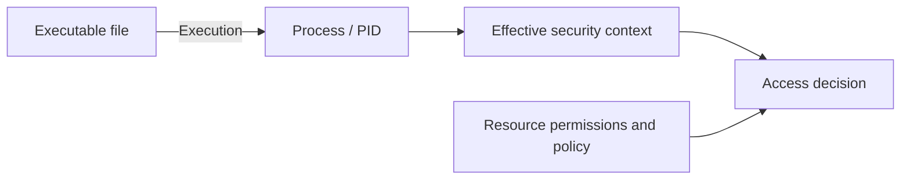

# 8강 — 계정·토큰·접근 권한 { #lesson-8-identity-tokens-and-permissions }

**학습 목표:** 관리자 계정, 관리자 권한으로 실행된 프로세스, 특정 자원에 대한 접근 권한을 각각의 증거로 판단합니다.

**보충:** 학습 중 나눈 권한 관련 질문을 자세히 풀어 설명합니다. 명령어와 단순화한 예시는 허가된 실습 환경을 기준으로 합니다.

## 파일이 실행되면 프로세스가 됨 { #file-and-process }

디스크의 Implant 실행 파일은 파일입니다. 실행하면 운영체제가 프로세스를 만듭니다. **PID, Process ID**는 그 시점에 실행 중인 프로세스를 식별하는 번호입니다. 같은 파일에서 여러 프로세스가 생길 수 있고, 프로세스 종료 후 운영체제가 PID를 재사용할 수도 있습니다.

프로세스와 연결된 계정은 ‘누구인가’를 이해하는 단서입니다. 어떤 동작이 허용되는지는 실제로 사용하는 보안 컨텍스트와 대상 자원의 보안 규칙을 함께 봐야 합니다.



## Sliver에서 계정 정보 확인 { #read-identity-information }

앞에서 선택한 대상을 **Sliver 콘솔**에서 확인합니다.

```text
info
help whoami
whoami
```

`info`는 서버가 보유한 Session·Beacon 정보를 표시합니다. 계정, PID, OS, 연결 정보 등이 포함됩니다. 배경 파악에 유용하지만 모든 권한을 새로 검사하는 명령은 아닙니다. 표시된 정보가 언제, 어떻게 수집되었는지 고려하세요. [Sliver info 구현](https://github.com/BishopFox/sliver/blob/master/client/command/info/info.go)

Sliver의 `whoami`는 선택한 Implant의 계정에 관한 명령입니다. 운영자 PC의 터미널에서 실행하는 명령과 입력 위치가 다릅니다. 설치한 버전의 도움말과 실제 출력을 확인하세요. 계정 이름만으로 토큰 승격 여부, 모든 그룹 속성, 원격 서버 접근 권한을 확정할 수 없습니다. Beacon 작업은 체크인과 결과 반환까지 기다려야 할 수도 있습니다.

## Access Token이 설명하는 것 { #access-token }

Windows의 **Access Token, 접근 토큰**은 프로세스나 스레드의 보안 컨텍스트를 나타냅니다. 계정의 신원, 그룹 정보, 특권 등이 포함됩니다. 스레드가 다른 보안 컨텍스트를 가장하는 경우도 있으므로, 심화 조사에서는 프로세스와 스레드 컨텍스트를 함께 볼 수 있습니다. [Microsoft: Access tokens](https://learn.microsoft.com/en-us/windows/win32/secauthz/access-tokens)

입문 단계에서는 다음 세 질문을 구분하면 됩니다.

| 질문 | 확인할 증거의 예 |
|---|---|
| 어떤 계정인가? | 계정 이름과 SID |
| 이 동작은 실제 어떤 컨텍스트로 실행되는가? | 토큰 승격 여부, 활성 그룹·특권, 무결성 수준 |
| 이 자원에서 이 동작을 해도 되는가? | 관련 접근 제어·정책 또는 범위가 적절한 검증 |

## 관리자 계정도 일반 권한의 프로세스를 실행할 수 있음 { #administrator-and-elevation }

UAC와 관리자 승인 모드에서는 로컬 Administrators 그룹에 속한 사용자도 보통 일반 프로그램을 제한된 토큰으로 실행합니다. 승격을 승인하면 관리용 토큰을 사용합니다. 따라서 계정의 그룹 소속만으로 Implant가 사용하는 컨텍스트를 알 수는 없습니다. [Microsoft: UAC 동작 원리](https://learn.microsoft.com/en-us/windows/security/application-security/application-control/user-account-control/how-it-works)

**설명용 예시입니다.**

| 관찰 | 알 수 있는 것 | 아직 모르는 것 |
|---|---|---|
| `LAB\student`가 로컬 Administrators에 속함 | 계정의 그룹 소속 | Implant가 승격되었는지 |
| 일반 편집기가 `LAB\student`로 실행됨 | 프로세스의 계정 | 관리용 토큰을 사용하는지 |
| 같은 계정으로 편집기를 명시적으로 승격하여 실행함 | 같은 계정에서도 프로세스 컨텍스트가 달라질 수 있음 | 특정 파일이 어떤 동작을 허용하는지 |

승격된 프로세스라는 사실이 확인되어도 무제한 접근을 뜻하지 않습니다. 자원 권한과 다른 통제가 영향을 줍니다. 한 컴퓨터의 로컬 관리자라는 사실도 다른 서버의 관리자 접근 권한을 자동으로 부여하지 않습니다.

## 읽기 성공과 쓰기·삭제 권한 { #resource-specific-rights }

Implant가 `report.txt`를 성공적으로 읽었다고 해 봅시다. 그 결과는 해당 동작에 사용된 컨텍스트에서 읽기가 성공했다는 증거입니다. 덮어쓰기나 삭제까지 가능하다는 증거는 아닙니다.

| 동작 | 따로 확인할 질문 |
|---|---|
| 디렉터리 목록 확인 | 이 컨텍스트가 해당 디렉터리를 열거할 수 있는가? |
| 파일 읽기 | 파일 내용을 읽을 수 있는가? |
| 쓰기·교체 | 내용을 수정하거나 파일 객체를 교체할 수 있는가? |
| 삭제 | 파일 또는 상위 디렉터리의 관련 권한이 삭제를 허용하는가? |

**ACL, Access Control List**은 객체의 접근 규칙을 설명하는 목록입니다. 폴더와 그 안의 파일은 실효 권한이 다를 수 있습니다. 읽기가 성공해도 쓰기·삭제 권한은 **아직 입증되지 않은 상태**입니다. 쓰기·삭제가 금지되었다고 입증된 것도 아닙니다. ‘읽기 성공, 쓰기·삭제 미평가’라고 기록하세요.

권한 확인을 위해 불필요하게 파일을 삭제하지 않습니다. 수정 검증이 명시적으로 필요한 실습에서는 실습용으로 만든 폐기 가능한 객체를 사용합니다.

## 관찰 결과 해석 예시 { #worked-interpretation }

```text
Observed: Account belongs to local Administrators.
Observed: Implant returned the contents of a lab file.
Unknown: Implant token elevation.
Unknown: Permission to modify or delete that file.
Unknown: Authentication and authorization on another server.
```

결론도 관찰한 범위에 맞춰야 합니다. HTTP 200, Beacon 체크인, Defender 이벤트를 해석할 때와 같은 원리입니다. 관찰 하나가 입증하는 단계나 능력은 정해져 있습니다.

## 확인 문제 { #review-questions }

1. Implant의 계정이 Administrators에 속합니다. Implant가 관리자 권한으로 실행되었다고 확정할 수 있을까요?
2. 파일을 읽었습니다. 덮어쓰기나 삭제도 할 수 있다고 확정할 수 있을까요?

??? success "정답과 해설"
    **1. 아니요.** 그룹 소속은 계정에 대한 정보입니다. UAC 때문에 그 계정의 프로세스가 제한된 컨텍스트를 사용할 수 있습니다. 관리자 권한으로 실행되었다고 판단하려면 실제 동작에 사용된 컨텍스트를 확인해야 합니다.

    **2. 아니요.** 읽기, 쓰기, 교체, 삭제는 별개의 동작입니다. 읽기 성공이 입증하는 것은 해당 읽기 동작입니다. 다른 권한은 적절한 증거가 생길 때까지 알 수 없습니다.

[이전: 백신·EDR](lesson-7-antivirus-edr-and-detection-evidence.md) · [다음: 포트포워딩과 SOCKS5](lesson-9-port-forwarding-and-socks.md)
