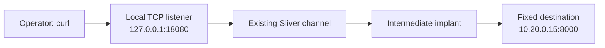
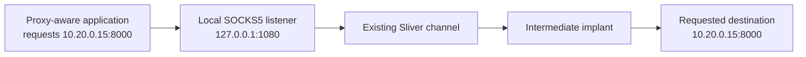

# 9강 — 포트포워딩과 SOCKS5 { #lesson-9-port-forwarding-and-socks }

**학습 목표:** Implant가 있는 호스트를 거쳐 실습 서비스에 연결하고, 목적지가 고정된 TCP 포워딩과 SOCKS5 프록시를 구분합니다.

**보충:** 네트워크 관련 대화를 구체적인 예제로 확장합니다. 다음 강의에서는 두 기법을 내부 SSH 서버에 적용합니다.

## 세 가지 관문 { #three-gates }

| 관문 | 질문 | 통과해도 아직 입증되지 않은 것 |
|---|---|---|
| 도달 가능성 Reachability | 이 컴퓨터가 대상 서비스에 연결할 수 있는가? | 유효한 로그인 자격 증명 |
| 인증 Authentication | 서비스가 이 신원을 받아들이는가? | 모든 동작에 대한 권한 |
| 인가 Authorization | 이 계정에 요청한 동작을 허용하는가? | 다른 자원에 대한 무제한 접근 |

**Pivoting, 피벗팅**은 중간 호스트의 연결 가능성을 이용합니다. 중간 호스트에 목적지로 통신할 수 있는 경로와 허용 조건이 있어야 합니다. 터널이 자격 증명을 제공하거나 중간 호스트에 없던 네트워크 경로를 만들어 주지는 않습니다.

Sliver의 `portfwd`와 `socks5`는 기존 C2 채널을 통해 애플리케이션 연결을 전달합니다. 별도의 `pivots` 기능은 Implant 사이의 C2 연결을 다루므로 이 두 명령과 같은 의미로 쓰면 안 됩니다.

## 실습 호스트와 준비 { #lab-and-preparation }

| 역할 | 주소 | 전제 |
|---|---|---|
| 운영자와 Sliver 콘솔 | `192.168.56.10` | Linux; Client와 Server를 이 VM에서 실행 |
| 중간 Implant 호스트 | `192.168.56.20` | Windows; 내부 호스트로 통신 가능 |
| 내부 테스트 서비스 | `10.20.0.15:8000` | Linux; 전용 실습 HTTP 서버 |

라우팅과 방화벽 규칙은 미리 구성되어 있다고 가정합니다. 운영자는 내부 서비스에 직접 연결할 수 없고, 중간 호스트는 연결할 수 있습니다. IP 주소를 다르게 적는 것만으로 이런 분리가 구현되지는 않습니다.

**내부 Linux VM의 콘솔**에서 실습 자료만 있는 전용 폴더로 이동한 후 실행합니다.

```bash
printf '%s\n' 'INTERNAL LAB OK' > index.html
python3 -m http.server 8000 --bind 10.20.0.15
```

테스트 페이지를 만들고 해당 디렉터리를 제공합니다. 이 터미널은 열어 둡니다. **Windows 중간 VM의 PowerShell**에서 정해진 목적지 하나를 확인합니다.

```powershell
Test-NetConnection -ComputerName 10.20.0.15 -Port 8000
```

`TcpTestSucceeded: True`는 그 시점에 그 호스트에서 TCP 연결이 가능했다는 증거입니다. HTTP 내용, 인증, 애플리케이션 내부 권한까지 입증하지는 않습니다.

## 대화형 Session 사용 { #interactive-session }

확인한 Sliver 명령 정의에서 이 `portfwd`와 `socks5`는 **Session**을 대상으로 합니다. 먼저 설치한 버전의 도움말을 확인합니다.

```text
help portfwd
help socks5
sessions
```

살아 있는 Session이 있으면 실제 ID로 선택합니다.

```text
sessions --interact <Session_ID>
```

꺾쇠괄호 부분을 콘솔에 표시된 값으로 바꿉니다. 괄호 자체는 입력하지 않습니다. Beacon만 있다면 해당 Beacon을 선택하고 추가 대화형 Session을 요청합니다.

```text
beacons
beacons --interact <Beacon_ID>
interactive
```

작업이 전달되고 새 Session이 연결될 때까지 기다립니다. 이후 `sessions`와 `sessions --interact <Session_ID>`로 새 Session을 확인·선택합니다. Beacon을 선택하는 것만으로 Session으로 바뀌지는 않습니다. 새 연결에는 동작 중인 Listener와 지원되는 C2 설정도 필요합니다. [Sliver Session 명령 정의](https://github.com/BishopFox/sliver/blob/master/client/command/sessions/commands.go)

## 포트포워딩: 목적지를 미리 고정 { #port-forwarding }



**중간 호스트의 Session을 선택한 Sliver 콘솔**에서 입력합니다.

```text
portfwd add --bind 127.0.0.1:18080 --remote 10.20.0.15:8000
portfwd
```

| 인자 | 의미 |
|---|---|
| `--bind 127.0.0.1:18080` | Sliver 콘솔이 실행되는 컴퓨터의 루프백 18080 포트에서 대기 |
| `--remote 10.20.0.15:8000` | 선택한 Implant가 연결할 고정 목적지 |

TCP 연결을 전달하며, 애플리케이션은 계속 HTTP를 사용합니다. `portfwd`는 ID를 포함한 포워딩 목록을 표시합니다. 목록에 있다는 사실은 로컬 Listener 설정을 보여 줄 뿐, 최종 서비스와 통신이 성공했다는 증거는 아닙니다. [명령 인자 정의](https://github.com/BishopFox/sliver/blob/master/client/command/portfwd/commands.go), [Client 측 Listener 구현](https://github.com/BishopFox/sliver/blob/master/client/command/portfwd/portfwd-add.go)

**운영자 VM에서 별도의 Linux 터미널**을 열어 실행합니다.

```bash
curl --noproxy "*" --max-time 10 -i http://127.0.0.1:18080/
```

`--noproxy "*"`는 환경 변수에 설정된 HTTP 프록시를 이 테스트에서 사용하지 않게 합니다. `--max-time 10`은 전체 시도를 10초로 제한하고, `-i`는 응답 헤더를 표시합니다. 예상한 `INTERNAL LAB OK` 본문이 오면 이 요청이 포워딩을 거쳐 전달되었다는 증거입니다. 시간 초과만으로 어느 구성 요소가 실패했는지는 특정할 수 없습니다.

여기서 `127.0.0.1`은 Implant가 아니라 **운영자 VM**입니다. Client와 Server가 다른 컴퓨터에서 실행된다면 로컬 Listener가 만들어진 Client 컴퓨터에서 애플리케이션을 실행합니다.

## SOCKS5: 애플리케이션이 목적지를 요청 { #socks5 }



같은 Session을 선택한 **Sliver 콘솔**에서 입력합니다.

```text
socks5 start --host 127.0.0.1 --port 1080
socks5
```

로컬 SOCKS5 Listener를 만듭니다. 고정 포워딩과 달리 시작 명령에 최종 내부 서비스를 지정하지 않습니다. 애플리케이션이 SOCKS 프로토콜로 목적지를 전달합니다. [SOCKS5 인자 정의](https://github.com/BishopFox/sliver/blob/master/client/command/socks/commands.go), [Listener 구현](https://github.com/BishopFox/sliver/blob/master/client/command/socks/socks-start.go)

**운영자의 별도 Linux 터미널**에서 실행합니다.

```bash
curl --noproxy "" --socks5-hostname 127.0.0.1:1080 --max-time 10 -i http://10.20.0.15:8000/
```

| 부분 | 의미 |
|---|---|
| `--socks5-hostname 127.0.0.1:1080` | 이 SOCKS5 프록시 사용; 목적지에 호스트 이름을 쓸 경우 프록시 측에 이름 해석 요청 |
| `--noproxy ""` | `NO_PROXY` 설정 때문에 명시한 프록시를 건너뛰는 상황 방지 |
| `http://10.20.0.15:8000/` | 최종 요청할 서비스 |

이 예시는 숫자 IP이므로 목적지 DNS 해석 차이가 결과를 바꾸지 않습니다. 예상한 응답은 이 특정 프록시 요청의 성공을 뒷받침합니다. [curl 옵션 설명](https://curl.se/docs/manpage.html)

SOCKS5를 시작해도 모든 프로그램이 자동으로 사용하지는 않습니다. 클라이언트가 SOCKS를 지원하거나 적합한 연결 도구를 사용해야 합니다. 1080 포트에 일반 HTTP만 보내면 SOCKS 연결 협상이 되지 않습니다. 이 예시는 범용 VPN이 아니며 모든 프로토콜·UDP·ICMP 지원을 입증하지도 않습니다.

## 기법 선택과 증거 해석 { #comparison-and-evidence }

| 구분 | 고정 포트포워딩 | SOCKS5 |
|---|---|---|
| 목적지 지정 위치 | Sliver `portfwd add` | 프록시를 사용하는 각각의 클라이언트 연결 |
| 예시에서 애플리케이션이 지정하는 대상 | `127.0.0.1:18080` | 프록시를 통해 `10.20.0.15:8000` |
| 애플리케이션 프록시 설정 | 이 로컬 TCP 연결에서는 불필요 | 필요 |
| 처음 연습하기 좋은 상황 | 알고 있는 서비스 하나 | 목적지를 선택해서 연결할 수 있는 클라이언트 |

HTTP `401`·`403`은 애플리케이션 응답입니다. HTTP를 사용하는 어떤 엔드포인트가 응답했지만 접근은 제한된 상황일 수 있습니다. 응답 주체와 메시지를 확인한 후 터널 문제인지, 의도한 목적지가 확인된 것인지 판단하세요.

## 실습 종료 { #cleanup }

Sliver에서 목록을 확인하고 **이번 실습에서 만든 ID만** 정리합니다.

```text
portfwd
portfwd rm --id <Forward_ID>
socks5
socks5 stop --id <Proxy_ID>
```

포워딩과 SOCKS5의 ID 목록은 별개입니다. 내부 VM에서는 `Ctrl+C`로 임시 HTTP 서버를 종료합니다.

## 확인 문제 { #review-questions }

1. `portfwd` 목록에 항목이 있습니다. 내부 서비스가 응답한 것이 확실할까요?
2. SOCKS5가 대기 중입니다. 일반 클라이언트가 자동으로 사용하게 될까요?
3. 터널을 통해 SSH 서비스에 도달했습니다. 사용자 인증도 성공한 것일까요?

??? success "정답과 해설"
    **1. 아니요.** 로컬 Listener 설정과 종단 간 요청 성공은 다른 관찰입니다. 실제로 사용할 애플리케이션으로 요청하고 결과를 확인해야 합니다.

    **2. 아니요.** 해당 클라이언트에 SOCKS 지원이나 적합한 연결 도구를 설정해야 합니다. 프록시 시작이 컴퓨터의 모든 트래픽을 바꾸지는 않습니다.

    **3. 아니요.** 도달 가능성, 인증, 인가는 별개의 관문입니다. 다음 강의에서 실습용 SSH 계정으로 확인합니다.

[이전: 계정과 권한](lesson-8-identity-tokens-and-permissions.md) · [다음: 웹 서버 경유 내부 SSH 실습](lesson-10-web-server-to-internal-ssh-lab.md)
