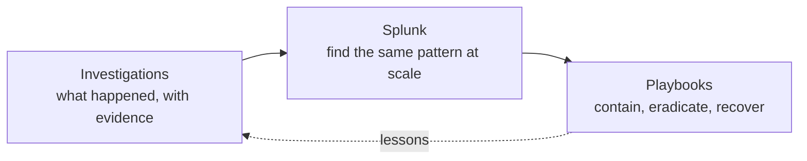

# Blue Team { #blue-team }

The defender's side of the handbook: hands-on **packet and log investigations**, **Splunk** for searching and hunting, and **playbooks** for responding. The reference sections ([Network](../network/index.md), [Windows](../windows/index.md), [Adversary](../adversary/index.md)) explain *what* the evidence is; this tab shows it *being used* on real cases.

-   :material-file-search-outline:{ .lg .middle } **Investigations**

    ---

    Step-by-step walkthroughs of PCAP and log investigations, from opening the evidence to the final report. Every command, its output and why it answers the question.

    [:octicons-arrow-right-24: Investigations](investigations/index.md)

-   :material-magnify-scan:{ .lg .middle } **Splunk**

    ---

    SPL cheat sheet, data discovery, field extraction, security searches by question, hunting patterns and the BOTSv3 workflow.

    [:octicons-arrow-right-24: Splunk](splunk/index.md)

-   :material-clipboard-list:{ .lg .middle } **Playbooks**

    ---

    Repeatable response procedures: ransomware, compromised workstation, account compromise, lateral movement, exfiltration, web shell.

    [:octicons-arrow-right-24: Playbooks](playbooks/index.md)

## How the three fit together { #how-they-fit }

An investigation finds the pattern (for example "a Word document followed by POSTs to `/forum.php` every two minutes"). Splunk turns it into a search you can run across the whole estate. The playbook says what to do with every host that matches.

!!! info "Adding pages"
    `python new.py blueteam/investigations/<name> -t playbook` for a new case write-up, `python new.py blueteam/splunk/<name>` for a Splunk page. New files appear in the sidebar automatically.
