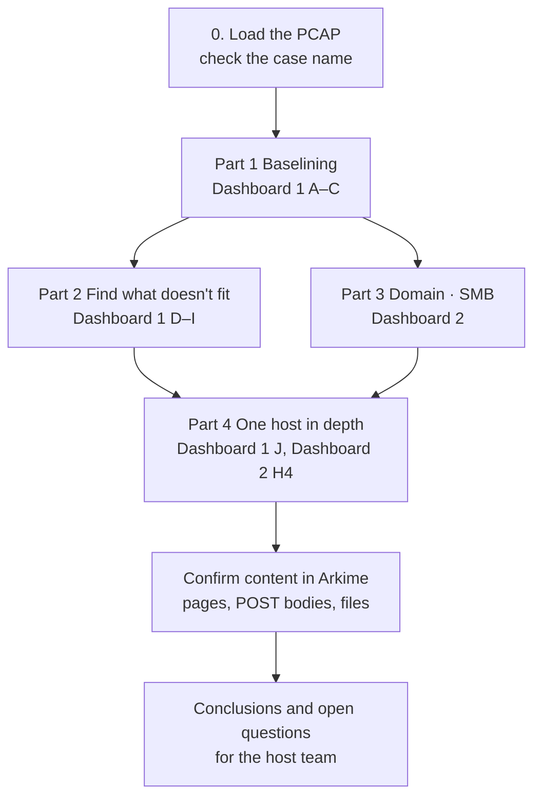

# Analysing a PCAP with the Dashboards { #analysis-workflow }

<div class="dfir-meta" markdown>
**Category:** Splunk · **Uses:** Dashboard 1 (traffic overview), Dashboard 2 (SMB · domain), Arkime · **Last updated:** 2026-11-26
</div>

!!! abstract "What this page does"
    A checklist of **which panels to read, in which order, and what to note** when a new PCAP arrives. Then a table of **where each attack type shows up**, one real lab scene (Night Dew) read through the dashboards, and the **Windows event IDs** to hand to the host team.

## The big picture { #flow }



**Principle:** don't hunt for bad things first. **Draw normal first** (baselining), then look for what **doesn't fit** it. In your notes, keep what you saw (**[data]**) apart from what you suspect (**[guess]**).

## Part 1 — Baselining (Dashboard 1, A–C) { #baseline }

- [ ] Pick the **Case**, **Time range = All time**, Host IP = `*`.
- [ ] **A1–A3** note capture start, end and length → set Timeline bucket to match (30 min → `1m`, hours → `5m`–`10m`).
- [ ] **A4–A8** connections, internal hosts, external destinations, bytes sent and received. Sent > received → note **possible exfiltration**.
- [ ] **B1** which logs exist and which don't. With `kerberos`/`smb_*`/`dce_rpc`, do Part 3. Without `http`, section F is empty.
- [ ] **B2–B4** services, connection states, protocols. Many `(not recognised)` or `S0`/`REJ`?
- [ ] **B6** note unfamiliar ports.
- [ ] **C1** internal hosts — who is the main character (most connections)?
- [ ] **C2** per IP: name, domain, users, MAC, OS.
- [ ] **C3** server roles — DC, DNS, DHCP, gateway, file/web/mail. Note **any PC that looks like a server**.
- [ ] **C4** with DHCP, check MAC vendors and names.

After baselining you should be able to write something like:

> 2026-01-20 01:00–01:43 UTC (43 min), 3 internal hosts (DC01 10.0.0.10, PC-01 10.0.0.101 alice, PC-02 10.0.0.102 bob), domain LAB. 41 external destinations, mostly HTTPS. The DC handles DNS, Kerberos, LDAP and SMB; gateway 10.0.0.1 does DHCP. PC-02 also appears as an SMB server (to check).

## Part 2 — Find what doesn't fit (Dashboard 1, D–I) { #hunt }

- [ ] **D1** external destinations — no name, odd port, small repeated bytes.
- [ ] **D2** rare places visited once (in time order) — download server candidates.
- [ ] **D3** connections on ports other than 80/443/53/123, and their states.
- [ ] **D4** repeated connections with low jitter (< 0.2) — beacon candidates; check the names (D1, G2) for normal services.
- [ ] **D5** pairs that sent a lot — exfiltration candidates.
- [ ] **E5** read DNS names in **first-asked order** — the plot of the story.
- [ ] **E4, E6** rare names, long odd names, NXDOMAIN, TXT.
- [ ] **F5** rare User-Agents — a non-browser program?
- [ ] **F6** repeated POSTs — C2 check-ins?
- [ ] **F7** downloaded programs and documents, **disguised EXEs** (red).
- [ ] **F9** Referer chain — compromised site → redirect → payload.
- [ ] **G3, G4** TLS without SNI, TLS off 443, **self-signed certificates**.
- [ ] **H3, H4** file hashes and Windows program (PE) details.
- [ ] **I1–I4** Snort, Zeek weird, notice — line their times up with other panels.

## Part 3 — Windows domain and SMB (Dashboard 2) { #domain }

- [ ] **A numbers** — any red cells (HIGH RPC, admin shares, NTLM failures, Kerberos errors)?
- [ ] **B1** SMB pairs — any **PC → PC**? Pairs with large sent bytes?
- [ ] **B4** 445 scanning — one source failing against many IPs.
- [ ] **C1–C3** pipe, endpoint and operation pies. One slice filling the pie → **C8 bursts**.
- [ ] **C5** risky RPC calls (HIGH first).
- [ ] **D6, D7** programs on admin shares, PsExec/C2 pipe names.
- [ ] **D8, D9** mass deletes/renames (ransomware), sensitive file names.
- [ ] **E6, E8** admin shares, SMB to non-DC hosts.
- [ ] **F6, F7** guessing / spraying, accounts used in many places.
- [ ] **G3, G4** what the Kerberos errors mean, RC4 tickets (Kerberoasting).
- [ ] **H1** lateral movement checklist — a verdict per pair.
- [ ] **H4** domain story timeline — read row by row around the suspicious time.

## Part 4 — One host in depth, and Arkime { #deep-dive }

1. Type the suspicious IP into **Host IP**; every panel in both dashboards narrows to it.
2. Read everything the host did in dashboard 1 **J1**; click the row at the suspicious time to open **J2** (all records of that uid).
3. What Splunk can't show — page content, POST bodies, file content — open in **Arkime** by time, IP and port: `ip == 10.0.0.101 && port == 445`. In pcapbox add `tags == <case>`.
4. Write up what you found **in time order** (the H4 table is a ready-made start).

## Attack type → where it shows { #pattern-map }

| Attack / behaviour | Dashboard 1 | Dashboard 2 | One-line clue |
|---|---|---|---|
| Compromised site → exploit kit | F9, F7, E5 | — | Flash/EXE/odd page at the end of a Referer chain |
| Malicious document / script download | F7, H3, F5 | — | No Referer + new User-Agent, disguised EXE |
| HTTP C2 beacon | D4, F6, F5 | — | Steady POSTs to one address, odd UA |
| HTTPS C2 | D4, G3, G4 | — | No SNI, non-443 port, self-signed certificate |
| Dead / blocked C2 | D3, B3 | — | Only `S0`/`REJ` at a steady interval |
| DNS tunnel / DGA | E6, E2 | — | Long random names, TXT, many NXDOMAIN |
| Data exfiltration | A7, D5 | B3 | Sent ≫ received |
| SMB scan / worm (EternalBlue) | B6 | B4, I1 | One source hitting many IPs on 445, mostly failing |
| Password guessing (SMB/NTLM) | — | F6, A11 | Many failures for one user |
| Password guessing (via netlogon) | — | C8, C3 | Hundreds of `NetrLogonSamLogonWithFlags` |
| Password spraying | — | F6, G3 | Many users, 1–2 failures each, `PREAUTH_FAILED` |
| User name enumeration | — | G3 | Many `KDC_ERR_C_PRINCIPAL_UNKNOWN` |
| Kerberoasting | — | G4, G7 | RC4 TGS for many services, SPN searches |
| AD recon (BloodHound) | — | C5, C8, G7 | samr listing, `NetrSessionEnum`, broad LDAP searches |
| PsExec / smbexec | C3 | H1, D6, D7, C5 | ADMIN$ + EXE + svcctl `CreateServiceW` + `PSEXESVC` pipe |
| Remote scheduled task (atexec) | — | H1, C5 | atsvc `JobAdd`, `SchRpcRegisterTask` |
| WMI / DCOM remote execution | — | H1, H2, C5 | 135 then a high port, `IWbemServices ExecMethod` |
| Pass-the-hash | — | F5, F7, H1 | Admin account over NTLM PC → PC, many targets |
| DCSync | — | H3, C5 | `DRSGetNCChanges` from a PC |
| Hive / NTDS theft | — | D9, H3 | `ntds.dit`, `sam`/`system` copies, `BaseRegSaveKey` |
| Coercion (PetitPotam, PrinterBug) | — | C5, H3 | `EfsRpc*`, `RpcRemoteFindFirstPrinterChangeNotificationEx` |
| Ransomware (share encryption) | — | D8, D4 | Hundreds of `FILE_RENAME` in minutes, one new extension |
| RDP / WinRM movement | B6 | H2 | Internal → internal 3389, 5985 |

## Example: reading the Night Dew netlogon burst with the dashboards { #night-dew-example }

Follow the values actually seen in the [Night Dew case](../../investigations/night-dew-hancitor-pony-zeus-panda-tls-c2.md).

1. **Dashboard 1 C1** — the PC (10.0.14.129) sent about 948 KB, while **A7** (sent to external) is far smaller: the rest went **inside**. **B6** shows the DC's (10.0.14.3) high port `49158`.
2. **Dashboard 2 A6** — a large DCE/RPC count; the **C3 RPC Operations** pie is almost one colour.
3. **C8 bursts**:

    ```text
    minute            id_orig_h     id_resp_h   endpoint  operation                    calls
    2018-05-11 02:08  10.0.14.129   10.0.14.3   netlogon  NetrLogonSamLogonWithFlags   1522
    ```

4. **Click the C3 slice** to put `NetrLogonSamLogonWithFlags` in the operation box. In **C9 DCE_RPC Timeline** only the 02:08 bucket towers; in **C10** the first call is at **02:08:12.836**.
5. The pipe in **C1** is `49158` — RPC **straight over a high TCP port**, not an SMB pipe.
6. Earlier in **H4 domain story**: the normal logon cluster at 02:06:52 (`ept_map`, `NetrServerReqChallenge`, `NetrServerAuthenticate3`, `DRSCrackNames`); then the burst starts **0.6 s after** the second malicious POST (02:08:12.248) seen in dashboard 1 **F6**.
7. Conclusion — **[data]** the PC asked the DC to validate NTLM credentials 1,522 times in 32 seconds. **[guess]** malware trying a built-in password list against accounts. Which accounts and passwords, and whether any worked, is encrypted and not visible in traffic → ask the host team for DC event **4776**.

## Event IDs to hand to the host team { #host-handoff }

Traffic tells you **who, when, from where to where**; host logs tell you **what ran and whether it worked**.

| Seen in traffic | Host to check | Event ID (log) | Meaning |
|---|---|---|---|
| NTLM/Kerberos logon | target PC | **4624** (Security) | Logon success; type 3 = network (SMB), 10 = RDP |
| Logon failure | target PC | **4625** (Security) | Logon failed; sub-status `0xC000006A` wrong password, `0xC0000064` no such user |
| NTLM validation burst | DC | **4776** (Security) | DC validated NTLM credentials; result `0x0` = success |
| Kerberos password error | DC | **4771** (Security) | Kerberos pre-authentication failed |
| RC4 service tickets | DC | **4769** (Security) | Service ticket requested; encryption `0x17` = RC4 |
| Account locked | DC | **4740** (Security) | Account locked out |
| Share mapping (ADMIN$, C$) | target PC | **5140** (Security) | Network share accessed |
| Files / pipes in a share | target PC | **5145** (Security) | Access check on an object in a share (pipe names too) |
| svcctl `CreateServiceW` | target PC | **7045** (System), **4697** (Security) | New service installed — name and executable path |
| Remote scheduled task | target PC | **4698** (Security), **106** (TaskScheduler) | Scheduled task created |
| Remote WMI execution | target PC | **4688** (Security) | New process with parent `WmiPrvSE.exe` |
| DCSync | DC | **4662** (Security) | Directory object access with replication rights GUIDs |
| Account created / group change | DC | **4720**, **4728**, **4732** | User created, added to a global / local group |
| Remote log clearing | target PC | **1102** (Security), **104** (System) | Audit log / System log cleared |

Related: [Windows Event IDs](../../../basics/windows-event-ids.md) · [Lateral movement / domain playbook](../../playbooks/lateral-domain.md) · [PsExec & SMB](../../../adversary/psexec-smb.md)
