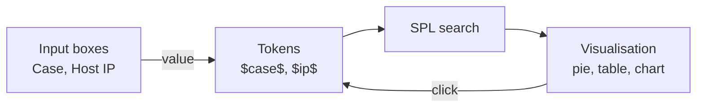

# Dashboard Basics (Simple XML) { #dashboard-basics }

<div class="dfir-meta" markdown>
**Category:** Splunk · **For:** first-time dashboard builders · **Last updated:** 2026-11-26
</div>

!!! abstract "What you learn here"
    Starting from saving one search as a panel, you learn **every Simple XML feature used in the two dashboards** — inputs, tokens, `$$`, CDATA, base searches, click filters, colours, in-panel dropdowns — each with a small example. At the end you add a panel yourself.

## Why Classic (Simple XML) { #why-classic }

Splunk has two dashboard types.

| | Classic (Simple XML) | Dashboard Studio |
|---|---|---|
| Format | XML text | JSON text |
| Writing / copying by hand | Easy; a panel is a few lines | Long and nested |
| Click filters, in-panel inputs, base searches | All supported | Supported (different syntax) |
| Docs and examples | Plenty | Fewer |

This guide uses Classic because it is **easy to paste and easy to read line by line**. Later you can move a dashboard with Dashboard Studio's **Import → Classic dashboard**.

## What a dashboard is made of { #parts }



- **search** — each panel has one SPL search.
- **visualisation** — draws the result as a number, pie, bars or a table.
- **input** — puts the user's choice into a **token**.
- **token** — a placeholder like `$name$`. `$case$` in a search is replaced with the box value before the search runs.
- **drilldown** — what happens on click; usually puts the clicked value into a token.

## 1. Your first panel — from the Search app { #first-panel }

1. Run this in **Search & Reporting** with time range **All time**.

    ```spl
    index=zeek sourcetype=zeek:conn
    | fillnull value="(not recognised)" service
    | stats count by service
    | sort - count
    ```

    - Line 1: Zeek connection logs only.
    - Line 2 `fillnull value="..." service` — writes `(not recognised)` into events whose `service` is **empty** (Zeek did not recognise the protocol). Without it the next line `stats ... by service` **drops** those events (an empty by-field removes the row).
    - Line 3 `stats count by service` — count per service.
    - Line 4 `sort - count` — biggest first.

    ```text
    service            count     ← example result
    dns                5310
    ssl                2190
    (not recognised)   1874
    http               1120
    krb_tcp            61
    smb,gssapi,krb     18
    ```

2. **Visualization** tab above the results → chart type **Pie Chart**.
3. **Save As → Existing Dashboard** (or **New Dashboard**; for new, enter a title and choose **Classic Dashboards**). **Panel Title**: `Connections by service` → **Save**.
4. **View Dashboard** shows a one-pie dashboard.

Now look at what it is underneath.

## 2. View the Source — the XML skeleton { #skeleton }

Dashboard → **Edit** → **Source** shows something like:

```xml
<dashboard version="1.1" theme="dark">
  <label>My first dashboard</label>
  <row>
    <panel>
      <title>Connections by service</title>
      <chart>
        <search>
          <query>index=zeek sourcetype=zeek:conn | fillnull value="(not recognised)" service | stats count by service | sort - count</query>
          <earliest>0</earliest>
          <latest></latest>
        </search>
        <option name="charting.chart">pie</option>
      </chart>
    </panel>
  </row>
</dashboard>
```

| Line | Meaning |
|---|---|
| `<dashboard version="1.1" theme="dark">` | Start. `version="1.1"` = current Classic format, `theme="dark"` = dark background |
| `<label>` | Dashboard title |
| `<row>` | **One horizontal row**; several panels in it share the width equally |
| `<panel>` | One box |
| `<title>` | Panel title |
| `<chart>` | Visualisation type. Pie, bar and line are all `<chart>` with the `charting.chart` option; a single number is `<single>`, a table `<table>` |
| `<search>` / `<query>` | The panel's SPL |
| `<earliest>0</earliest><latest></latest>` | Time range. `0` = from 1970 = **All time**; empty latest = now |
| `<option name="..">` | Display settings |

Two XML rules: **every `<x>` needs its `</x>`**, and **`<`, `>`, `&` cannot appear as plain text** — the fix is in [section 4](#dollar-cdata).

## 3. Inputs and tokens { #inputs-tokens }

For inputs, change the outer `<dashboard>` to **`<form>`** and put the inputs inside `<fieldset>`.

```xml
<form version="1.1" theme="dark">
  <label>Token practice</label>
  <fieldset submitButton="false" autoRun="true">
    <input type="time" token="tp" searchWhenChanged="true">
      <label>Time range</label>
      <default>
        <earliest>0</earliest>
        <latest></latest>
      </default>
    </input>
    <input type="text" token="idx" searchWhenChanged="true">
      <label>Zeek index</label>
      <default>zeek</default>
    </input>
    <input type="text" token="ip" searchWhenChanged="true">
      <label>Host IP</label>
      <default>*</default>
    </input>
  </fieldset>
  <row>
    <panel>
      <title>Connections by service</title>
      <chart>
        <search>
          <query>index=$idx$ sourcetype=zeek:conn (id_orig_h="$ip$" OR id_resp_h="$ip$") | fillnull value="(not recognised)" service | stats count by service</query>
          <earliest>$tp.earliest$</earliest>
          <latest>$tp.latest$</latest>
        </search>
        <option name="charting.chart">pie</option>
      </chart>
    </panel>
  </row>
</form>
```

- `<fieldset submitButton="false" autoRun="true">` — the input group. No **Submit** button (search as soon as a value changes); run on first load.
- `<input type="time" token="tp">` — time picker; the range becomes **`$tp.earliest$`** and **`$tp.latest$`**.
- `<input type="text" token="idx">` — text box; its text becomes **`$idx$`**. `<default>zeek</default>` = initial value.
- `searchWhenChanged="true"` — rerun searches using this token when it changes.
- `index=$idx$` becomes `index=zeek` before the search runs.
- `(id_orig_h="$ip$" OR id_resp_h="$ip$")` — with `*`, `id_orig_h="*"` matches **any value**, i.e. no filter. With `10.0.14.129`, the IP matches **as source or destination**.

!!! warning "Never leave a box empty"
    An empty token freezes every panel that uses it at **"Search is waiting for input…"**. To see everything, type `*`, don't clear it.

## 4. A literal `$`, and CDATA { #dollar-cdata }

**① `$$`** — Simple XML reads every `$...$` as a token. SMB is full of names with `$` (`IPC$`, `ADMIN$`, `C$`), and computer accounts end with `$` (`PC-01$`). Inside a dashboard, write **a literal `$` as `$$`**.

| Goal | Search app | Dashboard XML |
|---|---|---|
| ADMIN$ share | `share="ADMIN$"` | `share="ADMIN$$"` |
| Names ending in `$` | `like(share,"%$")` | `like(share,"%$$")` |
| Regex end anchor | `match(f,"\.exe$")` | `match(f,"\.exe$$")` |

When you **copy a dashboard query into the Search app, change `$$` back to `$`**. Queries printed in this guide already use a single `$`.

**② CDATA** — SPL often has `<` and `>` (e.g. `where count>=50`), which XML reads as tags. Text between `<![CDATA[` and `]]>` is treated as **plain text**.

```xml
<query><![CDATA[
index=$idx$ sourcetype=zeek:dce_rpc
| stats count by operation
| where count>=50
]]></query>
```

- **Tokens are still replaced** inside CDATA (`$idx$` → `zeek`); the `$$` rule still applies.
- Every query in both dashboards sits in CDATA, so they can span lines and use `<`, `>` freely.

## 5. Dropdowns — static and search-filled { #dropdown }

The **Case** dropdown fills itself from the case names in Splunk.

```xml
<input type="dropdown" token="case" searchWhenChanged="true">
  <label>Case (pcap_case)</label>
  <choice value="*">All data</choice>
  <default>*</default>
  <fieldForLabel>pcap_case</fieldForLabel>
  <fieldForValue>filter</fieldForValue>
  <search>
    <query><![CDATA[
index=$idx$ sourcetype=zeek:conn
| stats count by pcap_case
| eval filter="pcap_case=\"".pcap_case."\""
| sort pcap_case
]]></query>
    <earliest>0</earliest>
    <latest>now</latest>
  </search>
</input>
```

- `<choice value="*">All data</choice>` — a **static choice** that is always there; picking it sets `$case$` = `*`.
- `<search>` — fills the other choices: one result row = one choice.
- `<fieldForLabel>pcap_case</fieldForLabel>` — the text **shown** comes from `pcap_case`.
- `<fieldForValue>filter</fieldForValue>` — the value **put into the token** comes from `filter`.
- `eval filter="pcap_case=\"".pcap_case."\""` — builds the **whole condition**, e.g. `pcap_case="20180511_NIGHT_DEW"`. `.` joins strings; `\"` is a literal double quote.

**Why put the whole `pcap_case="..."` into the token?** If the search said `pcap_case="$case$"` with All = `*`, then `pcap_case="*"` would match **only events that have a `pcap_case` field** — nothing at all in a team environment without that field. Writing just **`$case$`** in the search, with a bare `*` for All (= every event) and `pcap_case="name"` for a case, works in both environments.

## 6. Visualisation types and common options { #visualizations }

| Visualisation | Tag | Result shape | Common options |
|---|---|---|---|
| Single number | `<single>` | 1 row × 1 column (`stats count as v`) | `underLabel`, `colorMode` (`none`/`block`), `rangeValues`, `rangeColors` |
| Pie | `<chart>` + `charting.chart=pie` | 2 columns: name, number | `charting.chart.showPercent`, `charting.chart.sliceCollapsingThreshold` (when small slices fold into "other") |
| Column | `<chart>` + `column` | `timechart` output, or name + numbers | `charting.chart.stackMode=stacked`, `charting.legend.placement=bottom` |
| Bar | `<chart>` + `bar` | name + numbers | `charting.legend.placement` |
| Table | `<table>` | anything | `count` (rows per page), `wrap`, `drilldown` (`none`/`row`/`cell`) |

Any visualisation takes `<option name="height">300</option>`.

## 7. Time charts — `eval _time=ts` + `timechart` { #timechart }

```spl
index=zeek sourcetype=zeek:dce_rpc
| eval _time=ts
| timechart span=1m limit=12 useother=t count by endpoint
```

- `eval _time=ts` — overwrite Splunk's time field `_time` with **Zeek's own timestamp `ts`**. Some environments stamp `_time` with the load date (2026), so charts always use `ts`. Where `_time` is already right (pcapbox), nothing changes.
- `timechart` — cuts `_time` into equal buckets and calculates per bucket.
- `span=1m` — one bucket = 1 minute. In the dashboards: `span=$span$` (Timeline bucket box).
- `count by endpoint` — count per bucket per `endpoint`; each value becomes one colour.
- `limit=12 useother=t` — draw the top 12 separately, fold the rest into `OTHER`.

```text
_time               epmapper  lsarpc  netlogon  drsuapi    ← Night Dew lab values (as a table)
2018-05-11 02:06    4         0       4         8
2018-05-11 02:07    0         0       0         0
2018-05-11 02:08    0         1       1522      0
```

Drawn as `column` + `stacked`, each bucket is a stacked bar. A **sudden tall bar** is the time to check in the detail table.

## 8. Base searches and post-processing { #base-search }

If three pies (pipe, endpoint, operation) all count `dce_rpc`, there is no need to read the data three times. Run one **base search**, and each panel adds a **post-process** to its result.

```xml
<search id="b_dce">
  <query><![CDATA[
index=$idx$ sourcetype=zeek:dce_rpc $case$
| eval pipe=lower(mvindex(split(named_pipe,"\\"),-1))
| fillnull value="-" pipe endpoint operation
| stats count by id_orig_h id_resp_h pipe endpoint operation
]]></query>
  <earliest>$tp.earliest$</earliest>
  <latest>$tp.latest$</latest>
</search>
...
<chart>
  <search base="b_dce">
    <query><![CDATA[
| stats sum(count) as calls by endpoint
]]></query>
  </search>
  <option name="charting.chart">pie</option>
</chart>
```

- `<search id="b_dce">` — a **named search** placed directly inside `<form>` (before the first `<row>`). It draws nothing by itself.
- `<search base="b_dce">` — "take b_dce's result and continue". The query **starts with `|`**; the time range comes from the base.
- Post-process `stats sum(count) as calls by endpoint` — the base already counted (`count`), so only **add (`sum`)**. Using `count` again would count rows and give wrong numbers.

**Base search rules**

1. End the base with an **aggregating command such as `stats`**. Passing raw events on is capped at 500,000 events and the rest is dropped silently.
2. Before `stats ... by`, **`fillnull`** the by-fields, or rows with empty values vanish.
3. Fields the post-process needs must be in the base's `by` clause or results.

## 9. Click filters (drilldown) { #drilldown }

**① Pie slice → input box**

```xml
<input type="text" token="ep" searchWhenChanged="true">
  <label>RPC endpoint</label>
  <default>*</default>
</input>
...
<chart>
  <search base="b_dce"><query>| stats sum(count) as calls by endpoint</query></search>
  <option name="charting.chart">pie</option>
  <drilldown>
    <set token="form.ep">$click.value$</set>
  </drilldown>
</chart>
...
<query><![CDATA[
index=$idx$ sourcetype=zeek:dce_rpc
| search endpoint="$ep$"
| table ts endpoint operation
]]></query>
```

- `$click.value$` — the **name** of the clicked slice (e.g. `netlogon`).
- `<set token="form.ep">` — with `form.`, the **visible input box** changes too, so you can see which filter is on and clear it with `*`.
- Other panels' `search endpoint="$ep$"` become `endpoint="netlogon"`.

!!! note "Clicking the `other` slice"
    **other** groups small slices and is not a real value, so clicking it empties the results. Type `*` in the box to clear.

**② Table row → token, reveal a hidden panel**

```xml
<table>
  <search>...| table time id_orig_h id_resp_h operation uid</search>
  <option name="drilldown">row</option>
  <drilldown>
    <set token="sel_uid">$row.uid$</set>
  </drilldown>
</table>
...
<panel depends="$sel_uid$">
  <title>Every Zeek log for the clicked connection (uid)</title>
  ...
</panel>
```

- `$row.uid$` — the clicked row's **`uid` column**, so the table must include `uid`.
- `<panel depends="$sel_uid$">` — **hidden until** `sel_uid` exists; it appears after a click.
- **uid** is Zeek's per-connection tag. conn, smb_files, dce_rpc and ntlm records of one connection share it, so one uid collects the whole connection.

## 10. In-panel "Split by" dropdowns { #panel-input }

Inputs can also sit **inside a panel**, as choices for that panel only.

```xml
<panel>
  <title>DCE_RPC Timeline</title>
  <input type="dropdown" token="dce_split" searchWhenChanged="true">
    <label>Split by</label>
    <choice value="endpoint">Endpoint</choice>
    <choice value="operation">Operation</choice>
    <choice value="id_orig_h">Client</choice>
    <default>endpoint</default>
  </input>
  <chart>
    <search>
      <query>index=$idx$ sourcetype=zeek:dce_rpc | eval _time=ts | timechart span=$span$ count by $dce_split$</query>
      ...
```

- The token holds a **field name** and changes `by $dce_split$`, so the same data can be viewed per service or per PC.
- Inside a panel, `<input>` must come **before** the visualisation tag.

## 11. Colours { #colors }

**Table column — colour per value**

```xml
<format type="color" field="sev">
  <colorPalette type="map">{"HIGH":#DC4E41,"MEDIUM":#F1813F,"LOW":#F8BE34,"INFO":#708794}</colorPalette>
</format>
```

- `field="sev"` — the column. `type="map"` — `{"value":colour}` pairs for exact values.

**Single value — green at 0, red at 1 or more**

```xml
<option name="useColors">1</option>
<option name="colorBy">value</option>
<option name="colorMode">block</option>
<option name="rangeValues">[0]</option>
<option name="rangeColors">["0x53a051","0xdc4e41"]</option>
```

- `rangeValues [0]` — one threshold → two ranges (≤ 0, > 0). `rangeColors` — one colour each.
- Both dashboards use this for numbers that should **turn red only when something is wrong** (HIGH RPC calls, admin shares, NTLM failures, Snort alerts).

**Pie / bars — colour per series name**

```xml
<option name="charting.fieldColors">{"FAILED":0xDC4E41,"success":0x53A051}</option>
```

## 12. Exercise — add a panel yourself { #exercise }

**Goal:** add a table of RDP (3389) connections between internal hosts to dashboard 1.

**① Build it in the Search app first**

```spl
index=zeek sourcetype=zeek:conn pcap_case="<case>" id_resp_p=3389
| stats count as conns sum(orig_bytes) as sent sum(resp_bytes) as received min(ts) as first max(ts) as last values(conn_state) as states by id_orig_h id_resp_h
| eval first=strftime(first,"%Y-%m-%d %H:%M:%S"), last=strftime(last,"%Y-%m-%d %H:%M:%S")
| sort - conns
```

- `id_resp_p=3389` — destination port RDP only.
- `values(conn_state) as states` — all connection states; only `S0`/`REJ` means **attempts that failed**.

**② Swap in tokens** — `zeek` → `$idx$`, `pcap_case="<case>"` → `$case$`, and add the IP filter `(id_orig_h="$ip$" OR id_resp_h="$ip$")`.

**③ Paste into Source** — Dashboard → Edit → Source → after the last `</row>`, just before `</form>`.

```xml
<row>
  <panel>
    <title>X1. RDP connections (port 3389)</title>
    <table>
      <search>
        <query><![CDATA[
index=$idx$ sourcetype=zeek:conn $case$ (id_orig_h="$ip$" OR id_resp_h="$ip$") id_resp_p=3389
| stats count as conns sum(orig_bytes) as sent sum(resp_bytes) as received min(ts) as first max(ts) as last values(conn_state) as states by id_orig_h id_resp_h
| eval first=strftime(first,"%Y-%m-%d %H:%M:%S"), last=strftime(last,"%Y-%m-%d %H:%M:%S")
| sort - conns
]]></query>
        <earliest>$tp.earliest$</earliest>
        <latest>$tp.latest$</latest>
      </search>
      <option name="count">10</option>
      <option name="drilldown">none</option>
    </table>
  </panel>
</row>
```

**④ Save** → the new panel appears at the bottom. For errors see below.

## Common errors { #errors }

| Message / symptom | Cause | Fix |
|---|---|---|
| `XML Syntax Error` on save | Missing closing tag, `<` or `&` outside CDATA | Check tag pairs at the line number; wrap the query in CDATA |
| "Search is waiting for input…" | A token used in the search has no value | Fill boxes with `*`; check token spelling |
| `$` disappears from a panel title | Titles are token-parsed too | Use `$$` in titles as well |
| Panel says "No results" but Search finds data | Dashboard time range or token values differ | Use the panel's magnifier (Open in Search) to see **the query that actually ran** |
| Pie numbers too small | Post-process counted again | Use `sum(count)` |
| Numbers too low | Events with empty `stats by` fields dropped | `fillnull value="-" fields...` |
| Clicking does nothing | `charting.drilldown` is `none`, or no `<drilldown>` | `<option name="charting.drilldown">all</option>` plus `<drilldown>` |

Next: [Dashboard 1 — Traffic overview](overview-dashboard.md)
