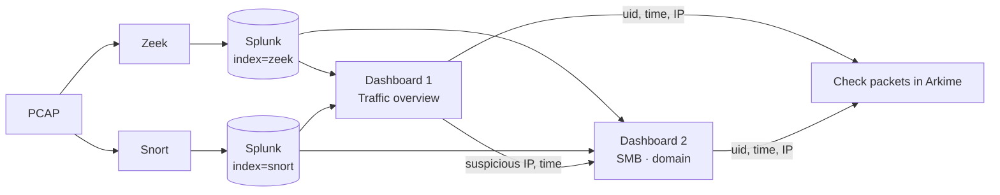

# Traffic Analysis Dashboards (Zeek + Splunk) { #traffic-analysis-dashboards }

<div class="dfir-meta" markdown>
**Category:** Splunk · **Data:** Zeek logs (`index=zeek`), Snort alerts (`index=snort`) · **Last updated:** 2026-11-26
</div>

!!! abstract "In one sentence"
    Run a PCAP through Zeek into Splunk, and the **two dashboards** on this page take you from baselining (what normal looks like) to finding malicious activity for most traffic cases — one is a **whole-traffic overview**, the other is dedicated to **SMB and the Windows domain**. Written for beginners: installation, the SPL behind every panel, and how to read each result, line by line.

## What you get { #what-you-get }

| Dashboard | File | Panels | Questions it answers |
|---|---|---|---|
| **Zeek Traffic Analysis - Overview** | `zeek_traffic_overview.xml` | 57, sections A–J | When does the capture start and end? Which PCs and servers are there? Who talked to whom outside, how much? Suspicious DNS, HTTP, TLS, files, beacons, alerts? Everything one host did, in time order |
| **Zeek SMB and Windows Domain Analysis** | `zeek_smb_ad.xml` | 66, sections A–I | Who connected to which share on which host? Which files were opened, deleted, renamed? Which RPC functions were called (pipe, endpoint, operation)? NTLM and Kerberos successes and failures? Lateral movement traces such as PsExec, WMI, scheduled tasks, DCSync? |



## Pages in this section { #pages }

<div class="grid cards" markdown>

-   **[Dashboard basics](dashboard-basics.md)** — Simple XML skeleton, inputs and tokens, `$$` and CDATA, base searches, click filters, colours, adding your own panel
-   **[Dashboard 1 — Traffic overview](overview-dashboard.md)** — every panel in sections A–J: query, line-by-line notes, example result, how to read it
-   **[Dashboard 2 — SMB and the Windows domain](smb-dashboard.md)** — SMB, DCE/RPC, NTLM and Kerberos basics, pie charts and timelines, lateral movement checklist, RPC risk rules
-   **[Analysing a PCAP with the dashboards](analysis-workflow.md)** — which panel in which order, where each attack type shows up, event IDs to hand to the host team

</div>

## Prerequisites { #prerequisites }

The dashboards match the Zeek data shape that the home-lab **pcapbox** VM loads into Splunk. If yours differs, see [Adapting to another environment](#adapt).

| Item | pcapbox value | Used by |
|---|---|---|
| Zeek index | `index=zeek` | **Zeek index** box at the top (default `zeek`) |
| Snort index | `index=snort sourcetype=snort:alert` (`sid`, `msg`, `src_ip`, `dest_ip`, `dest_port`) | **Snort index** box (default `snort`) |
| sourcetypes | `zeek:conn`, `zeek:dns`, `zeek:http`, `zeek:ssl`, `zeek:x509`, `zeek:files`, `zeek:smb_mapping`, `zeek:smb_files`, `zeek:dce_rpc`, `zeek:ntlm`, `zeek:kerberos`, `zeek:ldap_search` … | every panel |
| Field names | **underscores** instead of dots: `id_orig_h`, `id_resp_p`, `times_created`, `certificate_subject` | every panel |
| Time | **`ts`** = UTC epoch seconds | table times, timelines (`eval _time=ts`) |
| Case | `pcap_case` = PCAP file name | **Case** dropdown |
| files.log | `tx_hosts`, `rx_hosts`, `file_source` (= Zeek's `source`), hashes `md5`/`sha1`/`sha256` | section H, D10 |

**Set Splunk to UTC:** your user name (top right) → **Preferences** → **Time zone** → `(GMT) Coordinated Universal Time`. The dashboards build times with `strftime(ts, ...)`, which follows your user time zone. With UTC, Zeek, Arkime and Snort times all match.

## Step 0 — Check the data shape { #check-data }

Before installing, check three things in **Search & Reporting**.

**① Which Zeek logs exist**

```spl
| tstats count where index=zeek by sourcetype
| sort - count
```

- Leading `|` — the search **starts with a command**, not an event search.
- `tstats count` — counts from index metadata, **very fast**, without reading each event.
- `where index=zeek` — only the `zeek` index. Per company guidance we never use `index=*`.
- `by sourcetype` — one row per log type. `sort - count` — biggest first (`-` = descending).

```text
sourcetype          count        ← example result
zeek:conn           12840
zeek:dns            5310
zeek:ssl            2207
zeek:http           1122
zeek:files          980
zeek:dce_rpc        411
zeek:smb_mapping    66
zeek:smb_files      58
zeek:ntlm           21
zeek:kerberos       145
```

Missing logs are fine — only the panels that use them say "No results found". No `zeek:smb_*`, for example, means the capture had no file sharing.

**② Field name shape**

```spl
index=zeek sourcetype=zeek:conn
| head 1
```

- `head 1` — the first event only. In the **field list** on the left, check `id_orig_h` (underscore) vs `id.orig_h` (dot). Underscores → use the dashboards as they are.

**③ List of cases**

```spl
index=zeek sourcetype=zeek:conn
| stats count min(ts) as first max(ts) as last by pcap_case
| eval first=strftime(first,"%Y-%m-%d %H:%M:%S"), last=strftime(last,"%Y-%m-%d %H:%M:%S")
```

- `stats ... by pcap_case` — connections and first/last time per case.
- `strftime(field, "format")` — epoch number → readable date. `%Y-%m-%d %H:%M:%S` = `2018-05-11 02:06:52`.

```text
pcap_case               count  first                last          ← example result
LAB_PSEXEC_EXAMPLE      1840   2026-01-20 01:00:03  2026-01-20 01:42:55
LAB_WEB_EXAMPLE         729    2026-01-21 09:10:15  2026-01-21 09:42:06
```

These names appear in the dashboards' **Case** dropdown.

## Step 1 — Install the dashboards { #install }

### Option A — paste in the web UI (recommended) { #install-ui }

1. Download `zeek_traffic_overview.xml` from [Download the XML](#xml) at the bottom of this page, open it in Notepad and **copy all of it** (Ctrl+A → Ctrl+C).
2. In Splunk: **Search & Reporting** → **Dashboards** → **Create New Dashboard**.
3. **Dashboard Title**: `Zeek Traffic Analysis - Overview`. **Permissions**: `Private` or `Shared in App`.
4. Choose **Classic Dashboards** (not Dashboard Studio) → **Create**.
5. In the empty dashboard, click **Source** (top of the edit view, `</>`).
6. **Delete everything** in it, paste the XML → **Save**.
7. Repeat for `zeek_smb_ad.xml` (title `Zeek SMB and Windows Domain Analysis`).

!!! tip "Can't see Source?"
    Dashboard → **Edit** (top right) → **Source** at the top of the edit view. In newer Splunk it may sit in the `...` menu next to **Edit**.

!!! warning "Not Dashboard Studio"
    These files are **Classic (Simple XML)**. Dashboard Studio uses JSON and will reject them. Why Classic: [basics page](dashboard-basics.md#why-classic).

### Option B — copy files into pcapbox { #install-file }

Put the files into a Splunk app's dashboard folder over SSH. Use scp — **not** `\\10.50.10.60\incoming`, which is for PCAPs.

```bash
# on the host PC (PowerShell)
scp zeek_traffic_overview.xml zeek_smb_ad.xml analyst@10.50.10.60:/tmp/

# on pcapbox
sudo mkdir -p /opt/splunk/etc/apps/pcapbox/local/data/ui/views
sudo cp /tmp/zeek_traffic_overview.xml /tmp/zeek_smb_ad.xml /opt/splunk/etc/apps/pcapbox/local/data/ui/views/
sudo chown -R splunk:splunk /opt/splunk/etc/apps/pcapbox/local/data
```

- `scp file user@host:folder` — copy a file over SSH.
- `.../apps/pcapbox/local/data/ui/views/` — the app's **dashboard folder**. The file name (without `.xml`) becomes the dashboard's URL name.
- `chown splunk:splunk` — let the Splunk process read the files.

Then open `http://10.50.10.60:8000/en-US/debug/refresh` and click **Refresh** (or `sudo /opt/splunk/bin/splunk restart`). Both dashboards appear under the pcapbox app's **Dashboards**.

## Step 2 — The input boxes { #inputs }

Both dashboards share the same boxes at the top. A box's value becomes a **token** (`$name$`) that goes into every panel's search. Tokens are explained on the [basics page](dashboard-basics.md#inputs-tokens).

| Box | Token | Default | What it does |
|---|---|---|---|
| **Time range** | `$tp.earliest$`, `$tp.latest$` | All time | Search time range. Keep **All time** for old PCAPs |
| **Zeek index** | `$idx$` | `zeek` | Change only this if your index has another name |
| **Snort index** | `$sidx$` | `snort` | Snort alert index |
| **Case (pcap_case)** | `$case$` | All data (`*`) | Picking a case puts `pcap_case="name"` into the searches |
| **Host IP** | `$ip$` | `*` | One IP (`10.0.14.129`) or a wildcard (`10.0.14.*`): every panel keeps only connections involving it |
| **Timeline bucket** | `$span$` | `1m` | Width of one bar in the time charts. `1m` for a 30-minute PCAP, `5m`–`10m` for a few hours |

The SMB dashboard has six extra **click-filter boxes** — RPC named pipe, RPC endpoint, RPC operation, SMB file action, SMB share, NTLM user. Clicking a pie slice fills the box, and the timelines and detail tables then show only that value. Type `*` to clear.

## Step 3 — First run checks { #first-run }

1. Pick a **Case**; keep **Time range = All time**.
2. If the numbers **A1–A10** at the top of dashboard 1 appear, the data connection works. A1/A2 should match step 0 ③.
3. A single panel with "No results found" usually means **that log is not in this capture** (e.g. section F in a capture with no HTTP). For red error icons see [Troubleshooting](#troubleshooting).
4. The **magnifier (Open in Search)** at the bottom right of a panel opens its search in the Search app — a good way to experiment.

## Adapting to another environment (team kit) { #adapt }

| Difference | How to check | Fix |
|---|---|---|
| Different index name | **Settings → Indexes** | Type it into the **Zeek index** box |
| Different sourcetypes (`bro:conn:json`, `corelight_conn` …) | Step 0 ① | In the Source editor **find and replace** `sourcetype=zeek:` with the local names |
| Dotted fields (`id.orig_h`) | Step 0 ② | Find and replace `id_orig_h` → `id.orig_h` etc. Inside `eval`/`where`, wrap them in single quotes: `'id.orig_h'` |
| files.log uses `source`, not `file_source` | `sourcetype=zeek:files | head 1` | Replace `file_source` with the local field |
| `_time` is index time | compare `_time` with `ts` | The dashboards already use `ts`; just keep **All time** |
| No `pcap_case` | — | The Case dropdown shows only **All data**; that's fine |

## Troubleshooting { #troubleshooting }

| Symptom | Cause | Fix |
|---|---|---|
| Every panel says "Search is waiting for input…" | A token is empty (a box was cleared) | Put `*` in the empty box |
| Every panel says "No results found" | Narrow time range / wrong index | All time, check Zeek index |
| One panel says "No results found" | That log isn't in the capture, or nothing matched | Often normal; compare with B1 |
| `Error in 'eval' command` | Field names differ (dot/underscore) | [Adapting](#adapt) |
| Times show 2026 | The table used `_time` | These dashboards use `ts`; for your own panels use `strftime(ts, ...)` |
| Slow | Lots of data | Pick one case, narrow with Host IP |
| XML error on save | Paste was cut short | Copy the whole file again |

## Download the XML { #xml }

- [Download zeek_traffic_overview.xml](zeek_traffic_overview.xml){: download } — dashboard 1
- [Download zeek_smb_ad.xml](zeek_smb_ad.xml){: download } — dashboard 2

**To copy and paste:** download the file, open it in Notepad (or VS Code) and press **Ctrl+A → Ctrl+C**. Or open it on GitHub and click **Copy raw file** at the top right — [zeek_traffic_overview.xml](https://github.com/DFIDwiz-sketch/dfir-handbook/blob/main/docs/blueteam/splunk/traffic-dashboards/zeek_traffic_overview.xml) · [zeek_smb_ad.xml](https://github.com/DFIDwiz-sketch/dfir-handbook/blob/main/docs/blueteam/splunk/traffic-dashboards/zeek_smb_ad.xml).

For a closed network, carry the two downloaded `.xml` files across and install them with [Option A](#install-ui) or [Option B](#install-file).

Next: [Dashboard basics](dashboard-basics.md) — once you know how the XML is built you can change and add panels yourself.
