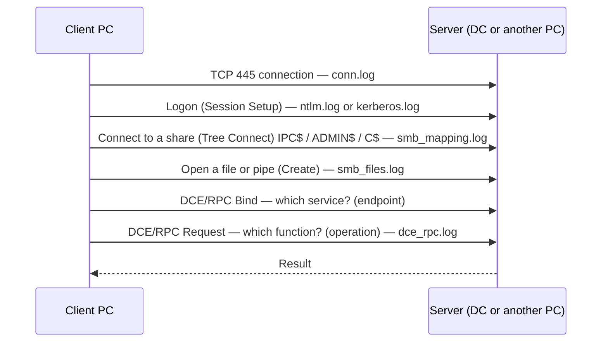

# Dashboard 2 — SMB and the Windows Domain { #smb-dashboard }

<div class="dfir-meta" markdown>
**Category:** Splunk · **Dashboard:** `zeek_smb_ad.xml` (66 panels) · **Data:** Zeek `conn`, `smb_mapping`, `smb_files`, `dce_rpc`, `ntlm`, `kerberos`, `ldap_search`, `files` · **Last updated:** 2026-11-26
</div>

!!! abstract "What this dashboard does"
    It lays out every conversation between Windows PCs, and between PCs and the domain controller (DC). **Pie charts** show RPC Named Pipe, DCE_RPC Endpoint, RPC Operations, SMB Files action, share types and NTLM results at a glance; clicking a slice narrows the **DCE_RPC / SMB Files / SMB Mapping / NTLM timelines** and detail tables to that value. On top of that: **risk rules** (30-odd RPC calls rated HIGH/MEDIUM/LOW with ATT&CK IDs), a **lateral movement checklist** (PsExec, services, scheduled tasks, WMI, DCOM, remote registry, DCSync), password guessing and spraying, Kerberoasting, LDAP recon, sensitive file names, and a single **domain story timeline**.

!!! tip "How to read this page"
    New to SMB? Read [SMB basics](#smb-basics) and [Zeek defaults](#zeek-defaults) first; sections A–I then follow the dashboard. Queries paste into the Search app (replace `pcap_case="<case>"`). Example results are an illustrative lab — DC01 `10.0.0.10`, PC-01 `10.0.0.101` (user alice), PC-02 `10.0.0.102` (user bob), domain `LAB` — in which PC-01 uses **PsExec** against PC-02 at 01:20. Only results marked **Night Dew lab values** come from a real capture.

## SMB basics — for beginners { #smb-basics }

**SMB** (Server Message Block, TCP **445**) is Windows **file sharing**. It carries more than files: it is also the **channel for calling Windows functions on another computer**, which is why attackers use it most when moving to the next PC (lateral movement).



| Term | Plain meaning | Example |
|---|---|---|
| **share** | A folder opened to the network, addressed `\\server\share` | `\\DC01\SYSVOL`, `\\FS01\Projects` |
| **admin share** | Hidden shares Windows creates itself; names end in `$` | `ADMIN$` (= `C:\Windows`), `C$` (= whole C drive) |
| **IPC$** | Special share for opening **pipes**, not files | `\\PC-02\IPC$` |
| **named pipe** | A **door** programs use to talk, opened like a file in IPC$ | `svcctl`, `samr`, `lsarpc`, `PSEXESVC` |
| **DCE/RPC** | **Calling functions** on another computer, over a pipe or a high TCP port | create a service, list users |
| **endpoint** (interface) | The **service** called over RPC (chosen by UUID) | `svcctl` = services, `samr` = accounts |
| **operation** (opnum) | The **function** in that service | `CreateServiceW`, `SamrEnumerateUsersInDomain` |
| **NTLM** | Older Windows logon; user and PC names in clear | `alice@LAB`, `PC-01` |
| **Kerberos** | The domain's default logon, using tickets | `alice/LAB.LOCAL` → `cifs/PC-02` |
| **uid** | Zeek's per-connection tag linking all its logs | `CfA9x2...` |

**Normal vs not, in one sentence:** usually traffic is **PC → DC** (logon, Group Policy: `IPC$`, `SYSVOL`, `NETLOGON`) and **PC → file server**. **PC → PC**, `ADMIN$`/`C$`, programs written to shares, and service / scheduled task / WMI calls are admin work or **an attack**.

## Logs Zeek writes { #zeek-logs }

| Log (sourcetype) | One line = | Key fields |
|---|---|---|
| `zeek:conn` | one connection | `id_orig_h`, `id_resp_h`, `id_resp_p` (445, 139, 135), `conn_state`, `orig_bytes`, `resp_bytes`, `service` (`smb`, `gssapi`, `ntlm`, `krb`) |
| `zeek:smb_mapping` | one share connection | `path` (`\\SERVER\SHARE`), `share_type` (`DISK`, `PIPE`, `PRINT`), `service`, `native_file_system` |
| `zeek:smb_files` | one file/pipe action | `action` (`SMB::FILE_OPEN` …), `path`, `name`, `size`, `prev_name` (name before a rename), `times_created`/`times_modified`, `fuid` |
| `zeek:dce_rpc` | one RPC call | `named_pipe`, `endpoint`, `operation`, `rtt` (request → response time) |
| `zeek:ntlm` | one NTLM logon | `username`, `domainname`, `hostname` (client PC name), `server_nb_computer_name`, `server_dns_computer_name`, `success` |
| `zeek:kerberos` | one Kerberos request | `request_type` (`AS`, `TGS`), `client`, `service`, `success`, `error_msg`, `cipher` |
| `zeek:ldap_search` | one LDAP search | `base_object`, `scope`, `filter`, `result_count` |
| `zeek:files` | one transferred file | `file_source=SMB`, `is_orig` (direction), `filename`, `md5`, `sha256` |

## Zeek defaults that matter { #zeek-defaults }

To avoid misreading results, know **what Zeek does not log by default**.

1. **`smb_files` logs only open, rename and delete by default.** Zeek's default `SMB::logged_file_actions` is `FILE_OPEN`, `FILE_RENAME`, `FILE_DELETE`, `PRINT_OPEN`, `PRINT_CLOSE`. **`FILE_READ` and `FILE_WRITE` do not appear.** Whether a file was written (uploaded) shows in `zeek:files` via `is_orig` ([D10](#d10)).
2. **A few noisy `dce_rpc` calls are dropped.** Zeek's default `DCE_RPC::ignored_operations` drops `winreg` `BaseRegOpenKey`, `BaseRegQueryValue`, `BaseRegCloseKey`, `OpenLocalMachine` and others, `spoolss` `RpcSplOpenPrinter`, `RpcClosePrinter`, and `wkssvc` `NetrWkstaGetInfo`. Remote registry **reads** are mostly invisible; **writes** (`BaseRegSetValue`, `BaseRegCreateKey`, `BaseRegSaveKey`) are visible.
3. **`named_pipe` can hold a port number.** The value comes from the RPC reply's "secondary address": over an SMB pipe it is a name like `\PIPE\lsass`, over direct TCP a **port** like `135` or `49158`. The dashboard strips `\PIPE\` and lower-cases it (`lsass`, `135`).
4. **Pipe name and endpoint can differ** — e.g. `svcctl` answers on `\PIPE\ntsvcs`, `samr`/`lsarpc` on `\PIPE\lsass` ([C7](#c7)).
5. **Shares with SMB3 encryption** are opaque to Zeek: `conn` remains, `smb_*` and `dce_rpc` are empty.
6. **Windows usually encrypts TCP LDAP** (sign & seal). `ldap_search` mainly shows UDP 389 **DC locator pings** (`NtVer`) and searches by tools that don't encrypt.
7. **Kerberos AP requests** carry the account name in the encrypted part, so it is empty. Normal.

??? note "(Optional) log SMB reads and writes in pcapbox"
    Adding one line to the end of pcapbox's Zeek config `/opt/pcapbox/zeek/pcapbox.zeek` makes `smb_files` include `FILE_READ` and `FILE_WRITE`. Re-ingest the PCAP afterwards.

    ```bash
    echo 'redef SMB::logged_file_actions += { SMB::FILE_READ, SMB::FILE_WRITE };' | sudo tee -a /opt/pcapbox/zeek/pcapbox.zeek
    zeek -a /opt/pcapbox/zeek/pcapbox.zeek && echo "Zeek config OK"
    ```

    - `redef name += { values };` — add items to a Zeek option. `tee -a` — append to the file.
    - `zeek -a` — syntax check only; `Zeek config OK` = success.
    - Reads and writes create **one line per chunk**, so logs grow. Don't change the team environment's config.

## Section map { #map }

| Section | Question | Main panels |
|---|---|---|
| **A** At a glance | How much SMB, RPC, logon? Any warning signs? | 12 numbers (risky ones turn red) |
| **B** SMB connections | Who with whom? Failures, scans? Volume? | pair table, state pie, bars, scan table, time chart |
| **C** DCE/RPC | Which pipes, services, functions? Risky calls? Bursts? | **4 pies**, risk table, map, bursts, **DCE_RPC Timeline** + detail |
| **D** SMB files | Files opened, deleted, renamed? Programs? Pipes? | **3 pies**, **SMB Files Timeline** + detail, programs, pipes, deletes, sensitive files, transfer hashes |
| **E** SMB mapping | Which shares? Admin shares? PC → PC? | **3 pies**, **SMB Mapping Timeline** + detail, admin shares, matrix, non-DC targets |
| **F** NTLM | Who logged on? Failures? Spraying? One account in many places? | **3 pies**, **NTLM Timeline** + detail, patterns, spread |
| **G** Kerberos, LDAP | What do the errors mean? Kerberoasting? Recon searches? | 2 pies, error table, RC4 table, services, time chart, LDAP table |
| **H** Lateral movement | PsExec, services, tasks, WMI, DCSync? Remote access methods? Credential access? The whole story | checklist, methods, credentials, **domain story timeline**, uid |
| **I** Snort | Alerts on Windows ports | table |

---

## A. Numbers at a glance { #a-glance }

Every number is a one-line post-process on a section's **base search** below.

| Panel | Base | Post-process | How to read it |
|---|---|---|---|
| A1 SMB connections | `b_smbconn` | `| stats sum(sessions) as v` | 445/139 connections |
| A2 SMB clients / A3 servers | `b_smbconn` | `| stats dc(id_orig_h) as v` / `dc(id_resp_h)` | Only the DC as server is normal; a PC as server → B1 |
| A4 Shares mapped | `b_map` | `| stats dc(path) as v` | Distinct `\\server\share` |
| A5 Files touched | `b_smbf` | `| where share!="IPC$" | stats dc(name) as v` | Real files, not pipes |
| A6 DCE/RPC calls · A7 operations | `b_dce` | `sum(count)` · `dc(operation)` | Calls, distinct functions |
| **A8 HIGH-risk RPC calls** | `b_dce` | `| where sev="HIGH" | stats sum(count) as v | eval v=coalesce(v,0)` | **Red when not 0** → C5 |
| **A9 Admin share mappings** | `b_map` | `| where like(share,"%$") AND share!="IPC$" | ...` | **Red when not 0** → E6 |
| A10 NTLM logons | `b_ntlm` | `sum(count)` | |
| **A11 NTLM failures** | `b_ntlm` | `| where result="FAILED" | ...` | **Red when not 0** → F6 |
| **A12 Kerberos errors** | `b_krb` | excluding normal errors (`PREAUTH_REQUIRED`, `RESPONSE_TOO_BIG`) | **Red when not 0** → G3 |

- `coalesce(v,0)` — 0 when there is no result, so you see a green 0, not a blank.
- `like(share,"%$")` — name ends in `$`; `%` = any characters.

---

## B. Who talks SMB to whom { #b-conn }

Base **`b_smbconn`** — SMB connections from conn.log.

```spl
index=zeek sourcetype=zeek:conn pcap_case="<case>" (id_resp_p=445 OR id_resp_p=139 OR service="*smb*")
| fillnull value="-" conn_state service
| stats count as sessions sum(orig_bytes) as out sum(resp_bytes) as in sum(duration) as dur min(ts) as first max(ts) as last values(service) as service by id_orig_h id_resp_h id_resp_p conn_state
```

- Line 1: `(id_resp_p=445 OR id_resp_p=139 OR service="*smb*")` — destination port 445 (SMB) or 139 (old SMB over NetBIOS), or Zeek recognised SMB. `*smb*` = any value containing smb.
- Line 2: fill empty `conn_state`, `service` with `-` (so they aren't dropped by `by`).
- Line 3: per **pair (source → destination:port) + state**: connections, bytes each way, total time, first, last.

### B1. SMB client → server pairs { #b1 }

```spl
| stats sum(sessions) as sessions sum(out) as out sum(in) as in sum(dur) as dur min(first) as first max(last) as last values(conn_state) as states by id_orig_h id_resp_h id_resp_p
| eval KB_sent=round(out/1024,1), KB_received=round(in/1024,1), seconds=round(dur,1)
| eval first=strftime(first,"%Y-%m-%d %H:%M:%S"), last=strftime(last,"%Y-%m-%d %H:%M:%S")
| table id_orig_h id_resp_h id_resp_p sessions KB_sent KB_received seconds states first last
| sort - sessions
```

- Re-adds the base's per-state rows **per pair** (`sum`). `values(conn_state) as states` — states seen for the pair.

```text
id_orig_h   id_resp_h   id_resp_p  sessions  KB_sent  KB_received  seconds  states   first                last          ← example result
10.0.0.101  10.0.0.10   445        8         41.2     88.0         301.5    SF       2026-01-20 01:00:12  2026-01-20 01:40:05
10.0.0.102  10.0.0.10   445        6         30.9     61.7         240.2    SF       2026-01-20 01:00:15  2026-01-20 01:40:11
10.0.0.101  10.0.0.102  445        3         402.8    12.4         95.0     SF RSTO  2026-01-20 01:20:03  2026-01-20 01:22:40
```

**How to read it:** the first two rows are PC → DC — normal. Row 3 is **PC-01 → PC-02**, and it sent far more (402.8 KB) than it received → **PC-01 uploaded something to PC-02**. Follow this pair through sections C, D, E and H.

### B2. SMB connection states · B3. Data per pair { #b2 }

```spl
| eval state=case(conn_state="SF","SF - opened and closed normally", conn_state="S0","S0 - no reply", conn_state="REJ","REJ - rejected", conn_state="S1","S1 - open, never closed", conn_state="S2","S2 - client closed, no server reply", conn_state="S3","S3 - server closed, no client reply", conn_state="RSTO","RSTO - client sent reset", conn_state="RSTR","RSTR - server sent reset", conn_state="RSTOS0","RSTOS0 - SYN then reset, no reply", conn_state="RSTRH","RSTRH - server SYN-ACK then reset", conn_state="SH","SH - SYN then FIN, no reply", conn_state="SHR","SHR - server SYN-ACK and FIN only", conn_state="OTH","OTH - no SYN seen (mid-stream)", true(), conn_state)
| stats sum(sessions) as sessions by state
| sort - sessions
```

```spl
| stats sum(out) as out sum(in) as in by id_orig_h id_resp_h
| eval total=out+in
| sort - total
| head 10
| eval pair=id_orig_h." > ".id_resp_h, KB_sent=round(out/1024,1), KB_received=round(in/1024,1)
| table pair KB_sent KB_received
```

- B2 — the same state labels as [dashboard 1 B3](overview-dashboard.md#b3). Many `S0`/`REJ` = unanswered 445 attempts → B4.
- B3 `eval total=out+in` → top 10 pairs, two bars (sent, received).

**How to read it:** a big **sent** bar = the client wrote files to the server (copying a program, staging). A big **received** bar = pulled from the server (bulk copy from a file server = exfiltration prep?).

### B4. Failed SMB connections and scanning { #b4 }

```spl
| eval failed=if(conn_state="S0" OR conn_state="REJ" OR conn_state="RSTOS0" OR conn_state="SH" OR conn_state="RSTRH", sessions, 0)
| stats sum(sessions) as attempts sum(failed) as failed dc(id_resp_h) as targets values(id_resp_h) as target_list min(first) as first max(last) as last by id_orig_h
| eval fail_pct=round(100*failed/attempts,0), target_list=mvindex(target_list,0,9)
| eval verdict=case(targets>=10 AND fail_pct>=50,"Likely SMB scanning or worm spread", targets>=5,"Many SMB targets - check", attempts>=10 AND fail_pct>=80,"Repeated failed SMB connections", true(),"")
| eval first=strftime(first,"%Y-%m-%d %H:%M:%S"), last=strftime(last,"%Y-%m-%d %H:%M:%S")
| table id_orig_h attempts failed fail_pct targets target_list verdict first last
| sort - targets
```

- Line 1 `failed=if(conn_state="S0" OR ..., sessions, 0)` — no reply (`S0`), rejected (`REJ`), half-open (`RSTOS0`, `SH`, `RSTRH`) count as **failed**.
- Line 2: **per source IP**: attempts, failures, targets, target list.
- Line 3 `fail_pct` — failure %. `mvindex(target_list,0,9)` — at most 10 targets.
- Line 4 `verdict` — ≥ 10 targets + ≥ 50 % failed = **scan or worm**; ≥ 5 targets = check; repeated failures.

**How to read it:** one PC hitting **many IPs on 445 in a short time, mostly failing** is an SMB scan. Worms like WannaCry (EternalBlue, MS17-010) spread this way → [EternalBlue (SMBv1)](../../../adversary/eternalblue-smbv1.md).

### B5. SMB connections over time { #b5 }

```spl
index=zeek sourcetype=zeek:conn pcap_case="<case>" (id_resp_p=445 OR id_resp_p=139 OR service="*smb*")
| eval _time=ts
| timechart span=1m limit=10 useother=t count by id_resp_h
```

- In-panel **Split by**: by server (default), client, connection state.

**How to read it:** **periodic** SMB to the DC is Windows behaviour such as Group Policy refresh (PCs: every 90 min + 0–30 min random) — regular enough to look like a beacon, but normal when the target is the DC and the shares are `IPC$`/`SYSVOL`. Note the moment a **PC → PC** colour appears.

---

## C. DCE/RPC { #c-dcerpc }

Base **`b_dce`** — groups the calls and attaches the **risk rules** per row.

```spl
index=zeek sourcetype=zeek:dce_rpc pcap_case="<case>"
| eval pipe=lower(mvindex(split(named_pipe,"\\"),-1))
| fillnull value="-" pipe endpoint operation
| stats count min(ts) as first max(ts) as last avg(rtt) as rtt by id_orig_h id_resp_h id_resp_p pipe endpoint operation
| eval ep_l=lower(endpoint), op_l=lower(operation)
| eval rule=case(
    ep_l="drsuapi" AND op_l="drsgetncchanges", "HIGH|Credential access|DCSync - AD replication of password data (normal only DC to DC)|T1003.006",
    ep_l="drsuapi" AND op_l="drsreplicaadd", "HIGH|Defense evasion|New replication partner added (DCShadow)|T1207",
    match(op_l,"^efs"), "HIGH|Credential access|EFSRPC call - authentication coercion (PetitPotam)|T1187",
    ep_l="spoolss" AND match(op_l,"^rpcremotefindfirstprinterchangenotification"), "HIGH|Credential access|Printer change notification - authentication coercion (PrinterBug)|T1187",
    ep_l="spoolss" AND match(op_l,"^rpcaddprinterdriver"), "HIGH|Privilege escalation|Remote printer driver install (PrintNightmare)|T1068",
    ep_l="dfsnm" AND match(op_l,"^netrdfs(add|remove)stdroot"), "HIGH|Credential access|DFS root change - authentication coercion (DFSCoerce)|T1187",
    ep_l="svcctl" AND match(op_l,"^(createservice|startservice|changeserviceconfig)"), "HIGH|Execution|Remote service created or started (PsExec, smbexec)|T1569.002",
    ep_l="svcctl" AND match(op_l,"^deleteservice"), "MEDIUM|Defense evasion|Remote service deleted (clean-up after remote execution)|T1070",
    ep_l="svcctl", "LOW|Discovery|Remote Service Control Manager opened or queried|T1007",
    ep_l="atsvc" AND op_l="jobadd", "HIGH|Execution|Remote scheduled job created (at)|T1053.002",
    ep_l="itaskschedulerservice" AND match(op_l,"^schrpc(registertask|run|enabletask)"), "HIGH|Execution|Remote scheduled task created or run (schtasks /s, atexec)|T1053.005",
    ep_l="itaskschedulerservice" AND op_l="schrpcdelete", "MEDIUM|Defense evasion|Remote scheduled task deleted|T1070",
    ep_l="iwbemservices" AND match(op_l,"^execmethod"), "HIGH|Execution|Remote WMI method run (wmic process call create, wmiexec)|T1047",
    ep_l="iwbemlevel1login", "MEDIUM|Execution|Remote WMI logon (comes before WMI execution)|T1047",
    (ep_l="iremotescmactivator" OR ep_l="isystemactivator") AND op_l="remotecreateinstance", "MEDIUM|Lateral movement|Remote DCOM object created (WMI or DCOM execution)|T1021.003",
    ep_l="winreg" AND op_l="baseregsavekey", "HIGH|Credential access|Registry hive saved remotely (SAM/SYSTEM/SECURITY dump)|T1003.002",
    ep_l="winreg" AND match(op_l,"^basereg(createkey|setvalue|deletevalue|deletekey|restorekey|replacekey)"), "MEDIUM|Persistence|Remote registry write|T1112",
    ep_l="winreg", "LOW|Discovery|Remote registry read|T1012",
    ep_l="samr" AND match(op_l,"^samr(createuser2indomain|createuserindomain|addmembertogroup|addmembertoalias)"), "HIGH|Persistence|Account created or added to a group|T1136.002",
    ep_l="samr" AND match(op_l,"^samr(setinformationuser|changepassworduser|unicodechangepassworduser|oemchangepassworduser)"), "MEDIUM|Persistence|Account password or settings changed|T1098",
    ep_l="samr" AND match(op_l,"^samr(enumerate|querydisplayinformation|getmembers|getaliasmembership|querygroupinfo|queryinformationuser|getgroupsforuser|lookupnamesindomain)"), "MEDIUM|Discovery|Account or group enumeration (net user /domain, BloodHound)|T1087.002",
    ep_l="lsarpc" AND match(op_l,"^lsar(retrieveprivatedata|querysecret|opensecret)"), "HIGH|Credential access|LSA secret read|T1003.004",
    ep_l="lsarpc" AND match(op_l,"^lsar(enumerateaccounts|enumerateaccountrights|enumerateaccountswithuserright|enumeratetrusteddomains)"), "MEDIUM|Discovery|Privilege or trust enumeration|T1069",
    ep_l="srvsvc" AND op_l="netrsessionenum", "MEDIUM|Discovery|Session enumeration - who is logged on where (BloodHound)|T1049",
    ep_l="srvsvc" AND op_l="netrshareenum", "MEDIUM|Discovery|Share enumeration (net view, share scanners)|T1135",
    ep_l="wkssvc" AND op_l="netrwkstauserenum", "MEDIUM|Discovery|Logged-on user enumeration|T1033",
    ep_l="eventlog" AND match(op_l,"^elfrclearelf"), "HIGH|Defense evasion|Event log cleared remotely|T1070.001",
    match(ep_l,"backupkey|bkrp"), "HIGH|Credential access|DPAPI domain backup key request|T1555",
    ep_l="netlogon" AND op_l="netrserverpasswordset2", "MEDIUM|Privilege escalation|Machine password set - Zerologon if many NetrServerAuthenticate calls came first|T1210",
    ep_l="netlogon" AND match(op_l,"^netrlogonsamlogon"), "INFO|Credential access|NTLM logon check passed to the DC - many in a short time = password guessing|T1110",
    match(op_l,"^unknown-"), "LOW|Unknown|Operation number Zeek could not name - unusual|-",
    true(), "INFO|-|Normal or not classified|-")
| eval sev=mvindex(split(rule,"|"),0), category=mvindex(split(rule,"|"),1), meaning=mvindex(split(rule,"|"),2), attack=mvindex(split(rule,"|"),3)
| fields - ep_l op_l rule
```

- Line 2 `pipe=lower(mvindex(split(named_pipe,"\\"),-1))` — split `\PIPE\lsass` at `\`, take the last piece (`lsass`), lower-case. `"\\"` = **one backslash** inside an SPL string. Port numbers (`135`) stay as they are.
- Line 3: empty values → `-`.
- Line 4: per source, destination, port, pipe, endpoint, operation: calls, first, last, average `rtt`.
- Line 5 onwards: the **[RPC risk rules](#rpc-risk-rules)** add `sev` (HIGH/MEDIUM/LOW/INFO), `category`, `meaning` and `attack` (MITRE ATT&CK ID), explained at the end of the page.

### C1. RPC Named Pipe · C2. DCE_RPC Endpoint · C3. RPC Operations { #c1 }

All three pies have the same shape — **add up the base's `count` per value**.

```spl
| stats sum(count) as calls by pipe
| sort - calls
```

```spl
| stats sum(count) as calls by endpoint
| sort - calls
```

```spl
| stats sum(count) as calls by operation
| sort - calls
```

- `stats sum(count) as calls by pipe` — calls per pipe; C2 uses `by endpoint`, C3 `by operation`.
- **Clicking** a slice fills the **RPC named pipe / RPC endpoint / RPC operation** box, and the C9 timeline and C10 detail table show only that value.
- Slices under 0.5 % fold into **other** (`sliceCollapsingThreshold`); don't click other.

```text
C3 operation                     calls     ← Night Dew lab values
NetrLogonSamLogonWithFlags       1522
ept_map                          4
DRSCrackNames                    4
DRSBind                          2
DRSUnbind                        2
NetrServerReqChallenge           1
NetrServerAuthenticate3          1
NetrLogonGetCapabilities         1
NetrLogonGetDomainInfo           1
LsarLookupSids3                  1
```

**How to read it:** a pie almost entirely one colour means **one function was called in a burst**. In Night Dew, `NetrLogonSamLogonWithFlags` (= asking the DC "is this account and password right?") ran 1,522 times in 32 seconds — **password guessing**. **Numbers** in the pipe pie (C1) such as `135`, `49158`, `49155` mean RPC went **directly over TCP**, not through an SMB pipe.

### C4. RPC calls by risk level { #c4 }

```spl
| stats sum(count) as calls by sev
```

- Fixed colours: HIGH red, MEDIUM orange, LOW yellow, INFO grey (`charting.fieldColors`).

### C5. Risky RPC calls (with ATT&CK ID) { #c5 }

```spl
| where sev!="INFO"
| stats sum(count) as calls min(first) as first max(last) as last values(pipe) as pipes by sev category meaning attack id_orig_h id_resp_h endpoint operation
| eval order=case(sev="HIGH",1, sev="MEDIUM",2, true(),3)
| sort order, first
| eval first=strftime(first,"%Y-%m-%d %H:%M:%S"), last=strftime(last,"%Y-%m-%d %H:%M:%S")
| table sev category meaning attack id_orig_h id_resp_h endpoint operation pipes calls first last
```

- Line 1: everything except INFO.
- Line 2: per risk + source/destination + endpoint/operation: calls, first, last, pipes.
- Lines 3–4 `order=case(sev="HIGH",1, ...)` then `sort order, first` — HIGH first, earliest first within a level.

```text
sev     category        meaning                                              attack     id_orig_h   id_resp_h   endpoint  operation       pipes   calls  first          ← example result
HIGH    Execution       Remote service created or started (PsExec, smbexec)  T1569.002  10.0.0.101  10.0.0.102  svcctl    CreateServiceW  ntsvcs  1      2026-01-20 01:20:05
HIGH    Execution       Remote service created or started (PsExec, smbexec)  T1569.002  10.0.0.101  10.0.0.102  svcctl    StartServiceW   ntsvcs  1      2026-01-20 01:20:05
MEDIUM  Defense evasion Remote service deleted (clean-up after remote ...)   T1070      10.0.0.101  10.0.0.102  svcctl    DeleteService   ntsvcs  1      2026-01-20 01:22:39
LOW     Discovery       Remote Service Control Manager opened or queried     T1007      10.0.0.101  10.0.0.102  svcctl    OpenSCManagerW  ntsvcs  2      2026-01-20 01:20:04
```

**How to read it:** **open service manager → create service → start → (minutes later) delete** is the classic PsExec sequence. On the host, check PC-02's **System 7045** (new service installed), **Security 4697** (service installed) and **4624 logon type 3** (network logon) → [PsExec & SMB](../../../adversary/psexec-smb.md).

### C6. Endpoint and operation map · C7. Pipe (port) and endpoint { #c7 }

```spl
| stats sum(count) as calls dc(id_orig_h) as clients dc(id_resp_h) as servers values(pipe) as pipes min(first) as first max(last) as last by sev endpoint operation meaning
| eval first=strftime(first,"%Y-%m-%d %H:%M:%S"), last=strftime(last,"%Y-%m-%d %H:%M:%S")
| sort - calls
| table sev endpoint operation calls clients servers pipes meaning first last
```

```spl
| stats sum(count) as calls values(endpoint) as endpoints dc(id_orig_h) as clients by pipe id_resp_p
| sort - calls
```

- C6 — per function: calls, calling PCs (`clients`), servers, pipes, meaning.
- C7 — which endpoints went through each pipe name (or port).

```text
pipe      id_resp_p  calls  endpoints          clients    ← C7 example result
lsass     445        62     lsarpc samr        3
ntsvcs    445        5      svcctl             1
srvsvc    445        4      srvsvc             2
135       135        9      epmapper           3
49667     49667      14     drsuapi netlogon   3
```

**How to read it:** in C6, functions with **`clients` = 1** stand out — behaviour of a single PC. C7 explains the naming: `svcctl` answers on the `ntsvcs` pipe, `samr`/`lsarpc` on `lsass`.

### C8. Bursts — the same RPC call 50+ times in a minute { #c8 }

```spl
index=zeek sourcetype=zeek:dce_rpc pcap_case="<case>"
| fillnull value="-" endpoint operation
| eval _time=ts
| bin _time span=1m
| stats count as calls by _time id_orig_h id_resp_h endpoint operation
| where calls>=50
| eval minute=strftime(_time,"%Y-%m-%d %H:%M")
| sort - calls
| table minute id_orig_h id_resp_h endpoint operation calls
```

- `eval _time=ts | bin _time span=1m` — round time down to **1-minute buckets**; `bin` = bucketing.
- `stats count as calls by _time id_orig_h id_resp_h endpoint operation` — calls per minute, pair and function.
- `where calls>=50` — 50 or more.

```text
minute            id_orig_h     id_resp_h   endpoint  operation                    calls   ← Night Dew lab values
2018-05-11 02:08  10.0.14.129   10.0.14.3   netlogon  NetrLogonSamLogonWithFlags   1522
```

| Burst | Meaning |
|---|---|
| `netlogon` `NetrLogonSamLogon*` | Password guessing (brute force). DC Security log **4776** (NTLM credential validation; result `0xC000006A` = wrong password, `0x0` = success) |
| hundreds of `netlogon` `NetrServerAuthenticate3` | **Zerologon** (CVE-2020-1472) attempt — followed by `NetrServerPasswordSet2` = likely success |
| many `samr` `Samr...Enumerate...`, `lsarpc` `LsarLookupSids` | Account / group collection (BloodHound, enum4linux) |
| `srvsvc` `NetrShareEnum` / `NetrSessionEnum` across servers | Share / session recon |

### C9. DCE_RPC Timeline { #c9 }

```spl
index=zeek sourcetype=zeek:dce_rpc pcap_case="<case>"
| eval pipe=lower(mvindex(split(named_pipe,"\\"),-1))
| fillnull value="-" pipe endpoint operation
| eval _time=ts
| timechart span=1m limit=12 useother=t count by endpoint
```

- Lines 2–3: the same pipe clean-up as the base.
- In the dashboard line 4 adds `| search pipe="$pipe$" endpoint="$ep$" operation="$op$"` — the values clicked in C1–C3.
- `timechart ... count by endpoint` — in-panel **Split by**: Endpoint (default), Operation, Named pipe, Client, Server.

**How to read it:** small clusters at logon time (epmapper, lsarpc, netlogon, drsuapi) are normal. Look for a **lone tall bar**, then switch Split by to **Client** to see who did it.

### C10. DCE_RPC Timeline — every call (detail) { #c10 }

```spl
index=zeek sourcetype=zeek:dce_rpc pcap_case="<case>"
| eval pipe=lower(mvindex(split(named_pipe,"\\"),-1))
| fillnull value="-" pipe endpoint operation
| `rpc_risk_rules`
| sort 0 ts
| head 5000
| eval time=strftime(ts,"%Y-%m-%d %H:%M:%S.%3N"), rtt_ms=round(rtt*1000,1)
| table time sev id_orig_h id_resp_h id_resp_p pipe endpoint operation rtt_ms meaning uid
```

- `` | `rpc_risk_rules` `` — a **macro** slot for running in the Search app; the dashboard contains the full rules. How to create the macro: [RPC risk rules](#rpc-risk-rules).
- `sort 0 ts | head 5000` — first 5,000 calls in time order.
- `rtt_ms=round(rtt*1000,1)` — request → response in ms; empty = no response seen.
- **Clicking** a row opens every log of that connection in H5.

```text
time                     sev   id_orig_h   id_resp_h   id_resp_p  pipe    endpoint  operation       rtt_ms  meaning                                     ← example result
2026-01-20 01:20:04.118  LOW   10.0.0.101  10.0.0.102  445        ntsvcs  svcctl    OpenSCManagerW  0.9     Remote Service Control Manager opened ...
2026-01-20 01:20:05.020  HIGH  10.0.0.101  10.0.0.102  445        ntsvcs  svcctl    CreateServiceW  12.4    Remote service created or started ...
2026-01-20 01:20:05.051  HIGH  10.0.0.101  10.0.0.102  445        ntsvcs  svcctl    StartServiceW   210.7   Remote service created or started ...
```

---

## D. SMB files { #d-files }

Base **`b_smbf`** — groups file actions.

```spl
index=zeek sourcetype=zeek:smb_files pcap_case="<case>"
| eval act=replace(action,"SMB::",""), share=upper(mvindex(split(path,"\\"),-1)), fname=mvindex(split(name,"\\"),-1)
| eval ext=if(match(fname,"\.[A-Za-z0-9]{1,6}$"), lower(mvindex(split(fname,"."),-1)), "(none)")
| fillnull value="-" act share name fname ext
| stats count min(ts) as first max(ts) as last max(size) as size by id_orig_h id_resp_h act share name fname ext
```

- Line 2 `act=replace(action,"SMB::","")` — `SMB::FILE_OPEN` → `FILE_OPEN`. `share=upper(mvindex(split(path,"\\"),-1))` — last piece of `\\PC-02\ADMIN$` = `ADMIN$`, upper case. `fname` — last piece of `name` (file name without folders).
- Line 3 `ext` — if the file name ends in `.` + 1–6 characters, those characters (lower case), else `(none)`. `{1,6}` = repeated 1 to 6 times.
- Line 5: per pair, action, share and name: count, first, last, largest `size`.

### D1. SMB Files action · D2. By share · D3. By extension { #d1 }

```spl
| stats sum(count) as events by act
| sort - events
```

```spl
| stats sum(count) as events by share
| sort - events
```

```spl
| where share!="IPC$"
| stats sum(count) as events by ext
| sort - events
```

- Clicking D1/D2 fills the **SMB file action / SMB share** boxes (filters for D4, D5).
- D3 `where share!="IPC$"` — real files only, no pipes.

| action | Meaning |
|---|---|
| `FILE_OPEN` | A file or folder was opened — **not proof the content moved** (just browsing a folder creates it) |
| `FILE_RENAME` | Renamed (`prev_name` = old name) |
| `FILE_DELETE` | Deleted |
| `PRINT_OPEN` / `PRINT_CLOSE` | Printer share |
| `FILE_READ` / `FILE_WRITE` | Not logged by default ([Zeek defaults](#zeek-defaults)) |

### D4. SMB Files Timeline { #d4 }

```spl
index=zeek sourcetype=zeek:smb_files pcap_case="<case>"
| eval act=replace(action,"SMB::",""), share=upper(mvindex(split(path,"\\"),-1)), fname=mvindex(split(name,"\\"),-1)
| eval ext=if(match(fname,"\.[A-Za-z0-9]{1,6}$"), lower(mvindex(split(fname,"."),-1)), "(none)")
| fillnull value="-" act share name fname ext
| eval _time=ts
| timechart span=1m limit=10 useother=t count by act
```

- The dashboard adds `| search act="$act$" share="$share$"`.
- **Split by**: Action (default), Share, Extension, Client, Server.

### D5. SMB Files Timeline — every file action (detail) { #d5 }

```spl
index=zeek sourcetype=zeek:smb_files pcap_case="<case>"
| eval act=replace(action,"SMB::",""), share=upper(mvindex(split(path,"\\"),-1)), fname=mvindex(split(name,"\\"),-1)
| eval ext=if(match(fname,"\.[A-Za-z0-9]{1,6}$"), lower(mvindex(split(fname,"."),-1)), "(none)")
| fillnull value="-" act share name fname ext
| sort 0 ts
| head 5000
| eval time=strftime(ts,"%Y-%m-%d %H:%M:%S.%3N"), KB=round(size/1024,1), created=strftime(times_created,"%Y-%m-%d %H:%M:%S"), modified=strftime(times_modified,"%Y-%m-%d %H:%M:%S")
| table time id_orig_h id_resp_h act share name prev_name KB created modified uid fuid
```

- `KB=round(size/1024,1)` — file size. `created`/`modified` — the **file's own** created/modified times (`times_created`, `times_modified`, reported by SMB).
- `uid` (connection) and `fuid` (file) — clicking a row opens H5.

```text
time                     id_orig_h   id_resp_h   act        share   name                          prev_name  KB     created              ← example result
2026-01-20 01:00:13.402  10.0.0.101  10.0.0.10   FILE_OPEN  SYSVOL  lab.local\Policies\{31B2F340-016D-11D2-945F-00C04FB984F9}\gpt.ini    0.1    2025-11-02 03:10:44
2026-01-20 01:20:03.877  10.0.0.101  10.0.0.102  FILE_OPEN  IPC$    srvsvc                                   0.0
2026-01-20 01:20:04.010  10.0.0.101  10.0.0.102  FILE_OPEN  ADMIN$  PSEXESVC.exe                             374.9  2026-01-20 01:20:04
2026-01-20 01:20:05.300  10.0.0.101  10.0.0.102  FILE_OPEN  IPC$    PSEXESVC-PC-01-6672-stdin                0.0
```

**How to read it:** row 1 — opening `gpt.ini` (Group Policy version file) on the DC's SYSVOL = **normal**. Row 3 — **`PSEXESVC.exe` just appeared in PC-02's ADMIN$** (`created` equals the open time) → it was copied there.

### D6. Programs and scripts on SMB shares { #d6 }

```spl
| where match(ext,"^(exe|dll|scr|sys|ps1|psm1|bat|cmd|vbs|vbe|js|jse|wsf|hta|msi|lnk|jar|py)$")
| eval on_admin_share=if(like(share,"%$") AND share!="IPC$","YES","")
| stats sum(count) as events values(act) as actions max(size) as size min(first) as first max(last) as last by id_orig_h id_resp_h share name on_admin_share
| eval first=strftime(first,"%Y-%m-%d %H:%M:%S"), last=strftime(last,"%Y-%m-%d %H:%M:%S")
| sort first
| table first id_orig_h id_resp_h share name on_admin_share actions size events last
```

- `match(ext,"^(exe|dll|...)$")` — executable extensions.
- `on_admin_share` — `YES` (red) for shares ending in `$` other than IPC$.

**How to read it:** EXE/DLL/scripts on `ADMIN$`/`C$` are **step one of remote execution** (PsExec, Impacket `smbexec`/`psexec`, Cobalt Strike `jump psexec`). `.bat`, `.ps1`, `.vbs` on SYSVOL may be logon scripts — confirm with the admins.

### D7. Named pipes opened through IPC$ { #d7 }

```spl
| where share="IPC$"
| eval p=lower(fname)
| eval note=case(match(p,"^psexesvc"),"HIGH - PsExec service pipe", match(p,"^remcom"),"HIGH - RemCom (PsExec clone)", match(p,"^paexec"),"HIGH - PAExec", match(p,"^csexec"),"HIGH - CSExec", match(p,"^(msagent_|postex_|status_|mojo\.5688\.8052)"),"HIGH - Cobalt Strike style pipe name", match(p,"^msse-[0-9]+-server"),"HIGH - Cobalt Strike style pipe name", p="atsvc","MEDIUM - remote scheduled job", p="svcctl" OR p="ntsvcs","MEDIUM - service control", p="winreg","MEDIUM - remote registry", match(p,"^(samr|lsarpc|lsass|netlogon|srvsvc|wkssvc|spoolss|epmapper|browser|eventlog|efsrpc|netdfs|protected_storage|drsuapi|initshutdown)$"),"INFO - common Windows pipe", true(),"LOW - uncommon pipe name, check")
| eval sev=mvindex(split(note," - "),0)
| stats sum(count) as opens dc(id_orig_h) as clients dc(id_resp_h) as servers min(first) as first by sev note fname
| eval order=case(sev="HIGH",1, sev="MEDIUM",2, sev="LOW",3, true(),4)
| sort order, -opens
| eval first=strftime(first,"%Y-%m-%d %H:%M:%S")
| table sev note fname opens clients servers first
```

- `p=lower(fname)` — pipe name, lower case.
- `note=case(...)` — known labels: `^psexesvc` = PsExec; `^remcom`, `^paexec`, `^csexec` = PsExec look-alikes; `msagent_`, `postex_`, `status_`, `msse-<n>-server` = Cobalt Strike default pipe names; `atsvc`/`svcctl`/`winreg` = remote tasks, services, registry; other common Windows pipes = INFO; unknown = LOW.

```text
sev   note                                  fname                         opens  clients  servers  first           ← example result
HIGH  HIGH - PsExec service pipe            psexesvc                      1      1        1        2026-01-20 01:20:05
HIGH  HIGH - PsExec service pipe            psexesvc-pc-01-6672-stdin     1      1        1        2026-01-20 01:20:05
INFO  INFO - common Windows pipe            lsarpc                        14     3        2        2026-01-20 01:00:12
```

**How to read it:** PsExec creates the `PSEXESVC` pipe plus three `PSEXESVC-<source PC>-<PID>-stdin/stdout/stderr` pipes — the **source PC's name is in the pipe name**. Tools can rename pipes, so check unfamiliar (LOW) names against the timeline too.

### D8. Deleted and renamed files · D9. Sensitive file names { #d8 }

```spl
| where act="FILE_DELETE" OR act="FILE_RENAME"
| stats sum(count) as events dc(name) as files values(ext) as exts min(first) as first max(last) as last by id_orig_h id_resp_h share act
| eval minutes=round((last-first)/60,1)
| eval first=strftime(first,"%Y-%m-%d %H:%M:%S"), last=strftime(last,"%Y-%m-%d %H:%M:%S")
| sort - files
| table id_orig_h id_resp_h share act files events minutes exts first last
```

```spl
| eval f=lower(fname)
| eval why=case(f="ntds.dit","AD database (all password hashes)", match(f,"^(sam|system|security)(\.(save|bak|hiv|hive|old))?$"),"Registry hive copy (local hashes, LSA secrets)", match(f,"\.dmp$"),"Memory dump (lsass?)", match(f,"\.(kirbi|ccache)$"),"Kerberos ticket file", f="groups.xml" OR f="services.xml" OR f="scheduledtasks.xml" OR f="datasources.xml","Group Policy Preferences file (may hold a password, T1552.006)", match(f,"\.(kdbx|pfx|p12|pem|key)$"),"Password vault, certificate or key", match(f,"^(unattend|sysprep)\.xml$"),"Install answer file (may hold a password)")
| where isnotnull(why)
| stats sum(count) as events values(act) as actions min(first) as first by id_orig_h id_resp_h share name why
| eval first=strftime(first,"%Y-%m-%d %H:%M:%S")
| sort first
```

- D8 — per pair, share and action: files, extensions, minutes taken.
- D9 `why=case(...)` — meaning from the name: `ntds.dit` (AD database — every password hash), `sam`/`system`/`security` (registry hive copies), `.dmp` (memory dump — lsass?), `.kirbi`/`.ccache` (Kerberos tickets), `groups.xml` and friends (Group Policy Preferences — may hold a password, T1552.006), `.kdbx`/`.pfx`/`.key`, `unattend.xml`.

**How to read it:** **hundreds of renames in minutes** all to one new extension = **ransomware encryption**. Deletes alone = clean-up (PsExec deletes `PSEXESVC.exe` when done). `ntds.dit` or hives in D9 = **credential theft** → [SAM & NTDS extraction](../../../adversary/sam-ntds-extraction.md).

### D10. Files that crossed SMB — direction and hashes { #d10 }

```spl
index=zeek sourcetype=zeek:files pcap_case="<case>" file_source=SMB
| eval direction=if(is_orig="true" OR is_orig="T","upload: client > server","download: server > client")
| sort 0 ts
| eval time=strftime(ts,"%Y-%m-%d %H:%M:%S"), KB=round(seen_bytes/1024,1), tx=mvjoin(tx_hosts,","), rx=mvjoin(rx_hosts,",")
| table time tx rx direction filename mime_type KB md5 sha256 fuid
```

- `file_source=SMB` — files.log entries carried by SMB.
- `direction=if(is_orig="true" ..., "upload: client > server", "download: server > client")` — `is_orig` true = the file was **sent by the side that started the connection (client)** = upload.

```text
time                 tx          rx          direction                 filename      mime_type              KB     md5                               ← example result
2026-01-20 01:20:04  10.0.0.101  10.0.0.102  upload: client > server   PSEXESVC.exe  application/x-dosexec  374.9  (hash)
```

**How to read it:** where `smb_files` only says "opened", this confirms **whether the content moved, in which direction, and its hash**. The same hash on other PCs = the same tool spreading.

---

## E. SMB share connections (mapping) { #e-mapping }

Base **`b_map`**.

```spl
index=zeek sourcetype=zeek:smb_mapping pcap_case="<case>"
| eval share=upper(mvindex(split(path,"\\"),-1)), server_name=upper(mvindex(split(path,"\\"),2))
| eval share_class=case(share="IPC$","IPC$ - named pipes for RPC", share="ADMIN$","ADMIN$ - Windows folder (admin only)", match(share,"^[A-Z]\$$"),"Drive admin share (C$ etc.)", share="SYSVOL" OR share="NETLOGON","SYSVOL / NETLOGON - Group Policy and logon scripts", like(share,"%$"),"Other hidden share", true(),"Normal share")
| fillnull value="-" share server_name share_type service native_file_system share_class
| stats count min(ts) as first max(ts) as last by id_orig_h id_resp_h path share server_name share_class share_type service native_file_system
```

- Line 2: `\\PC-02\ADMIN$` → `share=ADMIN$`, `server_name=PC-02` (piece number 2, counting from 0).
- Line 3 `share_class` — share category: `IPC$` (pipes), `ADMIN$`, drive admin shares like `C$` (`^[A-Z]\$$` = one letter + `$`), `SYSVOL`/`NETLOGON` (Group Policy, logon scripts), other hidden shares (ending in `$`), normal shares.

### E1. Share types · E2. Share names · E3. Share categories { #e1 }

```spl
| stats sum(count) as maps by share_type
```

```spl
| stats sum(count) as maps by share
| sort - maps
```

```spl
| stats sum(count) as maps by share_class
| sort - maps
```

- Clicking E2 fills the **SMB share** box (filters E4, E5, and also D4, D5).
- `share_type`: `DISK` = folder, `PIPE` = IPC$, `PRINT` = printer.

### E4. SMB Mapping Timeline · E5. Every share connection (detail) { #e4 }

```spl
index=zeek sourcetype=zeek:smb_mapping pcap_case="<case>"
| eval share=upper(mvindex(split(path,"\\"),-1)), server_name=upper(mvindex(split(path,"\\"),2))
| eval share_class=case(share="IPC$","IPC$ - named pipes for RPC", share="ADMIN$","ADMIN$ - Windows folder (admin only)", match(share,"^[A-Z]\$$"),"Drive admin share (C$ etc.)", share="SYSVOL" OR share="NETLOGON","SYSVOL / NETLOGON - Group Policy and logon scripts", like(share,"%$"),"Other hidden share", true(),"Normal share")
| fillnull value="-" share server_name share_type service native_file_system share_class
| eval _time=ts
| timechart span=1m limit=10 useother=t count by share
```

```spl
index=zeek sourcetype=zeek:smb_mapping pcap_case="<case>"
| eval share=upper(mvindex(split(path,"\\"),-1)), server_name=upper(mvindex(split(path,"\\"),2))
| eval share_class=case(share="IPC$","IPC$ - named pipes for RPC", share="ADMIN$","ADMIN$ - Windows folder (admin only)", match(share,"^[A-Z]\$$"),"Drive admin share (C$ etc.)", share="SYSVOL" OR share="NETLOGON","SYSVOL / NETLOGON - Group Policy and logon scripts", like(share,"%$"),"Other hidden share", true(),"Normal share")
| fillnull value="-" share server_name share_type service native_file_system share_class
| sort 0 ts
| head 5000
| eval time=strftime(ts,"%Y-%m-%d %H:%M:%S.%3N")
| table time id_orig_h id_resp_h path share share_class share_type service native_file_system uid
```

- **Split by**: Share (default), Share category, Share type, Client, Server.
- E5 — `native_file_system` (usually `NTFS`), `service` (`A:`, `IPC` etc. in SMB1).

```text
time                     id_orig_h   id_resp_h   path               share    share_class                              share_type   ← E5 example result
2026-01-20 01:00:12.950  10.0.0.101  10.0.0.10   \\DC01\IPC$        IPC$     IPC$ - named pipes for RPC               PIPE
2026-01-20 01:00:13.390  10.0.0.101  10.0.0.10   \\DC01\SYSVOL      SYSVOL   SYSVOL / NETLOGON - Group Policy ...     DISK
2026-01-20 01:20:03.870  10.0.0.101  10.0.0.102  \\PC-02\IPC$       IPC$     IPC$ - named pipes for RPC               PIPE
2026-01-20 01:20:03.990  10.0.0.101  10.0.0.102  \\PC-02\ADMIN$     ADMIN$   ADMIN$ - Windows folder (admin only)     DISK
```

### E6. Admin and hidden shares · E7. Who mapped which shares { #e6 }

```spl
| where like(share,"%$") AND share!="IPC$"
| stats sum(count) as maps min(first) as first max(last) as last by id_orig_h id_resp_h path share_class
| eval first=strftime(first,"%Y-%m-%d %H:%M:%S"), last=strftime(last,"%Y-%m-%d %H:%M:%S")
| sort first
```

```spl
| stats sum(count) as maps values(share) as shares min(first) as first max(last) as last by id_orig_h id_resp_h server_name
| eval first=strftime(first,"%Y-%m-%d %H:%M:%S"), last=strftime(last,"%Y-%m-%d %H:%M:%S")
| sort - maps
```

**How to read it:** `ADMIN$`/`C$` need **admin rights**. Management tools (SCCM, backup, AV deployment) use them, but an ordinary PC mapping another PC's `ADMIN$` points to **lateral movement** first. On the host, check the receiving PC's **Security 5140** (network share accessed) and **5145** (access check on an object in a share).

### E8. SMB to hosts that are not domain controllers { #e8 }

```spl
index=zeek pcap_case="<case>" (sourcetype=zeek:smb_mapping OR sourcetype=zeek:kerberos)
| eval kdc=if(sourcetype="zeek:kerberos", id_resp_h, null())
| eventstats values(kdc) as dcs
| where sourcetype="zeek:smb_mapping"
| eval dclist=",".coalesce(mvjoin(dcs,","),"").","
| eval target=if(like(dclist,"%,".id_resp_h.",%"),"domain controller","NOT a domain controller")
| eval share=upper(mvindex(split(path,"\\"),-1))
| stats count as maps values(share) as shares min(ts) as first max(ts) as last by id_orig_h id_resp_h target
| eval first=strftime(first,"%Y-%m-%d %H:%M:%S"), last=strftime(last,"%Y-%m-%d %H:%M:%S")
| sort target, -maps
```

- Line 1: smb_mapping and kerberos together.
- Line 2 `kdc=if(sourcetype="zeek:kerberos", id_resp_h, null())` — the IP that **answered Kerberos = a DC**.
- Line 3 `eventstats values(kdc) as dcs` — attach the **DC list** to every row. `eventstats` computes like `stats` but **adds the result to each row** instead of replacing the rows.
- Line 4: keep only smb_mapping rows now.
- Lines 5–6 `dclist=",".coalesce(mvjoin(dcs,","),"")."," ` → text like `,10.0.0.10,`; `like(dclist,"%,".id_resp_h.",%")` — destination in the list = DC. The commas stop `10.0.0.1` matching inside `10.0.0.10`.
- Line 8 `sort target, -maps` — "NOT a domain controller" first (alphabetical), then most mappings.

**How to read it:** orange **NOT a domain controller** rows = SMB to something other than a DC (file server, or **another PC**). A file server is fine; if the destination looked like **a PC** in dashboard 1 C3, it is a lateral movement candidate. In captures without Kerberos (no domain) every row shows NOT.

---

## F. NTLM { #f-ntlm }

Base **`b_ntlm`**.

```spl
index=zeek sourcetype=zeek:ntlm pcap_case="<case>"
| eval result=case(success="true" OR success="T","success", success="false" OR success="F","FAILED", true(),"no result seen")
| eval user=if(len(username)>0, username."@".coalesce(domainname,"?"), "(no user name seen)")
| fillnull value="-" hostname server_nb_computer_name server_dns_computer_name server_tree_name domainname
| stats count min(ts) as first max(ts) as last by id_orig_h id_resp_h id_resp_p user hostname server_nb_computer_name result
```

- Line 2 `result` — `success` `true`/`T` = success, `false`/`F` = **FAILED**, missing = no result seen (reply not in the capture).
- Line 3 `user` — `username@domainname`. No name → `(no user name seen)` (anonymous logon, or the AUTHENTICATE message wasn't seen). `@` is used instead of a backslash (`LAB\alice`) so click filters don't break on backslashes.
- Line 4: empty fields → `-`.

### F1. NTLM results · F2. NTLM users · F3. Client computer names { #f1 }

```spl
| stats sum(count) as logons by result
```

```spl
| stats sum(count) as logons by user
| sort - logons
```

```spl
| stats sum(count) as logons by hostname
| sort - logons
```

- Clicking F2 fills the **NTLM user** box (filters F4, F5).
- F3 `hostname` — the computer name the client **reports itself**; attack tools may leave it empty or make one up.

```text
user                    logons        ← F2 example result
PC-01$@LAB              6
alice@LAB               4
administrator@LAB       2
```

**How to read it:** users ending in `$` are **computer accounts** (a PC logging on to the DC — normal). Watch for **administrator** or service accounts used PC → PC. In F3, a name **different from the real PC name** (`WIN-ABC123`, `kali`, empty) points to an attack tool or an outside device.

### F4. NTLM Timeline · F5. Every NTLM logon (detail) { #f4 }

```spl
index=zeek sourcetype=zeek:ntlm pcap_case="<case>"
| eval result=case(success="true" OR success="T","success", success="false" OR success="F","FAILED", true(),"no result seen")
| eval user=if(len(username)>0, username."@".coalesce(domainname,"?"), "(no user name seen)")
| fillnull value="-" hostname server_nb_computer_name server_dns_computer_name server_tree_name domainname
| eval _time=ts
| timechart span=1m limit=10 useother=t count by result
```

```spl
index=zeek sourcetype=zeek:ntlm pcap_case="<case>"
| eval result=case(success="true" OR success="T","success", success="false" OR success="F","FAILED", true(),"no result seen")
| eval user=if(len(username)>0, username."@".coalesce(domainname,"?"), "(no user name seen)")
| fillnull value="-" hostname server_nb_computer_name server_dns_computer_name server_tree_name domainname
| sort 0 ts
| head 5000
| eval time=strftime(ts,"%Y-%m-%d %H:%M:%S.%3N")
| table time id_orig_h id_resp_h id_resp_p user hostname server_nb_computer_name server_dns_computer_name server_tree_name result uid
```

- F4 — default **Split by = Result**; FAILED red, success green.
- F5 — `server_nb_computer_name` (server NetBIOS name), `server_dns_computer_name` (server DNS name), `server_tree_name` (domain DNS name). The `result` column is coloured.

```text
time                     id_orig_h   id_resp_h   id_resp_p  user                hostname  server_nb_computer_name  result    ← F5 example result
2026-01-20 01:00:12.940  10.0.0.101  10.0.0.10   445        PC-01$@LAB          PC-01     DC01                     success
2026-01-20 01:20:03.861  10.0.0.101  10.0.0.102  445        administrator@LAB   PC-01     PC-02                    success
```

**How to read it:** row 2 — at 01:20:03 PC-01 **logs on to PC-02 with NTLM as administrator**, followed straight away by the ADMIN$ mapping (E5) and service creation (C5). In a domain, **NTLM (not Kerberos) logons to PCs** often mean access by IP address or **logon with a hash (pass-the-hash)** → [Pass-the-Hash](../../../adversary/pass-the-hash.md).

### F6. Password guessing, spraying and spread — per source { #f6 }

```spl
| eval failed=if(result="FAILED",count,0)
| stats sum(count) as attempts sum(failed) as failures dc(user) as users dc(id_resp_h) as targets dc(hostname) as client_names values(hostname) as names min(first) as first max(last) as last by id_orig_h
| eval verdict=case(users>=5 AND failures>=5,"Password spraying - many users fail", users<=2 AND failures>=10,"Brute force - one user, many failures", targets>=5,"One source logs on to many hosts - lateral movement / pass-the-hash?", client_names>=2,"Source sends more than one computer name - check", true(),"")
| eval first=strftime(first,"%Y-%m-%d %H:%M:%S"), last=strftime(last,"%Y-%m-%d %H:%M:%S")
| sort -failures, -targets
| table id_orig_h attempts failures users targets client_names names verdict first last
```

- Line 1 `failed=if(result="FAILED",count,0)` — a failures-only column.
- Line 2: per source IP: attempts, failures, distinct users, targets, distinct client names.
- Line 3 `verdict`:
    - ≥ 5 users + ≥ 5 failures → **password spraying** (one password, many accounts)
    - ≤ 2 users + ≥ 10 failures → **brute force** (one account, many passwords)
    - ≥ 5 targets → **one source logging on to many PCs** — lateral movement, pass-the-hash?
    - ≥ 2 client names → one IP reports several names — check

### F7. Accounts used against more than one host { #f7 }

```spl
| stats sum(count) as logons dc(id_orig_h) as sources dc(id_resp_h) as targets values(id_resp_h) as target_list values(result) as results min(first) as first by user
| where targets>=2
| eval target_list=mvindex(target_list,0,9)
| eval first=strftime(first,"%Y-%m-%d %H:%M:%S")
| sort - targets
```

**How to read it:** one account logging on to **many PCs** in a short time is admin work or **stolen credentials spreading**. Host checks: **4624** (logon success, type 3 = network) and **4625** (logon failure) on the targets, **4776** (NTLM validation) on the DC.

---

## G. Kerberos and LDAP { #g-kerberos }

In a domain, SMB logons usually use **Kerberos**, so reading SMB means reading Kerberos too. Base **`b_krb`**.

```spl
index=zeek sourcetype=zeek:kerberos pcap_case="<case>"
| eval result=case(success="true","success", isnotnull(error_msg), error_msg, success="false","failed", true(),"no reply seen")
| eval account=lower(mvindex(split(client,"/"),0)), acct_type=case(like(account,"%$"),"computer", len(account)>0,"user", true(),"(hidden in ticket)")
| fillnull value="-" request_type service cipher account
| stats count min(ts) as first max(ts) as last by id_orig_h id_resp_h request_type account acct_type service cipher result
```

- Line 2 `result` — `success`, or **the error name as is** (`KDC_ERR_PREAUTH_FAILED` …).
- Line 3 `account` — first part of `client` (`alice/LAB.LOCAL`), lower case. `acct_type` — ending in `$` = computer, a name = user, none = `(hidden in ticket)`.
- **`request_type`**: `AS` = getting a **TGT** (entry ticket) at logon; `TGS` = getting a **ticket for a service** (e.g. `cifs/PC-02` = PC-02's SMB).

### G1. Kerberos results · G2. Request types and ciphers { #g1 }

```spl
| stats sum(count) as events by result
| sort - events
```

```spl
| eval t=request_type." ".cipher
| stats sum(count) as events by t
| sort - events
```

- G2 `t=request_type." ".cipher` — e.g. `TGS aes256-cts-hmac-sha1-96`, `TGS rc4-hmac`.

**How to read it:** `KDC_ERR_PREAUTH_REQUIRED` is **normal** — the first reply, "send proof made from your password first", and the client resends straight away. Modern domains use **AES**; many **RC4 (`rc4-hmac`)** tickets mean an old setting or a tool choosing weak crypto on purpose → G4.

### G3. Kerberos errors explained { #g3 }

```spl
| where result!="success"
| stats sum(count) as events dc(account) as accounts values(account) as account_list min(first) as first by id_orig_h result
| eval account_list=mvindex(account_list,0,9)
| eval meaning=case(result="KDC_ERR_PREAUTH_REQUIRED","Normal - first step of a logon, the client then sends pre-authentication", result="KDC_ERR_PREAUTH_FAILED","Wrong password", result="KDC_ERR_C_PRINCIPAL_UNKNOWN","User name does not exist (user enumeration if many)", result="KDC_ERR_S_PRINCIPAL_UNKNOWN","Service name (SPN) does not exist", result="KDC_ERR_CLIENT_REVOKED","Account disabled or locked out", result="KDC_ERR_KEY_EXPIRED","Password expired", result="KDC_ERR_ETYPE_NOSUPP","Encryption type not supported", result="KRB_AP_ERR_SKEW","Clock difference too big", result="KDC_ERR_BADOPTION","Option not allowed (sometimes delegation abuse)", result="KRB_ERR_RESPONSE_TOO_BIG","Normal - reply too big for UDP, client retries over TCP", result="KDC_ERR_WRONG_REALM","Wrong domain name", true(),"")
| eval first=strftime(first,"%Y-%m-%d %H:%M:%S")
| sort - events
| table id_orig_h result meaning events accounts account_list first
```

| Error | Meaning | Many of them means |
|---|---|---|
| `KDC_ERR_PREAUTH_REQUIRED` | Normal first step | — |
| `KDC_ERR_PREAUTH_FAILED` | Wrong password | Guessing / spraying (DC event **4771**: Kerberos pre-authentication failed) |
| `KDC_ERR_C_PRINCIPAL_UNKNOWN` | User does not exist | **User name enumeration** (tools like kerbrute) |
| `KDC_ERR_S_PRINCIPAL_UNKNOWN` | Service name (SPN) does not exist | Misconfiguration, recon |
| `KDC_ERR_CLIENT_REVOKED` | Account locked or disabled | Locked by guessing (DC event **4740**: account locked out) |
| `KDC_ERR_ETYPE_NOSUPP` | Encryption type mismatch | Old devices, forced RC4 |
| `KRB_AP_ERR_SKEW` | Clock difference too large | Time configuration |
| `KRB_ERR_RESPONSE_TOO_BIG` | Too big for UDP → retry over TCP | Normal |

### G4. RC4 service tickets per account (Kerberoasting check) { #g4 }

```spl
| where request_type="TGS" AND match(cipher,"rc4") AND NOT like(service,"krbtgt%")
| stats sum(count) as tickets dc(service) as services values(service) as service_list min(first) as first by id_orig_h account
| eval verdict=if(services>=3,"Possible Kerberoasting - many RC4 service tickets",""), service_list=mvindex(service_list,0,9)
| eval first=strftime(first,"%Y-%m-%d %H:%M:%S")
| sort - services
```

- `where request_type="TGS" AND match(cipher,"rc4") AND NOT like(service,"krbtgt%")` — service tickets issued with RC4 (excluding `krbtgt` renewals).
- `verdict` — one account with ≥ 3 different services → **possible Kerberoasting**.

**How to read it:** **Kerberoasting** = collecting service accounts' tickets to **crack their passwords offline**. RC4 tickets crack more easily, so tools ask for RC4. Confirm with DC event **4769** (service ticket requested, encryption type `0x17` = RC4) → [Kerberoasting](../../../adversary/kerberoasting.md).

### G5. Services requested · G6. Kerberos time chart { #g5 }

```spl
| where request_type="TGS"
| eval svc_type=mvindex(split(service,"/"),0)
| stats sum(count) as tickets dc(account) as accounts values(account) as account_list min(first) as first by service svc_type
| eval account_list=mvindex(account_list,0,9)
| eval first=strftime(first,"%Y-%m-%d %H:%M:%S")
| sort - tickets
```

```spl
index=zeek sourcetype=zeek:kerberos pcap_case="<case>"
| eval result=case(success="true","success", isnotnull(error_msg), error_msg, success="false","failed", true(),"no reply seen")
| eval account=lower(mvindex(split(client,"/"),0)), acct_type=case(like(account,"%$"),"computer", len(account)>0,"user", true(),"(hidden in ticket)")
| fillnull value="-" request_type service cipher account
| eval _time=ts
| timechart span=1m limit=10 useother=t count by result
```

- G5 `svc_type=mvindex(split(service,"/"),0)` — `cifs/PC-02.lab.local` → `cifs`.

| svc_type | Meaning |
|---|---|
| `cifs` | That host's **SMB** (file sharing) |
| `host` | Several services on that host (scheduled tasks, WMI …) |
| `ldap` | The DC's LDAP |
| `HTTP` | Web (WinRM also uses `HTTP/`) |
| `MSSQLSvc` | SQL Server |
| `krbtgt` | Ticket renewal |

**How to read it:** a **`cifs/PC-02`** ticket means someone reached PC-02's SMB with Kerberos — PC → PC SMB that NTLM (F) does not show.

### G7. LDAP searches Zeek could read { #g7 }

```spl
index=zeek sourcetype=zeek:ldap_search pcap_case="<case>"
| eval fl=lower(filter)
| eval flag=case(match(fl,"ntver"),"DC locator ping (normal)", match(fl,"serviceprincipalname"),"SPN search - Kerberoasting recon", match(fl,"4194304"),"No pre-auth search - AS-REP roasting recon", match(fl,"admincount"),"adminCount search - privileged accounts", match(fl,"msds-allowedtodelegateto|524288|msds-allowedtoactonbehalfofotheridentity"),"Delegation search", match(fl,"\(objectclass=\*\)"),"Everything search - bulk directory dump", match(fl,"objectcategory=computer|objectclass=computer"),"Computer list", match(fl,"samaccounttype=805306368|objectcategory=person|objectclass=user"),"User list", match(fl,"objectclass=group|objectcategory=group"),"Group list", match(fl,"trusteddomain"),"Domain trust search", true(),"")
| stats count as searches sum(result_count) as results values(flag) as flags min(ts) as first by id_orig_h id_resp_h base_object scope filter
| eval first=strftime(first,"%Y-%m-%d %H:%M:%S")
| sort - results
```

- `fl=lower(filter)` — the search filter in lower case.
- `flag=case(...)` — labels for filters common in recon: `ntver` (DC locator ping, normal), `serviceprincipalname` (SPN hunt → Kerberoasting prep), `4194304` (accounts without pre-auth → AS-REP roasting prep), `admincount` (privileged accounts), delegation, `(objectclass=*)` (dump everything), computer/user/group lists, trusts.
- `sum(result_count) as results` — entries returned.

**How to read it:** one PC running **broad searches returning thousands of entries** = AD recon such as BloodHound/SharpHound. Windows normally encrypts TCP LDAP, so it often won't appear here ([Zeek defaults](#zeek-defaults) 6) — absence is not proof.

---

## H. Lateral movement and the whole story { #h-lateral }

### H1. Lateral movement checklist — per client > server pair { #h1 }

This is the dashboard's **core verdict table**: it looks for each signal in three logs (smb_mapping, smb_files, dce_rpc) and shows **0/1 per pair**.

```spl
index=zeek pcap_case="<case>" (sourcetype=zeek:smb_mapping OR sourcetype=zeek:smb_files OR sourcetype=zeek:dce_rpc)
| eval share=upper(mvindex(split(path,"\\"),-1)), fname=lower(mvindex(split(name,"\\"),-1)), ep=lower(endpoint), op=lower(operation)
| eval s_admin=if(sourcetype="zeek:smb_mapping" AND like(share,"%$") AND share!="IPC$",1,0)
| eval s_exe=if(sourcetype="zeek:smb_files" AND like(share,"%$") AND share!="IPC$" AND match(fname,"\.(exe|dll|bat|ps1|cmd|vbs|scr)$"),1,0)
| eval s_svc=if(sourcetype="zeek:dce_rpc" AND ep="svcctl" AND match(op,"^(createservice|startservice|changeserviceconfig)"),1,0)
| eval s_pipe=if(sourcetype="zeek:smb_files" AND share="IPC$" AND match(fname,"^(psexesvc|remcom|paexec|csexec)"),1,0)
| eval s_task=if(sourcetype="zeek:dce_rpc" AND (ep="atsvc" OR ep="itaskschedulerservice") AND match(op,"^(jobadd|schrpcregistertask|schrpcrun|schrpcenabletask)"),1,0)
| eval s_wmi=if(sourcetype="zeek:dce_rpc" AND ((ep="iwbemservices" AND match(op,"^execmethod")) OR ep="iwbemlevel1login"),1,0)
| eval s_dcom=if(sourcetype="zeek:dce_rpc" AND (ep="iremotescmactivator" OR ep="isystemactivator") AND op="remotecreateinstance",1,0)
| eval s_reg=if(sourcetype="zeek:dce_rpc" AND ep="winreg" AND match(op,"^basereg(createkey|setvalue|savekey)"),1,0)
| eval s_dcsync=if(sourcetype="zeek:dce_rpc" AND ep="drsuapi" AND op="drsgetncchanges",1,0)
| eval exe_name=if(s_exe=1, share."\\".fname, null()), rpc_call=if(s_svc+s_task+s_wmi+s_dcom+s_reg+s_dcsync>0, endpoint."::".operation, null())
| stats max(s_admin) as admin_share max(s_exe) as exe_copied max(s_svc) as service max(s_pipe) as psexec_pipe max(s_task) as task max(s_wmi) as wmi max(s_dcom) as dcom max(s_reg) as reg_write max(s_dcsync) as dcsync values(exe_name) as files values(rpc_call) as rpc_calls min(ts) as first max(ts) as last by id_orig_h id_resp_h
| eval score=admin_share+exe_copied+service+psexec_pipe+task+wmi+dcom+reg_write+dcsync
| where score>0
| eval verdict=case(dcsync=1,"HIGH - DCSync (replication request)", exe_copied=1 AND (service=1 OR psexec_pipe=1),"HIGH - PsExec-style: program copied, then run as a service", service=1,"HIGH - remote service created or started", task=1,"HIGH - remote scheduled task", wmi=1,"HIGH - remote WMI execution", psexec_pipe=1,"HIGH - PsExec pipe", dcom=1,"MEDIUM - remote DCOM activation", exe_copied=1,"MEDIUM - program copied to an admin share", reg_write=1,"MEDIUM - remote registry write", admin_share=1,"LOW - admin share opened", true(),"")
| eval sev=mvindex(split(verdict," - "),0)
| eval first=strftime(first,"%Y-%m-%d %H:%M:%S"), last=strftime(last,"%Y-%m-%d %H:%M:%S")
| sort - score
| table sev verdict id_orig_h id_resp_h admin_share exe_copied service psexec_pipe task wmi dcom reg_write dcsync files rpc_calls first last
```

- Line 2: tidy share, file name, endpoint and operation (lower case).
- Lines 3–11: one **0 or 1** column per signal.

| Column | Condition | Meaning |
|---|---|---|
| `admin_share` | smb_mapping share ending in `$` (not IPC$) | An admin share was opened |
| `exe_copied` | smb_files `.exe`, `.dll`, `.bat`, `.ps1`, `.cmd`, `.vbs`, `.scr` on an admin share | A program was placed |
| `service` | svcctl `CreateService*` / `StartService*` / `ChangeServiceConfig*` | Remote service created/started |
| `psexec_pipe` | IPC$ `psexesvc`, `remcom`, `paexec`, `csexec` | PsExec-style pipe |
| `task` | atsvc `JobAdd` / ITaskSchedulerService `SchRpcRegisterTask`, `SchRpcRun`, `SchRpcEnableTask` | Remote scheduled task |
| `wmi` | IWbemServices `ExecMethod*` / IWbemLevel1Login | Remote WMI execution |
| `dcom` | IRemoteSCMActivator / ISystemActivator `RemoteCreateInstance` | Remote DCOM object |
| `reg_write` | winreg `BaseRegCreateKey`, `BaseRegSetValue`, `BaseRegSaveKey` | Remote registry write/save |
| `dcsync` | drsuapi `DRSGetNCChanges` | Replication request = DCSync |

- Line 12 `exe_name`, `rpc_call` — collect the actual file and call names.
- Line 13 `stats max(...) by id_orig_h id_resp_h` — per pair, **1 if seen even once** (`max`).
- Line 14 `score` — number of 1s. Line 15 `where score>0` — pairs with any signal.
- Line 16 `verdict` — strongest first: DCSync → copy + service (PsExec) → service → task → WMI → PsExec pipe → DCOM → copy only → registry → admin share only.

```text
sev   verdict                                                    id_orig_h   id_resp_h   admin_share exe_copied service psexec_pipe task wmi dcom reg_write dcsync files                rpc_calls                                     ← example result
HIGH  HIGH - PsExec-style: program copied, then run as a service 10.0.0.101  10.0.0.102  1           1          1       1           0    0   0    0         0      ADMIN$\psexesvc.exe  svcctl::CreateServiceW svcctl::StartServiceW
```

**How to read it:** one row = "**who did what to whom, how**". Technique write-ups: [PsExec & SMB](../../../adversary/psexec-smb.md), [WMI & WinRM](../../../adversary/wmi-winrm.md), [DCSync](../../../adversary/dcsync.md). Normal exception: SCCM or AV deployment servers create services on many PCs — check whether the source is **a management server**.

### H2. Remote access between internal hosts { #h2 }

```spl
index=zeek sourcetype=zeek:conn pcap_case="<case>"
| eval src_scope=case(match(id_orig_h,"^(22[4-9]|23[0-9]|255)\.|\.255$|^ff"),"multicast/broadcast", match(id_orig_h,"^(10\.|192\.168\.|172\.(1[6-9]|2[0-9]|3[01])\.|127\.|169\.254\.|0\.0\.0\.0$|fe80:|fc|fd)"),"internal", true(),"external")
| eval dst_scope=case(match(id_resp_h,"^(22[4-9]|23[0-9]|255)\.|\.255$|^ff"),"multicast/broadcast", match(id_resp_h,"^(10\.|192\.168\.|172\.(1[6-9]|2[0-9]|3[01])\.|127\.|169\.254\.|0\.0\.0\.0$|fe80:|fc|fd)"),"internal", true(),"external")
| where src_scope="internal" AND dst_scope="internal" AND NOT (conn_state="S0" OR conn_state="REJ")
| eval method=case(id_resp_p=445 OR id_resp_p=139,"SMB", id_resp_p=135,"RPC endpoint mapper (DCOM / WMI start)", id_resp_p=3389,"RDP", id_resp_p=5985 OR id_resp_p=5986,"WinRM / PowerShell remoting", id_resp_p=22,"SSH", id_resp_p=23,"Telnet", id_resp_p=5900,"VNC", true(),null())
| where isnotnull(method)
| stats count as conns values(method) as methods sum(orig_bytes) as out sum(resp_bytes) as in min(ts) as first max(ts) as last by id_orig_h id_resp_h
| eval KB_sent=round(out/1024,1), KB_received=round(in/1024,1)
| eval first=strftime(first,"%Y-%m-%d %H:%M:%S"), last=strftime(last,"%Y-%m-%d %H:%M:%S")
| sort - conns
| table id_orig_h id_resp_h methods conns KB_sent KB_received first last
```

- Internal → internal, answered connections, method by port: 445/139 SMB, 135 RPC (DCOM/WMI start), 3389 RDP, 5985/5986 WinRM, 22 SSH, 23 Telnet, 5900 VNC.

**How to read it:** movement can use **RDP** or **WinRM** instead of SMB. Several methods from one PC to the same target is suspicious → [RDP](../../../adversary/rdp.md).

### H3. Credential access signs { #h3 }

```spl
index=zeek pcap_case="<case>" (sourcetype=zeek:dce_rpc OR sourcetype=zeek:smb_files)
| `rpc_risk_rules`
| eval f=lower(mvindex(split(name,"\\"),-1))
| eval finding=case(sourcetype="zeek:dce_rpc" AND category="Credential access" AND sev!="INFO", endpoint."::".operation." - ".meaning, sourcetype="zeek:smb_files" AND f="ntds.dit", "File ntds.dit - AD database", sourcetype="zeek:smb_files" AND match(f,"^(sam|system|security)(\.(save|bak|hiv|hive|old))?$"), "File ".f." - registry hive copy", sourcetype="zeek:smb_files" AND match(f,"\.dmp$"), "File ".f." - memory dump", sourcetype="zeek:smb_files" AND match(f,"\.(kirbi|ccache)$"), "File ".f." - Kerberos ticket", sourcetype="zeek:smb_files" AND f="groups.xml", "File groups.xml - GPP password file")
| where isnotnull(finding)
| stats count min(ts) as first max(ts) as last by id_orig_h id_resp_h finding
| eval first=strftime(first,"%Y-%m-%d %H:%M:%S"), last=strftime(last,"%Y-%m-%d %H:%M:%S")
| sort first
```

- Combines the dce_rpc **Credential access** rules (DCSync, hive save, LSA secrets, DPAPI backup key, authentication coercion — INFO excluded) and sensitive file names in smb_files into **one list**.

**How to read it:** DCSync (`DRSGetNCChanges`) is normal **only between DCs**; from a PC it is an attack. Confirm with the DC's **4662** (directory object access with replication rights GUIDs `1131f6aa-...`, `1131f6ad-...`). **Coercion** (PetitPotam, PrinterBug) makes a DC log on to the attacker, leading to NTLM relay → [LLMNR & NTLM relay](../../../adversary/llmnr-ntlm-relay.md), [PrintNightmare](../../../adversary/printnightmare.md).

### H4. Windows domain story — one timeline { #h4 }

dce_rpc, smb_mapping, smb_files, ntlm, kerberos and ldap_search joined into **one time-ordered table** — the most useful panel for writing an incident timeline.

```spl
index=zeek pcap_case="<case>" (sourcetype=zeek:dce_rpc OR sourcetype=zeek:smb_mapping OR sourcetype=zeek:smb_files OR sourcetype=zeek:ntlm OR sourcetype=zeek:kerberos OR sourcetype=zeek:ldap_search)
| `rpc_risk_rules`
| eval log=replace(sourcetype,"zeek:",""), share=upper(mvindex(split(path,"\\"),-1)), fname=lower(mvindex(split(name,"\\"),-1))
| eval what=case(
    log="dce_rpc", "RPC ".coalesce(endpoint,"?")."::".coalesce(operation,"?")." via ".coalesce(named_pipe,"?"),
    log="smb_mapping", "MAP ".coalesce(path,"?")." (".coalesce(share_type,"?").")",
    log="smb_files", replace(coalesce(action,"?"),"SMB::","")." ".coalesce(path,"")." ".coalesce(name,"?"),
    log="ntlm", "NTLM ".coalesce(username,"?")."@".coalesce(domainname,"?")." from ".coalesce(hostname,"?")." success=".coalesce(success,"?"),
    log="kerberos", "KRB ".coalesce(request_type,"?")." ".coalesce(client,"?")." > ".coalesce(service,"?")." ".if(success="true","ok",coalesce(error_msg,"failed")),
    log="ldap_search", "LDAP search base=".coalesce(base_object,"")." filter=".coalesce(filter,""))
| eval sev=case(log="dce_rpc", sev,
    log="smb_mapping" AND like(share,"%$") AND share!="IPC$", "MEDIUM",
    log="smb_files" AND like(share,"%$") AND share!="IPC$" AND match(fname,"\.(exe|dll|bat|ps1|cmd|vbs|scr)$"), "HIGH",
    log="smb_files" AND share="IPC$" AND match(fname,"^(psexesvc|remcom|paexec|csexec)"), "HIGH",
    log="ntlm" AND success="false", "LOW",
    log="kerberos" AND match(error_msg,"PREAUTH_FAILED|PRINCIPAL_UNKNOWN|CLIENT_REVOKED"), "LOW",
    true(), "INFO")
| sort 0 ts
| head 5000
| eval time=strftime(ts,"%Y-%m-%d %H:%M:%S.%3N")
| table time sev log id_orig_h id_resp_h id_resp_p what uid
```

- `` | `rpc_risk_rules` `` — adds risk levels to dce_rpc rows (the dashboard contains the full rules).
- `what=case(log="dce_rpc", "RPC endpoint::operation via pipe", log="smb_mapping", "MAP path (type)", ...)` — a one-line summary per log.
- `sev=case(...)` — dce_rpc uses the risk rules; admin share mapping = MEDIUM; program on an admin share = HIGH; PsExec pipe = HIGH; NTLM failure and Kerberos password errors = LOW; everything else INFO.

```text
time                     sev     log          id_orig_h   id_resp_h   id_resp_p  what                                                      ← example result
2026-01-20 01:20:03.861  INFO    ntlm         10.0.0.101  10.0.0.102  445        NTLM administrator@LAB from PC-01 success=true
2026-01-20 01:20:03.870  INFO    smb_mapping  10.0.0.101  10.0.0.102  445        MAP \\PC-02\IPC$ (PIPE)
2026-01-20 01:20:03.990  MEDIUM  smb_mapping  10.0.0.101  10.0.0.102  445        MAP \\PC-02\ADMIN$ (DISK)
2026-01-20 01:20:04.010  HIGH    smb_files    10.0.0.101  10.0.0.102  445        FILE_OPEN \\PC-02\ADMIN$ PSEXESVC.exe
2026-01-20 01:20:04.118  LOW     dce_rpc      10.0.0.101  10.0.0.102  445        RPC svcctl::OpenSCManagerW via \PIPE\ntsvcs
2026-01-20 01:20:05.020  HIGH    dce_rpc      10.0.0.101  10.0.0.102  445        RPC svcctl::CreateServiceW via \PIPE\ntsvcs
2026-01-20 01:20:05.051  HIGH    dce_rpc      10.0.0.101  10.0.0.102  445        RPC svcctl::StartServiceW via \PIPE\ntsvcs
2026-01-20 01:20:05.300  HIGH    smb_files    10.0.0.101  10.0.0.102  445        FILE_OPEN \\PC-02\IPC$ PSEXESVC-PC-01-6672-stdin
```

**How to read it:** logon → IPC$ → ADMIN$ → program placed → service manager → create service → start → PsExec pipe: **two seconds** of activity at a glance. Click a row to see every record of that connection in H5.

### H5. Every Zeek record of the clicked connection { #h5 }

```spl
index=zeek pcap_case="<case>" (uid="<uid>" OR conn_uids="<uid>" OR uids="<uid>")
| sort 0 ts
| eval time=strftime(ts,"%Y-%m-%d %H:%M:%S.%3N")
| table time sourcetype _raw
```

- Appears when you click a row in C10, D5, E5, F5 or H4. `_raw` = the original Zeek JSON.

---

## I. Snort alerts on Windows ports { #i-snort }

```spl
index=snort sourcetype=snort:alert pcap_case="<case>" (dest_port=445 OR dest_port=139 OR dest_port=135 OR dest_port=88 OR dest_port=389 OR src_port=445 OR src_port=139)
| stats count min(_time) as first max(_time) as last by sid msg src_ip dest_ip dest_port
| eval first=strftime(first,"%Y-%m-%d %H:%M:%S"), last=strftime(last,"%Y-%m-%d %H:%M:%S")
| sort first
```

- Alerts on 445, 139 (SMB), 135 (RPC), 88 (Kerberos) and 389 (LDAP) only.

**How to read it:** names like `ET EXPLOIT ... MS17-010`, `ETERNALBLUE`, `DOUBLEPULSAR` are SMB exploit attempts. Read B4 (scans) and H1 (checklist) at the alert time. Writing your own rules: [DC SMB attacks and Snort rules](../../../training/pcap-ir-labs/dc-smb-and-snort-rules.md).

---

## RPC risk rules { #rpc-risk-rules }

The full classification used by sections C and H; the dashboard contains it verbatim.

```spl
| eval ep_l=lower(endpoint), op_l=lower(operation)
| eval rule=case(
    ep_l="drsuapi" AND op_l="drsgetncchanges", "HIGH|Credential access|DCSync - AD replication of password data (normal only DC to DC)|T1003.006",
    ep_l="drsuapi" AND op_l="drsreplicaadd", "HIGH|Defense evasion|New replication partner added (DCShadow)|T1207",
    match(op_l,"^efs"), "HIGH|Credential access|EFSRPC call - authentication coercion (PetitPotam)|T1187",
    ep_l="spoolss" AND match(op_l,"^rpcremotefindfirstprinterchangenotification"), "HIGH|Credential access|Printer change notification - authentication coercion (PrinterBug)|T1187",
    ep_l="spoolss" AND match(op_l,"^rpcaddprinterdriver"), "HIGH|Privilege escalation|Remote printer driver install (PrintNightmare)|T1068",
    ep_l="dfsnm" AND match(op_l,"^netrdfs(add|remove)stdroot"), "HIGH|Credential access|DFS root change - authentication coercion (DFSCoerce)|T1187",
    ep_l="svcctl" AND match(op_l,"^(createservice|startservice|changeserviceconfig)"), "HIGH|Execution|Remote service created or started (PsExec, smbexec)|T1569.002",
    ep_l="svcctl" AND match(op_l,"^deleteservice"), "MEDIUM|Defense evasion|Remote service deleted (clean-up after remote execution)|T1070",
    ep_l="svcctl", "LOW|Discovery|Remote Service Control Manager opened or queried|T1007",
    ep_l="atsvc" AND op_l="jobadd", "HIGH|Execution|Remote scheduled job created (at)|T1053.002",
    ep_l="itaskschedulerservice" AND match(op_l,"^schrpc(registertask|run|enabletask)"), "HIGH|Execution|Remote scheduled task created or run (schtasks /s, atexec)|T1053.005",
    ep_l="itaskschedulerservice" AND op_l="schrpcdelete", "MEDIUM|Defense evasion|Remote scheduled task deleted|T1070",
    ep_l="iwbemservices" AND match(op_l,"^execmethod"), "HIGH|Execution|Remote WMI method run (wmic process call create, wmiexec)|T1047",
    ep_l="iwbemlevel1login", "MEDIUM|Execution|Remote WMI logon (comes before WMI execution)|T1047",
    (ep_l="iremotescmactivator" OR ep_l="isystemactivator") AND op_l="remotecreateinstance", "MEDIUM|Lateral movement|Remote DCOM object created (WMI or DCOM execution)|T1021.003",
    ep_l="winreg" AND op_l="baseregsavekey", "HIGH|Credential access|Registry hive saved remotely (SAM/SYSTEM/SECURITY dump)|T1003.002",
    ep_l="winreg" AND match(op_l,"^basereg(createkey|setvalue|deletevalue|deletekey|restorekey|replacekey)"), "MEDIUM|Persistence|Remote registry write|T1112",
    ep_l="winreg", "LOW|Discovery|Remote registry read|T1012",
    ep_l="samr" AND match(op_l,"^samr(createuser2indomain|createuserindomain|addmembertogroup|addmembertoalias)"), "HIGH|Persistence|Account created or added to a group|T1136.002",
    ep_l="samr" AND match(op_l,"^samr(setinformationuser|changepassworduser|unicodechangepassworduser|oemchangepassworduser)"), "MEDIUM|Persistence|Account password or settings changed|T1098",
    ep_l="samr" AND match(op_l,"^samr(enumerate|querydisplayinformation|getmembers|getaliasmembership|querygroupinfo|queryinformationuser|getgroupsforuser|lookupnamesindomain)"), "MEDIUM|Discovery|Account or group enumeration (net user /domain, BloodHound)|T1087.002",
    ep_l="lsarpc" AND match(op_l,"^lsar(retrieveprivatedata|querysecret|opensecret)"), "HIGH|Credential access|LSA secret read|T1003.004",
    ep_l="lsarpc" AND match(op_l,"^lsar(enumerateaccounts|enumerateaccountrights|enumerateaccountswithuserright|enumeratetrusteddomains)"), "MEDIUM|Discovery|Privilege or trust enumeration|T1069",
    ep_l="srvsvc" AND op_l="netrsessionenum", "MEDIUM|Discovery|Session enumeration - who is logged on where (BloodHound)|T1049",
    ep_l="srvsvc" AND op_l="netrshareenum", "MEDIUM|Discovery|Share enumeration (net view, share scanners)|T1135",
    ep_l="wkssvc" AND op_l="netrwkstauserenum", "MEDIUM|Discovery|Logged-on user enumeration|T1033",
    ep_l="eventlog" AND match(op_l,"^elfrclearelf"), "HIGH|Defense evasion|Event log cleared remotely|T1070.001",
    match(ep_l,"backupkey|bkrp"), "HIGH|Credential access|DPAPI domain backup key request|T1555",
    ep_l="netlogon" AND op_l="netrserverpasswordset2", "MEDIUM|Privilege escalation|Machine password set - Zerologon if many NetrServerAuthenticate calls came first|T1210",
    ep_l="netlogon" AND match(op_l,"^netrlogonsamlogon"), "INFO|Credential access|NTLM logon check passed to the DC - many in a short time = password guessing|T1110",
    match(op_l,"^unknown-"), "LOW|Unknown|Operation number Zeek could not name - unusual|-",
    true(), "INFO|-|Normal or not classified|-")
| eval sev=mvindex(split(rule,"|"),0), category=mvindex(split(rule,"|"),1), meaning=mvindex(split(rule,"|"),2), attack=mvindex(split(rule,"|"),3)
| fields - ep_l op_l rule
```

- Line 1 `ep_l=lower(endpoint), op_l=lower(operation)` — lower case for easy comparison.
- Line 2 `rule=case(condition, "level|category|meaning|ATT&CK", ...)` — the **first matching rule** wins. Four facts are packed into one string with `|` (inside SPL quotes `|` is just a character, not a command separator).
- Last two lines: `split(rule,"|")` unpacks it into `sev`, `category`, `meaning`, `attack`; `fields -` removes the temporary fields.
- Order matters: `svcctl` + `CreateService` (HIGH) must come **before** the catch-all `svcctl` (LOW).

### A macro for the Search app { #macro }

Queries on this page containing `` `rpc_risk_rules` `` call a **macro**. Create it once and they run in the Search app as printed.

1. **Settings → Advanced search → Search macros → New Search Macro**.
2. **Destination app**: `search` (or `pcapbox`); **Name**: `rpc_risk_rules`.
3. Paste the text below into **Definition** (it starts without the leading `|`).
4. **Save** → **Permissions**: **This app only** or **All apps**, read for **Everyone** → Save.

```spl
eval ep_l=lower(endpoint), op_l=lower(operation)
| eval rule=case(
    ep_l="drsuapi" AND op_l="drsgetncchanges", "HIGH|Credential access|DCSync - AD replication of password data (normal only DC to DC)|T1003.006",
    ep_l="drsuapi" AND op_l="drsreplicaadd", "HIGH|Defense evasion|New replication partner added (DCShadow)|T1207",
    match(op_l,"^efs"), "HIGH|Credential access|EFSRPC call - authentication coercion (PetitPotam)|T1187",
    ep_l="spoolss" AND match(op_l,"^rpcremotefindfirstprinterchangenotification"), "HIGH|Credential access|Printer change notification - authentication coercion (PrinterBug)|T1187",
    ep_l="spoolss" AND match(op_l,"^rpcaddprinterdriver"), "HIGH|Privilege escalation|Remote printer driver install (PrintNightmare)|T1068",
    ep_l="dfsnm" AND match(op_l,"^netrdfs(add|remove)stdroot"), "HIGH|Credential access|DFS root change - authentication coercion (DFSCoerce)|T1187",
    ep_l="svcctl" AND match(op_l,"^(createservice|startservice|changeserviceconfig)"), "HIGH|Execution|Remote service created or started (PsExec, smbexec)|T1569.002",
    ep_l="svcctl" AND match(op_l,"^deleteservice"), "MEDIUM|Defense evasion|Remote service deleted (clean-up after remote execution)|T1070",
    ep_l="svcctl", "LOW|Discovery|Remote Service Control Manager opened or queried|T1007",
    ep_l="atsvc" AND op_l="jobadd", "HIGH|Execution|Remote scheduled job created (at)|T1053.002",
    ep_l="itaskschedulerservice" AND match(op_l,"^schrpc(registertask|run|enabletask)"), "HIGH|Execution|Remote scheduled task created or run (schtasks /s, atexec)|T1053.005",
    ep_l="itaskschedulerservice" AND op_l="schrpcdelete", "MEDIUM|Defense evasion|Remote scheduled task deleted|T1070",
    ep_l="iwbemservices" AND match(op_l,"^execmethod"), "HIGH|Execution|Remote WMI method run (wmic process call create, wmiexec)|T1047",
    ep_l="iwbemlevel1login", "MEDIUM|Execution|Remote WMI logon (comes before WMI execution)|T1047",
    (ep_l="iremotescmactivator" OR ep_l="isystemactivator") AND op_l="remotecreateinstance", "MEDIUM|Lateral movement|Remote DCOM object created (WMI or DCOM execution)|T1021.003",
    ep_l="winreg" AND op_l="baseregsavekey", "HIGH|Credential access|Registry hive saved remotely (SAM/SYSTEM/SECURITY dump)|T1003.002",
    ep_l="winreg" AND match(op_l,"^basereg(createkey|setvalue|deletevalue|deletekey|restorekey|replacekey)"), "MEDIUM|Persistence|Remote registry write|T1112",
    ep_l="winreg", "LOW|Discovery|Remote registry read|T1012",
    ep_l="samr" AND match(op_l,"^samr(createuser2indomain|createuserindomain|addmembertogroup|addmembertoalias)"), "HIGH|Persistence|Account created or added to a group|T1136.002",
    ep_l="samr" AND match(op_l,"^samr(setinformationuser|changepassworduser|unicodechangepassworduser|oemchangepassworduser)"), "MEDIUM|Persistence|Account password or settings changed|T1098",
    ep_l="samr" AND match(op_l,"^samr(enumerate|querydisplayinformation|getmembers|getaliasmembership|querygroupinfo|queryinformationuser|getgroupsforuser|lookupnamesindomain)"), "MEDIUM|Discovery|Account or group enumeration (net user /domain, BloodHound)|T1087.002",
    ep_l="lsarpc" AND match(op_l,"^lsar(retrieveprivatedata|querysecret|opensecret)"), "HIGH|Credential access|LSA secret read|T1003.004",
    ep_l="lsarpc" AND match(op_l,"^lsar(enumerateaccounts|enumerateaccountrights|enumerateaccountswithuserright|enumeratetrusteddomains)"), "MEDIUM|Discovery|Privilege or trust enumeration|T1069",
    ep_l="srvsvc" AND op_l="netrsessionenum", "MEDIUM|Discovery|Session enumeration - who is logged on where (BloodHound)|T1049",
    ep_l="srvsvc" AND op_l="netrshareenum", "MEDIUM|Discovery|Share enumeration (net view, share scanners)|T1135",
    ep_l="wkssvc" AND op_l="netrwkstauserenum", "MEDIUM|Discovery|Logged-on user enumeration|T1033",
    ep_l="eventlog" AND match(op_l,"^elfrclearelf"), "HIGH|Defense evasion|Event log cleared remotely|T1070.001",
    match(ep_l,"backupkey|bkrp"), "HIGH|Credential access|DPAPI domain backup key request|T1555",
    ep_l="netlogon" AND op_l="netrserverpasswordset2", "MEDIUM|Privilege escalation|Machine password set - Zerologon if many NetrServerAuthenticate calls came first|T1210",
    ep_l="netlogon" AND match(op_l,"^netrlogonsamlogon"), "INFO|Credential access|NTLM logon check passed to the DC - many in a short time = password guessing|T1110",
    match(op_l,"^unknown-"), "LOW|Unknown|Operation number Zeek could not name - unusual|-",
    true(), "INFO|-|Normal or not classified|-")
| eval sev=mvindex(split(rule,"|"),0), category=mvindex(split(rule,"|"),1), meaning=mvindex(split(rule,"|"),2), attack=mvindex(split(rule,"|"),3)
| fields - ep_l op_l rule
```

- A macro is called inside a search as `` `name` `` (in backticks); Splunk swaps in the definition before running the search.

### The rules at a glance { #rules-table }

| Level | Endpoint · operation | Meaning | ATT&CK | Check on the host |
|---|---|---|---|---|
| HIGH | drsuapi `DRSGetNCChanges` | DCSync | T1003.006 | DC 4662 |
| HIGH | drsuapi `DRSReplicaAdd` | DCShadow | T1207 | DC 4742, 5137 |
| HIGH | `EfsRpc*` | PetitPotam coercion | T1187 | odd outbound logons from the target server |
| HIGH | spoolss `RpcRemoteFindFirstPrinterChangeNotification*` | PrinterBug coercion | T1187 | |
| HIGH | spoolss `RpcAddPrinterDriver*` | PrintNightmare | T1068 | PrintService 808, 316 |
| HIGH | dfsnm `NetrDfsAddStdRoot` / `RemoveStdRoot` | DFSCoerce | T1187 | |
| HIGH | svcctl `CreateService*` / `StartService*` / `ChangeServiceConfig*` | Remote service (PsExec) | T1569.002 | 7045, 4697 |
| HIGH | atsvc `JobAdd`, ITaskSchedulerService `SchRpcRegisterTask` / `Run` / `EnableTask` | Remote scheduled task | T1053 | 4698, TaskScheduler 106 |
| HIGH | IWbemServices `ExecMethod*` | Remote WMI execution | T1047 | 4688 with parent `WmiPrvSE.exe` |
| HIGH | winreg `BaseRegSaveKey` | Hive save (secretsdump) | T1003.002 | |
| HIGH | samr `SamrCreateUser*` / `SamrAddMemberTo*` | Account created / added to a group | T1136.002 | 4720, 4728, 4732 |
| HIGH | lsarpc `LsarRetrievePrivateData` / `LsarQuerySecret` / `LsarOpenSecret` | LSA secret read | T1003.004 | |
| HIGH | eventlog `ElfrClearELF*` | Remote log clearing | T1070.001 | 1102 |
| HIGH | BackupKey / bkrp | DPAPI domain backup key | T1555 | DC 4662 |
| MEDIUM | svcctl `DeleteService`, ITaskSchedulerService `SchRpcDelete` | Clean-up after remote execution | T1070 | |
| MEDIUM | IWbemLevel1Login, `RemoteCreateInstance` | WMI logon, DCOM | T1047, T1021.003 | |
| MEDIUM | winreg writes (`CreateKey`, `SetValue`, `Delete*`, `Restore`, `Replace`) | Remote registry write | T1112 | 4657 (if audited) |
| MEDIUM | samr password / setting changes | Account change | T1098 | 4724, 4738 |
| MEDIUM | samr listing (`Enumerate*`, `QueryDisplayInformation`, `GetMembers*` …) | Account / group listing | T1087.002 | 4661, 4799 |
| MEDIUM | lsarpc `LsarEnumerateAccounts*` / `AccountRights` / `TrustedDomains` | Privilege / trust listing | T1069 | |
| MEDIUM | srvsvc `NetrSessionEnum` | Session recon (BloodHound) | T1049 | |
| MEDIUM | srvsvc `NetrShareEnum` | Share recon | T1135 | 5145 |
| MEDIUM | wkssvc `NetrWkstaUserEnum` | Logged-on user recon | T1033 | |
| MEDIUM | netlogon `NetrServerPasswordSet2` | Machine password set (Zerologon?) | T1210 | DC 4742 |
| LOW | other svcctl | Service manager opened / queried | T1007 | |
| LOW | other winreg | Remote registry read | T1012 | |
| LOW | `unknown-<n>` | Function Zeek can't name | — | |
| INFO | netlogon `NetrLogonSamLogon*` | NTLM validation at the DC (bursts → C8) | T1110 | DC 4776 |
| INFO | everything else | Normal or not classified | — | |

**Event IDs:** 4662 directory object access · 4742 computer account changed · 5137 directory object created · 7045 new service installed (System log) · 4697 service installed (Security) · 4698 scheduled task created · 4688 new process · 4720 user created · 4728/4732 member added to a global/local group · 4724 password reset attempt · 4738 user account changed · 4661 handle to an object requested (SAM) · 4799 local group membership enumerated · 5145 access check on an object in a share · 4657 registry value modified · 1102 audit log cleared · 4776 NTLM credential validation · 808/316 printer driver load error / driver added.

## Reference — common pipes and endpoints { #reference }

| Endpoint | Pipe (name seen in the reply) | Does | Normally |
|---|---|---|---|
| `epmapper` | `135` | "Which port is service X on?" | common |
| `lsarpc` | `lsass` | Security policy, SID ↔ name | common at logon |
| `samr` | `lsass` | Accounts and groups | some; **lots of listing = recon** |
| `netlogon` | `lsass` or a high port | Secure channel with the DC, logon checks | common at start-up |
| `drsuapi` | high port | AD replication, name translation | `DRSCrackNames` common; `DRSGetNCChanges` DC-to-DC only |
| `srvsvc` | `srvsvc` | Share and session info | occasional (Explorer) |
| `wkssvc` | `wkssvc` | Workstation info | occasional |
| `svcctl` | `ntsvcs` | Service control | **rare PC → PC** |
| `atsvc`, `ITaskSchedulerService` | `atsvc` or a high port | Scheduled tasks | rare |
| `winreg` | `winreg` | Remote registry | rare |
| `spoolss` | `spoolss` | Printing | to print servers only |
| `IObjectExporter`, `ISystemActivator`, `IRemoteSCMActivator` | `135` | DCOM | occasional |
| `IWbemLevel1Login`, `IWbemServices` | high port | WMI | from management servers only |
| `efsrpc` | `efsrpc`, `lsarpc` | Encrypting File System | almost never — **suspect PetitPotam** |

Next: [Analysing a PCAP with the dashboards](analysis-workflow.md)
