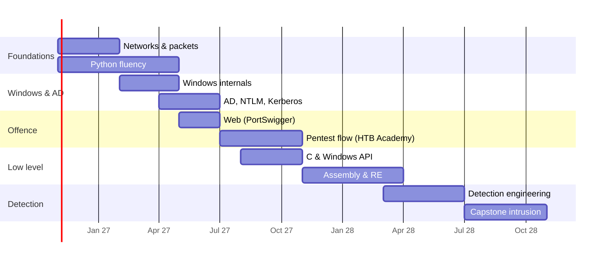

# 24-Month Curriculum

**Category:** Study plan · **Pace:** ~8–10 hours a week alongside work · **Last updated:** 2026-10-07

!!! abstract "Summary"
    A two-year plan following the [roadmap](roadmap.md) order: **networks → Windows internals & AD → offence → malware & reverse engineering → detection engineering**, with Python/C running alongside and the [purple-team weekly loop](purple-team-loop.md) as the constant habit. Each phase ends with a **checkpoint** — something you can show, not just a course completed.

## Overview

The bar dates are an example start of November; shift them to your own start month.

## Phase 1 — Months 1–3: Networks and Python

| Month | Study | Practise | Checkpoint |
|---|---|---|---|
| 1 | TCP/IP, ARP, DHCP, DNS in Wireshark; [well-known ports](../basics/well-known-ports.md) | Capture your own lab traffic; label every packet of a DNS lookup and a TCP handshake | Explain a 3-way handshake and DNS resolution from a pcap |
| 2 | HTTP, TLS, SSH, SMB; [Zeek logs](../network/zeek/index.md) | Python: parse Zeek `conn.log` into a summary (top talkers, long connections) | Your first Python tool on GitHub |
| 3 | LDAP, RPC, Kerberos on the wire; Suricata rules basics | Write 3 local Suricata rules; Arkime hunting from [hunting workflows](../network/arkime/hunting-workflows.md) | Purple-loop weeks 16–17 (HTTP & DNS C2) done |

## Phase 2 — Months 4–8: Windows internals and Active Directory

| Month | Study | Practise | Checkpoint |
|---|---|---|---|
| 4 | Processes, threads, services, registry, tokens, integrity levels (*Windows Internals* Part 1 ch. 1–3, Sysinternals) | Process Explorer/Process Monitor on normal activity; [event IDs](../basics/windows-event-ids.md) | Explain a process tree and token of a running service |
| 5 | Event logging, Sysmon config, artifacts ([Prefetch](../windows/prefetch.md), [Amcache](../windows/amcache.md), [registry](../windows/registry-keys.md)) | Build a lab: DC + 2 workstations + Splunk + Sysmon | Lab running with logs in Splunk |
| 6 | NTLM in depth → [Pass-the-Hash](../adversary/pass-the-hash.md), [relay](../adversary/llmnr-ntlm-relay.md) | Purple-loop weeks 5, 21 | Diagram of NTLM + where each attack inserts itself |
| 7 | Kerberos: TGT/TGS, SPNs, delegation | Purple-loop weeks 6, 22; [Golden/Silver](../adversary/golden-silver-tickets.md) | Explain why Kerberoasting works and what breaks it |
| 8 | Credential architecture: LSASS, SAM, LSA secrets, DPAPI, Credential Guard | Purple-loop weeks 7, 8; [hardening matrix](../adversary/hardening-by-version.md) | Credential-theft detection set in Splunk |

## Phase 3 — Months 7–12: Offence in a lab (overlaps phase 2)

| Month | Study | Practise | Checkpoint |
|---|---|---|---|
| 7–8 | PortSwigger: authentication, access control, SQLi, XSS, SSRF | All apprentice + some practitioner labs | Explain each vuln class and the log/HTTP evidence it leaves |
| 9–12 | HTB Academy Penetration Tester path: recon → enumeration → exploitation → privesc → lateral movement | HTB machines (retired, with write-ups afterwards); purple-loop weeks 9–15 | For every box: an attacker write-up **and** a defender write-up |

## Phase 4 — Months 9–16: C, assembly and reverse engineering

| Month | Study | Practise | Checkpoint |
|---|---|---|---|
| 9–10 | C: pointers, memory, stack/heap, structs; Windows API calls | Write: process lister, file hasher, a simple injector (lab only) | Read a C injector and map each API to [process injection](../adversary/process-injection.md) artifacts |
| 11 | PE format, imports/exports, `pefile` in Python | Python PE triage tool (imports, sections, entropy) | Tool flags packed/suspicious PEs |
| 12–13 | x86/x64 assembly, calling conventions; Malware Unicorn RE101 | Reverse your own C programs in Ghidra and x64dbg | Recognise loops, calls, strings decryption in disassembly |
| 14–16 | Static + dynamic malware analysis in an isolated VM | Samples from public training sets; [memory forensics](../memory/index.md) of the same samples | Report: files → persistence → credential access → C2, mapped to ATT&CK |

## Phase 5 — Months 17–24: Detection engineering and capstone

| Month | Study | Practise | Checkpoint |
|---|---|---|---|
| 17–18 | Detection-as-code: Sigma, SPL best practice, testing for false positives; [hunting patterns](../splunk/hunting-patterns.md) | Convert 10 of your purple-loop queries to Sigma; version them in Git | Detection library with tests |
| 19–20 | Threat-intel driven hunting: [DPRK TTPs](../threat-intel/dprk-ttps-hunting.md), other actor reports | Pick one actor, build a 5-technique emulation plan, run it, hunt it | Hunt report with gaps and new detections |
| 21–22 | DFIR case work: CyberDefenders / BTLO cases, full timelines with [Plaso](../tools/plaso-timelines.md) and [KAPE](../tools/kape.md) | One case per fortnight, written as a real incident report | 4 case reports |
| 23–24 | **Capstone**: a full intrusion in your lab, phishing → exfiltration, then investigate it cold (ideally a friend runs the attack) | Use every tool on this site | End-to-end incident report + detections + lessons learned |

## Rules that keep the plan alive

- **Weekly loop never stops** — even in heavy months, do one technique.
- **Write everything here.** A page on this site is the proof of learning; if you can't write it, you don't know it yet.
- **Labs only** for offensive work, isolated from work and home networks.
- **Re-plan every quarter**: move months around, but keep the order of the pillars.

## References

- Pages: [Roadmap](roadmap.md) · [Purple-team loop](purple-team-loop.md) · [Resources](resources.md)
