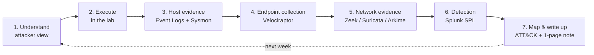

# Purple-Team Weekly Loop

<div class="dfir-meta" markdown>
**Category:** Study method · **Rhythm:** 1 week = 1 ATT&CK technique · **Last updated:** 2026-10-07
</div>

!!! abstract "Summary"
    Instead of a generic beginner curriculum, use the blue-team stack you already have — **Splunk, Zeek, Suricata, Arkime, Velociraptor** — and learn **one MITRE ATT&CK technique per week**: understand it as the attacker, run it in a lab, find every trace it leaves, write the detection, and finish with a one-page note. After a year that is ~50 techniques you can explain from both sides.

## The loop



| Day | Step | Output |
|---|---|---|
| 1 | Read the ATT&CK page and 1–2 procedure examples; read this site's page for the technique | 5-line explanation of **why** the technique works |
| 2 | Execute in the lab (manually and/or with Atomic Red Team) — snapshot the VM first | Exact commands + timestamps |
| 3 | Find the host evidence: Security, Sysmon, PowerShell, System logs; registry/file artifacts | List of event IDs and fields that show it |
| 4 | Collect with Velociraptor; check network side in Zeek/Suricata/Arkime | Artifact names, pcap/log evidence |
| 5 | Write and tune the SPL; test it against noise (run normal admin activity too) | Saved search + false-positive notes |
| 6–7 | Write the one-page note (template below); list visibility gaps | Note committed to this site |

## Worked example — week 1: T1059.001 PowerShell

### 1 · Understand (attacker view)

PowerShell is a full scripting language with direct access to .NET and the Windows API, installed on every modern Windows host. Attackers use it to **download and run code in memory** (`IEX (New-Object Net.WebClient).DownloadString(...)`), to hide commands with `-EncodedCommand` (Base64 of UTF-16LE text), and to run without a profile or window (`-nop -w hidden`). See [PowerShell cradles](../adversary/powershell-cradles.md) for the full attacker side.

### 2 · Execute in the lab (harmless payload)

```powershell
# Build an encoded command for a harmless action
$cmd   = 'Write-Output "purple-test"; Get-Process | Select-Object -First 3'
$bytes = [System.Text.Encoding]::Unicode.GetBytes($cmd)
$b64   = [Convert]::ToBase64String($bytes)

# Run it the way an attacker would (hidden window, no profile, encoded)
powershell.exe -nop -w hidden -enc $b64

# Optional: same idea through Atomic Red Team (list tests first, pick a benign one)
Invoke-AtomicTest T1059.001 -ShowDetailsBrief
```

Before running, make sure these are on in the lab: **Script Block Logging** (GPO *Administrative Templates › Windows Components › Windows PowerShell › Turn on PowerShell Script Block Logging*), **process creation with command line** (4688), and **Sysmon**.

### 3 · Host evidence

| Source | Event | What you will see |
|---|---|---|
| Sysmon | **1** — process created | `Image=...\powershell.exe`, `CommandLine` contains `-enc`, `ParentImage` (who launched it) |
| Security | **4688** — process created | Same as above, only if "Include command line in process creation events" is enabled |
| PowerShell/Operational | **4104** — script block logged | The **decoded** script text — attackers can encode the command line, but 4104 records what actually ran |
| PowerShell/Operational | **4103** — module logging | Pipeline/command details (if module logging enabled) |
| Windows PowerShell (classic) | **400 / 600** | Engine start with `HostApplication` = full command line — useful because it exists even on old systems |

### 4 · Splunk detection — line by line

```spl
index=botsv3 sourcetype="XmlWinEventLog:Microsoft-Windows-Sysmon/Operational" EventID=1 Image="*\\powershell.exe"
| where match(CommandLine, "(?i)\s-(e|en|enc|enco|encod|encode|encoded|encodedcommand)\s")
| rex field=CommandLine "(?i)-e\w*\s+(?<b64>[A-Za-z0-9+/=]{20,})"
| table _time, host, User, ParentImage, CommandLine, b64
```

- `index=botsv3 sourcetype=... EventID=1` — Sysmon process-creation events.
- `Image="*\\powershell.exe"` — only PowerShell processes (`*` = anything before, `\\` = one backslash).
- `where match(CommandLine, "...")` — keep command lines with any abbreviation of `-EncodedCommand` (PowerShell accepts `-e`, `-en`, `-enc` … all of them). `(?i)` makes the regex case-insensitive.
- `rex field=CommandLine "...(?<b64>...)"` — extract the Base64 blob into a new field called `b64` so you can decode it.
- `table` — show only the columns you need.

**Result:**

| _time | host | User | ParentImage | CommandLine | b64 |
|---|---|---|---|---|---|
| 2026-10-07 21:04:11 | LAB-WIN10 | LAB\analyst | C:\Windows\explorer.exe | `powershell.exe -nop -w hidden -enc VwByAGkAdABlAC0A...` | `VwByAGkAdABlAC0A...` |

Then confirm what actually ran from the script-block log:

```spl
index=botsv3 sourcetype="XmlWinEventLog:Microsoft-Windows-PowerShell/Operational" EventCode=4104
| search ScriptBlockText="*purple-test*" OR ScriptBlockText="*DownloadString*" OR ScriptBlockText="*FromBase64String*"
| table _time, host, ScriptBlockText
```

- `EventCode=4104` — script block logging: the decoded text of the script.
- `search ScriptBlockText="*...*"` — look for our test marker plus two classic attacker keywords.
- The result shows `Write-Output "purple-test"; Get-Process | Select-Object -First 3` in plain text — proof that 4104 defeats the encoding.

### 5 · Velociraptor

| Artifact | Why |
|---|---|
| `Windows.EventLogs.PowershellScriptblock` | Pulls 4104 events from the endpoint even if they never reached the SIEM |
| `Windows.System.Powershell.PSReadline` | Interactive command history (`ConsoleHost_history.txt`) per user |
| `Windows.Forensics.Prefetch` | Proves `POWERSHELL.EXE` executed and when (workstations) — see [Prefetch](../windows/prefetch.md) |

See [Velociraptor](../tools/velociraptor.md) for running hunts.

### 6 · Network side

- **Zeek `http.log`**: if the script downloads over HTTP, the default `user_agent` contains `WindowsPowerShell` — `zeek-cut ts id.orig_h host uri user_agent < http.log | grep -i powershell`.
- **Suricata** — a local rule for the same idea:

    ```text
    alert http $HOME_NET any -> $EXTERNAL_NET any (msg:"LOCAL PowerShell user-agent outbound"; flow:established,to_server; http.user_agent; content:"WindowsPowerShell"; nocase; sid:1000001; rev:1;)
    ```

- **Arkime**: `http.user-agent == *PowerShell*` to pull the sessions and download the pcap.
- Over HTTPS you will not see the user agent — look at JA3/JA4 and the destination instead ([Zeek SSL](../network/zeek/ssl-x509.md)).

### 7 · The one-page note (template)

```markdown
# T1059.001 — PowerShell
**Why it works:** built-in, trusted, runs .NET in memory; -enc hides intent.
**Lab commands:** powershell -nop -w hidden -enc <b64>   (2026-10-07 21:04, LAB-WIN10)
**Host evidence:** Sysmon 1 / 4688 (command line), 4104 (decoded script), 400 (HostApplication)
**Endpoint collection:** Velociraptor PowershellScriptblock, PSReadline, Prefetch
**Network evidence:** Zeek http.log UA "WindowsPowerShell"; Suricata sid 1000001
**Detection:** [SPL saved search name] — FP: SCCM/Intune scripts using -enc
**ATT&CK:** T1059.001 (Execution)
**Gaps:** 4104 not forwarded on servers; no TLS inspection
```

## Suggested order of techniques

Each row links to the page on this site that already holds the attacker and detection detail.

| Week | Technique | ATT&CK | Page |
|---|---|---|---|
| 1 | PowerShell / command interpreters | T1059.001 | [PowerShell cradles](../adversary/powershell-cradles.md) |
| 2 | Scheduled Task | T1053.005 | [Persistence](../adversary/persistence.md) |
| 3 | Windows Service | T1543.003 | [Persistence](../adversary/persistence.md) |
| 4 | Registry Run keys | T1547.001 | [Persistence](../adversary/persistence.md) |
| 5 | NTLM & Pass-the-Hash | T1550.002 | [Pass-the-Hash](../adversary/pass-the-hash.md) |
| 6 | Kerberos & Kerberoasting | T1558.003 | [Kerberoasting](../adversary/kerberoasting.md) |
| 7 | Credential dumping (LSASS) | T1003.001 | [LSASS dumping](../adversary/lsass-dumping.md) |
| 8 | SAM / NTDS extraction | T1003.002/.003 | [SAM & NTDS](../adversary/sam-ntds-extraction.md) |
| 9 | SMB / PsExec | T1021.002 | [PsExec & SMB](../adversary/psexec-smb.md) |
| 10 | RDP | T1021.001 | [RDP](../adversary/rdp.md) |
| 11 | WMI | T1047 | [WMI & WinRM](../adversary/wmi-winrm.md) |
| 12 | WinRM | T1021.006 | [WMI & WinRM](../adversary/wmi-winrm.md) |
| 13 | LOLBins (certutil, mshta, rundll32) | T1218, T1105 | [LOLBins](../adversary/lolbins.md) |
| 14 | Phishing → user execution | T1566, T1204 | [Phishing delivery](../adversary/phishing-delivery.md) |
| 15 | Web shell | T1505.003 | [Web shell playbook](../playbooks/webshell-server.md) |
| 16 | HTTP(S) C2 & beaconing | T1071.001 | [Beaconing & C2](../network/beaconing-c2.md) |
| 17 | DNS C2 / tunnelling | T1071.004 | [Zeek dns.log](../network/zeek/dns-log.md) |
| 18 | Process injection | T1055 | [Process injection](../adversary/process-injection.md) |
| 19 | UAC bypass | T1548.002 | [UAC bypass](../adversary/uac-bypass.md) |
| 20 | Token impersonation | T1134 | [Token & Potato](../adversary/token-impersonation-potato.md) |
| 21 | LLMNR poisoning & NTLM relay | T1557.001 | [LLMNR & NTLM relay](../adversary/llmnr-ntlm-relay.md) |
| 22 | DCSync | T1003.006 | [DCSync](../adversary/dcsync.md) |
| 23 | Impair defenses & log clearing | T1562, T1070.001 | [Impair defenses](../adversary/impair-defenses-log-clearing.md) |
| 24 | Exfiltration over web services | T1567 | [Data exfiltration playbook](../playbooks/data-exfiltration.md) |

After week 24, chain them: run weeks 14 → 1 → 2 → 7 → 9 → 16 → 24 as **one intrusion** and investigate it end to end as a case.

## References

- [MITRE ATT&CK — T1059.001 PowerShell](https://attack.mitre.org/techniques/T1059/001/)
- [Atomic Red Team](https://github.com/redcanaryco/atomic-red-team) — small, documented tests per ATT&CK technique
- [Microsoft — about_Logging_Windows (script block logging)](https://learn.microsoft.com/powershell/module/microsoft.powershell.core/about/about_logging_windows)
- Pages: [Roadmap](roadmap.md) · [24-month curriculum](curriculum-24-months.md) · [Hunting patterns](../splunk/hunting-patterns.md)
