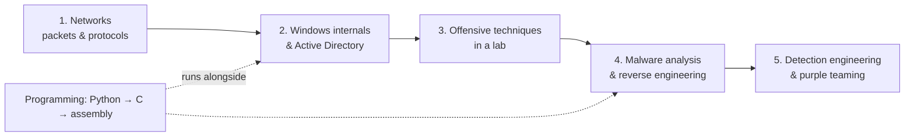

# Roadmap

**Category:** Study plan · **Goal:** advanced threat hunting / DFIR / malware analysis · **Last updated:** 2026-10-07

!!! abstract "Summary"
    Top-tier attackers are not good because they know many tools — they are good because they understand computers deeply. The same is true for the defenders who catch them. This roadmap puts **low-level system knowledge and the attacker's point of view** on top of a blue-team tool stack (Splunk, Zeek, Suricata, Arkime, Velociraptor), in a deliberate order.

## The recommended order

At this stage, going **deep on Windows/AD and programming** raises real skill far more than collecting more certificates.

## The eight pillars

### 1. Computer fundamentals — deeply

- **Linux without a GUI**: processes, permissions, systemd, logs, `/proc`, networking commands. See [Linux commands](../basics/linux-commands.md).
- **Windows**: how processes, services, the registry, permissions, **access tokens** and event logs actually work.
- **Networking**: not just TCP/IP — be able to look at packets and explain **ARP, DNS, DHCP, HTTP, TLS, SSH, SMB, LDAP, RPC**. Use [Wireshark/tshark](../network/wireshark-tshark.md) and [Zeek](../network/zeek/index.md) on your own traffic.
- For Windows environments, study in this order: **NTLM → Kerberos → Active Directory → Windows credential architecture** (LSASS, SAM, LSA secrets, DPAPI).

**You are done when** you can draw an SMB session or a Kerberos ticket exchange from memory and point to each step in a pcap.

### 2. Programming — Python fluently, then C

- **Python** until it's comfortable: parse logs, process pcaps (`scapy`, `pyshark`), call APIs (Splunk REST, VirusTotal), analyse files (`pefile`), automate triage.
- **C**: pointers, memory, stack vs heap, processes, DLLs, system calls. Write small programs that call the Windows API (`CreateProcess`, `OpenProcess`, `ReadProcessMemory`).
- **Advanced**: x86/x64 **assembly**. This is where malware analysis and exploit understanding take off.

**You are done when** you can write a Python tool that turns raw evidence into a CSV timeline, and read a 50-line C program that injects into a process and explain each call.

### 3. Attack — but only in a lab

- Start with **web**: HTTP, authentication, access control, SQL injection, XSS, SSRF — PortSwigger Web Security Academy (free, with labs).
- Then a full **penetration-testing flow**: reconnaissance → enumeration → exploitation → privilege escalation → lateral movement (HTB Academy Penetration Tester path).
- Never against systems you don't own or have written permission to test.

### 4. Windows & Active Directory attack *and* defence

- NTLM authentication → [Pass-the-Hash](../adversary/pass-the-hash.md) → [NTLM relay](../adversary/llmnr-ntlm-relay.md).
- Kerberos: TGT/TGS, SPNs, delegation, service accounts → [Kerberoasting](../adversary/kerberoasting.md), [AS-REP roasting](../adversary/asrep-roasting.md), [Golden/Silver tickets](../adversary/golden-silver-tickets.md), [DCSync](../adversary/dcsync.md), [ADCS](../adversary/adcs-abuse.md).
- The goal is not memorising commands but being able to explain **"which property of this authentication design makes this attack possible?"** — and therefore which control breaks it.

### 5. Reverse engineering

- PE format, imports/exports, strings, the Windows API, x86/x64 assembly, a debugger (x64dbg) and a disassembler (Ghidra).
- Start with small programs you wrote yourself, then real samples in an isolated VM. Malware Unicorn's RE101 walks through static and dynamic analysis step by step.
- Practise answering: **how does this sample create files → persist → steal credentials → reach C2?** — then map each answer to ATT&CK.

### 6. Attack and detection as one set (purple team)

The most important habit. After you perform any technique in the lab, don't stop:

1. Find the traces in **Windows Event Logs and Sysmon**.
2. Confirm endpoint artifacts with **Velociraptor**.
3. Look at the network side in **Zeek / Suricata / Arkime**.
4. Write the **Splunk SPL** detection.
5. Map it to the **MITRE ATT&CK** technique.

This is turned into a weekly routine on the [purple-team loop](purple-team-loop.md) page.

### 7. Follow one attack from start to finish

Treat a whole intrusion as one case:
`Phishing / web exploit → Execution → Persistence → Privilege escalation → Credential access → Discovery → Lateral movement → C2 → Exfiltration`.
Real groups' procedures are the best scenario source — for example the [North Korea TTPs](../threat-intel/dprk-ttps-hunting.md) page and MITRE's Lazarus Group entry. The [Adversary index](../adversary/index.md) shows a typical intrusion mapped to this site's pages.

### 8. Investigate like a real case, not only CTFs

- **pwn.college** builds Linux and low-level security understanding step by step.
- **CyberDefenders** (and Blue Team Labs Online) give DFIR, threat-hunting, network-forensics and malware-analysis cases shaped like real incidents.
- Write every case up as if a manager will read it: timeline, scope, root cause, evidence, recommendations.

## Where this leads after about a year

Not "someone who can use Splunk", but someone who can:

**read packets and understand the attack → understand Windows/Linux internals → reproduce attacker behaviour → find endpoint and network evidence → analyse malware → build detection logic.**

## References

- [MITRE ATT&CK — Lazarus Group (G0032)](https://attack.mitre.org/groups/G0032/) — procedure examples to build lab scenarios from
- [PortSwigger Web Security Academy](https://portswigger.net/web-security)
- [HTB Academy — Penetration Tester path](https://academy.hackthebox.com/path/preview/penetration-tester)
- [Malware Unicorn — RE101](https://malwareunicorn.org/workshops/re101)
- [pwn.college](https://pwn.college/dojos) · [CyberDefenders](https://cyberdefenders.org/)
- Pages: [Purple-team loop](purple-team-loop.md) · [24-month curriculum](curriculum-24-months.md) · [Resources](resources.md)
