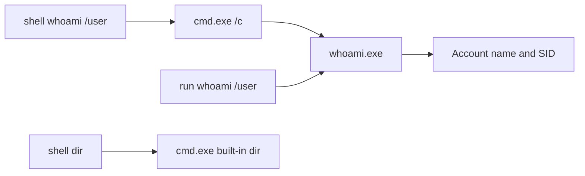
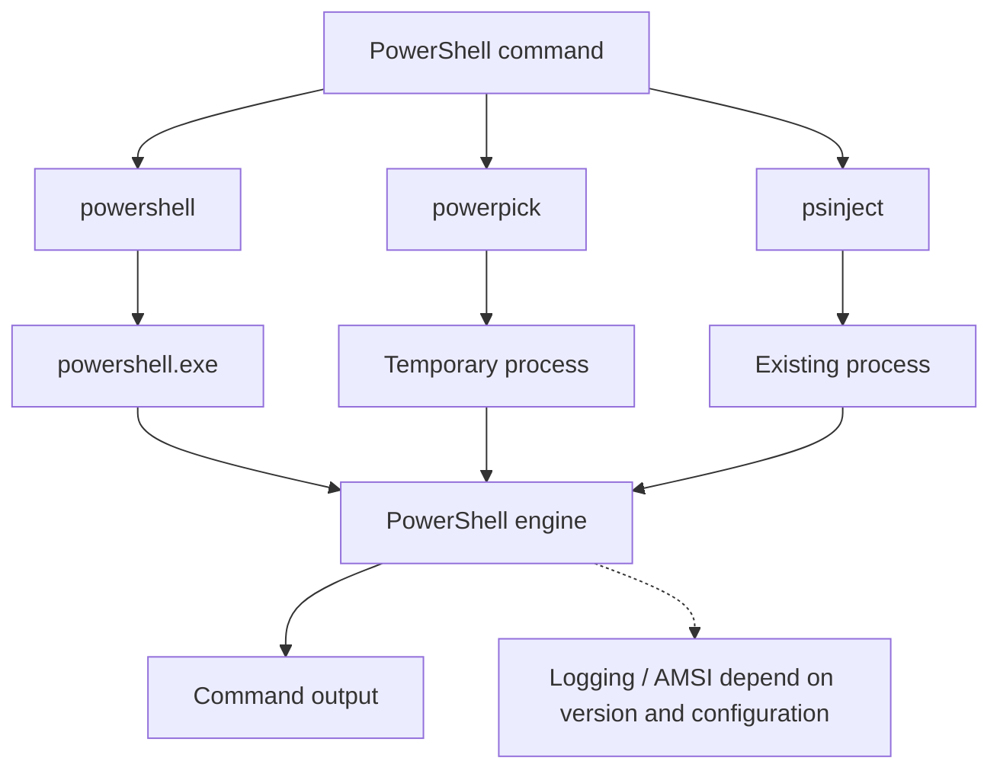
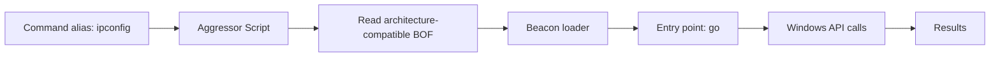

# 04. Execution and external tools { #execution-tools }

[Post-Exploitation index](index.md) · English companion to the complete Korean lecture · Reviewed 2026-10-27


## 12. shell versus run { #chapter-12 }



```text
shell whoami /user
run whoami /user
shell dir
```

Both whoami examples return the account and SID, but shell passes through cmd.exe /c while run executes the program directly. SID is Windows' security identifier, distinct from the display name.

| Property | shell | run |
| --- | --- | --- |
| Uses cmd.exe | Yes | No |
| Standalone executable | Supported | Supported |
| cmd built-in such as dir | Supported | Not directly |
| Shell syntax | Interpreted by cmd | Not automatically interpreted |

The source suggests `ls` instead of dir and `getuid` for identity checks. Learn the behavioral difference rather than assuming that one command is invisible.

## 13. External tools { #chapter-13 }

| Tool | Purpose described in the chapter |
| --- | --- |
| Seatbelt | Local system and security configuration reconnaissance |
| PowerView | Active Directory reconnaissance |
| Certipy / Certify | AD CS security assessment |
| Rubeus | Kerberos assessment |
| Impacket | Windows network protocol testing |

Determine whether a tool is PowerShell, a .NET Framework assembly, native code or Python, and whether it runs on-host or over the network. These tools are not interchangeable execute-assembly inputs. Network-side operation is deferred to the source's Pivoting chapter.

## 14. Three PowerShell execution paths { #chapter-14 }



| Command | Host in the source model |
| --- | --- |
| powershell | powershell.exe |
| powerpick | Engine hosted in a temporary process |
| psinject | Engine hosted in a selected existing process |

```text
powershell [commandlet] [arguments]
powershell $env:computername
powerpick [commandlet] [arguments]
psinject [pid] [arch] [commandlet] [arguments]
psinject 3020 x64 $PID
```

The computername environment variable returns the host name. The source describes powershell execution with -nop, -exec bypass and -EncodedCommand: skip profiles, set execution-policy behavior, and pass encoded text. Base64 is encoding, not encryption; execution-policy Bypass is neither elevation nor disabling endpoint security. [Execution policies](https://learn.microsoft.com/en-us/powershell/module/microsoft.powershell.core/about/about_execution_policies?view=powershell-5.1)

Powerpick uses unmanaged hosting of the PowerShell engine and a fork-and-run DLL, retrieving output over a named pipe. “Unmanaged” does not mean the engine disappeared. PsInject uses the same idea in an existing process. $PID reports the host process: 3020 proves execution location, not privilege escalation.

The source help also lists optional PATCHES arguments for powerpick and execute-assembly. These describe advanced in-memory function modifications; the chapter supplies no concrete patch rules, and they are not required to understand basic execution.

## 15. Importing PowerShell scripts { #chapter-15 }

```text
powershell-import [/path/to/local/script.ps1]
powershell-import C:\Tools\PowerSploit\Recon\PowerView.ps1
powerpick Get-Domain
```

The script path is on the **operator Client**, not a requirement for the same file to exist on the lab host. The source describes loading imported content into later powershell, powerpick and psinject executions using an internal web server. One imported script is retained at a time; this is not a persistent interactive PowerShell session.

Get-Domain is supplied by PowerView in this example, not built into PowerShell.

| Output | Meaning |
| --- | --- |
| Forest | Containing forest |
| DomainControllers | Domain controllers |
| Children / Parent | Domain hierarchy |
| DomainMode / DomainModeLevel | Functional-level representation |
| PdcRoleOwner | PDC Emulator |
| RidRoleOwner | RID Master |
| InfrastructureRoleOwner | Infrastructure Master |
| Name | Domain name |

Unknown DomainMode may reflect an older library not recognizing a level, rather than a broken domain.

## 16. .NET assemblies { #chapter-16 }

```text
execute-assembly [/path/to/file.exe] [arguments]
execute-assembly C:\Tools\Seatbelt\Seatbelt\bin\Release\Seatbelt.exe AntiVirus
```

The source describes a temporary process hosting the CLR and loading a .NET assembly from memory. CLR means **Common Language Runtime**, correcting the source's “Command Language Runtime.”

This mechanism is described for .NET Framework assemblies, not arbitrary modern .NET/.NET Core applications or native EXEs. The filename extension alone does not prove compatibility.

Seatbelt's AntiVirus argument requests the relevant inventory. Engine, ProductEXE and ReportingEXE are product registration/reporting information; they do not prove every protection component is active. The data-store help reference concerns reuse of already loaded content, rather than necessarily rereading the same file every time.

## 17. BOFs and Aggressor Script { #chapter-17 }



```text
inline-execute [/path/to/file.o] [args]
ipconfig
```

In the chapter, ipconfig is a command alias supplied by TrustedSec's Situational Awareness BOF tooling. It is distinct from shell ipconfig, which runs the Windows executable through cmd.

```text
beacon_inline_execute(
    $1,
    readbof($1, "ipconfig", $null, "T1016"),
    "go",
    $null
);
```

| Part | Meaning in this context |
| --- | --- |
| beacon_inline_execute | Execute the BOF |
| $1 | Target Beacon identifier |
| readbof | The tooling's BOF-reading helper |
| ipconfig | BOF selection |
| go | Entry function |
| Final $null | No additional argument buffer |
| T1016 | Network configuration discovery identifier |

An alias can wrap a BOF, so a familiar command name does not prove the implementation. Review loaded scripts and version-specific help.

---

[← 03. Processes and collection](processes-collection.md) · [05. Modern defense and review →](modern-defense.md)
