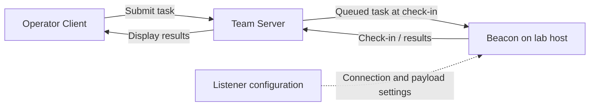
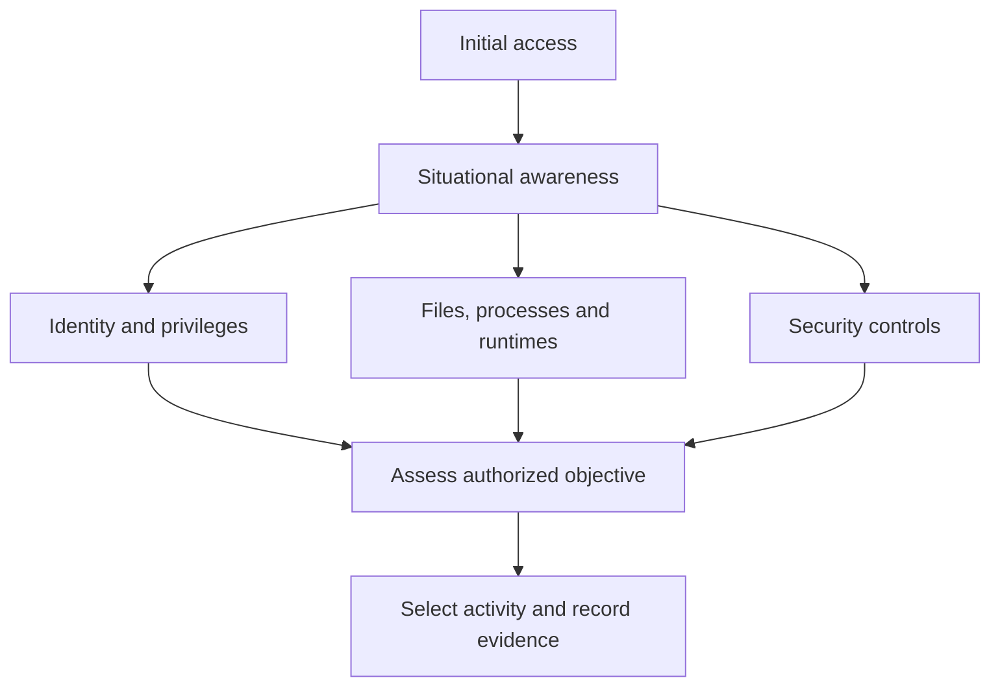
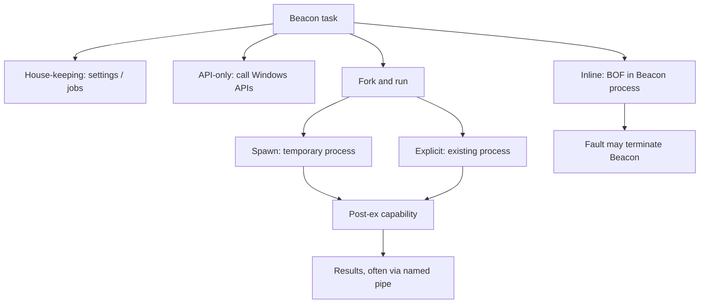

# 03.1 Architecture and command behavior { #fundamentals }

[Post-Exploitation index](index.md) · Reviewed 2026-10-27


## 1. Client, Team Server and Beacon { #chapter-1 }

The Client is the operator interface, the Team Server queues tasks and stores results, and Beacon runs on the lab host. A listener defines connection and payload settings; it is not interchangeable with a user account.



A check-in is Beacon contacting its server. Results and interactive browsers can be delayed by the configured interval. A Beacon session, a Windows logon session, and a user account are different identities.

| Component | Role | Location |
| --- | --- | --- |
| Client | Submit tasks; view and synchronize results | Operator workstation |
| Team Server | Coordinate tasking; retain collected files | Central server |
| Beacon | Execute tasks under its security context | Lab host |
| Listener | Define connection and payload configuration | Operator configuration |

## 2. Situational awareness { #chapter-2 }

Post-exploitation begins with understanding the current environment and the authorized objective. Access alone does not establish what a user may read, execute or administer.



| Investigate | Questions |
| --- | --- |
| Files, shares, mapped drives | Which locations are visible and accessible? |
| Processes and software | What is running, under which account? |
| AV, EDR, LAPS, Sysmon | Which controls and telemetry are present? |
| .NET and PowerShell | Which runtimes and versions are available? |
| Logged-on users and privileges | What is the current token and session? |
| Browser bookmarks and stored credentials | Where might business context or sensitive data exist? |
| UAC and SMB signing | Which local and network constraints apply? |
| Domain systems, services and access | How are users and resources related? |

LAPS manages local administrator passwords. Sysmon records events. EDR focuses on detection, investigation and response. These are not equivalent controls. Privilege escalation, credential dumping, impersonation and lateral movement are mentioned in the source chapter, but their detailed procedures are outside this lesson.

## 3. Classify commands by behavior { #chapter-3 }



| Class | Examples | Meaning and limitations |
| --- | --- | --- |
| House-keeping | `sleep`, `spawnto`, `jobs`, `ppid` | Change settings or inspect state |
| API-only | `cd`, `cp`, `ls`, `mv`, `ps`, `pwd`, `rm`, `upload` | Use Windows APIs; no guarantee of low impact or invisibility |
| Inline execution | `inline-execute` | Load additional code in Beacon; a fault can terminate it |
| Fork & run | `execute-assembly`, `powerpick`, `psinject` | Run a capability in a temporary or existing process |

`sleep` changes check-in timing; `spawnto` controls the temporary process used by applicable jobs. `jobs` lists ongoing jobs. `ppid` affects subsequent process creation rather than rewriting historical parentage.

API-only file commands still read, write, move or delete data. Avoid treating this classification as a safety ranking.

A traditional BOF is compiled to an object file. Beacon resolves and loads its code instead of using a normal standalone executable. It shares Beacon's address space. The source names `dllload`, `getsystem` and `timestomp` as BOF implementations: DLL loading, an attempt to obtain SYSTEM, and file timestamp changes respectively. Implementation can change by version; timestamp changes do not erase all evidence.

```text
inline-execute [/path/to/file.o] [args]
```

Fork & run describes a pattern, not a literal Unix fork call: create a process, inject a post-ex capability, execute it, and retrieve results, often over a named pipe. A reflective DLL supports memory loading outside the ordinary DLL loading path.

| Variant | Process | Source examples |
| --- | --- | --- |
| Spawn | Newly created temporary process | execute-assembly, powerpick |
| Explicit | Existing process identified by PID and architecture | psinject |
| Either | Depends on arguments | mimikatz, portscan, keylogger |

```text
execute-assembly [/path/to/file.exe] [arguments]
psinject [pid] [arch] [commandlet] [arguments]
mimikatz [pid] [arch] [module::command] <args>
mimikatz [module::command] <args>
```

These signatures illustrate execution models. They do not provide a credential-dumping procedure. Architecture, target access rights, process protection and version-specific help must be considered.

---

[← Learning path](index.md) · [03.2 Sessions and file systems →](sessions-files.md)
