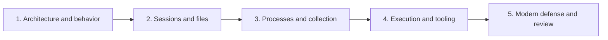

# Post-Exploitation { #post-exploitation }

Learn to connect **what a command returns** with **what happens inside the operating system**. This collection covers Beacon architecture, situational awareness, session and file management, collection, and execution models.

The **19 sections** are organized into **five learning pages**, with command explanations, comparison tables and execution diagrams.

!!! note "Scope and provenance"
    Independently written explanations based on the supplied “7 - Post-Exploitation” chapter. Original course files and screenshots are not redistributed. Examples assume an authorized lab. This site does not execute the commands. Product behavior depends on version and configuration; official supplements were reviewed on 2026-10-27.

## Learning path { #learning-path }

| Order | Page | Original sections |
| --- | --- | --- |
| 1 | [01. Architecture and command behavior](fundamentals.md) | 1–3 |
| 2 | [02. Sessions and file systems](sessions-files.md) | 4–6 |
| 3 | [03. Processes and collection](processes-collection.md) | 7–11 |
| 4 | [04. Execution and external tools](execution-tools.md) | 12–17 |
| 5 | [05. Modern defense and review](modern-defense.md) | 18–19 |

## Four questions { #four-questions }

| Question | Inspect | Example |
| --- | --- | --- |
| Where does it run? | Beacon, temporary process, existing process | BOF vs fork & run |
| Whose authority? | User, token, integrity, session | spawn vs spawnas |
| What changes? | Files, processes, clipboard, network | printscreen affects clipboard |
| Where do results go? | Console, result tab, server, Client | download vs Sync Files |

## Common confusions { #common-confusions }

| Assumption | Correction |
| --- | --- |
| Memory-only means no evidence | Disk, memory, process and network visibility are separate |
| Administrator account always has elevated rights | Inspect the current token and UAC state |
| Another Beacon means more privilege | Session creation and elevation are different |
| PID and JID are interchangeable | Process identity and Beacon job identity differ |
| A download is immediately local | Team Server receives it before Client synchronization |
| PowerShell requires powershell.exe | Another process can host the engine |

Start with [Architecture and command behavior](fundamentals.md), or return to [Red Team](../index.md).
