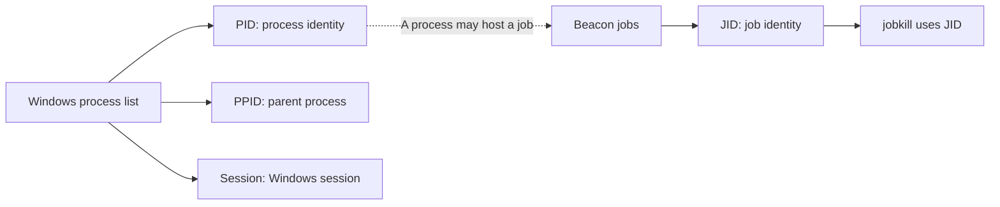
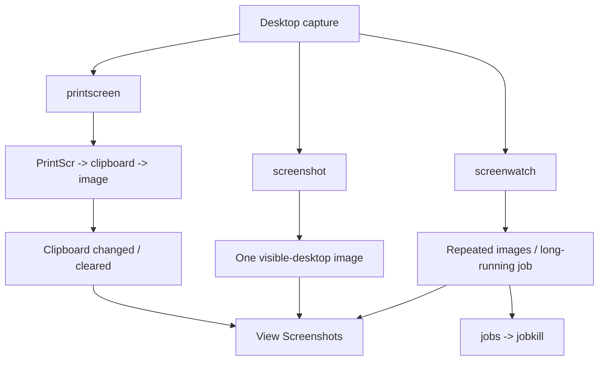

# 03.3 Processes and collection { #processes-collection }

[Post-Exploitation index](index.md) · Reviewed 2026-10-27


## 7. Process enumeration { #chapter-7 }



```text
ps
process_browser
```

| Field | Meaning |
| --- | --- |
| PID | Windows process identifier |
| PPID | Parent process identifier |
| Name | Process name |
| Arch | Process architecture |
| Session | Windows session |
| User | Process account |

Process Browser is also available under **Explore → Process List**. PIDs are transient identifiers, not numbers to memorize. Visibility depends on the information requested, access rights and protection settings. Administrative group membership does not mean the current process has an elevated token, and elevation does not guarantee access to protected processes. [UAC behavior](https://learn.microsoft.com/en-us/windows-server/security/user-account-control/how-user-account-control-works)

## 8. Keylogger and clipboard { #chapter-8 }

```text
keylogger [pid] [x86|x64]
keylogger
jobs
jobkill 0
clipboard
```

The PID form uses an existing process; the no-argument form creates a temporary process in the source description. Collection is constrained by permissions and the session/desktop context: it does not imply access to every user's input.

Keylogger results appear in **View → Keystrokes**, rather than ordinary console output. Save synchronizes the result locally; Delete removes the collected result. It is a long-running job. In `jobkill 0`, 0 is an example JID, not a Windows PID.

`clipboard` reads current text clipboard content. It is not a continuous keystroke log or recovery of all previous copied values. The source's password-like output illustrates exposure of copied sensitive text.

## 9. Registry { #chapter-9 }

A key resembles a folder; subkeys are nested folders; values are named data entries.

```text
reg query [x86|x64] [root\path]
reg queryv [x86|x64] [root\path] [value-name]
reg query x64 HKLM\SOFTWARE\Microsoft\Windows\CurrentVersion\Policies\System
reg queryv x64 HKLM\SOFTWARE\Microsoft\Windows\CurrentVersion\Policies\System ConsentPromptBehaviorAdmin
```

The source help calls the last argument a subkey, but the example reads a **value name**. x86/x64 selects the registry view; not every path differs between views.

| Root | Scope |
| --- | --- |
| HKLM | Machine-wide configuration |
| HKCU | Current user |
| HKU | Loaded user hives |
| HKCR | Class registration and file association view |
| HKCC | Current hardware configuration |

| Example value | Interpretation |
| --- | --- |
| EnableLUA = 1 | UAC enablement setting |
| ConsentPromptBehaviorAdmin = 5 | Consent for non-Windows binaries |
| PromptOnSecureDesktop = 1 | Secure desktop for elevation prompts |
| EnableInstallerDetection = 1 | Installer detection setting |
| ValidateAdminCodeSignatures = 0 | This UAC policy does not require signature validation |
| LocalAccountTokenFilterPolicy = 1 | Relaxes applicable remote local-account token filtering |

These values do not establish the entire effective security posture. In particular, signature policy 0 does not disable every signing or application-control mechanism. LocalAccountTokenFilterPolicy does not mean all UAC is off. Other source output concerns startup, UI access, virtualization, logon, smart cards, shutdown and docking; Audit, Kerberos and UIPI are subkeys. [UAC settings](https://learn.microsoft.com/en-gb/windows/security/application-security/application-control/user-account-control/settings-and-configuration) · [Remote UAC restrictions](https://github.com/MicrosoftDocs/SupportArticles-docs/blob/main/support/windows-server/windows-security/user-account-control-and-remote-restriction.md)

## 10. Screenshots { #chapter-10 }



| Command | Behavior | Duration |
| --- | --- | --- |
| printscreen | Simulated PrintScr, retrieve clipboard image, clear clipboard | One shot |
| screenshot | Capture visible desktop via capability DLL | One shot |
| screenwatch | Repeat captures and return images | Long-running job |

```text
printscreen [pid] [x86|x64]
printscreen
screenshot [pid] [x86|x64]
screenshot
screenwatch [pid] <x86|x64>
screenwatch
```

A PID selects an existing process; no PID selects the spawn variant in the source. Printscreen can disrupt the user's copied data. A visible-desktop capture does not promise access to every hidden window, locked screen or secure desktop.

Screenwatch delivery is tied to check-ins; the chapter says it captures every three minutes when idle. `sleep 5` and `sleep 60` illustrate timing changes, not exact real-time frame-rate guarantees. Manage the job with jobs/jobkill. Results are in **View → Screenshots**, with Save, Delete and zoom controls. The chapter also describes screenshot actions from the Beacon and Process Browser menus.

## 11. VNC { #chapter-11 }

```text
desktop [pid] [x86|x64] [high|low]
desktop [high|low]
desktop high
```

High/low describes image quality, not privilege. The chapter uses a reflective VNC DLL and forwarding through the Team Server to the Client. Its example port 5117 is not a universal fixed port.

**Explore → Desktop (VNC)** starts in view-only mode. GUI controls can enable keyboard and mouse control, which changes the user's real desktop state. Closing the tab tears down the associated port bindings in the described version.

---

[← 03.2 Sessions and file systems](sessions-files.md) · [03.4 Execution and external tools →](execution-tools.md)
