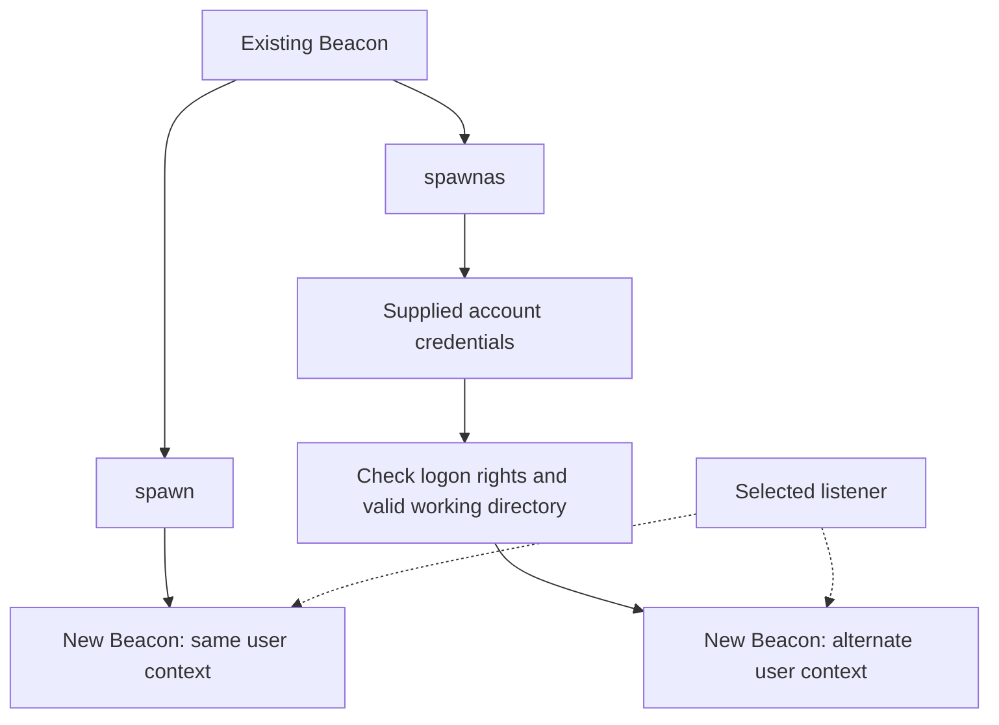
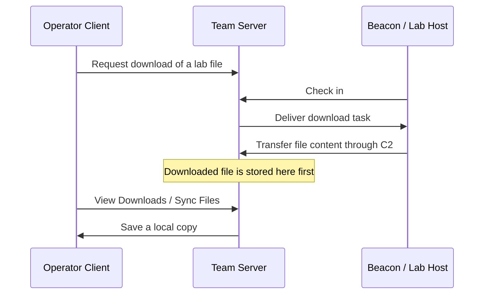

# 02. Sessions and file systems { #sessions-files }

[Post-Exploitation index](index.md) · English companion to the complete Korean lecture · Reviewed 2026-10-27


## 4. Session passing { #chapter-4 }

Session passing creates another Beacon from an existing session. It does not automatically convert the original session or elevate its privileges.



```text
spawn [x86|x64] [listener]
spawn [listener]
spawn x64 http
spawnas [DOMAIN\user] [password] [listener]
```

In the example, `http` is a listener name, not a complete protocol specification. `spawn` normally creates a new session in the same user context. `spawnas` attempts execution using the supplied credentials; omitting DOMAIN makes it try a local account in the source description. Do not copy an example's external host into your own configuration.

The source notes that `spawnas` commonly fails from SYSTEM because of underlying Windows API constraints and mentions `make_token`. A token-based authentication context is not a universal change to the process identity and every local permission.

### Error 267

The source's current directory was `C:\Users\pchilds\Documents`, which the alternate user could not use. Examine both the error and working directory:

```text
windows_error_code 267
pwd
cd C:\
```

Win32 267 means `ERROR_DIRECTORY`: an invalid directory name. A failure need not mean a wrong password; check the path and accessibility. Do not generalize this specific example into “267 always means permission denied,” or equate it with an unrelated NTSTATUS name. [Microsoft error codes](https://learn.microsoft.com/en-us/windows/win32/debug/system-error-codes--0-499-)

## 5. File-system navigation { #chapter-5 }

| Command | Meaning |
| --- | --- |
| `pwd` | Current working directory |
| `ls` | List current directory |
| `ls C:\Users` | List an absolute path |
| `ls Users` | Resolve a relative path against the working directory |
| `cd C:\` | Change working directory |
| `drives` | Enumerate available drives |
| `file_browser` | Open the graphical browser |

If the working directory is C:\, `ls Users` refers to C:\Users. Output includes size, file/directory type, modification time and name. A profile directory does not prove that its owner is logged on. Listing a file does not prove permission to read its content. Mapped drives can vary with logon context, and timestamps alone do not establish a file's history.

The File Browser is also available through **Explore → File Browser**. It starts in the current working directory. In the described version, grey directories have not yet been viewed; results are cached while the tab remains open. Closing the tab discards that browsing state. The GUI submits Beacon tasks, so it remains constrained by check-in timing.

## 6. File downloads { #chapter-6 }



```text
download [file]
download C:\Users\pchilds\Desktop\desktop.ini
downloads
```

`download` starts collection; `downloads` lists progress. The chapter uses `cancel` to stop a download. Confirm its arguments and task scope with the installed version's help, since later releases changed task and cancellation handling.

| Action | Destination or effect |
| --- | --- |
| download / File Browser → Download | Host file travels to Team Server |
| View → Downloads | Review collected files |
| Sync Files | Save a copy on the operator's Client machine |
| Delete Files | Delete the server-side collected copy, not the host original |

The chapter states that operators connected to the Team Server can see and delete its downloads. Treat the server as a repository of collected data. Transfer performance depends on protocol, check-in timing, file size, intermediate links and configuration. DNS A-record transfers are the chapter's example of a less efficient bulk-transfer path than HTTP POST, not a universal speed law.

---

[← 01. Architecture and command behavior](fundamentals.md) · [03. Processes and collection →](processes-collection.md)
