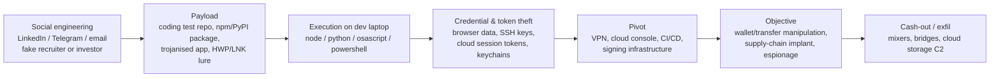

# North Korea (DPRK) — Groups & Incidents

**Category:** Threat actor profile · **Sponsor:** Reconnaissance General Bureau (RGB) and related state bodies · **Last updated:** 2026-10-07

!!! abstract "Summary"
    North Korea runs one of the most capable and most **financially motivated** state cyber programmes in the world. MITRE ATT&CK attributes the Lazarus Group to the RGB; the FBI attributed the February 2025 theft of roughly **US$1.5 billion** in crypto from the Bybit exchange to the DPRK's "TraderTraitor" activity — the largest single theft on record. The same ecosystem also does classic espionage (defence, government, think tanks, South Korea) and destructive attacks. What makes them dangerous is not exotic tooling but **patient social engineering, supply-chain thinking and fast operational pivots** — exactly what a defender must learn to recognise.

## Why defenders study DPRK actors

- **Money is the mission.** Revenue for the state (sanctions evasion) drives most operations, so banks, SWIFT operators, crypto exchanges, DeFi projects and *their developers* are primary targets.
- **They target people, not just networks.** Fake recruiters, fake coding tests, fake investors, fake job applicants (IT workers) — the initial access is human.
- **They are multi-platform.** Windows, **macOS** (developers and crypto staff), Linux servers, npm/PyPI packages, cloud consoles.
- **They reuse a recognisable behavioural playbook** that maps cleanly onto ATT&CK — see [TTPs & hunting](dprk-ttps-hunting.md).

## The clusters and their names

Every vendor names the same activity differently. "Lazarus" is used both for one group and as an umbrella for all RGB activity. This table lines the names up (vendor assessments; overlaps are normal).

| Cluster (common name) | Other names | ATT&CK | Main mission | Known for |
|---|---|---|---|---|
| **Lazarus Group** (umbrella / core) | Hidden Cobra, Diamond Sleet (ZINC), Labyrinth Chollima, Selective Pisces | [G0032](https://attack.mitre.org/groups/G0032/) | Espionage, destruction, theft | Sony Pictures (2014), WannaCry (2017), fake-job "Operation Dream Job" against defence & aerospace |
| **APT38 / BlueNoroff** | Sapphire Sleet, Stardust Chollima, Alluring Pisces | [G0082](https://attack.mitre.org/groups/G0082/) | Financial theft | Bangladesh Bank SWIFT heist (2016), banks, ATMs, crypto firms; macOS malware (RustBucket, KANDYKORN) |
| **TraderTraitor** | Jade Sleet, UNC4899, Slow Pisces | — | Crypto theft via developers & supply chain | Ronin (2022), JumpCloud (2023), DMM Bitcoin (2024), **Bybit (2025)** |
| **AppleJeus cluster** | Citrine Sleet, Gleaming Pisces, (UNC4736 per Mandiant for 3CX) | — | Crypto theft | Trojanised crypto-trading apps; the **3CX** double supply-chain compromise (2023) |
| **Andariel** | Onyx Sleet, Silent Chollima, Jumpy Pisces | [G0138](https://attack.mitre.org/groups/G0138/) | Espionage + ransomware for funding | Defence, healthcare, engineering; Maui ransomware against US healthcare |
| **Kimsuky** | APT43, Emerald Sleet (THALLIUM), Velvet Chollima, Sparkling Pisces | [G0094](https://attack.mitre.org/groups/G0094/) | Intelligence collection | South Korean government, unification/foreign-policy experts, think tanks, journalists; spear-phishing with HWP/LNK/CHM lures |
| **APT37** | ScarCruft, Reaper, InkySquid, Ricochet Chollima | [G0067](https://attack.mitre.org/groups/G0067/) | Espionage | South Korea, defectors, journalists; HWP exploits, cloud-storage C2 |
| **IT workers / "Contagious Interview"** | Famous Chollima, Jasper Sleet | — | Revenue (salaries), insider access, extortion | DPRK nationals hired remotely under false identities using "laptop farms"; fake-interview malware (BeaverTail, InvisibleFerret) against job seekers |

!!! tip "Practical rule"
    In a report, write down **which vendor name** you are quoting. "Lazarus did X" from one vendor and "Sapphire Sleet did X" from another may be the same event — or not.

## Timeline of major public incidents

| Year | Incident | Cluster (as reported) | What happened | Lesson for defenders |
|---|---|---|---|---|
| 2014 | **Sony Pictures** | Lazarus | Data theft, leaks and wiper malware destroying thousands of hosts | Destructive attacks follow long, quiet access — hunt for the access, not just the wiper |
| 2016 | **Bangladesh Bank** | APT38 | Fraudulent SWIFT transfers; about US$81 million lost (US$951 million attempted) | Attackers learned the bank's own payment process; log *business* systems, not just IT |
| 2017 | **WannaCry** | Lazarus | Worming ransomware using EternalBlue / MS17-010 | Patch SMBv1 — see [EternalBlue](../adversary/eternalblue-smbv1.md) |
| 2022 | **Ronin Network (Axie Infinity)** | TraderTraitor | About US$620 million stolen after an engineer opened a fake job-offer document | Developers with signing/validator keys are crown-jewel users |
| 2023 | **3CX** | AppleJeus cluster | Trojanised 3CX desktop app shipped to customers; 3CX itself was breached through an earlier trojanised app (X_Trader) — the first known *chained* supply-chain attack | A signed, trusted vendor binary can be the implant — baseline its network behaviour |
| 2023 | **JumpCloud** | TraderTraitor | Breach of an identity/MDM provider used to reach a small set of crypto customers | Your SaaS provider's admin plane is part of your attack surface |
| 2024 | **DMM Bitcoin** | TraderTraitor | About US$308 million in BTC stolen after a wallet-software employee ran a malicious "pre-employment test" | Coding tests from strangers are a delivery mechanism |
| 2025 | **Bybit** | TraderTraitor | About US$1.5 billion in ETH stolen. A Safe{Wallet} developer's macOS machine was compromised; stolen AWS session tokens were used to alter the wallet front-end JavaScript so a routine transfer was redirected | Cloud session tokens + front-end integrity; FBI PSA I-022625-PSA |
| Ongoing | **IT worker schemes** | Famous Chollima | Thousands of remote developers working under stolen/fake identities, US "laptop farms" dismantled by the DOJ | HR, identity verification and VPN/geo anomalies are security controls |

## What their tradecraft looks like (one picture)

The phase-by-phase breakdown, ATT&CK mapping and hunting queries are on the next page: [North Korea — TTPs & hunting](dprk-ttps-hunting.md).

## References

- [MITRE ATT&CK — Lazarus Group (G0032)](https://attack.mitre.org/groups/G0032/) · [APT38 (G0082)](https://attack.mitre.org/groups/G0082/) · [Kimsuky (G0094)](https://attack.mitre.org/groups/G0094/) · [APT37 (G0067)](https://attack.mitre.org/groups/G0067/) · [Andariel (G0138)](https://attack.mitre.org/groups/G0138/)
- [FBI PSA I-022625-PSA — North Korea responsible for $1.5 billion Bybit hack](https://www.ic3.gov/PSA/2025/PSA250226)
- [Unit 42 — Threat assessment: North Korean threat groups](https://unit42.paloaltonetworks.com/threat-assessment-north-korean-threat-groups-2024)
- [Wiz — TraderTraitor deep dive](https://www.wiz.io/blog/north-korean-tradertraitor-crypto-heist)
- [CISA — North Korea cyber threat overview and advisories](https://www.cisa.gov/topics/cyber-threats-and-advisories/nation-state-cyber-actors/north-korea)
- Pages: [TTPs & hunting](dprk-ttps-hunting.md) · [Phishing delivery](../adversary/phishing-delivery.md) · [EternalBlue](../adversary/eternalblue-smbv1.md)
