# Day 4 — Responder, Internet Allow Listing, Vulnerability Management, Web Security and AD Hardening

<div class="dfir-meta" markdown>
**Course:** Information Security Core Skills · **Instructor:** John Strand (BHIS) · **Day 4 scope:** Responder lab walkthrough → NTLM cracking, relay and signing → internet allow listing → vulnerability management → Nessus report lab → web application security → ZAP lab → AD hardening (BloodHound, PlumHound, Mimikatz) → Ping Castle lab → course wrap-up
</div>

!!! abstract "Day 4 at a glance"
    Day 4 opens with the **Responder lab** set up on Day 3. An attacker on the same network redirects traffic, captures the **NTLMv2 challenge/response**, then cracks it offline or **relays** it — hence host-to-host blocking, disabling LLMNR and **SMB signing**. Next, exploiting the attacker habit of **using brand-new domains briefly and burning them**: simply **blocking "Uncategorized"** in your web filter gives you de-facto **internet allow listing**. Finally, **vulnerability management** in the AI era — bump CVSS up a level, don't ignore lows and informationals, and **group by vulnerability rather than by host** — plus the **Nessus report lab**. Then **web application security** — don't bolt security on at the end; test throughout development with **SAST and DAST**, scan with **Burp and ZAP**, and check **whether your detections catch the scan** — and the **ZAP lab**. Part 4 is **AD hardening** — **BloodHound** to see the paths to Domain Admin as a graph, **PlumHound** to turn them into a fix list, and breaking today's dead ends before they connect — plus why **Mimikatz** is more than a hash extractor (and how to detect it), the **Ping Castle report lab**, and the course wrap-up.

!!! note "Conventions"
    **💡 Note (added)** = my own addition beyond the lecture. **(reconstructed)** = something the instructor only described or showed on screen, written out generically. Answers to questions that came up while studying are collected as **"Deep dive"** sub-sections. Labs that use offensive tooling are summarised by what they demonstrate and the defensive / detection takeaways.

**Day 4 map**

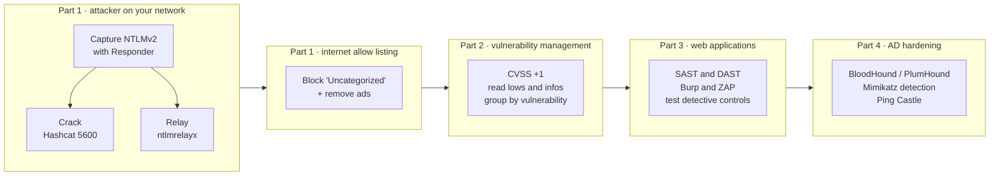

---

## 1. Responder lab walkthrough { #responder-lab }

### Why Ubuntu instead of Kali { #why-ubuntu }

In most classes Kali is used for Metasploit, Nmap and password cracking. Upcoming labs involve **Docker containers** and **honeypot technologies**, so the environment moved to Ubuntu, where more tools install easily. The new environment also shows the **Linux IP at the top of the screen**, so no more running `ifconfig` again and again.

### Poisoning doesn't work in the cloud — so the lab emulates it { #cloud-limitation }

Responder starts poisoners for **LLMNR, NBT-NS and mDNS** (Day 1 — Windows shouting "who has this name?" to the network when DNS fails). These **don't work in AWS**, which isolates **Layer 2** between VMs, so the lab has Windows **browse straight to the Linux box** instead.

> If you're on a network with an adversary, all they've got to do is **reroute your traffic** — and that's easy with ARP cache poisoning or LLMNR.

Responder's servers — **HTTP, HTTPS, SMB, Kerberos** and more — are all primed to steal credentials (**WPAD** is off for this lab).

> **Segmentation would stop an attack like this** — but we very rarely see organisations with that segmentation.

**Attack flow and where to break it** — dotted lines are the defence that cuts each step.

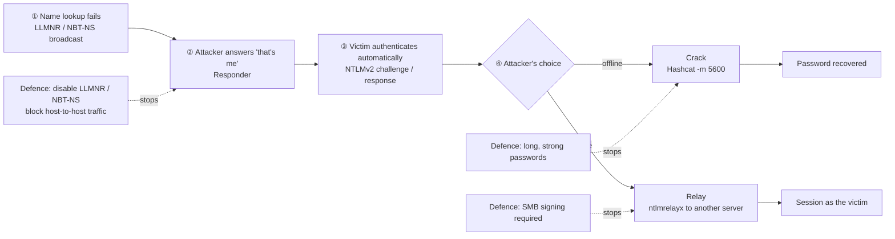

### The capture { #capture }

Type `\\<Linux IP>` into Windows File Explorer and hit Enter — Responder immediately captures the **administrator** authentication. If the user re-types credentials, you get them again. What you see is **NTLMv2**:

- **username**
- **challenge** — a random value from the server
- **response** — computed from the password hash and the challenge

> The challenge is sent in the clear and the response is sent in the clear, which kind of defeats the purpose. If we intercept that traffic on the same network, we can **crack** it.

!!! note "💡 Note (added) — a little more precisely"
    The lecture said "16-byte challenge" and "reverse the authentication." In NTLMv2 the **server challenge is 8 bytes**, and the response is an HMAC-MD5 keyed with the NT hash — it can't be reversed. The attacker instead **tries candidate passwords offline against the captured challenge/response** until one reproduces it. So Day 1's conclusion holds: **weak passwords fall, long strong ones survive**.

### Cracking — Hashcat mode 5600 { #hashcat-5600 }

In the password-cracking directory, edit the lab file so its **IP matches the captured value** (it differs per environment), then run Hashcat with **mode 5600** — **NetNTLMv2**. It's slow to start inside nested virtualisation, but the output shows the **admin account, the challenge, the hash within it, and the cracked password** at the end. The other passwords aren't in the wordlist, so John stops there.

| Hashcat mode | Value | Where it comes from |
|---|---|---|
| **`-m 0`** | MD5 | web databases, etc. |
| **`-m 1000`** | NT hash | SAM, NTDS.dit, LSASS memory — used for Pass-the-Hash |
| **`-m 5600`** | NetNTLMv2 | a challenge/response captured on the wire — what Responder catches |

The same "Windows password" needs a different mode **depending on where the value came from**.

### Relay instead of crack — ntlmrelayx { #ntlmrelayx }

**ntlmrelayx** doesn't crack the captured authentication — it **relays it to other systems** and authenticates there. The takeaway mirrors Day 3:

> That's why **these firewalls are important.** We don't want **host-to-host communication** on a network where somebody can just jump right over.

**Would Sysmon catch this?**

> Sysmon wouldn't see the cracking — that happens on the attacker's machine. It would see **the network connection from the victim back to the attacker**, and not much else.

!!! note "💡 Note (added) — watching from the network side"
    - **LLMNR (UDP 5355) / NBT-NS (UDP 137) responses** coming from an ordinary **workstation IP** rather than a DNS server
    - A workstation attempting **SMB (445) authentication to another workstation or an unfamiliar IP** (Zeek `smb_mapping.log`, `ntlm.log`)
    - On the victim, Sysmon **3** (network connection) from the `System` process to port 445 on an unexpected internal IP

    Defences: **disable LLMNR / NBT-NS**, **require SMB signing** (stops relay), **block workstation-to-workstation traffic**, and **block outbound SMB 445** to the internet. More: [LLMNR & NTLM relay](../../../adversary/llmnr-ntlm-relay.md)

### Deep dive ① What can be done with a captured value — crack vs relay vs Pass-the-Hash { #deep-dive-relay }

*An added explanation, not from the lecture.*

NTLM is a question-and-answer scheme. The server sends a random **question (challenge)**; the client uses its **NT hash as the key** to compute an **answer (response)**.

- The **NT hash** is a **fixed key** derived from the password. Whoever holds it can answer **any** challenge — log in any time, to any server, repeatedly → **Pass-the-Hash**.
- A **NetNTLMv2** value is a **one-time answer to one specific challenge**. Next time the server asks a **different question**, so a recorded answer is useless → no reuse, **offline cracking only**.
- **Relay** doesn't store anything for later — the attacker **sits between victim and real server and forwards question and answer in real time**.

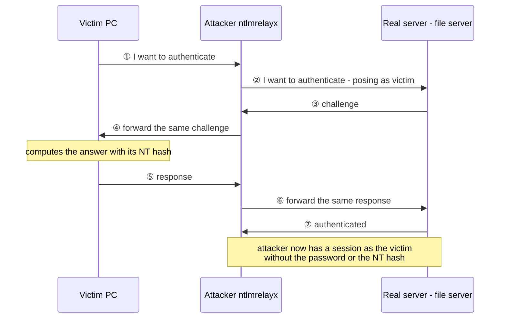

Because the real server's challenge is passed to the victim, the victim answers **exactly that challenge** — the answer the server is waiting for. The attacker gets a session as the victim **without knowing the password or the NT hash**, which is why relay works **however strong the password is**.

| | What the attacker holds | What they can do |
|---|---|---|
| **Pass-the-Hash** | NT hash (fixed key) | log in any time, to any server, repeatedly |
| **Captured NetNTLMv2** | a one-time answer | no reuse → offline cracking only |
| **NTLM relay** | nothing stored (live forwarding) | log in elsewhere **only at the moment** the victim authenticates |

**Relay constraints:** ① it must be **live**; ② the victim account needs **rights on the target** for it to matter; ③ reflecting back to the same host is blocked by long-standing patches.

**In the logs (DFIR view):** a successful relay leaves **4624** (successful logon) on the **target**, logon type **3** (network), auth package **NTLM**. The tell is that **account and source don't match** — the account is the victim (e.g. `CORP\alice`) but `IpAddress` is the **attacker's host**, and `WorkstationName` doesn't match that IP.

### Deep dive ② How SMB signing stops relay { #deep-dive-smb-signing }

*An added explanation, not from the lecture.*

Think of a **bank counter**:

- **Relay = passing someone else's ID check.** The attacker forwards the teller's questions to the real customer and the customer's answers back, and **passes the counter as the customer**.
- **SMB signing = requiring the customer's personal seal on every withdrawal slip after that.** Every request after logon (open a file, run a command …) must carry **a seal only the real user can produce**.
- **The attacker has no seal.** Authentication succeeds, but **the very first request is rejected**. They got to the counter but can't get anything done.

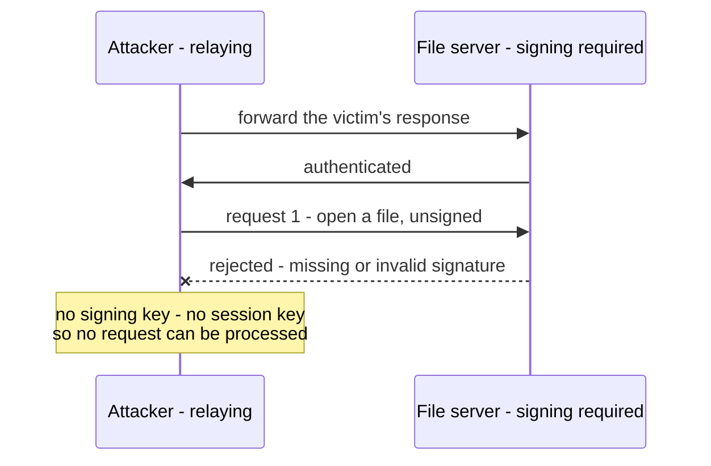

**Watch out: it must be "required," not just "enabled."**

- **Enabled:** "you may seal or not." → the attacker says "no seal, thanks" and it's accepted → **doesn't stop relay**
- **Required:** "no seal, no service." → **stops relay**

Recent Windows (Windows 11 24H2, Windows Server 2025) is moving to **SMB signing required by default**, but older versions or modified configurations may still not require it — check your actual settings.

### Deep dive ③ Does signing require the NT hash? { #deep-dive-signing-key }

*An added explanation, not from the lecture.*

**With NTLM logons, effectively yes.** (What's commonly called the "NTLM hash" is properly the **NT hash**.)

1. While answering the challenge, the client also
2. mixes the **NT hash with values from this challenge/response** to derive a **session key** for this conversation only.
3. Signatures are made with that **session key**, which itself is **never sent over the network**.

**So how does the file server know it?** It doesn't have users' NT hashes, so it **asks the domain controller**. The DC validates the answer, derives the session key and passes it to the file server over the **Netlogon secure channel**. Only the **client, the DC and the file server** know the key — the forwarding attacker doesn't. (With **Kerberos**, signing uses the **session key inside the Kerberos ticket** instead of the NT hash — same principle.)

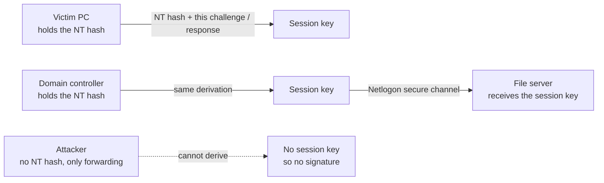

**The key consequence — if the attacker already has the hash, it's different.** An attacker who **already holds the NT hash** can derive the session key and **sign requests themselves**. So **Pass-the-Hash is not stopped by SMB signing.**

| Attack | Does the attacker know the NT hash? | Stopped by SMB signing (required)? |
|---|---|---|
| **NTLM relay** | no (just forwarding) | **yes** |
| **Pass-the-Hash** | yes (stolen) | **no** |
| **Cracking captured NetNTLMv2** | once cracked, they know the password | **no**, after cracking |

So each needs its own defence: **SMB signing for relay**; **Day 3's LAPS, workstation-to-workstation blocking and Credential Guard for Pass-the-Hash** ([Pass-the-Hash](../../../adversary/pass-the-hash.md)); **Day 1's long, strong passwords against cracking**.

### Labs coming up later today { #upcoming-labs }

- **Web testing lab** — attack a deliberately vulnerable little web app (Damn Small Vulnerable Web App) with **ZAP (Zed Attack Proxy)** ([part 3](#zap-lab))
- **Ping Castle lab** — no VM needed; just **analyse a Ping Castle report** on a website ([part 4](#ping-castle))

---

## 2. Internet allow listing { #internet-allowlisting }

Very similar to Day 1's application allow listing: **highly effective**, but people avoid it fearing they'd have to allow-list every site the company uses.

> You don't have to. It's actually easy with **simple settings on the web proxy** your users go out through.

It shuts down a large part of **initial compromise** and **C2**, and complements Day 2's RITA / AC-Hunter nicely.

### Why deny-listing fails { #why-not-denylist }

> The internet is big. Really big. You wouldn't believe just how vastly, mind-bogglingly huge it is. Most of it is worthless and evil.

### How attackers use domains { #attacker-domains }

**① Buy, use, refund.** A domain costs about **$4.99** at GoDaddy and similar, and under ICANN rules there's a **refund window of a week or two**. Attackers buy, attack, and **get their money back** — "if they ain't nothing, they ain't frugal."

**② Compromise someone else and use their domain.** John demonstrates with **Shodan** (a search engine for internet-exposed devices):

- Search **MongoDB** → **93,624** exposed databases, many **end-of-life** and unpatched
- With an enterprise licence (expensive) you can search for **vulnerable or already-compromised systems**
- In Shodan Images, port **5900 (VNC)** → live screens; tag **ICS** → **industrial control systems open with no authentication**

**Why only briefly?** Not just money — attack domains are usually **"burnt"** (deny-listed) within **a week or two**.

### Pentesters do it differently — pre-categorised domains { #pentester-domains }

Pentesters like BHIS use a tool that **buys expired domains and sorts them by URL and risk rating (SimilarWeb, ACR scores)** (the tool's name isn't clear in the auto-captions). Because these domains were used before, expired and came back on sale, security vendors have already given them **legitimate categories** — brokerage/trading, government/legal (e.g. an Oregon City Parks .org), entertainment, technology/internet. The goal is **bypassing domain filtering**.

> Attackers rarely do this — they **buy brand-new domains**. That difference is the key to the defence below.

| | Real attackers | Pentesters (BHIS) |
|---|---|---|
| Which domains | **brand-new** ones (or a compromised server's domain) | expired domains **back on sale** |
| How long | a week or two, then burnt and refunded | for the engagement |
| Vendor category | none → **"Uncategorized"** | already a **legitimate category** |
| Blocking "Uncategorized" | **catches them** | can get around it |

### Allow the sites, remove the ads { #ads }

Most people visit **only a handful of sites** a day. The exceptions are the click-on-everything crowd and heavy news readers — on sites like Yahoo, **ads that look like news stories** sit among the content, and some people click them. But they're rare.

> Allow-list the sites people want — even Yahoo — but **remove the ads** with something like Ghostery or AdBlock Plus **across the whole environment**. Your exposure ends up far lower than with a deny-list approach.

Deny-listing loses because vendors like Cisco or Fortinet **lag** — there's a gap between a site going live and attacking, and it reaching the critical mass where vendors block it.

### The key move — block "Uncategorized" { #block-uncategorized }

Web filters list categories (adware, alcohol, anonymizers, porn, gambling …). Companies block the obvious ones but **ignore "Uncategorized" in the bottom-right corner**.

> Blocking it gives you **de-facto allow listing of known sites without a lot of work**.

Attackers use **brand-new domains**, so your firewall / proxy vendor has **never seen them**.

> If Cisco has never seen that domain before, do you really want your users going there? That seems like a bad idea.

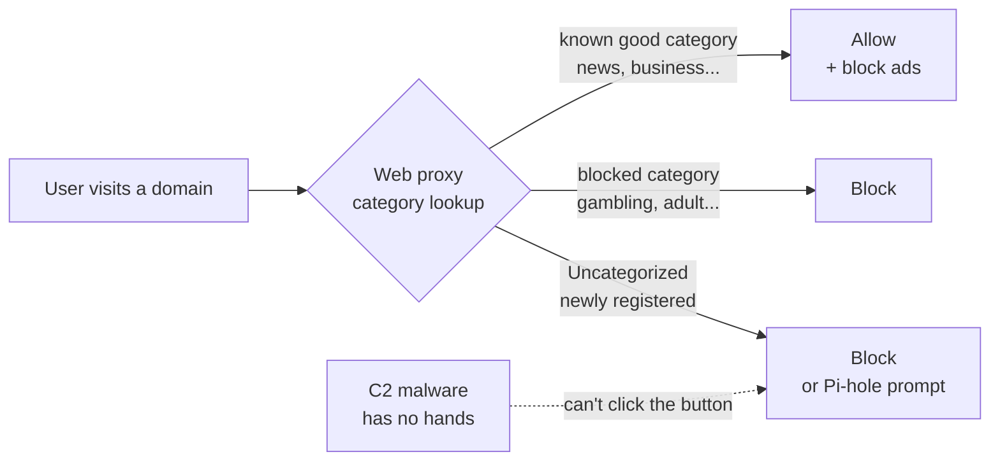

!!! note "💡 Note (added)"
    Many proxies and DNS filters now have a separate **"Newly Registered Domains (NRD)"** category (e.g. registered within 30 days). Blocking it alongside "Uncategorized" effectively filters the domains attackers just bought.

### Three allow-listing approaches { #allowlist-approaches }

- **① Allow-list every site individually** — "dumb most of the time"
- **② Allow-list by category** — as above (including blocking Uncategorized)
- **③ Let users allow-list their own sites** — possible with **Pi-hole**: an unseen domain triggers an **"Are you sure you want to go?"** prompt

> That makes it very hard to get **C2 out of the environment** — C2 malware **doesn't have hands** to click the button.

### Legitimate sites still infect — through ads { #malvertising }

Even with allow listing, compromise can come via **legitimate sites** — news, Facebook, movie sites, adult sites — and it's **almost always through advertisements**.

> The initial compromise server **usually isn't the C2 server** — one server delivers the exploit, a separate one does command and control.

So even if delivery gets through, you get another chance to block the **outbound C2**. Category filtering can also be done with DNS-based filters like **OpenDNS**.

!!! note "💡 Note (added) — finding never-before-seen domains in Splunk"
    ```spl
    index=zeek sourcetype=zeek_dns earliest=-30d
    | stats earliest(_time) AS first_seen count BY query
    | where first_seen > relative_time(now(), "-1d")
    | sort - count
    ```

    - **`index=zeek sourcetype=zeek_dns earliest=-30d`** — the last 30 days of Zeek DNS logs (adjust index / sourcetype).
    - **`stats earliest(_time) AS first_seen count BY query`** — per domain (`query`), when it **first appeared** (`first_seen`) and **how often** it was looked up.
    - **`where first_seen > relative_time(now(), "-1d")`** — keep only domains first seen **in the last 24 hours** — "absent for 30 days, new today."
    - **`sort - count`** — most-queried first.

    ```text
    query                         first_seen   count
    timeserversync.com            1729555200   168
    cdn-update-check.net          1729560000    42
    ```

    A brand-new domain queried **regularly and often** (like Day 2's WhatTime at 168/hour) is worth suspecting as C2.

### John on DNS over HTTPS (DoH) { #doh }

**DoH** sends name lookups over **encrypted HTTPS** — good for privacy. But John is uneasy:

- Even for people in dangerous countries, he recommends **a VPN** instead.
- Many DoH vendors wear a veneer of civil-rights help while **harvesting DNS data for ads** — "kind of sketchy."
- **Don't use DoH in a corporate setting:**

> DNS is unencrypted, so it lets us **see where people are going**, and that gives us some level of protection. With DoH we **lose that visibility**.

!!! note "💡 Note (added)"
    Typically you **disable browsers' built-in DoH** via Group Policy and block outbound 443 to well-known public DoH resolvers (e.g. `1.1.1.1`, `8.8.8.8`, `dns.google`) so clients **use internal DNS only** — which also keeps Day 2's DNS-based detection (e.g. spotting dnscat2-style backdoors) working.

---

## 3. Vulnerability management { #vulnerability-management }

### Unchanged for ten years { #unchanged }

> Run a vulnerability scanner → it finds external-facing vulnerabilities → you get a report. Very, very simple.

Some companies are moving to **credentialed scans** (give the scanner an account and inventory every installed application), but many teams get **completely overwhelmed by the data**. And in the AI era, **reported vulnerabilities, new CVEs and exploits will skyrocket**, so people have to stay in the loop.

### "Fix only highs and criticals" is broken { #broken-prioritization }

Ignoring **mediums, lows**, or anything **without a public exploit** causes problems in the AI era: anyone with a bit of skill, AI tools, time and tokens can **pull working exploits** out of those vulnerabilities.

> What was a medium before is probably becoming a high.

**John's proposal — bump every CVSS score up by at least one:** 6.5 → **7.5**, 8.5 → **9.5**, 9.5 → expect an exploit very quickly.

| CVSS score | Severity |
|---|---|
| 0.1 – 3.9 | Low |
| 4.0 – 6.9 | Medium |
| 7.0 – 8.9 | High |
| 9.0 – 10.0 | Critical |

On "we won't patch until there's an active exploit":

> By the time that exploit hits, **it's too late.**

Exploits and worms used to spread **indiscriminately** and give defenders **some time**; now even a targeted attack or pentest can do **targeted exploit development with AI** relatively quickly.

!!! note "💡 Note (added) — what to use alongside CVSS"
    - **CISA KEV** — vulnerabilities confirmed as exploited in the wild
    - **EPSS** — the **probability** of exploitation in the next 30 days

    Both help, but both rise only **after signals accumulate**, so they can lag in an era of AI-accelerated exploitation. Use KEV / EPSS to set the front of the queue — and don't ignore what's below.

**Summary — the old way vs the AI era**

| | Old way | AI era (John's proposal) |
|---|---|---|
| Priority | highs and criticals only | **bump CVSS +1** |
| No public exploit | later | AI can produce one quickly → **act early** |
| Lows / informationals | ignored | **a human reads them in context** |
| Unit of work | per host | **per vulnerability + automation** |

### The bigger problem — ignored lows and informationals { #lows-and-infos }

> The bigger problem is that **lows and informationals** probably shouldn't have been ignored anyway.

Imagine a server farm with **1,000 Telnet servers** (it happens with legacy tech). The scan shows each one's **banner**:

```text
login
login
login
mushroom
mushroom
login
router
login
...
```

*(reconstructed — John's spoken example)*

Most say `login`, but the **one that says `router`** is a **Telnet server requiring no authentication at all** — a huge, glaring vulnerability. Because a banner can be **any string**, the scanner can't tell "just a login banner" from "potentially a huge vulnerability," so it files it as **Informational**.

> Even before the age of AI, we were already dealing with a mass of **lows and informationals being missed** — and the vast majority of organisations **just ignore them**.

### Deep dive ④ Why is a `router` banner dangerous? { #deep-dive-router-banner }

*An added explanation, not from the lecture.*

The danger isn't the **word** `router` — it's that **a device command prompt appeared without any login request**. A normal Telnet server asks who you are first:

```text
$ telnet 10.1.0.1
Connected to 10.1.0.1.

User Access Verification

Username:
```

The `router` one most likely looks like this:

```text
$ telnet 10.1.0.9
Connected to 10.1.0.9.

Router>
```

`Router>` is the **"enter a command" prompt you normally only see after logging in**. Cisco devices default to the hostname `Router`, so the prompt reads `Router>`. You're **inside the router the moment you connect** — like opening the front door and finding yourself straight in the plant room.

A router is the network's **intersection**: from it an attacker can read the config to **map the network**, change routes to **redirect traffic to themselves** (the same effect as Responder), **edit ACLs to open blocked paths**, and use it as a **foothold** into other segments. And Telnet is **unencrypted**, so even legitimate logins send passwords in the clear.

`mushroom` illustrates that **banners can be any text** — you can't tell from the words whether a login prompt follows. A scanner just **records the first line**; it doesn't understand whether that's a login prompt or an already-logged-in command prompt. It takes a human reading it.

### Group by vulnerability, not by host { #group-by-vuln }

Looking host by host — **1,000 IPs × ~25 vulns each = 25,000 issues** — feels impossible. John says that approach is **almost always incorrect**.

> You don't actually have 25,000 vulnerabilities. You usually have **a couple hundred vulnerabilities repeating** again and again across systems.

Flip the question — ❌ "what vulnerabilities does this host have?" → ⭕ "**which hosts have this vulnerability?**" Now you chase **a couple hundred**, and you can use **automation — Microsoft patching, Ansible scripts** — to push the same fix to many systems **in parallel**.

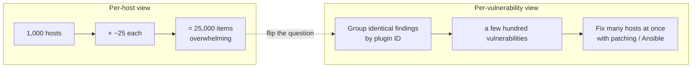

!!! note "💡 Note (added) — \"group by vulnerability\" in Splunk"
    Suppose Nessus results were exported to CSV and uploaded to Splunk as a **lookup file** `nessus_scan.csv` (columns such as `Plugin ID`, `Name`, `Risk`, `Host`, `Port`, `Plugin Output`).

    ```spl
    | inputlookup nessus_scan.csv
    | stats dc(Host) AS host_count values(Host) AS hosts BY "Plugin ID" Name Risk
    | sort - host_count
    ```

    - **`| inputlookup nessus_scan.csv`** — load the uploaded CSV instead of searching an index (note the leading `|`).
    - **`stats ... BY "Plugin ID" Name Risk`** — group by vulnerability. Field names with **spaces** go in double quotes.
        - **`dc(Host) AS host_count`** — `dc` is **distinct count** — how many **different hosts** have it.
        - **`values(Host) AS hosts`** — the **list** of those hosts.
    - **`sort - host_count`** — most-affected first.

    ```text
    Plugin ID  Name                              Risk    host_count  hosts
    42263      Unencrypted Telnet Server         Medium  1000        10.1.0.1, 10.1.0.2, ...
    57608      SMB Signing not required          Medium   812        10.2.0.5, 10.2.0.6, ...
    ...        Web Server Office File Inventory  None      14        10.3.1.20, ...
    ```

    *(illustrative numbers)* 25,000 rows become **a few hundred**, with "fix once, solve hundreds of hosts" at the top. **"SMB Signing not required"** ties straight to [Deep dive ②](#deep-dive-smb-signing) — Nessus rates it Medium, but it means 812 hosts are open to relay. In Nessus CSVs, informationals have `Risk` = **`None`** — **don't filter them out**.

    To surface **rare values** like the banners (Day 2's long-tail analysis):

    ```spl
    | inputlookup nessus_scan.csv
    | search "Plugin ID"=42263
    | stats count BY "Plugin Output"
    | sort count
    ```

    - **`search "Plugin ID"=42263`** — Telnet-server findings only.
    - **`stats count BY "Plugin Output"`** — count identical banner outputs.
    - **`sort count`** — **smallest first** (no `-` means ascending).

    ```text
    Plugin Output        count
    router                   1
    mushroom                 2
    login                  997
    ```

    The lone `router` at the top is the **unauthenticated Telnet server**.

**Vulnerability scanning covers a narrow slice.** In MITRE ATT&CK it's mostly **Exploit Public-Facing Application** and **External Remote Services** — most of the matrix and **post-exploitation lateral-movement opportunities** stay invisible. Hence tools like Day 3's BloodHound and part 4's Ping Castle.

---

## 4. Nessus report lab — an Easter-egg hunt { #nessus-lab }

In the Windows VM's `IntroLabs` folder is a **Nessus report** (older, but the concepts hold). The task is an Easter-egg hunt for **lows and mediums people ignore that absolutely should be fixed**; John's explanations are at the bottom of the report.

### ① Office File Inventory (Low) { #office-file-inventory }

`Ctrl+F` **"office"** → a **Low** finding listing **Office documents on the web server**.

> This is a low finding we end up with a lot — and **we use it to gain access to systems.**

People put silly things on web servers — **`passwords.doc`**, an **install guide** walking through setup **step by step**.

### ② Backup files (.bak) { #backup-files }

Search **`.bak`** → the site's page index shows things like:

```text
/admin/
/admin/backup/backup.bak
/admin/telnet
```

Many sites take **regular backups** saved as `.001`, `.002` or `.bak` in the same folder, and those often contain **server-side includes** with **user IDs and passwords**. Another site exposes **`sourcecode.tar`**.

!!! note "💡 Note (added) — why backup files are dangerous"
    A web server **executes** `config.php` and returns only the output, so its DB password stays hidden. But `config.php.bak` isn't treated as executable — it's **served as plain text**, exposing **source code and the DB password**. Keep backups out of the web root, and block serving extensions like `.bak`, `.old`, `.tar`, `.zip`.

### ③ config term (Telnet) { #config-term }

Finally, the Telnet case from earlier:

```text
Welcome to the configure terminal.
Please authenticate.
Please authenticate.

Router(config)#
```

*(reconstructed — the report's exact wording may differ)*

It keeps saying "please authenticate," but ultimately **configuration mode is just sitting there**, and anyone who connects can change the configuration.

### Deep dive ⑤ Why does `config term` appear after "please authenticate"? { #deep-dive-config-term }

*An added explanation, not from the lecture.*

> The **"Please authenticate" text isn't an authentication check — it's just a printed notice.**

Devices have two separate settings:

- **Banner** — a **notice** shown on connect; any text at all.
- **Login** — the setting that actually **asks for and checks credentials**.

This device has a banner saying "please authenticate" but **no login configured**. It's a door with a **"show ID to enter" sign** that **isn't locked**.

`config term` is Cisco's **`configure terminal`** — the command that enters **configuration mode**.

| Prompt | Level | What you can do |
|---|---|---|
| `Router>` | user EXEC | view some status |
| `Router#` | privileged EXEC | view everything and enter config mode |
| `Router(config)#` | **global configuration** | **change any device setting** |

So this is **worse than Deep dive ④'s `Router>`** — not only no authentication, but **straight into full-privilege configuration**.

**Why it happens:** no authentication on the remote-access (VTY) lines (`no login`); remote sessions configured to land directly at **privilege level 15**; loosened for testing and **never reverted**; an old device **nobody reviews**.

**Defence:** **disable Telnet, allow SSH only** (`transport input ssh`), **require login** on remote access (AAA or local accounts), and restrict management access to **management IPs** with an ACL. When auditing, collect the **banners of every host with port 23 open and review the rare ones first** to spot anything that isn't a `login` prompt.

### What this lab is getting at { #nessus-takeaway }

> You can't just look at highs and criticals — **you've got to look at lows and informationals.** And to do that effectively, **sort by plugin ID and vulnerability ID**.

That's a standard vulnerability-assessment scan — **fundamentally different** from testing **web applications, mobile apps and APIs**, which is where part 3 picks up.

---

## 5. Web application security { #web-app-security }

A standard vulnerability-assessment scan is fundamentally different from testing **web applications, mobile apps and APIs**. So how do we secure our apps quickly and effectively? Three obstacles: **training** is ridiculously expensive, **tools** can be expensive, and **changing the whole process** to build security in is hard.

### Security gets "bolted on" at the end { #bolted-on }

The software development life cycle keeps building, adding functionality and improving — but security is consistently **bolted on at the end, almost as an afterthought**. A common call to BHIS:

> "We need a web application security assessment — and by the way, we need it fairly quickly because **we're going live in a month**."

They've done no security until then and expect BHIS to show up and **sprinkle security all over the place**. That's **expensive and dangerous**; security should be done **continuously throughout the life cycle**.

### Is AI-written code secure? { #ai-code }

BHIS uses Anthropic's Claude, OpenAI's ChatGPT and others — and John has noticed something:

> AI will write code, but it won't necessarily write it **securely**. Strangely, ask the same AI to **look for the security vulnerabilities** in that code and it finds **a bunch**.

That's because these are **two different skill sets**:

| Skill | How the AI learned it | Used when writing code? |
|---|---|---|
| **Writing code** | trained on billions of lines from the internet (John: "plagiarised") | yes |
| **Securing code** | a separate skill | **missing** |

!!! note "💡 Note (added)"
    So when using AI to write code, ask for "implement the feature" and "review it for security" **as separate requests**. With **SAST** (below) turned on in the repository, AI-written code is scanned automatically just like human-written code.

Many organisations now **write their own apps** instead of buying SaaS (John: the "SaaS apocalypse"). Building got easier, but we're back to the same place — **security is hard.**

### Except it's not really that hard { #not-that-hard }

> Security is hard. **Except not really.**

- Most security testers **know less about development than developers do** — different skill sets.
- So it's **easier to teach a web developer security** than to teach a tester development.
- There are **tons of free tools**.
- The **Pareto principle (80/20)** — **80% of vulnerabilities** can be found with **20% of the effort**.

### Where and when to test { #when-to-test }

These tools are so easy to use that they belong in **every stage** of the build cycle — run them **nightly**.

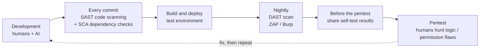

- **Source-code analysis (SAST)** — John shows GitHub **Advanced Security → Code scanning**, which analyses repository code for security vulnerabilities. "That's something you should **turn on** for source-code analysis."
- **Dynamic testing (DAST)** — scan the **running app** to see how it reacts live. Code runs **inside an engine like Apache or Nginx**, which can introduce **additional vulnerabilities at runtime**, and code scanning isn't great at **business-logic errors**.

!!! note "💡 Note (added) — the three kinds of analysis"
    | Name | What it looks at | Example |
    |---|---|---|
    | **SAST** (static) | **source code**, not running | GitHub code scanning (CodeQL) |
    | **DAST** (dynamic) | the **running app's** responses | ZAP, Burp active scan |
    | **SCA** (composition) | known vulnerabilities in **third-party libraries** | GitHub Dependabot |

    Each catches different things, so use them together. AI-written code sometimes pulls in **old library versions**, which makes SCA especially useful.

### What tools catch and what they miss { #what-tools-catch }

| Automated tools catch well (~80–85% of issues) | Humans need to find |
|---|---|
| Cross-site scripting (XSS) | **Logic errors** — reusing a coupon, skipping a checkout step |
| SQL injection | **Permission errors** — changing an order number shows someone else's data |
| Command injection | some **stored** attacks (e.g. stored XSS) |
| Common misconfigurations | anything that needs the app's **business context** |

> Do the tools cover everything? No — they just don't. That needs manual testing, which is a lot of what BHIS does.

!!! note "💡 Note (added) — the injection family, simply"
    - **SQL injection** — typing something like `' OR '1'='1` instead of a username makes the app **treat it as part of the database command**, skipping the password check.
    - **Command injection** — if the app appends user input to an OS command, characters like `;` can **chain extra commands**.
    - **XSS** — if input is echoed back into a page, a script in it can **run in other users' browsers**.

    Same root cause: **trusting user input and using it as-is** — the "injection" family in the OWASP Top 10.

### Self-test before the pentest { #self-test }

> **Before** your assessment, run the tools yourself and share the results with the tester: "We're aware of these — **find the stuff an automated tool won't**."

Pentest time isn't wasted on what tools can find, and any good tester wants to move on to the **hard-to-find vulnerabilities** — they're more fun.

---

## 6. Tools — Burp and ZAP { #burp-and-zap }

BHIS's main tool is **Burp Suite Pro** (not free, but cheap and awesome); there's also **W3AF**, and this lab's **ZAP** (free).

> These tools are **far better than most commercial tools you'd spend over $20,000 on** — but you have to know how to use them.

| | Burp Suite Pro | ZAP (Zed Attack Proxy) |
|---|---|---|
| Price | about **US$500** (paid, but cheap) | **free** |
| Origin | **PortSwigger** — always its own product (not a ZAP extension) | **Paros Proxy** → **OWASP ZAP** → today the ZAP core team |
| Interface | stripped-down, basic — "all killer, no filler" | an automated-scan wizard that's easy for beginners |
| Key features | intercept / modify, crawl, active scan | intercept / modify, active scan, **fully automated scanning** |
| At BHIS | **the main tool**; most-used by web testers | this lab's tool |

John sees Burp's plain interface as an **advantage**: rather than a "paste a URL and scan" button, you browse or crawl the site, it appears on the left, and you start an active scan there — exactly what you need where you expect it. Newcomers, though, tend to gravitate to the **pretty** tools. On ZAP:

> It has active scanning. **It's free.** A strong development core. **It's free.** It intercepts and modifies requests. **It's free.** Fully automated scanning too. And it costs you "free.93" — **in everyone's budget**.

!!! note "💡 Note (added) — who runs ZAP today"
    The lecture said "Crash Override" has taken over ZAP. Per ZAP's own documentation: ZAP **left OWASP in September 2023**, and **since September 2024 Checkmarx supports it** (employing three core-team members). It remains an **independent open-source project controlled by the ZAP core team**, and free.

### John's favourite trick — feed the results to AI { #burp-ai }

1. Browsing a web server with Burp records the discovered pages and requests in a **state file**.
2. Upload that file to an **AI agent**: "analyse this Burp state file and look for these vulnerabilities."
3. It does — adding AI to any of these tools **hyper-extends** its analysis.

!!! warning "💡 Note (added) — check before you upload"
    These files contain real requests, so they may include **session cookies, tokens and user data**. Check company / client policy before sending them to an external AI service, and scrub sensitive values first.

### The web-proxy workflow { #proxy-workflow }

The same for Burp and ZAP:

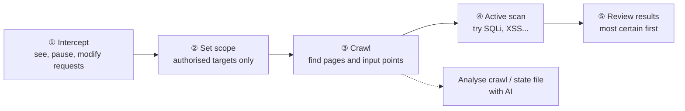

| Step | What it does | Why it matters |
|---|---|---|
| ① **Intercept** | see requests, stop them, change anything, set fuzzing points | see directly how the app handles input |
| ② **Scope** | define only what you're testing | otherwise it **crawls and attacks third-party sites** — out of scope |
| ③ **Crawl (spider)** | finds every page and **input parameter** | the list to analyse and attack; great material for AI analysis |
| ④ **Active scan** | fires SQL injection, XSS and more | handles the automatable 80% |
| ⑤ **Review** | Burp: **solid red, white text = certain**; **white background, red text = relatively certain critical** | draws your eye to what to fix first |

---

## 7. Test your detective controls too { #test-detective-controls }

> We need to keep looking for vulnerabilities, of course — but **at the same time we need to test our detective controls.**

When you run a web scan, check whether your **IDS, IPS, SIEM and AI engines detect it**.

> Move away from "can we be hacked?" to **"what can we actually detect?"**

MITRE ATT&CK gives a taxonomy to file findings against attack methods — Day 3's "trust but verify," applied to the web.

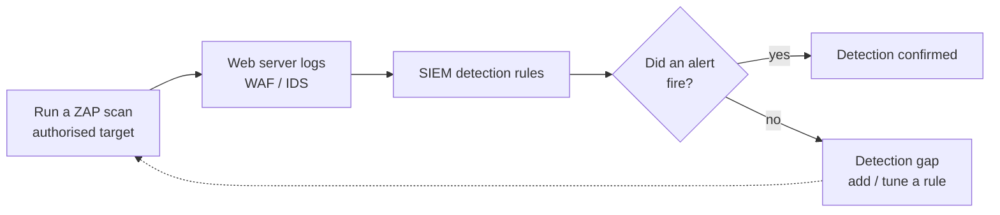

!!! note "💡 Note (added) — spotting a scan in web logs (Splunk)"
    A scanner leaves **lots of requests from one source**, **lots of distinct paths**, and a **spike of server errors (5xx)** in the access log.

    ```spl
    index=web sourcetype=access_combined earliest=-1h
    | stats count AS requests dc(uri_path) AS unique_paths count(eval(status>=500)) AS server_errors BY clientip
    | where requests > 500 AND server_errors > 20
    | sort - requests
    ```

    - **`index=web sourcetype=access_combined earliest=-1h`** — the last hour of web access logs (common Apache / Nginx format); adjust the index.
    - **`stats ... BY clientip`** — group by requesting IP.
        - **`count AS requests`** — total requests.
        - **`dc(uri_path) AS unique_paths`** — distinct paths; scanners hit huge numbers of them.
        - **`count(eval(status>=500)) AS server_errors`** — count only status ≥ 500; `eval(...)` counts events where the condition is true. Injection attempts cause lots of server errors.
    - **`where requests > 500 AND server_errors > 20`** — keep IPs with many requests and many errors (tune thresholds).
    - **`sort - requests`** — busiest first.

    ```text
    clientip       requests  unique_paths  server_errors
    10.10.239.50   18452     2210          640
    ```

    People don't open thousands of distinct paths an hour. If this fires, the detection works; if not, that's **Day 3's detection gap**. Status codes: [HTTP status codes](../../../basics/http-status-codes.md).

---

## 8. ZAP lab { #zap-lab }

### Setup { #zap-setup }

Use the **new lab environment (antilab)** — not the older "Active Defense and Cyber Deception" one.

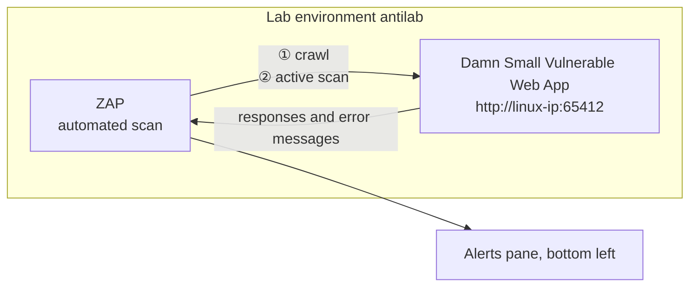

1. In the Windows VM, open an **Ubuntu shell**.
2. Change to the web-testing lab directory and note the **Linux IP**.
3. Run the **Damn Small Vulnerable Web App (DSVW)** Python script — not pretty, but **vulnerabilities present and accounted for**.
4. Start **ZAP** (slow at first; it asks whether to **persist the session**).
5. **Automated Scan** → enter the **Linux IP and port** (in the lab, `http://10.10.239.83:65412` — the IP differs per environment) → **Attack**.
6. If the scan **breaks DSVW, restart it**.

!!! warning "Authorised targets only"
    This lab scans a **deliberately vulnerable practice app inside your own lab**. ZAP's active scan sends real attack requests, so in practice only point it at **authorised targets within scope** — exactly why John stresses setting scope.

### Walkthrough { #zap-walkthrough }

ZAP was still updating so the URL entry fought back at first; then **Automated → URL → Attack**. Requests stream past, and quickly:

> Oh, we actually got a **command injection** vulnerability, it looks like, already.

ZAP **crawls** first, then switches to the **active scan**; meanwhile watch the **Alerts** pane in the lower left. DSVW fell over once and was restarted (John: "I'll probably update the lab to run it in a loop"). Checking at the end, the scan was at **100%**.

| Finding | What it means | Why it's dangerous | Fix |
|---|---|---|---|
| **Command injection** | input appended to a server OS command | arbitrary command execution on the server | never build commands from input; accept only allowed values |
| **SQL injection (SQLite)** | input lands inside the SQL statement; even the DB type leaks | read / modify the database | **parameterised queries** |
| **Database error disclosure** | `sqlite3.OperationalError ... syntax error` shown to the user | a **hint** for the attacker | log details; show users a generic error page |
| **UNION SQL injection** | appends **another table's data** to the result | data theft | parameterised queries, **least-privilege DB account** |
| **Remote file include (RFI)** | a supplied path **loads another file** | inject phishing content into a legitimate page, etc. | restrict loadable files to a **fixed allow list** |

**Open the SQL injection alert** and you see the request above and the response below — an **Internal Server Error** with:

```text
sqlite3.OperationalError: near "...": syntax error
```

> You should never see those errors from the database coming through directly.

!!! note "💡 Note (added) — why an error message is a hint"
    It tells the attacker "this app uses SQLite," "my input reached the SQL statement," and "the syntax broke here," so they can refine the next attempt precisely. **File inclusion** comes in two flavours — **LFI** (read other files on the server) and **RFI** (load a file from an external server) — both from trusting a user-supplied path.

### Why results differ between students { #zap-variance }

> Some of you probably got different vulnerabilities than others. That's very common — as a web server gets **overloaded**, some responses don't come back properly.

!!! note "💡 Note (added)"
    A finding **missing from an automated scan doesn't mean it isn't there.** Slow servers or failed requests cause misses. For important apps, throttle the scan or run it more than once — and keep a human verification step.


---

## 9. AD hardening — the last control { #ad-hardening }

After the ZAP lab John moves on to the tenth control, **Active Directory (AD) hardening**. It goes by quickly in the lecture, but every attack from the previous three days ends up here.

!!! note "💡 Note (added) — why AD comes last"
    AD manages an organisation's accounts, groups, PCs, servers and permissions in one place, and the top permission is **Domain Admin (DA)**. With DA you can log in to every PC, reset every password and push software to every machine through Group Policy. That is why an attacker inside the network almost always aims for DA. Every attack covered so far is **a step on the staircase to DA**; AD hardening is about breaking those steps.

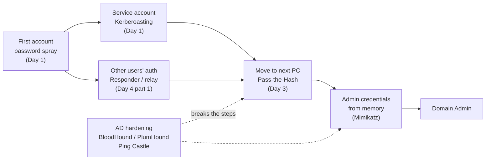

### BloodHound — every path to Domain Admin { #bloodhound }

The first tool is **BloodHound** (SpecterOps), which also came up on Day 3.

> BloodHound takes a standard, non-privileged user and enumerates **all the pathways for that user to become a full domain administrator**.

BloodHound sees AD as a **graph**. Users, groups, computers and GPOs are the dots (nodes); the relationships between them are the lines (edges). Each one is an ordinary setting on its own — chained together, they become a path.

| Edge | Meaning |
|---|---|
| **MemberOf** | This user/group is a member of that group |
| **AdminTo** | This user/group is local admin on that PC |
| **HasSession** | This user is logged in on that PC (their credentials are in memory) |
| **GenericAll** and other rights edges | This object can freely change that one (reset a password, add to a group, …) |

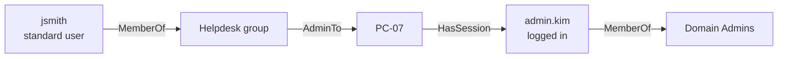

How to read it: jsmith is in Helpdesk, so can become admin on PC-07; PC-07's memory still holds the credentials of admin.kim, who is logged in there; extract them ([Mimikatz](#mimikatz), below) and jsmith is a Domain Admin. **None of this shows up in a vulnerability scanner** — nothing is unpatched; it is a problem of **permission relationships**. That is why part 2 said vulnerability scans don't see post-compromise lateral-movement opportunities.

!!! note "💡 Note (added) — lists and graphs"
    A well-known line from Microsoft's John Lambert (2015):

    > Defenders think in lists. Attackers think in graphs. As long as this is true, attackers win.

    Defenders look at "the list of admin accounts" and "the list of patches"; attackers look at "how does this connect to that." BloodHound lets **defenders see the graph too**.

#### 💡 Note (added) — BloodHound collection leaves traces { #detect-bloodhound }

BloodHound collects with **standard domain-user rights** only (the collector is called SharpHound). It asks the DC over LDAP for users, groups and permissions, and asks each PC "who is logged in?" and "who is local admin?". Those last questions connect to each PC's special **`IPC$`** share and open **named pipes** (channels programs use to talk) such as `srvsvc` and `samr`. The result is a pattern where **one PC opens the same pipes on dozens or hundreds of PCs in a short time** — a detection point when an attacker uses the same tool.

**Event 5145** = "A network share object was checked to see whether client can be granted desired access". It records who (account), from where (source IP) and which file/pipe on which share — **on the PC being accessed**. It is off by default; turn on **Object Access → Audit Detailed File Share** in advanced audit policy. It is noisy, so it is usually enabled on servers and key PCs only.

```spl
index=wineventlog source="WinEventLog:Security" EventCode=5145 Share_Name="*IPC$" Relative_Target_Name IN ("srvsvc", "samr", "lsarpc")
| bin _time span=10m
| stats dc(host) AS target_count values(Relative_Target_Name) AS pipes BY _time, Source_Address, Account_Name
| where target_count > 20
| sort - target_count
```

- **Line 1** — Security log, **5145** only, share name ending in `IPC$` (the real value looks like `\\*\IPC$`), and target is one of three pipes. `IN (...)` means "equals any value in the brackets".
    - **`srvsvc`** — Server service. Queries who is logged in (sessions).
    - **`samr`** — Security Account Manager. Queries local group members (who is admin).
    - **`lsarpc`** — Local Security Authority. Translates between SIDs and names.
- **Line 2 `bin _time span=10m`** — groups time into 10-minute buckets so you can count "how many hosts in 10 minutes".
- **Line 3 `stats ...`**
    - **`dc(host) AS target_count`** — `dc` is distinct count. 5145 is logged on the accessed PC, so `host` is the target → "how many PCs were touched".
    - **`values(Relative_Target_Name) AS pipes`** — the pipes used.
    - **`BY _time, Source_Address, Account_Name`** — per 10-minute bucket, source IP and account.
- **Line 4 `where target_count > 20`** — only sources touching more than 20 hosts in 10 minutes (tune the threshold).
- **Line 5 `sort - target_count`** — highest first.

```text
_time                Source_Address  Account_Name  target_count  pipes
2026-10-27 14:10:00  10.0.5.23       jsmith        143           lsarpc
                                                                 samr
                                                                 srvsvc
2026-10-27 02:00:00  10.0.1.15       svc_sccm      38            samr
```

Row 1 — **a standard user on a standard PC touched 143 hosts in 10 minutes** → suspect BloodHound-style collection, investigate first. Row 2 — a management tool's service account doing its overnight job → likely benign; confirm and add to an allow list.

!!! tip "Field names depend on log format"
    With `renderXml = false` (classic format) the fields are `Share_Name`, `Relative_Target_Name`, `Source_Address`, `Account_Name` as above; in XML format they are `ShareName`, `RelativeTargetName`, `IpAddress`, `SubjectUserName`. Event IDs are collected in [Windows event IDs](../../../basics/windows-event-ids.md).

### PlumHound — turning the graph into a to-do list { #plumhound }

> We wrote a little tool — written by Kent at Black Hills Information Security — called **PlumHound**. PlumHound takes the data from your BloodHound output and creates **work effort**.

BloodHound shows "the full path to DA" through an attacker's eyes. But a defender staring at a graph doesn't immediately get "so what do I fix on Monday?". PlumHound turns the same data into **tabular reports** you can work through. John's examples: **domain users, workstations with RDP, Kerberoastable users, group policy objects, paths to Domain Admin**.

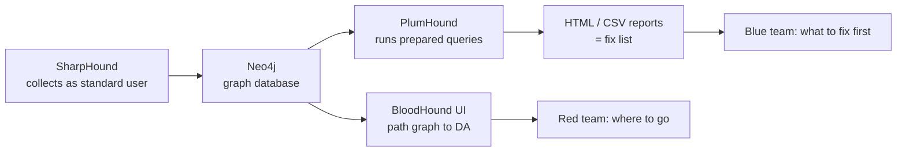

| | BloodHound | PlumHound |
|---|---|---|
| **Question** | "Can I reach DA? How?" | "What should we fix? In what order?" |
| **Output** | Path graph (UI) | Report list (HTML / CSV) |
| **Dead ends** | Easy to miss if they don't reach DA | Stay on the list |
| **Main users** | Attackers, pentesters, defenders | Defenders, sysadmins |

!!! note "💡 Note (added) — a bit more on PlumHound (per the BHIS blog)"
    A Python tool by **Kent Ickler and Jordan Drysdale**. It connects to the **Neo4j** graph database BloodHound uses, runs prepared **Cypher** queries and writes **HTML or CSV reports**. The default task list produces **69 reports plus an index page**, and each report includes its query so you can reuse it elsewhere. Examples: high-privilege Kerberoastable accounts, LAPS deployment, accounts whose passwords never expire, accounts with passwords in the description field.

    - **AnalyzePath** — shows **which single relationship to break** to cut the paths from a given user or group.
    - **BusiestPath** — lists **the paths that affect the most users** first, to prioritise remediation.

### Why dead ends matter — Hogwarts' moving staircases { #moving-staircases }

> BloodHound looks specifically for the total pathway to domain administrator. But there are a lot of **dead ends**. Think Hogwarts — when the students were going to their rooms, the staircases were constantly changing and moving. Your AD environment is a lot like that when it comes to vulnerabilities. Some stairways get you into your house; others drop you somewhere else. The point is, **a pathway that doesn't end in a domain administrator account today might in a few weeks or months.**

AD changes every day: people join and leave, get added to groups, admins log in to PCs to fix things, new GPOs appear — the staircases move.

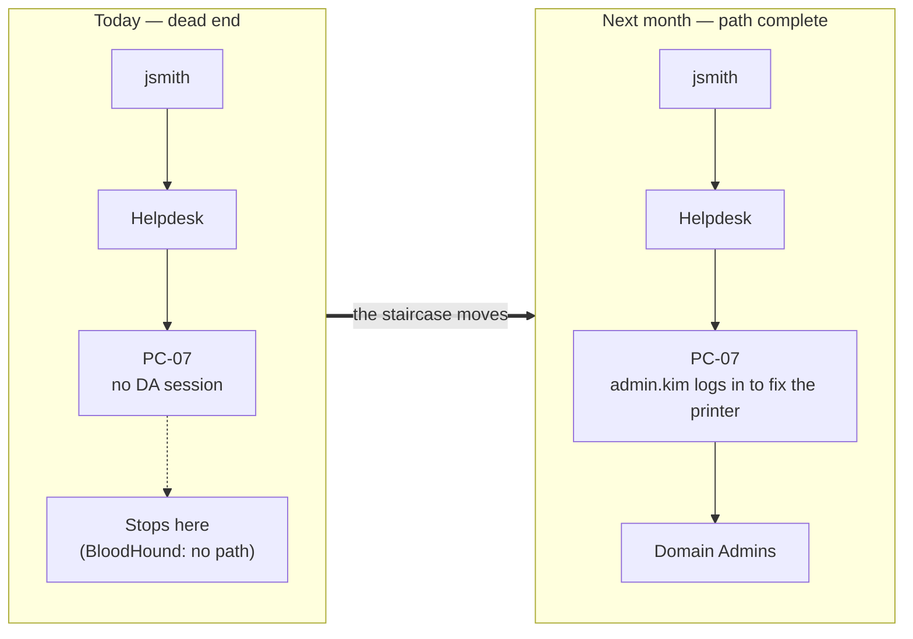

Today BloodHound's "path to DA" says "nothing found", but PlumHound's list still shows items like **"Helpdesk is local admin on 300 PCs"**, so you can fix it in advance. It's the same lesson as **not ignoring lows and informationals** in part 2 — things that aren't critical now become critical when they connect.

---

## 10. Mimikatz — more than a hash extractor { #mimikatz }

> A lot of people use Mimikatz just for **extracting password hashes and clear-text passwords out of memory**, which it's very good at. But it does **a tremendous amount more** than that, which can be used for **assessing individual workstations**.

Windows keeps logged-in users' credentials in the memory of the **LSASS** process (so it can authenticate to file servers and the like without asking again). Mimikatz reads that memory.

!!! note "💡 Note (added) — what else it can do (concepts)"
    | Capability | Concept | Related page |
    |---|---|---|
    | **Credentials in memory** | Hashes, tickets and (on old settings) clear-text passwords from LSASS | [LSASS dumping](../../../adversary/lsass-dumping.md) |
    | **Kerberos tickets** | View and export tickets in memory for reuse | [Pass-the-Hash](../../../adversary/pass-the-hash.md) |
    | **Stored secrets** | Decrypt secrets Windows protects (Credential Manager, saved browser passwords, …) | — |
    | **DCSync** | With replication rights, **imitate DC replication** and pull every account's hash without logging in to a DC | [DCSync](../../../adversary/dcsync.md) |
    | **Ticket forgery** | Use the krbtgt hash to forge a ticket for any user (Golden Ticket) | [Golden & Silver Tickets](../../../adversary/golden-silver-tickets.md) |

**What "assessing workstations" means** — in an authorised assessment, what's left on a single PC exposes **AD admin habits**. If a standard user's PC has **DA credentials in memory**, someone logged in to an ordinary PC with a DA account (a tiering failure), and an attacker who owns that one PC wins.

| Defence | What it does |
|---|---|
| **Credential Guard** | Moves LSASS secrets into a virtualisation-based isolated space so reading memory doesn't reveal them |
| **LSA protection (RunAsPPL)** | Makes LSASS a protected process so even admin-level programs can't easily read its memory |
| **Protected Users group** | Members don't use NTLM or weak crypto, and credentials aren't cached |
| **Admin tiering** | DA accounts log in to DCs only; PCs get PC-only admin accounts |
| **LAPS** | A different local admin password on every PC (stops Day 3 Pass-the-Hash spread) |
| **Disable WDigest** | Turns off the old behaviour of keeping clear-text passwords in memory (off by default on modern Windows) |

!!! note "💡 Note (added)"
    The two detections below are additions beyond the lecture. As on [Day 3](day-3.md), they only count once you've **tested them and confirmed they fire**.

### Detection ① LSASS memory access — Sysmon event 10 { #detect-lsass }

**Sysmon event 10 (ProcessAccess)** = records when one process opens another. `SourceImage` = the program doing the access, `TargetImage` = the program being accessed, `GrantedAccess` = the rights requested (a number).

```spl
index=wineventlog source="WinEventLog:Microsoft-Windows-Sysmon/Operational" EventCode=10 TargetImage="*\\lsass.exe"
| search NOT SourceImage IN ("C:\\Windows\\System32\\wininit.exe", "C:\\Windows\\System32\\csrss.exe", "C:\\Windows\\System32\\svchost.exe", "C:\\ProgramData\\Microsoft\\Windows Defender\\Platform\\*\\MsMpEng.exe")
| stats count values(GrantedAccess) AS access BY host, SourceImage
| sort - count
```

- **Line 1** — Sysmon event 10 where **the accessed program is lsass.exe**. `\\` means a single backslash inside an SPL string.
- **Line 2 `search NOT SourceImage IN (...)`** — removes the built-in Windows processes and Defender (MsMpEng) that touch LSASS legitimately. **Exclude by full path, not just name** — attackers often name malware `svchost.exe` and drop it in another folder; excluding by name would hide it too.
- **Line 3 `stats count values(GrantedAccess) AS access BY host, SourceImage`** — count and requested rights per PC and source program.
- **Line 4 `sort - count`** — highest first.

**Reading GrantedAccess** — the number is a sum of permission bits.

| Value | Meaning |
|---|---|
| `0x0010` | Read memory |
| `0x0400` | Query information |
| `0x1000` | Query limited information |
| `0x1010` | `0x1000 + 0x0010` → limited query + **read memory** (common with credential-theft tools) |
| `0x1410` | `0x1000 + 0x0400 + 0x0010` → also includes **read memory** |
| `0x1FFFFF` | All access |

The key question is **"does it include 0x10 (read memory)?"**

```text
host    SourceImage                                         count  access
WS-07   C:\Users\Public\update.exe                          2      0x1010
WS-07   C:\Program Files\VMware\VMware Tools\vmtoolsd.exe   14     0x1000
```

Row 1 — an unknown exe in the Public folder with **read-memory rights** → investigate first. Row 2 — `0x1000` is limited query only, no memory read → likely a legitimate tool. In a lab, Atomic Red Team's **T1003.001 (LSASS Memory)** tests let you confirm this search actually fires.

### Detection ② DCSync — event 4662 { #detect-dcsync }

**Event 4662** = "An operation was performed on an object". It is logged **on the DC** when an AD object is accessed. To get it, enable **DS Access → Audit Directory Service Access** on DCs and set an **audit entry (SACL)** on the domain object. DCSync is a replication request, so 4662 contains **GUIDs for the replication rights**.

| GUID | Right |
|---|---|
| `1131f6aa-9c07-11d1-f79f-00c04fc2dcd2` | Replicating Directory Changes |
| `1131f6ad-9c07-11d1-f79f-00c04fc2dcd2` | Replicating Directory Changes **All** (includes secrets such as password hashes) |

```spl
index=wineventlog source="WinEventLog:Security" EventCode=4662 ("1131f6aa-9c07-11d1-f79f-00c04fc2dcd2" OR "1131f6ad-9c07-11d1-f79f-00c04fc2dcd2")
| search NOT Account_Name="*$"
| stats count min(_time) AS first_seen BY host, Account_Name
| convert ctime(first_seen)
```

- **Line 1** — 4662 events containing either GUID. The GUIDs are searched as **raw text**, not a field, because in classic format this information spans several lines and field extraction is unreliable.
- **Line 2 `search NOT Account_Name="*$"`** — removes **computer accounts** (ending in `$`); DCs replicating with each other is normal.
- **Line 3 `stats count min(_time) AS first_seen BY host, Account_Name`** — count per DC and account, plus **the earliest time** (= first seen).
- **Line 4 `convert ctime(first_seen)`** — turns the numeric (epoch) time into a readable date.

```text
host   Account_Name        count  first_seen
DC01   helpdesk02          2      10/27/2026 14:03:11
DC01   MSOL_8a1f2c3d4e5f   96     10/27/2026 00:00:04
```

Row 1 — a helpdesk account requested replication → not normal work, **investigate immediately**. Row 2 — `MSOL_` accounts belong to **Microsoft Entra Connect (formerly Azure AD Connect)**, which legitimately uses replication rights to sync password hashes → benign; confirm and allow-list.

---

## 11. Ping Castle lab { #ping-castle }

> The one we're going to be talking about now is **Ping Castle**. We have a lab where you're going to be looking at the vulnerabilities Ping Castle found in an Active Directory environment.

Ping Castle is an **AD security assessment tool**. Run it with **standard domain-user rights** and you get an **HTML report** — think of it as AD's health-check report.

### Reading the score { #pingcastle-score }

!!! note "💡 Note (added)"
    The report has four categories, each scored **up to 100**. **Higher is worse** (0 = no issues, 100 = maximum risk) — like golf, lower is better.

| Category | What it looks at |
|---|---|
| **Stale Objects** | Unused accounts and PCs, old operating systems, old delegations |
| **Privileged Accounts** | Number of admins, admin account settings |
| **Trusts** | Trust relationships with other domains |
| **Anomalies** | Other security settings (LLMNR, SMB signing, krbtgt, …) |

**The overall score is the highest of the four.** The weakest area defines the domain — manage admins perfectly and one open trust still sinks you. Each triggered rule adds points; click it for the **explanation and remediation**.

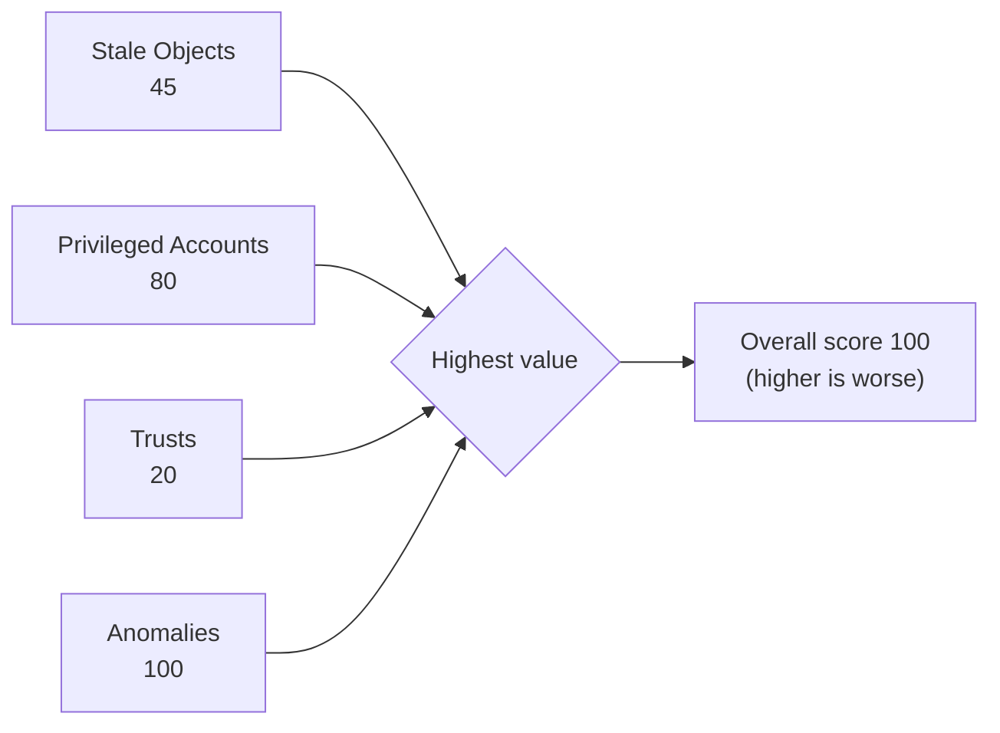

(Numbers are illustrative.)

### The lab — reading a report, no VM needed { #pingcastle-lab }

As previewed in part 1, this lab **doesn't use the VM**. You go to a website, analyse a **pre-generated Ping Castle report**, and **answer the questions** listed above it.

> Just to be completely honest, I do not know how they created this environment to run this Ping Castle report against. It is wild. **Insane number of vulnerabilities.** I don't know how this domain controller didn't just start a fire.

The goal is to get familiar with **Ping Castle's output** and the **kinds of vulnerabilities** you look for in a report.

> Once again, you **don't need to be an elite hacker** to find these things. All you need is access to a Ping Castle report, which is **cheap** — more expensive if you're consulting. You can get really good vulnerability analysis without having to do a whole bunch of hacks.

!!! note "💡 Note (added) — licensing"
    Ping Castle is now owned by **Netwrix**. The free **Community edition** can audit **your own environment** (no technical support or commercial-use rights). **Auditing other organisations (consulting)** requires the commercial **Service Provider** licence, and the **Enterprise** edition for protecting your own company is also paid — that's John's "more expensive if you're consulting".

### How to read the report { #pingcastle-reading }

!!! note "💡 Note (added)"
    Most lab questions ask "what is this item and why is it dangerous?". Reading in this order is fastest.

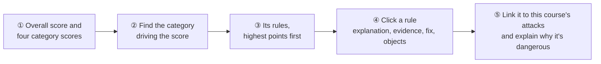

### Common findings and how they connect to this course { #pingcastle-findings }

| Finding | Why it's dangerous | Connects to | Fix |
|---|---|---|---|
| **LLMNR / NBT-NS not disabled** | Responder captures authentication | [Day 4 part 1](#responder-lab) · [LLMNR & NTLM relay](../../../adversary/llmnr-ntlm-relay.md) | Disable LLMNR by GPO, disable NBT-NS |
| **SMB signing not required** | NTLM relay | [Deep dive ②](#deep-dive-smb-signing) | Require signing on all servers and PCs |
| **Accounts with SPNs (especially admins)** | Kerberoasting → offline cracking | [Day 1](day-1.md) · [Kerberoasting](../../../adversary/kerberoasting.md) | Long passwords or **gMSA**; remove from admin groups |
| **No LAPS** | Same local admin password everywhere → Pass-the-Hash spreads | [Day 3](day-3.md) · [Pass-the-Hash](../../../adversary/pass-the-hash.md) | Windows LAPS |
| **Too many admins / passwords never expire** | Larger target, stale passwords | [Day 1](day-1.md) | Minimum membership, regular review |
| **Old krbtgt password** | If it ever leaked, forged tickets stay valid | [Mimikatz](#mimikatz) · [Golden & Silver Tickets](../../../adversary/golden-silver-tickets.md) | Reset **twice** using the proper procedure |
| **Unconstrained delegation** | Compromise that server and you steal tickets of users who connect | [BloodHound](#bloodhound) | Switch to constrained delegation; mark sensitive accounts "cannot be delegated" |
| **Obsolete OS, unused accounts and PCs** | Unpatchable systems, ownerless accounts | [Part 2 vulnerability management](#vulnerability-management) | Clean up or disable |
| **Print Spooler running on DCs** | A path to coerce the DC into authenticating | [Day 4 part 1 relay](#ntlmrelayx) · [PrintNightmare](../../../adversary/printnightmare.md) | Disable Spooler on DCs |

!!! note "💡 Note (added) — two terms from the table"
    - **gMSA (group Managed Service Account)** — a service account whose long password AD generates and rotates automatically. Kerberoasting it becomes practically impossible.
    - **krbtgt** — the account that signs every Kerberos ticket. With its hash you can forge a ticket for any user (Golden Ticket). It is reset **twice** because AD **remembers the previous password** too — reset once and the old hash still works.

### 💡 Note (added) — watch for Ping Castle runs too { #detect-pingcastle }

Like BloodHound, Ping Castle **runs with standard-user rights**. An attacker can run it too and get a free map of your AD weaknesses. So **runs from accounts or PCs outside the security team** are worth an alert (Sigma has a Ping Castle execution rule).

```spl
index=wineventlog source="WinEventLog:Microsoft-Windows-Sysmon/Operational" EventCode=1 (Image="*\\PingCastle.exe" OR OriginalFileName="PingCastle.exe")
| table _time, host, Image, ParentImage, CommandLine
```

- **Line 1** — **Sysmon event 1 (process creation)** where the executable path ends in PingCastle.exe, or `OriginalFileName` is PingCastle.exe. `OriginalFileName` is **the original name embedded inside the executable**, so renaming the file to `upd.exe` doesn't hide it.
- **Line 2 `table ...`** — time, PC, executable, parent process and command line as a table.

```text
_time                host   Image                              ParentImage                                                CommandLine
2026-10-27 15:22:41  WS-12  C:\Users\jsmith\Downloads\upd.exe  C:\Windows\System32\WindowsPowerShell\v1.0\powershell.exe  upd.exe --healthcheck --server corp.local
```

Run from a standard user's Downloads folder, **renamed**, via PowerShell → worth investigating.

---

## 12. Course wrap-up { #wrap-up }

The recording announces the AMA but goes straight into the closing. John thanks **two groups** at the pay-what-you-can course.

First, **the people who paid.** You didn't have to pay. Some say that makes you a sucker; BHIS sees it as **paying it forward** in the industry.

Second, **the people who didn't pay.** He says they understand "110%" that even $25 matters to some families today.

> **Time is your single most precious commodity.** You could have spent it with your family, with your friends, recuperating physically and spiritually — and you chose to be here.

One request: **amplify the signal.** If you see a new pay-what-you-can class on LinkedIn or Bluesky, share it, to help reach people with the passion and capability to join this industry.

Announcements from the host:

- **Certificates of completion** go out overnight (streaming viewers can still register) — please post them on social media.
- The **Threat Hunt Summit**, and **pay-what-you-can workshops** on Fridays (the next day: Wade Wells on CTI).
- John's next class, in about a month: **Active Defense and Cyber Deception**.

### 💡 Note (added) — the four-day course on one page { #course-recap }

Here is which control stops each stage of an attack. **Layering** them so the next one catches what the previous one missed is Day 3's defence in depth (the multiplication principle).

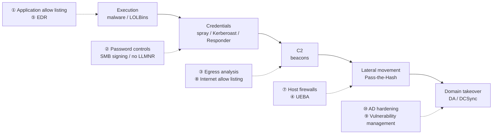

**⑥ Logging (Sysmon)** isn't tied to one stage — it records **traces from every stage**, so you can find later what the other controls missed.

| # | Control | Day | One-line takeaway | Key tools / logs |
|---|---|---|---|---|
| 1 | Application allow listing | [Day 1](day-1.md) | Only approved programs run | AppLocker, events 8003 (audit: would have been blocked) / 8004 (blocked) |
| 2 | Password controls | [Day 1](day-1.md) | Long passphrases against spraying and Kerberoasting | 4625 / 4624, 4769 (encryption 0x17) |
| 3 | Egress traffic analysis | [Day 2](day-2.md) | Find beacons in outbound connections | Zeek, RITA, AC-Hunter |
| 4 | UEBA | [Day 2](day-2.md) | Unusual user behaviour | LogonTracer, 4624 logon types |
| 5 | EDR | [Day 3](day-3.md) | Overlap multiplies effectiveness | Validate with Atomic Red Team |
| 6 | Logging | [Day 2](day-2.md) · [Day 3](day-3.md) | Default Windows logs aren't enough → Sysmon | Sysmon 1 / 3 / 10, Deep Blue CLI |
| 7 | Host firewalls | [Day 3](day-3.md) | Block PC-to-PC traffic to stop lateral movement | Windows Firewall (netsh advfirewall) |
| 8 | Internet allow listing | [Day 4](#internet-allowlisting) | Block "Uncategorized", remove ads | Web proxy, Pi-hole |
| 9 | Vulnerability management | [Day 4](#vulnerability-management) | Group by vulnerability; read lows and infos | Nessus, ZAP |
| 10 | AD hardening | [Day 3](day-3.md) · [Day 4](#ad-hardening) | Break the staircase to DA | BloodHound, PlumHound, Ping Castle |

---

That's all of Day 4 and the end of the course. One-line summary:

> **An attacker on your network captures NTLMv2 and cracks or relays it — the answer is host-to-host blocking, disabling LLMNR and required SMB signing, while stolen-hash Pass-the-Hash needs separate defences. Attackers burn brand-new domains, so blocking "Uncategorized" and removing ads gives de-facto internet allow listing. For vulnerabilities, bump CVSS up a level, look at lows and informationals, and group by vulnerability so automation can fix them at scale. Test web apps throughout development with SAST and DAST, and check that your detections catch the scan. See AD as a graph — BloodHound for paths, PlumHound for the fix list, Ping Castle for the health check — and break today's dead ends before they become tomorrow's paths.**

Next course: John Strand's **Active Defense and Cyber Deception**. The course overview is at [Information Security Core Skills](index.md).

## References

- [Antisyphon Training](https://www.antisyphontraining.com/) · [Black Hills Information Security](https://www.blackhillsinfosec.com/)
- [Responder](https://github.com/lgandx/Responder) · [Impacket (ntlmrelayx)](https://github.com/fortra/impacket) · [Hashcat example hashes (mode numbers)](https://hashcat.net/wiki/doku.php?id=example_hashes)
- [Microsoft — SMB signing](https://learn.microsoft.com/windows-server/storage/file-server/smb-signing) · [CISA KEV](https://www.cisa.gov/known-exploited-vulnerabilities-catalog) · [FIRST EPSS](https://www.first.org/epss/) · [FIRST CVSS](https://www.first.org/cvss/)
- [MITRE ATT&CK — T1557.001 LLMNR/NBT-NS Poisoning and SMB Relay](https://attack.mitre.org/techniques/T1557/001/)
- [ZAP](https://www.zaproxy.org/) · [ZAP ownership](https://zaproxy.org/docs/zap-ownership) · [Burp Suite](https://portswigger.net/burp) · [Damn Small Vulnerable Web](https://github.com/stamparm/DSVW)
- [GitHub code scanning](https://docs.github.com/code-security/code-scanning) · [OWASP Top 10](https://owasp.org/www-project-top-ten/)
- [BloodHound (SpecterOps)](https://bloodhound.specterops.io/) · [PlumHound](https://github.com/PlumHound/PlumHound) · [PlumHound introduction (BHIS)](https://www.blackhillsinfosec.com/plumhound-reporting-engine-for-bloodhoundad/)
- [PingCastle](https://www.pingcastle.com/) · [PingCastle user guide (Netwrix)](https://docs.netwrix.com/docs/pingcastle/3_5) · [Compare PingCastle editions (Netwrix)](https://netwrix.com/en/products/pingcastle/pingcastle-comparison/)
- [MITRE ATT&CK — T1003.001 LSASS Memory](https://attack.mitre.org/techniques/T1003/001/) · [T1003.006 DCSync](https://attack.mitre.org/techniques/T1003/006/)
- [Microsoft — Credential Guard](https://learn.microsoft.com/windows/security/identity-protection/credential-guard/) · [LSA protection](https://learn.microsoft.com/windows-server/security/credentials-protection-and-management/configuring-additional-lsa-protection) · [Protected Users](https://learn.microsoft.com/windows-server/security/credentials-protection-and-management/protected-users-security-group) · [Windows LAPS](https://learn.microsoft.com/windows-server/identity/laps/laps-overview)
- Related: [LLMNR & NTLM relay](../../../adversary/llmnr-ntlm-relay.md) · [Pass-the-Hash](../../../adversary/pass-the-hash.md) · [SAM & NTDS extraction](../../../adversary/sam-ntds-extraction.md) · [Zeek](../../../network/zeek/index.md) · [Well-known ports](../../../basics/well-known-ports.md) · [HTTP status codes](../../../basics/http-status-codes.md) · [Kerberoasting](../../../adversary/kerberoasting.md) · [DCSync](../../../adversary/dcsync.md) · [Golden & Silver Tickets](../../../adversary/golden-silver-tickets.md) · [LSASS dumping](../../../adversary/lsass-dumping.md) · [PrintNightmare](../../../adversary/printnightmare.md) · [Windows event IDs](../../../basics/windows-event-ids.md)
