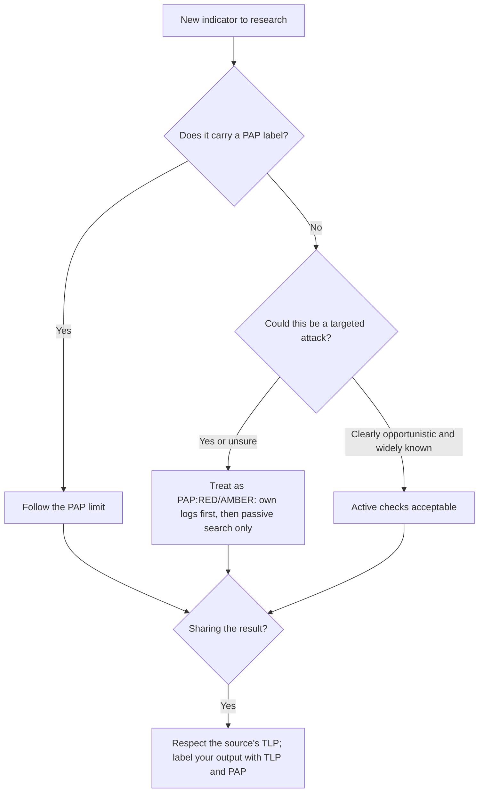

# Analysis OPSEC — What It Is, Who It Protects, and Sharing Rules with TLP and PAP { #opsec-tlp-pap }

!!! abstract "What this page covers"
    Every investigation step that touches the outside world can also tell the attacker something. This page starts the **analysis OPSEC** section. First, **what operational security (OPSEC) means**: the military idea of denying the enemy knowledge of what you know, what you can do and what you plan, and why it carries over almost word for word to a SOC. Second, **why targeted and opportunistic attacks need different levels of care**: in a targeted attack, the fact that you have spotted the attacker is a tactical advantage that a careless lookup can throw away. A worked example follows one targeted phishing link and shows, from the attacker's own web and DNS logs, exactly what each analyst action reveals. Third, the **three kinds of cyber OPSEC** (personal, attacker and analyst) and the everyday actions that leak: DNS lookups, loading URLs, public sandbox and multi-scanner submissions, and any traffic to attacker infrastructure. Fourth, the **Traffic Light Protocol (TLP)**, which tells you who you may share information with, in its current 2.0 form (CLEAR, GREEN, AMBER, AMBER+STRICT, RED), with how to mark emails and documents, and four invented reports labelled and handled. Fifth, the **Permissible Actions Protocol (PAP)**, which tells you what you may *do* with an indicator, with a MISP-style tagged event read line by line and a table of allowed actions per indicator. The 2026 view and practice questions follow.

!!! note "Labels"
    **[Supplement]** = practical material you need to know, **[Correction]** = a commonly repeated claim that is wrong or outdated, **[Changed]**/**[Caution]** = what has changed recently and what is risky to do the old way. The company (Wattle Ridge Energy, `wattleridge.example`), people, hostnames, domains, IPs and log lines are invented for illustration (`.example`, documentation and private IPs). Frameworks, protocols, standards bodies and products are real and described in my own words.

## The 8 key points { #key-points }

1. **OPSEC means not telling the adversary what you know.** In the military sense it is denying the enemy knowledge of your dispositions, capabilities and intentions. For an analyst, it means hiding *that* you have noticed the attack, *what* you have found and *what* you plan to do.
2. **Spotting a targeted attacker is a head start — don't waste it.** While they think they are unseen, you can study their tools and plan one decisive clean-up. If they realise they've been seen, they change domains, malware and methods, and detection starts again from zero.
3. **Opportunistic attacks need much less care.** Mass spam and commodity malware are being investigated by thousands of teams at once; your lookup is one of many. Ask "could this be targeted?" *before* you take any active step.
4. **Three kinds of cyber OPSEC:** personal (keep your private life private), attacker (stay unfound) and **analyst** (hide your knowledge from the attacker). This section is about the third.
5. **Many ordinary actions leak:** a DNS lookup, opening the URL (even on a "good" hosting domain), submitting a URL or file to a public multi-scanner or sandbox, and anything else that sends packets to infrastructure the attacker controls or can watch.
6. **TLP controls sharing.** TLP 2.0 has five labels: **CLEAR** (no limit), **GREEN** (your community, not public), **AMBER** (your organisation and its clients, need-to-know), **AMBER+STRICT** (your organisation only) and **RED** (only the named people in that conversation). The label goes in the email subject and body, and in each page's header and footer.
7. **PAP controls action.** PAP uses the same colours but answers "what may I do with this indicator?": **CLEAR/WHITE** no restriction, **GREEN** active actions allowed (connect, block), **AMBER** passive checks with third-party services only, **RED** nothing detectable from outside — only searches in your own logs.
8. **The two are independent.** An indicator can be TLP:GREEN (share it widely) and PAP:RED (but nobody may touch it). Respect both, and label what *you* share with both.

## Why this matters in a SOC { #why }

Imagine a detective who has just worked out which house the gang is using. If she parks a marked police car outside and knocks on the door to "ask a few questions", the gang moves out that night and takes the evidence with them. If she keeps her distance, watches who comes and goes, checks property records and talks to neighbours who have already seen things, she can plan one raid that catches everyone at once. Nothing about her suspicion changed; only how visibly she acted on it.

Back to the technical reality. An analyst who pastes a phishing URL into a public scanner, or opens it from a corporate laptop, is the marked police car. Attackers run their own web servers, DNS servers and file hosts (T1583.001 Domains, T1583.002 DNS Server), so they see every request in their logs. They can also search the same public scanning and reputation sites we use, and notice when their unique domain or file hash suddenly appears. For a mass campaign that does not matter much. For an intrusion aimed at your organisation, it can turn a contained incident into a long chase: the attacker's next domain, backdoor and access path are ones you have never seen. Analysis OPSEC is the habit of asking, before every outward-facing step, "who else will see this, and what will it tell them?" And because SOCs share intelligence with each other, it also covers the rules that tell you what you may pass on (TLP) and what you may do with what you were given (PAP).

## What OPSEC is { #what-is-opsec }

The term comes from the military. NATO's glossary describes operations security as the process that gives an operation the right security, by passive or active means, so that the enemy is denied knowledge of the friendly side's **dispositions** (where things are), **capabilities** (what they can do) and **intentions** (what they plan). For information security, the meaning is almost identical: we do not want the attacker to learn **what we know**.

For a SOC analyst those three words map neatly:

| Military term | What it means for a SOC investigation | Example of a leak |
| --- | --- | --- |
| Dispositions | Which hosts, accounts and data the attacker has reached that we have **found** | Blocking only the one C2 domain we know about, right now |
| Capabilities | Our tools and visibility — what we can **see** and **detect** | A sandbox visiting their page with a tell-tale "headless" browser |
| Intentions | What we **plan** to do — watch, contain, evict | A company-wide email saying "we are under attack, change passwords" |

### Targeted vs opportunistic: how much OPSEC is needed { #targeted-vs-opportunistic }

Attacks fall into two broad camps (the [previous section](../investigation/targeted-clicks-bec.md#targeted) showed how to tell them apart), and they need very different levels of care.

**Opportunistic attacks** spray spam and malware across the internet without knowing or caring who receives it. Thousands of security teams, researchers and automated feeds are investigating the same domains and files at the same moment. One more lookup from you tells the attacker nothing new, so OPSEC is a minor concern.

**Targeted attacks** are different. Once you have identified one, you hold a small **tactical advantage**: you know about them, and they don't know that you know. While that lasts, you can quietly analyse their indicators and files, work out what they are after, find every host they touched, and prepare a **remediation that takes effect all at once** — every backdoor removed, every stolen credential reset, every C2 path blocked in the same hour — so they are locked out in one move. That kind of plan may become impossible if they notice you. A spooked attacker may switch to new infrastructure and malware, burn the access they have quickly (steal data now, or deploy ransomware), or go quiet and wait. Each forces you back to detection and analysis.

**[Supplement]** You will rarely be *sure* an attack is targeted at the moment you first see it. That is why the safe habit is to treat anything that *could* be targeted as targeted until proven otherwise, and to use passive methods first, which cost you nothing on opportunistic cases.

### Worked example: one targeted link, seen from the attacker's side { #attacker-view }

Wattle Ridge Energy's SOC receives a phishing report. Three engineers got an email titled "Updated SCADA vendor portal — re-register by Friday". The link is:

```text
https://wattleridge-portal.example/sso/login?t=8f3k2a
```

The domain imitates the company's own name, it was registered six days ago, and the `t=8f3k2a` value differs for each recipient (a per-recipient token, staged on purpose: T1608.005 Link Target). Every sign says **targeted**. The analyst on shift, in a hurry, does three things in the first five minutes. Below is what the attacker sees, because they run the authoritative DNS server for the domain and the web server it points to.

**Action 1: `nslookup wattleridge-portal.example` from the analyst's workstation.** The query goes to Wattle Ridge's internal resolver, which asks the domain's authoritative server. The attacker's DNS query log shows (BIND-style format):

```text
12-Nov-2026 02:13:55.412 client 198.51.100.53#40122 (wattleridge-portal.example): query: wattleridge-portal.example IN A -E(0)DC (203.0.113.53)
```

Read field by field:

- `12-Nov-2026 02:13:55.412` — when the query reached the attacker's server (UTC).
- `client 198.51.100.53#40122` — the IP and source port of the resolver that asked. `198.51.100.53` is Wattle Ridge's own recursive resolver; a quick WHOIS on that address returns "Wattle Ridge Energy". **The attacker now knows someone inside the target resolved the domain.**
- `(wattleridge-portal.example): query: wattleridge-portal.example IN A` — the name asked for, the class (`IN`, internet) and the record type (`A`, an IPv4 address).
- `-E(0)DC` — flags: `-` recursion not requested (normal for resolver-to-authoritative), `E(0)` EDNS version 0 in use, `D` DNSSEC records requested, `C` checking disabled. Not important here.
- `(203.0.113.53)` — the attacker's server address that received the query.

On its own, a lookup could be a user about to click. But if no web request follows from that network, a DNS query with no connection after it looks like someone *checking* rather than *falling for* the link.

**Action 2: open the URL in a browser on an analysis VM, still on the corporate network.** The attacker's web server log:

```text
198.51.100.23 - - [12/Nov/2026:02:14:07 +0000] "GET /sso/login?t=8f3k2a HTTP/1.1" 200 5120 "-" "Mozilla/5.0 (X11; Linux x86_64; rv:132.0) Gecko/20100101 Firefox/132.0"
```

- `198.51.100.23` — the source IP: Wattle Ridge's corporate internet egress. Again, WHOIS names the company.
- `- -` — remote identity and authenticated user, both empty (normal).
- `[12/Nov/2026:02:14:07 +0000]` — time of the request.
- `"GET /sso/login?t=8f3k2a HTTP/1.1"` — the exact path **with the token**. `8f3k2a` was sent to only one engineer, so the attacker knows *whose* email was opened.
- `200 5120` — status 200 (page served) and 5,120 bytes sent.
- `"-"` — no referrer. A user clicking from Outlook or a webmail page usually produces a different pattern.
- `"Mozilla/5.0 (X11; Linux x86_64 ...) Firefox/132.0"` — a **Linux** desktop browser. The engineers use managed Windows laptops. A Linux browser opening a Windows user's token at 2 a.m. local time, with no sign-in attempt afterwards, looks like an analyst.

**Action 3: submit the URL to a public URL scanner with default (public) visibility.** Two log lines appear a minute later:

```text
192.0.2.80 - - [12/Nov/2026:02:15:31 +0000] "GET /sso/login?t=8f3k2a HTTP/1.1" 200 5120 "-" "Mozilla/5.0 (Windows NT 10.0; Win64; x64) AppleWebKit/537.36 (KHTML, like Gecko) HeadlessChrome/131.0.0.0 Safari/537.36"
192.0.2.80 - - [12/Nov/2026:02:15:32 +0000] "GET /sso/assets/logo-wattleridge.png HTTP/1.1" 200 18233 "https://wattleridge-portal.example/sso/login?t=8f3k2a" "Mozilla/5.0 (Windows NT 10.0; Win64; x64) ... HeadlessChrome/131.0.0.0 ..."
```

- `192.0.2.80` — an address belonging to a well-known scanning service's cloud range.
- `HeadlessChrome/131.0.0.0` — Chrome running without a screen, the classic sign of an automated scanner.
- The second line shows the scanner loading the page's resources (the logo), with the phishing page as the referrer — a full render.

Worse, the scan result is now **public**: anyone, including the attacker, can search that service for `wattleridge-portal.example` and see that someone scanned it, when, and a screenshot of the page. Many attackers check this routinely for their own domains.

**What the attacker concludes:** the target's network resolved the domain, a Linux browser opened one engineer's token, and a scanner rendered it publicly — all within two minutes and with no credential submitted. "We've been caught." By 02:40 the domain points elsewhere, and the next lure (next week, a different domain, a different lure theme) comes in without the indicators the SOC is now watching for.

**What the analyst could have done instead:**

| Need | Leaky way | Quieter way |
| --- | --- | --- |
| Where does the domain point? | `nslookup` from the corporate network | Search **passive DNS** history (records already collected by others) — next page |
| What does the page look like? | Open it from the corporate egress | Search existing scan results first; if a live look is truly needed, use a private scan or an unattributed connection and a realistic Windows browser, with the token **removed or changed** — next page |
| Is anyone else seeing it? | Submit to a public scanner | Search (not submit) intelligence platforms; ask trusted peers under TLP:AMBER |
| Did anyone click? | — | Search **your own** proxy, DNS and email-click logs, which reveal nothing to the attacker ([previous section](../investigation/targeted-clicks-bec.md#tracking-clicks)) |

**[Supplement]** Your own logs also record your analysts' mistakes. On Windows, Sysmon Event ID 22 (DNSEvent) logs every DNS query a process makes, with the process name. Searching for analyst workstations resolving indicators under investigation is a cheap way to find OPSEC slips — and to stop analysts' lookups being mistaken for victims' clicks in the same investigation.

## Kinds of cyber OPSEC { #opsec-types }

You will hear "OPSEC" in three different senses in cyber security:

1. **Personal OPSEC — keeping your private life private.** Not posting your travel plans, your workplace badge, or your home address. Relevant to analysts too: defenders of high-value organisations are themselves targets for social engineering.
2. **Attacker OPSEC — protecting yourself from being found.** Attackers try to leave no traces. When they fail — reused email addresses, debugging files left on servers, test samples uploaded to public scanners — researchers find them. Many public attribution stories begin with an attacker's OPSEC failure.
3. **Analyst OPSEC — hiding what you know about the attack from the attacker.** This is our subject. Even after we have caught them, we want them to keep believing they haven't been caught for as long as that is useful to us.

The common ways analysts leak their knowledge:

- **DNS lookups** of attacker domains (seen by the attacker's authoritative server if they run it).
- **Loading, testing or probing URLs** — even on a "good" domain. A malicious file on a popular file-sharing service still lets the account owner see download counts or access logs.
- **Multi-scanner submissions** of URLs or files: the file or URL becomes known, and possibly downloadable.
- **Public sandbox runs** of samples: the report is often public and searchable by hash.
- **Anything that actively sends traffic** to attacker-owned or attacker-watched infrastructure: port scans, banner grabs, downloads with `wget` or `curl`.

The next page covers how to research safely instead: passive sources, search-versus-scan, unattributed connections, Tor, and the "premature block".

## Sharing intelligence: the Traffic Light Protocol { #tlp }

Threat intelligence is better with friends: a phishing domain one energy company found yesterday is one its neighbour can block today. But not everything can be shared with everyone. A producer may need to protect a **source** (an informant, a partner, a victim who does not want to be named) or a **method** (a detection they do not want attackers to learn about). The **Traffic Light Protocol (TLP)** is the common language for saying how far information may travel. It is maintained by FIRST (the Forum of Incident Response and Security Teams); TLP 2.0 was published in August 2022, and CISA (the US agency that absorbed US-CERT) adopted it in November 2022.

TLP labels are set by the **source** of the information, and the **recipient** must respect them. They describe sharing, not secrecy classification.

| Label | Who may receive it | Typical use |
| --- | --- | --- |
| **TLP:CLEAR** (was TLP:WHITE) | Anyone. No limit beyond normal copyright. | Public advisories, blog posts, published IOCs |
| **TLP:GREEN** | Your community (peers and partner organisations in your sector or community), but **not** posted on public channels | Sector-wide phishing domain lists in an ISAC |
| **TLP:AMBER** | Your own organisation, and its **clients** who need to know to protect themselves, on a need-to-know basis. The source may add tighter limits, which must be obeyed. | Incident details shared with a few peer SOCs and their managed customers |
| **TLP:AMBER+STRICT** | Your **organisation only** — not clients | A partner's detection details that would hurt them if spread |
| **TLP:RED** | Only the **named recipients**, or the people present in that meeting or call. In extreme cases, shared only verbally or in person. | Details of an ongoing investigation that could identify a victim |

**[Correction]** You will still see TLP:WHITE in older documents and tools. In TLP 2.0 it became **TLP:CLEAR**, partly because "white" could be confused with plain, unlabelled information. **AMBER+STRICT** is new in 2.0, and AMBER now explicitly allows sharing with clients on a need-to-know basis.

### How to mark it { #tlp-marking }

- **Email:** put the label in the **subject line** and in the **body before the shared information**, in capitals with no space after the colon: `TLP:AMBER`, `TLP:AMBER+STRICT`.
- **Documents:** put the label in the **header and footer of every page**, conventionally right-aligned (so it is not confused with other marking schemes), in capitals, at 12-point or larger.
- **Machine-readable data:** use the TLP tags or markings your platform supports (for example `tlp:amber` tags in MISP or the TLP 2.0 marking objects in STIX).
- **[Supplement]** If information is unlabelled, do not invent a label for someone else's data; ask the source. When **you** produce a report, label it deliberately and say why if the choice is unusual.

### Worked example: four reports on one morning { #tlp-example }

The Wattle Ridge SOC lead receives four pieces of intelligence and must decide what to do with each:

| Report | Label | Can she forward it to the company's outsourced OT security provider? | Can she paste the indicators into the sector ISAC's chat? | Can she publish a blog post? |
| --- | --- | --- | --- | --- |
| R1: national CERT advisory on a VPN appliance flaw | TLP:CLEAR | Yes | Yes | Yes |
| R2: ISAC list of phishing domains imitating energy firms | TLP:GREEN | Yes (a partner in the community) | Yes — it came from that community | **No** — GREEN is never posted publicly |
| R3: peer utility's write-up of the same SCADA-portal lure, "do not share with vendors" | TLP:AMBER + extra limit | **No** — the source added a limit, and it overrides the default "clients" allowance | No | No |
| R4: phone call with a government liaison naming a suspected actor | TLP:RED | No | No | No — and she may not even brief her own SOC beyond the people on the call |

Two common mistakes this table avoids: treating GREEN as "public" (it is not — it stays in the community), and treating AMBER's "clients" allowance as overriding a source's explicit extra limit (the source's limit wins).

When Wattle Ridge writes up its own incident, the analyst labels the version for the ISAC **TLP:GREEN** (domains, subject lines and the lure theme, but not the names of the engineers targeted) and the version for two peer utilities **TLP:AMBER** (adding the per-recipient token pattern and the timeline). Labelling different versions for different audiences is normal.

## Acting on intelligence: the Permissible Actions Protocol { #pap }

Have you ever received an indicator from a neighbouring organisation and wondered "what am I allowed to do with this?" TLP answers *who* you may tell; it does not answer whether you may connect to the server, scan it or submit it somewhere. Using TLP as a proxy for that is a rough fit at best. The **Permissible Actions Protocol (PAP)**, created in the MISP community and published as a MISP taxonomy, fills the gap. It can be attached to **each individual indicator**, and tells the recipient how far they may interact with it — in other words, how much risk of the attacker noticing is acceptable to the source.

| Label | What you may do | What that means in practice |
| --- | --- | --- |
| **PAP:CLEAR** (older versions: PAP:WHITE) | No restrictions | Use it however you like |
| **PAP:GREEN** | **Active actions** allowed | Ping it, connect to it, block traffic to and from it, set up honeypots to interact with it |
| **PAP:AMBER** | **Passive cross-checks** only | Look it up with third-party services (search reputation and scanning sites, passive DNS), run a monitoring honeypot — but no direct contact |
| **PAP:RED** | **Non-detectable actions only** | Don't use it on the network at all. Only search your own logs and data, so nothing is visible from outside |

**[Supplement]** The protocol says "AMBER", not "yellow"; some older write-ups mix the two. Note also that even PAP:AMBER "third-party lookups" means *searching* existing data, not submitting a fresh scan that will itself contact the server and publish the result — that distinction is on the next page.

### Worked example: a tagged event read line by line { #pap-example }

A peer utility shares a MISP event about the SCADA-portal campaign. Simplified, the parts that matter look like this:

```json
{
  "Event": {
    "info": "SCADA vendor-portal credential phishing against energy sector",
    "Tag": [
      { "name": "tlp:amber" },
      { "name": "PAP:AMBER" }
    ],
    "Attribute": [
      { "type": "domain", "value": "wattleridge-portal.example",
        "Tag": [ { "name": "PAP:AMBER" } ] },
      { "type": "url", "value": "https://grid-vendor-sso.example/sso/login?t=u77qd1",
        "Tag": [ { "name": "PAP:RED" } ] },
      { "type": "ip-dst", "value": "203.0.113.45",
        "Tag": [ { "name": "PAP:GREEN" } ] },
      { "type": "email-subject", "value": "Updated SCADA vendor portal - re-register by Friday",
        "Tag": [ { "name": "tlp:green" }, { "name": "PAP:CLEAR" } ] }
    ]
  }
}
```

- `"info"` — the event's title: a human summary of what it is about.
- `"Tag": [ tlp:amber, PAP:AMBER ]` at event level — the **default** for the whole event: share inside your organisation and with clients who need it; passive checks only.
- First attribute, the **domain**, `PAP:AMBER` — you may look it up in passive DNS and reputation databases, but don't resolve or visit it.
- Second attribute, the **URL with a token**, `PAP:RED` — this URL contains a token that identifies the peer's victim. Any contact, even through an anonymous connection, would tell the attacker that this particular victim's lure was investigated. Search your own proxy logs for it; never open or scan it.
- Third attribute, the **IP**, `PAP:GREEN` — the hosting IP is shared by many campaigns and already widely known; blocking it at the firewall and alerting on connections is fine.
- Fourth attribute, the **subject line**, `tlp:green` and `PAP:CLEAR` — attribute-level tags override the event default: the subject may be shared with the whole community, and used any way you like (for example a mail-filter rule).

From that, the analyst builds a simple action plan:

| Indicator | Allowed | Planned action |
| --- | --- | --- |
| `wattleridge-portal.example` | Passive cross-check | Passive DNS history; search (not scan) scanning sites; hunt in own DNS logs |
| `https://grid-vendor-sso.example/...?t=u77qd1` | Own logs only | Search proxy logs for the domain and the path; no visits, no scans |
| `203.0.113.45` | Active | Firewall block, alert on any connection attempt |
| Subject line | Anything | Quarantine rule in the mail gateway; share with the ISAC |

### TLP and PAP together { #tlp-pap-together }

The two labels are **independent**: TLP is about *people*, PAP is about *packets*. A widely known scanning IP might be TLP:CLEAR and PAP:GREEN. A victim-specific URL might be TLP:RED and PAP:RED. And a combination like **TLP:GREEN with PAP:RED** is perfectly sensible: "tell everyone in the sector to look for this domain in their logs, but nobody touch it, because the investigation is still live." Before you act on any shared indicator, read both; when you share, set both.

A quick decision flow to keep in mind before any outward-facing step:



Read from the top: if a source gave you a PAP label, it decides. If not, your own judgement on "targeted or not" decides, defaulting to caution when unsure. Whatever you find, the source's TLP decides who you may tell, and anything you send out gets both labels.

## The 2026 view { #trends }

!!! success "[2026 Current] Still valid"
    The core idea has not changed: in a targeted intrusion, the attacker not knowing that you know is an advantage, and outward-facing research can throw it away. Attackers still watch their own infrastructure logs and still search public scanning and reputation services for their own domains and hashes. TLP remains the standard sharing label across CERTs, ISACs and vendors, and PAP is still used in MISP, OpenCTI and other intelligence platforms. Treating "could be targeted" as targeted, searching your own logs first, and labelling what you share remain best practice.

!!! info "[Changed] What has changed"
    - **TLP 2.0** (FIRST, August 2022; adopted by CISA in November 2022) replaced TLP 1.0: WHITE became **CLEAR**, **AMBER+STRICT** was added, and AMBER explicitly allows sharing with clients on a need-to-know basis. Older guidance that cites "US-CERT" now points to **CISA**, which absorbed it.
    - **PAP** gained **PAP:CLEAR** alongside the older PAP:WHITE, and is available as standard markings in STIX 2.1 common objects as well as in MISP.
    - **Platforms changed.** RiskIQ's community passive-DNS service became Microsoft Defender Threat Intelligence, and in 2025 Microsoft announced it was folding Defender TI's capabilities into Defender XDR and Sentinel at no extra cost. Public sandbox sites named in older material (such as the old malwr.com) are gone; others remain. Check what each tool you use today shares and with whom.
    - **More attacker visibility.** Phishing kits commonly include anti-analysis features — blocking known scanner IP ranges and headless browsers, one-time tokens, CAPTCHA or Cloudflare-style challenges, geofencing — which both hide the page from analysts and tell the attacker when someone tried. A per-recipient token visited by anyone other than the victim is an obvious tip-off.
    - **AI and sharing.** SOC copilots and AI assistants can summarise and enrich indicators. Pasting a TLP:AMBER or TLP:RED report into an external AI service is sharing it with that service: only use tools your organisation has approved for that classification of data, and check whether prompts are retained.
    - **ATT&CK IDs** on this page: T1583.001 Domains, T1583.002 DNS Server, T1608.005 Link Target, T1566.002 Spearphishing Link. ATT&CK v20 (October 2026) is current; these IDs are unchanged.

!!! warning "[Caution] Wrong or risky to do the old way"
    - **Don't look up or open indicators from a possibly targeted attack on the corporate network** "just to check" — that is exactly the signal the attacker is waiting for.
    - **Don't treat TLP:GREEN as public.** Posting it on social media or a public blog breaks the protocol and the trust of the community that shared it.
    - **Don't assume AMBER's "clients" allowance overrides a source's added limits.** Extra limits from the source always apply.
    - **Don't use TLP as a substitute for PAP.** A TLP:CLEAR indicator is not automatically safe to scan; ask, or default to passive.
    - **Don't remove or ignore labels when moving data between tools** (email to ticket to SIEM watchlist to AI tool). Labels must travel with the data.
    - **TLP is not a legal or security classification.** It does not replace your organisation's own classification rules (for defence work, protective markings and handling rules still apply on top of TLP).

## Practice questions { #quiz }

### Question 1

An analyst receives a reported phishing link `https://payroll-wattleridge.example/view?id=a19x` sent to two named finance staff. They immediately run `nslookup` on the domain and open the link in a browser on their work laptop. Explain what the attacker could see in their own logs from each action, why it matters here, and what the analyst should have done first.

??? success "Answer and explanation"
    **`nslookup`:** if the attacker runs the domain's authoritative DNS server, their query log shows a lookup from the company's resolver IP (WHOIS shows the company) — and, if no web request follows, a lookup that looks like checking rather than clicking.

    **Opening the link:** their web log shows a request from the company's egress IP, the full path including `id=a19x` (identifying which finance employee's email was opened), the time, and the user agent. If nothing else follows (no credential submission), it looks like investigation.

    **Why it matters:** the lure imitates the company's name, is sent to two named people and carries per-recipient IDs — signs of a **targeted** attack, where being noticed lets the attacker switch infrastructure and return unseen.

    **What first:** search **own logs** (proxy, DNS, email-click records) to see whether either employee clicked or submitted credentials; search **passive DNS** and existing scan results instead of resolving or visiting; if a live look is essential, use an unattributed connection and a realistic browser with the ID removed or altered (next page).

### Question 2

You receive a report marked `TLP:AMBER` with a note "not for vendors". Your company uses a managed security provider (an outside vendor) that runs your EDR. Can you share the report with them? What about a `TLP:GREEN` report — can you post its domains on a public blog? And what replaced `TLP:WHITE`?

??? success "Answer and explanation"
    **TLP:AMBER with "not for vendors":** no. AMBER normally allows sharing within your organisation and with clients on a need-to-know basis, but the source may add limits, and those must be obeyed. Here they explicitly excluded vendors. (Without that note, sharing with a provider acting on your behalf would need careful judgement or a question to the source; with it, the answer is clear.)

    **TLP:GREEN on a public blog:** no. GREEN may circulate widely within the community (peers and partners in your sector or the security community), but not through publicly accessible channels.

    **TLP:WHITE** became **TLP:CLEAR** in TLP 2.0 (August 2022), which also added **TLP:AMBER+STRICT** (organisation only, no clients).

### Question 3

A shared indicator set contains a C2 domain tagged `PAP:RED`, a hosting IP tagged `PAP:GREEN`, and the whole event is `TLP:GREEN`. List what you may and may not do with the domain and with the IP, and explain how TLP:GREEN and PAP:RED can both make sense on the same event.

??? success "Answer and explanation"
    **Domain (`PAP:RED`):** may only be used for actions not detectable from outside — search your own DNS, proxy, firewall and EDR logs for it. May **not** resolve it, visit it, scan it, or submit or even look it up in ways that would contact it. (A firewall block is also an action an attacker can notice when beacons stop, so check with the source before blocking.)

    **IP (`PAP:GREEN`):** active actions allowed — block traffic to and from it, alert on connections, ping or connect to it, or point a honeypot at it.

    **Both labels together:** TLP is about **who may be told**; PAP is about **what may be done**. The source wants every organisation in the community to *hunt* for the domain in their own logs (so share widely: GREEN), but does not want anyone to *touch* it while the investigation continues (so PAP:RED). The labels answer different questions, so they can differ.

## Related { #related }

- [Analysis OPSEC](index.md) — section overview
- [Targeted Attacks, Clicks, Captured Passwords and BEC](../investigation/targeted-clicks-bec.md) — telling targeted from opportunistic
- [Starting an Investigation](../investigation/questions-and-data.md#osint) — OSINT and the submission catch
- [Threat Intelligence Levels, the Intelligence Cycle and F3EAD](../mental-models/threat-intel-cycles.md) — who consumes intelligence and how it is shared
- [Phishing Delivery & Initial Execution](../../../adversary/phishing-delivery.md)
- [Threat Intelligence](../../../threat-intel/index.md)
