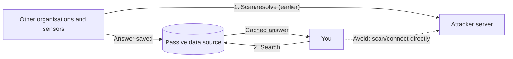

# Researching Safely — Passive Sources, Search vs Scan, Common OPSEC Failures, Unattributed Connections and Tor { #passive-osint-failures }

!!! abstract "What this page covers"
    The [previous page](opsec-tlp-pap.md) showed why outward-facing research can tip off an attacker. This page is the practical "how not to". First, the **ideal: passive searching** — asking a source that already knows the answer, such as passive DNS, instead of contacting the attacker yourself, with an invented passive-DNS result read row by row and used to pivot. Second, **knowing your OSINT tools**: the three questions to ask about any service (does it run a fresh scan, does it keep and share what you upload, does it tell others what was looked up), and a safe way to test a tool with a canary domain whose nameserver you control. Third, **search vs scan**, the choice that has the biggest consequences — hash lookups instead of file uploads, the invoice that should never have been uploaded, and URL scan visibility. Then the **three common OPSEC failures**: (1) **public IOC submission**, (2) **interacting with attacker infrastructure** (DNS lookups, probing, downloading malware from your own network or with an obvious tool), with invented attacker-side logs and a careful download command broken down flag by flag, and (3) the **premature block**, where cutting one C2 channel sends the attacker to a fallback you never saw. In between: **unattributed connections and dedicated analysis machines**, and **Tor** — what it hides, what it doesn't, and why a unique URL gives you away even through three relays. The page and the section close with a summary, the 2026 view and practice questions.

!!! note "Labels"
    **[Supplement]** = practical material you need to know, **[Correction]** = a commonly repeated claim that is wrong or outdated, **[Changed]**/**[Caution]** = what has changed recently and what is risky to do the old way. The company (Wattle Ridge Energy, `wattleridge.example`), people, hostnames, domains, IPs, hashes and log lines are invented for illustration (`.example`, documentation and private IPs). Real tools and services are named and described in my own words; their behaviour changes, so always check current documentation.

## The 8 key points { #key-points }

1. **The ideal is passive.** Ask a source that has already collected the answer — passive DNS, historical scan results, intelligence databases — so no new packet goes anywhere near the attacker.
2. **Know what each OSINT tool does with your input.** Does it run a fresh scan even if it has an answer? Does it keep and share uploaded files? Does it tell the next searcher that someone already looked? If the documentation doesn't say, test it with harmless data first.
3. **Search, don't scan, by default.** A search reads the database. A scan or upload contacts the target, stores the result, and often publishes it. You cannot take a submission back.
4. **Never upload what you aren't ready for the world to see.** Uploaded files may be downloadable by paying subscribers. Check a file's **hash** first; a "phishing" PDF may turn out to be a real, confidential invoice.
5. **Failure 1 — public IOC submission:** attackers watch public services for their own domains and hashes; your submission flips the answer from "unknown" to "known".
6. **Failure 2 — talking to their infrastructure:** a DNS lookup with no connection after it, a port scan, or a download with `wget` from your corporate IP all look like a defender. If you must interact, do it from an **unattributed connection** on a **dedicated analysis machine**, and make it look like what the attacker expects.
7. **Tor hides your IP, not your content.** A unique per-victim URL, cookies, or a DNS lookup that leaks outside Tor still identify you, and a "victim" arriving from a Tor exit is suspicious in itself.
8. **Failure 3 — the premature block:** blocking one C2 channel of a capable attacker can push them to a fallback channel or a second backdoor you haven't found. Against targeted attackers, scope first, then remove everything at once.

## Why this matters in a SOC { #why }

Imagine you want to know whether a stranger who keeps calling your office is a con artist. You could ring him back from your desk phone and ask. Or you could check the shared fraud register that other businesses have already filled in, look up old newspaper reports, and ask colleagues who have already dealt with him. The second way tells you almost as much — and he never learns you are on to him. If you really must call, you use a phone that can't be traced to your office, and you sound like an ordinary customer, not an investigator.

Back to the technical reality. Most of what an analyst wants to know about a domain, an IP or a file — where it points, what it hosted, when it appeared, whether others have seen it — has usually been recorded already by someone else. Passive DNS sensors, URL scanners, reputation services and malware repositories hold years of history. Using them carefully gets you the answer with no new traffic to the attacker. Using them carelessly (pressing "scan" instead of "search", uploading a sample, or simply resolving the domain from the corporate network) can announce your investigation to the one person who shouldn't know. And the last mistake on this page, blocking too early, isn't a research slip at all — it is a response decision that can cost you the whole eviction.

## The ideal: passive searching { #passive }

When you analyse a possibly malicious domain, especially one that might be part of a targeted attack, avoid sending any packets towards the attacker that you don't need to — and that includes DNS requests. Sometimes it won't matter, because attackers share infrastructure across many victims. But sometimes it will, and since you can rarely tell which case you are in, the better habit is **always try passive information sources first**.



How to read it: (1) other people, sensors and services have already resolved or scanned the domain at some point, and the answers were saved with dates. (2) You search that saved history. You get what is known without causing any new traffic to the attacker. The dotted line is what you avoid: contacting the attacker's server yourself.

### Worked example: passive DNS for the lure domain { #passive-dns-example }

Wattle Ridge's analyst searches a passive DNS service for `wattleridge-portal.example` (the targeted lure from the previous page):

```text
query                          type  answer          first_seen            last_seen             count
wattleridge-portal.example     A     203.0.113.45    2026-11-06 22:41:09   2026-11-12 01:58:30   37
wattleridge-portal.example     NS    ns1.dnsbox.example  2026-11-06 22:40:02   2026-11-12 01:58:30   12
wattleridge-portal.example     MX    (none)          -                     -                     0
```

Read column by column:

- `query` and `type` — the name that was resolved and the record type observed (`A` for an IPv4 address, `NS` for its nameserver, `MX` for mail servers).
- `answer` — what the resolution returned. The `A` record points to `203.0.113.45`; the nameserver is `ns1.dnsbox.example`.
- `first_seen` / `last_seen` — the earliest and latest time any sensor saw this answer. The domain started resolving on 6 November, six days before the phishing email — consistent with infrastructure set up for this campaign.
- `count` — how many times sensors saw the answer. Low numbers (tens, not millions) mean very few people ever resolved it: another sign of a targeted lure.
- No `MX` record — the domain was not set up to receive mail; it exists only to host the page.

Now **pivot** on the IP, again passively — which other names have pointed to `203.0.113.45`?

```text
answer          query                          first_seen            last_seen
203.0.113.45    wattleridge-portal.example     2026-11-06 22:41:09   2026-11-12 01:58:30
203.0.113.45    grid-vendor-sso.example        2026-11-04 03:12:55   2026-11-11 19:20:41
203.0.113.45    scada-support-login.example    2026-10-29 07:05:13   2026-11-02 08:44:02
```

Two more lookalike "vendor portal" domains have used the same server in the last month. That links Wattle Ridge's lure to the peer utility's report (`grid-vendor-sso.example`), suggests a campaign against the energy sector, and gives the SOC two more domains to hunt for in its own DNS and proxy logs — all without a single packet to the attacker.

**[Supplement]** Passive DNS is only as good as its sensors. A brand-new or rarely used domain may have **no** history yet. "No results" means "not seen by these sensors", not "doesn't exist" — and it is *not* a reason to resolve the domain yourself if the attack may be targeted.

## Know your OSINT tools { #know-your-tools }

Services such as VirusTotal and Microsoft Defender Threat Intelligence (the successor to RiskIQ's PassiveTotal community service) can show past hostname-to-IP resolutions without sending any traffic to the target, in most cases. They do it by caching lookups already done by others and storing each answer with the date and IP. But "in most cases" hides traps. Some services record that someone searched for a domain and show that to the next person who asks. Some resolve or scan the domain themselves to refresh their data — they have to fill their database somehow. So before using any service for sensitive lookups, know the answers to three questions:

| Question | Why it matters | A safe answer looks like |
| --- | --- | --- |
| 1. If the answer is already known, will it run a **fresh lookup or scan** anyway? Can you control that? | A fresh scan contacts the attacker's server from the service's IPs | "Search returns stored data only; scanning is a separate, explicit action" |
| 2. Will it **keep uploaded files** and offer them to later users who open the report? Can you opt out? | Your sample — or your confidential document — becomes downloadable | "Private submission: visible only to you or your team" |
| 3. Will other visitors see that this domain or hash was **already looked up**, or that a file with this hash was submitted? | The attacker can check whether their indicator has become "known" | "Searches are not recorded or shown to others" |

The answer can differ by **input type**: a hash search may leave no trace while a file upload is shared; a search for a known domain may be passive while a search for an unknown one triggers fresh WHOIS and DNS queries.

### Testing a tool safely { #testing-tools }

If the documentation doesn't answer the three questions, test the tool before you need it, with data that means nothing:

1. **Repeat test:** search for a made-up domain that you know doesn't exist, once; then search again later. Does the second result mention the first lookup ("first submitted", "last analysed", a view count)? Then the service records and reveals lookups.
2. **Traffic test:** register a test domain whose authoritative nameserver **you** control, and watch its query log while you use the service.

Example of the traffic test. Wattle Ridge's lab registers `canary-7731.wattleridge-lab.example`, with the nameserver on a lab server. The analyst types the name into a tool's **search** box at 09:00:00. The lab nameserver's log:

```text
27-Nov-2026 09:00:02.118 client 192.0.2.140#53211 (canary-7731.wattleridge-lab.example): query: canary-7731.wattleridge-lab.example IN A -E(0)DC (198.51.100.90)
27-Nov-2026 09:00:02.371 client 192.0.2.140#18890 (canary-7731.wattleridge-lab.example): query: canary-7731.wattleridge-lab.example IN NS -E(0)DC (198.51.100.90)
```

- `09:00:02` — two seconds after pressing "search".
- `client 192.0.2.140` — an address in the service's own range (check with WHOIS).
- `IN A` then `IN NS` — the service resolved the name and its nameservers.

Conclusion: **for a domain it has never seen, this tool's "search" actively resolves the domain.** Against a real attacker running their own DNS, that query would have reached them. The analyst writes this into the SOC's tool runbook: "Tool X: safe for known indicators; for never-seen domains, use passive DNS service Y instead."

## OSINT: scan or search — choose wisely { #scan-vs-search }

Reputation sites usually offer two kinds of action: a passive **search** of what they already have, and an active **scan** or **submission**. The difference has serious consequences.

**Search.** Generally checks the database and does nothing active. Exceptions exist (as the canary test showed, a never-seen domain may trigger fresh WHOIS and DNS lookups), which you can only find by testing. Search should still be your first attempt every time.

**File submission.** You hand over the file's content. The service will likely keep it and share it with partners and researchers; on large multi-scanner services, subscribers to premium tiers can typically download submitted samples. This is especially dangerous in a common situation: an analyst thinks a PDF or Word document is a phishing lure, uploads it to check, and later realises it was a real company invoice, a contract or a payslip. Getting a public service to remove it later is unlikely. **Don't submit anything you aren't ready for the whole world to see.**

**URL submission.** Most services will actively fetch the URL with their tools, save the pages and screenshots, and show the next person who searches for that URL that it was scanned, and when. As the previous page showed, the attacker's server sees the scanner arrive, too.

### Worked example: hash first, file never (unless you must) { #hash-first }

A user reports an attachment, `Remittance_Nov.pdf`. Before doing anything public, the analyst computes its hash on the analysis machine:

```console
$ sha256sum Remittance_Nov.pdf
4d1e7a0c9b2f63e85a11c0d7f4a29b6e13c58f07a9d2e64b1f0c3a87e5d92b16  Remittance_Nov.pdf
```

- `sha256sum` — computes the SHA-256 fingerprint of the file. Same bytes, same hash; one changed byte, a completely different hash.
- The output is the 64-hex-character hash, two spaces, then the file name.

The analyst **searches** for the hash, not the file. Three possible outcomes:

| Search result | What it means | Next step |
| --- | --- | --- |
| Known, flagged malicious by many engines, first seen weeks ago | A known, probably opportunistic lure; your search revealed nothing new | Use the existing report; block and purge |
| Known, clean, uploaded by others | Probably a common legitimate document | Check with the sender by a known channel |
| **Unknown** | Either a new, possibly targeted lure — or a private, legitimate file | **Do not upload.** Analyse internally (static checks, internal sandbox, private submission if your organisation has one) |

In this case the hash is unknown. Internal analysis finds no scripts, no links, no embedded files; finance confirms it is a real remittance advice from a supplier. Had it been uploaded publicly, a confidential payment document — with bank details — would now be downloadable by strangers.

## Common OPSEC failure 1: public IOC submission { #failure-submission }

For artefacts from a **possibly targeted** attack, the most common and most avoidable mistake is submitting indicators — hashes, URLs, domains, IPs, anything unique to the attack — to public services. (For opportunistic attacks this matters far less: by definition, the attacker doesn't care who is looking.)

Think about it from the attacker's side. A careful attacker keeps checking public services: "Do you know my domain? My file?" Before discovery, the answer is **no**. The moment a defender submits, the answer becomes **yes** — a beacon saying "the attack was caught, or is being investigated". With files it is worse: not only does the attacker learn you found them, but anyone with access to the service may download the sample — evidence of an attack aimed at *you* — indefinitely.

There are too many tools to describe each one, but you must know how the ones your SOC uses behave. If you don't, ask the vendor's support or test with fake data (above), including whether the service passes submissions on to **other** services and partners.

**[Supplement]** Watch for **automatic** submission too. Email security gateways, SOAR playbooks, browser extensions and some EDR products can be configured to send unknown files or URLs to cloud analysis services. Check those settings: an automated playbook can commit failure 1 at machine speed.

## Common OPSEC failure 2: interacting with attacker infrastructure { #failure-interaction }

The second failure is contacting the attacker's systems in a way that tells them they are being investigated. This is the reason the Permissible Actions Protocol exists: so that one organisation's analysts don't accidentally tip off the attacker that another organisation shared. Common forms:

1. **DNS lookups** — a lookup that is never followed by a connection looks to the attacker's DNS server like someone checking, not someone falling for it.
2. **Probing or port scanning** the infrastructure.
3. **Downloading malware in an identifiable way** — from your own organisation's IP range or ASN, or with an obvious tool.

What the third one looks like on the attacker's download server:

```text
198.51.100.23 - - [12/Nov/2026:03:02:44 +0000] "GET /d/upd_7731.bin HTTP/1.1" 200 482304 "-" "Wget/1.21.4"
198.51.100.23 - - [12/Nov/2026:03:03:10 +0000] "GET /d/ HTTP/1.1" 403 199 "-" "curl/8.5.0"
```

- `198.51.100.23` — the target organisation's own egress IP again.
- `"GET /d/upd_7731.bin"` and `200 482304` — the payload was downloaded (about 471 KB).
- `"Wget/1.21.4"` — the payload was meant to be fetched by a Windows script or document on a victim's PC. A Linux download tool fetching it is a defender, not a victim.
- Second line: `GET /d/` with `curl` — someone trying to **list the directory**. No victim ever does that. The `403` refusal doesn't matter; the attempt is in the log.

How to avoid it:

- **Use passive sources** wherever possible: passive DNS for resolutions (safe from the attacker's view *if* they run their own DNS; if you can confirm they don't own or operate the DNS, an ordinary lookup reveals less), and historical URL-scan results for web content.
- **If you must interact, do it anonymously or the way a real victim would.** The most convincing approach — and it belongs to malware analysis — is to run the delivery chain in an isolated lab, see exactly how the real client requests the next stage (user agent, headers, path), and reproduce that request from an unattributed connection. From the attacker's side it then looks as if the attack was delivered but simply didn't result in a working compromise — leaving them unsure whether they were caught.

### Worked example: one careful fetch { #careful-fetch }

The analyst needs the payload for internal analysis, the URL carries no victim token, the indicator's PAP allows it, and the lab has recorded how the lure document requests it. On the **analysis machine** (not on the corporate network), through Tor:

```console
$ curl -sS \
    --proxy socks5h://127.0.0.1:9050 \
    -A "Mozilla/5.0 (Windows NT 10.0; Win64; x64; Trident/7.0; rv:11.0) like Gecko" \
    -H "Accept: */*" \
    -o upd_7731.bin \
    "https://files-cdn-update.example/d/upd_7731.bin"
$ sha256sum upd_7731.bin
9a0c...e41f  upd_7731.bin
```

Line by line:

- `curl -sS` — fetch the URL. `-s` is silent (no progress bar), `-S` still **shows errors**.
- `--proxy socks5h://127.0.0.1:9050` — send the request through the local Tor client's SOCKS port. The **`h`** in `socks5h` matters: it means "let the proxy resolve the hostname". With plain `socks5://`, `curl` would resolve the name **itself**, through the analysis line's normal DNS — a DNS leak that defeats the point.
- `-A "..."` — the user agent the lab saw the real lure use (here an old Windows component's string), instead of `curl/8.5.0`.
- `-H "Accept: */*"` — match the header the real client sent.
- `-o upd_7731.bin` — save the bytes to a file; never pipe them to a shell.
- Then `sha256sum` — record the hash for the case notes and for **searching** (not submitting).

**[Caution]** Even this is a judgement call, not a free pass. If the infrastructure is unique to your organisation, *any* contact may be noticed. And many attacker servers only serve the payload to the IP ranges, countries or tokens they expect — a refusal is a result too, but so is the fact that you asked.

## Unattributed connections and analysis desktops { #unattributed }

Two practices protect both the investigation and the organisation.

**1. An unattributed connection.** Use an internet line that cannot be linked to your organisation for any interaction with attacker infrastructure — for example a separate business broadband line or mobile hotspot that the SOC shares, or a VPN or Tor on top. The hope is that the attacker uses the same infrastructure against several victims, so your visit blends in. That is an important caveat: **if the infrastructure is dedicated to you, any interaction at all, from any source, can inform them.** Even so, using an unattributed line is best practice — there is no reason to hand the attacker your company name in their logs.

**2. A dedicated analysis machine with disposable VMs.** When an alert contains a malware download link or a domain you need to investigate directly, move the indicator (not the corporate laptop) to a separate machine on that separate connection, by a controlled method — typed in, a ticket note, or an approved transfer — and work there.

- The analysis machine is **never connected to the corporate network**: you are using it to visit known-malicious URLs and handle malware.
- Analysis happens inside **virtual machines** that can be **reverted to a clean snapshot** after each case, so an accidental (or deliberate) infection doesn't mean wiping the host.
- The host and VMs typically run **Linux**, often a distribution built for this work such as **REMnux**, which avoids being a target for most Windows malware and comes with analysis tools installed. (For realistic Windows behaviour, a separate isolated Windows VM is used deliberately.)
- **No corporate accounts, data, or browser profiles** on it. Then it can be used to investigate anything on the internet without revealing who you are.

```text
[Corporate desktop] --(indicator text only)--> [Analysis host: Linux, own internet line]
                                                    |-- VM 1 (REMnux, snapshot "clean-2026-11")
                                                    |-- VM 2 (isolated Windows, snapshot "clean")
                                                    `-- egress: separate line -> VPN/Tor -> internet
```

Reading the sketch: only the **text** of the indicator crosses from the corporate side. All traffic leaves through the separate line, optionally through a VPN or Tor, so the attacker's logs show an IP with no link to Wattle Ridge. After each case, both VMs revert to their clean snapshots.

## Tor: The Onion Router { #tor }

Tor is another way to hide your source address. Its name comes from how it works: the client wraps the data in **several layers of encryption**, one per relay, and each relay peels off one layer as the data passes through.

```text
You --[3 layers]--> Guard relay --[2 layers]--> Middle relay --[1 layer]--> Exit relay --(plain or TLS)--> Destination
```

- The client picks a path of three relays and encrypts the data first with the **exit's** key, then the **middle's**, then the **guard's** — so the outer layer is for the first relay.
- The **guard** relay peels its layer and learns only where to send it next: it knows your IP but not the destination.
- The **middle** relay knows only the guard and the exit.
- The **exit** relay peels the last layer and connects to the destination: it knows the destination but not you.
- The **destination logs the exit relay's IP**, not yours.

In theory, unmasking you requires seeing both ends of the path at once. As long as there are many volunteer relays and paths are chosen at random, that is hard. In practice, traffic-timing analysis by well-resourced adversaries and plain user mistakes are possible, so do not treat Tor as foolproof.

**What Tor does not do:**

- **It doesn't anonymise application data.** If you log in to a service through Tor, the service knows who logged in. Tor hides *where* you are, not *what you send*.
- **DNS is only protected if your client sends it through Tor.** That depends on how you connect (see `socks5h` above). A lookup that goes to your normal resolver undoes the effort.
- **A unique URL identifies you anyway.** If the attacker sent your organisation a link with a token no one else has, visiting it through Tor still tells them *your* link was opened — by someone hiding behind Tor.
- **[Supplement]** **Tor exit IPs are publicly listed.** An attacker expecting a Windows victim on an Australian corporate network who instead sees a visit from a Tor exit learns that the visitor is hiding. Many phishing kits simply block Tor exits. Tor is good for blending into general internet noise, not for impersonating a specific victim.

One of the safer ways to use Tor is **Tails**, a Linux system designed to send all network traffic through Tor only and to keep no identifying information. Working from Tails (or a similar Tor-only setup such as Whonix) prevents many simple mistakes — but you are still responsible for not sending identifying content such as unique URLs or cookies.

## Common OPSEC failure 3: the premature block { #premature-block }

A sudden block of malware or command-and-control (C2) traffic can itself tip the attacker off. Often that is fine — blocking a known commodity domain is routine. But when the attacker may already be **inside** the network, acting hastily can make things worse. If a backdoor has been calling home every few minutes for days and suddenly goes silent, the attacker assumes they have been found. The real question is whether they used that time to set up **secondary backdoors** — and with capable attackers, the answer is probably yes.

How it can play out:

1. The attacker compromises **PC1** with **backdoor A**, which talks to **C2 server 1**, and uses it to infect **PC2** with **backdoor B** — different malware with a different C2 server.
2. The SOC finds PC1 talking to C2 server 1 and blocks that domain to contain PC1.
3. Backdoor A falls back to its secondary channel, **C2 server 2**, perhaps over a different protocol (T1008 Fallback Channels).
4. The SOC doesn't notice, and the attacker re-establishes control through C2 server 2 — or through PC2, which nobody has found.

Even if the SOC removes backdoor A and blocks C2 server 1 completely, PC2 with backdoor B is still there. The team will search every device for backdoor A and for traffic to C2 server 1, find nothing more, and the attacker stays.

### Worked example: what the fallback looks like in logs { #fallback-example }

Wattle Ridge blocked `sync-telemetry.example` (C2 server 1) on the firewall at 10:00. Zeek `dns.log` from PC1 (`10.20.4.17`) afterwards (columns trimmed):

```text
ts                   id.orig_h    query                         qtype  rcode    answers
2026-11-13T10:04:12  10.20.4.17   sync-telemetry.example        A      NOERROR  198.51.100.77
2026-11-13T10:09:12  10.20.4.17   sync-telemetry.example        A      NOERROR  198.51.100.77
2026-11-13T10:14:13  10.20.4.17   sync-telemetry.example        A      NOERROR  198.51.100.77
2026-11-13T10:15:02  10.20.4.17   a8f3.cdn-metrics-edge.example TXT    NOERROR  "v=1;k=q2..."
2026-11-13T10:15:32  10.20.4.17   c41d.cdn-metrics-edge.example TXT    NOERROR  "v=1;k=x9..."
```

- `ts`, `id.orig_h` — time and the querying host (PC1).
- Rows 1–3: PC1 keeps resolving the blocked C2 domain every five minutes — the backdoor is still running; only the connection is failing.
- Rows 4–5: after three failures, a **new** domain appears, with random-looking subdomains and `TXT` queries returning encoded data — the fallback channel, now using DNS itself as the transport (T1071.004 DNS). The firewall block on C2 server 1 never touched it.

Had the SOC scoped first — memory and EDR analysis of PC1 would have shown the second domain in the backdoor's configuration — it could have blocked both channels at the same moment, and hunted for other hosts (PC2) using any of the attacker's known infrastructure, before acting. That trade-off between acting now and acting all at once is the subject of the next section, **Reacting to Intrusions**.

**[Supplement]** "Don't block too early" never means "let harm continue". If data is leaving or ransomware is spreading, contain at once. The point is to *decide* deliberately, for targeted attackers with established access — not to block reflexively the first indicator you find.

## Summary: analysis OPSEC { #summary }

Working with malware samples and attacker infrastructure is sometimes necessary. Most pitfalls are easy to avoid:

- **Don't prod attacker infrastructure without good reason.**
- **Use passive DNS** and other passive sources wherever possible.
- **Use existing scan results** (recorded responses) for URL investigation; search before you scan.
- **If you must interact**, use an unattributed line, an analysis machine, and requests that look like the attack working — not like a defender probing.
- **Keep IOCs and files to yourself** unless the sharing rules say otherwise; hash first, upload last (or never).
- **TLP tells you what you may share; PAP tells you what you may touch.** Label everything you send out with both.
- **Don't cut one C2 channel of a capable attacker before you know the others.**

## The 2026 view { #trends }

!!! success "[2026 Current] Still valid"
    Passive first, search before scan, hash before upload, unattributed analysis infrastructure with disposable VMs, and scoping before blocking a targeted attacker are all still standard practice. Attackers still monitor public scanning and reputation services for their own indicators, and fallback channels and multiple backdoors remain common in hands-on intrusions (T1008, T1071.004). VirusTotal, urlscan.io and Hybrid Analysis are still widely used; REMnux and Tails are still maintained.

!!! info "[Changed] What has changed"
    - **Private options are more common.** urlscan.io offers **Public**, **Unlisted** (hidden from public search but visible to vetted urlscan Pro customers) and **Private** (submitter and their team only) visibility; VirusTotal (part of Google Threat Intelligence) offers paid private scanning. Defaults still matter: check what yours are, including for API keys used by automation.
    - **Passive DNS moved.** RiskIQ's community service became Microsoft Defender Threat Intelligence, and in 2025 Microsoft announced its capabilities are being folded into Defender XDR and Sentinel at no extra cost. Other commercial passive-DNS providers remain. Some sites named in older material (for example the old malwr.com) are gone; check the status of any service before relying on it.
    - **Phishing kits fight back.** Many block known scanner, cloud and Tor IP ranges, require one-time tokens, or show CAPTCHA and challenge pages to automated browsers. Live checks are less reliable *and* more noticeable; your own logs and existing scan history matter even more.
    - **Tor and Tails merged** their organisations in 2024; Tails now lives at `tails.net`. Defenders increasingly use commercial VPNs or residential-style egress services for unattributed research, each with its own logging and legal terms to review.
    - **Automation is a new source of failure 1.** SOAR playbooks, email gateways and AI assistants can submit URLs and files automatically. Review which enrichment steps *submit* versus *search*, and route possible targeted-attack indicators to private analysis.
    - **ATT&CK IDs** on this page: T1008 Fallback Channels, T1071.004 DNS, T1105 Ingress Tool Transfer, T1608.005 Link Target. ATT&CK v20 (October 2026) is current; these IDs are unchanged.

!!! warning "[Caution] Wrong or risky to do the old way"
    - **Don't treat "search" as always passive.** Some tools actively resolve or scan never-seen indicators; test with a canary domain you control.
    - **Don't upload documents to public multi-scanners to "check if they're phishing".** Hash-search first; analyse unknown files privately.
    - **Don't use `socks5://` when you mean `socks5h://`** (or any setup that resolves DNS outside the tunnel); a DNS leak cancels the anonymity.
    - **Don't visit a per-victim tokenised URL "safely" via Tor** — the token alone identifies the victim organisation.
    - **Don't connect the analysis machine to the corporate network**, sign in to corporate accounts on it, or skip reverting VMs between cases.
    - **Don't block the first C2 indicator of a possibly targeted intruder reflexively** — but never let "OPSEC" delay containment when active damage is under way.

## Practice questions { #quiz }

### Question 1

A colleague says: "I only used the search box, not the scan button, so the attacker can't have seen anything." Explain when that might be wrong, and describe a safe way to find out how a particular OSINT tool behaves.

??? success "Answer and explanation"
    It can be wrong in at least two ways. (1) Some services, when asked about a domain they have **never seen**, actively resolve it and pull WHOIS data to fill their database — so the "search" sends traffic to the attacker's DNS. (2) Some services **record and display lookups** ("first searched", view counts), so the attacker, searching for their own domain, can see that someone has looked.

    To find out: read the service's documentation for the three questions (fresh scan? files kept and shared? lookups revealed?). If it doesn't say, test with harmless data: search for a made-up domain twice and see if the second result mentions the first; and register a canary domain whose **nameserver you control**, search for it, and check that nameserver's query log for requests from the service's IPs at the time of the search.

### Question 2

You must download a second-stage payload for analysis. The URL has no victim token, the indicator is PAP:GREEN, and your lab saw the real lure request it with a Windows user agent. Describe the setup and the command options you'd use, and explain why `socks5h` rather than `socks5` matters.

??? success "Answer and explanation"
    Setup: a **dedicated analysis machine** not connected to the corporate network, on an **unattributed internet line**, working inside a **disposable VM** (for example REMnux) that will be reverted afterwards, with only the URL text brought over from the corporate side.

    Command: `curl` through Tor or a VPN, with a **user agent and headers matching what the real client sent** (`-A`, `-H`), `-o` to save to a file (never execute or pipe to a shell), and `-sS` for quiet output that still shows errors. Then hash the file and **search** for the hash rather than uploading it.

    `socks5h://` tells curl to let the proxy resolve the hostname, so the DNS lookup also travels through Tor. With `socks5://`, curl resolves the name itself through the normal resolver — a **DNS leak** that could show the attacker's DNS server a lookup from your real network before the anonymised request even starts.

### Question 3

Your SOC finds a backdoor on one workstation beaconing to a C2 domain, in what looks like a targeted intrusion. The on-call manager wants the domain blocked on the firewall immediately. What risk does that carry, what would you check first, and when would you agree to block at once anyway?

??? success "Answer and explanation"
    **Risk:** the **premature block**. The attacker sees the beacon die, assumes they are discovered, and switches to a **fallback channel** (T1008) or uses **another backdoor on another host** that you haven't found — so you lose sight of them while they keep access.

    **Check first:** analyse the backdoor (memory/EDR, configuration) for **secondary C2 domains or protocols**; hunt across all hosts for any of the attacker's known infrastructure, tools and accounts; look in DNS and proxy logs for unusual new domains (for example TXT-heavy random subdomains) that could be fallbacks. Then plan to block all channels, remove all footholds and reset affected credentials **at the same time**.

    **Block at once anyway** when harm is active and outweighs the intelligence value: data is being exfiltrated, ransomware or destructive activity is starting, safety-critical systems are at risk, or the activity is clearly opportunistic commodity malware. OPSEC informs the timing of containment; it never justifies letting serious damage continue.

## Related { #related }

- [Analysis OPSEC — What It Is, TLP and PAP](opsec-tlp-pap.md) — previous page
- [Analysis OPSEC](index.md) — section overview
- [Starting an Investigation](../investigation/questions-and-data.md#osint) — OSINT and the submission catch
- [Analysing Network Events Layer by Layer](../investigation/analysing-network-events.md) — passive DNS, prevalence and certificates
- [DNS](../dns/index.md) — DNS tunnelling and safe investigation
- [Adversary Techniques](../../../adversary/index.md)
