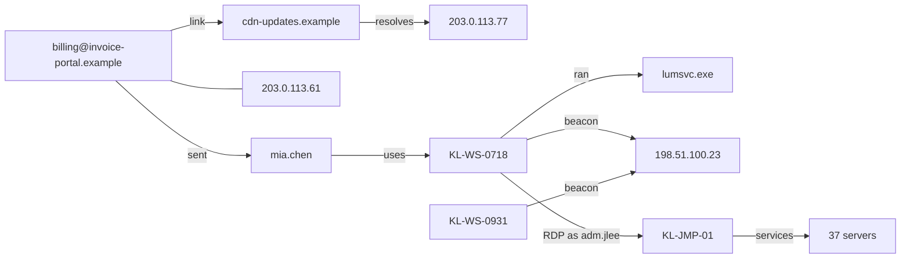

# Link Analysis, the Event Matrix and Incident Tracking Forms — Drawing the Case So You Can See It { #link-analysis-event-matrix }

!!! abstract "What this page covers"
    The organising techniques of structured analysis: ways to get a case out of your head and onto a page where you — and others — can see its shape. First **link analysis**, borrowed from criminal investigation: entities and relationships charted together so commonalities and missing links stand out. A worked case continues the admin-account intrusion from the ACH page: evidence from an email header, Zeek `dns.log` and `conn.log` lines and EDR events is read field by field, turned into an association matrix with a source and confidence for each link, drawn as a graph, and interpreted — revealing a second infected laptop and a hypothesis worth checking. Then **tools**: Maltego and its transforms (and what its editions look like now), the free yEd, and other options, with the OPSEC catch that enrichment sends your indicators to third parties. Next the **event matrix chart**: events laid out by host and time, where a gap in the chart predicts an event nobody has seen yet — and the predicted SQL Server connection is then found in the logs. Then **pre-made incident tracking forms**, with a filled-in tracker of systems, accounts, indicators and timeline. A summary of the whole structured-analysis section, the 2026 view and practice questions close the page.

!!! note "Labels"
    **[Supplement]** = practical material you need to know, **[Correction]** = a commonly repeated claim that is wrong or outdated, **[Changed]**/**[Caution]** = what has changed recently and what is risky to do the old way. The company (Kestrel Logistics), hostnames, accounts, domains, IPs, file names and log lines are invented for illustration (`.example`, documentation and private IPs). Tools and their vendors are real and described in my own words.

## The 8 key points { #key-points }

1. **Organising techniques turn a pile of facts into a picture.** They are decomposition and externalisation applied to the whole case: once it is drawn, you can see patterns your working memory could never hold.
2. **Link analysis charts entities and the relationships between them.** Hosts, accounts, IPs, domains, files and emails become nodes; "logged on to", "resolved to", "sent", "downloaded" become edges. It tells the story and exposes commonalities.
3. **Build the association list before the picture.** Collect the data, list every pair of related entities with its source and confidence, then draw — by hand or with software. The list is what makes the chart trustworthy.
4. **A good chart suggests links you haven't found yet.** Two victims sharing infrastructure, or a node connected to everything, points to where to look next — as a hypothesis to test, not a finding.
5. **Maltego automates enrichment with transforms; yEd and others just draw.** Transforms resolve, look up and pivot at scale, but they also send your indicators to third-party services — an OPSEC decision every time.
6. **An event matrix lays out events on a timeline per entity.** Rows are hosts or people, columns are time, and every node is an event. Arrows show progression in time.
7. **Gaps in the event matrix predict missing evidence.** If data left from a host that was never seen touching the data's server, an unobserved step must exist — and the chart tells you where and when to look for it.
8. **Standard tracking forms keep the case complete.** A shared tracker with tabs for systems, accounts, host and network indicators and a timeline makes sure what is found is recorded, preserved and usable — and the charts are built from it.

## Why this matters in a SOC { #why }

Picture a detective's wall in any crime drama: photographs pinned up, string running between them, dates written under each one. It is a cliché because it works. Nobody can keep forty suspects, places and phone calls in their head, but everyone can look at a wall and see that two strings meet at the same car park.

Back to the technical reality. By day two of a real intrusion, a SOC case holds dozens of hosts, several accounts, a handful of domains and IPs, hundreds of log lines and a growing list of open questions. That is far beyond the "about seven items" that working memory can juggle (the memory page explained why). Organising techniques are the investigator's wall: **link analysis** for *who and what is connected to what*, an **event matrix** for *what happened where, in which order*, and a **tracking form** so that nothing found is ever lost. They also have a second job that's easy to forget: a clear chart is the fastest way to explain an incident to a manager, an executive or the next shift, and it belongs in the final report.

## Link analysis { #link-analysis }

### What it is { #link-what }

**Link analysis** (also called relational or network analysis) comes from criminal intelligence work. Every entity related to the problem — people, accounts, hosts, phone numbers, addresses, organisations, in our world also IPs, domains, files and emails — goes on the board, and the connections between them are drawn. The resulting graph lets you:

- **tell the story** of what happened, as a chain of connected entities;
- **identify commonalities** — two victims who share a sender, a domain or an IP;
- **hypothesise connections you haven't found yet** — the shape of the chart suggests where a link probably exists.

It is an outstanding method of **decomposition and externalisation**: the case is broken into its pieces (entities and links) and put on paper, where the pattern can be seen.

The generic steps:

1. **Collect** the data related to the question.
2. **Build an association matrix or list**: every pair of entities that are related, what the relationship is, where you learned it and how confident you are.
3. **Draw the chart**, by hand or — ideally — generated by software from the list.
4. **Interpret**: read the story, look for hubs, clusters and shared nodes, and turn suspected missing links into hypotheses to check.

### Worked example: scoping the `adm.jlee` intrusion { #link-example }

On the ACH page, the analysis concluded that an attacker used `adm.jlee`'s stolen credentials from sales laptop KL-WS-0718, through jump server KL-JMP-01, to 37 servers. Now the question is scope: *how did the attacker get onto KL-WS-0718, and is anything else involved?* The analyst collects four kinds of data.

**Source 1 — the email that started it.** The mail gateway holds a message delivered to the laptop's user, Mia Chen, five days earlier. The key header lines:

```
Received: from mail.invoice-portal.example (mail.invoice-portal.example [203.0.113.61])
        by mx1.kestrel.example with ESMTPS id 4Hq2Lw; Fri, 20 Nov 2026 01:12:44 +0000
From: "Accounts Receivable" <billing@invoice-portal.example>
To: mia.chen@kestrel.example
Subject: Overdue invoice INV-20391 - action required
Authentication-Results: mx1.kestrel.example; spf=pass smtp.mailfrom=invoice-portal.example; dkim=pass header.d=invoice-portal.example; dmarc=pass
```

- `Received: from mail.invoice-portal.example … [203.0.113.61]` — the server that handed the message to Kestrel's gateway, with its IP. This is the most trustworthy `Received` line because Kestrel's own server wrote it.
- `by mx1.kestrel.example … Fri, 20 Nov 2026 01:12:44 +0000` — when Kestrel received it (09:12 Perth time).
- `From: … <billing@invoice-portal.example>` — the sender address a user sees.
- `Subject` — an invoice lure, a common pretext for finance and sales staff.
- `Authentication-Results: … spf=pass … dkim=pass … dmarc=pass` — the message really came from `invoice-portal.example`. **[Supplement]** That proves *who sent it*, not that the sender is trustworthy: attackers register their own look-alike domains and set up SPF, DKIM and DMARC correctly. "Passes authentication" is not "safe".

The message contained a link to `https://cdn-updates.example/inv/INV-20391.zip` (**T1566.002 Phishing: Spearphishing Link**).

**Source 2 — DNS and connections from the laptop.** Zeek `dns.log` on the internal sensor (fields shown as name=value for readability):

```
ts=2026-11-20T01:19:07Z  uid=Dk81Pa  id.orig_h=10.40.7.18  query=cdn-updates.example  qtype_name=A  rcode_name=NOERROR  answers=203.0.113.77  TTLs=300
```

- `id.orig_h=10.40.7.18` — KL-WS-0718 asked.
- `query=cdn-updates.example`, `qtype_name=A` — for the IPv4 address of the link's domain.
- `answers=203.0.113.77`, `TTLs=300` — it resolved to 203.0.113.77, with a five-minute cache time. Short TTLs are common on both CDNs and attacker infrastructure, so on their own they mean little.

Two days later, a Zeek `conn.log` line shows regular traffic from the laptop to another address:

```
ts=2026-11-22T03:00:14Z  uid=Cm4Rt9  id.orig_h=10.40.7.18  id.orig_p=51533  id.resp_h=198.51.100.23  id.resp_p=443  proto=tcp  service=ssl  duration=0.84  orig_bytes=1210  resp_bytes=3466  conn_state=SF
```

- `id.resp_h=198.51.100.23`, `id.resp_p=443`, `service=ssl` — TLS to an external address.
- `duration=0.84`, `orig_bytes=1210`, `resp_bytes=3466` — tiny and short. Repeated every 60 seconds (visible across many such lines), this is the classic shape of a command-and-control beacon (**T1071.001 Application Layer Protocol: Web Protocols**).

**Source 3 — the sensor-wide search.** The analyst asks the obvious next question of the network data: *who else talked to 198.51.100.23?* One more internal host appears — 10.40.9.31, **KL-WS-0931**, a laptop in the finance team — with the same 60-second pattern since 22 November.

**Source 4 — EDR on KL-WS-0718.** After the user opened the downloaded archive:

```
2026-11-20T01:21:40Z  KL-WS-0718  mia.chen  C:\Users\mia.chen\Downloads\INV-20391\INV-20391.pdf.lnk  ->  powershell.exe -w hidden -enc <base64>
2026-11-20T01:21:44Z  KL-WS-0718  mia.chen  powershell.exe  wrote  C:\Users\mia.chen\AppData\Roaming\Lumen\lumsvc.exe  sha256=1f3a…e9
```

- `INV-20391.pdf.lnk` — a shortcut file disguised as a PDF; double-clicking it ran PowerShell (**T1204.002 User Execution: Malicious File**, **T1059.001 Command and Scripting Interpreter: PowerShell**).
- `-w hidden -enc <base64>` — a hidden window and an encoded command, typical of download cradles (**T1027 Obfuscated Files or Information**).
- `wrote …\Lumen\lumsvc.exe` — the downloaded implant, saved in the user's roaming profile. Its hash (shortened here) becomes an entity on the chart.

### The association list { #association-list }

Every relationship becomes one row, with *where it came from* and *how sure you are*:

| # | Entity A | Relationship | Entity B | Source | Confidence |
| --- | --- | --- | --- | --- | --- |
| L1 | billing@invoice-portal.example | sent email to | mia.chen | Mail gateway | High |
| L2 | invoice-portal.example | sending server IP | 203.0.113.61 | `Received` header | High |
| L3 | email INV-20391 | links to | cdn-updates.example | Message body | High |
| L4 | cdn-updates.example | resolved to | 203.0.113.77 | Zeek `dns.log` | High |
| L5 | mia.chen | uses | KL-WS-0718 | Asset inventory | High |
| L6 | KL-WS-0718 | downloaded and ran | lumsvc.exe (1f3a…e9) | EDR | High |
| L7 | KL-WS-0718 | beacons to | 198.51.100.23 | Zeek `conn.log` | High |
| L8 | KL-WS-0931 | beacons to | 198.51.100.23 | Zeek `conn.log` | High |
| L9 | KL-WS-0718 | RDP as adm.jlee to | KL-JMP-01 | 4624 type 10 | High |
| L10 | KL-JMP-01 | service creation on | 37 servers | 7045 | High |
| L11 | adm.jlee | credentials exposed in | infostealer dump | CTI report | Medium |

**[Supplement]** The source and confidence columns are what separate link analysis from drawing pictures. When someone asks "why is that line on the chart?", the answer is a row number and a log source. Pay particular attention to links based on *shared infrastructure*: an IP address shared by thousands of sites (a CDN or cloud front end) connects things that have nothing to do with each other.

### The chart { #link-chart }



The source above is Mermaid, a text format many documentation tools draw automatically:

- `graph LR` — draw a graph, left to right.
- `S["billing@invoice-portal.example"]` — a node with the ID `S` and a visible label.
- `-->|sent|` — an arrow with the label "sent"; `---` is a line without direction.
- Each later line adds one edge from the association list.

Writing graphs as text has a practical advantage: they live in the case notes, can be reviewed like any other text and are redrawn instantly when you add a row.

### Reading the chart { #link-interpret }

- **The story** runs left to right: a sender → an email → a link → a download on KL-WS-0718 → a beacon → an RDP session with a stolen admin account → 37 servers. You can tell it in one breath to a manager.
- **The commonality** is the C2 node. KL-WS-0931 has nothing to do with the rest of the chart *except* that it beacons to the same address. Without the chart, it is easy to treat KL-WS-0931 as a separate, lower-priority ticket. With it, it is plainly the same intrusion — a second foothold.
- **The missing link** is the obvious question the chart asks: *how did KL-WS-0931 get infected?* The shape suggests a hypothesis — it may have received the same lure. The analyst searches the mail gateway for messages from `invoice-portal.example` and finds one delivered to a finance user on 21 November. That's a hypothesis confirmed by a check, now added as row L12. A second check — *does anything else resolve `cdn-updates.example`?* — finds nothing, which is also worth recording.

**[Supplement]** Build the chart early and update it as you go. A chart drawn at the end only illustrates the report; a chart drawn on day one steers the investigation.

## Tools for link analysis { #tools }

### Maltego { #maltego }

**Maltego** is the commercial tool most associated with link analysis in security and OSINT work. You place **entities** (domains, IPs, email addresses, people, organisations, hashes …) on a graph and run **transforms** on them — small queries that return related entities and draw them automatically: domain → IP addresses, IP → other domains seen on it (from passive DNS), domain → registration data, email → associated accounts, and many more, from Maltego's own data and from third-party data providers.

Where it shines is scale. Paste 100 suspicious domains onto a graph, select them all, run "resolve to IP", then "IP to netblock" and "netblock to AS number", and the overlaps draw themselves: the 14 domains that share two IPs in the same hosting provider jump out as one cluster. Doing that by hand is an afternoon; with transforms it is a few minutes. The finished graphs also make good figures for management briefings and incident reports.

**[Changed]** Maltego's product line has changed a lot. The older "Classic" and "XL" desktop licences were retired years ago, and the vendor's legacy Pro and Organization plans stopped being sold in 2024. In late 2026 the vendor's documentation describes a free Community Edition/Basic tier and paid Entry, Professional and Enterprise plans, with the desktop graph tool alongside a browser-based platform. The free tier caps each transform at a small number of results (24, per the current documentation) and limits data access. **CaseFile**, the free offline-only edition long recommended for drawing case graphs without transforms, is no longer a separate product in current versions; its offline features are reached through a free Maltego account instead. Plans and limits change often — check the vendor's current plan page before you budget for it, and check the licence terms before using a free tier for commercial work.

### yEd and other drawing tools { #yed }

If you just need to draw, **yEd** from yWorks is a free desktop diagramming tool that produces charts very like Maltego's, and **yEd Live** runs in a browser without installation. It has few security icons out of the box, but its palette manager can search for and import extra icon sets. It cannot enrich anything — no transforms, no lookups — so it suits the occasional case chart, not infrastructure pivoting.

**[Supplement]** Other options worth knowing:

| Tool | What it is good for |
| --- | --- |
| diagrams.net (draw.io) | Free, quick diagrams; files can live with the case notes |
| Mermaid in your notes/wiki | Graphs as text, versioned with the case, redrawn automatically |
| Gephi | Free graph analysis of large exported datasets (thousands of nodes) |
| Neo4j / BloodHound | Graph databases for identity and attack-path questions (see the graph-thinking page) |
| Built-in incident graphs in EDR/XDR and SIEM | Automatically drawn process, host and identity relationships for one incident |

### The OPSEC catch { #opsec }

**[Caution]** Every enrichment transform, online lookup and "submit to a scanning service" sends your indicator to someone else. If the attacker controls the domain, or watches the services that publish lookups, they may learn that you are looking at them. Before running transforms on a live case, know which data provider each transform queries and whether that is acceptable for this case's sensitivity. Analysis OPSEC gets its own section later in these notes.

## The event matrix chart { #event-matrix }

### What it is { #event-what }

**Event charting** is another technique from criminal intelligence. It may look like a link chart, but it is organised by **time** rather than by relationships. Three rules make the difference:

- **Every node is the same type of thing — an event.** Not a host, not an account: "PC infected", "database dumped", "email received".
- **Arrows show progression in time**, often cause and effect: one event leads to the next.
- **Branches can split and merge** to show independent activity on different hosts or by different people and where they come together.

In the **event matrix** form, each entity (host, account or person) gets a horizontal row, time runs across the columns, and each event is placed at the intersection of *where* it happened and *when*. Use it when a clear, shared timeline across all entities is the first thing the analysis needs.

### Worked example: the gap that predicts an event { #event-example }

On day two, a new piece of evidence arrives: the data-loss tool flags a 2.3 GB upload on 25 November from **KL-WS-0931** — the finance laptop — of an archive named `crm_export.7z`. The file name and size match a full export of the CRM database on server **KL-DB-02**. The analyst builds the matrix (dates in Perth local time):

| Entity | 20 Nov | 21 Nov | 22 Nov | 24 Nov | 25 Nov |
| --- | --- | --- | --- | --- | --- |
| KL-WS-0718 (sales) | ① Phishing email; ② implant installed | | ③ Beacon starts | ⑤ RDP as adm.jlee to KL-JMP-01 | |
| KL-WS-0931 (finance) | | ④ Phishing email | ④a Implant installed; beacon starts | | ⑧ `crm_export.7z` uploaded (2.3 GB) |
| KL-JMP-01 | | | | ⑥ Service creation on 37 servers | |
| KL-DB-02 (CRM DB) | | | | | ⑦ ??? database exported |

Read it as a sequence: ① → ② → ③ on KL-WS-0718, ④ → ④a on KL-WS-0931, ⑤ → ⑥ through the jump server, then ⑧ — data leaving from KL-WS-0931.

Now look at what's missing. The data came from KL-DB-02, but **nothing on the chart touches KL-DB-02**. KL-DB-02 was not among the 37 servers. For the export to end up on KL-WS-0931, *some* event ⑦ must have happened: someone or something on one of the compromised hosts connected to KL-DB-02 and pulled the data, probably on 24 or 25 November, after the admin credentials were stolen. The chart doesn't tell you what ⑦ was — it tells you **where and when to look**: connections between KL-WS-0931 (or KL-WS-0718, or KL-JMP-01) and KL-DB-02, from 24 November onwards.

The analyst checks the Zeek `conn.log` for KL-DB-02's address and finds:

```
ts=2026-11-24T22:41:09Z  uid=Hq7Ve2  id.orig_h=10.40.9.31  id.orig_p=50811  id.resp_h=10.10.8.12  id.resp_p=1433  proto=tcp  service=-  duration=1384.2  orig_bytes=88213  resp_bytes=2417893110  conn_state=SF
```

- `ts=2026-11-24T22:41:09Z` — 06:41 Perth time on 25 November, before the finance user normally starts work.
- `id.orig_h=10.40.9.31` → `id.resp_h=10.10.8.12` — from KL-WS-0931 to KL-DB-02.
- `id.resp_p=1433` — the default Microsoft SQL Server port. A finance laptop normally reaches the CRM through its web application, not by talking to the database directly.
- `duration=1384.2` — 23 minutes.
- `resp_bytes=2417893110` — about 2.4 GB sent *from* the database server *to* the laptop: the export (**T1213 Data from Information Repositories**, then **T1074.001 Data Staged: Local Data Staging**, and later exfiltration over the C2 channel, **T1041**).
- `service=-` — Zeek didn't label the protocol; the port and volume still say plenty.

A matching **4624** on KL-DB-02 at 22:41 UTC shows `adm.jlee`, logon type 3, from 10.40.9.31 — the same stolen account, now used from the second foothold. Event ⑦ is found and placed on the chart, and the case's scope now includes a database breach with customer data, which changes the legal and notification picture entirely.

That is the power of the event matrix: by laying out what you *know* along a shared timeline, the holes become visible, and each hole is a precise search.

**[Caution]** An event chart shows *order*, and it is tempting to read every arrow as *cause*. Two events in sequence are not necessarily linked. Mark arrows you've confirmed (a log shows one led to the other) differently from arrows you've inferred, and convert all times to one time zone before you place anything.

## Pre-made incident tracking forms { #tracking-forms }

A simple way to make sure all the important data is gathered is a **standard form that must be filled in**. For incident response, a well-known free example is the incident-response tracker spreadsheet that CrowdStrike's services team published for the community: a workbook with a tab for each category of data that experienced responders track. Similar trackers are often nicknamed the "spreadsheet of doom". Whatever template you use, typical tabs include:

- **Systems** — every host involved, why it's in scope, its state and what's been collected.
- **Accounts** — every account involved, how it was used and what's been done to it.
- **Host indicators** — files, hashes, paths, services, tasks, registry keys.
- **Network indicators** — domains, IPs, URLs, certificates, with first and last seen.
- **Timeline** — events in UTC with host, source and confidence: the raw material for the event matrix.
- **Evidence and tasks** — what was collected, where it's stored, and who's doing what next.

Filled in for our case (a few rows per tab):

**Systems**

| Host | IP | Role | Why in scope | First evil (UTC) | Status | Evidence |
| --- | --- | --- | --- | --- | --- | --- |
| KL-WS-0718 | 10.40.7.18 | Sales laptop | Phishing, implant, beacon, RDP source | 2026-11-20 01:21 | Isolated | Memory, triage image |
| KL-WS-0931 | 10.40.9.31 | Finance laptop | Phishing, implant, DB export, upload | 2026-11-21 23:50 | Isolated | Memory, triage image |
| KL-JMP-01 | 10.10.5.20 | Jump server | adm.jlee RDP; service fan-out | 2026-11-24 18:28 | Isolated | Event logs, triage image |
| KL-DB-02 | 10.10.8.12 | CRM database | Exported via SQL from KL-WS-0931 | 2026-11-24 22:41 | Monitoring | SQL logs, event logs |

**Accounts**

| Account | Type | How misused | Action | Time |
| --- | --- | --- | --- | --- |
| KESTREL\adm.jlee | Domain admin (personal) | RDP to jump host, network logons to 37 servers and KL-DB-02 | Disabled, password reset twice, sessions revoked | 2026-11-25 03:20 |
| mia.chen | User | Phished; implant ran in her session | Password reset, MFA re-registered | 2026-11-25 04:05 |

**Host indicators**

| Indicator | Type | Where seen | Notes |
| --- | --- | --- | --- |
| `%APPDATA%\Lumen\lumsvc.exe` (sha256 1f3a…e9) | File | KL-WS-0718, KL-WS-0931 | Implant |
| Service with random 8-letter name, `%COMSPEC% /c C:\Windows\Temp\s.bat` | Service (7045) | 37 servers | Remote execution |
| `crm_export.7z` | File | KL-WS-0931 | Staged data |

**Network indicators**

| Indicator | Type | First seen | Last seen | Notes |
| --- | --- | --- | --- | --- |
| invoice-portal.example / 203.0.113.61 | Domain / IP | 2026-11-20 | 2026-11-21 | Phishing sender |
| cdn-updates.example / 203.0.113.77 | Domain / IP | 2026-11-20 | 2026-11-21 | Payload host |
| 198.51.100.23:443 | IP | 2026-11-22 | 2026-11-25 | C2, 60-second beacon |

The value of the form isn't the spreadsheet; it's the discipline. Every analyst on the case records the same fields, so nothing found on the night shift is lost by the morning, every row can be traced to a source, and the link chart and event matrix can be (re)built from it at any time.

**[Supplement]** Many teams now keep this data in a case-management platform (for example the open-source DFIR-IRIS, TheHive or the case features of their SIEM/SOAR) instead of a spreadsheet, and timelines in a tool such as Timesketch. In 2026 WithSecure also released Kanvas, an open-source desktop tool that reads a "spreadsheet of doom"-style tracker and generates a timeline, a lateral-movement graph and a report from it — the spreadsheet stays the source of truth, and the charts on this page come out of it automatically.

## Structured analysis: section summary { #summary }

Across this section, the techniques have had four things in common:

- **They leave an organised, visual, externalised audit trail** — a hypothesis list, a matrix, a chart, a tracker — that shows how the conclusion was reached.
- **They let analysis be shared and critiqued.** Colleagues can't review what's in your head; they can review a matrix and point at a cell.
- **They combine the expert's intuition with a disciplined, evidence-based process.** System 1 still proposes; System 2 and the structure check.
- **They significantly reduce the risk of analytic error** — not by making analysts smarter, but by working around the limits of perception and memory that every analyst has.

These methods were long taught mainly inside government intelligence agencies. Today the books, guides and examples are publicly available, and nothing stops a SOC from working the same way. Combined with growing subject-matter expertise, intuition and structured thinking work together: fast where it is safe to be fast, careful where it matters, and documented throughout.

## The 2026 view { #trends }

!!! success "[2026 Current] Still valid"
    Link analysis, event charting and standard tracking forms are core incident-response practice in 2026, and the logic is unchanged: draw entities and relationships to find commonalities, lay events on a timeline to find gaps, and keep every finding in one structured record. The case pattern on this page — phishing to several users, a shared C2, stolen admin credentials, then a direct database pull and exfiltration — remains typical of current intrusion reports, and the "spreadsheet of doom" is still found in many IR teams alongside proper case platforms.

!!! info "[Changed] What has changed"
    - **Tools draw the first graph for you.** EDR/XDR consoles and SIEMs now generate incident graphs (process trees, host-to-host movement, identity relationships) automatically, and many correlate alerts into a single "incident story". That saves time, but the analyst still has to check which links are real and add what the tool can't see (email, interviews, business context).
    - **Maltego's editions changed.** Classic/XL are long gone, legacy plans ended in 2024, CaseFile is no longer a separate product, and the free tier is limited (24 results per transform per current documentation). Plans change often; verify before relying on any specific limit.
    - **AI assistants build timelines and graphs from notes.** Copilots can turn case notes or exported logs into a timeline, an association list or Mermaid code in seconds. That's useful, but every row must still trace to a real source; an AI can merge two hosts with similar names or invent a link that "fits".
    - **Attack-flow formats are common.** Structured descriptions of an attack sequence mapped to ATT&CK (such as the Attack Flow format from MITRE's Center for Threat-Informed Defense) are now used to share event chains between teams — essentially an event chart in a machine-readable form.
    - **Identity is the centre of the graph.** In 2026 intrusions the most important links are often accounts, sessions, tokens and cloud apps rather than IPs; a link chart that only contains hosts and IPs misses most of the story.

!!! warning "[Caution] Wrong or risky to do the old way"
    - **Shared infrastructure creates false links.** Cloud and CDN IPs, shared hosting, public resolvers and VPN exit nodes connect unrelated things. A link through such an IP needs a second, independent connection before you treat it as meaningful.
    - **Enrichment leaks.** Transforms and online lookups send your indicators to third parties. On a sensitive or targeted case, decide what may be queried before you start.
    - **A chart is not evidence.** Every edge needs a source and a confidence. An undocumented line on a chart becomes "fact" the moment it appears in a slide.
    - **Order is not cause.** On an event matrix, mark confirmed and inferred arrows differently, and put every time in one zone (UTC is safest) before you place events.
    - **Don't keep the tracker on a compromised network.** If the attacker has domain admin, a spreadsheet on the shared drive or a ticket in an on-domain tool may be read by them. Use out-of-band storage for active incident tracking — more on this in the section on reacting to intrusions.

## Practice questions { #quiz }

### Question 1

You have a link chart for a phishing case. Two laptops that otherwise have no connection both link to the same external IP address. A colleague says: "Same IP, same attacker — merge the cases." What should you check before agreeing, and how could the chart itself help you decide?

??? success "Answer and explanation"
    Check **what the IP is**. If it belongs to a CDN, a large cloud provider, shared hosting or a public service, thousands of unrelated sites and clients use it, and the link may be meaningless. Look at the details of each connection: the domain names (DNS/SNI) used, timing and pattern (for example, both beaconing every 60 seconds), the processes making the connections, and the TLS certificate or JA3/JA4 fingerprint.

    The chart helps by showing whether there is a **second, independent link** between the two laptops: the same sender, the same lure, the same implant hash or install path, the same compromised account. One shared IP is a lead; two independent shared entities make "same intrusion" a strong conclusion. Record the source and confidence for each link either way.

### Question 2

What are the three rules that make an event chart different from a link chart? Then explain, using the KL-DB-02 example, how a gap in the event matrix led to a specific search, and what made that search specific.

??? success "Answer and explanation"
    In an event chart, (1) **every node is the same type — an event**; (2) **arrows show progression in time**, often cause and effect; (3) **branches can split and merge** to show separate activity on different hosts or by different people. A link chart instead mixes entity types and shows relationships, not time.

    In the example, data from KL-DB-02 left the network from KL-WS-0931, but no event on the chart touched KL-DB-02. So an unobserved event — someone accessing KL-DB-02 — must have happened between the theft of the admin credentials (24 November) and the upload (25 November). The chart made the search specific in three ways: **which hosts** (the compromised hosts and KL-DB-02), **which time window** (from 24 November) and **what kind of event** (a connection to the database or a logon on it). The Zeek `conn.log` line to port 1433 and the 4624 on KL-DB-02 were then found in minutes.

### Question 3

A team lead says: "We don't need a tracking form — everything is in the ticket comments." Give three concrete problems this causes during a multi-day intrusion, and say how a structured tracker solves each.

??? success "Answer and explanation"
    1. **Things get lost between shifts.** Indicators and hosts mentioned in comment 37 are missed by the next analyst. A tracker has one row per host, account and indicator, so the current scope is visible at a glance.
    2. **No consistent fields.** One analyst writes local time, another UTC; one records the hash, another only the file name; nobody records the source. A tracker forces the same fields (UTC time, source, confidence, status), which is what makes rows comparable and traceable.
    3. **Charts and reports can't be built from it.** Building a link chart, an event matrix, a block list or the final report from free text is slow and error-prone. A tracker *is* the association list and the timeline, so the charts and IOC exports can be generated from it — by hand or automatically.

    A fourth point worth adding: if the attacker has administrator access, comments in an on-domain ticketing system may be visible to them; the tracker should be kept out of band during an active intrusion.

## Related { #related }

- [Analysis of Competing Hypotheses (ACH)](ach.md) — previous page: the intrusion this page scopes
- [The Diamond Model, attack trees, graph thinking and threat modelling](../mental-models/diamond-attack-trees.md) — pivoting and graph thinking
- [Memory and experience](../analyst-cognition/memory-experience.md) — why decomposition and externalisation work
- [Login events](../important-events/logins.md) · [Services, tasks and USB events](../important-events/services-tasks-usb.md)
- [Spotting data exfiltration and destruction](../alert-triage/exfil-destruction-sensitive.md) · [Phishing delivery](../../../adversary/phishing-delivery.md)
