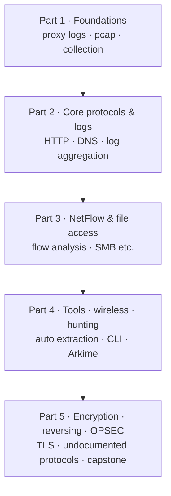

# Network Forensics — Lecture Series { #network-forensics }

!!! abstract "What this series is"
    Even when you can't image the disk, when there are thousands of systems to look at, or when the attacker has wiped their tracks, the network still keeps a record. This series explains, step by step from the beginning, how to collect, read and interpret that record — proxy logs, packets, flows and device logs. It is written Korean-first (this is the English translation). Each lesson moves through **"why we need it → how it works → a small example → an example with extra conditions → how to interpret it in a real investigation"**, and ends with review questions and answers.

## How to read this series { #how-to-read }

If you're new, read from Part 1 in order. Later lessons assume the concepts from earlier ones (pcap, BPF, display filters, converting log timestamps and so on). If you already know a topic, jump straight to the lesson you need from the reading-order table on each part's first page.

The diagram shows the flow of the series. Going down, it moves from "how to get hold of the evidence" to "how to read evidence that is hidden". The capstone in Part 5 uses the methods from Parts 1–4 on a single case.

## Parts { #parts }

-   :material-database-search:{ .lg .middle } **Part 1 · Foundations of Network Evidence**

    ---

    Why network forensics, web proxy logs and caches, pcap files with tcpdump and BPF, Wireshark and tshark, where and how to collect evidence (SPAN, taps), and what makes network investigations hard.

    [:octicons-arrow-right-24: Part 1](part-1/index.md)

-   :material-protocol:{ .lg .middle } **Part 2 · Core Protocols & Log Aggregation/Analysis**

    ---

    Profiling HTTP and DNS from a forensic angle, and pulling logs from many devices into one place for cross-analysis.

    [:octicons-arrow-right-24: Part 2](part-2/index.md)

-   :material-chart-timeline-variant:{ .lg .middle } **Part 3 · NetFlow & File-Access Protocols**

    ---

    How flow records work, collection and analysis tools, visual analysis and tracking lateral movement, and reconstructing sessions of file-access protocols such as SMB.

    [:octicons-arrow-right-24: Part 3](part-3/index.md)

-   :material-tools:{ .lg .middle } **Part 4 · Analysis Tools, Wireless & Full-Packet Hunting**

    ---

    Automated extraction tools, command-line analysis at scale, wireless network evidence, and full-packet hunting with Arkime.

    [:octicons-arrow-right-24: Part 4](part-4/index.md)

-   :material-lock-open-variant:{ .lg .middle } **Part 5 · Encryption, Protocol Reversing, OPSEC & Intel**

    ---

    SSL/TLS profiling and decryption, analysing undocumented protocols, investigator OPSEC and threat intelligence, and a comprehensive investigation lab.

    [:octicons-arrow-right-24: Part 5](part-5/index.md)

## Notation { #notation }

**[Changed]** marks something that has changed since older explanations, **[Correction]** a common misconception, **[Caution]** something risky if done the old way, and **[Supplement]** a practical addition. Current-state information carries the date it was checked and a source link. **(Hypothetical)** marks an invented example; example IPs and domains use documentation ranges (192.0.2.0/24, 198.51.100.0/24, 203.0.113.0/24, example.com etc.). Output that was really executed is marked **(Actual output)**, output that only shows the shape is marked **(Illustrative output)**.

## Related reference { #related }

- [Wireshark & tshark](../../network/wireshark-tshark.md)
- [Zeek](../../network/zeek/index.md)
- [Arkime](../../network/arkime/index.md)
- [Beaconing & C2 detection](../../network/beaconing-c2.md)
- [Blue Team Essentials — DNS](../blue-team-essentials/dns/index.md)

!!! note "About this section"
    Personal study notes rewritten in my own words from a range of study material. Not official guidance of any organisation.
