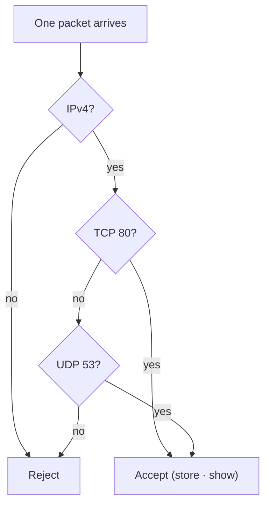

# Lesson 1.7 — Selecting Only the Packets You Need with BPF { #bpf }

!!! abstract "Scope of this lesson"
    The `'host ... and port 80'` at the end of the tcpdump command in [lesson 1.6](pcap-and-tcpdump.md) is a BPF filter. This lesson covers that filter language from the ground up.

    - What BPF is, and why it's the means of filtering "earliest and cheapest"
    - Protocol, address and port primitives, and the `src` and `dst` direction qualifiers
    - `and`, `or`, `not` and parentheses, and the commonly mistaken **operator precedence**
    - `vlan`, `portrange`, `gateway`, and byte- and bit-level conditions
    - What filters silently miss with **IPv6, VLANs and fragmented packets**
    - Reducing a large pcap with BPF, and testing and recording filters

!!! note "Lab material and notation"
    **(Actual output)** in this lesson was produced with tcpdump 4.99.4 (libpcap 1.10.4) in this work environment. IPv6 is disabled in this environment, so IPv6 traffic couldn't be generated for real; instead the filter practice pcap (`lab.pcap`, 13 packets) was **assembled by hand in Python**. Only private and documentation ranges are used (10.10.0.0/16, 198.51.100.0/24, 203.0.113.0/24, 2001:db8::/32). Each packet's makeup is in the table in section 2.

## 1. One PC's traffic on a 1 Gbps link { #why-bpf }

**(Hypothetical)** Right after lesson 1.4's incident, it's decided to watch whether suspicious traffic recurs from research-segment PC `10.10.6.14`. The tapped link carries an average of several hundred Mbps. Storing it all piles up several TB a day, but all that's needed is that one PC's traffic.

"Store everything and filter later" isn't the answer. The disk runs short, and if the capture machine's CPU and storage can't keep up, as in lesson 1.6, you may **miss even the packets you need**. You must take only what you need from the start. That's the job of **BPF** (Berkeley Packet Filter).

BPF decides "is this packet of interest?" at **a very low level**, as packets enter the OS kernel. Uninteresting packets are never even passed up to the user program (tcpdump, etc.), so every later step, whether on screen, to disk or handed to another tool, gets lighter. And almost every libpcap-based tool uses BPF, so once learned it applies everywhere: tcpdump, tshark's capture filters, Zeek, Arkime and more.

## 2. An analogy: the airport's first X-ray { #analogy }

Picture bags going through the X-ray machine at airport security. The screener judges **each bag quickly** against very simple rules ("pull out anything with liquids"). Only bags that pass on go to detailed inspection.

BPF is exactly this first X-ray: simple rules, but very fast, applied to every packet. But the analogy hides one of BPF's most important properties. The screener judges **each bag on its own**, without remembering "that passenger's other bag". BPF is the same: after judging one packet it forgets everything it saw and judges the next packet from scratch. So BPF can't express **connection-level** conditions such as "the rest of the packets of connections that started with a SYN", and this property also explains why `src host`, which we'll see later, catches only one side of a conversation.

The 13 practice packets in this lesson look like this:

| # | Content | Notes |
| --- | --- | --- |
| 1–4 | `10.10.6.14` ↔ `203.0.113.50` port 80 HTTP: SYN, SYN-ACK, ACK, `GET` | IPv4 |
| 5 | `10.10.6.14` → `10.10.4.53` UDP 53 DNS query | IPv4 |
| 6 | `10.10.6.14` → `10.10.4.53` TCP 53 SYN | DNS over TCP |
| 7 | `10.10.6.14` → `198.51.100.7` ICMP echo | ping |
| 8 | `2001:db8:6::14` → `2001:db8:ff::50` TCP 80 SYN | **IPv6** |
| 9 | `2001:db8:6::14` → `2001:db8:4::53` UDP 53 | **IPv6** |
| 10 | `10.10.6.14` → `203.0.113.60` TCP 443 SYN | IPv4 |
| 11 | `10.10.6.14` → `224.0.0.251` UDP 5353 | Multicast |
| 12 | `10.10.6.14` → `203.0.113.50` TCP 80 SYN | **802.1Q VLAN 20 tag** |
| 13 | `203.0.113.60` → `10.10.6.14` TCP 443 RST+ACK | Reply from a closed port |

## 3. How it works: BPF is a tiny program { #how-it-works }

The filter text we write is for people; the kernel turns it into **a very small machine-code program** and runs it on every packet. `tcpdump -d` shows that program (actual output):

```console
$ tcpdump -d -y EN10MB 'udp port 53'
(000) ldh      [12]
(001) jeq      #0x86dd          jt 2	jf 8
(002) ldb      [20]
(003) jeq      #0x11            jt 4	jf 19
(004) ldh      [54]
(005) jeq      #0x35            jt 18	jf 6
(006) ldh      [56]
(007) jeq      #0x35            jt 18	jf 19
(008) jeq      #0x800           jt 9	jf 19
(009) ldb      [23]
(010) jeq      #0x11            jt 11	jf 19
(011) ldh      [20]
(012) jset     #0x1fff          jt 19	jf 13
(013) ldxb     4*([14]&0xf)
(014) ldh      [x + 14]
(015) jeq      #0x35            jt 18	jf 16
(016) ldh      [x + 16]
(017) jeq      #0x35            jt 18	jf 19
(018) ret      #262144
(019) ret      #0
```

`-d` means "don't apply the filter, show the compiled result", and `-y EN10MB` means "assume an Ethernet link". It looks like code at first, but reading a few lines reveals the principle.

- `ldh [12]`: load 2 bytes from byte 12 of the packet (load half-word). In the Ethernet header, that's the **EtherType** field.
- `jeq #0x86dd jt 2 jf 8`: if that value is 0x86dd (IPv6), go to line 2, otherwise line 8 (jump if equal; jt if true, jf if false).
- The IPv6 side (lines 2–7): `ldb [20]` is the IPv6 header's "next header" field, `0x11` (17) is UDP, `[54]` and `[56]` are the UDP source and destination ports, and `0x35` is 53.
- The IPv4 side (lines 8–17): `0x800` means IPv4, `[23]` is IPv4's protocol field, `jset #0x1fff` is the line that rejects the packet if the **fragment offset** is non-zero, and `ldxb 4*([14]&0xf)` computes the IPv4 header length to skip over it.
- `ret #262144`: accept (pass up to 262,144 bytes). `ret #0`: reject.

This short program already shows two important facts. First, `udp port 53` checks **both IPv4 and IPv6**. Second, because of line 12, **IPv4 fragments other than the first never match a port condition.** When a large UDP packet is split into several fragments, the second fragment onwards has no UDP header, so the port can't be known. Section 7 comes back to this.

## 4. Primitives: the basic units of a filter { #primitives }

BPF expressions are built from small conditions called **primitives**. For each packet, each primitive is judged true or false.

### 4.1 Protocols { #protocol-primitives }

The simplest are protocol names: `ip`, `ip6`, `tcp`, `udp`, `icmp` and others. If the packet is that protocol it's "of interest" and evaluation continues; if not, libpcap stops processing that packet and waits for the next. The packet itself carries on its way; BPF isn't a blocking device, it **selects copies**.

Results against the practice file (actual output):

| Filter | Packets matched | Interpretation |
| --- | --- | --- |
| (no filter) | 13 | Everything |
| `ip` | 10 | **IPv4 only.** The two IPv6 packets (8, 9) and the VLAN-tagged packet (12) are excluded |
| `ip6` | 2 | IPv6 only (8, 9) |
| `ip or ip6` | 12 | Both IPv4 and IPv6. The VLAN-tagged packet (12) is still excluded |
| `tcp` | 8 | Both IPv4 TCP and IPv6 TCP (8). The VLAN-tagged packet is excluded |
| `udp` | 3 | 5, 9, 11 |
| `icmp` | 1 | 7 |

Here's the first trap. **`ip` means IPv4 only.** If you wanted "all IP traffic", write `ip or ip6`. With IPv6 increasingly common, writing just `ip` and missing all IPv6 traffic happens more often than you'd think. The second trap (VLANs) is in section 6.1.

### 4.2 Addresses and ports { #address-primitives }

| Primitive | Meaning | Example |
| --- | --- | --- |
| `ether host` | Packets where the layer 2 **MAC address** is the source or destination | `ether host 00:50:56:0a:04:53` |
| `host` | Packets where the layer 3 **IP address** is the source or destination | `host 10.10.4.53` |
| `net` | Packets where an IP address is in that **network range** (CIDR) | `net 203.0.113.0/24` |
| `port` | Packets where the layer 4 **port** is the source or destination (TCP and UDP alike) | `port 53` |

The results (actual output):

| Filter | Matched | Interpretation |
| --- | --- | --- |
| `host 10.10.4.53` | 2 | 5, 6 (the DNS server's IPv4 address) |
| `net 203.0.113.0/24` | 6 | 1–4, 10, 13. The VLAN-tagged packet (12) is excluded |
| `ether host 00:50:56:0a:04:53` | 3 | 5, 6, 9 sent to the DNS server's MAC (including IPv6) |
| `port 53` | 3 | UDP 5, TCP 6, IPv6 UDP 9 |
| `udp port 53` | 2 | 5, 9 |
| `tcp port 53` | 1 | 6 |

**`port` ignores protocol.** `port 53` catches both UDP 53 and TCP 53. DNS is usually UDP, but uses TCP for large responses or zone transfers. To see all DNS, `port 53` is right; for UDP only, put the protocol in front, as in `udp port 53`.

Note also that the IPv6 packet (9) appears in the `ether host` result. A MAC address is layer 2, so it doesn't matter whether IPv4 or IPv6 sits above it. You can use it to catch the same device's IPv4 and IPv6 traffic together. But MAC addresses only mean something within one segment. They change across a router, so depending on the tap position (lesson 1.1 section 10), what you see may be "the router's MAC" rather than "that device's MAC".

### 4.3 Direction: `src` and `dst` { #direction }

All the primitives above **ignore direction**. `host 10.10.4.53` matches whether that address is source or destination. To set a direction, put a **direction qualifier**, `src` (source) or `dst` (destination), in front (actual output):

| Filter | Matched | Interpretation |
| --- | --- | --- |
| `src host 10.10.6.14` | 8 | Only IPv4 packets that PC **sent** |
| `dst host 10.10.6.14` | 2 | Only IPv4 packets that PC **received** (2, 13) |

To see both sides of the conversations that PC is part of, just use `host 10.10.6.14`. Remember section 2's analogy: BPF judges each packet separately, so `src host` looks only at that packet's source field and has no idea a reply to it comes separately.

Oddly, only MAC addresses use different syntax. For IP the qualifier comes **before**, as in `src host`, `src net`, `src port`, but for MAC it comes **after** `ether` and `host` is dropped, as in `ether src` and `ether dst`. Both directions is `ether host`. Annoying to memorise, but getting it wrong is a syntax error, so you'll soon get used to it.

## 5. Combining with logic { #logic }

Primitives are simple, but combining them with `and` (or `&&`), `or` (`||`) and `not` (`!`) builds elaborate conditions, and parentheses set the order.

```text
'tcp and (port 80 or port 443 or port 8080) and (not dst host 203.0.113.1)'
```

That means "TCP packets on one of ports 80, 443 or 8080, whose destination isn't `203.0.113.1`". As lesson 1.6 said, parentheses and spaces are special to the shell, so **wrapping the whole filter in quotes** is essential.

### 5.1 [Caution] `and` and `or` have equal precedence { #precedence }

Many people get this wrong. In maths and most programming languages, "and" is evaluated before "or". **BPF is different.** Per the libpcap documentation, `not` comes first, and **`and` and `or` have equal precedence and associate left to right.** Compare directly (actual output):

| Filter | Matched |
| --- | --- |
| `tcp port 80 or udp port 53 and host 10.10.4.53` | **1** |
| `tcp port 80 or (udp port 53 and host 10.10.4.53)` | **6** |

If you wrote the first line meaning "all HTTP, or UDP DNS to the DNS server", you're in trouble. BPF groups it from the left as **`(tcp port 80 or udp port 53) and host 10.10.4.53`**, leaving only the one packet involving the DNS server (5). All five HTTP packets are dropped. As a capture filter, the HTTP would **never have been stored**. So when mixing `and` and `or`, **always state your intent with parentheses**.

One more: libpcap has a rule that "if a keyword is omitted, the most recent keyword is assumed". `not host 10.10.4.53 and 10.10.4.54` is read as `not host 10.10.4.53 and host 10.10.4.54`, which means something completely different from `not (host 10.10.4.53 or host 10.10.4.54)`. It's safer not to abbreviate and to write the keyword for every primitive.

### 5.2 Identical to the computer, different to people { #readability }

Look at these two filters:

```text
'ip and (tcp port 80 or udp port 53)'
'(ip and tcp port 80) or (ip and udp port 53)'
```

Drawn as a picture, one packet passes through the first filter in this order:



**How to read the diagram:** each diamond is one decision, asked in turn from top to bottom. Once a decision reaches a conclusion (accept or reject), that packet's evaluation ends, and the next packet starts again from the top. Section 2's "each bag on its own" property is right there in the picture.

They mean the same. Both matched 5 packets in the practice file, and comparing the compiled output from `tcpdump -d` showed **exactly the same 21-line** program (actual output):

```console
$ tcpdump -d -y EN10MB 'ip and (tcp port 80 or udp port 53)' > a.bpf
$ tcpdump -d -y EN10MB '(ip and tcp port 80) or (ip and udp port 53)' > b.bpf
$ cmp -s a.bpf b.bpf && echo "IDENTICAL compiled code"
IDENTICAL compiled code
```

Tools like tcpdump **optimise** filters before running them, so expressions with the same meaning often become the same program however a person wrote them. But the logical flow a person reads differs. The first reads "among IPv4, HTTP or DNS"; the second "IPv4 HTTP, or IPv4 DNS".

As the source material stresses, **whether a person can understand and explain the filter** matters as much as computational efficiency, perhaps more. Filters get written into reports, reused by colleagues, and become the answer in court to "under what conditions was this evidence collected?" The more complex a filter, the more room for syntax mistakes and the harder to explain, so pick **the most readable form**.

## 6. Less common but useful primitives { #advanced-primitives }

### 6.1 `vlan`: tagged traffic { #vlan }

A **VLAN** (virtual LAN) logically splits one switch into several segments, and when switches carry several VLANs over one link, a 4-byte **802.1Q tag** is inserted into the Ethernet header. Such a link is called a trunk. If a tap or mirror is on a trunk, captured packets carry this tag.

The problem is that the 4-byte tag **shifts every later position by 4 bytes**. Fixed positions like `[12]` and `[23]` in section 3's compiled output no longer line up. So the practice file's VLAN-tagged packet (12, a TCP 80 SYN on VLAN 20) did this (actual output):

| Filter | Matched | Interpretation |
| --- | --- | --- |
| `tcp port 80` | 5 | 1–4 and the IPv6 packet 8. **The VLAN-tagged packet 12 is excluded** |
| `vlan and tcp port 80` | 1 | Only 12 |
| `vlan 20` | 1 | Packets with VLAN number 20 |

With the `vlan` keyword, libpcap computes the conditions **after** it at positions shifted by the tag. So for a file captured on a trunk, write `vlan and tcp port 80`. If tagged and untagged packets are mixed, write both, as in `tcp port 80 or (vlan and tcp port 80)` (6 matches, actual output). Order matters: putting `vlan` first and the untagged condition after can make the later condition use shifted positions too, contrary to intent. As the source material puts it, this "can get tricky", so always test filters for trunk links against real files.

The lesson for investigations: **when a filter returns "nothing matched", first check whether the capture point was a trunk.** The tags may have made the filter silently miss.

### 6.2 `portrange` { #portrange }

Matches a **contiguous range** of ports rather than one port. `portrange 50000-50002` matched 5 in the practice file (port 50000 in 1–4 and port 50002 in 8; actual output). Direction qualifiers work too, as in `src portrange` and `dst portrange`. It's handy for services using dynamic ports, or malware using source ports in a particular range.

### 6.3 `gateway` { #gateway }

`gateway host` matches packets whose layer 2 MAC address is that host's but whose layer 3 IP address is **not** that host's, i.e. packets that **passed through** that host. The libpcap documentation describes it as equivalent to `ether host <MAC> and not host <IP>`. Normally the default gateway (router) plays this role, so if **a device that isn't the gateway** matches, you might suspect a fake gateway intercepting traffic in the middle (a man-in-the-middle, MITM).

But per the documentation, `gateway` must be followed by a **name**, and that name must resolve on the analysis machine both to an IP address (hosts file, DNS, etc.) and to a MAC address (`/etc/ethers`, etc.). In practice it's simpler to write the equivalent `ether host ... and not host ...` directly, which also avoids creating OPSEC problems through name lookups.

### 6.4 Byte- and bit-level conditions { #byte-offsets }

The most cryptic but most powerful feature. The form is `protocol[offset:size]`, with size 1, 2 or 4 bytes (1 if omitted). You can use comparisons (`=`, `!=`, `>`, `<`) and bitwise operations (`&` and, `|` or).

**[Correction] Offsets count from the start of that protocol's header.** The source material says "the offset is zero-based and calculated from the first byte of the IP header", which is true for `ip[...]`. Per the libpcap documentation, `tcp[...]` counts from **the start of the TCP header** and `ether[...]` from **the start of the Ethernet header**.

Some examples (actual output):

| Filter | Meaning | Matched |
| --- | --- | --- |
| `ip[9] == 6` | Byte 9 of the IPv4 header (protocol field) is 6 (TCP) | 7 |
| `tcp[13] & 0x02 != 0` | In byte 13 of the TCP header (flags), the SYN bit (0x02) is set | 4 |
| `tcp[tcpflags] & tcp-syn != 0` | The same meaning, written with names | 4 |
| `tcp[tcpflags] == tcp-syn` | **Only SYN** is set in the flags | 3 |

Unpacking `tcp[13] & 0x02 != 0`: bitwise-AND byte 13 with `0x02` (binary `00000010`); if the result isn't 0, i.e. the SYN bit is set, it matches. libpcap provides **names** for these positions such as `tcpflags`, `tcp-syn`, `tcp-ack`, `tcp-rst` and `tcp-fin`, which read more easily than numbers.

The difference between the last two lines matters. `& tcp-syn != 0` means "if SYN is set (even with other flags)", catching both SYN and SYN-ACK (1, 2, 6, 10), while `== tcp-syn` means "exactly SYN", catching only the first packets of new connections (1, 6, 10). To see "who **started** the connection", the latter is right.

Now we can unpack the puzzling filter from lesson 1.6:

```text
'tcp[((tcp[12]&0xf0)>>2):4] = 0x47455420'
```

- `tcp[12]`: byte 12 of the TCP header. Its upper 4 bits are the **TCP header length** (in 4-byte units).
- `& 0xf0`: keep only those upper 4 bits.
- `>> 2`: shift right 2 bits. The upper-4-bit value sits at 16× its value, so dividing by 4 (>>2) gives "header length × 4", i.e. **the header length in bytes**. A header length field of 5 is 0x50 → 0x14 = 20 bytes.
- `tcp[that value:4]`: the 4 bytes right after the TCP header, i.e. **the first 4 bytes of data**.
- `= 0x47455420`: are those 4 bytes `G` (0x47) `E` (0x45) `T` (0x54) space (0x20), i.e. `GET `?

In the practice file only packet 4 matched. It finds HTTP `GET` requests on any port, so you can use it to find lesson 1.2's "HTTP bypassing the proxy out on an odd port".

These conditions look complex but run **very fast, close to the kernel**. If this is the surest way to pick out the traffic of interest, filtering with BPF before handing it to CPU-heavy back-end processing is the right call.

## 7. [Caution] What filters silently miss { #blind-spots }

Here are the traps seen so far. None produces an error; they just **silently catch less**, which makes them more dangerous.

**Byte conditions don't match IPv6.** Packet 8 in the practice file is an IPv6 TCP SYN, yet none of section 6.4's SYN filters caught it. Checking (actual output):

| Filter | Matched |
| --- | --- |
| `ip6 and tcp[13] & 0x02 != 0` | **0** |
| `ip6 and ip6[6] == 6` | 1 |

The libpcap documentation still states (both the 1.10 branch and the current development documentation) that byte access for upper-layer protocols such as `tcp[...]` and `udp[...]` **doesn't match IPv6 packets** (checked 2026-11-05). For IPv6, count directly from the IPv6 header with `ip6[...]`. `ip6[6] == 6` checks whether byte 6 of the IPv6 header (the next header field) is 6 (TCP). But this too only works **when there are no extension headers**, because extension headers push the TCP header further back. If you use byte-level filters in an environment with a lot of IPv6, always test against real files and record the limits. Distinguish this from **named primitives like `tcp` and `tcp port 80`, which did catch IPv6** (section 4).

**VLAN tags throw off fixed positions**, as section 6.1 showed.

**IPv4 fragments from the second onwards don't match port conditions**, because of the `jset #0x1fff` in section 3's compiled output. If an attacker deliberately splits packets into small fragments, the later fragments can be missing from a capture using a `port` filter. To be sure of seeing fragmented traffic, capture on address conditions (`host`) only and judge ports later, after reassembly.

**`ip` is IPv4 only**, the trap from section 4.1.

## 8. Reducing large files { #data-reduction }

Another key use of tcpdump is **reducing an existing pcap with BPF**. Leave the original untouched, and make a new file by extracting what's relevant or removing what isn't (actual output):

```console
$ cat reduce.bpf
not port 443
and not net 224.0.0.0/4
and not port 53
$ tcpdump -n -r lab.pcap -F reduce.bpf -w reduced.pcap
reading from file lab.pcap, link-type EN10MB (Ethernet), snapshot length 262144
$ capinfos -c -s lab.pcap reduced.pcap
File name:           lab.pcap
Number of packets:   13
File size:           1078 bytes
File name:           reduced.pcap
Number of packets:   7
File size:           587 bytes
```

It reads the original with `-r`, uses **a filter written in a file** with `-F`, and writes a new file with `-w`. `-F` lets you manage complex filters as files, so a team can keep its filters in a git repository and everyone uses the same ones. Inside a filter file you can split lines, and there are no shell quoting issues.

This filter removed port 443 (usually HTTPS, content not visible), 224.0.0.0/4 (multicast, usually noise) and port 53 (DNS, assumed to be in other logs already). 13 packets became 7, and 1,078 bytes became 587. On real large files you can cut size substantially this way too. Wireshark takes a long time to open large pcaps and may not open files beyond several hundred MB at all, so reducing before opening is especially important.

**[Caution] Check the "it's elsewhere" assumption.** If DNS was removed "because it's in the DNS server logs", confirm those logs really exist and cover the incident window. And because you're **making a new file**, not editing the original, you can always go back to the original to look at what was removed. Always keep the original.

## 9. How to interpret it in a real investigation { #interpretation }

**Capture filters are permanent.** Packets dropped by a BPF applied at capture time can never be seen again. Wireshark's **display filters**, covered in lesson 1.9, only choose which already-stored packets to show, so they can always be undone. Hence the principle: keep capture filters **conservative**, i.e. generous, and do fine selection after storing. For section 1's case, it's safer to apply just `host 10.10.6.14` and not filter by port or protocol, which is less exposed to section 7's traps (fragments, VLANs, IPv6).

**Test filters and record them.** The more elaborate a filter, the more chance of a syntax mistake. Before using one in operations, ① count matches against known traffic in the lab, ② check it compiles with `tcpdump -d`, and ③ confirm it doesn't drop packets under real load. And in reports, write the filter used **verbatim**. With pcapng, as lesson 1.6 showed, it's also kept in the file.

**Don't read "the filter caught nothing" as "there was nothing".** This is the BPF version of the principle repeated since lesson 1.1. If the result is 0, first check for IPv6, a VLAN trunk, fragments, or a precedence mistake.

## 10. Summary { #summary }

- BPF is a filter language that judges "is this of interest?" for each packet close to the kernel, and almost every libpcap-based tool uses it. Filtering at capture reduces load and storage.
- BPF judges **each packet separately** and doesn't remember earlier packets. So `src host` catches only one side of a conversation.
- The basic primitives are protocols (`ip`, `ip6`, `tcp`, `udp`, `icmp`), addresses (`ether host`, `host`, `net`), `port`, and direction (`src`, `dst`, and for MAC `ether src`/`ether dst`). `ip` is IPv4 only, and `port` doesn't distinguish TCP from UDP.
- `and` and `or` have **equal precedence and group from the left**. Always use parentheses when mixing them. Computers optimise equivalent meanings into the same code, but choosing a form people can read matters.
- `vlan`, `portrange`, `gateway` and byte/bit conditions (`ip[9]`, `tcp[tcpflags]`) are powerful, but offsets count from each protocol header's start, and they can **silently miss VLAN-tagged packets, IPv6, and later IPv4 fragments**.
- Reduce large files with `tcpdump -r original -F filterfile -w newfile`, and keep the original.
- Capture filters can't be undone, so keep them generous, and test and record the filters you use verbatim.

In the next lesson (1.8) we cover tcpdump's practical options (splitting, rotating and limiting files) and reading the Wireshark window.

## Review questions { #review }

**Question 1.** To capture "all IP traffic that PC exchanged", you wrote `ip and host 10.10.6.14`. The PC has both IPv4 and IPv6 addresses. What do you miss, and how should you fix it?

??? success "Answer and explanation"
    `ip` means **IPv4 only**, and `host 10.10.6.14` is an IPv4 address too. So you miss **all of the PC's IPv6 traffic**. Writing the PC's IPv6 address (e.g. `2001:db8:6::14`) as well, as `host 10.10.6.14 or host 2001:db8:6::14`, is right; you can drop `ip and` entirely. You could exploit both addresses being the same device and write `ether host 00:50:56:0a:06:14`, but MAC addresses only mean something within one segment, so if the tap is across a router, the PC's MAC won't be visible. Choose according to the capture point.

**Question 2. (Precedence)** How many packets does this filter match in the practice file? Explain why, and rewrite it to mean what the author probably wanted.

```text
'host 203.0.113.50 or host 203.0.113.60 and tcp port 443'
```

??? success "Answer and explanation"
    BPF groups `and` and `or` at equal precedence from the left, so this filter is `(host 203.0.113.50 or host 203.0.113.60) and tcp port 443`. In the practice file, only packets 10 (SYN to 203.0.113.60) and 13 (RST from 203.0.113.60) involve port 443, both involving `.60`, so **2** match. The HTTP packets with 203.0.113.50 (1–4) are on port 80 and all drop out. If the author wanted "all traffic with 203.0.113.50, plus HTTPS with 203.0.113.60", write `host 203.0.113.50 or (host 203.0.113.60 and tcp port 443)`. That matches 6: 1–4, 10 and 13 (the VLAN-tagged packet 12 still drops out). The results of 2 and 6 for the two filters were confirmed by running them against the practice file.

**Question 3.** Explain the difference between `tcp[tcpflags] & tcp-syn != 0` and `tcp[tcpflags] == tcp-syn`, and say which is right for building "a list of internal PCs that started new connections outward".

??? success "Answer and explanation"
    The former means "if the SYN bit is set, even with other bits", catching **both** connection requests (SYN) and their replies (SYN-ACK). The latter catches only packets where **SYN alone** is set, i.e. the first packet that starts a connection. To find who started connections, **`== tcp-syn`** is right; with the former, external servers that sent SYN-ACKs get mixed into the list. Adding `and src net 10.10.0.0/16` makes it "first SYNs sent by internal addresses". And this condition doesn't match IPv6 packets (section 7), so in an environment using IPv6, look at the IPv6 side separately by other means (`ip6[...]`, or Wireshark filters after storage).

**Question 4. (Common misconception)** A colleague applied `tcp port 80` to a pcap captured from a tap on a trunk link, got 0 results, and says "there was no HTTP on this segment". How would you check?

??? success "Answer and explanation"
    On a trunk link every packet carries an 802.1Q VLAN tag, shifting later positions by its 4 bytes. `tcp port 80` then silently misses tagged packets (confirmed directly in section 6.1). First check with `tcpdump -n -e -r file -c 5` whether packets show `vlan`, and if so, count again with `vlan and tcp port 80` or `tcp port 80 or (vlan and tcp port 80)`. If it's still 0, then you can say "within this file's scope, no HTTP on port 80 is visible", and check HTTP on other ports separately by a port-independent method such as section 6.4's `GET ` byte condition.

**Question 5. (Byte calculation)** Byte 12 of a TCP header is `0x80`. How many bytes is the TCP header, and where does section 6.4's `GET` filter look for the start of data in this packet?

??? success "Answer and explanation"
    `0x80 & 0xf0 = 0x80`, `0x80 >> 2 = 0x20 = 32`, so the TCP header is **32 bytes**, the same as the upper-4-bit value 8 times 4 (8 × 4 = 32). That's the common case of the basic 20-byte header plus 12 bytes of options (e.g. the timestamp option). So the filter compares `tcp[32:4]`, the 4 bytes 32 bytes after the start of the TCP header, with `0x47455420`. Had you assumed a fixed header length of 20 and written `tcp[20:4]`, it would miss on most real packets with options. That's why the expression computes the length per packet.

**Question 6. (IPv6)** On an IPv6-only segment you want to capture "new TCP connection requests (packets with only SYN set)" with BPF. What happens with `tcp[tcpflags] == tcp-syn`, and what's the alternative?

??? success "Answer and explanation"
    Per the libpcap documentation, `tcp[...]` byte access doesn't match IPv6 packets, so **nothing is captured** (the same reason the IPv6 SYN got 0 in section 7). The alternative is to count directly from the IPv6 header. The basic IPv6 header is 40 bytes, and with no extension headers the TCP header follows immediately, so the TCP flags byte is `ip6[40+13]` = `ip6[53]`. You can write `ip6 and ip6[6] == 6 and ip6[53] == 0x02` (or the expression form `ip6[40+13]`); in the practice file both forms matched only packet 8, the IPv6 SYN (actual output). `ip6[6] == 6` checks "next header is TCP". But this approach **misses when there are extension headers**. So rather than a capture filter with such limits, it's safer to capture generously with something like `ip6 and tcp` and pick out SYNs afterwards with Wireshark or tshark display filters (lesson 1.9).

**Question 7. (Data reduction)** Before viewing a 5 GB pcap in Wireshark, you reduced it with `not port 53 and not port 443` to 800 MB. What goes in the report, and what do you do if the hypothesis "C2 over DNS" comes up later?

??? success "Answer and explanation"
    The report gives the original file and its hash, the command and filter used to reduce it verbatim (`tcpdump -n -r original.pcap -w reduced.pcap 'not port 53 and not port 443'`), the reduced file's hash and packet count, and the limitation "this analysis used a file with ports 53 and 443 removed". If a DNS C2 hypothesis comes up later, the reduced file has no port 53, so **go back to the original** and extract with `port 53` this time to analyse separately. That's possible because you kept the original. Had you written "no DNS anomalies" from the reduced file alone, you'd have said something wasn't there that you could never have seen.

**Question 8. (Design)** In section 1's case, a colleague proposes the capture filter `host 10.10.6.14 and (tcp port 80 or tcp port 443) and not ip6`. Give at least three risks of this filter, and propose a better capture filter.

??? success "Answer and explanation"
    1. **It permanently misses traffic outside 80 and 443.** Attackers can run C2 on other ports (53, 8080, arbitrary high ports).
    2. **It misses UDP.** DNS tunnels and QUIC (UDP 443) traffic drop out.
    3. **It explicitly excludes IPv6.** If the PC has an IPv6 address, all that traffic drops out; and `host 10.10.6.14` is an IPv4 address, so IPv6 was excluded anyway.
    4. **It can miss later IPv4 fragments and VLAN-tagged packets.** The port conditions drop fragments from the second onwards, and on a trunk, tagged packets drop out.

    A better proposal: apply **only the PC's addresses**, as in `host 10.10.6.14 or host 2001:db8:6::14` (considering `vlan` if it's a trunk), and do port and protocol selection with display filters after storage. The principle: capture filters generous, analysis filters fine-grained. If storage is a concern, manage it with lesson 1.8's file rotation options rather than narrowing the filter.

## References { #references }

- The Tcpdump Group, libpcap 1.10 branch [`pcap-filter` documentation source](https://github.com/the-tcpdump-group/libpcap/blob/libpcap-1.10/pcap-filter.manmisc.in) (checked 2026-11-05). Primitives and qualifiers; the rule that `not` comes first and `and`/`or` have equal precedence grouping from the left; the omitted-keyword rule; the definition of `gateway` and its name resolution requirement; offsets in `proto[expr:size]` being relative to that protocol layer; names such as `tcpflags`.
- The Tcpdump Group, libpcap development branch [`pcap-filter` documentation source](https://github.com/the-tcpdump-group/libpcap/blob/master/pcap-filter.manmisc.in) (checked 2026-11-05). The current statement that upper-layer byte access doesn't match IPv6 packets.
- IEEE 802.1Q (VLAN tags), RFC 8200 (IPv6 header and extension headers) and RFC 791 (the IPv4 fragment offset) are the basis for the header structures used in this lesson's offset calculations.

!!! note "About this page"
    Personal study notes rewritten in my own words from a range of study material. The practice packets were assembled by hand for explanation.
