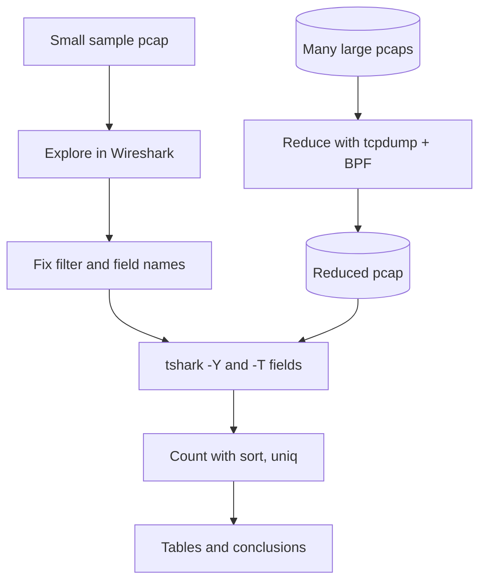

# 1.10 — Lab Guide: Getting Hands-On with tcpdump and Wireshark { #lab-tcpdump-wireshark-tshark }

!!! abstract "Scope of this lesson"
    - Why tshark: **explore small in the GUI, run big at the console**
    - The options you'll use constantly: `-r` `-w` `-n` `-Y` `-T` `-e` `-E` `-G`, plus `-2`
    - [Changed] `-G` now requires a report type (4.6), and `-e` accepts field **expressions** (4.4)
    - Labs A–E: live capture → saving to a file and hashing it → basic display filters → turning packets into tables with `-T fields` → sweeping several files with a loop
    - **Do data reduction with BPF**: on the same job, tcpdump took 0.25 s and tshark took over 18 s (actual measurement)
    - [Caution] combining `-Y` with `-w` can drop the earlier packets of a reassembled message

!!! note "Lab environment and notation"
    **(Actual output)** comes from this environment (Linux, 4 vCPUs) with tcpdump 4.99.4, libpcap 1.10.4 and tshark 4.2.2. Labs A–C use files **actually captured** on the loopback interface (`lo`), with a Python web server running and `curl` sending the requests. The DNS and large pcaps in Labs D and E were assembled in Python and use only private addresses, documentation addresses (RFC 5737) and example domains (`.example`). There is no GUI here, so the Wireshark steps are written **as procedures only**, and I checked the results by putting the same filters into tshark.

## 1. You found a method on screen and want to run it over 100 files { #why-tshark }

**(Hypothetical)** A colleague was looking through 30 minutes of pcap in Wireshark and found a suspicious name: `sync.cdn-update.example`. Now the question grows. "Did any other PC ask for this name in the past week?" A week of capture is 168 hourly files, hundreds of GB in total. Opening each one in Wireshark, typing the filter and counting by eye isn't realistic.

That's what **tshark** is for. tshark is the **command-line version** of Wireshark, using the same dissectors and the same display filters. With no screen to draw, it's lighter, and above all **you can put it in a shell script.** That gives you a natural order of work:

1. **Explore small.** Open a small sample in Wireshark and settle on the field names and the filter. With a screen you find "ah, this is the field" much faster.
2. **Run big.** Move that filter and those fields into a tshark command, and apply it identically to hundreds of files with a loop.
3. **Keep the record.** You can paste the command line straight into a report and reuse it in the next case. It becomes a **repeatable procedure**: the same input gives the same output.

!!! info "[Supplement] GUI-only features"
    Almost every Wireshark feature is in tshark too, but a few interactive ones exist only on screen. Following a stream and extracting files are *not* among them: tshark does both with `-z follow` and `--export-objects`, which we run in section 6.

## 2. Analogy: the test kitchen and the factory line { #analogy }

When a chef develops a new sauce, they taste from a small pot and adjust the proportions (the GUI). Once the recipe is fixed, it goes to the factory line, which makes a ton a day (tshark). Nobody on the line tastes and stirs by hand. The recipe, meaning the command line, is everything.

The analogy breaks in one place. **The factory line isn't infinitely fast either.** tshark dissects every layer of every packet just as Wireshark does, so feeding it a ton of raw material as-is is very slow. That's why we put a **sieving step** (tcpdump and BPF) in front of the line. That is section 8, the key measurement of this lesson.



**How to read it:** read top to bottom. The left branch (small sample → Wireshark) decides **what** to look at; the right branch (large pcaps → tcpdump) cuts down **how much** to look at. The two branches meet at tshark.

## 3. The tshark options you'll use most { #options }

Rather than memorising one line per option, group them by "what does this option decide?"

**Input and output**

- `-r file`: read from a **saved file** instead of a network interface. In investigations you almost always use this.
- `-w file`: write results to a file **as packets**, not text. Combined with a filter, this gives "a new pcap of only the matching packets". If you want to save the text you see on screen, use the shell's `>`, not `-w`.
- **[Changed] `-F format`:** the format of the `-w` file. tshark's default is **pcapng**. The source material describes it as "writing a pcap file", but if the receiving tool can't read pcapng you need `-F pcap`. Run `-F` alone to see the list of formats.

**Dissection and names**

- `-n`: **disable all name resolution.** As we confirmed in lesson 1.8, turning on network name resolution can make Wireshark-family tools send real DNS queries. Add it by habit when handling evidence.
- `-2`: read the file **twice**. The first pass works out every forward/backward relationship ("the response to this request is packet N"), and the second pass prints. The input must be rewindable, so this can't be used on live capture or piped input.
- `-R filter`: the filter for the **first pass**, used with `-2`. For single-pass reading, use `-Y`, not `-R`.

**What to show**

- `-Y 'filter'`: a display filter with **the same syntax** as Wireshark's filter bar (lesson 1.9). **Wrap it in single quotes** so the shell doesn't reinterpret parentheses, spaces or quotes. Inside the filter, strings use double quotes.
- `-T format`: chooses the output shape. The default `text` is a one-line summary per packet like tcpdump. Others include `pdml` (XML), `json`, `ek` (line-delimited JSON for Elasticsearch), `psml` and `tabs`. The one investigators use most is **`fields`**.
- `-e field`: with `-T fields`, chooses **which fields** to print. You can repeat it; columns appear in the order given. Use the "machine name" shown in Wireshark's status bar (such as `dns.qry.name`).
- `-E option=value`: shapes the **table** for `-T fields`: `header=y` (field names as the first line), `separator=,` (column separator, tab by default), `quote=d` (wrap in double quotes), `occurrence=f|l|a` (first, last or all occurrences of a field that appears several times in one packet), `aggregator=,` (the separator between values when printing all), and others.

**Looking things up**

- `-G report`: prints a **list** of things tshark knows and exits: `fields` (every field), `protocols` (every protocol), `fieldcount` (the counts) and more.

!!! warning "[Changed] `-G` now needs a report type"
    The source material says to use "`-G ?`" to see the available reports. In tshark 4.2.2, `-G ?` printed a usage text containing the list of reports **(actual output)**. In the past, `-G` alone produced the `fields` report; that behaviour was **deprecated** in 4.4.0, and the 4.6 manual states that "the glossary type is now mandatory". The command the 4.6 manual gives for listing report types is `-G help`. If an old script contains `tshark -G | grep ...`, change it to `tshark -G fields | grep ...`.

!!! info "[Changed] What `-e` accepts has grown"
    - **Since 4.2.0** you can pull on-screen column text out **as fields**, such as `_ws.col.info` and `_ws.col.protocol`. The old way of using the column title (`Info`) remains only for the default columns, for backward compatibility.
    - **Since 4.4.0** `-e` accepts not just a single field name but a **field expression** (display filter functions, slices, arithmetic and so on), for example `-e 'len(dns.qry.name)'`. This environment has 4.2.2, so I **could not run** this feature; it's based on the 4.4.0 release notes.

## 4. How this lab is organised { #how-to-use }

From this lesson on, lab guides have four parts. Knowing the purpose of each helps you decide where to pause and what to check.

- **Objectives:** what you should be able to do at the end.
- **Preparation:** the tools and files you need, and the lead you start from.
- **Lab:** each step is "command → output → interpretation". Every part of each command is explained, so **predict the result before you look**, then compare.
- **Takeaways:** what to carry away from the lab.

You can type the commands exactly as given, but there are many routes to the same answer. After one guided run, cover the explanations and try it alone; your skills grow much faster that way. Parts marked "Going further" aren't required for the objectives, so leave them for last.

**Objectives**

1. Watch live traffic on screen with tcpdump, and save it to a file.
2. Open the saved pcap in Wireshark (or tshark) and use basic display filters.
3. Turn packets into **tables** with tshark's `-T fields` and count them with shell tools.
4. Confirm by measurement that "reduce with BPF, dissect with display filters".

**Preparation**

- tcpdump, Wireshark (with tshark, 4.x), `curl`, Python 3
- Labs A–C: a practice web server. Make a few text files in an empty folder and run `python3 -m http.server 8082 --bind 127.0.0.1` in that folder.
- Lab D: three DNS pcaps cut into hourly files (`dns-00.pcap`, `dns-01.pcap`, `dns-02.pcap`). The internal DNS server is `10.10.4.53`. The starting lead is "`sync.cdn-update.example` looks suspicious".

!!! warning "[Caution] Practise on your own equipment and your own traffic"
    Capture only on **networks and equipment you're authorised for**. This guide uses only the loopback interface (`lo`), so you see only traffic inside your own computer. If you want to practise on a company network, get permission first.

## 5. Labs A and B: watch live, save to a file { #lab-ab }

### 5.1 Lab A: watch packets go by on screen { #lab-a }

```bash
sudo tcpdump -i lo -nn -c 12 'tcp port 8082'
```

- `-i lo`: capture on the loopback interface.
- `-nn`: don't turn addresses or port numbers into names (lesson 1.8).
- `-c 12`: stop after 12 packets, so the screen doesn't scroll forever while practising.
- `'tcp port 8082'`: a BPF selecting only the web server port (lesson 1.7), in single quotes.

Run `curl -s -o /dev/null http://127.0.0.1:8082/report.txt` in another terminal and you get this.

**(Actual output, some options trimmed)**

```text
03:20:39.926766 IP 127.0.0.1.58600 > 127.0.0.1.8082: Flags [S], seq 3814503150, win 65495, ... length 0
03:20:39.926778 IP 127.0.0.1.8082 > 127.0.0.1.58600: Flags [S.], seq 1889376451, ack 3814503151, ... length 0
03:20:39.926794 IP 127.0.0.1.58600 > 127.0.0.1.8082: Flags [.], ack 1, win 64, ... length 0
03:20:39.926875 IP 127.0.0.1.58600 > 127.0.0.1.8082: Flags [P.], seq 1:88, ack 1, ... length 87
03:20:39.926880 IP 127.0.0.1.8082 > 127.0.0.1.58600: Flags [.], ack 88, ... length 0
03:20:39.927687 IP 127.0.0.1.8082 > 127.0.0.1.58600: Flags [P.], seq 1:190, ack 88, ... length 189
03:20:39.927704 IP 127.0.0.1.58600 > 127.0.0.1.8082: Flags [.], ack 190, ... length 0
03:20:39.927941 IP 127.0.0.1.8082 > 127.0.0.1.58600: Flags [P.], seq 190:5590, ack 88, ... length 5400
03:20:39.927954 IP 127.0.0.1.58600 > 127.0.0.1.8082: Flags [.], ack 5590, ... length 0
03:20:39.927990 IP 127.0.0.1.8082 > 127.0.0.1.58600: Flags [F.], seq 5590, ack 88, ... length 0
03:20:39.928023 IP 127.0.0.1.58600 > 127.0.0.1.8082: Flags [F.], seq 88, ack 5591, ... length 0
03:20:39.928052 IP 127.0.0.1.8082 > 127.0.0.1.58600: Flags [.], ack 89, ... length 0
12 packets captured
24 packets received by filter
0 packets dropped by kernel
```

**Interpretation:** one HTTP request became 12 packets. The first three lines set up the connection (`S`, `S.`, `.`). The 87-byte packet is the request, 189 bytes is the response header, 5400 bytes is the body (the same size as `report.txt`), and the last three lines close the connection (`F.`). It's exactly the structure from lesson 1.6.

You also need to read **the last three lines**.

- `captured` is how many were actually printed or saved; `dropped by kernel` is how many were **missed** because a buffer overflowed (lesson 1.6, section 7.1). Always record these numbers when collecting evidence. If drops aren't 0, the report must say "the capture is incomplete".
- `received by filter` is exactly **double** `captured` (24) because of how loopback works. Lesson 1.6, section 7.1 said I hadn't determined the cause; here it is. Linux shows each loopback packet twice, once "outgoing" and once "incoming", and libpcap discards the outgoing copy so it doesn't record the same packet twice (as explained in libpcap 1.10.4's `pcap-linux.c`). The filter counts both, but only one is recorded. On an ordinary Ethernet interface the numbers won't be an exact double like this. Before being surprised by this number, check **which interface** it was.

### 5.2 Lab B: save to a file and record a hash { #lab-b }

```bash
sudo tcpdump -i lo -nn -w lab11.pcap 'tcp port 8082'
```

With `-w lab11.pcap`, packets aren't printed; they're saved to the file. While it runs, send three requests from another terminal: a normal one, one with a changed User-Agent, and one for a **file that doesn't exist**.

```bash
curl -s -o /dev/null http://127.0.0.1:8082/index.html
curl -s -o /dev/null -A "lab-agent/1.0" http://127.0.0.1:8082/report.txt
curl -s -o /dev/null http://127.0.0.1:8082/nope.txt
```

After stopping with `Ctrl+C` it reported `36 packets captured` **(actual output)**: 12 for each of three requests. Now, **before any analysis, record a hash**.

```bash
sha256sum lab11.pcap
```

**(Actual output)**

```text
c96571436262a2e4349875121d42d625f180f544d25ee7b664f17bfcb4a01254  lab11.pcap
```

Recomputing it after finishing all of Lab C gave the same value. This is how you confirm that read-only tools (tshark `-r`, tcpdump `-r`, editcap input) don't change the original. Results **always go to new files**.

!!! info "[Supplement] Why `-Z root` was needed for saving"
    In this environment tcpdump drops privileges after capture starts, and then couldn't write the `-w` file, so I added `-Z root` (lesson 1.6, section 7). You may not need it. Even if you do, on a capture box it's better to prepare **a dedicated folder with the right write permissions** than to work around the problem this way.

### 5.3 Lab B (continued): basic filters in Wireshark { #lab-b-wireshark }

Open `lab11.pcap` in Wireshark and enter the following into the filter bar one at a time. The packets in parentheses are what remained when the same filter was given to tshark **(actual output)**.

- `http.request`: only requests (packets 4, 16, 28).
- `http.response.code == 404`: only the response for the missing file (32).
- `http.user_agent contains "lab"`: only the request with the changed User-Agent (16).
- `tcp.stream == 2`: all 12 packets of the third connection. Stream numbers start at 0.

For the on-screen steps, see lesson 1.8 (window layout) and lesson 1.9 (filters, following streams). The one thing to confirm here: **clear the filter and all 36 packets come back**. A display filter changes only what's shown, never the file.

## 6. Lab C: turning packets into tables { #lab-c }

### 6.1 One line per request and response { #fields-basic }

```bash
tshark -n -r lab11.pcap -Y http.request -T fields -E header=y \
  -e frame.number -e tcp.stream -e http.request.method -e http.request.uri -e http.user_agent
```

Broken down: `-n -r lab11.pcap` means "read this file with no name resolution", `-Y http.request` means "requests only", `-T fields` means "as a table", `-E header=y` means "column names on the first line", and five `-e` options make five columns.

**(Actual output)**

```text
frame.number	tcp.stream	http.request.method	http.request.uri	http.user_agent
4	0	GET	/index.html	curl/8.5.0
16	1	GET	/report.txt	lab-agent/1.0
28	2	GET	/nope.txt	curl/8.5.0
```

Responses come out the same way: switch to `-Y http.response` and use `frame.number`, `tcp.stream`, `http.response.code`, `http.content_length` and `http.response_for.uri` as the `-e` columns.

**(Actual output)**

```text
frame.number	tcp.stream	http.response.code	http.content_length	http.response_for.uri
8	0	200	32	http://127.0.0.1:8082/index.html
20	1	200	5400	http://127.0.0.1:8082/report.txt
32	2	404	335	http://127.0.0.1:8082/nope.txt
```

**Interpretation:** the two tables join on the `tcp.stream` column. Stream 2 is the `/nope.txt` request, answered with a 404 and a 335-byte body. A missing file has a 335-byte body because the server sends an **error page**. That matters again in section 6.3.

### 6.2 Find with tshark, cut with tcpdump { #carve }

Say you want stream 2 alone in its own file. There are two ways.

```bash
# Way 1: with a tshark display filter
tshark -n -r lab11.pcap -Y 'tcp.stream == 2' -w s2.pcapng

# Way 2: find the port, then use a tcpdump BPF
tshark -n -r lab11.pcap -Y 'http.response.code == 404' -T fields -e tcp.srcport -e tcp.dstport
tcpdump -nn -r lab11.pcap -w p2.pcap 'tcp port 58632'
```

**(Actual output)** The second command printed `8082	58632`, and both ways produced a 12-packet file.

Way 2 has an extra step, so why learn it? `tcp.stream` is **a number Wireshark assigns as it reads a file**, so it differs from file to file. And if the original is 100 GB, just dissecting it in tshark takes ages (section 8). "Client port 58632", on the other hand, is a value actually inside the packets, so it works identically in any file and any tool. Use tshark to **find** in a small file, and tcpdump to **cut** from the big original.

!!! warning "[Caution] One port alone may not be enough"
    Client ports are reused over time. Cutting a day's original with just `tcp port 58632` can mix in entirely different connections from other times. In real investigations, include the address too (`host address and tcp port port`), and check with `capinfos` that the first and last packet times of the result fall in the expected range.

You can do the same by packet number. `editcap -r lab11.pcap first12.pcap 1-12` made a new file containing only packets 1–12 **(actual output)**. editcap, seen in lesson 1.6, is handy for cutting **by range** like this.

### 6.3 Following streams and extracting files, at the command line too { #follow-export }

```bash
tshark -n -r lab11.pcap -q -z follow,tcp,ascii,2
tshark -n -r lab11.pcap -q --export-objects http,obj
```

- `-q`: suppress the per-packet summary lines, leaving only the statistics (`-z`) or export results.
- `-z follow,tcp,ascii,2`: follow stream 2 as text, the same feature as "Follow TCP Stream" in lesson 1.9.
- `--export-objects http,obj`: extract files transferred over HTTP into the `obj` folder.

**(Actual output, beginning)**

```text
Follow: tcp,ascii
Filter: tcp.stream eq 2
Node 0: 127.0.0.1:58632
Node 1: 127.0.0.1:8082
85
GET /nope.txt HTTP/1.1
Host: 127.0.0.1:8082
User-Agent: curl/8.5.0
Accept: */*

	186
HTTP/1.0 404 File not found
Server: SimpleHTTP/0.6 Python/3.13.18
...
```

The `obj` folder got three files: `index.html` (32 bytes), `report.txt` (5400 bytes) and `nope.txt` (335 bytes). The SHA-256 of the extracted `report.txt` was **exactly the same** as the original `report.txt` in the server's folder (`265d49f7…7c3e98`). The file extracted from packets is byte-for-byte identical to the original.

**The trap is `nope.txt`.** From the name alone it looks as if the server had a `nope.txt`, but the content of this file is **the 404 error page (HTML) the server sent**. The export feature simply saves the response body **under the name from the requested URL**. When you list extracted files in a report, don't go by the name alone; check the status code and `Content-Type` of the response that carried the file.

## 7. Lab D: "who asked for that name?" across several files { #lab-d }

### 7.1 Check one file first { #one-file }

The lead is "`sync.cdn-update.example` looks suspicious". First, look at the packets with that name in one file.

```bash
tshark -n -r dns-01.pcap -Y 'dns.qry.name == "sync.cdn-update.example"'
```

**(Actual output)**

```text
   39 567.983743   10.10.6.14 → 10.10.4.53   DNS 83 Standard query 0x0079 A sync.cdn-update.example
   40 568.014742   10.10.4.53 → 10.10.6.14   DNS 115 Standard query response 0x0079 A sync.cdn-update.example A 198.51.100.66 A 198.51.100.67
  107 1467.983743   10.10.6.14 → 10.10.4.53   DNS 83 Standard query 0x007a A sync.cdn-update.example
  108 1468.014742   10.10.4.53 → 10.10.6.14   DNS 115 Standard query response 0x007a A sync.cdn-update.example A 198.51.100.66 A 198.51.100.67
  125 2367.983743   10.10.6.14 → 10.10.4.53   DNS 83 Standard query 0x007b A sync.cdn-update.example
  126 2368.014742   10.10.4.53 → 10.10.6.14   DNS 115 Standard query response 0x007b A sync.cdn-update.example A 198.51.100.66 A 198.51.100.67
```

Queries and responses both appear, **because a response carries the queried name too** (a DNS response copies the question section back). So to count "who asked", you must select queries only: `dns.flags.response == 0` is a query, `== 1` a response. Leave that condition out and the server `10.10.4.53` gets counted as an "asker", and the numbers double.

The second thing to notice is **the timing**. The queries are at 567, 1467 and 2367 seconds: exactly **900 seconds (15 minutes)** apart. A person browsing rarely produces such regularity. It's an **observation** worth suspecting as a program that asks a server "anything for me to do?" on a schedule (a beacon). But legitimate programs also check in on a fixed interval, for updates for example, so you **cannot conclude** it's malicious from this alone.

### 7.2 Handling multiple values: `-E occurrence` and `aggregator` { #occurrence }

The response contains two addresses (`198.51.100.66` and `.67`). When the same field appears several times in one packet, `-T fields` by default prints **all of them joined by commas**.

```bash
tshark -n -r dns-01.pcap -Y 'dns.flags.response == 1 && dns.qry.name == "sync.cdn-update.example"' \
  -T fields -E header=y -e frame.number -e ip.dst -e dns.a
```

**(Actual output)**

```text
frame.number	ip.dst	dns.a
40	10.10.6.14	198.51.100.66,198.51.100.67
108	10.10.6.14	198.51.100.66,198.51.100.67
126	10.10.6.14	198.51.100.66,198.51.100.67
```

Adding `-E occurrence=f` to the same command left only the **first value** (`198.51.100.66`) in the `dns.a` column **(actual output)**. That looks convenient, but be careful: the second address **silently disappears** from the table. If the attacker alternates between the two, you'd never think to look up `.67` in the firewall logs. Use `occurrence=f` only when you're sure the field appears once.

If you need a CSV for a spreadsheet:

```bash
tshark -n -r dns-01.pcap -Y 'dns.flags.response == 1 && dns.qry.name == "sync.cdn-update.example"' \
  -T fields -E separator=, -E quote=d -E aggregator=/s -e frame.time -e ip.dst -e dns.a
```

**(Actual output)**

```text
"Nov  1, 2026 09:10:00.030999000 UTC","10.10.6.14","198.51.100.66 198.51.100.67"
"Nov  1, 2026 09:25:00.030999000 UTC","10.10.6.14","198.51.100.66 198.51.100.67"
"Nov  1, 2026 09:40:00.030999000 UTC","10.10.6.14","198.51.100.66 198.51.100.67"
```

Because `separator=,` splits columns with commas, `aggregator=/s` joins the multiple values within one cell with a **space**. If both were commas, the spreadsheet would split the two addresses into separate columns. `quote=d` is needed because of the comma inside the date (`Nov  1, 2026`).

!!! warning "[Caution] `frame.time` comes out in the analysis machine's time zone"
    `frame.time` shows the UTC time stored in the pcap **converted to the time zone of the computer doing the analysis**. This environment is set to UTC, so it printed `UTC`, but running the same command with only the time zone changed (`TZ=Asia/Seoul`) printed the same packet as `Nov  1, 2026 18:10:00.030999000 KST` **(actual output)**. This is a common reason for times being nine hours apart when several people merge results. For tables, prefer a time-zone-free value such as `frame.time_epoch` (seconds since 1970). In this lab the query times came out of `frame.time_epoch` as values like `1793524200.000000000` **(actual output)**. There's also a `frame.time_utc` field fixed to UTC (confirmed in tshark 4.2.2's `-G fields`).

### 7.3 Sweep every file with a loop { #loop }

Now to answer section 1's question, "did other PCs ask too?" Run the same command over the three files, extract only the querying address, and count with `sort | uniq -c`.

```bash
for f in dns-*.pcap; do
  tshark -n -r "$f" -Y 'dns.flags.response == 0 && dns.qry.name == "sync.cdn-update.example"' \
    -T fields -e ip.src
done | sort | uniq -c | sort -rn
```

- `for f in dns-*.pcap; do ... done`: runs once for every pcap whose name starts with `dns-`. Quoting `"$f"` keeps file names with spaces intact.
- `| sort | uniq -c`: groups identical lines and counts them. `uniq` only merges **adjacent** identical lines, so the `sort` in front is essential.
- `| sort -rn`: sorts by count, largest first.

**(Actual output)**

```text
      6 10.10.6.14
      1 10.10.7.15
```

**Interpretation:** besides `10.10.6.14` (hq-rd-04), `10.10.7.15` (hq-wkstn-05) asked for the same name **once**. That PC wasn't in the file the colleague first looked at (`dns-01.pcap`). Print the file name alongside and you can see when each first appeared.

```bash
for f in dns-*.pcap; do
  tshark -n -r "$f" -Y 'dns.flags.response == 0 && dns.qry.name == "sync.cdn-update.example"' \
    -T fields -e ip.src | sed "s/^/$f\t/"
done | sort | uniq -c
```

**(Actual output)**

```text
      3 dns-01.pcap	10.10.6.14
      3 dns-02.pcap	10.10.6.14
      1 dns-02.pcap	10.10.7.15
```

`sed "s/^/$f\t/"` prefixes each line with the file name and a tab. Nobody asked in `dns-00.pcap` (the 08:00 hour); `10.10.6.14` appears from the 09:00 hour and `10.10.7.15` first appears in the 10:00 hour.

You can summarise it like this.

- **Observation (fact):** across the three files, the only addresses that queried the name were `10.10.6.14` (6 times) and `10.10.7.15` (once). `10.10.6.14`'s queries were 900 seconds apart.
- **Hypothesis:** something ran on `10.10.6.14` first and may have spread to `10.10.7.15` in the 10:00 hour.
- **Evidence still needed:** whether traffic actually passed between the two PCs, whether the two PCs actually connected to the answer addresses (`198.51.100.66` and `.67`) (proxy logs from lesson 1.3, NetFlow), and execution records on the endpoints.
- **Limits of the observation:** these pcaps were captured in front of the DNS server, so **queries sent directly to external DNS servers or over DoH, bypassing the internal DNS server, are not visible** (covered in lesson 1.12). And "none" only means "none in these three files".

!!! example "Going further"
    In the same loop, keep only `dns.flags.response == 0` as the filter, extract `-e dns.qry.name`, and count with `sort | uniq -c | sort -rn`. You get the ranking of the most-queried names across the three files. When I ran it: `mail.example.org` 52, `intranet.lab.example` 50, `www.example.com` 45, `cdn.example.net` 33, `sync.cdn-update.example` 7. Notice the suspicious name sits at the **bottom**. The habit of looking at the **tail** of a ranking, not the top, is common in hunting.

### 7.4 When you don't know the field name: `-G fields` { #glossary }

How did we know the name `dns.flags.response`? In Wireshark, clicking that line shows it in the status bar (lesson 1.9). Without a screen, use `-G fields` and `grep`.

```bash
tshark -G fields | grep -P '\tdns\.qry\.name\t|\tdns\.a\t|\tdns\.flags\.response\t'
```

**(Actual output)**

```text
F	Response	dns.flags.response	FT_BOOLEAN	dns	16	0x8000	Is the message a response?
F	Name	dns.qry.name	FT_STRING	dns		0x0	Query Name
F	Address	dns.a	FT_IPv4	dns		0x0	Response IPv4 Address
```

The tab-separated columns are, in order: "F (marks a field), human name, machine name, value type, parent protocol, display base, bitmask, description". The bitmask `0x8000` on `dns.flags.response` means the response flag is the **top bit** of the DNS header's 16-bit flags.

The tabs (`\t`) on each side in the `grep` regex are there to find `dns.a` exactly. Searching for plain `dns.a` also matches dozens of fields with the same prefix, such as `dns.aaaa` and `dns.a.ch`. Remember too that `.` in a regex means "any single character", so a real dot must be written `\.`.

**[Changed] The scale in numbers:** the source material says "over 2,600 protocols and over 210,000 fields". tshark 4.2.2's `-G fieldcount` reported **269,028 fields and 3,001 protocols** **(actual output)**. Dissectors are added with every version, so just remember that "it varies by version and keeps growing".

## 8. Lab E: why do data reduction with tcpdump? { #lab-e }

### 8.1 Same result, more than a 70× difference in time { #speed }

I built a practice pcap of one million packets (about 944 MB): 3% DNS queries, the rest TCP to a proxy (port 3128). Then I had both tools extract only the DNS into a new file.

```bash
time tcpdump -nn -r big.pcap -w red-bpf.pcap 'udp port 53'
time tshark -n -r big.pcap -Y 'udp.port == 53' -F pcap -w red-df.pcap
```

**(Actual output, each command run twice)**

| Tool | Run 1 | Run 2 |
| --- | --- | --- |
| tcpdump + BPF | 0.278 s | 0.251 s |
| tshark + display filter | 29.669 s | 18.212 s |

The two result files matched not only in packet count (about 29,000) but **in MD5 hash too.** Same job, yet the time differed by roughly 70–100×.

**Why so different?** tcpdump with BPF looks at **a few bytes at fixed positions** in each packet to decide pass or fail (lesson 1.7). tshark dissects **everything** (Ethernet, IP, TCP and the protocols above) in every packet before applying the display filter. When each TCP packet carries 900 bytes of content, as in this practice file, tshark even tries to work out which protocol that content is. It does all that work even for the 97% of packets that will be discarded.

**Note the limits of the measurement too.** These numbers are two runs on one file in this environment (4 vCPUs). On the second run the file was very likely already in the page cache, which may also explain the big gap between tshark's two times. So read it as **"a different order of magnitude"**, not "exactly N times". Change the hardware or the traffic mix and the ratio changes.

### 8.2 Split it into two stages and get the best of both { #two-step }

Reduce with BPF first, and use tshark only on the reduced result. You don't even need an intermediate file; a pipe will do.

```bash
time (tcpdump -nn -r big.pcap -w - 'udp port 53' \
  | tshark -n -r - -Y 'dns.qry.name == "www.example.com"' -T fields -e ip.src | wc -l)
```

- `-w -`: write the pcap to **standard output** instead of a file.
- `-r -`: read the pcap from **standard input** instead of a file.

**(Actual output)** `29815` lines in **0.890 s**. A refined question involving DNS names, done in under a second. tshark alone would have taken around 20 seconds, as in the previous measurement.

This is the principle in the source material's lab takeaways: **filter at layers 2–4 (addresses, ports, protocols) with tcpdump; look at what's above with tshark.** Note that `-2` (two passes) can't be used when reading from a pipe, because the input can't be rewound.

!!! info "[Supplement] What if you give tshark a BPF?"
    tshark has a BPF option, `-f`, but it works **only for live capture**. Given `-f 'udp port 53'` while reading a file, tshark 4.2.2 stopped with "Only read filters, not capture filters, can be specified when reading a capture file" **(actual output)**. To reduce a saved file with BPF, use tcpdump (or a range-cutting tool such as `editcap`).

### 8.3 [Caution] Packets lost when combining `-Y` and `-w` { #y-w-pitfall }

There's a trap when you **save** the output of a display filter. Using the loopback capture from lesson 1.6 (three requests), I saved only the HTTP responses.

```bash
tshark -n -r full.pcap -Y http.response -w resp.pcapng      # single pass
tshark -n -2 -r full.pcap -Y http.response -w resp2.pcapng  # two passes
```

**(Actual output, reopening the saved files)**

```text
# resp.pcapng (single pass): 3 packets
    1   0.000000    127.0.0.1 → 127.0.0.1    TCP 98 8082 → 36314 [PSH, ACK] Seq=1 Ack=1 Win=64 Len=32 ...
    2   0.010585    127.0.0.1 → 127.0.0.1    TCP 5466 8082 → 36326 [PSH, ACK] Seq=1 Ack=1 Win=64 Len=5400 ...
    3   0.018304    127.0.0.1 → 127.0.0.1    TCP 98 8082 → 36330 [PSH, ACK] Seq=1 Ack=1 Win=64 Len=32 ...

# resp2.pcapng (two passes): 6 packets
    1   0.000000    127.0.0.1 → 127.0.0.1    TCP 252 HTTP/1.0 200 OK  [TCP segment of a reassembled PDU]
    2   0.000055    127.0.0.1 → 127.0.0.1    HTTP 98 HTTP/1.0 200 OK  (text/html)
    ...
```

**Interpretation:** this server sent the response header and body in **separate packets**. Wireshark joins the two (reassembly) and dissects them as one HTTP response, and `http.response` is attached to **the last packet**. The single-pass file contains only that last packet, so on reopening it's a body fragment with no header and **isn't even dissected as HTTP** (it shows as plain `TCP`). With two passes (`-2`), the earlier header packet was saved as well.

The tshark manual says that with `-Y` and `-w`, "packets that the matching packets **depend upon** (e.g., fragments)" are written too. But in a 4.2.2 single pass, the earlier packet used in reassembly wasn't written. I **haven't verified** whether newer versions behave the same. So here are the safe approaches.

- When you need to cut by message, save the **whole connection** by `tcp.stream`. First extract the numbers with `-T fields -e tcp.stream`, then save with `-Y 'tcp.stream in {0, 2}'` (set members separated by commas, lesson 1.9).
- Or find the address and port as in section 6.2 and cut with tcpdump.
- Whichever you use, **reopen the saved file** and confirm the content you wanted is dissected.

## 9. How to use this in real investigations { #in-practice }

1. **Only ever read the original.** Compute and record a hash on receipt, and keep the original folder read-only. Write every result to a new file, and note in the file name or your notes "from which original, with which command".
2. **Explore small.** Open one or two samples in Wireshark and settle the filter and fields.
3. **Reduce with BPF.** Anything you can filter by address, port or protocol, cut down with tcpdump first.
4. **Build tables with tshark.** Don't forget `-n`, and extract times as time-zone-free values like `frame.time_epoch`. Keep the default `occurrence` (all) for multi-value fields.
5. **Paste the command line into the report as-is.** Include the tool name and version (the first line of `tshark --version`), because results and usage change by version, as with `!=` in lesson 1.9 and `-G` in this lesson.
6. **Write results as fact, hypothesis and evidence needed**, as in the summary in section 7.3.

## 10. Summary { #summary }

- tshark runs Wireshark's dissectors and display filters at the command line. **Explore small in the GUI, repeat big with tshark.**
- Remember these as a group: `-r` (read), `-w` (write packets as-is, pcapng by default), `-n` (no name resolution), `-Y` (display filter, in single quotes), `-T fields` with `-e` (make tables), `-E` (table shape), `-G` (look things up), `-2` (two passes).
- **[Changed]** Per the 4.6 manual, `-G` requires a report type (deprecated without one in 4.4.0). `-e` accepts `_ws.col.*` column fields since 4.2 and field expressions since 4.4.
- Multiple values in `-T fields` are joined with commas by default. `occurrence=f` silently drops values, so be careful; for CSV, make `separator` and `aggregator` different.
- `frame.time` comes out in the analysis machine's time zone. Use `frame.time_epoch` in tables.
- The same data reduction took tcpdump 0.25 s and tshark over 18 s, with identical result hashes. **Filter at layers 2–4 with tcpdump.**
- With `-Y` and `-w` together, the earlier packets used in reassembly can be lost (confirmed in a 4.2.2 single pass). Save by connection (`tcp.stream`) and reopen the saved file to check.
- An extracted file's name comes only from the requested URL. The content of `nope.txt` was a 404 error page.

## Review questions { #review }

**Question 1. (Reading a command)** Explain what each part of this command does and what the output will look like.

```bash
tshark -n -r day1.pcap -Y 'http.request and ip.src == 10.10.7.11' -T fields -E header=y -e frame.time_epoch -e http.host -e http.request.uri
```

??? success "Answer and explanation"
    `-n` turns off name resolution and `-r day1.pcap` reads that file. `-Y '...'` selects only "HTTP requests whose source is `10.10.7.11`". `-T fields` makes a table and `-E header=y` puts column names on the first line. There are three columns: the time (seconds since 1970), the `Host` header value and the request path. So the first line is `frame.time_epoch	http.host	http.request.uri`, followed by one tab-separated line per request. The filter is in single quotes, so the shell doesn't split it at the spaces or `==`.

**Question 2. (Changed conditions)** A colleague's old script contains `tshark -G | grep -i smb`. What will happen on a new analysis box with Wireshark 4.6, and how should it be fixed?

??? success "Answer and explanation"
    Old tshark printed the `fields` report by default when given `-G` alone. That behaviour was deprecated in 4.4.0, and the 4.6 manual describes the report type as **mandatory**. So on the new box it's likely the expected field list won't appear (I didn't verify the exact message 4.6 prints). Writing the report type, as in `tshark -G fields | grep -i smb`, means the same thing on both old and new versions. While you're at it, have the script record `tshark --version` at the top, which makes it easier to find the cause when results differ later.

**Question 3. (Common misconception)** "tshark uses the same engine as Wireshark, so tshark `-Y` is the most accurate and best way to reduce a large pcap too." Separate what's right from what's wrong in this claim.

??? success "Answer and explanation"
    **Right:** tshark uses the same dissectors and filters as Wireshark, so when filtering on higher-layer content (DNS names, HTTP headers) there's a lot only tshark can do.

    **Wrong:** for conditions **you can express at layers 2–4**, such as addresses, ports and protocols, tcpdump with BPF gives exactly the same result much faster. In section 8.1 the two result files had the same hash, yet took 0.25 s versus over 18 s. The "accuracy" is the same; only the "cost" differs. So the right approach is two stages: reduce with BPF first, then use tshark on the reduced result.

**Question 4. (Interpretation)** What would have changed if the loop in section 7.3 had been run without the `dns.flags.response == 0` condition?

??? success "Answer and explanation"
    DNS responses also carry the queried name, so the response packets would match the filter too. A response's `ip.src` is the DNS server (`10.10.4.53`), so the result would gain a line `7 10.10.4.53`, making the server look like "the PC that asked most". Conversely, counting the receiving side of responses with `-e ip.dst` would count the querying PCs, but would miss queries that got no response (timeouts, blocks). **Defining exactly what you count with the filter** is how you keep the numbers meaningful.

**Question 5. (Calculation and interpretation)** Extracting `10.10.6.14`'s query times with `frame.time_utc` gives 09:10:00, 09:25:00, 09:40:00, 10:10:00, 10:25:00 and 10:40:00, and `10.10.7.15` asked once at 10:10:07. If the interval is regular, is a time missing? What could explain the gap, and what can you read from `10.10.7.15`'s timing?

??? success "Answer and explanation"
    Most gaps are **900 seconds (15 minutes)**, but between 09:40 and 10:10 it's 1800 seconds. At the same interval there should have been a query at **09:55:00** (these times were extracted directly from the practice files with `-e frame.time_utc`). Possible explanations: ① the PC was asleep or offline at that moment; ② the program didn't ask DNS that time (it reused a stored answer); ③ it asked by another route, not the internal DNS server (external DNS, DoH); ④ **the capture missed that moment** (around the hourly file rollover, a capture box restart). Investigators easily overlook ④; you can check it by looking at each file's first and last packet times with `capinfos` and at the capture box's own records.

    `10.10.7.15` asked **7 seconds after** `10.10.6.14`'s 10:10:00 query. Two PCs asking for the same rare name at almost the same moment is an **observation** that they may be related, but it isn't evidence that "one PC infected the other". Two people may have opened the same email at about the same time. You need to look separately for traffic that passed directly between them.

**Question 6. (Changed conditions)** What will the first line of the CSV command in section 7.2 look like on a laptop set to Seoul time (KST)? Why can this be a problem?

??? success "Answer and explanation"
    The same packet comes out as `"Nov  1, 2026 18:10:00.030999000 KST","10.10.6.14","198.51.100.66 198.51.100.67"` (UTC 09:10 plus nine hours). I confirmed this directly by changing only the time zone to `TZ=Asia/Seoul`, as in the caution box in section 7.2. The problem is that when merging several analysts' tables, or matching against firewall logs recorded in UTC, you can end up comparing them **nine hours apart**. Even when the zone label is there, it easily disappears in the move to a spreadsheet. It's safer to extract a time-zone-free value like `frame.time_epoch` and convert to one time zone once, in the report.

**Question 7. (Spot the trap)** A colleague saved only the archive-file responses with `tshark -n -r case.pcap -Y 'http.response.code == 200 && http.content_type contains "zip"' -w zips.pcapng`, then ran `--export-objects http` on that file and got nothing. What should you suspect, and how should it be redone?

??? success "Answer and explanation"
    Suspect the trap from section 8.3. If the responses were reassembled from several packets, `http.response.code` is attached only to the last packet. A single-pass save can drop the earlier packets, so in the saved file the HTTP responses are incomplete and there's nothing to extract. To redo it: ① extract the stream numbers from the original with `-T fields -e tcp.stream`; ② save whole connections with `-Y 'tcp.stream in {…}'`, or cut with tcpdump by address and port; ③ reopen the saved file, confirm the HTTP responses dissect fully, and then export. Running `--export-objects` directly on the original also works.

**Question 8. (Interpretation)** Looking at the `nope.txt` extracted in section 6.3, a junior analyst wrote in the report "the server had a file named `nope.txt`, 335 bytes in size". What's wrong, and how should they have checked?

??? success "Answer and explanation"
    `--export-objects` simply saves the response body named after **the last part of the requested URL**. This response's status code was 404, and the 335-byte body was the server's **error HTML**. So "the server did not have `nope.txt`" is closer to the truth. To check: ① look at the response's `http.response.code` and `http.content_type` together, as in section 6.1; ② examine the extracted file with `file` or open it. Conversely, an attacker can make a victim download an executable under a name like `update.txt`, so the habit of judging **by content, not by name** matters.

**Question 9. (Application)** From a day of 24 pcaps (300 GB in total), you need "the HTTP requests sent by `10.10.6.14` whose `Host` ends in `.example`". Using only what this lesson covered, sketch the skeleton of the command.

??? success "Answer and explanation"
    Split it in two stages: ① reduce the layer 2–4 condition (TCP sent by `10.10.6.14`) with tcpdump; ② check the HTTP content condition with tshark.

    ```bash
    for f in day-*.pcap; do
      tcpdump -nn -r "$f" -w - 'src host 10.10.6.14 and tcp' \
        | tshark -n -r - -Y 'http.request and http.host matches "\\.example$"' \
            -T fields -e frame.time_epoch -e http.host -e http.request.uri \
        | sed "s/^/$f\t/"
    done > hits.tsv
    ```

    The port isn't narrowed to 80 because, as lesson 1.9 showed, HTTP can travel on other ports (though it only matches if Wireshark dissects that port as HTTP). In the `matches` regex, `\\.` is "a real dot" and `$` is "the end". Inside a display filter string you write the backslash twice so that one reaches the regex. Each result line is prefixed with the file name to record its source. Record the originals' hashes before running and the command line and tshark version afterwards. The display filter part (`http.host matches "\\.example$"`) was run with tshark 4.2.2 on a practice pcap and matched `intranet.lab.example`, but the loop as a whole is a **skeleton** that was never run on a 300 GB original. Test it on a small sample first.

## References { #references }

- Wireshark, [tshark manual source (release-4.6)](https://gitlab.com/wireshark/wireshark/-/blob/release-4.6/doc/man_pages/tshark.adoc) (checked 2026-11-05). `-2`, `-R`, `-Y` (including the note that packets the matching packets depend upon are also written), the list of `-T` formats, the `-e` and `-E` options, `-G` with "the glossary type is now mandatory", and the pcapng default for `-F`.
- Wireshark, [tshark manual source (v4.4.0)](https://gitlab.com/wireshark/wireshark/-/blob/v4.4.0/doc/man_pages/tshark.adoc) (checked 2026-11-05). The deprecation of `-G` without an argument.
- Wireshark, [4.2.0 release notes source](https://gitlab.com/wireshark/wireshark/-/blob/v4.2.0/doc/release-notes.adoc) (checked 2026-11-05). `_ws.col.*` column fields, and the cleanup of column titles in `-e`.
- Wireshark, [4.4.0 release notes source](https://gitlab.com/wireshark/wireshark/-/blob/v4.4.0/doc/release-notes.adoc) (checked 2026-11-05). Field expressions allowed in `tshark -e`, and the deprecation of `-G` with no argument.
- tcpdump group, [libpcap 1.10.4 `pcap-linux.c`](https://github.com/the-tcpdump-group/libpcap/blob/libpcap-1.10.4/pcap-linux.c) (checked 2026-11-05). Discarding outgoing packets on the loopback device.
- Versions: as of 2026-11-05 the latest stable releases are Wireshark 4.6.16, tcpdump 4.99.7 and libpcap 1.11.0 (the same check as lesson 1.9). The outputs in this lesson come from the older tshark 4.2.2 and tcpdump 4.99.4.

!!! note "About this page"
    A personal study note, rewritten in my own words from several learning resources. The lab procedures and practice files are my own, and the scenarios are hypothetical.
