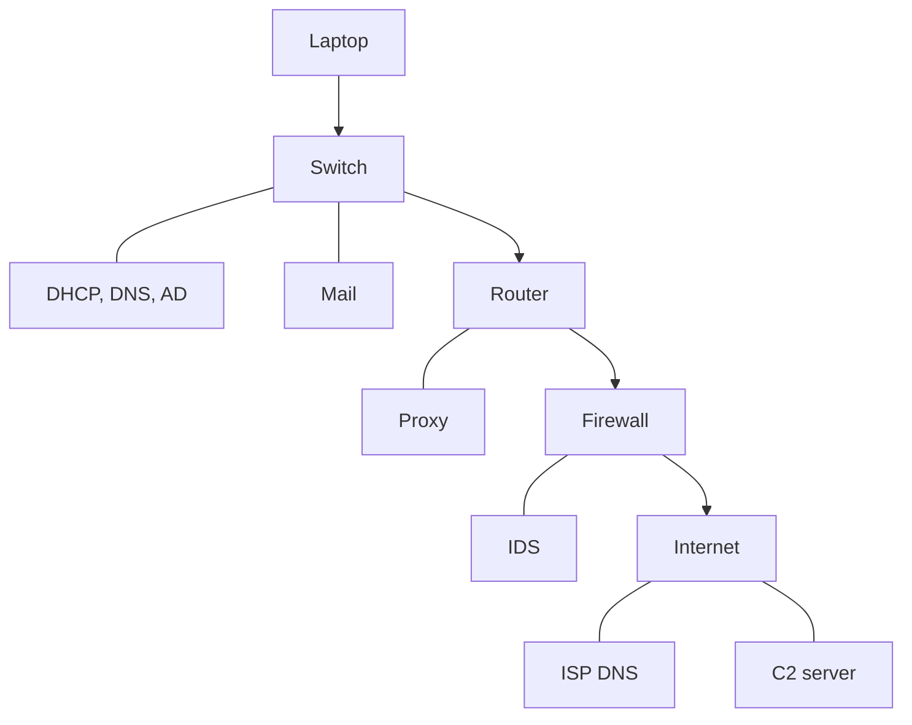
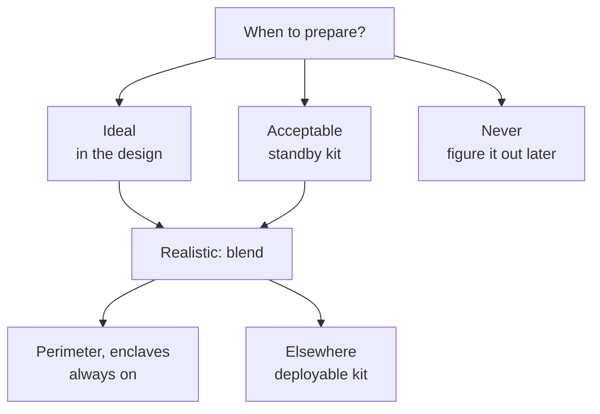

# 1.11 — Evidence Acquisition: Where and With What Do We Collect Packets? { #network-evidence-acquisition }

!!! abstract "Scope of this lesson"
    - The **four questions** to hold on to when you start with no leads
    - The traces a single phishing incident leaves in 13 steps: which device records what
    - The three evidence types revisited: pcap, **NetFlow/IPFIX** (with flow records built by hand), and logs
    - [Correction] flow byte counts include **IP headers**, not "payload only", and a flow is not the same as a connection
    - Ways to get packets: switch mirroring (SPAN), taps, cloud mirroring
    - [Changed] Azure NSG flow logs retire on 2027-09-30, and creating new ones is already blocked
    - Internal and external evidence sources, the four collection-planning cases, commercial versus homegrown capture platforms
    - [Correction] on Linux, libpcap already uses `AF_PACKET`
    - What to capture: business objectives, law and policy, and "what already exists elsewhere"

!!! note "Lab environment and notation"
    **(Actual output)** was produced in this environment. The flow records come from a pcap assembled in Python (private and documentation addresses only), read by **softflowd 1.1.0**, exported as IPFIX and received and read with **nfcapd/nfdump 1.7.3**. The log-integrity exercise ran on this environment's Linux (ext4, root account). Switches, taps and cloud equipment can't be handled here, so those parts are **documentation checks** only; sources and check dates are in the references. Some cloud provider documentation couldn't be opened directly from this environment, so it was checked through **search-result summaries of the official pages** and public documentation source repositories, and is marked as such.

## 1. "Something seems wrong, but we don't know what" { #blank-slate }

**(Hypothetical)** Monday morning, the security lead says: "Since last week there's been talk that something's off in the research lab. Nobody knows exactly what. Could you take a look?" There are no leads. Not one IP address, not one domain.

It feels hopeless, but most investigations reduce to one of these **four questions**. Once the question is set, the evidence you need follows.

1. **What was taken (damage assessment)?** What, when, where to, how, and by whom. This is the question victim organisations must answer first (sometimes by law). "Who" usually isn't the most important part, but knowing the attacker's intent and capability helps you guess **what they were after**.
2. **What happened before and after?** The moments **immediately around** an event matter as much as the event itself. They give context for why other observations matter (or don't), and can reveal other systems that are also compromised.
3. **How did it get in?** A drive-by download through an ad network, or an attachment or link in a phishing email? Network records often show the starting point quite clearly, and the method itself says something about the attacker.
4. **What were other systems doing at the same time?** Looking for the behaviour found on one machine elsewhere: this is **scoping**. Malicious activity rarely stops at one place. Finding "did other PCs ask for that name?" in section 7.3 of lesson 1.10 was exactly this question.

## 2. The traces left by one phishing incident { #phishing-scenario }

### 2.1 Breaking it into 13 steps { #thirteen-steps }

**(Hypothetical)** A research employee connects a laptop to the office network and clicks a link in an email. The browser downloads malware built specifically for this organisation, and the endpoint security product doesn't stop it. Broken into network events, this short story becomes:

1. The laptop gets its IPv4 settings via DHCP
2. The user logs on with a domain account
3. The user opens the mail client
4. The user clicks the link in the phishing email
5. DNS query and response for the link's host name
6. The phishing page serves a drive-by download
7. The user runs the downloaded file
8. That file retrieves a second stage
9. The second stage runs automatically
10. The second stage looks up the primary C2 (command server) name
11. The primary C2 address is blocked at the perimeter firewall
12. The second stage looks up the backup C2 name
13. Communication with the backup C2 is established

The network looks like this.



**How to read it:** further down means further out. Arrows are the path from the laptop out to the Internet; plain lines (`---`) are servers and devices attached beside that path. Keep in mind that each device sees only the traffic that passes it as you read the next table.

### 2.2 Who witnesses each step? { #who-sees-what }

Using the notation from lesson 1.1, **P** is full packets, **F** is flow and **L** is logs. The table is a **(hypothetical)** example based on what such devices commonly record; what actually remains depends on the device and its configuration.

| Step | Typical witness | Example of what's recorded |
| --- | --- | --- |
| 1 DHCP | DHCP server | L: time, MAC address → assigned IP. **The key for mapping an IP back to a device** |
| 2 Logon | AD server | L: account, time, source IP. The key for linking an IP to a **person** |
| 3 Mail | Mail server | L: message receipt (sender, subject, attachments/links) |
| 4–5 DNS | Internal DNS server | L: queried name and answer. P: query/response packets, depending on capture point |
| 6 Download | Web proxy | L: URL, size, status code (lesson 1.3). The file itself may be in the cache (lesson 1.5) |
| 7, 9 Execution | (outside the network) | The domain of endpoint records. From the network, **inferred indirectly** from what follows |
| 8 Second stage | Proxy, firewall | L, F, and P if there's a tap |
| 10, 12 C2 names | Internal DNS server | L: names never seen before. Regularity like the 900-second interval in lesson 1.10 |
| 11 Block | Firewall, IDS | L: the block record. **A block is also evidence that an attempt was made** |
| 13 C2 traffic | Firewall, router, IDS | F: small connections repeating over a long time. P: content too, if there's a tap |

Two things to take from this table. First, **one incident is scattered in pieces across many devices**; no single one shows the whole. Second, steps 1 and 2 (DHCP and logon) look unrelated to the attack, but they're essential for **mapping IP addresses back to devices and people**. If those logs are kept only briefly, you can hold all the other evidence and still be unable to answer "who was that IP at that time?"

## 3. The three evidence types, in more detail { #evidence-types }

### 3.1 P: pcap files { #pcap }

pcap is the de facto standard format produced by libpcap-family tools (tcpdump, tools using Npcap on Windows, and so on) (lesson 1.6). Extensions vary (`.pcap`, `.cap`, `.dump`), but **an extension is just a name**, so when you receive a file, check the magic number at the start with `file` or `capinfos`.

More important is **which interface it was captured on, and in what state**. A pcap contains only what that interface saw. Wireless LANs are a good example.

- If a Linux wireless interface was in **managed mode**, attached to an AP as usual, the pcap contains only **data frames**, usually looking like ordinary Ethernet.
- In **monitor mode** it also contains 802.11 management frames (beacons, authentication, association), but only for **the one channel** the interface was tuned to. Whatever happened on other channels isn't there.

So when you're handed a pcap, always ask and record "where, attached to what, with what settings was this captured?" Without that, a result of "nothing" can't be interpreted.

### 3.2 F: NetFlow and IPFIX { #netflow }

**Names.** NetFlow is the name of Cisco's technology (versions 5, 7 and 9 were widely used), and **IPFIX** (IP Flow Information Export) is the open IETF standard built on NetFlow 9. Of the IPFIX documents the source material cites, the protocol (RFC 5101) has been replaced by **RFC 7011** and the information model (RFC 5102) by **RFC 7012** **[Changed]**. In this course too, "NetFlow" refers broadly to NetFlow, IPFIX and similar flow technologies.

**Structure.** A device that sees packets (router, firewall, capture server) acts as an **exporter**: it builds flow records and sends them to a **collector**. Analysts query the records stored at the collector.

**What is a flow?** One line that treats "the same two addresses, the same two ports, the same protocol" as a group and counts, for that group, **packets, bytes, first and last times, TCP flags** and so on. No content; it counts only **the outside of the envelope**. That makes it far smaller than pcap and lets you keep it far longer.

!!! info "[Supplement] sFlow and sampled flow aren't the same"
    The source material treats other names such as sFlow and J-Flow as "equivalent for our purposes". Broadly true, but know one thing: **sFlow**, or NetFlow with sampling enabled, looks at only **one packet in N** and estimates the rest. A handful of short connections may then not appear in the records at all. When you're hunting for small, infrequent traffic such as beacons, first check **whether the flow data was sampled, and at what rate**.

### 3.3 Flow records built by hand { #flow-lab }

It's hard to get a feel for this from words alone, so I built some. The 30-minute practice pcap contains 120 web connections from four PCs through the proxy (`10.10.4.3:3128`), six small connections every five minutes from `10.10.6.14` (hq-rd-04) to the outside address `198.51.100.66:443`, and one connection in which the same PC uploads 20 MB to `203.0.113.80:443`.

```bash
nfcapd -l ./nf -p 9995 -t 60 &                    # collector: receive on port 9995, store in ./nf
softflowd -r acq.pcap -n 127.0.0.1:9995 -v 10 -a -A milli -d
```

- `softflowd -r acq.pcap`: build flows by **reading a pcap file** instead of an interface. Handy for extracting flows from a capture you already have.
- `-n 127.0.0.1:9995`: send the flows to the collector at this address.
- `-v 10`: the export format. `10` is IPFIX; `5` and `9` are NetFlow versions.
- `-a`: use the times inside the pcap as the flow times. **When I ran it without this option**, the flows were stamped with a wrong date (22 December) instead of the actual packet date (2 November) **(actual output)**. When building flows from a file, check the times first.
- `-A milli`: export times in milliseconds.

Compare the sizes first.

**(Actual output)**

```text
-rw-r--r-- 1 root root 25031507 Nov  5 03:32 acq.pcap
-rw-r--r-- 1 root root    26725 Nov  5 03:32 nf2/nfcapd.202611050332
```

A 25 MB pcap of about 18,000 packets became 254 flow records in **26.7 KB**, roughly 1/900 (for an uncompressed nfcapd file). The ratio depends heavily on the traffic: lots of large transfers favour flows much more; very many short connections favour them less.

**Largest first**

```bash
nfdump -r nf2/nfcapd.202611050332 -o long -O bytes -c 3
```

**(Actual output)**

```text
Date first seen             Duration     Proto      Src IP Addr:Port          Dst IP Addr:Port     Flags Tos  Packets    Bytes Flows
2026-11-02 09:25:00.000     00:00:00.296 TCP         10.10.6.14:52000 ->     203.0.113.80:443   ...AP.SF   0    14290   20.6 M     1
2026-11-02 09:01:31.572     00:00:00.033 TCP          10.10.4.3:3128  ->       10.10.6.11:50027 ...AP.SF   0       45    61693     1
2026-11-02 09:02:25.066     00:00:00.033 TCP          10.10.4.3:3128  ->       10.10.7.11:50099 ...AP.SF   0       45    61230     1
```

`-O bytes` sorts by bytes, largest first; `-c 3` limits to three lines; `-o long` is a format that includes TCP flags (`...AP.SF`: ACK, PSH, SYN and FIN were seen). The top line is the 20 MB upload. Without opening the pcap even once, we have "**who, when, where to, how much**": the starting point for the first question in section 1 (damage assessment). *What* was sent, flows can't tell you.

**Only one PC's connections to outside port 443**

```bash
nfdump -r nf2/nfcapd.202611050332 -N -o long 'src ip 10.10.6.14 and dst port 443'
```

**(Actual output, some columns trimmed)**

```text
2026-11-02 09:02:00.000   0.011 6   10.10.6.14:51000 ->  198.51.100.66:443  ...AP.SF  5       717
2026-11-02 09:07:00.000   0.011 6   10.10.6.14:51001 ->  198.51.100.66:443  ...AP.SF  5       717
2026-11-02 09:12:00.000   0.011 6   10.10.6.14:51002 ->  198.51.100.66:443  ...AP.SF  5       717
2026-11-02 09:17:00.000   0.011 6   10.10.6.14:51003 ->  198.51.100.66:443  ...AP.SF  5       717
2026-11-02 09:22:00.000   0.011 6   10.10.6.14:51004 ->  198.51.100.66:443  ...AP.SF  5       717
2026-11-02 09:25:00.000   0.296 6   10.10.6.14:52000 ->   203.0.113.80:443  ...AP.SF  14290 20571600
2026-11-02 09:27:00.000   0.011 6   10.10.6.14:51005 ->  198.51.100.66:443  ...AP.SF  5       717
```

Notice the filter syntax is almost the same as lesson 1.7's BPF (`-N` prints bytes in full rather than abbreviated as `20.6 M`). Two shapes appear: six connections **five minutes apart with identical size (717 bytes)**, and **one large transfer**. The "regular small connections" (suspected beacon) and "unusually large outbound transfer" (suspected exfiltration) that flow analysis commonly hunts for are on one screen. Both are, of course, only **observations**. Scheduled backups or update checks can produce the same shapes, so judge by what the destinations are and by other evidence.

### 3.4 [Correction] The bytes a flow counts, and why a flow is not a connection { #flow-corrections }

**Bytes include headers.** The source material says a flow record holds "the total volume of data transmitted in the **payloads** of all packets". When I checked, that wasn't the case. In the 20 MB upload above, the client's content was exactly 20,000,000 bytes, but the flow said **20,571,600** bytes. Summing the IP total length (`ip.len`) of the same packets with tshark gave **20,571,600**, an exact match **(actual output)**. That's 14,290 packets × (20-byte IP header + 20-byte TCP header) = 571,600 extra bytes. IANA's IPFIX Information Element registry also defines `octetDeltaCount` as including the IP header(s) and IP payload. This is what lesson 1.1 meant by "proxy logs count the HTTP response size; flows count bytes including IP and TCP headers". So a difference between a proxy log's size and a flow's bytes doesn't mean one of them is wrong.

**A flow is not one-to-one with a connection.** The source material says that for TCP, the initial sequence number is used to tell distinct flows apart. The tool in this lab didn't behave that way. I built a pcap that opens and closes a connection **twice, 10 seconds apart**, on the same addresses and ports. Each connection ran completely from SYN to FIN.

**(Actual output)**

```text
Date first seen             Duration     Proto      Src IP Addr:Port          Dst IP Addr:Port     Flags Tos  Packets    Bytes Flows
2026-11-02 10:00:00.000           10.060 6           10.10.7.11:50500 ->    198.51.100.25:443   ...AP.SF   0       10      600     1
2026-11-02 10:00:00.000           10.060 6        198.51.100.25:443   ->       10.10.7.11:50500 ...A..SF   0        4      160     1
2026-11-02 10:00:00.000           40.000 17          10.10.7.11:53530 ->       10.10.4.53:53    ........   0        3      174     1
```

softflowd 1.1.0 merged the two TCP connections into **one flow** (10 packets, 10.06 seconds). By default it keeps a flow open for 300 seconds (the `tcp.fin` timeout) even after seeing FIN. The third line shows three DNS queries from the same source port, 20 seconds apart, grouped into **one UDP flow**. Conversely, a very long connection can be split into several flows by the **active timeout**.

In short, flow boundaries are set by **the exporter's timeout configuration**. It varies by device, so don't read "3 flows = 3 connections"; check that exporter's settings. Flows are also usually recorded **one direction** at a time, as in the result above, where one connection is two lines (sending side and receiving side).

**Preparation is required.** Flow collection takes far more preparation than enabling a mirror port and running tcpdump: exporter configuration, a collector, storage and retention. So it has to be in place **before an incident**. Once it is, on high-bandwidth networks it's often more useful than pcap, which quickly becomes unwieldy to move and slow to analyse.

### 3.5 L: logs { #logs }

Logs are excellent evidence for **corroborating** activity seen on the network. Devices each leave the "artifacts of communication" from lesson 1.1. But handle them knowing these properties:

- **They need parsing.** Every device has its own format, so they must be parsed and searched (lessons 1.3–1.5).
- **They may not go back far enough.** As lesson 1.1 showed, intrusions take a long time to discover, and logs may be overwritten in the meantime.
- **They may not have enough detail.** The default format may lack the fields you need (like Squid's default format in lesson 1.3).
- **Time synchronisation is critical.** If device clocks disagree, correlating several logs falls apart.
- **They're easy to modify.** They're text files. So how you handle them matters; the next section tries it out.

## 4. Handling logs as evidence: hashes, read-only, working copies { #log-handling }

When you receive logs, **record a hash immediately and keep them in a read-only repository** accessible only to authorised staff. **Working files** trimmed to a period or address for analysis are made from a copy, not the original, with a record of what changed and the original file's name. So far this matches the source material. But I tested what "read-only" actually prevents.

```bash
sha256sum proxy-access.log | tee ../evidence.sha256   # store the hash outside the evidence folder
chmod a-w proxy-access.log                             # remove write permission for everyone
echo extra >> proxy-access.log                         # an (accidental) append
sha256sum -c ../evidence.sha256                        # check the original is unchanged
```

**(Actual output)**

```text
07fc1ccf65edeab18bd0d662dea00b9b3c105a23f4ae1efafef723c75271d267  proxy-access.log
-r--r--r-- 1 root root 168 Nov  5 03:33 proxy-access.log
proxy-access.log: FAILED
sha256sum: WARNING: 1 computed checksum did NOT match
```

The permissions were clearly `r--r--r--` (read-only for everyone), yet the append **succeeded with no error** and the hash check failed. This was done as **root**, and root ignores permission bits. Working as an administrator on a capture server is common, so remember that `chmod` alone does not make a file "read-only".

With Linux's immutable attribute (`chattr +i`) set on the same file, even root's append was blocked with `Operation not permitted` **(actual output)**. But root could also **remove** that attribute again with `chattr -i`. In the end, mechanisms inside the same computer can't fully stop an administrator's mistake or intent.

The principles to take from this:

- **A hash doesn't *prevent*; it *reveals*.** It makes any change detectable. For that, the hash record must be kept **somewhere other than the evidence** (the case log, a different store). In the same folder, both can be changed.
- **Prevention is the storage's job.** Use a separate store where analyst accounts have read access only, a read-only mount, or storage features that make data unchangeable once written.
- **Label working copies with their origin.** In this lab I put the filter in the file name, as in `grep 10.10.6.14 evidence/proxy-access.log > work/proxy-access.10.10.6.14.log`. In practice, keep the command line itself in the case record too.

!!! info "[Supplement] Log volume and retention"
    Text logs compress very well. Keep critical servers' logs for as long as the retention policy allows. Given how long intrusions take to discover (lesson 1.1), a few weeks of logs may not reach back to the initial entry. Decide which logs to keep and for how long in the **preparation phase**, not after an incident. **[Changed]** Unlike the six-phase incident response model the source material relies on, NIST SP 800-61 Rev. 3 (April 2025) reorganises incident response around the CSF 2.0 functions (Govern, Identify, Protect, Detect, Respond, Recover). The names changed, but the requirement to prepare in advance remains.

## 5. Getting packets, route 1: switch mirroring { #span }

To run capture software (libpcap), you first need a physical presence **where the packets flow**. We'll go through the three main approaches.

### 5.1 What mirroring is { #span-what }

For efficiency, a switch sends each port **only the packets that port needs**. Plug a laptop into any port and you see little more than your own traffic and broadcasts. Enterprise switches have **port mirroring**, which **copies** the traffic of chosen ports or VLANs out to another port (the destination port). Cisco's name, **SPAN** (Switch Port ANalyzer), is commonly used as a generic term. It's a kind of **software tap**. Larger devices can also select what to mirror more finely, for example by protocol.

**The advantage is that it's already there.** You only change the configuration of equipment most enterprises already own, with no need to break a link. That's especially welcome where downtime isn't allowed or every equipment change needs certification and approval.

### 5.2 The downside: the destination port overflows { #span-oversubscription }

**(Worked example)** Say you mirror three switch ports to one destination port. If the three ports carry 525 Mbps, 1 Gbps and 218 Mbps, the total is **1,743 Mbps**. The destination port is a single 1 Gbps port. Where does the excess of roughly 743 Mbps go? The switch's internal buffer holds on briefly, then it's **dropped**. The source material warns that some devices even disable mirroring entirely.

There's a further hidden trap. If those numbers count **one direction** only, each port is full duplex (sending and receiving simultaneously), so the amount to mirror can be up to **double**. The destination port, meanwhile, uses only **one direction**, sending towards the capture box. That's why the source slide describes the destination port as if it were "half duplex". Even mirroring **both directions of a single** 1 Gbps port means sending 2 Gbps into 1 Gbps whenever that link is saturated.

And as seen in lesson 1.6, section 7.1, packets dropped by the switch **don't appear** in the capture box's `dropped by kernel`. The capture box can't count packets it never received. So when capturing via mirroring, also check **the switch's statistics**. Behaviour varies by device, so read your device's documentation in advance and **be especially careful mirroring more than one port's worth of traffic**.

!!! info "[Supplement] Mirroring can give you the same packet twice"
    If you mirror **both** port A and port B on the same switch, and the PC on A talks to the server on B, the same packet can be copied once entering on A and once leaving on B. It then appears twice in the pcap at almost the same time, which is easy to mistake for a retransmission. Record the mirroring configuration (which ports, which directions) in the capture notes.

## 6. Getting packets, route 2: network taps { #taps }

### 6.1 Kinds of tap { #tap-kinds }

A **tap** is a **dedicated device** whose only job is to duplicate traffic. Inserted into a link, it passes the original traffic through untouched while sending copies out of its monitor ports.

- **Split-direction:** sends the two directions of the link to **two monitor ports** separately. The capture box receives on two ports and must merge them back into one bidirectional stream. In return, nothing overflows.
- **Aggregating:** merges both directions onto **one monitor port**. Connecting the capture box is simpler, but for the same reason as section 5.2, the monitor port can overflow when the link is busy in both directions.
- **Regenerating:** sends the same copies to **several monitor ports**, so a permanent security-monitoring system and an ad hoc capture box for incidents can be attached at the same time.

There are inexpensive taps for small incident response kits. The Throwing Star LAN Tap cited in the source material is passive and, according to the maker's design repository, **for 10/100 Ethernet only**. Inserted into a gigabit link, the connection may not come up at that speed, so choose your use carefully. Portable 1 Gbps taps are available from several manufacturers.

### 6.2 Pros and cons { #tap-pros-cons }

**Pros:** being built for one job, the right tap **won't lose packets**. Good products offer multiple monitor ports or redundant power, and most are made so that **the original link keeps working even without power** (fail-safe). Monitoring stops, but from the network engineers' point of view no new point of failure has been introduced. The copies a tap delivers can feed not only full packet storage but also flow generation (tools such as pmacct, or softflowd from section 3.3) or log generation (Zeek).

**Cons:** first, **cost**. High-grade devices commonly cost thousands of dollars each, so scattering dozens around the network isn't an option. Second, **installation interrupts the link**. Even a few seconds of re-cabling through the tap is forbidden in some environments. So usually a few taps are **pre-positioned at strategic points**, with more installed as needed after coordinating downtime.

!!! warning "[Caution] Filtering taps, decrypting taps"
    - Some taps **filter** what they send out by higher-layer protocol. That's ultimately a **capture filter**. As lesson 1.7 showed, traffic a capture filter drops can never be recovered. Keep filter conditions generous, and record them.
    - Taps and packet brokers that **decrypt** TLS are also in use. As powerful as they are, they greatly increase privacy risk and complexity. They need the same legal and ethical review as TLS interception in lesson 1.2.

## 7. Getting packets, route 3: mirroring in the cloud { #cloud-mirroring }

As servers move to the cloud, providers have added virtual tap features. All of them copy from **a virtual machine's network interface** to a designated target (a collector VM or a load balancer). As of the 2026-11-05 check:

- **AWS VPC Traffic Mirroring:** limited to supported instance types (extended to all Nitro v4 instances in an August 2025 announcement). Mirrored traffic arrives at the target wrapped in VXLAN, so the capture side has to strip one layer. According to the official limitations, **ARP, DHCP, instance metadata, NTP and Windows activation traffic are not mirrored**, and mirrored traffic counts against the instance's bandwidth. When the target is a standalone instance, packets larger than the MTU may be truncated.
- **Google Cloud Packet Mirroring:** select sources by subnet, network tag or instance name, and send to a collector instance group behind an internal load balancer. Per the documentation, mirroring happens **on the VMs**, so it consumes additional VM bandwidth.
- **Azure Virtual Network TAP:** per the documentation source revised in April 2025, it's in **public preview in selected regions**, with preview limitations listed (the source VM must be restarted once, up to 60 seconds of disruption when adding or removing a source, and so on).

!!! warning "[Caution] What cloud mirroring doesn't show you"
    As the AWS limitations list shows, cloud mirroring **is not the same as a physical tap**. Traffic handled inside the provider, such as DHCP or metadata-service requests, may be missing. And since it shares the source VM's resources, your permission design should consider whether an attacker who controls that VM could change the mirroring configuration. These details change by provider and over time, so re-check **that day's official documentation** before relying on it. For this lesson, the AWS and Google Cloud documentation couldn't be opened directly from this environment and was checked through search-result summaries of the official pages.

## 8. Where flows and logs come from { #sources }

### 8.1 Internal flow { #internal-flow }

- **Routers and firewalls:** most can export flows, but it's often **off by default**.
- **Enterprise switches with layer 3/4 visibility:** some export flows.
- **Endpoints or capture servers:** software such as fprobe, pmacct, nProbe, or softflowd from section 3.3 can generate flows directly. **Combined with a mirror port**, this lets you stand up a temporary flow collector wherever you need one during incident response or hunting, which is especially useful.
- **Cloud flow logs:** VPC Flow Logs in AWS and Google Cloud, and flow logs in Azure.

!!! warning "[Changed] Azure NSG flow logs are retiring"
    The **NSG (network security group) flow logs** the source material cites for Azure **retire on 30 September 2027**. According to the Microsoft documentation source (revised 2026-07-30), **new NSG flow logs can no longer be created**, and after the retirement date existing NSG flow log resources are deleted. Records already in storage are not deleted and follow their configured retention policies. The replacement is **virtual network (VNet) flow logs**. When investigating an Azure environment, first establish "which flow logs were enabled, and since when"; if detection or retention procedures depend on NSG flow logs, migrate them in advance. Note also that the documentation describes NSG flow log version 2 byte fields as "including the packet header and payload", the same basis as section 3.4.

Flow collection can be focused where the most sensitive data lives, but is commonly deployed at the **perimeter**. Queries are very fast and there's no content, which lowers the sensitivity of the collection itself, so it's good for scoping and for **checking newly learned indicators of compromise against past records**. It quickly surfaces large suspected-exfiltration flows as in section 3.3, frequent small connections (suspected C2), and communication with known attacker addresses. So investigation teams should know in peacetime **whether flow records exist and how long they're kept**.

### 8.2 Infrastructure device logs { #infrastructure-logs }

Wireless LAN controllers, DHCP servers, DNS servers, web proxies, network security monitoring platforms, intrusion detection systems and firewalls all leave their own logs, and all **corroborate** observed activity. Each records only what its own job needs, though, so none gives deep knowledge of an event alone; the picture emerges only when you **gather and correlate** them.

The real difficulty is **getting the logs out**. Security devices often show logs only through a web interface that makes export awkward, and devices run by a managed security service provider (MSSP) are particularly notorious. So test in peacetime **what you can get, how much, and how**. If you can't access devices directly, make sure their administrators can export quickly; if they're outsourced, agree at least on these standards:

- Logs are protected both at rest and in transit
- The transfer method handles the actual file sizes and types
- Both sender and receiver are comfortable with, and trained on, the technology and process

**Practising this regularly** surfaces the problems before a real incident does.

### 8.3 External sources { #external-sources }

- **ISPs:** often collect flows from the routers in their own network. With a good relationship you may be able to get the records for your connections. If you use a single ISP, that can be a record of **everything in and out**, which is especially valuable when attackers have wiped internal logs or retention has run out. But not every organisation can get it, so collect your own flows **yourself**.
- **Other victims and targets:** infected external systems used to attack you, or external organisations attacked **from** your infrastructure, sometimes provide source ports, addresses, times and packet contents. Detailed log sharing between organisations is easily blocked by legal review, so pre-arranged sharing frameworks such as industry **ISACs** (Information Sharing and Analysis Centers) help.
- **DNS:** DNS has become central to both scoping and detailed investigation. Forcing all endpoints to use **only internal DNS servers** gives you queries and responses in one place, and some external DNS services also show customers their query records. DoH (DNS inside HTTPS), covered in lesson 1.12, threatens this visibility.

## 9. Collection planning: four cases { #collection-planning }



**How to read it:** the question at the top ("when is capture capability prepared?") splits three ways, and the first two branches merge into the "Realistic" box below. The third branch leads nowhere.

- **Ideal: build it into the design.** The security team takes part in network design and identifies vantage points that will be useful during incidents. An easy example is where to put the web proxy, and designing so users **can't bypass** it. The advantage is that capture is **always running, or can be started without downtime**. It's not rare for incident response to be delayed because a few minutes of link downtime weren't approved. The disadvantage is cost: it's **insurance** for "maybe one day", which is hard to justify to budget holders; incidents may happen where there **is** no capture device; and there's a risk of lock-in to a product's proprietary storage format.
- **Acceptable: standby hardware and a good plan.** **Pre-build** capture platforms to deploy when needed. They can be placed right at the point of the incident, staff can **train** on the actual gear, and they're usually cheaper. But deploying may require link downtime and coordination. The source material notes having seen victims of serious breaches delay sensor placement by **as much as five days**. A **documented procedure** covering who, why and how must go with it.
- **Never: "we'll figure it out if it happens".** That's building the plane while flying it.
- **Realistic: blend them.** Keep permanent capture at the perimeter and in enclaves handling the most sensitive data, and fill the rest with a few deployable kits. That way you can put eyes wherever needed quickly, for incident response or hunting.

## 10. Capture platforms: buy or build { #platforms }

### 10.1 Commercial appliances { #commercial }

Network security is a big market, so there are many commercial appliances, including full packet storage. They're often marketed as "network flight data recorders", which is a fair analogy. At their core is the ability to acquire and store packets, with analytic functions added per product. The source material cites the Endace, LiveAction, NIKSUN and NetWitness product lines as examples. Product names and company ownership change often, so when choosing, check **current product information** and always confirm "can it export to an open format such as pcap?"

### 10.2 Homegrown capture platforms { #homegrown }

When you need something more tactical, customised or cheaper, you can build it: for example a Linux server with a capture network card and plenty of storage. What you save in money you pay in **time and expertise to build and maintain it**. In return it can match your requirements exactly: retention policy, hardening standards, budget, bandwidth. Here's what to consider in the design.

**① Which link(s) to monitor.** The capture card must match the tap or mirror port's physical interface and speed. These days, swappable SFP modules often let one card handle several physical media (copper, fibre).

**② Capture method.** The source material says "without extensive tuning, libpcap's `AF_INET` kernel interface may not suit 10 Gbps+ links, and `AF_PACKET` or PF_RING are better".

!!! warning "[Correction] On Linux, libpcap already uses `AF_PACKET`"
    libpcap for Linux (`pcap-linux.c`) captures with `PF_PACKET` (= `AF_PACKET`) sockets, using a ring buffer shared with the kernel (`TPACKET_V2`/`TPACKET_V3`). I confirmed this in both the libpcap 1.10.4 and 1.11.0 sources; the 1.11.0 source even states it won't build for kernels without `TPACKET_V2` support. So "libpcap versus `AF_PACKET`" isn't a valid contrast. On fast links, the real problem is **an architecture where one process receives and handles every packet**. That's where options come in such as tools using `AF_PACKET`'s fanout feature to spread packets across several processes (e.g. Suricata), ntop's PF_RING, kernel-bypass approaches, and dedicated capture cards. Which fits, as the source material says, can only be learned by **testing under real load**.

**③ CPU, memory, and storage.** Size CPU and memory to the expected load. Storage, the biggest concern, is calculated from link speed, typical and peak utilisation, and retention period.

**(Worked example)** If one direction of a 1 Gbps link is saturated all day: 1,000,000,000 ÷ 8 = 125,000,000 bytes per second; times 86,400 seconds is **10.8 TB per day**. Receiving **both directions** from a tap doubles that, up to 21.6 TB. At 30% average utilisation, both directions come to about 6.5 TB a day, and 30 days of retention needs **about 194 TB**. On top of that comes pcap's 16-byte per-packet record header (lesson 1.6): about 1% for 1,500-byte packets, and more the more small packets there are.

**Storage write speed and the bus** are also bottlenecks. As the source material notes, USB 2.0 tops out at 480 Mbps and can't take a 1 Gbps link, and USB 3.0 (now called USB 3.2 Gen 1) is theoretically 5 Gbps. And **"max" is not "actual"**. Test your storage's real sustained write speed before capturing a saturated link.

**④ Management.** Security or regulation may allow only direct, hands-on access; geographic separation may require remote management such as SSH or HTTPS. As the slide stresses, keep management connectivity **separate from the capture link** (out-of-band management). Either way, **harden** the operating system to local policy.

**⑤ A trusted clock.** Less visible, but critical. If the capture box's clock is wrong, every piece of evidence it produces has the wrong time. A dedicated GPS clock may not be warranted, but a proper NTP configuration prevents many headaches during analysis.

**⑥ An approved plan and trained people.** Network capture carries legal requirements and caveats, so you need a **standard plan approved by management** for when and how to use the platform, and you must **actually follow it**. The people who will run captures need training on both the equipment and the plan.

## 11. What to capture { #what-to-capture }

### 11.1 "It depends" { #it-depends }

There's no single right answer, only factors to weigh one by one.

- **Business (or mission) objectives.** If capture activity doesn't contribute to the organisation's core purpose, it's pure cost and will soon be questioned or cancelled. So the starting point is "what does the organisation need a network capture capability to do in support of its objectives?"
- **Internal policy and law.** If, say, the employee privacy policy guarantees privacy for email communications, capturing email data without changing the policy contradicts it. In some jurisdictions a private organisation storing full packets of its employees may be outright illegal.
- **External regulation and retention requirements.** Depending on country, industry and organisation, there may be a **maximum period** each type of data may be kept. Security people want to keep everything forever, but may have to follow a policy limiting it to days or weeks. This applies to almost every type of evidence, not just pcap.
- **Technical limits.** Disk, CPU, memory, typical utilisation, link speed.

### 11.2 The big picture: what already exists elsewhere { #big-picture }

"tcpdump everything to disk" is usually overkill. Step back and look at **evidence that already exists**, and the amount you need to take as packets shrinks.

- **Proxy logs.** In lesson 1.4 we found a person's web activity, suspicious searches and signs of uploads without opening a single pcap. In such an environment, storing all proxied web traffic as packets too may be redundant, and leaving it out can cut storage a lot.
- **DNS logs.** If there's a log of every query and response, it's often enough to give context to the traffic that follows. Storing DNS packets separately is usually unnecessary.
- **Other logs.** Logs compress well and are usually already covered by existing business-records laws and policies. So **how much log data exists** should be a primary factor in deciding the type and amount of full packet capture.
- **NetFlow.** Gives good visibility, especially for **encrypted traffic**. If you can't see the content anyway, flows alone can answer "who, when, how much" well enough, instead of full packets.

!!! warning "[Caution] Conditions for \"it's elsewhere, so leave it out\""
    Check before leaving something out: does that log **really cover every case** (traffic that bypasses the proxy isn't in the proxy log)? Does it **have the fields you need** (as in lesson 1.3, the default format may lack upload size)? Is its **retention long enough**? If any of the three falls short, the packets you meant to drop may become the only evidence.

## 12. How to use this in real investigations { #in-practice }

1. **Set the question first.** Once you decide which of the four questions in section 1 you must answer, it becomes clear (as in the table in section 2) which devices' records you need.
2. **Secure evidence in the order it disappears.** Retrieve short-lived records first (DHCP, DNS, firewall logs that get overwritten) and record hashes **elsewhere** as soon as you receive them.
3. **Look wide with flows.** Do scoping and time-window narrowing with flows. Note in the report whether they were sampled, the timeout settings, and that bytes include headers.
4. **Take packets narrowly.** Attach capture where needed by mirroring or tap, and check whether the destination port can overflow and what the switch's drop statistics say.
5. **Keep a capture record.** Which device, which port, which direction, which filter, clock state (NTP synchronised or not), start and stop times, dropped packets. Without it, nobody can interpret a result of "nothing".

## 13. Summary { #summary }

- With no leads, start from one of four questions: **damage assessment, before-and-after context, entry vector, scoping**.
- One incident leaves pieces on many devices. DHCP and logon records are the keys for mapping an IP back to a device and a person.
- What a pcap contains depends on **which interface and which mode** it was captured on (wireless managed mode versus monitor mode).
- NetFlow/IPFIX records count the outside of the envelope, with no content. A 25 MB pcap became 26.7 KB of flows, and a large upload and five-minute-interval connections stood out without opening the pcap. The IPFIX documents have been replaced by RFC 7011 and 7012.
- **[Correction]** Flow bytes include IP and TCP headers (confirmed: 20,571,600 = sum of `ip.len`). Flow boundaries are set by the exporter's timeouts, so flows aren't one-to-one with connections.
- Record log hashes **somewhere other than the evidence**. For root, `chmod a-w` prevented nothing; `chattr +i` did, but root could remove it. Prevention is a job for storage design.
- Mirroring is easy because the equipment is already there, but the destination port can overflow, and packets the switch drops don't show in the capture box's statistics. Taps don't lose packets but are expensive and need downtime to install.
- Cloud mirroring (AWS, Google Cloud, Azure preview) isn't the same as a physical tap. **[Changed]** Azure NSG flow logs retire on 2027-09-30 and can no longer be created; move to VNet flow logs.
- A realistic collection plan blends "build it into the design" with "standby kit"; "figure it out later" is never acceptable.
- **[Correction]** Linux libpcap already uses `AF_PACKET`. The issue with fast capture is processing architecture, settled by testing. Calculate storage from speed, utilisation and retention, and don't forget the clock (NTP) and an approved plan.
- Decide what to capture from business objectives, law and policy, retention rules, technical limits, and **the logs and flows that already exist**.

## Review questions { #review }

**Question 1. (Application)** In the hypothetical case in section 1, the security lead adds, "There was an alert that one lab PC connected to a strange site." Which of the four questions do you start with, and which records from the table in section 2.2 do you secure first?

??? success "Answer and explanation"
    The alert about a connection is the starting point, so begin with **"how did it get in?" and "what happened before and after?"** Around the alert time for that PC, secure ① DHCP logs (which device had that IP at that time), ② logon records (who was using it), ③ DNS and proxy logs (what was queried and downloaded before the alert), and ④ firewall and flow records (where it communicated afterwards). Then look for the same destination or pattern on **other PCs**, which moves you to the fourth question (scoping). Secure them in the order of **shortest retention first**.

**Question 2. (Calculation)** You mirror four switch ports to a single 1 Gbps destination port. Each port's one-direction utilisation is 300, 250, 200 and 150 Mbps; mirroring covers both directions, and the reverse direction carries the same amount. Will the destination port overflow?

??? success "Answer and explanation"
    The one-direction total is 300 + 250 + 200 + 150 = 900 Mbps, which seems to fit within 1 Gbps at first glance. But **both directions** are mirrored, so the amount actually sent to the destination port is 900 × 2 = **1,800 Mbps**. The destination port uses only one direction, 1 Gbps towards the capture box, so about 800 Mbps overflows. And those discarded packets don't appear in the capture box's `dropped by kernel`, so check the switch's statistics separately. The fixes are to mirror less, use split-direction taps, or use a faster destination port.

**Question 3. (Common misconception)** "The flow records show `10.10.6.14 → 203.0.113.80:443` with 20,571,600 bytes, so this PC sent a 20.57 MB file." Point out at least two problems with this sentence.

??? success "Answer and explanation"
    ① Flow bytes **include IP and TCP headers**. As confirmed in section 3.4, the content was 20,000,000 bytes and 571,600 bytes were headers. ② Port 443 usually means TLS, so the content also includes **TLS record headers and encryption overhead**; it can't exactly equal a file size. ③ Flows can't tell whether there was one "file", several, or whether it was compressed. ④ Depending on the exporter's timeouts, one transfer can be split into several flows, or merged with another connection. So the accurate sentence from flows alone is "there was about 20 MB of outbound traffic from this PC to this destination".

**Question 4. (Changed conditions)** A cloud investigation procedure written in 2023 says "in Azure, enable a new flow log on the target NSG and start analysis after 24 hours". Can this procedure still be used today (November 2026)?

??? success "Answer and explanation"
    No. Per the Microsoft documentation, **new NSG flow logs can't be created after 30 June 2025**, and NSG flow logs **retire on 30 September 2027**. The procedure must be changed to enable **virtual network (VNet) flow logs**. If NSG flow logs were already enabled, the records accumulated in storage remain after retirement according to the retention policy, so they can still be used to look back. Conversely, to avoid confusion like "why are there no flow logs?" after those resources are deleted, write down in the procedure what changed and when. Cloud features change this fast, so the habit of putting **a check date** in procedures matters.

**Question 5. (Interpretation)** A capture server administrator says, "All files in the evidence folder are `chmod 444`, so nobody can change them." Can you accept that? What more would you require?

??? success "Answer and explanation"
    You can't. In section 4, as root, an append to a `chmod a-w` file succeeded without error, and only the hash check revealed the change. `chattr +i` could also be removed by root. So require: ① the hash computed on receipt is recorded **somewhere other than the evidence** (e.g. the case log) and checked periodically; ② analyst accounts access the evidence through a separate store or read-only mount without write permission; ③ the store records who accessed what and when; ④ work is done only on copies, with their origin recorded. Permission settings reduce mistakes, but it's the hashes and records that **prove** the evidence's integrity.

**Question 6. (Calculation)** You plan to capture both directions of a 10 Gbps link with 40% average utilisation via a tap, and keep 14 days. Roughly how much storage do you need, and can a USB 3.0 (5 Gbps) external disk take it?

??? success "Answer and explanation"
    One saturated direction of 10 Gbps is 1.25 GB per second, 108 TB per day. Both directions make 216 TB; at 40% average that's **about 86.4 TB per day**, and 14 days come to **about 1.2 PB** (excluding extras such as pcap record headers). USB 3.0's theoretical maximum of 5 Gbps falls short even of the average rate of 8 Gbps (20 Gbps both directions × 40%), let alone the 20 Gbps peak. And "max" isn't "actual", so real sustained write speed is lower still. At this scale you need high-speed storage built from many disks, a capture architecture that spreads the processing, and the judgement from section 11 about what to leave out.

**Question 7. (Common misconception)** "We have VPC traffic mirroring enabled in the cloud, so we have every packet that VM sent and received." What do you need to check in this sentence?

??? success "Answer and explanation"
    Per the AWS limitations, ARP, DHCP, the instance metadata service, NTP and Windows activation traffic aren't mirrored. When the target is a standalone instance, packets larger than the MTU may be truncated, and mirrored traffic shares the source instance's bandwidth, so check behaviour under heavy load too. Also check what the session's filter selected (it behaves like a capture filter), **since when** the session has been enabled, and that deleting the source network interface deletes the session. So the accurate statement is "the mirrored traffic for this period, within this session's filter and limitations". These details change by provider and over time, so re-check that day's documentation.

**Question 8. (Application)** In one organisation all web traffic goes through the proxy, and proxy logs in the extended format from lesson 1.3 are kept for a year. Internal DNS logs are kept 90 days and flows 180 days. A new full packet capture appliance is going in at the perimeter, but storage is tight. What would you leave out, and what would you keep?

??? success "Answer and explanation"
    **Candidates to leave out:** web traffic going through the proxy (there's a year of proxy logs), and DNS packets (there are DNS logs). Excluding just these two can cut the volume a lot.

    **Keep:** outbound traffic that **doesn't** go through the proxy matters most. Proxy bypass is itself a suspicious signal, and it's likely the only evidence not found in other logs. Also keep port 53 traffic that doesn't go through the DNS servers (direct queries to external DNS).

    **Conditions:** as in the caution box in section 11.2, confirm the proxy logs have the fields you need (such as upload size), that the DNS logs record responses too, and compare the shorter DNS log retention (90 days) with packet retention to make sure there's no gap. Since encrypted traffic content can't be seen anyway, also weigh whether flows (180 days) are enough for it. Documenting this decision and the reasons lets you answer "why don't we have these packets?" later.

**Question 9. (Interpretation)** In the experiment in section 3.4, two connections 10 seconds apart on the same addresses and ports came out as one flow. An analyst who saw only this flow reported "one connection lasting 10 seconds". What's wrong, and how could they have checked?

??? success "Answer and explanation"
    In reality there were **two connections**, each fully completed. softflowd's default configuration keeps a flow open for 300 seconds after FIN, so it merged the next connection with the same 5-tuple. The flow's `Duration` (10.06 s) is just "from the first packet seen to the last packet seen"; it doesn't mean the connection stayed open. Ways to check: ① look up the exporter's timeout settings; ② look at the packet counts and flags (two SYNs could mean two connections, but flags are shown combined, so this alone isn't enough); ③ compare with records kept **per connection**, such as pcap or firewall logs from the same period.

## References { #references }

- Tools used in this environment: softflowd 1.1.0, nfdump/nfcapd 1.7.3, tshark 4.2.2, GNU coreutils `sha256sum`, e2fsprogs `chattr`. Outputs were obtained on 2026-11-05.
- IETF, [RFC 7011: Specification of the IPFIX Protocol](https://www.rfc-editor.org/rfc/rfc7011) (replaces RFC 5101, STD 77) and [RFC 7012: Information Model for IPFIX](https://www.rfc-editor.org/rfc/rfc7012) (replaces RFC 5102). Checked through search results on 2026-11-05.
- IANA, [IPFIX Entities registry](https://www.iana.org/assignments/ipfix) (checked through search results on 2026-11-05). The definition of `octetDeltaCount` as including IP header(s) and IP payload, and the note that RFC 7012 obsoleted RFC 5102.
- Microsoft, [NSG flow logs overview source](https://github.com/MicrosoftDocs/azure-docs/blob/main/articles/network-watcher/nsg-flow-logs-overview.md) and [retirement include file](https://github.com/MicrosoftDocs/azure-docs/blob/main/includes/network-watcher-nsg-flow-logs-retirement.md) (checked 2026-11-05). Retirement on 2027-09-30, no new creation, records kept under retention policy, bytes including headers.
- Microsoft, [Virtual Network TAP overview source](https://github.com/MicrosoftDocs/azure-docs/blob/main/articles/virtual-network/virtual-network-tap-overview.md) (checked 2026-11-05, document revised 2025-04-21). Public preview and its limitations.
- AWS, [Traffic Mirroring limitations](https://docs.aws.amazon.com/vpc/latest/mirroring/traffic-mirroring-network-limitations.html) and [announcement extending supported instance types (2025-08)](https://aws.amazon.com/about-aws/whats-new/2025/08/aws-extends-traffic-mirroring-support-new-instance-types). Couldn't be opened directly from this environment; checked through search-result summaries of the official pages on 2026-11-05.
- Google Cloud, [Packet Mirroring overview](https://docs.cloud.google.com/vpc/docs/packet-mirroring). Couldn't be opened directly from this environment; checked through search-result summaries of the official page on 2026-11-05.
- tcpdump group, [libpcap 1.11.0 `pcap-linux.c`](https://github.com/the-tcpdump-group/libpcap/blob/libpcap-1.11.0/pcap-linux.c) (checked 2026-11-05). Use of `PF_PACKET` sockets and `TPACKET_V2`/`TPACKET_V3`.
- Great Scott Gadgets, [Throwing Star LAN Tap design repository](https://github.com/greatscottgadgets/throwing-star-lan-tap) (checked 2026-11-05). "A passive tap for monitoring 10/100 Ethernet".
- NIST, [SP 800-61 Rev. 3](https://csrc.nist.gov/pubs/sp/800/61/r3/final) (published April 2025, supersedes Rev. 2; checked through search results on 2026-11-05).

!!! note "About this page"
    A personal study note, rewritten in my own words from several learning resources. The practice pcaps and logs are my own, and the scenarios are hypothetical.
