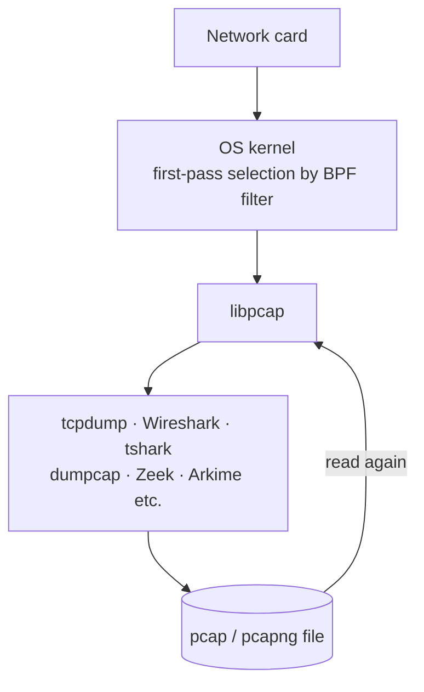

# Lesson 1.6 — The Container for Packets: libpcap, tcpdump, and the pcap/pcapng File Format { #pcap-and-tcpdump }

!!! abstract "Scope of this lesson"
    At the end of [lesson 1.5](proxy-cache.md) we said "if you can't extract a commercial cache, go to the data that crossed the wire: packets". This lesson covers the **container** those packets come in.

    - What libpcap is, and why tcpdump, Wireshark and tshark all run on top of it
    - Reading the pcap file header (24 bytes) and the per-packet record header (16 bytes) byte by byte
    - Snapshot length (snaplen) and truncated packets
    - What pcapng adds, its standardisation status, and what you lose converting to pcap
    - The basic tcpdump capture command, and what the statistics at the end mean

    BPF filter syntax is lesson 1.7; practical tcpdump options and the Wireshark window are lesson 1.8.

!!! note "Lab environment and notation"
    **(Actual output)** in this lesson comes from Ubuntu packages **tcpdump 4.99.4 (libpcap 1.10.4)** and **tshark 4.2.2** installed in this work environment, really capturing traffic exchanged with a test web server (`127.0.0.1:8082`) on the loopback interface (`lo`) of the same machine. As of 2026-11-05 the latest tags of each project are tcpdump 4.99.7, libpcap 1.11.0 and Wireshark stable 4.6.16 (checked from repository tags). Versions keep moving, so "latest" means as of that date.

## 1. A pcap file someone hands you { #a-pcap-file }

**(Hypothetical)** The day after lesson 1.4's incident, the network team hands over `research-1014.pcap`: "packets captured on the research segment tap during the incident window". You'll want to open it in Wireshark straight away, but first there are questions to ask.

- What time zone are the times in this file in?
- Are the packets whole, or only their first part?
- What kind of link (Ethernet, wireless, etc.) was it captured on?
- How many interfaces was it captured on, and were packets missed during capture?

Some of these answers are written **in the file itself**. Knowing the container's structure lets you judge, before even opening it, "what this evidence can and can't do".

## 2. An analogy: a recording tape and its label { #analogy }

Think of a packet capture file as a recording tape. At the very front is a **label**: "this tape was recorded this way, at this quality, with this camera". And each scene on the tape has **the time it was recorded and its length**.

A pcap file is the same. The **file header** at the front is the label (format, the most bytes stored per packet, the kind of link), and the **record header** in front of each packet is the per-scene time and length.

There are differences from the analogy too. The old pcap format's label has **no "which camera (interface) recorded it"**, and you can't put several cameras' footage on one tape. pcapng was created to fill this gap (section 6). Also, the tape's times follow the recording machine's clock. If that machine's clock was wrong, every scene's time is wrong together.

## 3. libpcap: the foundation under almost every packet tool { #libpcap }

The most fundamental tool in network forensics is **tcpdump**. It captures packets from the network, then either shows as much of each packet's information as you want on screen or writes the whole packet (or part of it) to disk. It's a command-line tool, so it works on your own PC or a remote server, typed by a person or automated in a script. It started in the Unix world but has been ported to other operating systems, and is a staple for Windows and Unix-like administrators and investigators alike.

tcpdump's core features actually come from the **libpcap** library underneath it. Four of them matter most:

1. **The BPF (Berkeley Packet Filter) language.** A simple filter language that decides "capture only packets like this". It builds elaborate filters by combining defined basic units (primitives) with logic (lesson 1.7).
2. **Showing on screen or saving to a pcap file.** pcap is a standardised format for storing packets on disk. Most of the data in this series is pcap files.
3. **Reading from a live network, or from a saved pcap file.** As the reverse of saving, libpcap lets you read a saved file just as if it were arriving from the network now. From a forensic perspective this is huge: **capture once, and years later you can analyse perfect copies of the original with many tools**.
4. **Deciding how much to keep (snaplen).** Keeping every byte is ideal, but legal or practical reasons sometimes prevent it. You can then keep only the first so many bytes of each packet, for example just the headers (section 5).

Because these features live in the **library**, not in tcpdump, other tools use exactly the same features. In fact the overwhelming majority of network analysis tools run on libpcap (or Npcap, its compatible implementation on Windows).



**How to read the diagram:** packets flow from top to bottom. The BPF filter in the kernel screens them first, and libpcap passes the result to the various tools. A file a tool writes is read back through libpcap, as the arrow looping back up shows, so any tool can analyse it again.

### 3.1 Wireshark and tshark { #wireshark-tshark }

tcpdump is great for capture but doesn't offer much for deep interpretation of packet content. **Wireshark** takes over there. It's a graphical program for visually examining network traffic and doing useful high-level analysis. Its biggest strength is **hundreds of protocol parsers** (dissectors, decoders). Because they show what each field in a packet means, you get productive much faster than reading protocol standards (RFCs) from scratch. The community often contributes dissectors even for proprietary protocols without published standards, and you can write your own.

Wireshark ships with **tshark**, the same features on the command line. You can work out an analysis approach in the GUI, then carry it over to tshark to apply across many files at once. That's a workflow we'll use often in this series.

Wireshark can capture too, but its GUI and dissectors do a lot behind the scenes, so it doesn't suit high-volume capture. It's fine in a lab, but when traffic picks up you need a dedicated capture tool like tcpdump. Modern Wireshark hands capture itself to a separate program, **dumpcap**, which can also be used on its own without the GUI (lesson 1.9).

## 4. Dissecting a pcap file { #pcap-format }

Let's open the container. I captured traffic with the test web server on loopback using tcpdump to make `full.pcap` (actual output):

```console
$ file full.pcap
full.pcap: pcap capture file, microsecond ts (little-endian) - version 2.4 (Ethernet, capture length 262144)
$ hexdump -C full.pcap | head -3
00000000  d4 c3 b2 a1 02 00 04 00  00 00 00 00 00 00 00 00  |................|
00000010  00 00 04 00 01 00 00 00  6f ec eb 6a d4 fe 04 00  |........o..j....|
00000020  4a 00 00 00 4a 00 00 00  00 00 00 00 00 00 00 00  |J...J...........|
```

### 4.1 The file header: the first 24 bytes { #file-header }

The first 24 bytes (`0x00`–`0x17`) are the file header. Read them four bytes at a time.

| Offset | Bytes | Value | Meaning |
| --- | --- | --- | --- |
| `0x00` | `d4 c3 b2 a1` | 0xa1b2c3d4 | **Magic number**: "this is a pcap file, times in microseconds" |
| `0x04` | `02 00` · `04 00` | 2 · 4 | Format version 2.4 |
| `0x08` | `00 00 00 00` | 0 | The field older documents called "time zone offset" |
| `0x0C` | `00 00 00 00` | 0 | The field older documents called "timestamp accuracy" |
| `0x10` | `00 00 04 00` | 262,144 | **Snapshot length** (maximum bytes stored per packet) |
| `0x14` | `01 00 00 00` | 1 | **Link-layer type**. 1 = Ethernet |

**Magic number and byte order.** Notice that the "Bytes" and "Value" columns are reversed? Computers store multi-byte numbers either **smallest part first** (little-endian) or **largest part first** (big-endian). Today's Intel and AMD x86 and x86-64 are little-endian, so the value 0xa1b2c3d4 is written `d4 c3 b2 a1` in the file. That's why the first four bytes of the most common pcap files are `d4 c3 b2 a1`. A file made on a very old big-endian machine shows `a1 b2 c3 d4`. These four bytes also tell a program "in which order to read the numbers in this file". That's why `file` reported `(little-endian)`.

Also, if the magic number is **0xa1b23c4d** (`4d 3c b2 a1` in the file), the format is the same but the fractional part of packet times is **nanoseconds** rather than microseconds. Even within pcap, interpret the times according to the magic number.

**[Changed] The time zone and accuracy fields.** The source material describes these two fields as "time zone always 0 because it's always UTC, accuracy also 0". Today's libpcap file format documentation defines both as **"not used"**: writers should fill them with 0, readers **must ignore** them, and it notes that some older writers stored non-zero values (checked 2026-11-05 in the `pcap-savefile` documentation on the libpcap 1.10 branch). The practical conclusion is the same: pcap packet times are **counted from 1 January 1970 UTC**, so they have no time zone, and whatever value is in these fields must not be used to adjust times.

**Snapshot length.** The most bytes stored per packet. 262,144 is tcpdump 4.99's default (confirmed in the tcpdump documentation). The source material's example is a good one: if every packet in an IPv4 pcap file is 40 bytes or less, were they truncated by a network error, or did someone capture with only 40 bytes? **This field gives the answer.** Defaults varied widely across tool versions and operating systems (old tcpdump defaulted to 68 or 96 bytes at times), so test and confirm tools before using them.

**Link-layer type.** The kind of medium it was captured from. 1 is Ethernet; there are many other values, such as wireless (802.11), Linux's "any" pseudo-interface (LINUX_SLL) and raw IP. The full list is in the `pcap-linktype` documentation. If this value is wrong, programs misinterpret a packet's first bytes. This lab used loopback yet showed 1 (Ethernet), because Linux presents loopback in Ethernet form.

### 4.2 The record header: 16 bytes per packet { #record-header }

After the file header come zero or more packets, each preceded by a 16-byte **record header**. In the hexdump above, the first packet's record header starts at `0x18`.

| Offset | Bytes | Value | Meaning |
| --- | --- | --- | --- |
| `0x18` | `6f ec eb 6a` | 0x6aebec6f = 1,793,846,383 | Capture time, **seconds** (Unix time) |
| `0x1C` | `d4 fe 04 00` | 0x0004fed4 = 327,380 | **Microseconds** after that second |
| `0x20` | `4a 00 00 00` | 74 | Bytes **stored** in the file (caplen) |
| `0x24` | `4a 00 00 00` | 74 | Bytes originally on the wire (len) |

The calculation (actual output):

```console
$ date -u -d @$((0x6aebec6f))
Thu Nov  5 02:39:43 UTC 2026
$ echo $((0x0004fed4))
327380
```

`$((0x6aebec6f))` asks the shell to turn hex into decimal. The first packet was captured at 02:39:43.327380 UTC on 2026-11-05. `capinfos` on the same file confirms it (actual output, partial):

```console
$ capinfos -M full.pcap
File name:           full.pcap
File type:           pcap
File encapsulation:  ether
File timestamp precision:  microseconds (6)
Packet size limit:   file hdr: 262144 bytes
Number of packets:   36
...
First packet time:   2026-11-05 02:39:43.327380
...
SHA256:              f734f65f4e69efec6bc4daa9b3bba40c9d379d61835aab27f45e09eded9f8957
Strict time order:   True
```

`capinfos`, included with Wireshark, summarises a capture file (`-M` shows large numbers in full instead of abbreviating them as 1k, 1M). It's the **first** command to run when someone hands you a file: file type, snapshot length, packet count, first and last packet times and even hashes, all at once. `Strict time order: True` means the packets are in time order; a result of merging several files may show `False`.

**[Caution] Packet times are "the capturing machine's clock".** The record header's time isn't an objective time the packet crossed the wire; it's what **the machine that captured it stamped with its own clock**. If the capture device's clock was five minutes fast, every packet is stamped five minutes fast. So check whether the capture device was synchronised with NTP (network time synchronisation), and align a few points with other evidence (e.g. lesson 1.3's proxy logs) for the same events, recording the offset.

## 5. Truncated packets: reducing the snapshot length { #snaplen }

I also captured the same traffic with `-s 96` (only 96 bytes per packet) for comparison (actual output):

```console
$ capinfos -M snap96.pcap | grep "Packet size"
Packet size limit:   file hdr: 96 bytes
Packet size limit:   inferred: 96 bytes
$ tshark -r snap96.pcap -T fields -e frame.number -e frame.cap_len -e frame.len | awk '$2!=$3' | head -4
4	96	143
6	96	252
8	96	98
16	96	153
```

The second command extracts each packet's number, stored length (`frame.cap_len`, the record header's caplen) and original length (`frame.len`, len), then uses awk to keep **only packets where they differ**. Packet 4 was originally 143 bytes but only 96 were stored. Its content shows where it was cut (actual output, partial):

```console
$ tcpdump -n -r snap96.pcap -A -c 4
...
.V7....(GET / HTTP/1.1
Host: 127.0.0.
```

`-A` shows packet content as text. The HTTP request breaks off at `Host: 127.0.0.`. The IP and TCP headers (who talked to whom, on which port, when) are intact, but **the content after them survives only up to 96 bytes**.

That's the two sides of snapshot length:

- **Why reduce it:** it saves a lot of storage, and keeps only headers when law or privacy policy forbids storing content. It also reduces processing load.
- **What you lose:** content is cut, so file carving (lesson 1.5) and payload analysis are impossible. You can't answer "what was exchanged", only "who talked to whom, when and how much". On lesson 1.1's spectrum, this evidence sits somewhere between full packets and flows.

So when packets are truncated, check the file header's snapshot length first. If it's 96, they were captured that way on purpose; if it's 262144 and they're still cut, look for another cause (a problem with the capture device, etc.).

## 6. pcapng: the next-generation format { #pcapng }

The old pcap format has limits. A file holds only one interface and one link type, you can't choose timestamp precision, and there's nowhere to leave notes or capture information. **pcapng** (pcap next generation) was created to fix this. Its structure is completely different from the old format: an extensible structure that chains units called **blocks**. Commonly cited benefits:

- Packets from several interfaces (even of different types) in one file
- Better timestamp precision options
- Rich metadata such as comments, capture statistics and name resolution (DNS) records

Capturing the same traffic with tshark to make a pcapng file shows the difference (actual output, partial):

```console
$ file capture.pcapng
capture.pcapng: pcapng capture file - version 1.0
$ capinfos -M capture.pcapng
...
Capture hardware:    Intel(R) Xeon(R) Processor @ 2.10GHz (with SSE4.2)
Capture oper-sys:    Linux 6.18.44-fc-v236
Capture application: Dumpcap (Wireshark) 4.2.2 (Git v4.2.2 packaged as 4.2.2-1.1build3)
Number of interfaces in file: 1
Interface #0 info:
                     Name = lo
                     Encapsulation = Ethernet (1 - ether)
                     Capture length = 262144
                     Time precision = nanoseconds (9)
                     Filter string = tcp port 8082
```

Information pcap didn't have is visible: **which interface** (`lo`), **which filter** (`tcp port 8082`), **which program, OS and hardware** captured it, and that times are at **nanosecond** precision. For an investigator, that's a valuable record of "how this evidence was made". A preserved capture filter in particular tells you "what was missing from this file from the start". Captured with `tcp port 8082`, it's normal that other traffic such as DNS isn't there at all.

### 6.1 [Changed] Standardisation and compatibility { #pcapng-status }

The source material says pcapng "was proposed in the IETF in 2004 but is still a draft, and critical tools don't fully support it, so convert to legacy pcap wherever possible". Status as checked on 2026-11-05:

- **Standardisation:** pcapng is still an IETF **Internet-Draft**. The latest revision is `draft-ietf-opsawg-pcapng-05` from March 2026. A separate draft describing the old pcap format (`draft-ietf-opsawg-pcap-08`, May 2026) targets "Historic" status and states that pcapng replaces that format.
- **Support:** Wireshark, tshark and dumpcap use pcapng as their **default save format**. libpcap can read pcapng files too, but its documentation says "not all pcapng files can be read". For example, a file mixing several interfaces with different link types may not be read correctly by libpcap-based tools. In this lab, tcpdump 4.99.4 read the simple file without problems (actual output):

    ```console
    $ tcpdump -n -r capture.pcapng | head -2
    reading from file capture.pcapng, link-type EN10MB (Ethernet), snapshot length 262144
    02:39:43.327380 IP 127.0.0.1.36314 > 127.0.0.1.8082: Flags [S], seq 833062265, ...
    ```

### 6.2 Converting to pcap, and what you lose { #convert }

When you must feed pcapng to an untested tool, Wireshark's command-line tool `editcap` converts it to legacy pcap (actual output):

```console
$ editcap -F pcap capture.pcapng converted.pcap
$ file converted.pcap
converted.pcap: pcap capture file, microsecond ts (little-endian) - version 2.4 (Ethernet, capture length 262144)
$ capinfos -M converted.pcap | grep -i precision
File timestamp precision:  microseconds (6)
```

`-F pcap` means "output format pcap". The conversion worked, but the converted file **lacks** the interface name, capture filter and capture program, OS and hardware information seen in section 6, and timestamp precision **dropped from nanoseconds to microseconds**. pcap has nowhere to hold that information.

So it's better to apply the source material's "convert to pcap wherever possible" with an adjustment:

1. **Preserve the original pcapng as evidence** and record its hash.
2. Convert only **a working copy for the tool that needs it**, and record when and with what command you converted it.
3. Interpret results from the converted copy alongside the original's metadata (interface, filter, precision).

## 7. Capturing with tcpdump { #capturing }

Now the capture command. Its basic form:

```bash
sudo tcpdump -n -s 0 -i ens33 -w out.pcap 'host 203.0.113.5 and port 80'
```

| Part | Meaning | Why |
| --- | --- | --- |
| `sudo` | Run with administrator rights | Capturing directly from an interface usually needs administrator rights |
| `-n` | Don't turn addresses into names or ports into service names | Generates no name lookup traffic (OPSEC), and is faster |
| `-s 0` | Snapshot length 0 = the default maximum (262,144 bytes) | Keep whole packets. Defaults varied across versions, so say it explicitly |
| `-i ens33` | Capture on interface `ens33` | `tcpdump -D` lists usable interfaces |
| `-w out.pcap` | Save to a file instead of the screen | Analyse again later with any tool |
| `'host 203.0.113.5 and port 80'` | BPF filter | Only packets involving that address and port 80 (lesson 1.7) |

**Almost always add `-n`.** Without it, tcpdump does a DNS lookup for every IP it sees. Besides slowing things down, if the attacker watches their own DNS server, they learn "someone looked up my address". That's the OPSEC issue we've discussed since lesson 1.2.

**Wrap BPF filters in quotes.** If the shell interprets characters in the filter such as spaces and parentheses first, you get a different filter from what you meant. Single or double quotes are the best habit.

`tcpdump -D` lists interfaces (actual output, partial):

```console
$ tcpdump -D
1.eth0 [Up, Running, Connected]
2.any (Pseudo-device that captures on all interfaces) [Up, Running]
3.lo [Up, Running, Loopback]
...
```

**Promiscuous mode.** A network card normally accepts only packets addressed to itself. For capture, the card is switched to **promiscuous mode** to accept packets not addressed to it, which needs administrator rights. tcpdump turns promiscuous mode on by default. But on a switched network promiscuous mode alone doesn't show other people's traffic, because the switch never sends their packets to that port in the first place. That's why taps or switch mirroring are needed, covered in lesson 1.11. Note that capturing on Linux's `any` interface doesn't use promiscuous mode.

**[Supplement] The user that writes the file.** For security, tcpdump on many Linux distributions drops administrator rights after starting capture and writes the file as an ordinary user such as `tcpdump`. So saving with `-w` to a folder that user can't write may give a permission error. In this lab I used `-Z root` to stop it switching users. In practice it's better to set up permissions on a dedicated capture folder.

### 7.1 The three numbers at the end { #capture-stats }

When capture stops, tcpdump shows statistics (actual output):

```console
tcpdump: listening on lo, link-type EN10MB (Ethernet), snapshot length 262144 bytes
36 packets captured
72 packets received by filter
0 packets dropped by kernel
```

| Line | Meaning (per tcpdump documentation) |
| --- | --- |
| `packets captured` | Packets tcpdump actually received and processed |
| `packets received by filter` | **Meaning varies by OS.** It may count packets regardless of the filter, or include packets that matched but haven't been processed yet |
| `packets dropped by kernel` | Packets the OS capture mechanism **discarded** for lack of buffer space. 0 if the OS doesn't report it |

In this lab, 72 "received" versus 36 "captured" looks odd, but as documented, the meaning of this number depends on the OS and configuration. I didn't separately determine why it was exactly double in this environment. The important point is not to read it as "36 were missed". **To see missed packets, look at the last line, `dropped by kernel`.**

And `0 dropped` **doesn't guarantee nothing was missed.** It counts only what was discarded **inside** the capturing machine. Packets discarded before that, for example by an overflowing switch mirror port, are invisible to this machine. And even with `-s 0` to keep whole packets, packets are lost if the capture machine's **CPU** can't keep up, or if the **storage** can't write as fast as the link delivers. So test capture equipment **at real speed and scale** before relying on it in operations.

### 7.2 Reading a captured file { #reading }

Read a saved file back with `-r` (actual output, partial):

```console
$ tcpdump -n -r full.pcap -A 'tcp[((tcp[12]&0xf0)>>2):4] = 0x47455420' | head -4
02:39:43.327455 IP 127.0.0.1.36314 > 127.0.0.1.8082: Flags [P.], seq 833062266:833062343, ack 1449026129, win 64, options [nop,nop,TS val 3495311331 ecr 3503756584], length 77
E...H.@.@...............1..zV^bQ...@.u.....
.V7....(GET / HTTP/1.1
Host: 127.0.0.1:8082
```

The filter at the end is BPF meaning "packets whose TCP data starts with the four bytes `GET `". It looks daunting now, but lesson 1.7 unpacks it piece by piece. In `full.pcap` the same request is visible intact up to `Host: 127.0.0.1:8082`. Compare with section 5's truncated file.

## 8. How to interpret it in a real investigation { #interpretation }

Given section 1's `research-1014.pcap`, before opening it:

1. **Make a copy and record a hash.** Leave the original untouched and analyse the copy (`sha256sum`, or `capinfos`'s SHA256).
2. **Check the container with `capinfos`.** Format (pcap/pcapng), snapshot length (is the content intact?), link type, first and last packet times (does it cover the incident window?), packet count, time order.
3. **If it's pcapng, record the metadata.** Interface name, capture filter (what was left out from the start), capture program, comments.
4. **Ask about capture conditions.** At which tap or mirror point (lesson 1.1 section 10's tap positions), which direction, with what equipment. Are there statistics on packets dropped during capture? Was the capture device's clock right?
5. **From that, write down "what this file can do".** E.g. "snapshot length 96, so no file carving; only connection records and header analysis possible", or "capture filter was `tcp`, so no DNS (mostly UDP)".

These five lines become the "evidence description" part of the report. Later, when someone says "X isn't in this file, so X didn't happen", they're also the basis for telling whether that's a limit of the evidence or X really didn't happen.

## 9. Summary { #summary }

- Most tools, such as tcpdump, Wireshark, tshark and Zeek, run on **libpcap**. BPF filters, pcap saving and reading, and snapshot length are all libpcap features, so the same principles hold across tools.
- Capture once into pcap, and years later you can re-analyse perfect copies of the original with many tools.
- A pcap file consists of a 24-byte file header (magic number, version, two unused fields, snapshot length, link type) and a 16-byte record header per packet (seconds, microseconds or nanoseconds, stored length, original length).
- Magic `d4 c3 b2 a1` is little-endian microseconds; `4d 3c b2 a1` is nanoseconds. Packet times are UTC Unix time and follow the capturing machine's clock.
- If the stored length is shorter than the original length, the packet is truncated. Check the file header's snapshot length to see whether that was intended.
- pcapng holds several interfaces, nanosecond precision, and metadata such as interface names, capture filters and capture environment. As of 2026 it's still an IETF draft but is the default format for the Wireshark family. Converting to pcap loses this information, so preserve the original.
- When capturing, add `-n`, quote the filter, and check `dropped by kernel` at the end. Even 0 can't tell you what was missed outside the capture machine.

In the next lesson (1.7) we unpack the BPF filters glimpsed here step by step, from primitives to byte-level conditions.

## Review questions { #review }

**Question 1.** A capture file's first four bytes are `4d 3c b2 a1`. What does that tell you? What happens if you interpret this file's packet times as microseconds?

??? success "Answer and explanation"
    As a value it's 0xa1b23c4d: a **nanosecond-precision pcap** file stored little-endian. The record header's second field is **nanoseconds**, not microseconds. Misread as microseconds, 0.327380123 seconds (327,380,123 ns), say, becomes 327,380,123 microseconds, i.e. a little over 327 seconds, giving a nonsensical time far past the next second. Most tools handle this from the magic number, but when writing a script that reads bytes directly, check the magic number first.

**Question 2. (Calculation)** The first 8 bytes of a pcap record header are `00 e1 f5 05 40 42 0f 00` (little-endian, microsecond format). When was this packet captured? Is anything odd about the second value?

??? success "Answer and explanation"
    The first four bytes `00 e1 f5 05`, read backwards, are 0x05f5e100 = **100,000,000** seconds. `date -u -d @100000000` gives **1973-03-03 09:46:40 UTC**. The second four bytes `40 42 0f 00` are 0x000f4240 = **1,000,000**, but the microsecond field must be 0–999,999. 1,000,000 should have rolled over into "the next second", so it's **not valid for the format**. Such a value signals that the file is corrupt, that it's really nanosecond format and the magic number was misread, or that the tool that made the file has a problem. The 1973 time itself also suggests the capture device's clock may have been in a reset state. Don't ignore such anomalies; record them in the evidence description.

**Question 3. (Interpretation)** Every packet in a pcap a colleague handed over is 68 bytes or less. The colleague says "there were only small packets on the network". How do you check?

??? success "Answer and explanation"
    Look at the file header's **snapshot length** (`capinfos`'s "Packet size limit"). If it's 68, the packets weren't small; it was captured **storing only up to 68 bytes**. Some old tcpdump versions defaulted to 68, so this is common in files from old equipment or scripts. More definitively, compare each packet's stored length (caplen) with its original length (len) (`tshark -T fields -e frame.cap_len -e frame.len`). If many packets have an original length above 68, there were big packets but they were truncated. Then record the limitation that this file can't support content analysis or file carving.

**Question 4. (Common misconception)** After capture you see `1520 packets captured`, `3040 packets received by filter`, `0 packets dropped by kernel`. A colleague wants to report "1,520 packets were missed". Right?

??? success "Answer and explanation"
    Wrong. Per the tcpdump documentation, the meaning of `received by filter` **varies by OS**, and may count regardless of the filter. Packets discarded by the capture machine are `dropped by kernel`, which is 0. So the correct reading is "no packets were discarded inside the capture machine". Even that doesn't mean "nothing at all was missed". Packets discarded **before** the capture machine, by a mirror port or tap, don't appear in this number, so check those devices' statistics too.

**Question 5. (Conversion)** To feed `evidence.pcapng`, received as incident evidence, into an old analysis tool, you converted it with `editcap -F pcap`. What should go in the report, and what's the problem with keeping only the converted copy instead of the original?

??? success "Answer and explanation"
    The report should give the original file and its hash, the conversion date, command (`editcap -F pcap evidence.pcapng work.pcap`) and tool version, and the converted copy's hash, and state that the converted copy was used for analysis. Keeping only the converted copy **permanently loses** information that existed only in pcapng. As section 6.2 showed, the interface name, capture filter, capture program, OS and hardware, comments and nanosecond precision disappear. If the file mixed several interfaces, you may lose which packet came from which. Then you can no longer answer questions like "which tap did this packet come from?" or "was anything excluded by the capture filter?" Preserve the original pcapng as it is.

**Question 6. (Reading a command)** Find what's wrong or risky in this command and fix it.

```bash
sudo tcpdump -i eth0 -w case.pcap host 198.51.100.20 and (port 80 or port 443)
```

??? success "Answer and explanation"
    1. **No `-n`.** When writing to a file, names aren't shown on screen, so the impact may be small, but add it out of habit. Run the same command without `-w` to view on screen, and tcpdump looks up every IP in DNS: an OPSEC problem.
    2. **The BPF isn't quoted.** The shell treats `(` and `)` as special characters, so this command either fails with a syntax error or behaves differently from what was meant.
    3. **No `-s 0`.** tcpdump 4.99 defaults to 262,144 bytes so it's fine, but older versions and other tools had small defaults, so stating it is a good habit.

    Fixed: `sudo tcpdump -n -s 0 -i eth0 -w case.pcap 'host 198.51.100.20 and (port 80 or port 443)'`

**Question 7. (pcapng metadata)** A pcapng file's `capinfos` output shows `Filter string = not port 22`. What does this mean for an investigation?

??? success "Answer and explanation"
    This file was captured **excluding port 22 (mostly SSH) traffic from the start**. So SSH traffic not appearing in this file doesn't mean "there was no SSH traffic"; it means **it was outside the collection scope**. If the attacker came in over SSH or tunnelled through SSH, this file can't tell you, and you need other evidence such as flow records or the server's authentication logs. Also record why the capture administrator excluded SSH (to cut management traffic, etc.). In the old pcap format this information wouldn't be in the file, and you couldn't know without asking whoever captured it.

**Question 8. (Time)** The first packet time in a pcap from the capture device is `2026-10-14 15:02:10`, and the proxy log (lesson 1.4) recording the same moment says `15:07:10`. Both are UTC. What do you suspect, and how should you handle it?

??? success "Answer and explanation"
    The pcap's time is **the capture device's clock**; the proxy log's time is **the proxy server's clock**. Five minutes apart for the same event means one (or both) clocks are likely wrong. As lesson 1.3 showed, Squid records when a request finished, but for a short request that doesn't explain five minutes. Check: both devices' NTP configuration and sync records, and the times in a third record of the same event (firewall, DNS server). Handling: don't alter the original times; **record with evidence** which device was off and by how much, and when building the timeline, apply that correction explicitly. Don't assume one side is "right" without evidence.

## References { #references }

- The Tcpdump Group, libpcap 1.10 branch [`pcap-savefile` documentation source](https://github.com/the-tcpdump-group/libpcap/blob/libpcap-1.10/pcap-savefile.manfile.in) (checked 2026-11-05). Magic numbers 0xa1b2c3d4 and 0xa1b23c4d, the definition of two fields as "not used (writers 0, readers ignore)", the snapshot length and link-type fields, and the record header structure.
- The Tcpdump Group, libpcap 1.10 [`pcap_open_offline` documentation source](https://github.com/the-tcpdump-group/libpcap/blob/libpcap-1.10/pcap_open_offline.3pcap.in) (checked 2026-11-05). pcapng can be read, but not all pcapng files can be.
- The Tcpdump Group, tcpdump 4.99 branch [`tcpdump.1` documentation source](https://github.com/the-tcpdump-group/tcpdump/blob/tcpdump-4.99/tcpdump.1.in) (checked 2026-11-05). Default snapshot length 262,144 bytes, `-r` reads pcapng files too, promiscuous mode and the `any` interface, and the meaning of the end-of-capture statistics.
- IETF, [draft-ietf-opsawg-pcapng](https://datatracker.ietf.org/doc/draft-ietf-opsawg-pcapng/) (revision -05, March 2026, confirmed by search 2026-11-05) and [draft-ietf-opsawg-pcap](https://datatracker.ietf.org/doc/draft-ietf-opsawg-pcap/) (revision -08, May 2026, targeting Historic status).
- tcpdump, libpcap and Wireshark repository tags (checked 2026-11-05 with `git ls-remote --tags`): tcpdump-4.99.7, libpcap-1.11.0, Wireshark v4.6.16.

!!! note "About this page"
    Personal study notes rewritten in my own words from a range of study material. The lab traffic and files were made in this work environment; the case is hypothetical.
