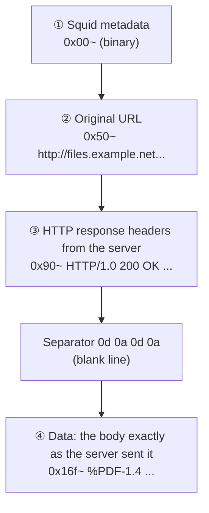

# Lesson 1.5 — Commercial Proxy Logs, and Pulling Responses Out of the Proxy Cache { #proxy-cache }

!!! abstract "Scope of this lesson"
    The last lesson of the web proxy unit:

    - Reading commercial proxy logs: find the field definitions first, and check whether more detailed logs already exist
    - What a proxy cache keeps and doesn't keep (`refresh_pattern` and response headers)
    - The folder layout of a Squid cache, and the internal structure of one cache file
    - Finding cache objects of interest (`grep`, `strings`) and turning them back into original files (carving)
    - Checking the extracted file: identifying its type, comparing hashes, decompressing, opening it safely
    - Why commercial proxy caches are hard, and what to turn to instead

!!! note "Lab environment and notation"
    **(Actual output)** in this lesson comes from installing the Ubuntu package **Squid 6.14** in this work environment, running a test web server I wrote (`127.0.0.1:8081`, with the example domains mapped to that address), fetching files through the proxy, and examining the real cache files that resulted. Times show the lab date (2026-11-05 UTC). Squid 6 is out of support upstream but still common as a distribution package, and for what this lesson covers its cache file structure matches the Squid 7 documentation. The commercial log example is a sample I made.

## 1. Commercial proxy logs: "find the rules first" { #commercial-logs }

Lesson 1.4's investigation could go straight to shell commands because the Squid log was plain text. What about the commercial proxies common in enterprises? As lesson 1.2 said, the data is there, but **getting it out and reading it takes more effort**.

Appliances such as Broadcom's Edge SWG (ProxySG), for example, accumulate logs on the device and export them in batches (e.g. over FTP), or send them through SIEM connectors. The logs you receive are usually in the **W3C Extended Log File Format** (ELFF). Its distinguishing feature is a header at the top of the file with lines starting `#`, among which the `#Fields:` line gives **the name of each column in order**. Here's a sample I made:

```text
#Software: ExampleProxy 1.0
#Version: 1.0
#Date: 2026-10-14 15:00:00
#Fields: date time time-taken c-ip sc-status s-action sc-bytes cs-bytes cs-method cs-uri-scheme cs-host cs-uri-port cs-uri-path cs-uri-query cs-username cs-auth-group s-hierarchy s-supplier-name rs(Content-Type) cs(Referer) cs(User-Agent) sc-filter-result cs-categories x-virus-id s-ip
2026-10-14 15:48:26 212 10.10.6.14 302 TCP_NC_MISS 727 664912 POST https paste.example 443 /post - jdoe LAB\research DIRECT 198.51.100.40 text/html "https://paste.example/" "Mozilla/5.0 (...) Firefox/144.0" OBSERVED "Pastebins" - 10.10.4.3
```

Field names follow a rule. The leading letters give the **direction**. `c` is the client, `s` the proxy itself (server), `r` the origin server (remote); `cs-` means "sent by the client to the proxy", `sc-` "sent by the proxy to the client", and `rs()` "a header sent by the origin server". So `cs-bytes` is **how much the client uploaded**, and `sc-bytes` **how much the client received**.

Here's an important connection to lesson 1.4. There, Squid's default log had no upload size, so we couldn't tell how much went to the paste site. This sample line shows `cs-bytes` as **664,912 bytes**. The commercial appliance's example format shown in the source material includes `cs-bytes` too. It depends on the device and configuration, so always check, but it means commercial logs **may hold more** than plain Squid logs. Fields like `cs-categories` (URL category) and `sc-filter-result` (policy verdict) aren't in Squid's default log either.

### 1.1 A shell command that finds fields by name { #elff-awk }

ELFF column order varies with device configuration, so memorising column **numbers** breaks on another device. Instead, read the `#Fields:` line to build a "name → number" table and extract fields by name, and the same command works under any configuration. Some fields (User-Agent and others) are quoted and contain spaces, so the script also keeps quoted values together as one field.

```awk
# Build a "field name -> number" table from the #Fields header, then extract fields by name.
/^#Fields:/ { for (i = 2; i <= NF; i++) col[$i] = i - 1; next }
/^#/ { next }
{
  n = 0; line = $0
  while (length(line) > 0) {
    sub(/^ +/, "", line)
    if (substr(line, 1, 1) == "\"") { m = index(substr(line, 2), "\""); f[++n] = substr(line, 2, m - 1); line = substr(line, m + 2) }
    else { m = index(line, " "); if (m == 0) { f[++n] = line; line = "" } else { f[++n] = substr(line, 1, m - 1); line = substr(line, m + 1) } }
  }
  print f[col["date"]], f[col["time"]], f[col["c-ip"]], f[col["cs-username"]], f[col["cs-method"]], f[col["cs-host"]] f[col["cs-uri-path"]], f[col["sc-status"]], "out=" f[col["cs-bytes"]], "cat=" f[col["cs-categories"]]
}
```

`col[$i] = i - 1` subtracts 1 because `#Fields:` itself is the first field, so the real names start from the second. Run against a three-line sample (actual output):

```console
$ awk -f elff.awk elff.log
2026-10-14 15:48:26 10.10.6.14 jdoe POST paste.example/post 302 out=664912 cat=Pastebins
2026-10-14 15:55:48 10.10.6.14 jdoe GET customs.example/files/form-cm105.pdf 200 out=512 cat=Government
2026-10-14 15:56:02 10.10.7.15 - GET c2.example.net/gate 403 out=389 cat=Malicious Sources
```

### 1.2 What to check before interpreting commercial logs { #commercial-checklist }

- **Find the rules (field definitions) first.** Fields with the same name can mean slightly different things across vendors and versions. Interpret only after checking the vendor's field documentation (e.g. Broadcom's Edge SWG access log fields article) and that device's actual log format configuration. In particular, don't assume `s-action` values (`TCP_HIT`, `TCP_NC_MISS`, `TCP_DENIED`, etc.) are defined the same as Squid's cache statuses just because the names look similar.
- **Check the time zone.** ELFF `date` and `time` are usually UTC, but device settings can make them local time. Look at the `#Date:` header together with the device configuration.
- **Check whether more detailed logs already exist.** Commercial devices may keep several logs besides the access log: policy verdict logs, malware scan logs, authentication logs. What operations normally send to the SIEM may be a subset of fields. The originals on the device may be richer, so ask first what exists and how far back.

## 2. The proxy cache: what's kept and what isn't { #what-gets-cached }

Now to the cache. Back to lesson 1.2's analogy, the cache is the purchasing desk's **storeroom**. Its original purpose was keeping copies of frequently requested content to save slow links. For investigators, those copies can be important clues, such as **malware delivered to victims and material sent outside**. To use them, you need to know two things: **which responses the proxy decides to keep**, and **in what form it stores them**.

### 2.1 Who decides whether to keep it? { #freshness }

A proxy that receives a response weighs three things.

1. **Did the server say it may be kept?** The response headers `Cache-Control` and `Expires` give instructions. `Cache-Control: max-age=1209600` means "fresh for 1,209,600 seconds (14 days); use it without asking again until then", `no-store` means "don't store this at all", and `private` means "this is personal; don't store it in a shared cache (a proxy)".
2. **What if the server said nothing?** Then the proxy's `refresh_pattern` rules estimate "how long to treat it as fresh".
3. **Other conditions.** Size limits, objects excluded from caching by ACL, responses with cookies and more.

`refresh_pattern` looks like this, the final line found in lesson 1.2's example and most configurations:

```squid
refresh_pattern .               0       20%     4320
```

| Position | Value | Meaning (per Squid 7 documentation) |
| --- | --- | --- |
| Regular expression | `.` | Pattern applied to URLs. `.` means "any character", so it matches every URL |
| min | `0` | **Minimum minutes** an object without a server-given expiry is treated as fresh. 0 means "never assume fresh by default" |
| percent | `20%` | When there's a `Last-Modified` header but no `max-age` or `Expires`, the percentage of (response time − last modified time) used as the freshness period |
| max | `4320` | **Maximum minutes** an object without a server-given expiry is treated as fresh (4,320 minutes = 3 days) |

A worked example. If an image response has neither `max-age` nor `Expires`, and `Last-Modified` is 10 days before the response time, the freshness period is 10 days × 20% = **2 days**. That's between min (0 minutes) and max (3 days), so for 2 days the cached copy is served without asking the server. If `Last-Modified` were 100 days earlier, 20% would be 20 days, but max caps it at **3 days**. And if there's no `Last-Modified` at all, there's no basis for percent, so min applies, **0 minutes**: "not fresh" as soon as it arrives.

The source material continues from here to "min is 0, so nothing is cached unless the server instructs it, which is why the pastes weren't in the cache". But testing it myself showed something slightly different.

### 2.2 [Correction] What testing showed: "not fresh" is not "not stored" { #cache-test }

I prepared four responses on the test web server differing only in headers, fetched each once through Squid 6.14, and checked the cache folder (actual output):

| Test response | Cache-related headers | Stored as a cache file? |
| --- | --- | --- |
| PDF form | `Cache-Control: max-age=1209600`, `Last-Modified` present | **Stored**. A repeat request gave `TCP_MEM_HIT` |
| Script (gzip-compressed) | `Cache-Control: public, max-age=7200` | **Stored** |
| Paste ① | **No** cache-related headers | **Stored**. A repeat request was logged `TCP_REFRESH_MODIFIED` (fetched anew from the server), and the cache file changed to a new number |
| Paste ② | `Cache-Control: no-store` | **Not stored** |
| Paste ③ | `Cache-Control: private` + `Set-Cookie` | **Not stored** |

The third row is the key. The response with no instructions was judged **"not fresh"**, so it wasn't served as-is on the next request, but it **was stored** on disk. And until a new response replaced it on the next request, that copy stayed in the cache folder.

So the right summary for investigators:

- **If the server sent `no-store` or `private`**, there's almost no chance of finding it in the cache. Pages after login and web apps that serve different content per person use these headers a lot.
- **If there were no instructions**, it may have been stored. But a repeat request for the same URL replaces it with a new copy, and when the cache fills, the oldest objects are deleted.
- **So don't conclude "this site isn't cached" from zero cache search hits.** Conversely, if something turns up, you were lucky, and you must check **when** that copy was stored (the `Date` header, section 4).

Why the pastes in the source material's case weren't in the cache can only be known by checking the headers the real site sent (cookies, `private`, etc.). Note too that this test was one version, Squid 6.14, against a simple test server, so other versions or settings (`refresh_pattern` options such as `store-stale` or `ignore-private`) may behave differently. If an administrator used options like `ignore-private` or `ignore-no-store` to cache more than the standard allows, there's more evidence, but correspondingly bigger privacy issues. That too is something to check in the config first, as in lesson 1.2.

## 3. The folder layout of a Squid cache { #cache-layout }

To secure the cache, first know **where** it is. The starting point is always the config file:

```squid
cache_dir ufs /var/spool/squid 100 16 256
```

You read this line in lesson 1.2. It gives the storage type (`ufs`), location, maximum size (MB), number of first-level folders (16) and second-level folders (256). The source material describes the default size as 100 MB, which is closer to the example value distributions put in their default config; in practice most administrators make it much larger. And as lesson 1.2 showed, per the Squid 7 documentation, with no `cache_dir` line at all there's no disk cache.

Two things to watch when securing it:

- **There may be several `cache_dir` lines.** Squid then **spreads** cache objects across several folders. Copy one folder and you miss part of it, so secure every path in the config.
- **The storage type may differ.** Besides `ufs`, `aufs` and `diskd` use the same family of folder layout, but `rock` is a completely different structure that packs objects into one large file. If you see a non-default type, learn that type's structure first.

`ufs` cache files appear at paths like these (actual output):

```console
$ find /var/tmp/squid-lab/spool -type f -name '0*' | sort
/var/tmp/squid-lab/spool/00/00/00000000
/var/tmp/squid-lab/spool/00/00/00000001
/var/tmp/squid-lab/spool/00/00/00000002
```

That's **two hex digits / two hex digits / eight hex digits**, like `00/00/00000000`. Unfortunately these names tell you **nothing** about the original URL, file type, size or time; they're just numbers assigned in storage order. So you have to open them.

## 4. Inside one cache file { #cache-file-structure }

Run `file` on a cache file and it usually just says "data" (binary). But there's plenty of readable text mixed in, so a handful can be taken apart by eye. Here's the start of the cache file holding the PDF, with `hexdump -C` (actual output, partial):

```console
$ hexdump -C 00/00/00000000 | head -26
00000000  03 90 00 00 00 03 10 00  00 00 60 e8 f8 2b d1 ab  |..........`..+..|
...
00000050  68 74 74 70 3a 2f 2f 66  69 6c 65 73 2e 65 78 61  |http://files.exa|
00000060  6d 70 6c 65 2e 6e 65 74  3a 38 30 38 31 2f 66 69  |mple.net:8081/fi|
00000070  6c 65 73 2f 66 6f 72 6d  2d 63 6d 31 30 35 2e 70  |les/form-cm105.p|
00000080  64 66 00 0a 08 00 00 00  71 02 00 00 00 00 00 00  |df......q.......|
00000090  48 54 54 50 2f 31 2e 30  20 32 30 30 20 4f 4b 0d  |HTTP/1.0 200 OK.|
000000a0  0a 53 65 72 76 65 72 3a  20 42 61 73 65 48 54 54  |.Server: BaseHTT|
...
00000120  61 63 68 65 2d 43 6f 6e  74 72 6f 6c 3a 20 6d 61  |ache-Control: ma|
00000130  78 2d 61 67 65 3d 31 32  30 39 36 30 30 0d 0a 4c  |x-age=1209600..L|
...
00000160  33 3a 30 30 3a 30 30 20  47 4d 54 0d 0a 0d 0a 25  |3:00:00 GMT....%|
00000170  50 44 46 2d 31 2e 34 0a  31 20 30 20 6f 62 6a 3c  |PDF-1.4.1 0 obj<|
```

Each `hexdump -C` line has three parts. The left is the position in the file (hex byte offset), the middle the values of 16 bytes from that position (in hex), and the right, inside `| |`, the same bytes shown as characters, with unprintable values shown as `.`.

The file has four parts:



**How to read the diagram:** top to bottom is front to back of the file. The `0x..` in each box is where that part starts in the hexdump above.

1. **Squid metadata.** The binary values at the very start are information Squid attaches for its own management (the object's identifying key, timing information, etc.). Hard for a person to read.
2. **Original URL.** Starting with the protocol marker (`http://`), the first readable text you notice.
3. **HTTP response headers.** The headers the server originally sent, stored as-is: `Date` (when the server responded), `Content-Type`, `Content-Length`, `Cache-Control`, `Last-Modified` and so on.
4. **Data.** The body starts after the blank line that ends the headers. From the start of the headers to the end of the file is **exactly the response the server sent** for the original request.

The separator `0d 0a 0d 0a` between headers and body is set by the HTTP standard. `0d` is carriage return (CR, back to the start of the line) and `0a` line feed (LF, next line), so `0d 0a 0d 0a` is "end the line, then end another with nothing on it": **a blank line**. HTTP places one blank line after the header lines before the body begins. In the hexdump above, `0d 0a 0d 0a` sits at `0x16b`–`0x16e`, and right after it, at `0x16f`, `25` is `%`, the first character of `%PDF`.

**[Supplement] Use the `Date` header to check "when is this copy from".** Cache file names carry no time, but the stored response's `Date` header is when the server produced that response. This lab's file contained `Date: Thu, 05 Nov 2026 02:30:45 GMT`. It's the first clue for telling whether the file you found in the cache is the one received at the time of the incident, or a replaced copy from someone fetching the same URL later. Align this time with the matching request time in the proxy log.

## 5. Finding cache objects of interest { #finding-objects }

### 5.1 Cast a wide net: `grep -rail` { #railgrep }

Cache files contain the URL and headers as text, so `grep` can sweep the whole folder for files containing a name of interest (actual output):

```console
$ cd /var/tmp/squid-lab/spool
$ grep -rail form-cm105 .
./00/00/00000000
```

The options one by one:

| Option | Meaning | Why |
| --- | --- | --- |
| `-r` | Search everything under the folder (recursive) | The cache is spread across several folder levels |
| `-a` | Treat binary files as text | Cache files are detected as binary, and otherwise their contents aren't shown |
| `-i` | Ignore case | URLs and headers may mix case |
| `-l` | Print **only file names**, not matching lines | So binary content doesn't clutter the screen |
| `-F` | Search literally, not as a regular expression | Finds symbols like `.` as text, and is much faster |

The first four together are often called "railgrep" (`grep -rail`). On a large cache, adding `-F` too, as in `grep -railF 'files.example.net' .`, is a good idea. But for objects whose body is **stored compressed** (gzip etc.), the text inside the body is compressed, so you can't find them by body content. URLs and headers aren't compressed, so searching by URL or file name is reliable.

### 5.2 A quick look at what it is: `strings` { #strings }

`strings` shows quickly what a found file is. It extracts **only runs of consecutive printable characters** from a file, and `-n 10` means "only runs of 10 or more", which filters out short accidental fragments in the binary (actual output):

```console
$ strings -n 10 00/00/00000000 | head -8
http://files.example.net:8081/files/form-cm105.pdf
HTTP/1.0 200 OK
Server: BaseHTTP/0.6 Python/3.13.18
Date: Thu, 05 Nov 2026 02:30:45 GMT
Content-Type: application/pdf
Content-Length: 402
Cache-Control: max-age=1209600
Last-Modified: Wed, 01 Oct 2025 03:00:00 GMT
```

The URL, result code, content type, size and even why it was cached (`max-age`) are visible at a glance. The headers themselves explain what this object is and why it stayed in the cache.

### 5.3 What's in the cache: listing URLs { #url-list }

To see many files at once, extract just the first line starting with `http` (= the original URL) from each (actual output):

```console
$ for file in $(grep -rail 'example' .); do strings -n 10 "$file" | grep '^http' | head -n 1; done
http://cdn.example.net:8081/js/app.js
http://files.example.net:8081/files/form-cm105.pdf
http://paste.example:8081/k7Qm2x
```

`for file in $( ... ); do ... done` is shell syntax for running the inner command once per file name produced by the command in the parentheses. Inside, `strings` extracts the text runs, `grep '^http'` keeps only lines **starting** with `http` (`^` means "start of line"), and `head -n 1` takes the first. The result is "the list of URLs in the cache". The paste `k7Qm2x`, with the same name as in lesson 1.4, appears here because of section 2.2's test.

## 6. Pulling the original file out of the cache (carving) { #carving }

Now let's restore the PDF to its original file. Cutting just the wanted file out of a larger lump of data like this is called **carving**. The principle is simple: **delete the separator `0d 0a 0d 0a` and every byte before it**, and what's left is the body the server sent, i.e. the original file.

### 6.1 By hand: a hex editor { #carve-hex-editor }

With only a few files, open a **copy** of the cache file in a hex editor (`ghex` or `bless` on Linux, HxD on Windows, etc.), find `0d 0a 0d 0a`, delete it and everything before it, and save under a new name. Leave the original cache file untouched.

### 6.2 By command: the same job, repeatably { #carve-script }

Doing it by hand is error-prone and hard to apply to many files. A small Python script that does the same job lets you reproduce the same result any time, which is also better for evidence handling.

```python
import sys, hashlib
src, dst = sys.argv[1], sys.argv[2]
data = open(src, "rb").read()
start = data.index(b"HTTP/")              # beginning of the stored response headers
sep = data.index(b"\r\n\r\n", start)       # end of headers (the blank line)
body = data[sep + 4:]
open(dst, "wb").write(body)
print(f"headers at 0x{start:x}, separator at 0x{sep:x}, body {len(body)} bytes")
print("sha256", hashlib.sha256(body).hexdigest())
```

There's a reason the separator is searched for **after `HTTP/`** rather than from the start of the file: the binary metadata at the front might happen to contain the same bytes as `0d 0a 0d 0a`. The real separator is the first blank line after the headers begin. `\r\n` is how Python writes `0d 0a`. The result (actual output):

```console
$ python3 carve.py 00/00/00000000 out/carved.pdf
headers at 0x90, separator at 0x16b, body 402 bytes
sha256 120db0f4998cb4d20d6238a3a92d254a61b32e5f46175a91837c7f2ce9f0bbfb
```

The positions the script found (headers `0x90`, separator `0x16b`) match what we saw by eye in section 4's hexdump, and the 402-byte body matches the header's `Content-Length: 402`.

## 7. Checking the extracted file { #verify }

### 7.1 Identify the type: `file` { #file-command }

`file` compares the bytes at the start of a file against known file formats to tell you its type (actual output):

```console
$ file out/carved.pdf
out/carved.pdf: PDF document, version 1.4, 1 page(s)
```

The header's `Content-Type: application/pdf` matches the actual content. Lesson 1.3 said the MIME type is only the server's **claim**; `file` is a quick, reasonable cross-check of that claim against the real content. If the server said PDF and `file` says executable, that is itself an important finding.

### 7.2 Compare hashes { #hash }

In this lab the original file is on the test server, so the hashes can be compared directly (actual output):

```console
$ sha256sum www/form-cm105.pdf
120db0f4998cb4d20d6238a3a92d254a61b32e5f46175a91837c7f2ce9f0bbfb  www/form-cm105.pdf
```

**Exactly the same** as the carved file's hash: the cache copy is byte-for-byte identical to the server's original. In real cases you usually can't have the original, but recording the carved file's hash lets you ① reproduce the same result later, and ② **look up** whether a known malicious file with that hash exists in threat intelligence services. (That's different from uploading the file itself to a public service; remember lesson 1.2's OPSEC.)

### 7.3 If it's compressed: decompress and check again { #decompress }

Not every object opens straight away. Carving the script file the same way gives (actual output):

```console
$ python3 carve.py 00/00/00000001 out/carved-js
headers at 0x83, separator at 0x14c, body 84 bytes
$ file out/carved-js
out/carved-js: gzip compressed data, last modified: Thu Nov  5 02:30:45 2026, max compression, original size modulo 2^32 1264
$ strings -n 10 00/00/00000001 | grep -i content-encoding
Content-Encoding: gzip
$ gunzip -c < out/carved-js > out/app.js
$ file out/app.js
out/app.js: ASCII text
```

The server sent it **compressed** with `Content-Encoding: gzip`, and the cache stored it compressed. So the carved result is a gzip file, and `gunzip` is needed to get the original script back. Besides gzip there are `br` (Brotli), `deflate` and others, and sometimes decompressing reveals another encoding (e.g. Base64). Check the headers and **decode as many times as needed** until you reach the original form. `file` is your guide at every step.

**[Caution] Other cases where the result may differ from the original.** If the response was `206` (partial), the cache may hold only part of it; and if you see `Transfer-Encoding: chunked` in the headers, the body may have chunk length markers mixed in that need removing. If the carved size differs from `Content-Length`, don't move on; find out why.

### 7.4 Open it safely { #safe-viewing }

To see the content you eventually have to open the file. This PDF was made by hand for the test and is safe, but in a real case a file carved from the cache is an **untrusted file**. A malicious PDF or document can attack the analysis PC the moment it's opened. So open such files in a **throwaway analysis environment** that can break without consequence (a virtual machine isolated from the network, etc.). Opening it straight on your main forensic workstation can contaminate the workstation itself, casting doubt on every analysis result after that.

## 8. Back to the case, and the remaining questions { #back-to-case }

Applying this to lesson 1.4's case:

- **The currency declaration form PDF:** the log had `TCP_MEM_HIT`, so it likely entered the cache. Using this lesson's method, find it by URL, check the headers' `Cache-Control` and `Date`, carve it, confirm with `file` and a hash, and open it in a throwaway environment to confirm it really is "a currency declaration form". This turns lesson 1.4 section 7's "PDF that appears to be a form" into "the form".
- **The three pastes:** try `grep -railF k7Qm2x` with the paste IDs. If it turns up, that's a big win; if not, weigh which of section 2.2's reasons applies (headers, replacement on re-request, deletion for lack of space). In the source material's case, nothing turned up. Even then, the conclusion "the paste content could not be confirmed from proxy evidence alone" stands.

Before wrapping up, ask these questions of the evidence not yet fully reviewed:

- Were there other exfiltration attempts? (other upload sites, cloud storage, large `POST`s)
- Was there suspicious activity **leading up to** the events we examined?
- Are there other "artifacts of communication" (lesson 1.1's goal 2)? (DNS queries, firewall records, mail server records)
- What further evidence would explain better what happened?

At the same time, beware of the "rabbit hole" from the end of lesson 1.4. These questions are for setting priorities within the question and time given, not an invitation to dig endlessly.

## 9. Commercial proxy caches: "it's complicated" { #commercial-cache }

Extracting content from a Squid cache is fairly easy like this, and can be automated. Commercial products are different. If their log analysis is complicated, cache extraction is often **all but impossible**. The cache format isn't published, so you need proprietary knowledge, or reverse engineering to learn the structure, or both. Some devices also encrypt the cache.

In that case it may be easier to reach **the root truth** through other evidence sources. The most certain root is **the data that actually crossed the wire**: packets. Skip the complex, undocumented cache format and look at the data that passed over the network itself. That doesn't mean giving up on the commercial device's data; as section 1 showed, use whatever usable format there is. But working with packets requires knowing how network data is **stored, analysed and replayed**. That's the subject from the next lesson on.

## 10. Summary { #summary }

- Commercial proxy logs like ELFF define their columns in a `#Fields:` header. **Find the rules (field definitions) first**, extract fields by name, and check whether more detailed logs already exist. They may hold information Squid's default log lacks, such as `cs-bytes`.
- Whether to cache is decided by the server's `Cache-Control` and `Expires`, and the proxy's `refresh_pattern` (min, percent, max).
- **[Correction]** In Squid 6.14 as tested, responses with no cache instructions were still stored on disk (just judged not fresh). `no-store` and `private` responses were not stored. Don't conclude "not cacheable" from zero cache search hits.
- A `ufs` cache consists of files named `hex2/hex2/hex8`, and the names tell you nothing. With several `cache_dir` lines, secure them all.
- A cache file runs metadata → URL → response headers → `0d 0a 0d 0a` → body, and from the headers to the end it's exactly the server's response. Use the headers' `Date` to establish when the copy is from.
- Find with `grep -railF`, look with `strings -n 10`, and carve by deleting the separator and everything before it. A repeatable script beats manual work.
- Confirm the type with `file` and identity with a hash, and decompress as many times as needed. Open untrusted files in a throwaway environment.
- Commercial caches are very hard to extract from; then turn to the data that crossed the wire (packets).

In the next lesson (1.6) we cover libpcap and tcpdump, the basic tools for handling those packets, and the structure of pcap and pcapng files.

## Review questions { #review }

**Question 1.** An ELFF log's `#Fields:` line has `cs-bytes` and `sc-bytes`. To judge the amount exfiltrated in lesson 1.4's paste site case, which field should you look at, and why?

??? success "Answer and explanation"
    **`cs-bytes`**. The leading letters of ELFF field names give the direction: `cs-` is client → proxy, `sc-` is proxy → client. The amount **uploaded** to the paste site is what the client sent, so it's `cs-bytes`. `sc-bytes` is the size of the response the site returned (a short 302 redirect in this case), unrelated to the amount exfiltrated. But confirm the field's exact definition (whether headers are included, etc.) from that device's field documentation.

**Question 2. (Calculation)** With `refresh_pattern . 0 20% 4320`, how long is each of the following responses treated as fresh? None has `Cache-Control: max-age` or `Expires`. (a) `Last-Modified` 5 days before the response time (b) 40 days before (c) no `Last-Modified`

??? success "Answer and explanation"
    The server gave no expiry, so `refresh_pattern` applies.

    - (a) 5 days × 20% = **1 day**. Between min (0 minutes) and max (4,320 minutes = 3 days), so 1 day as computed.
    - (b) 40 days × 20% = 8 days, but max caps it at **3 days**.
    - (c) With no `Last-Modified` there's no basis for percent, so min applies: **0 minutes**, not fresh as soon as it arrives.

    (c) is the common case for dynamic pages like pastes. And as section 2.2 showed, not fresh is not the same as not stored.

**Question 3. (Common misconception)** A colleague says: "`refresh_pattern`'s min is 0, so this proxy never stores responses the server didn't give instructions for. No point searching the cache." How would you respond?

??? success "Answer and explanation"
    min 0 means "the minimum period **treated as fresh** is 0", not "don't store". In this lesson's Squid 6.14 test, a response with no cache instructions was stored on disk and only replaced with a new copy on the next request. So searching the cache is worthwhile. But also point out that `no-store` and `private` responses weren't stored, that re-requesting the same URL or the cache filling up removes copies, and that behaviour can differ by version and configuration. Search, and if nothing turns up, work out why: that's the right order.

**Question 4.** Searching the cache folder with `grep -raiF 'invoice-2026' .` returns 0 hits. But the proxy log records `http://files.example.net/docs/invoice-2026.zip` fetched with `TCP_MISS/200`. Give at least three possible reasons.

??? success "Answer and explanation"
    1. **The server said not to store it:** with `no-store` or `private` in the response, it isn't stored.
    2. **It was stored and then disappeared:** the same URL may have been fetched again later, replacing it with a new copy (the file number changes), or the cache filled and the oldest objects were deleted.
    3. **It's in another `cache_dir`:** with several `cache_dir` lines, it may be stored under another path.
    4. **There's no disk cache:** with no `cache_dir`, it was only in memory and may have vanished on restart.
    5. **It was excluded by a size limit or ACL:** it may have hit a maximum object size setting or a no-cache rule.
    6. **A search problem:** check you didn't drop `-l` or give the wrong path. URLs aren't compressed, so searching by URL text is itself a sound approach.

    Narrow it down with the config file and `cache.log`.

**Question 5. (Reading structure)** Below is part of a cache file's hexdump. Where does the body (data) start, and what do the first bytes `4d 5a` most likely mean?

```text
000001a0  36 0d 0a 43 6f 6e 6e 65  63 74 69 6f 6e 3a 20 63  |6..Connection: c|
000001b0  6c 6f 73 65 0d 0a 0d 0a  4d 5a 90 00 03 00 00 00  |lose....MZ......|
```

??? success "Answer and explanation"
    The `0d 0a 0d 0a` on the second line is at `0x1b4`–`0x1b7` (the fifth to eighth bytes from the line's start at `0x1b0`), so the body starts right after, at **`0x1b8`**. `4d 5a` is `MZ` as text, the unique two bytes (magic bytes) that start a Windows executable (EXE, DLL). So this cache object is most likely **a Windows executable**. If the headers' `Content-Type` claims another format such as `image/png`, the server disguised the content, which is an important finding. Carve it, confirm with `file`, record a hash, and handle it only in a throwaway environment.

**Question 6. (Changed conditions)** `file` on a carved file says `gzip compressed data`. The headers have `Content-Type: text/html` and `Content-Encoding: gzip`. What do you do next, and how do you interpret the result?

??? success "Answer and explanation"
    The server sent the HTML **compressed** with gzip, and the cache stored it compressed. Decompress with `gunzip -c` and check again with `file`. If the result is HTML text, it's normal and matches the headers' claim. If decompressing reveals yet another format (e.g. a Base64 blob, another compression), repeat as many steps as needed. Also remember that in its compressed state, a `grep` for text inside the body didn't work; objects like this must be found by URL.

**Question 7. (Interpreting a hash)** You **looked up** the carved file's SHA-256 in a threat intelligence service and found no match. Can you conclude "this file isn't malicious"?

??? success "Answer and explanation"
    No. "No lookup result" only means **that service doesn't know this hash**. Files attackers tweak per target have a different hash each time, so having no record anywhere is normal. No result is the same problem as lesson 1.1's "no result ≠ nothing". Judge it together with the file type (`file`), its content, behavioural analysis in a throwaway environment, and the communication from that PC after receiving it (proxy and flow records). And **uploading** the file itself to a public analysis service to check may alert the attacker (OPSEC), so follow your organisation's policy.

**Question 8. (Judgement)** You need to extract a particular malicious file from the cache of your organisation's commercial proxy, but the vendor doesn't publish the cache format. What alternatives are there?

??? success "Answer and explanation"
    - **Packet capture:** if there's full packet capture for that segment at that time, you can reassemble the HTTP response from the packets and extract the file (covered from the next lesson). On a proxy doing TLS interception, the proxy–PC segment is encrypted with the internal CA, so which segment the packets come from matters.
    - **Endpoint evidence:** the file may remain in the receiving PC's browser cache, downloads folder or antivirus quarantine.
    - **The device's own features:** some commercial devices keep files separately for malware scanning, or have records of passing them to a sandbox. Ask operations or vendor support.
    - **Other victims or intelligence:** the same URL or hash may have been obtained elsewhere (look it up with OPSEC in mind).

    The key is not "can't extract from the cache, so that's it", but finding other evidence sources that reach the same fact: lesson 1.1's "many witnesses" principle.

## References { #references }

- Squid project, Squid 7 branch [`src/cf.data.pre`](https://github.com/squid-cache/squid/blob/v7/src/cf.data.pre) (checked 2026-11-05). Definitions of `refresh_pattern` min, percent and max, options such as `ignore-private`, `ignore-no-store` and `store-stale`, and the `cache_dir` format and storage types.
- RFC 9111, [HTTP Caching](https://www.rfc-editor.org/rfc/rfc9111). `Cache-Control` `max-age`, `no-store` and `private`, and heuristic freshness.
- RFC 9112, [HTTP/1.1](https://www.rfc-editor.org/rfc/rfc9112): section 2.1 message format (the blank line after headers) and section 7.1 chunked transfer coding.
- W3C, [Extended Log File Format](https://www.w3.org/TR/WD-logfile.html) (Working Draft). The `#Fields` header and the meaning of the `c`, `s`, `r`, `cs` and `sc` prefixes.
- Broadcom, [Edge SWG (ProxySG) access log fields, article 240610](https://knowledge.broadcom.com/external/article/240610/edge-swg-proxysg-access-log-fields.html) (title confirmed by search 2026-11-05). An example of a primary source for a commercial device's field definitions.

!!! note "About this page"
    Personal study notes rewritten in my own words from a range of study material. The lab server, cache files and logs were made up for explanation.
