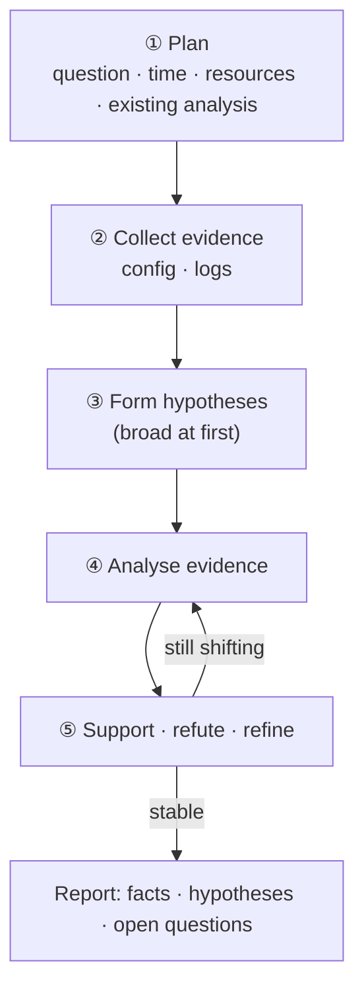

# Lesson 1.4 — Reconstructing an Incident from Proxy Logs Alone: Investigation Walkthrough { #proxy-log-walkthrough }

!!! abstract "Scope of this lesson"
    We put everything from [lesson 1.2](web-proxies.md) and [lesson 1.3](proxy-logs.md) to work on one case.

    - The order of an investigation: plan → collect evidence → hypothesise → analyse → support, refute or refine → repeat until stable
    - Getting the overall picture with shell commands when automated tools fail
    - Following the characters a user typed through search autocomplete requests
    - Reading webmail traces, and the "test it and compare" method
    - Interpreting requests logged several times in the same second, redirects and 404s
    - Traces suggesting exfiltration via a paste site, and their limits
    - Weaving scattered findings into one timeline, and reporting facts, hypotheses and open questions separately

!!! note "About the lab material"
    The case, people, organisation and domains in this lesson are all **hypothetical**. The sample log (`combined` format, 144 lines) was built for this case, and command output marked **(Actual output)** was produced by really running the commands against that sample log. Long output is trimmed with `...`. All times are UTC.

## 1. The case: a researcher disappears { #case }

**(Hypothetical)** At lesson 1.1's research institute, an employee who uses research-segment PC `10.10.6.14` abruptly leaves one afternoon and doesn't come to work the next day. This employee had already been suspected of passing research results to a competitor. The next day word comes that the employee was stopped at the airport while boarding an overseas flight, carrying a large undeclared sum of cash. The employee had no company material on them, and no electronic devices such as USB drives or laptops.

Management asks: "Determine whether this employee leaked company material." The employee's PC has already had a first-pass analysis (triage), which found no access to material outside their duties and no obvious signs of wrongdoing. A detailed PC analysis is under way, and we look at network evidence **in parallel**.

The organisation's environment:

- All internal web traffic goes through a Squid proxy, and the firewall prevents bypass.
- The proxy uses TLS interception (generating certificates on the fly) and logs query strings, User-Agent and Referer.
- Staff sign an acceptable use policy on joining stating that "use of the company network is logged and may be reviewed". That notice and approval are what make an investigation like this possible.

## 2. The order of an investigation { #process }

You'll want to open the logs straight away, but first set the order.



**How to read the diagram:** it runs top to bottom, but ④ and ⑤ loop until the hypotheses stop shifting. The key is asking, with every new finding, "does this support, refute or require refining my hypothesis?"

**① Plan.** Make the question clear. What's needed now isn't "the ultimate truth" but **"enough to give a well-founded opinion on whether this employee leaked material"**. Time is short, so scope the work to that. Also check what analysis is already done (the PC triage result). The fact that it found "no traces" is itself information.

**② Collect evidence.** What we secured this time:

- The proxy config file `/etc/squid/squid.conf`: tells us log locations, format and behaviour
- Proxy logs: `access.log`, and `cache.log` (the error log)

The logs were received **reduced to this employee's PC address only**. That's also good practice for handling personal data minimally, since there's no reason to look at other staff's records unrelated to the investigation. The trade-off, which we record, is that this data can't show whether the same thing happened from other PCs.

The key points from the config, read with lesson 1.2's method: the main changes from defaults are an enabled disk cache, TLS interception, query string logging (`strip_query_terms off`), and the `combined` format with User-Agent and Referer. So we can expect HTTPS requests to be logged with full URLs too.

**[Supplement]** Older Squid installations sometimes wrote Referer and User-Agent not into `access.log` but into **separate files** such as `referer.log` and `useragent.log`. Squid 7 still has built-in `referrer` and `useragent` formats, so the same setup is possible. If the config has `access_log` lines like that, secure those files too.

**③ Form hypotheses.** Start broad, for example:

- Hypothesis A: this employee sent company material out via the web.
- Hypothesis B: this employee planned the departure and carrying the cash in advance.
- Hypothesis C: this employee's web activity was no different from normal work (there's nothing to support the leak suspicion).

Include a "nothing happened" hypothesis like C on purpose. As lesson 1.1 taught, having something to look for contradicting evidence against keeps you from drifting to one side.

## 3. First attempt: an automated tool { #automated-tool }

First, run an automated summary tool. But what lesson 1.3 warned about actually happens. Many Squid summary tools can only read **the default log format**, so given a log switched to `combined` like this proxy's, they stop with "I don't know this input format". With open source you could change the code to read the new format, but there's no time now. Drop the easy option and go to the shell.

## 4. The overall picture: which sites were visited { #overview }

In the `combined` format, split on whitespace, the seventh field is the URL (`IP - - [date +0000] "method URL HTTP/1.1" ...`). So we use lesson 1.3's command with just the field number changed (actual output):

```console
$ grep -v '"CONNECT ' access.log | awk '{print $7}' | awk -F/ '{print $3}' | sort | uniq -c | sort -nr
     82 search.example
     14 news.example
     10 intranet.lab.example
     10 cdn.news.example
      8 paste.example
      6 weather.example
      5 customs.example
      3 mx3.webmail.example
      2 webmail.example
      2 login.webmail.example
      1 travel-rules.example
```

`grep -v '"CONNECT '` means **drop** the `CONNECT` lines (`-v` means "only non-matching lines"). On a proxy with TLS interception, each HTTPS connection first produces a `CONNECT` line, and the real requests inside are logged separately as `https://` URLs. `CONNECT` lines have `host:443` in the URL field, which doesn't fit the next step of extracting hostnames, so they're dropped.

This list is the first material for hypotheses. Search requests dominate, and the intranet, news and weather look like ordinary work and life. Three things stand out: a paste site (`paste.example`), webmail (the `webmail.example` family), and `customs.example`, which looks customs-related. Let's follow each.

## 5. Search autocomplete: exactly what the user typed { #autocomplete }

There are 82 search requests. Did a person really search 82 times in a day? Opening them up, most are to a `/complete` address (actual output):

```console
$ grep -c 'search.example' access.log
83
$ grep 'search.example' access.log | grep -c '/complete'
81
```

`grep -c` counts only the **number** of matching lines. 81 of the 83 lines are `/complete`. What is this?

It's **autocomplete**, the feature that shows suggested searches under the box as you type. Every time a key is pressed, the browser sends the characters typed so far to the server and gets suggestions back. Requests like this, exchanged in the background without reloading the page, are commonly called AJAX (asynchronous requests). The result is that the proxy log holds **requests growing one character at a time**, a record close to a keylogger. Extracting just the time and the value after `q=` (actual output, partial):

```console
$ grep -F 'search.example/complete' access.log | awk '{split($7,a,"q="); print substr($4,14), a[2]}'
15:02:10 o
15:02:11 or
15:02:12 orc
15:02:13 orch
...
15:02:26 orchid%20alloy%20test
...
```

Breaking the command down: `split($7,a,"q=")` splits the URL (seventh field) in two at `q=` into array `a`, and `a[2]` is the second part, the typed characters. `substr($4,14)` takes the fourth field `[14/Oct/2026:15:02:10` from the 14th character on, i.e. just the time. `%20` is how a space is written inside a URL (percent-encoding).

There's no need to read every line as characters accumulate. Just extract **where typing ended**, i.e. where the next line isn't a continuation of the previous one (actual output):

```console
$ grep -F 'search.example/complete' access.log | awk '{split($7,a,"q="); t=substr($4,14); q=a[2]; if (prev!="" && index(q,prev)!=1) print pt, prev; prev=q; pt=t} END{print pt, prev}'
15:02:26 orchid%20alloy%20test
15:06:52 orchid%20patent
15:10:21 flight%20711%20status
15:10:53 connecting%20482
15:53:03 currency%20declaration
```

`index(q,prev)!=1` is the condition "this value **does not start with** the previous value". That's the moment the previous input ended, so it prints the previous value (`prev`) and its time (`pt`). The last input has no following line, so `END` prints it separately.

Now we can read what this employee typed. Let's say `orchid` is the name of one of the institute's sensitive research projects. The employee looked up that project's **test results** and **patent**, then **flight status** and a **connecting flight**, and much later **currency declaration**.

### 5.1 [Caution] Reading autocomplete records { #autocomplete-caveats }

This record is powerful, but interpret it with care.

- **"Typed" and "searched" are different.** An autocomplete request records that the user **typed characters** into the search box. Whether they actually pressed search and saw results needs a separate search request (`/search?q=`). In the sample log there's an actual search request only for `orchid patent` (actual output):

    ```console
    $ grep -F 'search.example/search' access.log | awk '{print substr($4,14), $7}'
    15:07:02 https://search.example/search?q=orchid%20patent
    ```

    For the rest, the user may have clicked a suggestion, the results page may have opened by another path, or they may have just deleted it. Reports must distinguish "typed X into the search box" from "searched for X".
- **Who typed it is a separate question.** This record is about "this PC". Who was using that PC at that time is confirmed by other evidence such as logon records.
- **Every search site works differently.** Many browsers also send suggestion requests for characters typed into the address bar, and the request shape (path, parameter names, GET/POST) varies by site and browser and changes often. In a real case, test the behaviour at that time before interpreting (section 6.1).
- **Without TLS interception, this record doesn't exist.** A non-intercepting proxy has just one `CONNECT search.example:443` line. Autocomplete is visible in this case purely because of the configuration.

### 5.2 So why didn't the PC analysis find it? { #why-triage-missed }

If the employee searched like this in a browser, why didn't the PC triage find search or browsing history? Possible explanations: they browsed in **private mode** (an incognito window), or **cleared the browser history and cache** afterwards. Those traces may or may not be partly recoverable in the detailed PC analysis. But from the proxy, the record is plain to see. It even shows characters accumulating one at a time, so it's more detailed than a perfect PC analysis would be. This is lesson 1.1's advantage that "evidence accumulates apart from the target (here, the employee's PC)" in action.

## 6. Webmail { #webmail }

The host list included a webmail service. It's one of countless free webmail providers, and a sign the employee may have sent a message (actual output):

```console
$ grep -F 'webmail.example' access.log | awk '{print substr($4,14), $6, $7, $9, $10}'
15:18:30 "GET https://webmail.example/ 200 16120
15:19:27 "POST https://login.webmail.example/login 302 507
15:46:12 "POST https://login.webmail.example/login 302 507
15:46:28 "POST https://mx3.webmail.example/mail/compose;sid=9f2c?action=autosave 200 967
15:46:58 "POST https://mx3.webmail.example/mail/compose;sid=9f2c?action=autosave 200 967
15:50:14 "GET https://mx3.webmail.example/mail/sentconfirm;sid=9f2c?view=SHOW_CONFIRM 200 7161
15:50:23 "GET https://webmail.example/logout 200 15169
```

Line by line:

- **15:18:30** Opened the webmail front page.
- **15:19:27, 15:46:12** Sent a `POST` to the login page and got `302` (moved elsewhere). That's the common shape of submitting a login form and, on success, being sent on to the inbox. The two logins are about 27 minutes apart.
- **15:46:28, 15:46:58** Right after the second login, two `POST`s to the `compose` address with `action=autosave`, 30 seconds apart. These look like the web app **autosaving** in the background while a message is written.
- **15:50:14** An address containing `sentconfirm` and `SHOW_CONFIRM`. By its name, a "sent confirmation" screen.
- **15:50:23** Logout.

There's a very important limit here. **The message content, recipients and attachments are not in the log.** They travelled in the **body** of the `POST` requests, and the proxy log records the URL and some headers, not the body. They're not in the cache either. The cache keeps only reusable responses the server returned, and there's no reason to cache an outgoing request body.

### 6.1 Does "sent confirmation" really mean it was sent? Test it and compare { #test-case }

Seeing the name `sentconfirm` and guessing "a message was sent" is a reasonable hypothesis. But it's a **guess**, not confirmation. A good way to confirm is to **do the same thing yourself and compare what the proxy records**.

1. Use a separate account created for the investigation to access the same webmail service. Never use the subject's account.
2. Under the same conditions (same proxy, same kind of browser), log in, write a message, send it and log out, one step at a time, **noting the time of each action**.
3. Extract your test records from the proxy log and match which URLs appeared for each action.
4. Compare with the subject's records. If you confirm "pressing send produces `sentconfirm`, and saving alone doesn't", the 15:50:14 record strongly supports **sent**.

Logout can be confirmed the same way. But web services change constantly, so test as close to the incident as possible and record the test date and environment in the report. Also note that the test only tells you "this is how it behaves today"; there's no guarantee it behaved identically at the time.

## 7. Related activity: a PDF fetched three times in one second { #related-activity }

The last autocomplete input was `currency declaration`. Check what was viewed around it. There's a blog post reached from the search results (`travel-rules.example/blog/carrying-cash`, with the search site as Referer), and right after it, records from a customs site (actual output):

```console
$ grep -F 'customs.example' access.log | awk '{print substr($4,14), $7, $9, $10, $NF}'
15:54:17 http://customs.example/forms/declare-currency.pdf 301 444 TCP_MISS:HIER_DIRECT
15:54:19 https://customs.example/forms/declare-currency.pdf 404 16211 TCP_MISS:HIER_DIRECT
15:55:48 https://customs.example/files/form-cm105.pdf 200 237248 TCP_MISS:HIER_DIRECT
15:55:48 https://customs.example/files/form-cm105.pdf 200 237247 TCP_MISS:HIER_NONE
15:55:48 https://customs.example/files/form-cm105.pdf 206 40701 TCP_MEM_HIT:HIER_NONE
```

`$NF` in awk means "the last field on the line", here the cache and hierarchy status.

- **15:54:17** Requested a PDF over `http://` and got `301` (moved permanently), the common shape of a server sending you back with "come again over `https://`".
- **15:54:19** Requested again over `https://`, but got `404` (not found). The file was no longer at that address; perhaps an old link was followed.
- **15:55:48** A PDF at another path fetched **three times in the same second**. Twice `200` (sizes 237,248 and 237,247, **a one-byte difference**), once `206` (partial, 40,701 bytes, from memory cache).

Three lines in one second looks odd, but it's common with PDFs. A browser's PDF viewer often doesn't fetch the file in one go; it **requests only the ranges it needs** (HTTP Range requests), or requests a preview and the full download separately. The `206` is that trace. The exact cause of the one-byte difference can't be known from this log. The size field includes headers, so it could be a one-character header difference. Don't assert anything here; leave it as "cause not determined". The important observed fact is "the employee downloaded what appears to be a currency declaration form PDF".

**[Caution] Why not just fetch the PDF again now?** Be careful about visiting that URL now to check the content, for three reasons. First, **OPSEC**: if the target is an attacker's server, connecting from the organisation's address announces the investigation (the risk is small for a government site as in this case, but the habit matters). Second, **it may already have changed**: the file may have been deleted or altered. Third, **servers can serve different content to different requesters**: some return different content depending on the requesting IP, cookies or settings. So where possible, prefer **a copy from the time**, pulled from the proxy cache (lesson 1.5) or packets. This PDF even shows signs of having entered the cache (`TCP_MEM_HIT`), so there's a good chance it can be extracted.

## 8. The paste site: material walking out the door? { #paste-site }

`paste.example` in the host list is a **paste site**, where anyone can paste text and share it by link. It's handy for parking text briefly, so it comes up often in data leaks (actual output):

```console
$ grep -F 'paste.example' access.log | awk '{print substr($4,14), $6, $7, $9, $10}'
15:35:01 "GET http://paste.example/ 301 585
15:35:05 "CONNECT paste.example:443 200 0
15:35:05 "GET https://paste.example/ 200 8925
15:48:26 "POST https://paste.example/post 302 727
15:48:30 "GET https://paste.example/k7Qm2x 200 664841
15:49:12 "POST https://paste.example/post 302 727
15:49:14 "GET https://paste.example/Zp81Lr 200 635510
15:49:46 "POST https://paste.example/post 302 727
15:49:48 "GET https://paste.example/R4tw9B 200 281017
```

The first three lines are the first visit to the site: `http://`, then `301` to `https://`, the `CONNECT` line from lesson 1.2, and, thanks to interception, the `https://` URL.

The key is the three pairs that follow. A `POST` to `/post` gets a `302`, and within seconds a `GET` fetches a **never-before-seen short address** like `/k7Qm2x`. Sites like this commonly **redirect you to the new paste's short unique address** after you post. So this shape fits the interpretation "a paste was posted, and the site sent the user to the new paste's address". Testing as in section 6.1 would confirm it. Three paste IDs (`k7Qm2x`, `Zp81Lr`, `R4tw9B`) and their response sizes (about 650 KB, 620 KB and 270 KB) remain. That's a lot for text.

So what was posted? Here we hit the wall again.

- **The posted content (the `POST` body) isn't in the log**, for the same reason as the webmail in section 6.
- **The response from fetching the paste address is probably not in the cache either.** Sites like this often don't include "you may cache this" instructions in their responses, and then Squid's default settings don't keep them (lesson 1.5 explains why).
- **Opening it on the site now may show nothing.** Sites like this can set pastes to expire; suppose checking shows they're already gone.

The remaining hope is the site operator's cooperation. The paste IDs survive exactly, so if the operator keeps expired pastes, they might be found. But that usually requires a legal request through law enforcement, with no guarantee of success.

**[Supplement] To at least record how much was uploaded.** The default log's size field from lesson 1.3 (`%<st`) is the size of the response **sent** to the client, so it doesn't tell you how much the employee **uploaded**. That's why all three `POST`s above show 727 bytes: it's the size of the short redirect response the server returned. To prepare for exfiltration investigations, add `%>st`, the size of the request **received** from the client, to `logformat`. Then even without the content you can say "about 650 KB went out in this `POST`". But it's only recorded from the moment you add that field, so set it up **before** an incident.

## 9. Weaving a timeline { #timeline }

So far the findings are scattered by site. Put back in time order (2026-10-14, UTC):

| Time | Event | Basis |
| --- | --- | --- |
| 15:02:26 | Typed `orchid alloy test` into search box | Autocomplete requests |
| 15:06:52 · 15:07:02 | Typed `orchid patent`, actually ran the search | Autocomplete + `/search` request |
| 15:10:21 | Typed `flight 711 status` | Autocomplete requests |
| 15:10:53 | Typed `connecting 482` | Autocomplete requests |
| 15:18:30 | First visit to webmail | GET |
| 15:19:27 | First webmail login | POST → 302 |
| 15:35:05 | First visit to paste site | 301 → CONNECT → GET |
| 15:46:12 | Second webmail login | POST → 302 |
| 15:46:28 | Started writing a message (autosave) | compose POST |
| 15:48:30 | Paste ① `k7Qm2x` created | POST → 302 → new ID |
| 15:49:14 | Paste ② `Zp81Lr` created | Same shape |
| 15:49:48 | Paste ③ `R4tw9B` created | Same shape |
| 15:50:14 | Message sent (apparently) | `sentconfirm` |
| 15:50:23 | Webmail logout | logout |
| 15:53:03 | Typed `currency declaration` into search box | Autocomplete requests |
| 15:53:55 | Read a blog post on carrying cash | GET, Referer = search site |
| 15:55:48 | Downloaded currency declaration form PDF | 200 · 200 · 206 |

In order, a **flow** emerges that wasn't visible site by site. The employee looked up the sensitive project, checked flights, logged into webmail, opened the paste site, logged in again and started a message, posted three pastes in the meantime, sent the message and logged out immediately, then looked up the rules for carrying cash.

## 10. Summing up: facts, hypotheses and open questions { #findings }

Now separate them as in lesson 1.1.

**Observed facts (directly in the log).**

- The sensitive project's name and related words were typed into the search box on this PC, and one of them was actually searched.
- The same day, flight-related words and, later, currency-declaration-related words were typed, and a PDF that appears to be a currency declaration form was downloaded.
- There were two webmail logins, autosave requests from the compose screen, what appears to be a "sent confirmation" screen, and a logout.
- There were three `POST`s to the paste site, each followed by a request that appears to be a new paste address, leaving three paste IDs.

**Hypotheses those facts support.**

- Hypothesis B (planned the departure and carrying the cash in advance) is strongly supported, and fits the actual arrest.
- Hypothesis A (leaked material via the web) is **supported but not established**, because the content of the three pastes and the sent message is unknown.
- Hypothesis C (no different from normal) fits this record poorly.

**What needs further evidence.**

- The **content** of the pastes and the message: legal requests to the site and mail service operators (with law enforcement cooperation), the proxy cache (lesson 1.5), and packets if there's packet capture.
- **Who** was using the PC at the time: logon records, physical access records.
- On the PC, traces of private browsing or history clearing, and paste content left in the clipboard or temporary files: detailed PC analysis.
- Whether the sensitive project's material was actually accessed: file server access logs (SMB, Part 3).

The recommendation to management can read: "The proxy records strongly indicate the departure was planned in advance, and support the possibility that a substantial amount of data left via webmail and a paste site. However, what left has not yet been confirmed; confirming it requires the following steps." This is lesson 1.1's report that **withstands challenge**: it doesn't claim content it doesn't have, yet says clearly what the current evidence points to.

The investigation isn't over. To reach a judgement in a short time, we picked the lines essential to the question; we didn't review the whole log and cache. Reviewing everything might reveal more. But to avoid falling down the "rabbit hole" of endless aimless review, the investigator must always set priorities against the question and time given.

## 11. Summary { #summary }

- An investigation is a loop: plan → collect → hypothesise → analyse → support, refute or refine. Include a "nothing happened" hypothesis too.
- Automated tools often can't read custom-format logs. Match the field numbers and shell commands give you the overall picture right away.
- On a proxy with TLS interception and query string logging, search autocomplete is recorded one character at a time. But "typed" and "searched" are different.
- `POST` bodies are in neither the log nor the cache. What was sent via webmail or a paste site can't be known from the proxy alone; to record even the upload size, log `%>st` in advance.
- Don't infer behaviour from URL names alone; test with a separate account and compare.
- Several lines in the same second (`200`, `206`) can be normal behaviour such as PDF viewing. Leave unexplained causes as "not determined".
- Revisiting the URL now carries OPSEC risk and the problem of changed content, so prefer a copy from the time.
- Weave scattered findings into a timeline, and report facts, hypotheses and open questions separately.

In the next lesson (1.5) we cover reading commercial proxy logs, and actually extracting from the proxy cache the responses we said this time "might be in the cache".

## Review questions { #review }

**Question 1.** In section 4's host list, `search.example` dominates with 82 entries. What's wrong with reporting from this number alone that "the employee searched 82 times that day"?

??? success "Answer and explanation"
    81 of the 82 are **autocomplete requests** (`/complete`). The browser sends a request per key press, so 82 is closer to the **number of characters typed** than the number of searches. Five search phrases were actually completed, and only one went as far as a results page (`/search`). Before reporting a number, open up the requests that make it up and see what kind they are.

**Question 2. (Common misconception)** A colleague's draft report says "the employee searched for `flight 711 status`". What needs fixing, and how can you check?

??? success "Answer and explanation"
    The log only has autocomplete requests showing those characters were **typed into the search box**; there's no actual search results request (`/search?q=flight%20711%20status`). So the accurate wording is "typed `flight 711 status` into the search box". Whether results were actually seen can be checked by `/search` requests near that time, the request shape produced by clicking a suggestion (confirmed by testing), and any following visit to an airline site. Without the distinction, you can't answer the other side's challenge that "they may have typed it and deleted it".

**Question 3. (Changed conditions)** If this proxy didn't use TLS interception, what parts of the analysis in sections 5–8 would still be possible, and what would not?

??? success "Answer and explanation"
    Every HTTPS connection would leave just one `CONNECT host:443` line.

    - **Possible:** which sites were visited and when (the `CONNECT` times for `search.example`, `webmail.example`, `paste.example` and `customs.example`). Requests over plain HTTP, like the first `http://` visit to the paste site, remain visible.
    - **Not possible:** the characters typed via autocomplete, the webmail login, compose and sent-confirmation paths, the paste IDs, the PDF paths and the `206` distinction. If a tunnel stays open a long time, many requests inside it are still one line, so timing is known only in lumps.

    You could still say "these sites were visited in this time window", but most of this case's conclusions would lose their basis. It shows how much the strength of conclusions about the same incident depends on collection settings.

**Question 4. (Reading a command)** In section 5's awk command that "extracts only where typing ended", what happens if you change `index(q,prev)!=1` to `q!=prev`?

??? success "Answer and explanation"
    `q!=prev` means "this value differs from the previous one", and in autocomplete growing one character at a time, **almost every line differs from the previous one** (`o` and `or` differ). So every intermediate step of typing is printed, which is almost the same as reading all 81 lines. `index(q,prev)!=1` catches only when "this value **doesn't start with** the previous value", i.e. the moment something new was typed rather than continuing the previous input, giving the final shape of each input. Note, though, that backspacing a few characters and retyping (`orchid pat` → `orchid pa` → `orchid patent`) can also register as "new input", so check the original lines around the extracted results once more.

**Question 5. (Interpreting results)** In section 9's timeline, the three pastes were created **between** starting the message (15:46:28) and the sent confirmation (15:50:14). Name one hypothesis this order supports, and explain what's needed to confirm it.

??? success "Answer and explanation"
    Hypothesis: **the pastes were posted and their links put into the message that was sent.** It fits the order of starting a message, posting pastes, and sending right after. But the order fits other explanations too: the message and pastes may be unrelated, or the paste links may have been passed on another channel (a messenger, etc.). Confirming it requires **the message content**: obtaining the sent message through a legal request to the mail service operator, or finding clipboard or browser traces in the detailed PC analysis. The proxy log doesn't keep `POST` bodies, so it can't establish this hypothesis.

**Question 6. (Judgement)** Of section 7's three PDF lines, the two `200`s differ in size by one byte. A colleague says "it's a sign someone swapped the file". How would you respond?

??? success "Answer and explanation"
    That conclusion lacks grounds. The observed fact is only "the same URL was logged twice with `200` within the same second, one byte different in size". The size field includes response headers, so a single character of header difference (e.g. the number of digits in a date or length value) could account for one byte. One was handled from the server (`HIER_DIRECT`) and the other without contacting the server (`HIER_NONE`), so the header makeup may have differed. To check, extract the actual responses from the cache and compare (lesson 1.5), or test under the same conditions. Until then, "cause not determined" is the accurate wording.

**Question 7. (OPSEC)** To check whether a paste really expired, a colleague wants to open `https://paste.example/k7Qm2x` in the browser on their office PC. What's the problem, and what's better?

??? success "Answer and explanation"
    Three problems. ① The office PC goes out through **the organisation's address and proxy**, which can signal to the site operator or whoever is watching the paste (an accomplice, say) that "this organisation is looking for this paste". ② That visit **mixes into the evidence logs**, later confusing "is this request the subject's or the investigator's?" ③ If the paste still exists, it can change the site's view counts or access records. If checking is truly necessary, do it from an environment separated for investigation (a network not linked to the organisation, investigation equipment), and record the time and method. And where possible, rather than visiting the site directly, asking the operator through legal process to preserve and provide it is also safer as evidence. This OPSEC habit is covered in detail in Part 5.

**Question 8. (Design)** After this incident, the security team wants to change the proxy config because "next time we want to know better what was uploaded". Suggest one change based on this lesson, and state its limits.

??? success "Answer and explanation"
    **Suggestion:** add `%>st`, the size of the request received from the client, to `logformat`. Then each `POST` records how much data left, so you can find by size the moments large data went out via a paste site or webmail, as in this case. You can also put paste and file-sharing sites under a separate condition to log them in more detail (splitting logs, lesson 1.3).

    **Limits:** you still know only the size, not the **content**. And it's only recorded from when the setting is changed. Recording content needs other means such as data loss prevention (DLP) equipment or packet capture, and since that stores staff uploads, privacy and legal review and staff notification must come with it.

## References { #references }

- Squid project, Squid 7 branch [`src/cf.data.pre`](https://github.com/squid-cache/squid/blob/v7/src/cf.data.pre) (checked 2026-11-05). The `%>st` (total size of request received from client) and `%<st` (size of reply sent to client) format codes, and the built-in `referrer` and `useragent` formats.
- RFC 9110, [HTTP Semantics](https://www.rfc-editor.org/rfc/rfc9110): section 14 Range requests, 15.3.7 `206 Partial Content`, 15.4.2 `301`, 15.4.3 `302`.

!!! note "About this page"
    Personal study notes rewritten in my own words from a range of study material. The organisation, people, domains and logs in the case are all made up for explanation.
