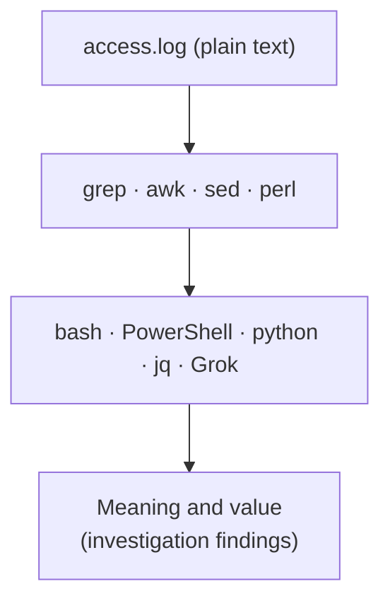

# Lesson 1.3 — Reading Proxy Logs: The Ten Default Fields, Custom Formats, and Unix Time { #proxy-logs }

!!! abstract "Scope of this lesson"
    In [lesson 1.2](web-proxies.md) the config file told us "where the logs are and in what format". This time we read the logs themselves.

    - What each of the ten fields in Squid's default log format means, and what it tells an investigator
    - Reading "what happened" from cache status codes and HTTP status codes
    - What the default format leaves out (User-Agent, Referer, readable time), and building a custom format with `logformat`
    - Automated analysis tools, and analysing directly with shell commands
    - Turning Unix time into human-readable time, one line at a time or all at once

!!! note "Notation"
    Command output marked **(Actual output)** in this lesson was produced by really running the commands against a 12-line sample log I built. All addresses and domains in the sample log are hypothetical, and its date is 2025-10-12 (UTC). This work environment's system time zone is UTC.

## 1. One line of numbers { #one-line }

**(Hypothetical)** A colleague copies this line from the proxy server and asks: "Looks like this PC downloaded something. What does it mean?"

```text
1760231140.004    388 10.10.7.15 TCP_MISS/200 1843200 GET http://files.example.net/update.bin - HIER_DIRECT/203.0.113.50 application/octet-stream
```

At first it's a lump of numbers and symbols. But the line is a **form** with set information in set fields. Once you know the fields, this one line tells you "when, which PC, with what result, how big, what, and from where". By the end of this lesson you'll read it fluently.

## 2. An analogy: a parcel waybill { #analogy }

Think of a parcel waybill. It has set fields for sender, recipient, weight and drop-off time, so you can read a waybill you've never seen once you know the fields. A proxy log line is like one waybill, and one is added every time a request finishes.

But just as each courier has its own waybill layout, **proxy logs change which fields appear and in what order depending on configuration.** That's why lesson 1.2 started with the config's `access_log` and `logformat` lines. One way this analogy differs from reality: a waybill is filled in **before** shipping, but Squid writes the log line **after** the request finishes. That difference affects how you read the time, as section 3.2 explains.

## 3. The ten fields of the default format { #default-format }

Squid's default log format is named `squid`, and Squid 7's documentation defines it as:

```squid
logformat squid      %ts.%03tu %6tr %>a %Ss/%03>Hs %<st %rm %ru %[un %Sh/%<a %mt
```

Each item starting with `%` is a **format code**, replaced by the value of one field. The `03` in `%03tu` means "three digits, padding with zeros", and the `6` in `%6tr` means "at least six characters wide". That's why there were several spaces before the second field in the log. Now let's split section 1's line by this definition.

| # | Format code | Value in section 1 | Meaning | What to watch in an investigation |
| --- | --- | --- | --- | --- |
| 1 | `%ts.%03tu` | `1760231140.004` | Unix time (seconds.milliseconds) | UTC. The time the request **finished** (section 3.2) |
| 2 | `%6tr` | `388` | Response time (milliseconds) | Used to compute the start time |
| 3 | `%>a` | `10.10.7.15` | Requesting client IP | May be another proxy's address if it came through one |
| 4 | `%Ss/%03>Hs` | `TCP_MISS/200` | Cache status / HTTP status code sent to the client | The heart of "what happened" (section 3.3) |
| 5 | `%<st` | `1843200` | Size of reply sent to the client (bytes) | Includes headers. May not equal the file size exactly |
| 6 | `%rm` | `GET` | Request method | `POST` is a request that **uploads** data |
| 7 | `%ru` | `http://files.example.net/update.bin` | Request URL | By default **query strings are stripped** |
| 8 | `%[un` | `-` | User name | Only has a value with proxy authentication. `-` otherwise |
| 9 | `%Sh/%<a` | `HIER_DIRECT/203.0.113.50` | How it was fetched / IP of the server actually contacted | Records the DNS result at that moment |
| 10 | `%mt` | `application/octet-stream` | Content type declared by the server (MIME type) | Only what the server **claims**; may not match the actual content |

Now you can put section 1's line into words: "At about 01:05:40 UTC on 2025-10-12, PC `10.10.7.15` requested `http://files.example.net/update.bin` with GET. It wasn't in the cache (MISS), so the proxy went directly to `203.0.113.50` to fetch it; the result was 200 (success), the size 1,843,200 bytes, and the server declared it a generic binary (`application/octet-stream`). Processing took 0.388 seconds. No proxy authentication was used."

### 3.1 More about each field { #field-notes }

**Requesting IP (field 3).** Usually the address of the device that connected to the proxy, i.e. the network-layer (layer 3) source address. But if another proxy or load balancer sits between the client and this proxy, the intermediate device's address appears here. The real client address may then be in a header the intermediate device adds, such as `X-Forwarded-For`. With `follow_x_forwarded_for` enabled, Squid reflects that header's address in its records. But clients can invent this header freely, so confirm in the config that the value comes from a trusted intermediate device.

**Reply size (field 5).** `%<st` is the total sent by the proxy to the client, so it includes the HTTP response headers. So even a 1,843,200-byte file usually shows a value a few hundred bytes larger. Allow for this when matching files by size. On `CONNECT` lines it's the number of bytes passed through the tunnel.

**URL (field 7).** As seen in lesson 1.2, if `strip_query_terms` is at its default `on`, everything after `?` is stripped before logging. If you see no query strings, check the config to tell whether it's that setting or there simply weren't any.

**Hierarchy status and server IP (field 9).** `HIER_DIRECT` means the proxy went straight to the origin server; `HIER_NONE` means it didn't contact a server (served from cache or denied). Going through an upstream proxy gives values like `PARENT_HIT`. The IP after it is the address the proxy actually connected to **at that moment**. A domain's IP changes over time, so this record is closer to the facts at that time than a DNS lookup today.

**MIME type (field 10).** The value the server declared in its response header, such as "this is an image". Malicious servers sometimes send executables labelled `image/png`, so read this field only as the server's claim, and confirm the real content from a file pulled from the cache or packets (lesson 1.5).

### 3.2 Is that time the start or the end? { #timestamp-meaning }

So is the time in the first field when the request **started**, or when it **finished**? Squid 7's source code takes this value from the current time at the moment the log line is written. Squid writes the log when request processing ends, so it's the **finish time**. You can estimate the start time as "timestamp − response time".

Most requests take under a second, so it makes little difference. Long-lived connections are different. Here's the calculation for the sample log's `CONNECT` line (actual output):

```text
01:03:32  start~01:02:32  mail.example:443
```

The recorded time is 01:03:32, but the response time is 60,412 ms (about 60 seconds), so the tunnel actually opened around 01:02:32. For a tunnel open for hours, the difference is hours. When aligning with other evidence (firewall connection start times, the first SYN in packets), not knowing this can lead to the wrong conclusion that "the proxy records are a minute late".

### 3.3 What happened: cache status and HTTP status codes { #status-codes }

The fourth field has two parts. The first is **how Squid handled** this request (cache status); the second is **what result it returned** to the client (HTTP status code). Investigators should read the HTTP status code in particular as the field telling them "what happened".

Common cache statuses, checked against the status name list in Squid 7's source:

| Cache status | Meaning | What it means for an investigation |
| --- | --- | --- |
| `TCP_MISS` | Not in cache, fetched from the server | There really was communication with the external server at that moment |
| `TCP_HIT` / `TCP_MEM_HIT` | Served straight from disk / memory cache | No external communication. Also means someone fetched the same thing earlier |
| `TCP_REFRESH_UNMODIFIED` | Asked the server whether the cached copy was still valid; told it hadn't changed | Brief contact with the server. Content is the cached copy |
| `TCP_REFRESH_MODIFIED` | Asked, found it had changed, fetched it again | Contact with the server, new content |
| `TCP_DENIED` | Denied by access control (`http_access`) | Block policy or authentication failure. The attempt still happened |
| `TCP_TUNNEL` | Opened a `CONNECT` tunnel and relayed as-is | Uninspected HTTPS, etc. Content unknown |
| `NONE` family | Ended before processing, e.g. by an error | Malformed request, connection failure, etc. |

Statuses sometimes carry a suffix such as `_ABORTED` (cut off midway) or `_TIMEDOUT`. For example, `TCP_MISS_ABORTED/200` means "was fetching from the server and got cut off", so the size may not be the whole file.

**[Changed]** The source material's example log shows `TCP_REFRESH_HIT/304`. That name isn't in Squid 7's status name list; the same case is logged as `TCP_REFRESH_UNMODIFIED` (checked 2026-11-05 in Squid 7 source `src/LogTags.cc`). When reading logs from older servers, recognise both the old and current names. Also, depending on the Squid version, `CONNECT` lines appear as `TCP_MISS/200` or `TCP_TUNNEL/200`, so when looking for `CONNECT` it's safer to filter on **the method field (field 6)** than on the status name.

Common HTTP status codes only; see the [HTTP status codes reference](../../../basics/http-status-codes.md) for the full list.

| Code | Meaning | What it means for an investigation |
| --- | --- | --- |
| 200 | Success | Got what was requested (doesn't mean it was executed) |
| 206 | Partial content | Downloading a big file in pieces or resuming. Combine several lines for the same URL |
| 301 / 302 | Moved elsewhere | Redirect. Find the real destination in the next line |
| 304 | Not modified | Use the copy you already have. No content transferred |
| 403 | Forbidden | Blocked by the proxy or server |
| 407 | Proxy authentication required | Requested without credentials. Malware that can't authenticate sometimes leaves these repeatedly |
| 404 | Not found | No such path on the server. Could be a scanner or an old C2 address |
| 5xx | Server-side error | A problem with the server or the upstream path |

### 3.4 A small example: same site, three lines { #small-example }

Look at the first three lines of the sample log (the sample log as written):

```text
1760230869.433    531 10.10.7.11 TCP_MISS/200 17746 GET http://news.example/ - HIER_DIRECT/203.0.113.20 text/html
1760230895.705    246 10.10.7.11 TCP_REFRESH_UNMODIFIED/304 303 GET http://news.example/ - HIER_DIRECT/203.0.113.20 -
1760230901.112     12 10.10.7.11 TCP_MEM_HIT/200 5120 GET http://news.example/static/logo.png - HIER_NONE/- image/png
```

The first line is the PC requesting the news front page for the first time, which the proxy fetched from the server (MISS, 200, about 17 KB). The second line, about 26 seconds later, is the same page requested again. This time the browser asked "is my copy still valid?", the proxy checked with the server and learned it hadn't changed (`TCP_REFRESH_UNMODIFIED`), and returned only a short 303-byte "use what you have" (304). The logo image in the third line came straight from memory cache, so the server IP is `-` and the response took only 12 ms.

This gives an interpretation useful in investigations. The 303 bytes in the second line are not "the size of the page this PC received". The page the PC actually displayed was the copy in its browser cache, the roughly 17 KB from the first line. Judging "it received a small response" from the size field alone is wrong.

### 3.5 Examples with changed conditions: denial, authentication and repetition { #conditions }

Other lines from the sample log:

```text
1760231141.920      0 10.10.7.15 TCP_DENIED/403 3870 GET http://c2.example.net/gate - HIER_NONE/- text/html
1760231260.002      1 10.10.5.25 TCP_DENIED/407 3995 GET http://news.example/ - HIER_NONE/- text/html
1760231300.551    174 10.10.7.11 TCP_MISS/200 2211 POST http://api-telemetry-sync.example/gate - HIER_DIRECT/203.0.113.77 text/html
1760231600.549    169 10.10.7.11 TCP_MISS/200 2211 POST http://api-telemetry-sync.example/gate - HIER_DIRECT/203.0.113.77 text/html
1760231900.553    171 10.10.7.11 TCP_MISS/200 2211 POST http://api-telemetry-sync.example/gate - HIER_DIRECT/203.0.113.77 text/html
```

- **The 403 line:** `10.10.7.15` requested `c2.example.net` but the proxy blocked it. The 3,870-byte reply is the size of the proxy's "blocked" page, and the server IP is `-`, so there was no external communication. **Observed fact:** that PC sent a request to a blocked domain. **Hypothesis:** something on that PC is trying to reach the C2. This is the very PC that fetched `update.bin` two seconds earlier (section 1). Linking the two lines strengthens the hypothesis, but to conclude you need to check which process on the endpoint made the request.
- **The 407 line:** the security analyst's PC requested without authentication and was told "proxy authentication required". A browser used by a person normally gets this reply and immediately retries with credentials. So one or two 407s are normal. But hundreds of 407s in a row from the same PC may signal a program that doesn't know the proxy authentication (possibly malware) repeatedly trying to get out.
- **The three POST lines:** the same PC sent **same-size (2,211-byte)** POSTs to the same address at **5-minute (300-second) intervals**. That regularity is hard for a human to produce by hand, and it's the typical shape of lesson 1.1's "program that periodically talks to the outside". Legitimate telemetry programs look like this too, so check domain reputation and the endpoint's processes together.

## 4. What the default format leaves out { #what-is-missing }

The default format is useful, but investigators miss three things.

**There's no User-Agent.** The User-Agent is a string the requesting program declares about itself, like a name tag. A browser used by a person sends something like `Mozilla/5.0 (Windows NT 10.0; Win64; x64) ...`, a command-line tool sends `curl/8.5.0`, and malware may send nothing or a clumsy imitation of a browser. It's a clue to whether section 3.5's POSTs came from a browser or another program. But this value is also a **claim** the program can set freely. User-Agent analysis is covered in depth in the [Blue Team Essentials User-Agent and cookies lesson](../../blue-team-essentials/http-analysis/user-agents-cookies.md).

**There's no Referer.** The Referer header (the misspelling became part of the standard) tells you "which page led to this one". Click a link in search results and the request for the new page carries the search results page's address as the Referer. If the user clicked a link in a mail program, typed the address or used a bookmark, it's usually empty. With this value you can piece the user's **path** through the web back together. Malware infections often go through several redirects and hops, and without Referer it's hard to get the order right. Users themselves don't remember where they went once time has passed.

**[Supplement]** For privacy, today's browsers by default send only **the origin (domain)** instead of the full URL in the Referer when moving to another site (the `strict-origin-when-cross-origin` policy; the web standard made this the default in November 2020). So in today's logs the Referer often appears without a path, like `https://search.example/`. Don't expect to read search terms from the Referer as in older examples.

**The time isn't human-readable.** The first field is Unix time, which is hard to read directly. Section 6 shows how to convert it.

## 5. Building a custom format with `logformat` { #logformat }

To fill these gaps, Squid lets administrators define the log format themselves, using the `logformat` directive. Squid 7 already defines several common formats, and using `combined` adds User-Agent, Referer and readable time all at once.

```squid
logformat combined   %>a - %[un [%tl] "%rm %ru HTTP/%rv" %>Hs %<st "%{Referer}>h" "%{User-Agent}>h" %Ss:%Sh
access_log daemon:/var/log/squid/access.log logformat=combined
```

The first line is a definition **already built into** Squid 7, so you don't need to write it; just name it as in the second line. The new format codes mean:

| Code | Meaning |
| --- | --- |
| `%tl` | Human-readable **server local time** (default shape `12/Oct/2025:01:05:40 +0000`) |
| `%tg` | Human-readable **GMT (UTC) time** |
| `%rv` | The request's HTTP version |
| `%{Referer}>h` | The Referer header the client sent |
| `%{User-Agent}>h` | The User-Agent header the client sent |
| `%Ss:%Sh` | Cache status and hierarchy status |

A line in this format looks like this (illustrative output):

```text
10.10.6.11 - - [12/Oct/2025:01:06:43 +0000] "GET http://parcel-redelivery.example/dl/label.zip HTTP/1.1" 200 98211 "http://parcel-redelivery.example/track" "Mozilla/5.0 (Windows NT 10.0; Win64; x64; rv:144.0) Gecko/20100101 Firefox/144.0" TCP_MISS:HIER_DIRECT
```

Now you can read "the user downloaded this ZIP with Firefox via the `track` page", information the default format couldn't give.

**[Caution] `%tl` is the server's local time.** The source material's example shows `+0000`, so it looks like "human-readable UTC", but that's only because that server's time zone was UTC. If the server is in Sydney time, the same moment is written `[12/Oct/2025:12:06:43 +1100]`. Always read the trailing `+1100` (11 hours ahead of UTC) and convert to UTC to align with other evidence. If you want UTC from the start, `%tg` is safer.

**[Changed] The source material's custom format won't even start in Squid 7.** The source material defines `combined` itself with `%[ui` (the user name obtained via the ident protocol) in the second field. Squid 7 **removed ident support entirely**, and configurations containing the `%ui` format code are rejected, so Squid fails to start. Instead, the built-in `common` and `combined` formats always put a `-` in that position (checked 2026-11-05 in the Squid 7 release notes). For investigators this means two things. First, that field always being `-` in Squid 7 logs is normal. Second, if that field has a value in an older server's logs, it's a name obtained through ident, an **untrustworthy** mechanism. Ident simply accepts a value reported from the client side, so don't use that name as evidence of a user's identity.

### 5.1 Splitting logs into several files { #multiple-logs }

Squid can have several `access_log` lines, each with its own format and condition (ACL). That's very useful in network forensics. During a response, you can agree with the proxy administrator to log **only requests matching known-malicious patterns** separately, in a more detailed format (example config):

```squid
acl suspect_dst dstdomain .c2.example.net .api-telemetry-sync.example
access_log daemon:/var/log/squid/access.log logformat=squid
access_log daemon:/var/log/squid/suspect.log logformat=combined suspect_dst
```

`dstdomain` is an ACL that matches on destination domain, and the leading dot (`.`) includes subdomains. Because the third line ends with the ACL name, only requests matching that condition are additionally written to `suspect.log` in `combined` format. The original log on the second line still records every request. Turned around: **if the server under investigation already has a line like this**, there's another log file someone else created. This is exactly lesson 1.2's "read the config first to find evidence you'd otherwise miss".

## 6. Reading Unix time { #unix-time }

### 6.1 What Unix time is { #what-is-epoch }

**Unix time** (epoch time) is the number of seconds elapsed since 00:00:00 UTC on 1 January 1970. It just counts seconds, with no time zones or daylight saving, so it's very convenient for computers to store and calculate with. The difference between two times is a single subtraction. Section 3.5's POST interval came straight out as 1760231600.549 − 1760231300.551 ≈ 300 seconds. People, though, need it converted.

### 6.2 One line at a time: `date` { #date-command }

The Linux `date` command converts it directly (actual output):

```console
$ date -d @1760230869.433
Sun Oct 12 01:01:09 UTC 2025
$ date -u -d @1760230869.433
Sun Oct 12 01:01:09 UTC 2025
$ TZ=Australia/Sydney date -d @1760230869.433
Sun Oct 12 12:01:09 AEDT 2025
```

`-d` means "show this time", and the `@` before the number marks it as Unix time. `-u` shows it in UTC. The first two lines match above only because this work environment's time zone is already UTC. On an analysis PC in another time zone, the result without `-u` comes out in that PC's local time. The third line temporarily changes the time zone with the `TZ=` environment variable, showing the same moment is 12:01 midday in Sydney (AEDT, daylight saving applied). **Get into the habit of always adding `-u` to standardise on UTC when analysing**, so you can align with other evidence straight away.

`date -d @` is a feature of the GNU version used on Linux. macOS's `date` has different syntax and doesn't accept a decimal point, so give it only the integer part:

```console
$ date -j -u -r 1760230869
```

Other tools do the same. In Python, `datetime.fromtimestamp(1760230869.433, tz=timezone.utc)` gave `2025-10-12T01:01:09.433000+00:00` (actual output), and in PowerShell you can convert at millisecond precision with something like `[DateTimeOffset]::FromUnixTimeMilliseconds(1760230869433).UtcDateTime`.

### 6.3 All at once: `awk` { #awk-convert }

Converting one line at a time is a neat trick, but useless for tens of thousands of lines. Use `awk` to change only the first field and leave the rest (actual output):

```console
$ awk '{$1=strftime("%F %T", $1, 1); print $0}' access.log | head -3
2025-10-12 01:01:09 531 10.10.7.11 TCP_MISS/200 17746 GET http://news.example/ - HIER_DIRECT/203.0.113.20 text/html
2025-10-12 01:01:35 246 10.10.7.11 TCP_REFRESH_UNMODIFIED/304 303 GET http://news.example/ - HIER_DIRECT/203.0.113.20 -
2025-10-12 01:01:41 12 10.10.7.11 TCP_MEM_HIT/200 5120 GET http://news.example/static/logo.png - HIER_NONE/- image/png
```

Breaking the command down:

- `awk '{ ... }' access.log`: reads the log line by line and does what's inside the braces. awk splits each line into fields on whitespace, calling the first `$1`, the second `$2`, and the whole line `$0`.
- `strftime("%F %T", $1, 1)`: turns the Unix time in the first field into text shaped like `%F %T` (`2025-10-12 01:01:09`). The third argument `1` means "convert to UTC". Leave it out and you get the analysis PC's local time.
- `$1=...; print $0`: puts the converted value back in the first field and prints the whole line.
- `| head -3`: shows only the first three lines.

The reason for the `%F %T` shape (year-month-day hour:minute:second) is that it writes the largest unit first, so **sorting it as text also sorts it chronologically**. Merge and `sort` several files and the time order stays intact.

Three things to know about this method:

1. **Milliseconds disappear.** `strftime` only goes to whole seconds. If event order matters down to milliseconds, append the decimal part like this (actual output):

    ```console
    $ awk '{ms=substr($1, index($1,".")); $1=strftime("%F %T", int($1), 1) ms; print}' access.log | head -2
    2025-10-12 01:01:09.433 531 10.10.7.11 TCP_MISS/200 17746 GET http://news.example/ - HIER_DIRECT/203.0.113.20 text/html
    2025-10-12 01:01:35.705 246 10.10.7.11 TCP_REFRESH_UNMODIFIED/304 303 GET http://news.example/ - HIER_DIRECT/203.0.113.20 -
    ```

    `index($1,".")` finds the position of the dot, `substr` takes from the dot to the end (`.433`), and that's appended after the converted time.

2. **Spaces between fields collapse to one.** When awk changes a field it rebuilds the line with single spaces between fields. Losing the original log's alignment spaces is harmless, but leave the original untouched and **save the converted result to a new file**. Never modify original evidence.
3. **Some awks lack `strftime`.** `strftime` started as a GNU awk (gawk) extension. In this work environment the default awk, mawk 1.3.4, ran the commands above, but older versions such as mawk 1.3.3 don't have it. If you get an error like "function strftime never defined", run it with `gawk`.

You can chain this with other commands such as `grep`, e.g. `grep -F 'c2.example.net' access.log | awk '{$1=strftime("%F %T", $1, 1); print}'`: filter first, then convert. If you use it often, a shell alias is handy:

```bash
alias squidtime='awk '\''{$1=strftime("%F %T", $1, 1); print}'\'''
```

To put single quotes inside single quotes, it uses `'\''` (close the quote, one escaped quote, reopen). With this you can write `grep -F 'c2.example.net' access.log | squidtime` (tested in this work environment).

## 7. Analysis tools and direct analysis { #analysis }

### 7.1 Automated analysis tools { #tools }

Squid is so widely used that there are countless tools to summarise its logs and show them as graphs. The source material cites `calamaris` and `squidview`, and the Squid project maintains a list of log analysis tools. But most were built for **proxy administrators**. They're good for questions like "which sites use the most bandwidth?" or "what's the cache hit rate?", which may not be the investigator's questions. Many also only read the default format and can't parse custom-format logs; you'll run into exactly this in lesson 1.4's walkthrough. With open-source tools you can modify the code to read new formats, so weigh what each tool offers and pick or adapt what suits the situation.

### 7.2 Plain-text logs mean a shell is all you need { #raw-analysis }

The biggest strength of Squid logs is that they're **plain text**. A proprietary binary or database format needs converting first, but plain text can be cut, counted and sorted with familiar tools straight away.



**How to read the diagram:** it stacks from bottom to top. On top of the plain-text log are line tools (grep, awk, etc.), and above them the scripting languages and structuring tools that combine them. The "meaning" at the top isn't a tool; it's what **a person** gets by interpreting. Grok is a pattern language that splits a log line into named fields; it comes back in Part 2's log aggregation.

Automated tools and shell commands reduce vast data so **outliers** are easy to find. The machine points "look here", and the person looks there to find the data that answers the questions. A few examples run directly against the sample log (actual output):

**Which sites got the most requests?**

```console
$ awk '$6!="CONNECT"{print $7}' access.log | awk -F/ '{print $3}' | sort | uniq -c | sort -rn
      4 news.example
      3 api-telemetry-sync.example
      2 parcel-redelivery.example
      1 files.example.net
      1 c2.example.net
```

- `awk '$6!="CONNECT"{print $7}'`: keeps only lines whose sixth field (method) isn't `CONNECT`, and prints the seventh field (URL). `CONNECT` lines have `host:443` in the URL field, which doesn't fit the next step, so they're excluded.
- `awk -F/ '{print $3}'`: this time uses `/` as the field separator to split the URL. `http://news.example/a` splits into `http:`, empty, `news.example`, `a`, so the third field is the hostname.
- `sort | uniq -c`: groups identical values (`sort`) and counts how many times each appears (`uniq -c`). `uniq` only merges **adjacent** identical lines, so the `sort` before it is essential.
- `sort -rn`: sorts by the count (`-n`), largest first (`-r`).

**What were the results?**

```console
$ awk '{print $4}' access.log | sort | uniq -c | sort -rn
      6 TCP_MISS/200
      1 TCP_TUNNEL/200
      1 TCP_REFRESH_UNMODIFIED/304
      1 TCP_MISS/302
      1 TCP_MEM_HIT/200
      1 TCP_DENIED/407
      1 TCP_DENIED/403
```

**Which PC received the most?**

```console
$ awk '{b[$3]+=$5} END{for(c in b) print b[c], c}' access.log | sort -rn
1847070 10.10.7.15
98823 10.10.6.11
48213 10.10.6.14
29802 10.10.7.11
3995 10.10.5.25
```

`b[$3]+=$5` means "keep adding the reply size (field 5) per client address (field 3)", and `END{...}` means print the accumulated totals after reading the whole file.

Taking the three results together gives an interpretation. `10.10.7.15` received by far the most because of the single `update.bin` file, and the same PC also requested the blocked C2 domain. `10.10.7.11` received little but has regular POSTs. The key point is that **receiving little doesn't mean safe**. Beacons are small by nature. So "which PC received the most" and "which PC sends regularly" are different questions, and you must ask both. These numbers are only a starting point, though; conclusions come after cross-checking endpoint, DNS and firewall records in the order from lesson 1.1.

## 8. How to interpret it in a real investigation { #interpretation }

Common mistakes when reading proxy logs:

- **"200, so it's infected" is wrong.** 200 only means it was received, not executed. Confirm execution with endpoint records.
- **Size isn't exactly the received file's size.** Headers are included; `206` means only part, `_ABORTED` means the amount before it was cut off. `304` is a "no change" answer with no content.
- **The time is the finish time, and you must check the time zone.** The default format's Unix time is UTC, but custom formats using `%tl` are in the server's local time. The server clock itself may be wrong, so where possible align a few times against other records the same event left (firewall, packets) and record the offset.
- **The requesting IP may not be the real client.** If another proxy or load balancer sits in between, its address is recorded.
- **Some things aren't in the log.** Traffic that bypassed the proxy, stripped query strings, paths of uninspected HTTPS, and POST request bodies (what was uploaded) aren't in the log. The missing POST body matters especially in exfiltration investigations, and you'll hit it head-on in lesson 1.4.

## 9. Summary { #summary }

- A proxy log line is a form with information in set fields, and which fields appear and in what order is set by the config's `logformat`.
- The ten fields of Squid's default format are time, response time, client IP, cache status/HTTP code, size, method, URL, user name, hierarchy status/server IP and MIME type.
- The time is UTC Unix time when the request **finished**; estimate the start as "time − response time".
- The HTTP status code tells you "what happened", and the cache status tells you whether there was real external communication. In Squid 7, `TCP_REFRESH_UNMODIFIED` replaces `TCP_REFRESH_HIT`, and `CONNECT` is logged as `TCP_TUNNEL`.
- The default format lacks User-Agent, Referer and readable time. The built-in `combined` format fills them in, but `%tl` is server local time. Squid 7 removed ident (`%ui`).
- Convert Unix time one line at a time with `date -u -d @number`, or all at once with awk's `strftime`. Leave the original untouched and save results to a new file.
- Automated tools and shell commands only point at outliers; a person finds the meaning by aligning them with other evidence.

In the next lesson (1.4) we use all of these skills to reconstruct one employee's day from proxy logs alone.

## Review questions { #review }

**Question 1.** Put this default-format log line into words, with the time in UTC.

```text
1760231203.910    455 10.10.6.11 TCP_MISS/200 98211 GET http://parcel-redelivery.example/dl/label.zip - HIER_DIRECT/198.51.100.77 application/zip
```

??? success "Answer and explanation"
    At about 01:06:43 UTC on 2025-10-12 (`date -u -d @1760231203.910`), PC `10.10.6.11` requested `http://parcel-redelivery.example/dl/label.zip` with GET. It wasn't in the cache (`TCP_MISS`), so the proxy went directly (`HIER_DIRECT`) to server `198.51.100.77` to fetch it; the result was 200 (success), the size sent to the client was 98,211 bytes including headers, and the server declared it a ZIP file (`application/zip`). Processing took 0.455 seconds and there's no user name (`-`). But "it's a ZIP file" is the server's claim, and "the user opened it" can't be known from this line.

**Question 2.** A `CONNECT` line has a recorded time of `1760231012.880` and a response time of `60412`. The firewall log records the same connection as starting at 01:02:32 UTC. How do you explain the one-minute difference?

??? success "Answer and explanation"
    Squid's timestamp is when the request **finished**. 1760231012.880 is 01:03:32 UTC, and with a response time of 60,412 ms (about 60 seconds), the tunnel opened at about 01:03:32 − 60 s = **01:02:32**, exactly matching the firewall's connection start time. So no clock is wrong; the two devices recorded different moments (start and finish). Not knowing this and "correcting" the proxy clock by a minute would shift every other time wrongly.

**Question 3. (Common misconception)** A PC's log has `TCP_REFRESH_UNMODIFIED/304 303`. A colleague says "this PC only received 303 bytes, so it barely saw that page". Right?

??? success "Answer and explanation"
    Wrong. A `304` to the client means "the copy the browser already has is still valid; use it". The 303 bytes are just the size of that short answer, and the user most likely saw the whole page on screen from the browser cache's copy. The `TCP_REFRESH_UNMODIFIED` in front means the proxy, too, checked with the server and found its cached copy unchanged. The real content size is in the earlier `TCP_MISS/200` line for the same URL (17,746 bytes in section 3.4).

**Question 4. (Changed conditions)** The proxy server's time zone is `Australia/Sydney` and the log format is `combined`. The log shows `[12/Oct/2025:12:06:43 +1100]`. What's that in UTC, and if the same server also logged in the default `squid` format, what would the first field contain?

??? success "Answer and explanation"
    `+1100` means 11 hours ahead of UTC, so in UTC it's 12:06:43 − 11 h = **2025-10-12 01:06:43**. The default format's first field is Unix time, independent of time zone, so it's **1760231203.xxx**, the same as question 1 (the milliseconds are unknown because the combined format doesn't carry them). Unix time not changing with the server's time zone is a strength of the default format; with `%tl` formats you must read the trailing zone. Logging with `%tg` (GMT) from the start avoids this conversion.

**Question 5. (Reading a command)** Explain step by step what this command does, and how the result changes if you remove the first `sort`.

```bash
awk '{print $3}' access.log | sort | uniq -c | sort -rn | head -5
```

??? success "Answer and explanation"
    1. `awk '{print $3}'`: extracts the third field of each line, the client IP.
    2. `sort`: sorts so identical IPs are adjacent.
    3. `uniq -c`: merges adjacent identical lines and counts them.
    4. `sort -rn`: sorts by count, largest first.
    5. `head -5`: shows the top five only.

    The result is "the five clients that sent the most requests". Without the first `sort`, `uniq -c` only merges **consecutive** identical IPs, so an IP scattered through the log gets counted as several separate lines. The PC that actually made the most requests then drops in the ranking, giving a wrong result.

**Question 6. (Today's environment)** You want to upgrade an old Squid server to Squid 7, but its config has a line like the source material's `logformat combined %>a %[ui %[un [%tl] ...`. What happens, and from an investigation standpoint how should the second field of that server's old logs be treated?

??? success "Answer and explanation"
    Squid 7 removed ident support and rejects configurations containing the `%ui` format code, so **Squid won't start**. To upgrade, remove that line and use the built-in `combined`, or a format without `%ui`. After the upgrade that field is always `-`. If the second field in old logs has a value, it's a name obtained via ident. Ident is an old, insecure mechanism that simply accepts what the client side reports, so don't use that value as evidence that "this person did it". Confirm user identity from trustworthy sources such as proxy authentication (`%ul`) or domain logon records.

**Question 7. (Interpreting results)** Looking at section 7.2's results, a colleague says "`10.10.7.11` received about the least, so let's drop it from the priority list". How would you respond?

??? success "Answer and explanation"
    Don't drop it. `10.10.7.11` is the PC that sent **same-size (2,211-byte) POSTs to the same address at exactly 5-minute intervals**. Beacons and C2 traffic are small and regular by nature, so they don't show in totals received. "How much was received" and "how regularly was something sent" are different questions, and you must ask both. And a POST is a request that **uploads** data, yet the default log doesn't record what was uploaded (the body). So this PC is, if anything, a priority target for checking endpoint records, DNS and domain reputation together.

**Question 8. (Reading config)** In the proxy under investigation you find a line like section 5.1's `access_log ... suspect.log logformat=combined suspect_dst`. But the administrator says "our proxy log is just `access.log`". What do you check, and what possibilities should you consider?

??? success "Answer and explanation"
    Per the config, requests matching `suspect_dst` are **additionally** written to `suspect.log`, so check whether that file exists and since when it's been written (file creation and modification times, config change history). There are several possibilities. Someone may have created it during an earlier incident and forgotten, or the administrator may simply not know. Because it's in `combined` format, that file holds User-Agent and Referer values missing from the default log, making it richer evidence for those domains. Conversely, if nobody knows who added this setting or why, the config change itself may be something to investigate. Either way, **what the config file actually instructs** takes priority over what the administrator says.

## References { #references }

- Squid project, Squid 7 branch [`src/cf.data.pre`](https://github.com/squid-cache/squid/blob/v7/src/cf.data.pre) (checked 2026-11-05). Definitions of the built-in `squid`, `common`, `combined`, `referrer` and `useragent` log formats, meanings of format codes, and the recommended `access_log` syntax (`logformat=` option and ACLs).
- Squid project, Squid 7 [`src/LogTags.cc`](https://github.com/squid-cache/squid/blob/v7/src/LogTags.cc) and [`src/format/Format.cc`](https://github.com/squid-cache/squid/blob/v7/src/format/Format.cc) (checked 2026-11-05). The list of cache status names; `%ts` comes from the current time when the log line is written, and `%tr` is request processing time.
- Squid project, [Squid 7 release notes source](https://github.com/squid-cache/squid/blob/v7/doc/release-notes/release-7.sgml.in) (checked 2026-11-05). Ident support removed, configurations with `%ui` fail to start, and that field in `common`/`combined` is always `-`.
- MDN Web Docs, [Referrer-Policy](https://developer.mozilla.org/en-US/docs/Web/HTTP/Reference/Headers/Referrer-Policy) (checked in the source repository 2026-11-05). With no policy specified, `strict-origin-when-cross-origin` is the default; before the November 2020 Fetch standard revision ([whatwg/fetch#1066](https://github.com/whatwg/fetch/pull/1066)) it was `no-referrer-when-downgrade`.

!!! note "About this page"
    Personal study notes rewritten in my own words from a range of study material. The sample log and configuration were made up for explanation.
