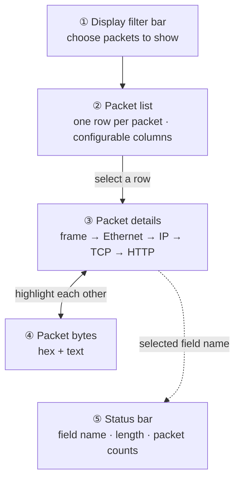

# Lesson 1.8 — Practical tcpdump Options and Reading the Wireshark Window { #tcpdump-options-wireshark-ui }

!!! abstract "Scope of this lesson"
    - tcpdump options for long captures: splitting files by size and time (`-C`, `-G`), limiting their number (`-W`), filter files (`-F`), and post-rotation processing (`-z`)
    - Reading four common capture and conversion commands piece by piece
    - The five parts of the Wireshark window (filter bar, packet list, packet details, packet bytes, status bar) and how they relate
    - **Name resolution settings and OPSEC**: what's safe to turn on and what to turn off
    - Adding columns and time display formats

    Display filter syntax and following streams are the next lesson (1.9).

!!! note "Lab environment and notation"
    **(Actual output)** was produced with tcpdump 4.99.4 and tshark 4.2.2 in this work environment. This environment has no display (GUI), so the Wireshark window itself couldn't be opened. The window is therefore described by its menu names and structure, and the same features (detail view, byte view, name resolution, time formats, custom columns) were actually run with **tshark**, which uses the same engine. Wireshark menu names may vary slightly between versions.

## 1. Capturing only DNS for two weeks { #scenario }

**(Hypothetical)** After lesson 1.4's incident, the security team decides "let's capture all of the organisation's DNS traffic for the next two weeks". As lesson 1.7 taught, `port 53` will do for the capture filter, but problems remain.

- Two weeks in **one file** is too big to open, and if the file gets corrupted midway you lose everything.
- When the disk fills, capture may stop or the system may stall.
- Later, when you want only "the afternoon of 20 October", you need to find that part straight away.

That's why tcpdump has options to **split files, name them and limit their number**. And the captured files eventually get opened in Wireshark, which has a setting you mustn't leave as it is. This lesson covers both.

## 2. tcpdump options for long captures { #tcpdump-options }

On top of lesson 1.6's basic options (`-r`, `-w`, `-i`, `-n`, `-s`), these are commonly used in practice:

| Option | Meaning | Remember |
| --- | --- | --- |
| `-r file` | Read from a pcap file instead of the network | |
| `-w file` | Write to a pcap file instead of the screen | |
| `-i interface` | Interface to capture on | On Linux and others, `any` captures all interfaces at once |
| `-n` | No name lookups | **Almost always add it.** Prevents slowdowns and OPSEC problems |
| `-C size` | Start a new file when the file exceeds that size | Unit is **1,000,000 bytes** (a million bytes, not MiB) |
| `-G seconds` | Start a new file every that many seconds | The file name must include a **time format** |
| `-W count` | With `-C`, **rotate** through that many files; with `-G`, create that many and **exit** | |
| `-F file` | Read the filter from a file instead of the command line | For a team to share filters (lesson 1.7) |
| `-z command` | Run a command on each file as it's closed | e.g. `-z gzip` to compress |
| `-c count` | Capture that many packets and exit | |
| `-A` | Show content as text | Lesson 1.6 |

Now the results of testing each option. Tests ran on the loopback interface while sending continuous requests to the test web server.

### 2.1 `-G`: splitting by time { #rotate-time }

```console
$ tcpdump -n -i lo -G 2 -W 3 -w 'dns-%F_%H%M%S.pcap' 'tcp port 8082'
$ echo $?
0
$ ls -1 dns-*
dns-2026-11-05_025710.pcap
dns-2026-11-05_025712.pcap
dns-2026-11-05_025714.pcap
```

(Actual output. In reality `-Z root` was also added; see lesson 1.6 section 7.) `-G 2` means a new file every 2 seconds and `-W 3` means make three and exit; it really made three files and exited normally (`0`). The `%F` (year-month-day) and `%H%M%S` (hours, minutes, seconds) in the file name are `strftime`, the standard time format syntax, the same one you saw in lesson 1.3's awk. So you can tell from the file name alone when each file is from.

Testing revealed three things.

**① Without a time format in the name, files keep getting overwritten.** Capturing for 5 seconds with `-G 1 -w same.pcap` left only one file, `same.pcap` (actual output). The tcpdump documentation also warns that "if no time format is specified, each new file will overwrite the previous". Each new file made every second has the same name, so only the last second survives. For the same reason, a time format **coarser** than the rotation interval (e.g. rotating every second with only minutes in the name) also overwrites.

**② The time in the file name is the capture machine's local time zone.** Capturing with the time zone set to Sydney, a file made at 02:58 UTC was named `tz-2026-11-05_135818.pcap`, i.e. **13:58** (actual output). The times inside the packets are UTC (lesson 1.6) but the file names are local time, so looking for "the files from the 03:00 UTC hour" later, you might open the wrong file. Running capture scripts in UTC, as in `TZ=UTC tcpdump ...`, removes this confusion.

**③ New files are only created when packets arrive.** On the first test the traffic stopped partway, and even after waiting 20 seconds there were only two files and tcpdump hadn't exited (actual output). tcpdump checks "is it time to rotate?" when it receives a packet, so **on a quiet link a file may not change even after the set time has passed**. So don't assume "rotated every 2 hours, so each file is exactly 2 hours"; check each file's first and last packet times with `capinfos`.

### 2.2 `-C` and `-W`: splitting by size and rotating { #rotate-size }

```console
$ tcpdump -n -i lo -C 1 -W 3 -w ring.pcap 'tcp port 8082'
$ ls -l ring.pcap*
1000021 ring.pcap0
1000021 ring.pcap1
589919 ring.pcap2
```

(Actual output, sizes and names only.) `-C 1` means a new file every 1,000,000 bytes and `-W 3` means **rotate** through three files (a ring buffer). The file names got `0`, `1` and `2` appended. Per the documentation, with `-W` it pads names with leading zeros to fit the file count (e.g. from `00` for a count of 100) so they sort in order, and once the set number is used it **overwrites from the first file**. This test only filled up to the third file, so I didn't observe the overwriting itself.

The file size being 1,000,021 bytes rather than exactly 1,000,000 has a reason too. tcpdump checks "is the file now bigger than this size?" **before** writing each packet, so it overshoots by the last packet. And the documentation states that the unit is 1,000,000 bytes, not 1,048,576 (MiB).

**[Changed] Unit suffixes depend on the version.** The latest tcpdump documentation says you can add `k`, `m` or `g` suffixes, as in `-C 20k` or `-C 500m`, to change the unit. But `-C 20k` on this work environment's 4.99.4 gave the error `tcpdump: invalid file size 20k` (actual output). The repository's documentation and change log show this feature arrived **in 4.99.6** (checked 2026-11-05). Distribution packages often lag the latest, so test on the capture device's tcpdump version first.

A ring buffer with `-C` and `-W` **keeps the disk from overflowing, but old data silently disappears.** Lesson 1.1 section 8.1's "retention" calculation applies directly. Work out in advance how many hours one ring buffer holds, and when an incident occurs, copy the files you need **before they're overwritten**.

### 2.3 `-z`: processing each file as it's closed { #postrotate }

`-z gzip` runs `gzip` on each file as it's closed, compressing it. Put a small script that records a hash there instead of compressing, and you keep each file's hash from the moment it's created, which helps evidence management. In this lab environment no rotation happened within the test window, so I didn't directly confirm the `-z` result.

**[Supplement] dumpcap's ring buffer.** `dumpcap`, included with Wireshark, does the same job. It splits and rotates with `-b duration:seconds`, `-b filesize:kilobytes` and `-b files:count`, and its default save format is pcapng, so each file keeps the interface and filter information from lesson 1.6. Whichever you use, testing on the capture device under real load comes first.

### 2.4 Four common commands { #examples }

The source material's examples, adapted to this series' hypothetical organisation and read piece by piece.

**① A quick look on screen**

```bash
sudo tcpdump -n -s 100 -A -i ens33 -c 1000
```

Captures the first 1,000 packets (`-c 1000`) on interface `ens33`, shows the first 100 bytes of each (`-s 100`) including content as text (`-A`), and exits. Good for getting a feel for what's on a link. Without `-n` it looks up a name for every IP and is much slower.

**② Extracting one host from a large file**

```bash
tcpdump -n -r input.pcap -w output.pcap 'host 10.10.6.14'
```

Reads `input.pcap` and writes only packets involving `10.10.6.14` to `output.pcap`: lesson 1.7's "data reduction". It only reads a file, so no administrator rights are needed.

**③ 14 days of DNS, one file per day**

```bash
sudo TZ=UTC tcpdump -n -i ens33 -w 'dns-%F_%H%M%S.pcap' -G 86400 -W 14 'port 53'
```

A new file every 86,400 seconds (24 hours × 60 minutes × 60 seconds), exiting after 14 files. The source material writes the filter as `'(tcp or udp) and port 53'`, but as lesson 1.7 showed, `port` already catches both TCP and UDP, so it's effectively the same as `'port 53'` (the original form is better if you need to exclude other transports such as SCTP precisely). `TZ=UTC` in front makes the file names UTC too (section 2.1 ②). But as in section 2.1 ③, files only change when packets arrive, so don't assume each file breaks exactly at midnight.

**④ A suspicious host, 100 MB at a time, indefinitely**

```bash
sudo tcpdump -n -i ens33 -w suspect.pcap -C 100 'host 203.0.113.77'
```

Writes traffic with `203.0.113.77` to a new file (`suspect.pcap`, `suspect.pcap1`, `suspect.pcap2` …) every 100,000,000 bytes (100 × 1,000,000), **without end**. With no `-W` it doesn't rotate and just keeps growing, so watch the disk. This shape is for when you expect little volume, since it's just one suspicious host.

## 3. Reading the Wireshark window { #wireshark-window }

Now open the captured files in Wireshark, the window you'll stare at longest in this series. From top to bottom it has five parts.



**How to read the diagram:** top to bottom is the actual layout of the window. Selecting a row in the packet list shows that packet in the details and bytes panes, and fields in the details pane and bytes in the bytes pane highlight each other (two-way arrow). Selecting a field in the details pane shows its name in the status bar (dotted line).

**② Packet list.** One row per packet, with configurable columns. The default "Time" column is **seconds since the capture started**, handy for intervals between packets but not the actual time. As lesson 1.6 showed, pcap has a UTC time for each packet, so you can switch to a human-readable time (section 5). The "Info" column is the dissector's one-line summary of the packet, good for scanning many packets for interesting ones.

**③ Packet details.** Where the dissectors show their real power. It unfolds every field in the packet by layer, from the IP, TCP and UDP headers up to the application data at the top. Even unfamiliar protocols are shown with human-readable field names and values, so start here when exploring a protocol you don't know. tshark's `-V` shows the same content as text (actual output, partial):

```console
$ tshark -r nameres.pcap -n -Y 'frame.number==6' -V
Frame 6: 201 bytes on wire (1608 bits), 201 bytes captured (1608 bits)
    Arrival Time: Oct 14, 2026 17:46:40.600000000 UTC
    ...
Ethernet II, Src: 00:50:56:0a:06:14, Dst: 00:50:56:0a:00:01
    ...
Internet Protocol Version 4, Src: 10.10.6.14, Dst: 203.0.113.50
    ...
    Time to Live: 64
    Protocol: TCP (6)
    ...
Transmission Control Protocol, Src Port: 50010, Dst Port: 80, Seq: 1, Ack: 1, Len: 147
```

"Frame" at the top isn't data from the wire but **metadata** Wireshark attaches (capture time, stored length, etc.: lesson 1.6's record header). Below it are the real headers stacked as Ethernet, IP, TCP.

**④ Packet bytes.** A hex dump of every byte of the packet as stored in the pcap file (= as it crossed the wire). tshark's `-x` gives the same shape (actual output, partial):

```console
$ tshark -r nameres.pcap -n -Y 'frame.number==6' -x
0000  00 50 56 0a 00 01 00 50 56 0a 06 14 08 00 45 00   .PV....PV.....E.
0010  00 bb 12 34 40 00 40 06 db be 0a 0a 06 0e cb 00   ...4@.@.........
0020  71 32 c3 5a 00 50 00 00 03 e9 00 00 1b 59 50 18   q2.Z.P.......YP.
0030  fa f0 00 00 00 00 47 45 54 20 2f 75 70 64 61 74   ......GET /updat
```

At first it seems unnecessary next to the details pane, but the raw bytes often reveal interesting parts the details pane passed over. So Wireshark **links the two panes**. Click a byte in the bytes pane and the field that byte decodes into is highlighted in the details pane; click a field in the details pane and its bytes are highlighted. For example, clicking the `06` at offset `0x17` in the dump above highlights "Protocol: TCP (6)" in the details pane. It does the byte-offset arithmetic you did by hand in lessons 1.6 and 1.7, and understanding this link is critical for an analyst.

**① Display filter bar.** At the top of the window, where you choose which packets to show. Lesson 1.9 covers it in detail.

**⑤ Status bar.** At the bottom, giving a quick frame of reference. On the left it shows the **dissector field name** and byte length of the field selected in the details pane (e.g. `ip.proto`), which is essential information for building display filters. In the middle it shows the total packet count and how many packets the current filter displays. If capturing with Wireshark directly, it also shows values such as how many packets libpcap dropped for lack of resources.

**Changing the layout.** Under Edit → Preferences → Appearance → Layout you can pick one of six pane layouts and what each pane shows. Only cosmetic, but on an odd screen ratio or a large shared screen it can make a big difference to usability.

## 4. Name resolution and OPSEC { #name-resolution }

Wireshark has several **name resolution** settings that show addresses and numbers as human-readable names (Edit → Preferences → Name Resolution). Some are safe to turn on; some can **ruin an investigation**.

| Setting | What it changes | Where it looks | OPSEC |
| --- | --- | --- | --- |
| MAC address resolution | First 3 bytes of a MAC → vendor name | Wireshark's built-in vendor table | Safe (no outbound traffic) |
| Transport name resolution | Port number → service name (80 → http) | Wireshark's built-in service table | Safe |
| Network address resolution | IP address → hostname | The two methods below | **Depends on the method** |
| ├ Use captured DNS packets | Name addresses from DNS responses in the file | The pcap you opened | Safe, and the name **as of that time** |
| └ Use an external name resolver | The analysis PC really asks a DNS server | Today's DNS | **Dangerous** |

### 4.1 Testing it { #nameres-test }

I built a test pcap with a DNS query and response plus an HTTP request to that address, and ran it through tshark (actual output, partial):

```console
$ tshark -r nameres.pcap -n
    2   0.120000   10.10.4.53 → 10.10.6.14   DNS 93 Standard query response 0xabcd A files.example.net A 203.0.113.50
    3   0.240000   10.10.6.14 → 203.0.113.50 TCP 54 50010 → 80 [SYN] Seq=0 Win=64240 Len=0
$ tshark -r nameres.pcap -N dn
    3   0.240000   10.10.6.14 → files.example.net TCP 54 50010 → 80 [SYN] Seq=0 Win=64240 Len=0
$ tshark -r nameres.pcap -N mt -T fields -e eth.src_resolved -e _ws.col.Info
VMware_0a:06:14	50010 → 80 [SYN] Seq=0 Win=64240 Len=0
VMware_0a:00:01	http(80) → 50010 [SYN, ACK] Seq=0 Ack=1 Win=64240 Len=0
```

`-n` turns off all name resolution. The letters after `-N` are the kinds of resolution to turn on; per the tshark documentation, `d` is use captured DNS packets, `n` network address resolution, `N` use external resolvers, `m` MAC, and `t` transport (ports). With `-N dn`, `203.0.113.50` became `files.example.net` based on the DNS response in the file; with `-N mt`, the MAC prefix `00:50:56` showed as `VMware` and port 80 as `http(80)`.

So did the analysis PC send anything out? I ran it again watching the network operations tshark requested from the OS with a tool called `strace` (actual output):

| tshark option | Times the analysis PC tried to connect to a DNS server (port 53) |
| --- | --- |
| `-N dn` (captured DNS + network address resolution) | **0** |
| `-N dnN` (plus external resolver) | **2** (to the system DNS server `8.8.8.8`) |
| `-o nameres.network_name:TRUE` (only the setting equivalent to ticking "Resolve network addresses" in the GUI) | **2** |

The third row is the key. In this version's (4.2.2) default preferences, the external resolver is **already on** and only network address resolution is off (checked with `tshark -G defaultprefs`). So the moment you tick "Resolve network addresses" in the GUI, the analysis PC starts **sending real DNS queries** for every IP in the pcap. The latest documentation (as of 4.6) also gives the default with no settings as `-N dmN`, i.e. with the external resolver on.

### 4.2 Why external resolution is dangerous { #why-external-is-bad }

The source material gives three reasons.

1. **OPSEC.** Attackers who run their own DNS servers often watch queries for their IPs and domains. A query from an unfamiliar source can tell them "someone has found my infrastructure". It sounds paranoid, but it has happened in the wild, and attackers react fast. And if the query goes out through the organisation's DNS server, **the investigator's queries get mixed into** the DNS logs from lesson 1.3, causing confusion later.
2. **Time differs.** DNS records change often. The answer you get now may differ from the answer when the evidence was collected weeks ago. If the attacker changed the domain's address, you'll see the wrong name on screen.
3. **Location differs.** DNS responses can vary with the network location of the querier (regional responses, internal-only names, etc.). The answer at the analysis PC may differ from the one the victim PC got.

So the rule is to **almost never turn this setting on**. Instead, the **use captured DNS packets** feature the Wireshark team added is a good alternative. It names addresses only from DNS responses inside the packets, so there's no outbound traffic and, above all, it shows the names **as of when the evidence was collected**: a kind of passive DNS. But remember that addresses with no DNS response in the file get no name (e.g. a capture filter that excluded DNS, lesson 1.7), and that the DNS response itself may have been forged.

MAC and transport name resolution are a matter of personal preference and create no outbound traffic, so there's no OPSEC worry. But transport names are a convenience feature attached **from the port number alone**, so `http(80)` doesn't mean the connection really is HTTP. Don't miss cases where an attacker uses a different protocol on port 80.

**[Changed] Where the vendor and service tables live.** The source material says these tables are in the files `/usr/share/wireshark/manuf` and `services`. **Since Wireshark 4.2.0**, these files (`manuf`, `services`, `enterprises`) were compiled into the program for faster start-up and are no longer shipped as separate files. You can dump the built-in content with commands like `tshark -G manuf`, and a `manuf` file in the personal configuration folder is read as well (checked 2026-11-05 in the Wireshark 4.2.0 release notes). Indeed, this environment's 4.2.2 had no `/usr/share/wireshark/manuf`, and `00:50:56 VMware` could be found in `tshark -G manuf` (actual output). The latest documentation also adds an `s` option that names addresses from the server name (SNI) in TLS handshakes; this too uses only information in the file.

## 5. Adding columns and displaying time { #columns-and-time }

### 5.1 Any field as a column { #custom-columns }

The packet list's default columns are usually enough, but you can add, remove and reorder them. Besides the standard columns, **any field Wireshark dissects** can be a column. For example, right-click the User-Agent field in the details pane and choose "Apply as Column" to get an `http.user_agent` column; packets without that field show a blank. In tshark, `-T fields -e field` plays the same role (actual output):

```console
$ tshark -r nameres.pcap -n -Y http.request -T fields -e frame.time_epoch -e ip.src -e http.host -e http.user_agent
1792000000.600000000	10.10.6.14	files.example.net	Mozilla/5.0 (Windows NT 10.0; Win64; x64; rv:144.0) Gecko/20100101 Firefox/144.0
```

Just as you handled proxy log fields in the shell in lesson 1.3, tab-separated output like this can be counted with `sort` and `uniq` straight away. The workflow of defining an analysis approach with columns in the GUI and then applying it to many files with tshark starts here.

### 5.2 Time display formats { #time-format }

View → Time Display Format changes the shape and precision of the Time column. I tried the same formats with tshark's `-t` (actual output, the time part of packet 2):

| `-t` | Meaning | Result |
| --- | --- | --- |
| `r` | Time since the first packet (default) | `0.120000` |
| `d` | Time since the previous packet | `0.120000` |
| `e` | Unix time | `1792000000.120000` |
| `ad` | Date and time, **analysis PC's local time** | `2026-10-14 17:46:40.120000` |
| `ud` | Date and time, **UTC** | `2026-10-14 17:46:40.120000` |

`ad` and `ud` match only because this work environment's time zone is UTC. Rerunning with the time zone set to Sydney, `ad` came out as `2026-10-15 04:46:40.120000`, **even the date changed**, while `ud` stayed the same (actual output). The same packet can appear on a different date depending on the analysis PC's time zone. So for investigations, the **UTC date and time format** ("UTC Date and Time of Day" in the GUI) is the best default, as it lines up directly with reports and other evidence (such as lesson 1.3's proxy logs).

**[Caution] Packet times and times inside packets are different.** A pcap's packet times are UTC (lesson 1.6). But times **inside** packets, such as an HTTP response's `Date` header, an email's date, or the time in a log string an application sent, follow whatever format and time zone that program chose. Don't treat the two as the same, and be especially careful with times that carry no time zone. This comes up again in later lessons.

## 6. How to use this in a real investigation { #in-practice }

On the capture side:

- For long captures, split with `-G` (time) or `-C` (size), put a time format like `%F_%H%M%S` in the name, and run with `TZ=UTC`.
- With a ring buffer (`-C` + `-W`), calculate how many hours one cycle holds, and when an incident occurs, copy files before they're overwritten.
- Confirm a split file's real range from `capinfos`'s first and last packet times, not from its name.
- Test options on the device's tcpdump version first (e.g. `-C` unit suffixes).

On the analysis side, before opening a pcap in Wireshark:

1. Make sure **network address resolution is off, or the external resolver is off**. If you need names, turn on only "Use captured DNS packet data".
2. Switch time display to **UTC date and time**.
3. Add the fields the investigation needs (User-Agent, Host, etc.) as columns.
4. If the file is large, open a reduced copy first, as in lesson 1.7.

Save these settings as a Wireshark **profile** and you don't have to redo them each time. Making one investigation profile for the team to share is also a good idea.

## 7. Summary { #summary }

- `-G seconds` splits files by time and `-C millions-of-bytes` by size; `-W` with `-C` makes a ring buffer, and with `-G` creates that many files and exits. `-F` is a filter file, and `-z` runs a command on each file as it's closed.
- `-G` file names must include a time format (or they're overwritten), and that time is the capture machine's **local time zone**. New files are created **only when packets arrive**.
- `-C`'s unit is 1,000,000 bytes, and the `k`, `m`, `g` suffixes arrived in tcpdump 4.99.6.
- The Wireshark window consists of the display filter bar, packet list, packet details, packet bytes and status bar, with the details and bytes panes linked by highlighting. The field name in the status bar is the raw material for display filters.
- MAC and transport name resolution are safe, but **using an external resolver for network address resolution** makes the analysis PC send real DNS queries. The external resolver is on by default, so if you need names, use only "Use captured DNS packet data".
- Since Wireshark 4.2.0, the `manuf` and `services` tables are built into the program.
- Any field can be a column, and viewing time as UTC date and time is the default to use. Times inside packets differ from packet times.

In the next lesson (1.9) we cover Wireshark display filter syntax, the syntax checker's three colours, the `!=` trap, and following TCP streams.

## Review questions { #review }

**Question 1.** After a week of capturing with the command below, there's only one file, and it holds only the last hour. What went wrong and how should it be fixed?

```bash
sudo tcpdump -n -i ens33 -G 3600 -w capture.pcap 'host 10.10.6.14'
```

??? success "Answer and explanation"
    `-G 3600` made a new file every hour, but the file name `capture.pcap` has **no time format**, so each new file was created with the same name, overwriting the previous one. Only the last hour survived; the tcpdump documentation warns about exactly this. Fixed: `sudo TZ=UTC tcpdump -n -i ens33 -G 3600 -w 'capture-%F_%H%M%S.pcap' 'host 10.10.6.14'`. The time format must be finer than the rotation interval (one hour), so it includes hours, minutes and seconds, and `TZ=UTC` keeps the names in UTC.

**Question 2. (Calculation)** On a segment that accumulates 40 GB a day on average, you set up a ring buffer with `-C 1000 -W 48`. Roughly how many hours does it hold? If incidents take a day on average to discover, what's the problem?

??? success "Answer and explanation"
    `-C 1000` makes each file 1,000 × 1,000,000 = about 1 GB (a billion bytes), and `-W 48` rotates 48 of them, so about 48 GB total. At 40 GB a day, that's about 1.67 GB an hour, so 48 ÷ 1.67 ≈ **about 29 hours** of retention. If discovery takes a day (24 hours) on average, there are only a few hours of margin, and on busier days or later-discovered incidents, **the packets from the incident are likely already overwritten**. It's the same problem as lesson 1.1 section 8.1's calculation. Add disk, adjust the capture filter, or set up in advance a procedure to copy the ring buffer files as soon as an incident is suspected.

**Question 3. (Common misconception)** Looking at `dns-2026-10-20_020000.pcap`, captured with `-G 7200` (rotate every 2 hours), a colleague wrote in the report "this file is exactly two hours, from 02:00 to 04:00". What needs checking?

??? success "Answer and explanation"
    Three things. ① **Time zone:** the file name's time is the capture machine's local time zone, so unless capture ran with `TZ=UTC`, 02:00 may not be UTC. ② **Actual range:** tcpdump changes files only when packets arrive, so in a quiet period a file may run longer than two hours or its boundaries may miss the hour. ③ **Gaps:** capture may have stopped partway. So check the **first and last packet times** with `capinfos` and put those values in the report. The file name is a convenience label, not a guarantee of the evidence's range.

**Question 4. (OPSEC)** A colleague wanted to see names instead of IP addresses in Wireshark and ticked "Resolve network addresses" in the preferences. Everything else is at its default. What can happen, and what's the right setting?

??? success "Answer and explanation"
    In this version's defaults, "Use an external network name resolver" is already on, so the moment network address resolution is ticked, the analysis PC **sends real DNS queries** for every IP address in the pcap. This lesson's test directly confirmed connection attempts to the system DNS server with only this setting on. As a result ① the attacker's DNS server may notice the investigation, ② names may differ from those at the time of the evidence because they're today's answers, ③ answers from the analysis PC's location may differ from those the victim PC got, and ④ the investigator's queries mix into the organisation's DNS logs. The right setting is to **turn off** "Use an external network name resolver" and turn on only "Use captured DNS packet data". In tshark, leave out `N`, as in `-N dn`.

**Question 5.** The Protocol column in the packet list shows `TCP` rather than `HTTP`, yet the port in the Info column appears as `http(80)`. Is this connection HTTP?

??? success "Answer and explanation"
    You can't tell. `http(80)` is a service label attached by **transport name resolution** from port number 80 alone; it doesn't mean the connection is really HTTP. If the Protocol column says `TCP`, Wireshark's dissector hasn't yet seen data it recognises as HTTP. It could be the SYN/ACK packets establishing the connection, or a non-HTTP protocol running over port 80. Look directly at the bytes of packets carrying data, or confirm the real content with lesson 1.9's stream following. Attackers using a different protocol over an easily allowed port like 80 is common.

**Question 6. (Time)** An analyst in Sydney and one in London open the same pcap in Wireshark, both with time display set to "Date and Time of Day". They report a packet's time differently. Why, and how do you align them?

??? success "Answer and explanation"
    "Date and Time of Day" converts to **the analysis PC's local time zone** (tshark's `-t ad`). In this lesson's test, changing the time zone made the same packet appear on a different date. The value in the pcap is the same UTC time, but Sydney and London have different time zones, so the displayed times differ. Switching both to **UTC date and time** ("UTC Date and Time of Day", tshark's `-t ud`) gives the same value. Putting this setting in a shared team investigation profile prevents this confusion.

**Question 7. (Changes)** You wanted to edit `/usr/share/wireshark/manuf`, as the source material describes, to name your organisation's device MAC prefixes, but a PC with Wireshark 4.6 installed has no such file. What should you do?

??? success "Answer and explanation"
    Since Wireshark 4.2.0, the `manuf`, `services` and `enterprises` tables are built into the program and not installed as separate files. You can view the built-in content with `tshark -G manuf`. Per the release notes, a `manuf` file is also read from the **personal configuration folder** (per profile), so put a `manuf` file with entries for your devices there. This kind of naming uses only files on the analysis PC, so there's no OPSEC issue. But remember that a MAC prefix's vendor name is only a clue for guessing the device, and MAC addresses can be changed.

**Question 8. (Reading a command)** Describe in one sentence what this command does, and name one problem it can cause.

```bash
sudo tcpdump -n -i any -w all.pcap -C 500
```

??? success "Answer and explanation"
    It saves traffic from all interfaces (`-i any`), unfiltered and without name lookups (`-n`), to a new file (`all.pcap`, `all.pcap1`, …) every 500,000,000 bytes (500 × 1,000,000), **without end**. The problem is that with no `-W`, files keep accumulating and **the disk can fill up**. When the disk fills, not only does capture stop, other functions of the system can stall too. Also, as lesson 1.6 showed, Linux's `any` interface doesn't use promiscuous mode, and its link type is a Linux-specific format rather than Ethernet, so layer 2 information such as MAC addresses is recorded differently from a normal Ethernet capture. For a long-running capture, limit the count with `-W`, or put disk monitoring in place alongside it.

## References { #references }

- The Tcpdump Group, tcpdump 4.99 branch [`tcpdump.1` documentation source](https://github.com/the-tcpdump-group/tcpdump/blob/tcpdump-4.99/tcpdump.1.in) and [change log `CHANGES`](https://github.com/the-tcpdump-group/tcpdump/blob/tcpdump-4.99/CHANGES) (checked 2026-11-05). `-C`'s unit (1,000,000 bytes) and the pre-write size check, `-G`'s time format and overwrite warning, `-W`'s ring buffer and exit behaviour, and `-z`. That `-C` unit suffixes are a 4.99.6 change (confirmed by comparing documentation across tags).
- Wireshark, [tshark documentation source (release-4.6)](https://gitlab.com/wireshark/wireshark/-/blob/release-4.6/doc/man_pages/dissection-options.adoc) (checked 2026-11-05). The meaning of the `-N` letters `d`, `m`, `n`, `N`, `s`, `t` and `v`, and the default `-N dmN`.
- Wireshark, [4.2.0 release notes source](https://gitlab.com/wireshark/wireshark/-/blob/v4.2.0/doc/release-notes.adoc) (checked 2026-11-05). `manuf`, `services` and `enterprises` compiled into the program, viewable with `tshark -G manuf|enterprises|services`, and `manuf` also read from the personal configuration folder.

!!! note "About this page"
    Personal study notes rewritten in my own words from a range of study material. The lab traffic and files were made in this work environment; the case is hypothetical.
