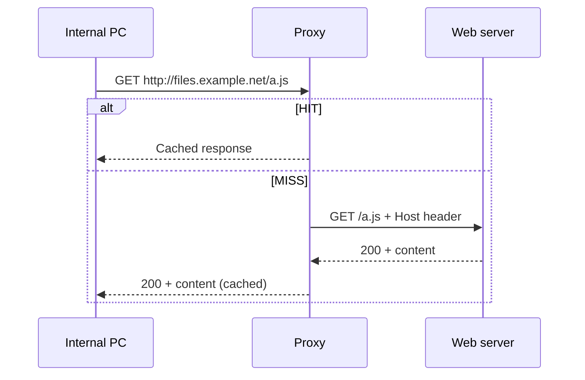
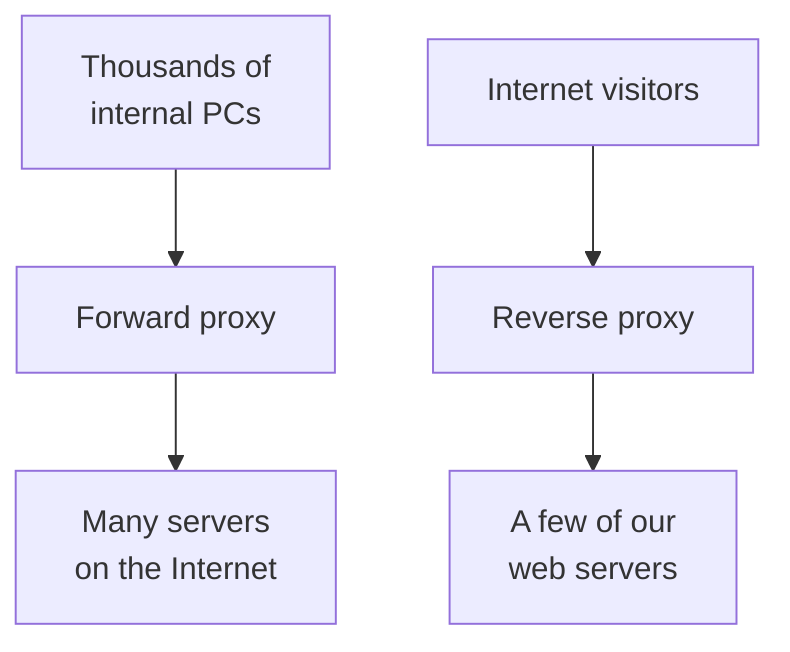
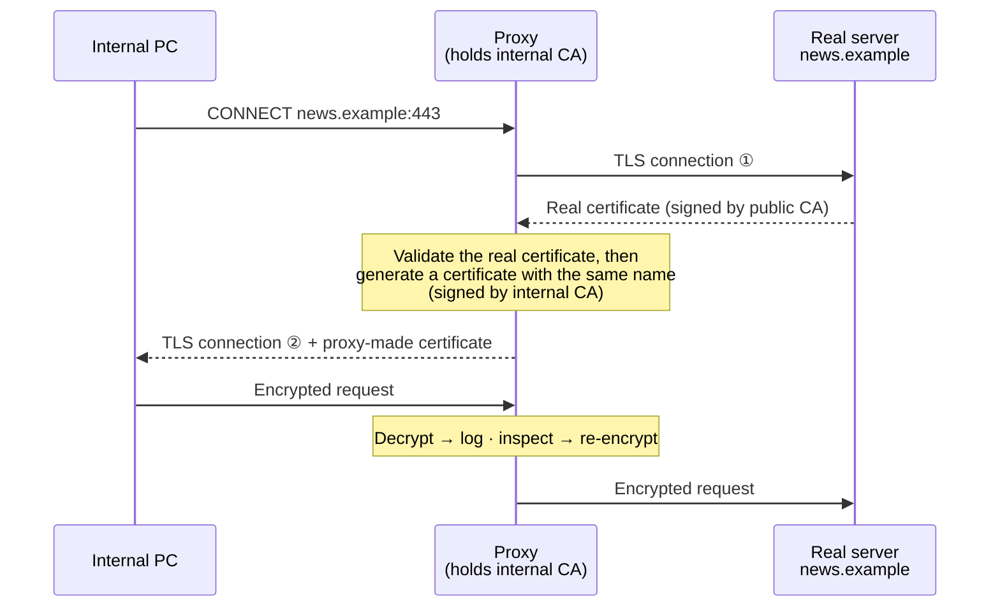

# Lesson 1.2 — Web Proxies: How They Work, the Main Products, and Why the Config File Is Evidence { #web-proxies }

!!! abstract "Scope of this lesson"
    The first part of the web proxy unit:

    - What a proxy is and why it exists (forward and reverse proxies)
    - How a performance device became a security and investigation device (blocking, logs, cache)
    - How TLS encryption blinds the proxy, and how TLS interception restores its view
    - Which products are in use, and what commercial vs open source means to an investigator
    - The three things to secure from a Squid proxy (config, logs, cache), and **how to read the config file first**

    Reading each log field is the next lesson (1.3); pulling files out of the cache is lesson 1.5.

!!! note "Notation"
    Same as [lesson 1.1](why-network-forensics.md): **(Hypothetical)**, **(Illustrative output)**, **[Changed]**, **[Supplement]**, **[Caution]**. Configuration examples were written for this lesson, not taken from a real server.

## 1. Finding the PCs that reached the C2 among 30,000 { #why-proxy }

Back to lesson 1.1's hypothetical organisation. **(Hypothetical)** An outside agency reports that the domain `c2.example.net` is an attack server. Management's first question: "How many of our PCs connected to it?"

Imaging PCs one by one would take weeks. But this organisation routes all web traffic through a **web proxy**. So a one-line search of the proxy log for that domain can give a first answer in minutes.

```bash
grep -F 'c2.example.net' /var/log/squid/access.log
```

`grep` is the Linux command that finds lines containing a given string in a file, and `-F` tells it to search for the text **literally** rather than as a regular expression. In a regular expression the dots in a domain mean "any single character", so without `-F` you could match odd lines like `c2xexamplexnet`. Each matching line contains the internal PC address that made the request, so collecting those addresses gives you "the list of PCs that connected".

Of course, as lesson 1.1 taught, "0 hits" doesn't mean nobody connected. Still, the fact that this one line can cut the scope from 30,000 machines to a handful is why this series turns to proxies straight away. So what exactly is a proxy, that it holds records like this?

## 2. An analogy: the company's purchasing desk { #analogy }

Picture a company where staff don't go out to shops themselves but ask the company's **purchasing desk** to buy things for them.

- A staff member asks the desk: "Please buy this item from this shop."
- The desk clerk goes to the shop, buys it and hands it over. From the shop's point of view it's always **the clerk** who comes in; it never sees the individual staff.
- The clerk writes in a ledger: "at this time, this person asked for this item from this shop, and here's the result."
- For frequently requested items, the clerk buys a spare and keeps it in the storeroom. When the next person asks for the same thing, the clerk hands it over from the storeroom without going to the shop.
- If the company declares "no business with this shop", the clerk refuses those errands.

A web proxy is exactly this desk. Staff are internal PCs, shops are web servers on the Internet, the ledger is the **proxy log**, the storeroom is the **proxy cache**, and the banned-shop list is the **block policy**. The analogy also explains why, in lesson 1.1, the firewall showed the proxy's address rather than the PC's: the shop (external server) only ever sees the clerk (the proxy).

But there are differences between the analogy and reality. Remember three of them.

1. **The storeroom doesn't hold everything.** A real proxy keeps only "responses that can be reused", and usually doesn't keep responses that differ per person, such as pages after login. So the cache is a "jackpot if it's there" source, not an "always there" one (lesson 1.5).
2. **It can't open sealed parcels.** HTTPS is a sealed, encrypted parcel, so without extra configuration the clerk knows only "went to this shop", not what was bought (section 5).
3. **Some staff may skip the desk.** Even with a rule in place, if there's a back door (a path that bypasses the proxy), it won't be in the ledger. Whether the ledger is complete can only be judged alongside the firewall rules.

## 3. How it works: how a proxy relays a request { #how-it-works }

### 3.1 Forward proxy { #forward-proxy }

A **proxy server** is a server configured to broker traffic between a client and a server. It can be used for almost any protocol, but today "proxy" usually means a **web proxy** brokering HTTP and HTTPS. The proxy internal PCs pass through on the way out is a **forward proxy**.



**How to read the diagram:** the three vertical lines are three devices (internal PC `10.10.7.11`, proxy `10.10.4.3:3128`, web server `203.0.113.75:80`), and time runs top to bottom. Solid arrows are requests, dashed arrows are responses. The "alt" box means only one of the two cases happens: the upper flow if it's in the cache (HIT), the lower flow if not (MISS).

There's a difference here that is very useful to an investigator. Compare the request lines of the first and third arrows.

| Segment | Request line | Why it differs |
| --- | --- | --- |
| PC → proxy | `GET http://files.example.net/a.js HTTP/1.1` | The proxy needs to know which server to go to, so the **full URL** is sent |
| Proxy → server | `GET /a.js HTTP/1.1` + `Host: files.example.net` | The server is itself, so it gets **only the path**, and the host comes in the Host header |

The HTTP standard calls the first form **absolute-form** and the second **origin-form**. So if a request line in a packet capture starts with `GET http://...`, you know "this packet was captured on the way to a proxy". Conversely, if a PC that should use the proxy sends `GET /path` straight to an external server, it **bypassed the proxy**. That may be a policy violation or a sign of malware.

### 3.2 How does HTTPS get through? CONNECT { #connect }

But what about HTTPS? The content is encrypted, so the proxy can't read the full URL. So the browser first asks the proxy:

```http
CONNECT news.example:443 HTTP/1.1
Host: news.example:443
```

That means "**open a tunnel** to port 443 on news.example". Once the proxy answers `200 Connection established`, it just relays the bytes in both directions without looking inside. So the log of a proxy without TLS interception keeps a single line like `CONNECT news.example:443` per HTTPS connection, and not which pages were opened inside it or how many times. Section 5 shows how this limit is overcome.

**[Supplement] Explicit vs transparent proxies.** What we've described so far is an **explicit proxy**, where the PC's browser or OS is configured with "the proxy is 10.10.4.3:3128". The alternative, where the PC has no setting and network equipment quietly redirects port 80/443 traffic to the proxy, is a **transparent** (or intercepting) proxy. With a transparent proxy the PC doesn't know the proxy exists, so request lines are in origin-form (`GET /path`) and there's no `CONNECT`. The same "proxy log" looks different depending on the mode, so check the mode in the config first (section 7).

### 3.3 Reverse proxy { #reverse-proxy }

Proxies also sit the other way round. A proxy that stands in front of an organisation's few web servers and receives requests from the Internet's many visitors is a **reverse proxy**. It mostly handles performance features such as spreading requests across servers (load balancing) and compressing responses.



**How to read the diagram:** the left column is the forward proxy, the right column the reverse proxy, and in both the arrows are the request direction. A forward proxy stands in for "our people"; a reverse proxy stands in for "our servers".

| | Forward proxy | Reverse proxy |
| --- | --- | --- |
| Stands in for | Internal clients | The organisation's web servers |
| What its log answers | Which internal PC requested which external URL | Which outside visitor requested what from our servers |
| Incidents it's used for | Phishing clicks, malware downloads, C2, exfiltration | Web server attacks, vulnerability scans, web shell access |
| Watch out for | Paths that bypass the proxy | Server logs show the proxy's address instead of the visitor's → check headers like `X-Forwarded-For` |

In lesson 1.1's organisation, the first clue was odd behaviour on the DMZ web server. In incidents like that, the logs of a reverse proxy in front of the web server (if there is one) are likely to hold the attacker's requests. This series mostly covers forward proxies, but the reading method is almost the same.

### 3.4 It started as a performance device { #history }

Proxies weren't originally security devices. They were born to save slow Internet links. Hundreds of people used to share a single 1.544 Mbps T-1 line. With 200 users at once, each person's share is 1,544,000 ÷ 200 ≈ 7,700 bps, less than 1 KB per second. In that situation, 200 people each fetching the same news page is a huge waste. So the proxy kept a page it had fetched once (the cache) and handed it to the next person without using the link. Links are fast now, but the structure remains, and security people found new value in it.

## 4. A performance device becomes a security device { #security-value }

Because it's "the gate every web request passes through", the proxy gained two security uses: **preventing** incidents (proactive) and **investigating** them (post-incident).

### 4.1 Proactive: blocking known bad things { #prevent }

Administrators can block requests to prohibited sites or known malicious domains at the proxy. This is very useful during incident response too. Blocking an attacker's C2 domain at the one proxy cuts that traffic **across the whole organisation almost instantly**, without touching tens of thousands of PCs.

**[Caution]** Choose the timing carefully, though. As lesson 1.1 showed, blocking C2 before the investigation finishes may tell the attacker they've been spotted, so they hide through another path or wipe their traces. On the other hand, if data is leaving right now, you must block immediately. So the incident lead decides the timing, weighing the risk of further damage against the need to investigate. And remember that **blocked requests are still logged**. A PC that keeps trying the domain after the block is likely still infected.

### 4.2 Post-incident: logs and cache { #post-incident }

The **log** is the access roster of every HTTP(S) request the proxy handled. It usually holds the time, the requesting PC's IP address, the URL and the result status, plus the username where proxy authentication is used. So it can **quickly** answer "which internal systems tried to reach a known malicious site or file?" Whether it's a phishing incident or a botnet using HTTP for C2, it establishes scope far faster than analysing systems one by one.

The **cache** is copies of the responses the proxy fetched. Even if the malicious file has already been deleted from the infected PC, if it was stored in the proxy cache when first downloaded, you can pull it out and analyse it **without touching the infected PC**. If you've ever analysed an infected PC only to find the malicious file gone, you'll appreciate how welcome this is.

A small example. Here are some lines from the proxy log on one day (illustrative output, fields simplified):

```text
2026-10-12 09:01:14 10.10.7.11  GET  http://parcel-redelivery.example/track?id=8812  200
2026-10-12 09:01:20 10.10.7.11  GET  http://parcel-redelivery.example/dl/label.zip   200
2026-10-12 09:03:51 10.10.6.14  GET  http://parcel-redelivery.example/track?id=1203  200
2026-10-12 09:40:02 10.10.7.15  GET  http://parcel-redelivery.example/track?id=5521  403
```

The facts these four lines show directly: three PCs (`.7.11`, `.6.14`, `.7.15`) connected to the same domain, only `.7.11` also fetched a ZIP file, and `.7.15`'s request ended with `403` (forbidden), probably because a block policy went in between. The hypothesis you can form is "the same phishing email went to several people". To conclude, check the mail server records (who received an email with that link) and each PC's execution records. And it's worth checking whether the ZIP `.7.11` downloaded is still in the cache.

**[Supplement] Conditions worth checking first in proxy logs.** There are public cheat sheets listing suspicious conditions in proxy logs. The source material recommends a web proxy event analysis cheat sheet by security researcher Florian Roth; I couldn't confirm where that document is currently published. Here are representative conditions, listed in my own words. None of them is evidence of malice on its own; they're criteria for picking "candidates to look at first".

- URLs that request an **IP address directly** instead of a domain
- **Executables, scripts or archives** downloaded from never-before-seen domains
- Rarely used top-level domains or free dynamic DNS domains
- Very long or Base64-looking URLs, and same-size requests repeated at regular intervals
- Odd or empty User-Agents (the browser identification string), and authentication failures (`407`) or blocks (`403`) piling up on one PC

These conditions are covered in more depth in the [Blue Team Essentials HTTP(S) analysis lessons](../../blue-team-essentials/http-analysis/index.md).

## 5. TLS blinds the proxy, and interception restores its view { #tls }

### 5.1 The problem: sealed parcels { #tls-problem }

As section 3.2 showed, TLS-encrypted HTTPS leaves a single `CONNECT host:443` line in the proxy log. Most web traffic is now HTTPS, so an unconfigured proxy tells you little beyond "went to this site". If a C2 server uses the domain of a legitimate cloud service, that one line can't separate normal from malicious.

### 5.2 The fix: TLS interception { #tls-interception }

That's why many organisations turn on the proxy's **TLS interception** (also called TLS inspection, or "SSL inspection" in some products). The principle is that the proxy sets up two separate TLS connections in the middle.



**How to read the diagram:** there are two TLS connections, one between the PC and the proxy (②) and one between the proxy and the server (①). The proxy decrypts the content in the middle, then re-encrypts it and passes it on. The PC receives a certificate the proxy made, signed by an **internal certificate authority** (a CA, the party that signs certificates to vouch that they're genuine).

For this to work, there are conditions:

- **Every PC must be preconfigured to trust the internal CA.** Otherwise the browser shows a certificate warning on every HTTPS connection. So TLS interception only works on endpoints the organisation manages.
- **Programs that use certificate pinning break.** Some apps hard-code "this server's certificate and no other". The proxy's certificate differs, so they refuse to connect. In practice, such apps and privacy-sensitive sites such as banking and healthcare go on an exception list and pass through uninspected.
- **Legal and privacy review is needed.** You're decrypting employees' encrypted communications, so it's usually enabled after technical, legal and management teams review it together and staff are notified.

The most important result for the investigator: with interception on, the proxy logs HTTPS requests with the **full URL** too, like `GET https://news.example/article/77`. You'll see exactly this difference in lesson 1.4's investigation walkthrough. And remember that sites passed through on the exception list still leave only a `CONNECT` line. "That site's URL isn't in the log" may mean it was on the exception list, not that nobody visited.

### 5.3 [Supplement] What has changed in today's TLS landscape { #tls-today }

Since the source material was written, TLS has seen several changes that affect investigators. Part 5 goes into detail; here are just the proxy-related ones.

- **In TLS 1.3 the server certificate travels encrypted.** You used to see the server certificate just by looking at packets, but with TLS 1.3 a device watching in the middle (a packet sensor) can't see it. Only a device that is one end of the connection, like a proxy, can. That makes proxy records more valuable.
- **ECH (Encrypted Client Hello) hides even the server name (SNI).** A device watching in the middle can't even see which site was visited. With an explicit proxy, however, the browser writes the destination directly in `CONNECT host:443`, so the proxy log still records the hostname.
- **HTTP/3 uses QUIC over UDP, not TCP.** If UDP 443 is open on a path that doesn't go through the proxy, the browser may go out directly over QUIC and leave nothing in the proxy log. So organisations that want to funnel web traffic through a proxy block UDP 443 so browsers fall back to TCP, or turn QUIC off by browser policy. Chrome, for example, has a `QuicAllowed` policy; disabling it stops QUIC (checked 2026-11-05 in the policy definition file in the Chromium source). When investigating, check the firewall logs for **UDP 443** traffic that bypassed the proxy before judging whether the proxy log is complete.
- **The interception device can itself become a risk.** The US NSA issued an advisory on the risks of TLS interception in 2019, and CISA publicised it. It advises intercepting only once inside the organisation, protecting the internal CA key rigorously, and managing the interception device's logs carefully (checked 2026-11-05 via the [CISA alert](https://www.cisa.gov/news-events/alerts/2019/11/19/nsa-releases-cyber-advisory-managing-risk-transport-layer-security) and secondary summaries; I couldn't read the original PDF this time). A proxy positioned to see all plaintext also means an attacker who controls the proxy sees all that plaintext. So when investigating, the proxy's own integrity is something to question as well.

## 6. Which products are in use { #products }

There are many proxies, both open source (FOSS) and commercial. These names come up often in investigations.

| Product | Form | What the investigator should know |
| --- | --- | --- |
| Squid | Open source, software | The best-known open-source proxy. Plain-text logs and very detailed config documentation. This series' reference |
| NGINX | Open source (commercial edition exists), web server and proxy | Usually deployed as a **reverse** proxy. Common in web server attack investigations |
| Apache Traffic Server | Open source | Donated by Yahoo! to the Apache Foundation in 2009. Large-scale caching proxy |
| Broadcom (formerly Symantec · Blue Coat) ProxySG / Edge SWG | Commercial, appliance or virtual appliance | Widely used in enterprises. Built-in TLS interception. Log fields configured in W3C extended format |
| Forcepoint Web Security (formerly Websense) | Commercial | Used in large environments |
| Zscaler | Commercial, **cloud** service | The proxy moved to the cloud. Logs live in the vendor's cloud |

**[Changed]** The source material called Broadcom's product "Symantec WebFilter (formerly Blue Coat)". As of 2026-11-05, Broadcom's support documentation covers this proxy family as "Edge SWG (ProxySG)" ([Broadcom knowledge article 240610: Edge SWG (ProxySG) access log fields](https://knowledge.broadcom.com/external/article/240610/edge-swg-proxysg-access-log-fields.html)). WebFilter is closer to the name of the URL categorisation database the proxy uses. Product names change often through acquisitions, so in reports it's better to confirm from the config and log headers "what device and version it actually was, whatever it's called".

**[Supplement] How cloud proxies differ for investigation.** Cloud proxies like Zscaler have the advantage of collecting home workers' traffic too. But the logs and config live in **the vendor's cloud**, so you can't get evidence by copying a server's disk. You have to get it via the admin console, an API or log forwarding (SIEM integration), and retention is set by contract. When writing an incident response plan, check in advance "who can get the logs, how fast, and in what format".

### 6.1 Commercial vs open source: what's different for an investigator { #commercial-vs-foss }

There's no right answer to "is commercial or open source better?" Each has pros and cons. For an investigator, though, the differences are clear.

- **Open source makes the data accessible.** Logs are often plain text, and if you're unsure exactly what a field means, you can check the source code and documentation.
- **Commercial products can hinder access.** Storage formats are often proprietary and need converting before analysis, and admin interfaces do a handful of set functions well but make other questions hard to ask. That doesn't make the data unusable; it means getting it out takes more effort (lesson 1.5 shows a commercial log example).

That's why this series uses Squid as its reference: it's open source, so it's good for understanding principles by looking inside, and it's widely used. But the goal isn't how to use Squid; it's **investigation methods that work on any proxy**. Major commercial proxies have the same or similar features and records, so ask them the same questions you learn here.

## 7. The three pieces of evidence to secure from Squid { #squid-evidence }

Squid is free and ships as a standard package in most Linux distributions, so it's easy to install. But its simplicity hides powerful features. Skilled administrators run several Squid servers together, or set different cache retention policies per file type (e.g. keep `.exe` longer than `.html`), in hundreds of ways. That's why the first thing the investigator secures is the **configuration file**.

| Evidence | Common location (distribution packages) | What it tells you |
| --- | --- | --- |
| Configuration file | `/etc/squid/squid.conf` | Where, in what format and under what conditions the other evidence is recorded |
| Log files | Under `/var/log/squid/` (`access.log`, `cache.log`, etc.) | The access roster of client requests |
| Cache data | Under `/var/spool/squid/` | Copies of responses the servers returned |

**[Caution] Locations differ per installation.** The table above is for common distribution packages. Build from source and the defaults move under `/usr/local/squid/`, and administrators can change them freely in the config. So don't guess locations; **follow the paths written in the config file**. That's the first reason to secure the config first.

### 7.1 Why the config file comes first { #config-first }

This principle recurs throughout the series: **once a device is judged relevant to the investigation, secure its configuration file quickly.** Three reasons:

1. **It tells you where the other evidence is and what it means.** Where the logs are, which fields are written in which order, whether query strings are stripped before logging, whether the cache is on disk: it's all in the config.
2. **Configs change.** If an administrator adds a block rule or changes the log format during response, the config as it was at the time of the incident is gone. Without the incident-time config, you can misread the logs from that time. Evidence being altered or destroyed like this is called **spoliation**.
3. **It reveals evidence you'd otherwise miss.** For example, if the config has a line splitting logs into two places, you only learn the second log file exists by reading the config.

When securing the config, follow lesson 1.1's principle: make a copy and record a hash (a unique fingerprint value computed from the file's content) (example commands):

```bash
sudo tar -czpf proxy-config-$(date -u +%Y%m%dT%H%M%SZ).tgz /etc/squid/
sha256sum proxy-config-*.tgz | tee proxy-config.sha256
```

The first line's `tar -czpf` bundles the whole `/etc/squid/` folder into one archive (`c` create, `z` compress, `p` preserve permissions, `f` set the file name). `date -u +%Y%m%dT%H%M%SZ` puts the acquisition time in UTC into the file name, so "when was this config taken?" never gets confused later. The second line computes the archive's SHA-256 hash, showing it on screen and saving it to a file at the same time (`tee`). Recomputing the hash later and getting the same value is your basis for saying it hasn't changed since acquisition. The whole folder is bundled, not just the main config file, because the config may pull in other files via `include` directives, and the TLS interception certificates may sit in the same folder.

Squid also installs a default config file that explains every directive in great detail. Depending on the distribution it's called something like `/etc/squid/squid.conf.default` or `squid.conf.documented`. When a config line is confusing, this file is the primary reference. But use the documentation **for the Squid version on the server under investigation**, because config syntax changes between versions (section 8.2).

## 8. Reading a config file: a walkthrough { #reading-config }

Let's actually read one. Below is the core of a config **written for this lesson**, assuming it's the proxy of lesson 1.1's hypothetical organisation. It follows Squid 7's documented syntax.

```squid
# --- Network presence ---
http_port 3128 ssl-bump tls-cert=/etc/squid/ca/proxy-ca.pem generate-host-certificates=on dynamic_cert_mem_cache_size=4MB

# --- Access control ---
acl localnet src 10.10.0.0/16
acl research src 10.10.6.0/24
acl SSL_ports port 443
acl CONNECT method CONNECT
http_access deny CONNECT !SSL_ports
http_access allow localnet
http_access deny all

# --- TLS interception rules ---
acl step1 at_step SslBump1
acl no_bump ssl::server_name .bank.example .health.example
ssl_bump peek step1
ssl_bump splice no_bump
ssl_bump bump all

# --- Logs and cache ---
access_log daemon:/var/log/squid/access.log squid
strip_query_terms off
cache_dir ufs /var/spool/squid 51200 16 256
```

Lines starting with `#` are comments, which Squid ignores. Let's read it a block at a time.

### 8.1 Line by line { #line-by-line }

**Network presence: `http_port 3128 ...`** Squid waits for requests on **TCP port 3128**. 3128 is Squid's conventional default, but administrators often change it to something like 8080. Knowing this value lets you read other evidence: in firewall logs, "PC → 10.10.4.3:3128" is normal proxy use, while "PC → Internet:443" is a direct connection bypassing the proxy. On the same line, `ssl-bump` marks this port for TLS interception, `tls-cert=` is the internal CA certificate file used for interception, and `generate-host-certificates=on` means generate a certificate on the fly for each site visited. `dynamic_cert_mem_cache_size=4MB` keeps up to 4 MB of generated certificates in memory for reuse.

**Access control: `acl` and `http_access`.** An `acl` (access control list) is a definition: "call requests matching this condition by this name". `acl localnet src 10.10.0.0/16` means "call requests with a source address from 10.10.0.0 to 10.10.255.255 `localnet`". `/16` is CIDR notation for an address range whose first 16 bits (10.10) are the same. `http_access` allows or denies using those conditions, and **the first matching line from the top applies**. So order matters. The config above ① denies `CONNECT` to any port other than 443 (stopping tunnels to arbitrary ports), ② allows internal addresses, ③ denies everything else. Besides addresses, conditions can use user authentication, User-Agent, day and time, URL regular expressions and more.

This matters to the investigator because it lets you understand **which requests were denied** and **how denied requests appear in the log**. And a separately defined group like `research` is a hint that different rules or a separate log may apply to just that group.

**TLS interception rules: `ssl_bump`.** Squid processes a TLS connection in several steps and decides at each step whether to look (peek), pass it through (splice) or intercept (bump). The config above ① peeks at the client's greeting (Client Hello) in the first step to learn the server name being requested (`peek step1`), ② passes through without interception if that name is one of the banking or healthcare example domains (`splice no_bump`), ③ intercepts everything else (`bump all`). If no rule matches, the default action is `splice` (pass through).

For the investigator, ② is the key. Records for `.bank.example` and `.health.example` appear in the log only as `CONNECT` lines. You're confirming in the config itself section 5.2's point that "no URL may be due to the exception list".

**Logs and cache.** `access_log daemon:/var/log/squid/access.log squid` means write the access log to `/var/log/squid/access.log` in Squid's native format (`squid`). The `daemon:` prefix has a separate helper process write the file. If the format name isn't `squid` but a self-defined name, there will be a `logformat` line somewhere in the same config; find it to confirm the field order (lesson 1.3). `strip_query_terms off` means log the query string after `?` in URLs too. Squid's default is `on`, which **strips query strings** before logging. That default protects privacy, so switching it `off` needs agreement from the people with authority. `cache_dir ufs /var/spool/squid 51200 16 256` means keep a `ufs`-type disk cache in `/var/spool/squid` of up to 51,200 MB (50 GB), split into 16 first-level folders each with 256 second-level folders. That's why cache files appear two numbered folder levels down, like `/var/spool/squid/00/05/000005F4` (lesson 1.5).

### 8.2 [Changed] The source material's config vs today's syntax { #syntax-changes }

The source material's example config uses Squid syntax from a few years ago, so it differs from the current version in places (as of 2026-11-05 the latest stable release is Squid 7.6, and Squid 6 is out of support). Checked against the Squid 7 branch's original config documentation (`src/cf.data.pre`) and config parsing code.

| Line in the source material | Current status | What the investigator should know |
| --- | --- | --- |
| `http_port ... cert=... key=...` | Documented names are `tls-cert=` and `tls-key=`. The parser still accepts `cert=` and `key=` | Older servers may still use the old names, so recognise both |
| `ssl_bump server-first all` | `server-first` and `client-first` remain only as "backward compatibility actions". Today you combine `peek`, `stare`, `splice` and `bump` per step | The old mode can't decide based on TLS greeting information, making fine-grained exception lists hard |
| `sslproxy_flags DONT_VERIFY_PEER` | This directive is **obsolete**. The same function is `tls_outgoing_options flags=DONT_VERIFY_PEER` | **[Caution]** The proxy accepts even bogus server certificates and users never see a warning. It can hide connections to fake servers, so it's a dangerous setting; if found, report it as a risk |
| `sslcrtd_program /usr/lib64/squid/ssl_crtd ...` | The certificate generator helper was renamed `security_file_certgen` | Check both names when searching by executable |
| `cache_dir ufs /var/spool/squid ...` | Same syntax. But **with no `cache_dir`, there's no disk cache and caching is in memory only** (Squid 7 documentation's default description) | **[Caution]** Without a disk cache, the cache vanishes the moment Squid restarts. Don't restart before acquisition |
| The `store.log` file | `cache_store_log` defaults to `none` (not written) | A missing `store.log` isn't strange; it exists only if enabled in the config |

The most practical lesson in this table is the last two rows. Reading the config also tells you **"this evidence never existed on this server"**. Without knowing that, reporting "the cache was wiped" or "someone deleted store.log" would be a wrong conclusion.

### 8.3 Changing the conditions { #config-variations }

Even in the same organisation, a small config difference greatly changes what the log contains. Some cases compared:

| Config difference | Result in logs and cache | Effect on the investigation |
| --- | --- | --- |
| No `ssl-bump` | All HTTPS appears only as `CONNECT host:443` | The proxy can't tell you HTTPS paths or file names. Need packet or endpoint evidence |
| `strip_query_terms` at default (`on`) | Query strings like `?id=8812` are stripped | Search terms, phishing link identifiers and C2 command parameters aren't in the log |
| No `cache_dir` | Cache in memory only | Restart destroys cache evidence. Must acquire while running |
| Two `access_log` lines | Logged to two files by condition | Looking at one file misses part |
| `http_port` in transparent mode (`intercept`) | Request lines in origin-form, no `CONNECT` | Section 3.2's "find HTTPS via CONNECT lines" doesn't work |

### 8.4 How to interpret it in a real investigation { #interpretation }

After reading the config you can record the following in a report or case notes. Based on the example config above:

- **Observed facts (read directly from the config):** the proxy uses port 3128, TLS interception is on, the banking and healthcare example domains are excepted, query strings are logged, and the disk cache is up to 50 GB.
- **What those facts support:** HTTPS requests through this proxy should be in the log as full URLs, except for the excepted domains. Copies of responses may be in the cache.
- **What still needs checking:** was the config **the same at the time of the incident** (change history, backups, file modification times, interviewing the administrator)? Did every PC actually use this proxy (were there direct 80, 443 or UDP 443 connections in the firewall rather than 3128)? Does the cache currently on disk cover the incident period (the cache deletes the oldest objects when full)?

The last point matters most. The config file shows the **current** state. That it matched the state at the time of the incident is a hypothesis to verify separately.

## 9. Summary { #summary }

- A web proxy is a server that brokers HTTP(S) between clients and servers. A forward proxy stands in for internal PCs; a reverse proxy stands in for the organisation's servers.
- It started as a performance device to save slow links, but because every web request passes through it, it gained security value: blocking (proactive) and logs and cache (post-incident).
- Requests to a proxy start with the full URL (absolute-form), and HTTPS with `CONNECT host:443`. These shapes let you tell proxy use from proxy bypass.
- TLS blinds the proxy, and TLS interception restores its view using an internal CA. It needs endpoint control, exceptions for certificate pinning and legal review, and excepted sites still leave only `CONNECT`.
- With TLS 1.3 and ECH reducing what packets alone show, proxy records have become more valuable. QUIC (UDP 443), however, can slip past the proxy, so check the gap with firewall records.
- Commercial or open source, the goal is method, not tool. Commercial and cloud proxies take more effort to get data out of.
- Squid's evidence is config, logs and cache, and you secure **the config file first**. The config tells you where the other evidence is and what it means, and also tells you what evidence never existed.

In the next lesson (1.3) we read each field of the `access.log` this config produces, and cover custom log formats and Unix time conversion.

## Review questions { #review }

**Question 1.** In a packet capture, internal PC `10.10.7.11` sends the request line `GET http://files.example.net/a.js HTTP/1.1`. Another PC, `10.10.7.15`, sends `GET /a.js HTTP/1.1` to `203.0.113.75:80`. The organisation is meant to use an explicit proxy. What can you tell from the two requests?

??? success "Answer and explanation"
    The first is **absolute-form** (full URL), so it's a request to the proxy: normal proxy use. The second is **origin-form** (path only) and the destination is an external server, so `10.10.7.15` requested the external server **directly, without the proxy**. In an organisation meant to use an explicit proxy, that's an observed anomaly. It doesn't prove malice by itself, though; it might be a PC missing the proxy setting or an updater that doesn't use the proxy. Check which process on that PC made the connection (endpoint records) and why the firewall allowed the direct connection. Also note that this request is **absent** from the proxy log. Looking at the proxy log alone, you'd have missed it.

**Question 2.** The proxy log has only `CONNECT mail.example:443` and not a single `https://` URL for that site. You were told this proxy does TLS interception. Give at least two possible explanations, and how you'd check each.

??? success "Answer and explanation"
    1. **It was on the exception list:** if an `ssl_bump splice` rule includes that domain or its category, it passes through uninspected and only `CONNECT` is logged. Check the `ssl_bump` and related `acl` lines in the config.
    2. **Interception was off at the time:** it may have been enabled later or switched off for a while. Check the incident-time config via change history, backups and interviewing the administrator.
    3. **The TLS connection failed midway:** a program using certificate pinning rejects the proxy's certificate and the connection drops, so no requests follow. Check the error records in `cache.log` or on the endpoint.

    Either way, the conclusion "interception is on, so no URL means no visit" is wrong. The `CONNECT` line itself is an observed fact that a tunnel to that host was opened.

**Question 3. (Changed conditions)** If you remove the `strip_query_terms off` line from section 8's example config, how do section 4.2's four example log lines change? What judgement becomes harder?

??? success "Answer and explanation"
    The default `on` applies, so query strings such as `?id=8812`, `?id=1203` and `?id=5521` are **stripped** before logging. All three then look identical: `http://parcel-redelivery.example/track`. A phishing link's `id` value usually identifies "which email this was sent in", so with it you can match each recipient precisely against mail server records. With query strings stripped, that matching gets hard, and you also lose information such as search terms and C2 command parameters. That's why you read the config first: knowing "this log never had query strings" saves you time hunting for information that isn't there.

**Question 4. (Common misconception)** A colleague says: "The proxy server's `/var/spool/squid/` is empty, so it looks like the attacker wiped the cache." How would you check?

??? success "Answer and explanation"
    First, see whether the config has a `cache_dir`. Per the Squid 7 documentation, with no `cache_dir` there's **no disk cache at all, only memory**. In that case an empty folder is normal. `cache_dir` may also point to another path, or be split across several paths with multiple lines, so check every path listed. Only if `cache_dir` is set to that path and it's still empty do you weigh the possibilities: was there recent admin work such as a reinstall or cache reset (interview the administrator, system logs), was the disk replaced, and are there real deletion traces (file system forensics)? "The attacker wiped it" is the last conclusion, and only with evidence.

**Question 5. (Reading config)** With the config below, what happens when user PC `10.10.7.11` sends `CONNECT example.org:8443`? Explain why.

```squid
acl localnet src 10.10.0.0/16
acl SSL_ports port 443
acl CONNECT method CONNECT
http_access allow localnet
http_access deny CONNECT !SSL_ports
http_access deny all
```

??? success "Answer and explanation"
    **It's allowed.** `http_access` applies the first matching line from the top. In the first line, `allow localnet`, the source `10.10.7.11` matches `localnet` (10.10.0.0/16), so it's allowed immediately and the lines below are never consulted. So the second line, meant to "deny CONNECT to ports other than 443", never applies to internal PCs. As in section 8's example, `deny CONNECT !SSL_ports` must come **above** `allow localnet` to work as intended. From an investigation standpoint, if this proxy's log shows internal PCs' non-standard-port `CONNECT`s being allowed, that may be a channel left open by a config mistake, and a handy one for an attacker's C2.

**Question 6. (Calculation)** In section 8's `cache_dir ufs /var/spool/squid 51200 16 256`, (a) what is the maximum cache size in GB, and (b) how many second-level folders can hold cache files in total?

??? success "Answer and explanation"
    (a) The third value, 51200, is in MB, so 51,200 ÷ 1,024 = **50 GB**. (b) Each of the 16 first-level folders has 256 second-level folders, so 16 × 256 = **4,096**. Knowing this, you can expect numbered folders from `/var/spool/squid/00/00` to `0F/FF` when acquiring the cache (16 first-level folders are hex 00–0F, 256 second-level are 00–FF). Copying only some folders misses part of the cache, so acquire the `cache_dir` path from the config **in full**. And once 50 GB fills, the oldest objects are deleted, so on a busy proxy the period the cache covers can be shorter than you'd think.

**Question 7. (Today's environment)** The proxy log shows a PC never connected to `www.video.example`. Yet the user says they watched videos there for hours. How could this be explained, and what should you check?

??? success "Answer and explanation"
    The most likely explanation is **HTTP/3 (QUIC)**. Video services use QUIC heavily, and QUIC uses UDP 443, not TCP. If the firewall allowed UDP 443 on a path not going through the proxy, the browser may have gone direct, bypassing the proxy. Check the firewall logs for that PC's **UDP 443** connections, and whether browser policy (e.g. Chrome's `QuicAllowed`) disabled it. Also check whether the PC was missing its proxy setting or went out by another path such as a VPN. The lesson: "not in the proxy log" doesn't mean "didn't connect", and whether the proxy log is complete can only be judged **against firewall records**.

**Question 8. (Judgement)** On day one of the response, as soon as the C2 domain is found, a colleague says "let's block it at the proxy right now". Give one argument for and one against, and if you do block, say how you can use the proxy log afterwards.

??? success "Answer and explanation"
    - **For:** blocking at the one proxy cuts C2 traffic across the whole organisation almost instantly. If data is leaving right now, it's the fastest way to limit damage.
    - **Against:** the attacker may notice the C2 traffic stopping and realise they're being investigated. They may move to another C2 or wipe traces, and you lose them before scoping is complete (lesson 1.1's OPSEC and "remediate all at once").

    The incident lead decides, weighing the risk of spread against the need to investigate. If you block, use the fact that **blocked requests are logged too**. PCs that keep requesting the domain after the block (recorded as 403 and so on) are likely still infected, so that list becomes your set for detailed analysis. And if the attacker moves to a new C2, look for requests to never-before-seen domains from the same PCs right after the block.

## References { #references }

- Squid project, Squid 7 branch original config documentation [`src/cf.data.pre`](https://github.com/squid-cache/squid/blob/v7/src/cf.data.pre) and config parsing code [`src/cache_cf.cc`](https://github.com/squid-cache/squid/blob/v7/src/cache_cf.cc) (checked 2026-11-05). `http_port`'s `tls-cert=` and `generate-host-certificates`, `ssl_bump` actions, `sslproxy_flags` obsolete, defaults for `cache_dir`, `cache_store_log` and `strip_query_terms`. The official site (squid-cache.org) was blocked from this work environment, so I checked via the source repository.
- endoflife.date, [Squid](https://endoflife.date/squid) (checked 2026-11-05). Latest stable 7.6 (2026-06-07), Squid 6 out of support.
- Broadcom, [Edge SWG (ProxySG) access log fields, article 240610](https://knowledge.broadcom.com/external/article/240610/edge-swg-proxysg-access-log-fields.html) (title confirmed by search 2026-11-05).
- CISA, [NSA Releases Cyber Advisory: Managing Risk from Transport Layer Security Inspection](https://www.cisa.gov/news-events/alerts/2019/11/19/nsa-releases-cyber-advisory-managing-risk-transport-layer-security) (posted 2019-11-19, confirmed by search 2026-11-05).
- Chromium, [`QuicAllowed` policy definition](https://github.com/chromium/chromium/blob/main/components/policy/resources/templates/policy_definitions/Miscellaneous/QuicAllowed.yaml) (checked 2026-11-05). Disabling the policy disallows QUIC; supported since Chrome 43.
- RFC 9112, [HTTP/1.1](https://www.rfc-editor.org/rfc/rfc9112#section-3.2), section 3.2: the four request-target forms (origin-form, absolute-form, authority-form, asterisk-form).

!!! note "About this page"
    Personal study notes rewritten in my own words from a range of study material. Configuration and log examples were made up for explanation.
