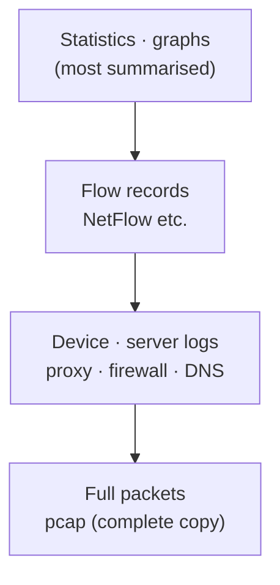
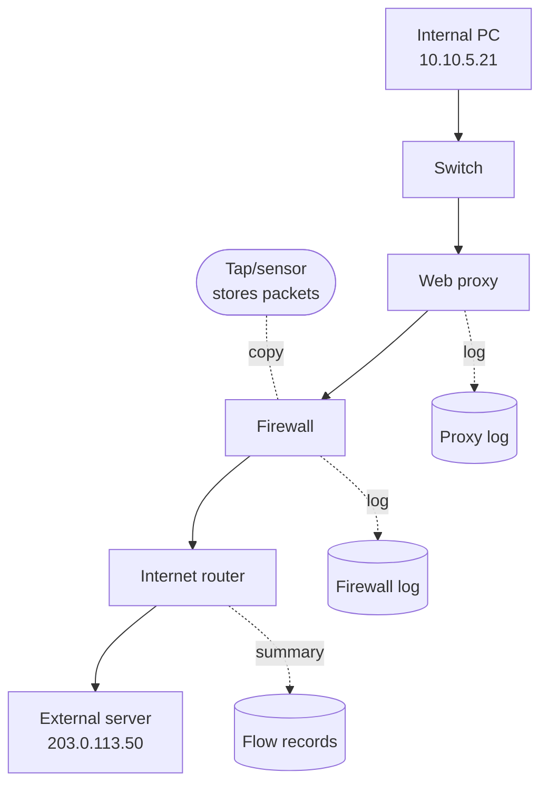
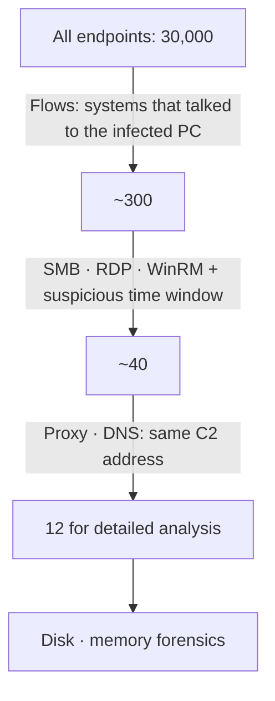
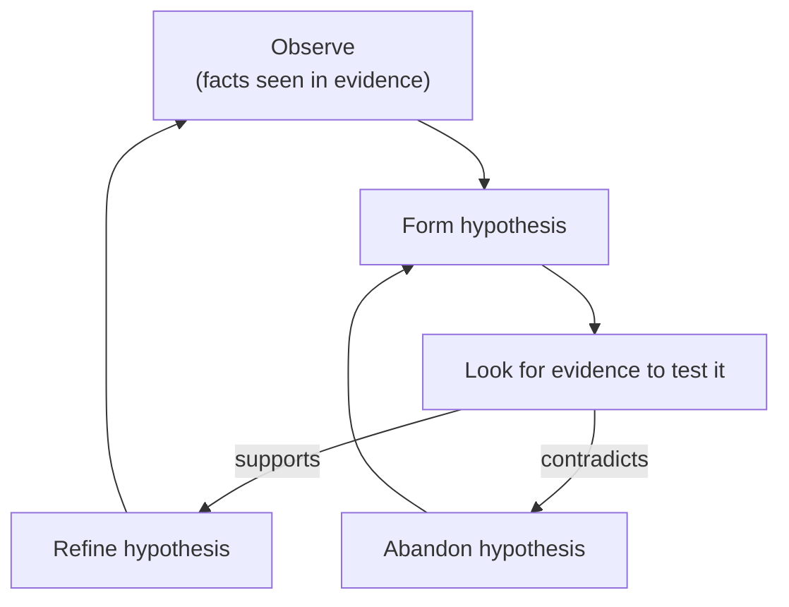
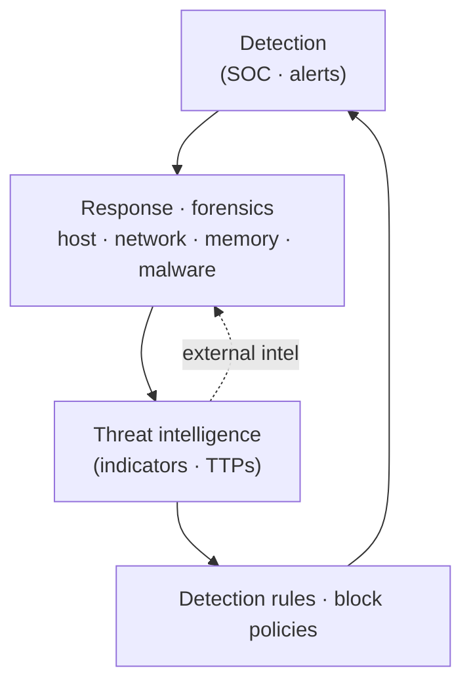
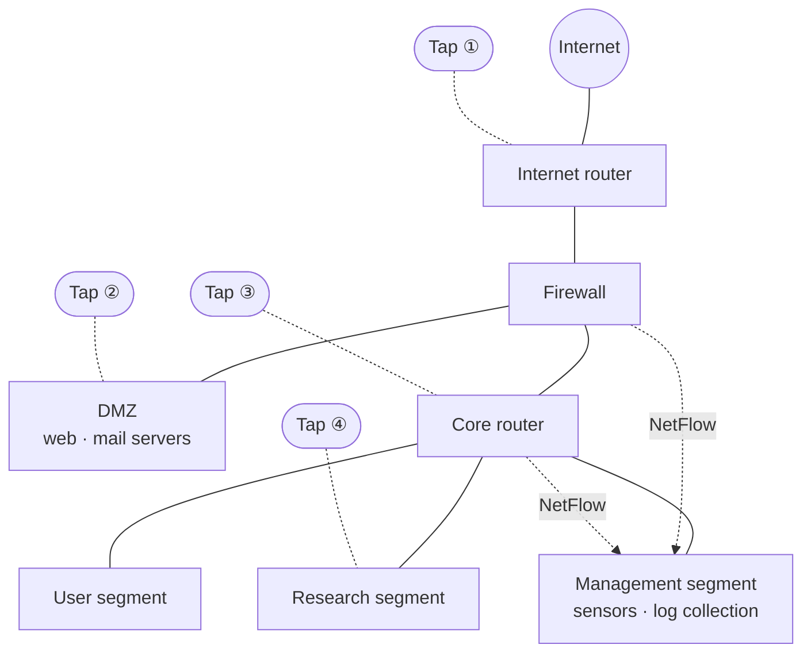

# Lesson 1.1 — Evidence Beyond the Disk: Why Network Forensics, and the Investigator's Mindset { #why-network-forensics }

!!! abstract "Scope of this lesson"
    This is the first lesson of Part 1. It answers these questions:

    - When does disk forensics hit a wall?
    - What evidence does the network keep when that happens?
    - What can each kind of evidence tell you, and what can't it?
    - What attitude should an investigator bring to the evidence?

    It also introduces the time, scope and scale pressures on a response team, and the **hypothetical organisation network** used throughout the series. There are almost no commands or tools yet. This lesson is about **why** we will spend the next lessons on proxy logs, pcap and flows.

!!! note "Notation"
    **(Hypothetical)** = a story made up to aid understanding, **(Illustrative output)** = output that shows the shape only and was not actually run, **[Changed]** = something that differs from older material, **[Supplement]** = a practical addition. External addresses use documentation ranges (192.0.2.0/24, 198.51.100.0/24, 203.0.113.0/24) and `example` domains. Internal addresses use the private 10.0.0.0/8 range so they cannot collide with any real network.

## 1. A phone call on a Friday afternoon { #a-phone-call }

**(Hypothetical)** At four o'clock on a Friday afternoon, the security team gets a call from an outside agency: "An address in your range has been talking to an attack server we're tracking, `203.0.113.50`, for the past few weeks." All you have is that one external address and a rough "a few weeks ago".

If you were the responder, where would you start? The first idea is probably **"find that PC and image the disk"**. Disk forensics is powerful. Deleted files leave traces, and trying to wipe them leaves more traces. But this route is blocked more often than you might expect.

- **You don't know which PC it is.** The agency gave you one of your public IPs, and behind it thousands of machines hide behind NAT (address translation).
- **The PC may already be gone.** It may have been rebuilt, the laptop lost, or it was a cloud instance that has since been deleted.
- **Touching it may tip off the attacker.** If the attacker is still inside, suddenly seizing a PC or running security tools signals "an investigation has started". The attacker may wipe traces or hide through another path. Acting so that the investigation doesn't leak to the adversary is called **OPSEC** (operational security). It comes up throughout this series.
- **It may not be just one machine.** Attackers don't stop at the first PC; they move on to other systems inside. This is **lateral movement**. In an organisation with tens of thousands of staff, answering "how far did it spread?" by imaging one disk at a time is simply not realistic.

So what do you look at when you can't look at the disk? The answer is **the path the communication took**. For a PC to talk to an external server, data must pass through switches, proxies, firewalls and routers. Some of those devices record the conversation in their own way. Network forensics is collecting those records, reading them, and fitting them together.

## 2. An analogy: one incident, many witnesses { #witnesses }

Picture something going missing from a building. If you can't search the suspect's home (= the disk), what would you check?

- **Corridor CCTV footage**: you see who went past, when, and what they carried. But it takes a lot of storage, so it isn't kept for long.
- **Access-card records**: only "card X passed door Y at time Z". You don't know what they carried, but months of records cost little to keep.
- **The guard's log book**: only what the guard judged important, such as "door alarm, 3rd-floor store room, 14:02".

The network has the same structure. CCTV is **full packet capture** (every byte exchanged, stored in full). Access-card records are **flow records** (only who talked to whom, when, and how much; NetFlow is the best-known form). The guard's log book is the **device logs** written by proxies, firewalls, DNS servers and intrusion detection systems. Several witnesses saw the same communication from different angles, so by fitting them together you get a picture no single witness can give.

There is one way this analogy differs from reality, and it matters a lot. A human witness **remembers** even without a recording device. A network cable remembers nothing. Packets vanish once they pass, and unless someone attached a recorder beforehand, that moment can never be seen again. A disk keeps what happened before we arrived; the network only shows **what happened after collection started**. That is why one of the biggest tasks in network forensics is "install and run collection before you need it".

Fortunately, even an organisation that prepared nothing is not empty-handed. Firewalls and proxies already log for operational reasons, and DNS servers, VPN appliances and cloud services often keep records of their own. A skilled investigator doesn't say "no packets, so we're done"; they find every remaining witness and fill as many gaps in their hypotheses as they can.

## 3. The evidence spectrum: from summaries to a complete copy { #evidence-spectrum }

Network evidence can be lined up by "how summarised it is". At one end are **heavily summarised** sources: statistics, graphs, flow records, host logs. At the other end is **full packet capture**, a bit-for-bit copy of everything that crossed the wire. Dozens of evidence sources sit in between.



**How to read the diagram:** moving top to bottom, detail increases. In exchange, storage grows, retention shrinks and analysis takes longer. Moving up, you can see further back and wider, but "what was exchanged" disappears.

"So isn't full packet capture all we need?" is the natural question. In theory yes, but in practice two things hold it back. First, volume. A 1 Gbps link at an average of 30% utilisation produces about 3.2 TB a day (1,000,000,000 bit/s × 0.3 ÷ 8 = 37.5 MB/s, × 86,400 s ≈ 3.24 TB). Second, encryption. Most traffic today is TLS-encrypted, so even with every packet you often can't read the content. In practice, organisations run several layers together, such as "months of flows + days of packets + assorted logs".

Here is what each source answers, side by side. Retention varies a lot between organisations, so treat that column as a rough feel only.

| Source | Questions it answers well | Questions it can't answer | Size · retention tendency |
| --- | --- | --- | --- |
| Full packets (pcap) | Exactly what was exchanged, which file crossed the wire | Encrypted content, traffic outside the collection point | Very large, usually days to weeks |
| Flows (NetFlow etc.) | Who talked to whom, when, for how long, how much | Content, URLs, file names | Small, months to a year or more possible |
| Web proxy logs | Which endpoint requested which URL, the result code, sometimes the username | Traffic that bypassed the proxy, request bodies | Medium, weeks to months |
| Firewall logs | Which connections were allowed or denied | What was inside the connection | Can be large depending on settings |
| DNS logs | Which name was looked up, when, by whom | What was actually done with that name | Medium |
| Host logs | Which process or account on that system communicated | Other systems, records that were deleted | Varies per system |

### 3.1 A small example: the traces one web request leaves { #one-request }

**(Hypothetical)** Internal PC `10.10.5.21` downloads `http://files.example.net/update.bin` with a browser. The request takes this path:



**How to read the diagram:** solid arrows are the direction the request actually travels (inside → Internet). Dotted lines show each device **recording the request in its own way**. The response comes back along the same path in reverse.

Each witness records the same moment like this (illustrative output, formats simplified):

```text
[proxy log]     2026-10-12 01:14:09 10.10.5.21 GET http://files.example.net/update.bin 200 1843200
[firewall log]  2026-10-12 01:14:09 allow tcp 10.0.0.3:50122 -> 203.0.113.50:80
[flow record]   2026-10-12 01:14:09 tcp 203.0.113.50:80 -> 10.0.0.3:50122 packets 1290 bytes 1901544
[packet capture] GET /update.bin HTTP/1.1 / Host: files.example.net ... (entire file content)
```

Notice something here. In the firewall log and the flow record, the source is `10.0.0.3`, not the PC's address `10.10.5.21`. Why? Because the PC asks the proxy, and **the proxy makes the outbound connection on its behalf**. So from the firewall or the router's outside, every web request looks like it came from one proxy. The question "which PC was it?" can only be answered from the proxy log. The byte counts differing slightly is also normal. The proxy log counts the HTTP response size; the flow counts bytes including IP and TCP headers. Remember that each witness counts by a different rule.

### 3.2 Changing the conditions { #change-conditions }

**Condition 1: what if it was HTTPS?** Say the same download was `https://`. If the proxy doesn't use TLS inspection (decryption), its log keeps only a `CONNECT files.example.net:443` line, not which file was fetched. The packet capture shows the server name inside the TLS handshake (SNI) plus sizes and timing, but the file content is ciphertext. The flow tells you size and time, exactly as with HTTP. So you can say "something of about 1.8 MB was received", but to say "a malicious file named update.bin was received" you need records from the endpoint or other evidence. Part 5 covers TLS in depth.

**Condition 2: what if the attacker cleared the PC's logs?** Even with the browser history and event logs wiped, the proxy, firewall and flow records sit on **other devices**, so they survive, unless the attacker controlled those too. This is a big advantage of network evidence: it accumulates physically apart from the target.

**Condition 3: what if there was no collection at all?** With no tap or sensor, there are no packets, ever. Then the first job is to find out which logs the devices were already writing and how long they keep them. If the firewall overwrites the oldest logs when space runs out, every day of delay costs a day of evidence. That is why, early in a response, **securing the logs that still exist** often comes before analysis.

### 3.3 How to interpret it in a real investigation { #interpretation-1 }

In the example above, what the one proxy log line directly shows is "`10.10.5.21` requested that URL and the server returned 200 (success) with 1,843,200 bytes". Concluding "that PC is infected" is premature. The file may have been downloaded but never run, or blocked by antivirus. To judge infection, you then check whether new outbound communication appeared from that PC (flows, proxy) and whether the file executed (endpoint records). Section 6 below formalises this "fact → hypothesis → further checks" flow.

## 4. Finding ten machines among tens of thousands: narrowing the scope { #scoping }

Now a harder situation. **(Hypothetical)** During the investigation you find that the attacker obtained a domain admin account's credentials and tried to use it to log on to other systems. The organisation has 30,000 endpoints, most of them not configured to log enough. Time to update your CV?

No. Lateral movement is still **network communication**. In a Windows environment, remote logon, file sharing and remote command execution use protocols such as SMB (port 445), RDP (3389) and WinRM (5985/5986). Which internal systems received such connections from the first infected PC is largely visible from internal flow records alone. That's how you cut 30,000 machines down to dozens, and then perform detailed disk and memory analysis on only the dozen or so that are genuinely suspicious.



**How to read the diagram:** moving down, the set of systems shrinks. The text by each arrow is the network evidence used at that step. The numbers are made up for illustration.

This shows one of network forensics' key roles. Network evidence sometimes reaches conclusions on its own, but more often it acts as a **lead generator that tells you which systems to examine closely**. It doesn't compete with disk forensics; it's the map that tells disk forensics where to dig.

**A common misconception.** Don't jump to "there was a connection on port 445, so it's lateral movement". Port 445 connections to file servers and domain controllers are countless and normal every day. Meaning appears only with **unusual combinations**: a user PC connecting to another user PC on 445, a connection at 3 a.m. outside working hours, a connection right after the suspected infection time. That's why knowing "what normal looks like" (a baseline) is where analysis starts.

## 5. The strengths and limits of network evidence { #strengths-limits }

Network evidence alone usually struggles to prove criminal liability in court. The reason is simple: an IP address is not a person. Several people can share one address (NAT, shared PCs), and an endpoint may have been remotely controlled. Turning "this request came from this address" into "this person did it" needs other evidence alongside, such as account logs, physical access records and endpoint forensics.

That doesn't make it low-value. Inside an organisation, it is very persuasive as grounds for isolating an infected PC, suspending an account, or deciding where to spend budget and people. And as shown above, its value as a **lead** to other forensic evidence is huge. The same holds **when an attack fails**. The tools and techniques the attacker used, and what they were after, remain on the network. These are the attacker's **TTPs** (tactics, techniques and procedures). TTPs from a failed attack become intelligence for predicting the attacker's motives, capabilities and next moves.

## 6. The investigator's mindset: separating facts, hypotheses and conclusions { #mindset }

Network evidence is voluminous and open to interpretation. So the attitude an investigator brings has a big effect on the result.

### 6.1 Be wary of tidy stories { #beware-tidy-stories }

Occam's razor, "the simplest explanation is usually right", is a fine everyday principle. In incident investigation it doesn't always hold, for two reasons.

First, **skilled attackers deliberately mislead us.** They plant tool strings used by other groups, generate eye-catching decoy traffic to draw attention away, or use covert channels that look like normal services. The first simple explanation you spot may be the one the attacker intended.

Second, **inexperienced users leave unexpected traces too.** They install odd software without understanding it, or misconfigure something so it produces traffic that looks like an attack. If you expect all the evidence to fit one neat story, you end up ignoring evidence that doesn't fit.

### 6.2 Investigate like a scientist { #scientific-attitude }

What an investigator needs, then, is a scientist's attitude. When gathering data, be disinterested, impartial and objective, with no stake in either conclusion. When an observation contradicts your hypothesis, abandon the hypothesis. Never believe in or rule out an idea dogmatically, and never use rhetorical exaggeration to push it or knock it down.

The best way to actually keep to this is to write down, from the start and separately, **the facts you observed, the hypotheses those facts support, and the conclusions that need further evidence**. Applied to the download example:

| Category | Content | Basis · what's needed |
| --- | --- | --- |
| Observed fact | `10.10.5.21` requested `update.bin` and received about 1.8 MB with a 200 response | One proxy log line |
| Observed fact | From 01:20 the same day, small connections from that PC to `203.0.113.77` every 5 minutes | Flow records |
| Hypothesis | The downloaded file ran and installed malware that calls out periodically | Fits both facts, but a legitimate updater could look the same |
| Conclusion needing more evidence | The PC is infected and remotely controlled by the attacker | Endpoint execution records, file analysis, content and destination reputation of the periodic traffic |

The further down the table, the stronger the claim and the more evidence it needs. If you want to write "infected" in a report, you have to fill the right-hand cell of the bottom row. If you can't, the accurate report says "infection is suspected" and lists what still needs checking.



**How to read the diagram:** an investigation isn't a one-way task; it's a loop. When new evidence supports a hypothesis, you make it more specific and go back to observing. When it contradicts, you drop it and form a new one. The key is that the "contradicts → abandon" arrow exists at all.

### 6.3 Be careful when there are no results, too { #absence }

"I searched the proxy logs for that C2 address and found nothing" is not the same as "there was no communication with that address". First check:

- **Collection scope:** was that PC's traffic really supposed to pass through that proxy? Was there a path that bypassed it?
- **Retention:** are logs for the suspected period still there?
- **Encryption and logging behaviour:** was it HTTPS, leaving only a `CONNECT` line instead of a URL? Did the proxy strip query strings before logging?
- **Tool settings:** did you get the case sensitivity or the log format wrong?

Only after checking these can you say "no trace of communication within the scope examined", and even then you say it with that "within the scope examined" qualifier.

## 7. DFIR is not an island { #dfir-cycle }

**DFIR** (Digital Forensics and Incident Response) doesn't run on its own. It sits inside a cycle spanning the whole security organisation.



**How to read the diagram:** follow the arrows around the loop (from detection rules at the bottom back to detection at the top). There's no fixed starting point. An incident may start from a SOC (security operations centre) detection alert, or from internally or externally generated threat intelligence (like the phone call in section 1).

Findings from network forensics flow around this cycle. For example, a C2 address and traffic pattern found during analysis are written up as threat intelligence, which then becomes a detection rule in the SIEM (a system that collects many logs for search and alerting) or a firewall block policy. The next time the same attacker shows up, they're detected sooner.

DFIR itself has several specialities: host, network, memory, malware analysis, mobile and more. No one person knows them all in depth, but they overlap a lot. The network knowledge in this series is useful when looking at network-related artifacts left on Windows, Linux, macOS or mobile devices, and when adding context to SIEM alerts. Conversely, someone who knows Windows file system artifacts will understand SMB (the Windows file-sharing protocol, covered in Part 3) traffic far faster. Building a broad bench of knowledge, alone or as a team, pays off.

## 8. How late is detection? The reality in numbers { #dwell-time }

The time an attacker stays inside before being discovered is called **dwell time**. This number ties directly to the question "how long do we need to keep evidence?"

**[Changed]** Older material on this topic cited the 2022 edition of the M-Trends report: a global median dwell time of 21 days, 14 days when the victim found it themselves, and 47% of victims first learning of the breach from an outside party. M-Trends 2026 (covering 2025 investigations), published on 23 March 2026, reports the following (checked 2026-11-05, [Google Cloud blog summary](https://cloud.google.com/blog/topics/threat-intelligence/m-trends-2026)).

| Item | Older material (2022 report) | M-Trends 2026 |
| --- | --- | --- |
| Global median dwell time | 21 days | 14 days (up again from 11 in the previous report) |
| Share first detected internally | 53% (47% external notification) | 52% (up from 43% the year before) |
| Notable detail | 8% undetected for over a year | Median of 122 days for cyber espionage and North Korean IT worker cases |

A few cautions when reading this table.

First, a **median** is "the middle value when the cases are lined up". A median of 14 days means half were found faster than 14 days and **half were found later**. Because it isn't a mean, cases that hid for months or years (the long tail) barely show in it. The 122 days for espionage cases shows how long that tail can be.

Next, year-to-year movement partly reflects changes in the mix of cases investigated. Lots of ransomware cases, which announce themselves, shorten dwell time; lots of espionage cases lengthen it. Don't read "14 days this year" as "an attacker is always caught within two weeks".

Finally, cases learned of through outside notification usually come with **little detail**, like the call in section 1: one address, one rough timeframe. That makes the network evidence you've stored internally even more important.

### 8.1 Do the maths: when retention is shorter than dwell time { #retention-math }

**(Hypothetical)** An organisation keeps full packets for 7 days, proxy logs for 30 days and flows for 180 days. What if an attack is discovered 14 days after it began?

- Full packets: 7 days < 14 days, so **the first 7 days of the intrusion are already gone.** You can't see the packets from the moment of entry.
- Proxy logs: 30 days > 14 days, so the initial access is still recorded.
- Flows: 180 days, so you can compare not just the start but also the "normal" picture before it (the baseline).

For an espionage-style case with 122 days of dwell time, the proxy logs (30 days) lose the start too, and only flows (180 days) cover it. That's why the more summarised the evidence, the more it's worth keeping for longer, and why layered retention makes sense. Retention isn't just a cost question, though; it interacts with privacy law and internal policy, so set it together with legal and privacy staff.

## 9. Three pressures on a response team: time, scope and scale { #time-scope-scale }

A response team ready to deploy doesn't mean things will go smoothly. A vague trigger like "some servers are dropping out oddly" doesn't tell you what to follow first. In many organisations, response teams name three big challenges.

**Time.** Response is almost always against a deadline. Yet DFIR doesn't allow guesses or unfounded claims, so you must be fast and **accurate to the point of pedantry**. Balancing deadlines against accuracy takes training and discipline.

**Scope.** Even if only 10–15 systems were really involved, picking those out of hundreds of thousands is very hard. Even with perfect knowledge of the environment and good tools, it can take days or weeks.

**Scale.** Many tools simply don't work at that size. So the team splits the environment into manageable chunks, and complexity grows with the number of chunks.

Network data eases all three pressures at once. Full packets, flows, logs from devices like proxies, and logs from endpoints show many systems at once from one place. The scoping in section 4 is exactly that. How much it helps, though, depends on how well this data is woven into the investigative process.

**[Supplement] What to check on day one.** Later lessons cover these in detail, but here's what's worth checking as soon as a response starts:

1. Make a list of **which evidence sources exist** right now (proxy, firewall, DNS, VPN, flows, packet sensors, cloud logs).
2. Check each source's **retention** and overwrite settings, and copy the periods you need before they disappear.
3. Secure the devices' **configuration files**. The config tells you where logs are written and in what format (you'll see this first-hand with the proxy in the next lesson).
4. Record each device's **time zone and clock accuracy**. If devices are minutes apart, the timeline tangles.
5. Confirm that collection and analysis are **within authorised scope**. Network data contains individual employees' activity verbatim, so looking without authority is a problem in itself.

## 10. The hypothetical organisation used in this series { #lab-environment }

Many lessons will use the same hypothetical organisation as their stage. **(Hypothetical)** It's a mid-sized research institute working on specialised materials. Recently the industry's information-sharing body (an ISAC, where organisations in the same sector share threat information) circulated a warning that activity by a state-backed group targeting the sector had increased. Then the mail server started dropping out intermittently, after similar odd behaviour on the Internet-facing web server. While looking for the cause, IT suspected malicious activity and a full incident response began. Another team handles the hosts; we investigate using **only the collected network data**.



**How to read the diagram:** solid lines are real connections. The dotted circles mark **taps** (devices placed in a link that copy the traffic passing through). Packets copied by the taps are stored on sensors in the management segment. The firewall and core router summarise traffic through all their interfaces as NetFlow and send it to the management segment, and server and device logs are gathered in one place too.

One question worth asking straight away: **"Which tap would see traffic between two PCs inside the user segment?"** The answer is "probably none". Traffic within one segment goes straight through that segment's switch and never reaches the core router. Traffic moving sideways inside the organisation is called **east-west traffic**; traffic between inside and outside is **north-south traffic**. If collection is concentrated on the north-south path, the lateral movement from section 4 is hard to see. How to fill this blind spot (switch mirroring, endpoint logs, etc.) is covered in the evidence-collection lesson later in Part 1.

The organisation's key users and endpoints are below. These addresses come back in later lessons.

| Role | Hostname | Address | Notes |
| --- | --- | --- | --- |
| CEO | hq-wkstn-01 | 10.10.7.11 | User segment |
| Senior researcher | hq-rd-01 | 10.10.6.11 | Research segment, access to sensitive material |
| Programme manager | hq-rd-04 | 10.10.6.14 | Research segment |
| IT administrator (separate normal and domain admin accounts) | hq-admin | 10.10.5.26 | Management segment |
| Security analyst | hq-hunt | 10.10.5.25 | Management segment |

## 11. Summary { #summary }

- Disk forensics hits a wall when the system is gone, when touching it tips off the attacker, or when there are too many systems. Even then, the path the traffic took keeps records.
- Network evidence forms a spectrum from summaries (statistics, flows, logs) to a complete copy (full packets). Each source answers different questions, so you need to fit several witnesses together.
- The cable remembers nothing. Collection must start before you need it; if nothing was prepared, rush to secure the logs devices were already writing.
- Network evidence sometimes reaches conclusions on its own, but more often it acts as the lead that picks which systems to examine closely.
- Write observed facts, hypotheses and conclusions needing more evidence separately, and drop a hypothesis when contradicting evidence appears. When there are no results, first suspect collection scope, retention, encryption and tool settings.
- Median dwell time is 14 days per the 2026 report, but espionage-type cases run far longer. Design retention against these numbers.

In the next lesson (1.2) we start with the witness that answered "which PC was it?" this time: what a **web proxy** is, and why it matters so much to an investigator.

## Review questions { #review }

**Question 1.** Why couldn't you find the PC straight away from the address the outside agency gave in section 1? What evidence would you need to find it?

??? success "Answer and explanation"
    What the agency saw was the organisation's **outside address**. Internal PCs go out through NAT or a proxy, so from outside many PCs look like one address. To find the actual PC behind it, you need records from the device that translated the address. For web traffic, the **proxy log** (which internal PC requested that destination); for other traffic, **firewall/NAT translation logs** or internal **flow records**. It's the same principle as in section 3.1, where the firewall only showed the proxy's address.

**Question 2.** Evaluate the claim "if we have packet capture, we don't need flow records".

??? success "Answer and explanation"
    The claim is wrong. Packets carry the most detail but are large, so they're usually kept only for days to weeks. As in the section 8.1 calculation, if dwell time exceeds retention, the packets from the start of the intrusion are already gone. Flows have no content but are small enough to keep for months, so they show the starting point and the normal baseline. Also, in segments with no tap (east-west traffic in section 10) there may be no packets at all, while flows from routers or firewalls may still exist. The two complement each other rather than substitute.

**Question 3. (Changed conditions)** The download in section 3.1 was HTTPS and the proxy does not do TLS inspection. What can and can't you learn from each witness?

??? success "Answer and explanation"
    - **Proxy log:** a line like `CONNECT files.example.net:443` tells you which PC connected to which host and when. It doesn't tell you which path (`/update.bin`) was fetched.
    - **Packet capture:** you see the server name in the TLS handshake, certificate information (depending on TLS version), and sizes and timing. The file content is ciphertext and unreadable.
    - **Flow:** as with HTTP, only addresses, ports, times and byte counts.

    So you can say "about 1.8 MB was received", but to say "that file is malicious" you need other evidence, such as the file left on the endpoint or execution records.

**Question 4. (Interpreting results)** A colleague wants to write in the report: "We searched the proxy logs for the C2 domain and got 0 hits, so no PC in our organisation communicated with that C2." What would you advise?

??? success "Answer and explanation"
    "0 hits" only means no trace **within the scope examined**. Before it goes in the report, advise checking:

    1. Whether every PC's web traffic really passes through that proxy (bypass paths, home-working PCs, server segments).
    2. Whether logs for the suspected period are within retention.
    3. Whether the malware uses a protocol or port other than HTTP/HTTPS. That traffic doesn't pass the proxy, so look at firewall, flow and DNS logs as well.
    4. Whether it connected directly by IP address instead of the domain.
    5. Whether the search conditions (case, subdomains, log format) are right.

    Even after checking these, the report should state its scope, e.g. "no trace of communication was found within the evidence sources and time period examined".

**Question 5. (Common misconception)** Flow records show user PC `10.10.7.11` made hundreds of connections to the file server on port 445. Is this evidence of lateral movement?

??? success "Answer and explanation"
    Not by itself. A user PC connecting to a file server on 445 (SMB) is everyday normal work with shared folders. The observed fact is "hundreds of 445 connections", which fits both normal work and lateral movement. It becomes meaningful only with **something unusual**: is the destination another user PC rather than the file server, a system this PC never normally talks to, at an odd hour such as 3 a.m., starting suddenly right after the suspected infection time? To judge, compare with the baseline (the same PC's flows over previous weeks) and cross-check host evidence such as that system's logon records.

**Question 6. (Calculation)** An organisation keeps packets for 10 days, proxy logs for 45 days and flows for 90 days. For an incident with dwell time of (a) 14 days and (b) 122 days, which sources can show the **first day** of the intrusion? Assume preservation happened immediately on discovery.

??? success "Answer and explanation"
    Dwell time is how far back from discovery you must reach to get to day one. Retention must be at least that long for day one to survive.

    - (a) 14 days: packets 10 < 14, **no**. Proxy 45 ≥ 14, **yes**. Flows 90 ≥ 14, **yes**.
    - (b) 122 days: packets **no**, proxy 45 < 122 **no**, flows 90 < 122 **no**. None of the three covers day one.

    In (b), it's hard to establish the entry path from network evidence alone; you rely more on endpoint traces or outside information. Given the long dwell times of espionage-style attacks, this is a reason to consider keeping summarised evidence (flows, DNS logs) for longer.

**Question 7. (Application)** In the section 10 organisation, research-segment PC `10.10.6.14` connects via RDP to `10.10.6.11` in the same research segment. Which tap in the diagram might see this? If no tap does, what evidence should you look for?

??? success "Answer and explanation"
    The research segment has **tap ④**, so if that tap sits where it can see traffic within the segment (for example between the research switch and the PCs, or at a point mirroring the whole segment), it may see it. But if tap ④ is on the link between the research segment and the core router, traffic between two PCs in the same segment never crosses that link, so it **won't be seen**, and it won't appear in the core router's NetFlow either. So first check "where, and in which direction" the tap is placed. If it isn't captured, look for endpoint-side evidence such as the research switch's logs or mirroring settings, and both PCs' Windows event logs (RDP logon records). East-west traffic like this easily becomes a blind spot for north-south collection.

**Question 8. (Mindset)** During analysis you find, in the packets, a string from a tool known to be used by a particular state-backed group. Can you conclude "this is that group's attack"?

??? success "Answer and explanation"
    Not yet. The observed fact is "that string was in the packets"; "that group's attack" is a hypothesis. As in section 6.1, skilled attackers sometimes plant other groups' traces to send investigators the wrong way. Tools are also often public or leaked and used by several groups. Judging who is behind it means checking whether infrastructure (addresses, domain registration), timing, targeted information and TTPs across several stages all fit, and cross-checking with the threat intelligence team. The accurate report states the observation as is, e.g. "a tool string reported to be associated with group X was observed".

## References { #references }

- Google Cloud Threat Intelligence, [M-Trends 2026: Data, Insights, and Strategies From the Frontlines](https://cloud.google.com/blog/topics/threat-intelligence/m-trends-2026) (published 2026-03-23, checked 2026-11-05). Median dwell time 14 days (previously 11), 52% detected internally (previously 43%), 122-day median for espionage and North Korean IT worker cases.
- MITRE ATT&CK, [Lateral Movement (TA0008)](https://attack.mitre.org/tactics/TA0008/) (checked 2026-11-05). The lateral movement tactic and its techniques.

!!! note "About this page"
    Personal study notes rewritten in my own words from a range of study material. The organisation, people and addresses in the hypothetical cases are all invented.
