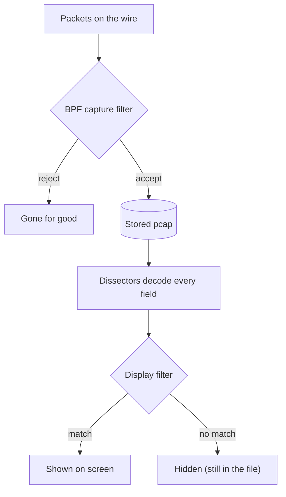

# Lesson 1.9 — Wireshark Display Filters and Following Streams { #wireshark-display-filters }

!!! abstract "Scope of this lesson"
    - How display filters differ from BPF (where, how fast, and what they know when filtering)
    - Comparisons, sets, substrings, regular expressions and functions, and **operator precedence that's the opposite of BPF's**
    - Finding field names, and "Apply as Filter" vs "Prepare as Filter"
    - The syntax checker's green, red and yellow, and what it doesn't tell you
    - **Multi-value fields and `!=`**: the difference between the source material's explanation and today's behaviour (since 3.6)
    - Following TCP streams, "Decode As", and capturing directly in Wireshark

!!! note "Lab environment and notation"
    **(Actual output)** was produced with tshark 4.2.2 in this work environment. tshark's `-Y` uses the same filter engine as the display filter bar in the Wireshark window. The filter practice pcap was assembled by hand in Python (private and documentation addresses only), and stream following used the file actually captured on loopback in lesson 1.6. With no GUI in this environment, I couldn't see the syntax checker's **colours** directly; instead I checked the error messages tshark gives for the same filters.

## 1. You want "this value in this protocol" from stored packets { #why-display-filters }

**(Hypothetical)** You have the file captured generously with `host 10.10.6.14` in lesson 1.7. Now the questions get specific: "Which DNS responses this PC received had more than five answers?", "Which HTTP requests had a username in the cookie?", "Which HTTP on ports other than 80 and 8080 contained the word `stolen`?"

Doing this with lesson 1.7's BPF means computing every byte position: where in a DNS response the answer count sits, where the HTTP headers start. There are hundreds or thousands of protocols, and even the most brilliant investigator can't do all of that with offsets and bit masks. So the Wireshark developers made the dissectors (the ones that fill lesson 1.8's packet details pane) **usable directly as filters**. These are **display filters**. Any field Wireshark dissects can be used in a filter.

```text
'dns.flags.response == 1 and dns.count.answers > 5 and dns.qry.name contains "example.net"'
```

"DNS responses with more than five answers whose queried name contains `example.net`." Not a single byte offset.

## 2. An analogy: the X-ray at the entrance and the librarian in the stacks { #analogy }

Lesson 1.7 compared BPF to the first X-ray at airport security. A display filter is more like **a librarian finding books in the stacks**. The librarian opens a book, reads the contents and text, and judges "this book has that content". That's slower than an X-ray, but answers far more complex questions.

There are two important differences in this analogy.

- **The timing differs.** A bag that doesn't pass the X-ray (a BPF capture filter) never gets on the plane; it's gone for good. The librarian (a display filter) picks **which to show** among books already in the stacks. Ask another question and you get other books; clear the filter and every book is visible again. The originals are untouched.
- **What's read differs.** The librarian reads a book's **content**. A display filter likewise doesn't look at the packet's bytes directly; it applies to **the logical content the dissector has already decoded**. For example, DNS saves bytes when the same name appears several times by replacing it with a short "that name from earlier" marker, a compression scheme. Reading a DNS packet's raw bytes is therefore fairly painful, but Wireshark decodes first and filters second, so you can compare the whole name directly with `dns.qry.name`.

| | BPF (capture filter) | Display filter |
| --- | --- | --- |
| When applied | At capture (also when reading a file) | After capture and storage, when displaying |
| Speed | Very fast (close to the kernel) | Slow (decides after decoding everything) |
| Undo | What a capture filter dropped is gone for good | Clear it and everything shows again |
| What it knows | Fixed header positions and a few protocols | Every field Wireshark dissects |
| Syntax | `host 10.10.6.14 and tcp port 80` | `ip.addr == 10.10.6.14 and tcp.port == 80` |

Drawn as a picture, here's where each filter sits in the processing order:



**How to read the diagram:** top to bottom is the order packets pass through. BPF sits **before** storage, so what it rejects can't be seen again; the display filter sits **after** storage and dissection, so what it hides stays in the file.

Wireshark dissects IP, TCP and UDP too, so there are display filters that do the same job as BPF, such as `tcp.port == 80` or `ip.src == 203.0.113.50`. But for the same condition BPF is **much** faster, so the rule is to reduce with BPF first wherever possible (lesson 1.7 section 8). Wireshark is mostly used on traffic already stored, and there trading a bit of speed for expressiveness is a good deal.

## 3. Syntax { #syntax }

### 3.1 Comparison and logic { #comparison }

| Kind | Operators | Example |
| --- | --- | --- |
| Equal / not equal | `==`, `!=` | `http.request.method == "POST"` |
| Magnitude | `<`, `>`, `<=`, `>=` | `dns.count.answers > 5` |
| Set membership | `in { }` | `http.response.code in {200, 301, 302, 404}` |
| Logic | `and` (`&&`), `or` (`||`), `not` (`!`), parentheses | `http and not tcp.port == 80` |
| Substring | `contains` | `http.host contains "example"` |
| Regular expression | `matches` (`~`) | `http.user_agent matches "curl|wget"` |

**[Caution] Precedence is the opposite of BPF's.** Lesson 1.7 said BPF gives `and` and `or` equal precedence and groups from the left. Display filters, **like most programming languages, group `and` before `or`**. The Wireshark 4.0.0 release notes announced this change, and the current documentation's order is `not` > `and` > `xor` > `or` (checked 2026-11-05). Checking with the practice file (actual output):

| Filter | Packets matched |
| --- | --- |
| `http.response.code == 404 or http.response.code == 301 and ip.src == 10.10.6.14` | 1 (packet 6, the 404 response) |
| `(http.response.code == 404 or http.response.code == 301) and ip.src == 10.10.6.14` | 0 |

The first line reads as `404 or (301 and source is that PC)`, so the server's 404 response (packet 6) matched. The same shape in BPF would have read the opposite way. Switching between the two languages, this difference is easy to forget, so the safest habit is **parentheses whenever you mix them, in either language**.

### 3.2 [Changed] Sets use commas { #sets }

To check whether a value is one of several, use a set instead of a long chain of `or`s. The source material separates elements with **spaces**, as in `http.response.code in { 200 301 302 404 }`, but since Wireshark 3.6 set elements must be separated by **commas**, and space separation became syntax "to be removed in a future version". Testing in 4.2.2, it really was an error (actual output):

| Filter | Result |
| --- | --- |
| `http.response.code in {200, 301, 302, 404}` | 3 (packets 5, 6, 7) |
| `http.response.code in {200 301 302 404}` | Error: `"301" was unexpected in this context.` |

Pasting filters from old material or scripts into the current version can fail like this. Failing is the lucky case; it's more dangerous when the meaning **changes silently**, like `!=` in section 6.

### 3.3 Case: `contains`, `matches`, `lower()` { #case }

The practice HTTP request's cookie is `Cookie: theme=dark; UserName=jdoe` (capital U and N). The results (actual output):

| Filter | Matched | Interpretation |
| --- | --- | --- |
| `http.cookie contains "username"` | 0 | `contains` is **case-sensitive** |
| `http.cookie matches "(?i)username"` | 1 | The source material's method. `(?i)` means "ignore case" |
| `http.cookie matches "username"` | 1 | Today's `matches` **ignores case by default** |
| `http.cookie matches "(?-i)username"` | 0 | `(?-i)` makes it case-sensitive |
| `lower(http.cookie) contains "username"` | 1 | Lowercase the field, then compare |

The source material says to add `(?i)` to make `matches` ignore case, but the current Wireshark documentation describes `matches` as a PCRE2 regular expression that is **case-insensitive by default**, and 4.2.2 behaved that way. `(?i)` is harmless but unnecessary; it's when you want case **sensitivity** that you add `(?-i)`. `contains`, on the other hand, is still case-sensitive, so when you don't know the case, wrap the field in `lower()` or use `matches`. Besides `lower()`, the current documentation lists more functions such as `upper()`, `len()` and `count()`.

### 3.4 It only matches if the dissector knows it { #dissector-dependence }

Let's test one of the source material's examples: "HTTP on ports other than 80 and 8080 containing `stolen`". Packet 8 in the practice file POSTs `stolen=orchid-007` to port 4444 (actual output):

| Filter | Matched |
| --- | --- |
| `(not tcp.port == 80 and not tcp.port == 8080) and http contains "stolen"` | 1 |
| `not tcp.port in {80, 8080} and http contains "stolen"` | 1 |
| `tcp.payload contains "stolen"` | 1 |
| `frame contains "stolen"` | 1 |

For `http contains` to match, Wireshark must **dissect** the packet as HTTP. Port 4444 isn't an HTTP port, but this version recognised it through its content-guessing feature (heuristics). Had the dissector not recognised it, `http contains` would return 0. So to find "packets containing this text in any protocol", filters that **don't rely on dissection**, such as `frame contains` or `tcp.payload contains`, are more reliable. These look only at one packet's bytes, though, so remember they can miss text split across two packets (use section 7's stream following for that).

### 3.5 BPF syntax doesn't work { #no-bpf }

Writing BPF syntax such as `host 203.0.113.80` where a display filter goes is an error (actual output: `"203.0.113.80" was unexpected in this context.`). As a display filter it must be `ip.addr == 203.0.113.80`. Conversely, Wireshark's **capture** filter box (on the capture start screen) takes BPF. Always remember that one program contains two languages.

## 4. Finding field names { #field-names }

With so many protocols, how do you know the field names to use in filters? Back to the GUI.

The answer is the **status bar** from lesson 1.8. Select the Name line of a DNS query in the packet details pane, and the left side of the status bar shows:

```text
Query Name (dns.qry.name), 19 bytes
```

The `dns.qry.name` in parentheses is the field name, and 19 bytes is the field's length. Packet 2 in the practice file queried `files.example.net`; it has 17 characters (5 + 1 + 7 + 1 + 3), and why it's 19 bytes is interesting. DNS stores a name by putting **a one-byte length in front of** each dot-separated piece (label) and a 0 byte at the end. `files` (5), `example` (7) and `net` (3), so 3 length bytes + 15 characters + 1 terminator = 19 bytes. The dots aren't stored; the length bytes do their job. A display filter doesn't need to know this storage scheme; write it **as a person reads it**, as in `dns.qry.name == "files.example.net"`. That's section 2's "decode first, filter second" in action.

Once you know the field name you can type it, but **building** it in the GUI is faster and avoids typos. Right-click a field in the details pane and there are two menus:

- **Apply as Filter:** builds a new filter and **applies it immediately**.
- **Prepare as Filter:** **only puts it** in the filter bar without applying it.

Both have submenus such as "Selected", "Not Selected", "…and Selected" and "…or Selected", so you can also add conditions to the current filter. The difference seems subtle, but once you've experienced how **very long** applying a filter to a large file can take, you'll value "Prepare". Refining several conditions and then applying once saves a lot of time watching the progress bar.

**[Supplement] Finding field names on the command line.** `tshark -G fields` prints a list of every field Wireshark knows. Filtering it, as in `tshark -G fields | awk -F'\t' '$3=="dns.qry.name"'`, gives that field's description and type (here `Name | dns.qry.name | FT_STRING`, actual output). Handy when writing scripts.

## 5. The syntax checker and its limits { #syntax-checker }

Display filters can get complex, so Wireshark checks the syntax as you type, using the filter bar's background colour, in three stoplight colours:

- **Green:** the syntax is valid.
- **Red:** an unknown field name or a syntax error. The status bar shows why.
- **Yellow:** the syntax is valid, but a warning that results may not be what you expect.

Putting typical red cases into tshark gives the same reasons as error messages (actual output):

| Filter | tshark 4.2.2 error message | Reason |
| --- | --- | --- |
| `some.made.up.field == "x"` | `Constant expression is invalid.` | Field name doesn't exist |
| `http.host == "intranet.lab.example` | `The final quote was missing from a quoted string.` | Quote not closed |
| `host 203.0.113.80` | `"203.0.113.80" was unexpected in this context.` | BPF syntax used |
| `http.response.code in {200 301 302 404}` | `"301" was unexpected in this context.` | No commas in the set (section 3.2) |

The source material's typical yellow example is `!=`. In older versions, using `!=` raised a yellow warning that "results may not be what you expect". Why, and how it has changed now, is the subject of the next section. With no GUI in this environment, I couldn't confirm directly whether today's version still shows yellow for `!=`.

And the most important limit: **the syntax checker checks syntax only, not logic.** Green doesn't mean it selects the packets you want. In section 3.1's precedence example, the filter without parentheses had perfectly valid syntax too. So test filters **against known packets** to confirm the results are right.

## 6. [Changed] Multi-value fields and `!=` { #multi-value }

Some fields appear **several times** in one packet. A DNS response's address (`dns.a`) appears several times if there are several answers; `ip.addr` appears twice (source and destination), and so does `tcp.port`. Asking "not equal" of such fields is trickier than it sounds. Does it mean "all values are not equal" or "at least one value is not equal"?

### 6.1 The source material's explanation (old behaviour) { #old-behavior }

The source material explains it like this: filtering with `dns.a != X` matched a packet whose response clearly contained X, because that response also had another `dns.a` that **wasn't** X. So the old `!=` was true "**if any value is not equal**". To find "responses that don't contain X", it said to write `dns.a && !(dns.a == X)`: among packets with `dns.a`, exclude those where **any** value equals X.

### 6.2 Today's behaviour { #new-behavior }

**Since Wireshark 3.6, `a != b` always means the same as `!(a == b)`.** The release notes explain that with this change, `ip.addr != 1.1.1.1` works "as expected", giving the same result as `ip.src != 1.1.1.1 and ip.dst != 1.1.1.1`, and it removes the contradiction of `a == b` and `a != b` both being true (checked 2026-11-05). A separate operator was introduced for the old meaning: `~=` in 3.6, then in 4.0.0 `~=` was deprecated in favour of `!==`. The current documentation summarises:

| Operator | Aliases | Meaning |
| --- | --- | --- |
| `==` | `any_eq`, `eq` | True if **any** value is equal |
| `!=` | `all_ne`, `ne` | True if **all** values are not equal (= no value is equal) |
| `===` | `all_eq` | True if **all** values are equal |
| `!==` | `any_ne` | True if **any** value is not equal (the old `!=` meaning) |

You can also prefix `any` or `all`, as in `any dns.a != X`.

### 6.3 Checking it { #multi-value-test }

The practice file has three DNS responses. Packet 1 has **two** answers (`203.0.113.70`, `198.51.100.71`), packet 2 has just `198.51.100.71`, and packet 3 just `203.0.113.70` (actual output):

| Filter | Packets matched | Interpretation |
| --- | --- | --- |
| `dns.a == 203.0.113.70` | 1, 3 | Responses with that address at least once |
| `dns.a != 203.0.113.70` | **2** | Responses with that address **not at all** |
| `dns.a && !(dns.a == 203.0.113.70)` | 2 | The source material's workaround; now the same as the line above |
| `dns.a !== 203.0.113.70` | 1, 2 | Responses with at least one other address (the old `!=`) |
| `any dns.a != 203.0.113.70` | 1, 2 | Same as above |
| `dns.a === 203.0.113.70` | 3 | Responses where every answer is that address |
| `all dns.a == 203.0.113.70` | 3 | Same as above |
| `dns.a ~= 203.0.113.70` | Error | `~=` is no longer accepted in 4.2.2 |
| `ip.addr != 10.10.6.14` | 0 | Every packet has that PC as source or destination |

With the `!=` of the source material's era, packet 1 would have matched too. Now only packet 2 does. The last row is interesting as well: under the old behaviour, `ip.addr != 10.10.6.14` would have matched almost every packet (one of source or destination is always another address), but now it has the intuitive meaning "packets not involving that PC", and matched 0.

**Why does this matter for investigations?** Because the same filter string **selects different packets depending on the Wireshark version**. Rerun a report's or script's `!=` filter written for a version before 3.6 on today's version, and it gives **a different result silently**, with no error. So reports must record the **tool version** alongside the filters used, and when reusing someone else's filters, check which version's meaning they were written for. And when asking "not" of a multi-value field, **choose explicitly** the meaning you want: `!=` (none equal) or `!==` (at least one different). Running filters on large data sets without understanding these nuances produces grossly inaccurate results.

## 7. Following TCP streams { #follow-stream }

Looking at packets one at a time doesn't show the flow of a conversation well, because HTTP requests and responses are split across several packets. **Follow TCP Stream** stitches together just the data portion of one TCP connection in order, showing the whole conversation in one view. It's one of the features you'll use most in this series and in real cases.

Select a packet, right-click (or use the Analyze menu), then Follow → TCP Stream, and a window opens. Client → server is coloured **red**, server → client **blue**. For a text protocol like HTTP you can see the whole exchange at a glance. tshark's `-z follow` does the same (the real capture from lesson 1.6, actual output):

```console
$ tshark -r full.pcap -n -q -z follow,tcp,ascii,0
===================================================================
Follow: tcp,ascii
Filter: tcp.stream eq 0
Node 0: 127.0.0.1:36314
Node 1: 127.0.0.1:8082
77
GET / HTTP/1.1
Host: 127.0.0.1:8082
User-Agent: curl/8.5.0
Accept: */*


	186
HTTP/1.0 200 OK
Server: SimpleHTTP/0.6 Python/3.13.18
Date: Thu, 05 Nov 2026 02:39:43 GMT
Content-type: text/html
Content-Length: 32
Last-Modified: Thu, 05 Nov 2026 02:39:39 GMT


	32
<html><body>hello</body></html>

===================================================================
```

`follow,tcp,ascii,0` means "the TCP stream, as text (ascii), stream number 0". Wireshark numbers each connection from 0 (`tcp.stream`), and following a stream automatically puts a filter like `tcp.stream eq 0` in the filter bar. The numbers in the output (`77`, `186`, `32`) are each chunk's byte count, and chunks preceded by a tab are server → client (blue in the GUI). The connection list from `-z conv,tcp` shows how many streams there are.

Two features of the stream window to know:

- **Choosing a direction:** the "Entire conversation" list at the bottom lets you pick just one direction. Especially useful for protocols where requests and responses don't fall into neat chunks the way HTTP's do.
- **Save as:** saves **just the data portion** of the selected direction to disk, exactly as it was. Like lesson 1.5's cache carving, saving the response direction is a starting point for restoring a file the server sent (you still need to strip the headers). You'll do this hands-on in the lab at the end of Part 1.

The same feature exists for UDP, TLS and HTTP streams, and newer versions add streams such as HTTP/2 and QUIC.

**[Caution] What stream following can't show.** It stitches together **only the captured packets**. If packets were missed during capture, those spots are empty (Wireshark may mark the number of missing bytes), and if packets were cut by snapshot length as in lesson 1.6, you see only what was kept. TLS-encrypted connections show only ciphertext without keys (Part 5). And only **data** is shown, so check header timing and size information separately in the packet list.

## 8. Other features { #other-features }

### 8.1 Decode As { #decode-as }

Wireshark usually decides the protocol by port number and content guessing (heuristics). But attackers often send a protocol over **an unexpected port** to evade detection. Wireshark may then fail to recognise it or decode it as the wrong protocol. In that case, right-click the packet, choose "Decode As", and specify the dissector you want, forcing that connection to be decoded as that protocol. In tshark, write it as `-d tcp.port==443,http`.

I tried three cases: HTTP on port 4444, DNS on UDP 5300, and **unencrypted HTTP on port 443** (actual output). 4.2.2 **recognised all three without being told**. Even HTTP on 443 was caught as `http.request`, not `tls`, with the same result as giving `-d tcp.port==443,http`. That's how good the latest Wireshark heuristics have become. That doesn't make the feature obsolete. For proprietary protocols built by attackers, or when heuristics **guess wrong** (e.g. data that happens to look like another protocol), you must specify it yourself; and when you doubt a label Wireshark attached, you can switch dissectors to check. It's the same principle as not trusting labels like `http(80)` at face value (lesson 1.8).

### 8.2 Capturing directly in Wireshark { #capture-in-wireshark }

Capturing and analysing in one step is sometimes convenient, so Wireshark can capture. The GUI exposes all the same functionality as tcpdump. But don't forget the heavy processing load of the GUI and dissectors. **Never capture important data through the Wireshark GUI**, because dropped packets add up quickly. In a suitable environment such as a lab, skipping the separate capture step can save time. Modern Wireshark hands the actual capture to a separate program, `dumpcap`, which can be used on its own without the GUI and may be a good option in some cases (lesson 1.8 section 2.3). Whatever you use, test it before relying on it in operations.

## 9. How to use this in a real investigation { #in-practice }

1. **Reduce first with BPF, then look in detail with display filters.** Applying display filters straight to large files is slow.
2. Build filters from fields in the details pane with **"Prepare as Filter"**, refine, then apply.
3. Precedence is the opposite of BPF's, so **use parentheses**.
4. When asking "not" of multi-value fields (`ip.addr`, `tcp.port`, `dns.a`, etc.), choose the meaning you want: `!=` (none equal) or `!==` (at least one different).
5. When you don't know the case, use `matches` or `lower()` instead of `contains`.
6. When you must search without relying on dissectors, use `frame contains`.
7. **Test filters against known packets**, and record the filter string together with the **tool version** in reports.
8. Apply filters settled in the GUI to many files with `tshark -Y` (connecting to lesson 1.3's shell analysis).

## 10. Summary { #summary }

- A display filter is a language that filters on **every field** Wireshark dissects. Slower than BPF, it's used after storage, can always be undone, and applies to logical content rather than bytes.
- Use comparisons (`==`, `!=`, `<` etc.), sets (`in {a, b}`, **commas required**), `contains` (case-sensitive), `matches` (PCRE2, **case-insensitive by default**) and functions such as `lower()`. BPF syntax is an error.
- Precedence is `not` > `and` > `xor` > `or`, **unlike BPF**. Use parentheses when mixing.
- Find field names in the status bar; "Apply as Filter" applies immediately, "Prepare as Filter" only fills the bar. `tshark -G fields` finds them too.
- The syntax checker checks **syntax only**, in green, red and yellow. Test logic yourself.
- **Since 3.6, `!=` means "no value is equal"**, and the old meaning ("at least one different") is `!==` (`any_ne`). The same filter gives different results across versions, so record the tool version with filters.
- Following a TCP stream stitches one connection's data together to show the whole conversation (client → server red, server → client blue), and lets you save one direction exactly as it was. Uncaptured parts and encrypted content aren't visible.
- "Decode As" forces a protocol on an unexpected port to be decoded. Don't do important captures through the Wireshark GUI.

In the next lesson (1.10) we cover a lab guide for getting hands-on with the tcpdump and Wireshark skills learned so far.

## Review questions { #review }

**Question 1.** Explain how the following is read as BPF (tcpdump) and as a display filter (Wireshark). Why does the same shape mean different things?

```text
A or B and C
```

??? success "Answer and explanation"
    BPF gives `and` and `or` **equal precedence and groups from the left**, so it reads `(A or B) and C` (lesson 1.7). Display filters, since 4.0.0, group `and` **before** `or`, so it reads `A or (B and C)` (confirmed directly in section 3.1). The two languages use different rules, so the same shape can be read the opposite way. It's a common mistake for analysts who switch between them, so parentheses whenever you mix `and` and `or`, in either language, is the safest approach.

**Question 2. (Changes)** An internal investigation procedure written in 2021 says "to find DNS responses from somewhere other than the internal DNS server `198.51.100.53`, use `ip.src != 198.51.100.53 and dns.flags.response == 1`". Does this filter give the same result in Wireshark 4.x as it did then?

??? success "Answer and explanation"
    `ip.src` appears **only once** per packet, so it's unaffected by the change in `!=`'s meaning; with one value, "all values differ" and "at least one differs" are the same. So this filter gives the same result before and after 3.6. The meaning changes when `!=` is used on fields that appear **several times**, like `ip.addr`, `tcp.port` and `dns.a`. Even so, it's good to note in the procedure "which Wireshark version" the filter is written for, and to remember results may differ for packets where `ip.src` appears twice, such as tunnels (IP inside IP).

**Question 3. (Calculation)** For section 6.3's three practice DNS responses (1: `.70` and `.71`, 2: `.71`, 3: `.70`), give the packet numbers each filter matches. (a) `dns.a == 198.51.100.71` (b) `dns.a != 198.51.100.71` (c) `dns.a !== 198.51.100.71` (d) `dns.a === 198.51.100.71`

??? success "Answer and explanation"
    `.71` is `198.51.100.71` and `.70` is `203.0.113.70`.

    - (a) Responses with `.71` at least once: **1, 2**
    - (b) Responses with no `.71` at all: **3**
    - (c) Responses with at least one value other than `.71`: packet 1 has `.70` so yes, packet 2 has only `.71` so no, packet 3 has only `.70` so yes: **1, 3**
    - (d) Responses where every answer is `.71`: **2**

    All four results were confirmed by running them against the practice file with tshark 4.2.2. The difference between (b) and (c) is the difference in `!=`'s meaning before and after 3.6; the old `!=` behaved like today's `!==`, giving (c)'s result.

**Question 4. (Case)** To find requests with `curl` in the User-Agent you used `http.user_agent contains "curl"`, but requests sending `CURL/8.5.0` or `Curl/7.88` were missed. Explain why and fix it two ways.

??? success "Answer and explanation"
    `contains` is **case-sensitive**, so it treats `curl`, `CURL` and `Curl` as different text. Fix it by ① lowercasing the field before comparing, as in `lower(http.user_agent) contains "curl"`, or ② using `matches`, which ignores case by default, as in `http.user_agent matches "curl"`. Writing `matches "(?i)curl"` as in the source material works too, but today's version ignores case even without `(?i)`. And remember the User-Agent is a value the program sets freely (lesson 1.3), so no `curl` doesn't mean it isn't a command-line tool.

**Question 5. (Dissector dependence)** A colleague searched a whole pcap with `http contains "password"`, got 0 hits, and concluded "no password was ever sent in plaintext". When could this conclusion be wrong? Suggest a broader filter too.

??? success "Answer and explanation"
    ① If Wireshark **didn't dissect** the traffic as HTTP (unusual port, heuristic failure), `http contains` won't match. ② If it went over another plaintext protocol (FTP, POP3, Telnet, etc.) rather than HTTP, it's obviously excluded. ③ If the text is **split across two packets**, a per-packet search can miss it. ④ If the case differs (`Password`, `PASSWORD`), `contains` misses it. ⑤ If the body is compressed (gzip) or encoded (Base64), the text isn't visible as-is. ⑥ If it was encrypted with TLS, it's not visible at all. More broadly, use a filter that doesn't rely on dissectors and ignores case, such as `frame matches "pass(word)?"`, and check splitting and compression separately with stream following or HTTP object export. And write the conclusion with the qualifier "within the scope examined".

**Question 6.** Give an example where the syntax checker is green but the packets you want don't appear, and explain how you'd discover it.

??? success "Answer and explanation"
    Example: `tcp.port == 80 or tcp.port == 443 and ip.src == 10.10.6.14`. The syntax is perfect, so it's green, but `and` groups first, making it `tcp.port == 80 or (443 and that PC)`, so **other PCs' port 80 traffic** all shows too. The author probably wanted "that PC's 80 and 443". Another example: using `!=` on a multi-value field expecting the old meaning is also green but gives different results. Discover it by **testing against packets with known answers**. For instance, find one port-80 packet from another PC beforehand and see whether it disappears when the filter is applied. A "displayed packets" count in the status bar larger or smaller than expected is a signal to be suspicious. The syntax checker checks syntax; people check logic.

**Question 7. (Streams)** Following the stream of an HTTP download, you see a marker like "[345 bytes missing in capture file]" in the middle of the response body. What can you do with a file saved from this stream with "Save as", and what must you watch out for?

??? success "Answer and explanation"
    The marker means packets were **missed** during capture, leaving that many bytes empty. The saved file's **bytes differ** from the original file, so its hash won't match the original's (e.g. a known hash from threat intelligence), and depending on the format it may not open or may be partly corrupt. You can still get information such as the file type (`file`), its opening content and strings. Watch out to ① **record that the file is incomplete**, ② not conclude things like "the hash differs from the known malicious file, so it isn't malicious", and ③ look for an intact copy of the same file from other evidence sources (the proxy cache, lesson 1.5; the endpoint). Also record in the evidence description why packets were missed (capture device load, etc., lesson 1.6 section 7.1).

**Question 8. (Application)** Referring to section 2's table, choose BPF or display filter for each of the following, and explain why. (a) Extracting one IP's traffic from a month's 50 TB of pcaps (b) Finding, in the extracted file, "DNS responses with a TTL under 60 seconds and three or more answers" (c) Capturing only a particular subnet's traffic for the next week

??? success "Answer and explanation"
    - (a) **BPF.** BPF, as in `tcpdump -r ... -w ... 'host address'`, is very fast and suits reducing large files. Filtering 50 TB with a display filter means dissecting every packet, which is enormously slow.
    - (b) **Display filter.** You can name DNS internal fields, as in `dns.flags.response == 1 and dns.resp.ttl < 60 and dns.count.answers >= 3`. With BPF you'd have to compute byte positions for the TTL and answer count inside DNS responses, which is practically impossible. The file is already reduced by (a), so speed isn't an issue. But remember `dns.resp.ttl` is a **multi-value field** appearing once per answer. `<` means "at least one", so if you want "every answer under 60 seconds", state it explicitly, as in `all dns.resp.ttl < 60`. This field name and the `all` syntax were confirmed working in tshark 4.2.2.
    - (c) **BPF.** Only BPF can be used as a filter at the capture stage. Following lesson 1.7's principle, capture generously (`net 10.10.6.0/24`) and do fine selection with display filters after storage.

## References { #references }

- Wireshark, [wireshark-filter documentation source (release-4.6)](https://gitlab.com/wireshark/wireshark/-/blob/release-4.6/doc/man_pages/wireshark-filter.adoc) (checked 2026-11-05). The meanings of `==`, `!=`, `===` and `!==` and their aliases `any_eq`, `all_ne`, `all_eq` and `any_ne`; the `any`/`all` qualifiers; `contains`; PCRE2 `matches`, case-insensitive by default, and `(?-i)`; functions such as `lower()`; and logical operator precedence (`not` > `and` > `xor` > `or`).
- Wireshark, [3.6.0 release notes source](https://gitlab.com/wireshark/wireshark/-/blob/v3.6.0/docbook/release-notes.adoc) (checked 2026-11-05). The change making `a != b` always equal `!(a == b)`, `~=`/`any_ne` for the old behaviour, and comma separation of set elements.
- Wireshark, [4.0.0 release notes source](https://gitlab.com/wireshark/wireshark/-/blob/v4.0.0/docbook/release-notes.adoc) (checked 2026-11-05). The change giving logical AND higher precedence than OR, and the deprecation of `~=` in favour of `!==`.
- RFC 1035, [Domain Names - Implementation and Specification](https://www.rfc-editor.org/rfc/rfc1035), section 3.1 (label length representation of names) and section 4.1.4 (message compression).

!!! note "About this page"
    Personal study notes rewritten in my own words from a range of study material. The practice packets were assembled by hand for explanation; the case is hypothetical.
