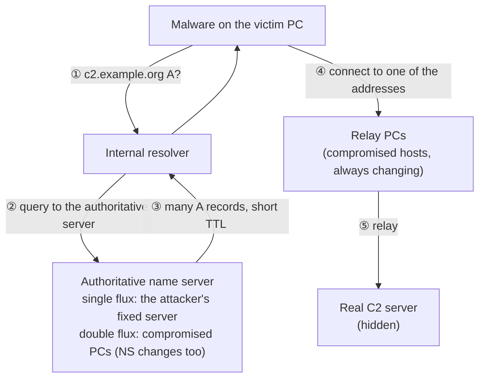

# 2.7 — Investigating DNS: Logs, Fast Flux, DGAs, Encrypted DNS, Punycode { #dns-investigation }

!!! abstract "Scope of this lesson"
    - A DNS architecture that helps investigations, and three kinds of DNS records: query logs, packets and passive DNS, and Windows analytic logs
    - What query logs alone miss: attackers "parking" a C2 name on `127.0.0.1`
    - Fast flux (single and double), Wireshark filters, and false positives from normal traffic
    - DGAs: generating names from the date, NXDOMAIN surges, the limits of heuristics, and [Changed] browsers' interception-detection queries
    - Other uses of passive DNS: DNS rebinding, unauthorised DNS servers
    - Encrypted DNS (DoT, DoH): what you see without keys and with them, and how to respond
    - Punycode and look-alike characters

!!! note "Lab environment and notation"
    **(Actual output)** came from the **practice DNS hierarchy** built in lesson 2.6 (Unbound 1.19.2 on loopback addresses), plus an attacker-role zone, `example.org`. All attacker behaviour (parking a name on `127.0.0.1` then switching it, fast flux that keeps swapping addresses, generating names from the date) was **imitated for practice**; no real malware was used. Time was compressed: things that would take hours or days happened within tens of seconds. Passive DNS records were produced with Zeek 9.0.1 (official Docker image) and TShark 4.2.2. The passivedns tool the book introduces could not be built from source in this environment, so it was **not run**; its output format is described only. Encrypted DNS was checked by enabling Unbound's DoT (853) and DoH (443) on `127.0.0.20`, with curl 8.5.0 and dig 9.18.39. Addresses are documentation addresses and domains are example domains.

## 1. A DNS architecture that helps investigations { #architecture }

As lesson 2.6 showed, DNS analysis gives you a pulse on nearly every protocol in use and exposes many kinds of malicious activity, which makes it a great foundation for threat hunting and real-time alerting.

The architecture has to support that. The book's advice is not to outsource this critical function wholesale (for instance to the public resolver `8.8.8.8`).

1. **Run a small number of internal resolvers.** How many depends on the client population and geography.
2. **Let only those resolvers reach outside DNS through the perimeter firewall.** They ask outside on everyone's behalf.
3. **Make all clients use the internal resolvers**, configured through DHCP.
4. **Block clients from reaching outside DNS directly** at the firewall.

And **keeping DNS records** is a major help to investigations. There are roughly three ways, which the book ranks like this:

| Method | Rating | Why |
| --- | --- | --- |
| DNS server query logs | Good | Most DNS servers support them, but they **lack responses** |
| DNS packet capture (pcap) | Better | Includes responses, but needs processing before use |
| Passive DNS records | Best | Extracts queries and responses from packets into easy one-line records |

## 2. Why query logs alone aren't enough { #query-logs }

### 2.1 Attackers "parking" a name { #phasing }

Attackers change the DNS records of their resources (C2 servers, exfiltration points) as they go. A hallmark of some groups is to **point C2 names at `127.0.0.1` while dormant**, switching them to the real address only when they need to talk to their implants. It protects them from discovery and exposure during quiet phases. Instead of loopback, they may point at something common and unrelated, such as a cloud provider's address.

I imitated this for practice. `beacon.example.org` first pointed at `127.0.0.1`, later at `203.0.113.66`, and a workstation role (`127.0.0.101`) asked twice.

**The resolver's query and reply log (Actual output; Unbound's `log-queries` and `log-replies`)**

```text
[1793863448] unbound[5388:0] info: 127.0.0.101 beacon.example.org. A IN
[1793863448] unbound[5388:0] info: 127.0.0.101 beacon.example.org. A IN NOERROR 0.001476 0 63
...
[1793863545] unbound[5388:0] info: 127.0.0.101 beacon.example.org. A IN
[1793863545] unbound[5388:0] info: 127.0.0.101 beacon.example.org. A IN NOERROR 0.000531 0 63
```

How to read it: `[1793863448]` is a Unix timestamp, followed by the client address, name, type and class. Reply lines add the response code (`NOERROR`), elapsed time (seconds), whether it came from cache (`0` = no) and the response size (bytes).

The two reply lines are **identical down to the size (63 bytes)**, even though one answer was `127.0.0.1` and the other the real C2 address. Even with reply logging on, **the content of the answer (the address) isn't recorded**. A traditional query log without reply logging is worse still. Logs like these can't tell you when the C2 woke up.

**Passive DNS records extracted from packets at the same time (Actual output)**

```text
1793863448.082569000|127.0.0.101|127.0.0.10|beacon.example.org|1|127.0.0.1|60
1793863545.359876000|127.0.0.101|127.0.0.10|beacon.example.org|1|203.0.113.66|60
```

TShark pulled the time, client, server, name, type number (1 = A), answer and TTL from the resolver's responses to the client. With this, you can see at once that **at 1793863545 (2026-11-05 07:25:45 UTC) the C2 woke up and pointed at `203.0.113.66`**, which is your lead for finding later connections to `203.0.113.66` (firewall, NetFlow, proxy logs).

### 2.2 Passive DNS tools { #passive-dns }

**Passive DNS** watches DNS traffic on a network interface or in a pcap file and records queries and responses. It only **listens from the side** without touching the server, hence "passive".

- **passivedns** (free tool): reads an interface or pcap and writes one-line records to a file or syslog. Run as a daemon sending both successful responses and NXDOMAINs to syslog, it can feed a log aggregator or SIEM in near real time (lessons 2.10 and 2.12). Given a pcap, it can write successful and NXDOMAIN queries to **two separate files**, a quick way to search DNS in a large pcap collection. Records are `||`-delimited, like `time||client||server||class||name||type||answer||TTL||count`. The TShark output above extracts the same information in a similar shape. **[Caution]** I couldn't run this tool in this environment; check its options with its own `--help`.
- **Zeek's `dns.log`**: Zeek, covered in detail in lesson 2.8, produces the same kind of record. I ran it on the same pcap.

**(Actual output; selected fields of Zeek 9.0.1's `dns.log`)**

```text
ts                 id.orig_h    id.resp_h   query              qtype rcode   answers       TTLs
1793863448.080943  127.0.0.101  127.0.0.10  beacon.example.org A     NOERROR 127.0.0.1     60.000000
1793863545.359143  127.0.0.101  127.0.0.10  beacon.example.org A     NOERROR 203.0.113.66  60.000000
```

Zeek **joins query and response in one line** (the asker `id.orig_h`, the responder `id.resp_h`, with answers and TTLs). Lesson 2.8 works with this log using `jq`.

### 2.3 Windows DNS Server analytic logs (ETW) { #windows-etw }

On Windows, the view long held that enabling DNS logging would hurt production servers too much. Since Windows Server 2012 R2, **ETW (Event Tracing for Windows)**-based DNS analytic logging can record queries and responses in detail, and it was engineered from the start to minimise the performance impact.

!!! info "[Supplement] What the current documentation says (revision of 2025-02-27, checked 2026-11-05)"
    According to Microsoft's "Enable DNS Logging and Diagnostics in Windows Server":

    - **Audit logs** are on by default and record **changes**: server, zone and record settings, dynamic updates, zone transfers, DNSSEC signing.
    - **Analytic logs** are **off by default**. In Event Viewer, under "Applications and Services > Logs > Microsoft > Windows > DNS-Server", use "Show Analytic and Debug Logs" and enable it. It is written to `%SystemRoot%\System32\Winevt\Logs\Microsoft-Windows-DNSServer%4Analytical.etl`.
    - Performance: about 5% degradation at 100,000 queries per second, and no apparent impact at 50,000 QPS and below.
    - Key events: 256 `QUERY_RECEIVED`, 257 `RESPONSE_SUCCESS`, 258 `RESPONSE_FAILURE`, 259 `IGNORED_QUERY` and others. Event 257 includes `Destination` (the querying client), `QNAME`, `QTYPE`, `XID` (transaction ID), `RCODE`, and **`PacketData`** (the whole DNS message in hex).

    learn.microsoft.com couldn't be opened from this environment, so I checked the MicrosoftDocs source on GitHub.

**[Caution] The answer (address) is inside `PacketData`.** `RESPONSE_SUCCESS` has no separate address field, so solving section 2.1's problem (`127.0.0.1` or the real address?) means decoding `PacketData`. There's no Windows here, so I took the response bytes the practice server actually sent, laid them out as the same kind of hex, and decoded them with dnspython.

**(Actual output; decoding hex in the same shape as `PacketData`)**

```text
PacketData=0x00008180000100010000000003777777076578616D706C6503636F6D0000010001C00C00010001000000240004C000020A
→ id=0, NOERROR, www.example.com. 36 IN A 192.0.2.10
```

The trailing `C0 00 02 0A` is `192.0.2.10`, and the `C0 0C` before it is a **compression pointer** (back to the question's name) from lesson 2.6. Managing ETW logs at scale is tricky, and there are public tools that turn them into a human-friendly format and match them against threat intelligence.

!!! info "[Supplement] Client-side records: Sysmon event 22"
    If you want to record **on each PC** which process asked for which name, Sysmon 10.0 (June 2019) added **event ID 22 (DNSEvent)**. It fills in the "who (which program)" that network records lack. It only sees queries that go through the OS DNS client, though, so a program doing its own DoH lookups (section 6) won't appear. Without a tuned configuration it's very noisy, so filters are needed.

## 3. Fast flux { #fast-flux }

### 3.1 Single flux { #single-flux }

**Fast-flux DNS** lets attackers hide their truly valuable servers (C2).

- The C2 name's A records list **the addresses of many compromised computers**.
- Malware on those computers acts as a **proxy**, relaying traffic between the victim and the real C2 server.
- The A records have a **very short TTL** (often under five minutes), and code on the compromised hosts **swaps them automatically and rapidly**.

Think of it as a **meeting place that changes every day**. The victim (the malware) asks DNS "where's today's meeting place?", goes to the place given (a relay PC), and that person passes the message on to the real boss. Block one meeting place and tomorrow it's somewhere else. Where it breaks: a meeting place is usually one spot, but fast flux hands out **several at once**, and they can change as fast as the attacker can compromise new hosts.

This makes it very hard for victims to block C2 traffic by address. Early on, the security community found an effective counter: block the **addresses of the C2 domain's authoritative name servers**, because DNS servers in a fast-flux setup were usually used only for malicious purposes.

For practice I gave `c2.example.org` 13 A records (TTL 10 s), replaced all 13 with new addresses every 12 seconds, and asked three times.

**(Actual output; answers received by the client; addresses picked at random from documentation ranges)**

```text
0.08 s   13  203.0.113.195 198.51.100.116 198.51.100.121 198.51.100.167 192.0.2.35 …
12.15 s  13  198.51.100.189 198.51.100.208 192.0.2.172 192.0.2.245 192.0.2.221 …
24.21 s  13  198.51.100.161 198.51.100.149 198.51.100.17 192.0.2.156 192.0.2.4 …
```

All three times, **all 13 addresses were different**. Blocking by address list would mean adding 13 more each time.

### 3.2 Double flux { #double-flux }

**Double flux** wraps the same idea in another layer. Compromised computers are used not only for A records but also for **NS records** (the domain's authoritative servers). The first tier of compromised hosts acts as **DNS proxies**, hiding the attacker's real DNS servers, and the answers those DNS proxies return again hold short-TTL A records for other compromised hosts that relay the C2 traffic.

**Figure 3-1. The layers of single and double flux** (top to bottom: the order in which the victim asks and connects)



**How to read it:** ①–③ are DNS, ④–⑤ the actual communication. In single flux only the A records in ③ keep changing; the authoritative server in ② is fixed, so you can block it. In double flux the authoritative servers in ② are compromised PCs too, and they keep changing.

Mitigation is more complex but still manageable in a proper DNS environment. A DNS administrator can **seize** known malware domains at the internal resolver (sinkholing, for example with RPZ-style features) so they never resolve. More importantly, with the architecture from section 1 in place, investigators can use DNS records to **scope the infection and quickly find newly compromised hosts**. Attackers responded by raising the bar again with DGAs (section 4).

### 3.3 Finding it with Wireshark filters, and false positives { #flux-filters }

Fast flux is fairly obvious to humans, but hard for machines to catch in advance with rules. The book offers two display filters. They're meant **to aid detection, not to block**, because they inevitably produce many false positives.

- `dns.resp.ttl < 300`: responses with a TTL under five minutes. Fast flux needs minimal caching, so TTLs are short. But they're common in legitimate records too.
- `dns.count.answers > 12`: responses with more than 12 answers. Fast flux uses many relays and may return many answers, but high-availability and geographic load balancing make large legitimate answers more common, and fast flux works fine with just a few answers.

I applied both filters to the practice capture, which also contains normal-role names (`www` with TTL 60, the end of the `cdn` chain with TTL 30, and `pool` with 16 A records at TTL 3600).

**(Actual output; based on the resolver's responses to clients)**

```text
$ tshark -r pdns.pcap -Y 'ip.src==127.0.0.10 && dns.resp.ttl < 300' -T fields -e dns.qry.name | sort | uniq -c
      2 beacon.example.org
      3 c2.example.org
      1 cdn.example.com
      1 www.example.com
$ tshark -r pdns.pcap -Y 'ip.src==127.0.0.10 && dns.count.answers > 12' -T fields -e dns.qry.name -e dns.count.answers | sort | uniq -c
      3 c2.example.org	13
      1 pool.example.com	16
```

`ip.src==127.0.0.10` restricts this to responses the resolver sent. Counting responses from outside authoritative servers too would count the same answer twice.

Interpretation: the TTL filter caught the two attacker names along with **two normal names** (`cdn`, `www`), and the answer-count filter caught `c2` along with a **legitimate large answer** (`pool`). Neither filter decides anything alone. Only `c2` met both, and above all, the decisive point is that **all of `c2`'s addresses changed every time it was asked**. You can only see that from **records over time** (passive DNS), not from one filter. The book reaches the same conclusion: the most effective approach is to use the environment's **normal DNS activity as a baseline** and investigate departures from it.

!!! tip "Using records to find names whose addresses keep changing"
    When answers are gathered on one line, as in Zeek's `dns.log`, counting **distinct answer addresses per name** is a stronger signal than TTL. In this lab's Zeek 9.0.1 `dns.log` (tab-separated), column 10 was `query` and column 22 was `answers`.

    ```text
    $ awk -F'\t' '!/^#/ && $22!="-" {n=split($22,a,","); for(i=1;i<=n;i++) print $10"\t"a[i]}' dns.log \
        | sort -u | cut -f1 | uniq -c | sort -rn | head -3
         39 c2.example.org
         16 pool.example.com
          2 cdn.example.com
    ```

    (Actual output) Split the answers column on commas into "name, address" pairs, remove duplicates with `sort -u`, then count per name. `c2.example.org` was asked 3 times and gave **39** addresses; `pool.example.com` was asked once and gave 16. Column numbers vary with Zeek version and configuration, so check the `#fields` line first. A legitimate CDN name also changes addresses by region and time, so compare against a baseline here too. Lesson 2.8 does the same with `jq`.

## 4. DGAs: malware that invents names { #dga }

### 4.1 How it works { #dga-concept }

**DGAs (domain generation algorithms)** aren't new, but they remain effective. Malware generates **hundreds or thousands** of candidate domain names for C2. The algorithm is usually seeded with something like the **date**. On the same day, every infected PC produces **the same list**, and the attacker only needs to register **one** of those names that day for the C2 connection to work, keeping the whole fleet intact.

What makes DGAs hard to counter is **scale**. In 2008, Conficker.A generated 250 names per day. The responders' coalition (the Conficker Working Group) reverse-engineered the algorithm, computed the lists in advance and worked with registrars to stop the author from registering them. Later variants raised the daily pool to **50,000**, shifting the advantage back away from responders. The CryptoLocker ransomware family likewise seeded its algorithm with the year, month and day to generate many candidates daily, with different algorithms and keys across variants.

To see the principle, I wrote a **practice generator** (`dga_lab.py`). It mixes the date and an index with SHA-256 to produce 20 lowercase names of 10–16 letters. **It isn't any real malware's algorithm.**

**(Actual output)**

```text
$ echo 2026-11-05 | python3 dga_lab.py | head -3
aghaceejpr.com
jqrsivavmai.com
khhjyrjmmfjg.com
$ echo 2026-11-06 | python3 dga_lab.py | head -3
qesxmlbzkh.com
teeaxbchtnff.com
ccxcburfal.com
```

The same date gives the same list wherever and whenever you run it, and a new date replaces the whole list. In the practice hierarchy I "registered" only the day's **14th name** (`thvcdbgrthihvvg.com`), and an infected-PC role (`127.0.0.103`) asked for the list in order.

**(Actual output)**

```text
$ tshark -r dga.pcap -Y 'ip.src==127.0.0.10 && dns.flags.response==1' -T fields -e ip.dst -e dns.flags.rcode | sort | uniq -c
      1 127.0.0.103	0
     19 127.0.0.103	3
      3 127.0.0.104	3
$ tshark -r dga.pcap -Y 'ip.dst==127.0.0.103 && dns.flags.rcode==0' -T fields -e dns.qry.name -e dns.a
thvcdbgrthihvvg.com	203.0.113.99
```

In `dns.flags.rcode`, 0 is NOERROR and 3 is NXDOMAIN. One PC received **19 NXDOMAINs** in a short time and **exactly one** success. That one (`203.0.113.99`) is the day's C2, and the investigator needs to find connections to it. This is exactly what the "mass NXDOMAIN" in lesson 2.6, section 3 looks like.

### 4.2 Heuristics and their limits { #dga-heuristics }

Spotting DGA names usually relies on heuristics estimating the **probability that a name wasn't chosen by a person**. Other approaches flag **domains newly observed** in your environment, **newly registered domains**, and external threat intelligence.

I computed the most common heuristics myself: **character entropy** (how evenly characters are mixed, in bits) and **vowel ratio**.

**(Actual output; column 1 = entropy, column 2 = vowel ratio, column 3 = length)**

```text
 3.00  0.38   8  timecard.example.com
 2.64  0.56   9  wikipedia.example
 3.19  0.40  15  weatherforecast.example
 2.85  0.40  10  kubernetes.example
---
 2.92  0.40  10  aghaceejpr.com         (practice DGA)
 2.86  0.00  12  khhjyrjmmfjg.com       (practice DGA)
 3.37  0.07  15  kgtvdzrngljvjaz.com    (practice DGA)
---
Average over 20 DGA names: entropy 3.21, vowel ratio 0.20
```

Interpretation: the averages differ, but **individual names overlap**. The legitimate `weatherforecast` (3.19) has higher entropy than the DGA name `aghaceejpr` (2.92), and `aghaceejpr` has the same vowel ratio as normal names. Short names have a lower maximum possible entropy (log₂10 ≈ 3.32 for 10 letters), so they're even harder to separate. That's why the book says catching DGAs in advance by machine is "all but impossible without a wide net prone to false positives". If a DGA only generates names under one domain (like the old `co.cc` case), you can block that domain, but if it produces sufficiently random, nondescript names, you have to accept that you **can't prevent** the malware from phoning home. Use heuristics **to aid detection**, together with NXDOMAIN surges, never-seen-before names and the connections that follow.

### 4.3 [Changed] The classic false positive: browsers' interception-detection queries { #chrome-probes }

Some ISPs and service providers never return **NXDOMAIN**, even for nonexistent domains, and instead send users to an ad-laden "search page". Chromium-based browsers detected this **DNS interception** by asking for bizarre names that should never exist (three random single-word names of 7–15 letters) and suspecting interception if the answers weren't NXDOMAIN. The trouble is that these queries **look a lot like DGA activity**.

For practice I had another PC (`127.0.0.104`) ask for three similar-looking names (the `127.0.0.104 3` line in section 4.1's output). Their entropies were 3.32, 3.32 and 3.58, higher even than the practice DGA average. And because the names have no dots, the resolver had to go **all the way to the root** for the NXDOMAIN (the outside capture shows `qxkzvbtrwe` and the others going to the root).

!!! warning "[Changed] Chromium has disabled this check by default since M97"
    In 2020, Verisign's analysis (on the APNIC blog) estimated that these probes accounted for **about half of root server traffic** (some 60 billion queries a day). Chromium has since changed the behaviour. The current Chromium source (`components/omnibox/browser/intranet_redirector_state.h`, checked via the GitHub mirror on 2026-11-05) reads:

    - `DISABLE_FEATURE = 1`: both the redirect checks and the did-you-mean infobars are disabled. **"Default value in M97 and above."**
    - `ENABLE_INTERCEPTION_CHECKS_AND_INFOBARS = 3`: both enabled. **"Default value prior to M97."**
    - And: "Defined by policy for enterprises; disabled for non-enterprises."

    The policy is `IntranetRedirectBehavior` (Chrome 88 and later). **What this means for investigations:** in ordinary user traffic since around 2022 you'll see these random queries less often, but they still appear with ① old browsers, ② environments that enable the check by enterprise policy, and ③ other software that uses a similar technique. Knowing the shape — "three random single-word names at once, around browser start-up" — helps tell them apart from DGAs.

Chrome isn't the only software doing this. The book's example is the Viscosity OpenVPN client, whose check queries always end in the (invalid) top-level domain `.viscosity` and contain the **tunnel interface name** in use (such as `utun10`). It's a false positive, but also a clue about that PC's configuration.

## 5. Other uses of passive DNS { #more-uses }

Collecting your own passive DNS evidence pays off in many investigations.

- **Tracking phased C2**: catch the moment a C2 name pointing at `127.0.0.1` or a common cloud address switches to the real one (or to a set of fast-flux addresses), as in section 2.1.
- **Finding rogue or unauthorised DNS servers**: search the "responding address" field for answers that didn't come from internal resolvers.
- **Use with other records**: firewall, IDS, web server logs and NetFlow are "limited-view artifacts of communication"; names add the context to interpret them.
- **Suspicious patterns such as DNS rebinding**: the attacker answers with an address they control and a **very short TTL** (so it isn't cached), and the user downloads code such as JavaScript. That code soon asks for **the same name** again (staying within the browser's same-origin rules), and this time gets the target's address, often an **internal address**. The attacker can then pivot to internal resources. In passive DNS it looks like **the same name switching from an outside address to a private one with short TTLs**.
- **Characterising encrypted or unidentified proprietary protocols**: even if you can't see the content, you know which name was looked up just before the connection.
- **DGA heuristics** (section 4.2).
- **Keeping a running list of the most-queried domains** to detect anomalous trends.

## 6. Encrypted DNS: DoT and DoH { #encrypted-dns }

### 6.1 The two approaches { #dot-doh }

As the Internet evolves, so must its core protocols, and DNS is no exception. Encrypting DNS was contentious, but with major browsers implementing it in their own code and big providers such as Google, Cloudflare and Quad9 offering it, its adoption is no longer in question.

| Approach | Standard | Transport | What investigators see |
| --- | --- | --- | --- |
| DoT (DNS over TLS) | RFC 7858 (2016) | TLS, usually **TCP 853** | Port 853 makes it **easy to recognise as DNS** and easy to block. Content hidden |
| DoH (DNS over HTTPS) | RFC 8484 (2018) | HTTPS (HTTP/2 etc.), **TCP 443** | **Nearly indistinguishable** from ordinary HTTPS |

Either way, the content is hidden, which all but eliminates the DNS monitoring and profiling covered so far. Worse, it can be built **into a program rather than the OS**, so any malware can take this path regardless of network and endpoint controls. Godlua, reported in 2019, is known as the first observed malware to hide itself with DoH.

### 6.2 What you see without keys, and with them { #doh-lab }

I sent the same question (`www.example.com A`) to a practice DoH/DoT server (`127.0.0.20`, certificate name `doh.example.net`) three ways: curl doing DoH GET and POST (saving TLS session keys with `SSLKEYLOGFILE`), and dig doing DoT (`+tls`).

**First, the DNS message carried in the DoH request (Actual output)**

```text
33 bytes: 00 00 01 00 00 01 00 00 00 00 00 00 03 77 77 77 07 65 78 61 6d 70 6c 65 03 63 6f 6d 00 00 01 00 01
base64url: AAABAAABAAAAAAAAA3d3dwdleGFtcGxlA2NvbQAAAQAB
```

It's **the same** DNS message as an ordinary UDP 53 query (12-byte header + 17-byte name + 4 bytes of type and class = 33 bytes). The one difference is the transaction ID at the front: **`00 00`**. The DoH standard (RFC 8484) recommends an ID of 0 so that identical questions produce identical HTTP requests and **HTTP caches** can reuse responses, which only works with GET.

- **GET**: the 33 bytes are converted to **base64url** (URL-safe base64 without trailing `=`) and placed in the `?dns=` query string.
- **POST**: the 33 bytes go into the request body as is, with `Content-Type: application/dns-message`.

**The capture without keys (Actual output)**

```text
$ tshark -r doh.pcap -Y dns | wc -l
0
$ tshark -r doh.pcap -Y 'tls.handshake.type==1' -T fields -e tcp.dstport -e tls.handshake.extensions_server_name -e tls.handshake.extensions_alpn_str
443	doh.example.net	h2,http/1.1
443	doh.example.net	h2,http/1.1
853		dot
```

The `dns` filter returns **not a single line**. All you can see is what's in the TLS ClientHello (`tls.handshake.type==1`).

- The two DoH requests: port 443, server name (SNI) `doh.example.net`, ALPN `h2,http/1.1`. **The same shape as ordinary web browsing.** The only clue is the SNI name, which is why comparing it against lists of known DoH service names is a common approach.
- The DoT request: port 853, ALPN **`dot`**. Port and ALPN alone reveal it as DNS (dig connected by address, so it sent no SNI).

**The capture with session keys (Actual output)**

```text
$ tshark -r doh.pcap -o tls.keylog_file:keys.log -Y 'http2.header.name==":path" || dns' \
    -T fields -e http2.headers.method -e http2.headers.path -e http2.headers.content_type -e dns.id -e dns.qry.name -e dns.a
GET	/dns-query?dns=AAABAAABAAAAAAAAA3d3dwdleGFtcGxlA2NvbQAAAQAB
			0x0000	www.example.com	192.0.2.10
POST	/dns-query	application/dns-message	0x0000	www.example.com
			0x0000	www.example.com	192.0.2.10
```

With keys, the inside of HTTP/2 opens up (as in lesson 2.3). Wireshark **decodes as DNS** the base64url question in the GET path, the POST body and the responses. The transaction ID was `0x0000` in both queries and responses, and decoding the response body gave `id=0`, `www.example.com A 192.0.2.10`.

dig has no equivalent key-logging option, so I couldn't open the DoT content. Inside, DoT uses the same format as DNS over TCP 53 (a 2-byte length plus the DNS message), so the principle of opening it with keys is the same.

### 6.3 Responding { #encrypted-dns-mitigation }

Countering the spread of encrypted DNS is possible but comes with notable complexity.

- **Both**: **TLS interception** (a decrypting proxy in the middle) is the most effective way to observe and optionally block it, but it often carries **legal risk**. The technology is relatively simple; managerial and regulatory hurdles make it a complicated prescription. Next best, **inspecting the TLS negotiation** (section 6.2's SNI, ALPN and certificate) gives some visibility. In tightly managed environments, **controlling OS and application configuration** is an option, but the sheer variety of enterprise software makes it hard to rely on alone, and malware naturally ignores enterprise policy.
- **DoT**: it uses its own port (853) rather than 53, so **firewalls** can control it effectively. Nothing stops an adversary from running DoT on another common port, but the opportunities for control are much greater.
- **DoH**: in the end it's just HTTPS with a particular payload, so lesson 2.4's **HTTPS profiling** approaches apply directly (which name, how often, how small the requests are).

!!! info "[Supplement] What has changed since the book (as of 2026-11-05)"
    - **New transports**: DNS over QUIC (DoQ, RFC 9250, 2022; UDP 853) is now a standard, and DoH can also run over HTTP/3, so, as seen in lesson 2.3, DNS can travel inside QUIC on **UDP 443**.
    - **OS-level support**: Windows 11, macOS, iOS, Android and others support encrypted DNS at the OS level. In that case it still shows up in records that watch the OS DNS client, such as Sysmon event 22, but not in network records on port 53.
    - **Ways for the network to say "use our resolver"**: Firefox won't turn on automatic DoH if the network's DNS gives a negative answer (NXDOMAIN and so on) for the **canary domain** `use-application-dns.net` (Mozilla support article). That signal doesn't override a user's own choice or enterprise policy, so on managed PCs, **enterprise policy** is the reliable control. DDR (RFC 9462, 2023) lets a client ask its current resolver "what's your encrypted address?" and move to that same resolver's DoT or DoH. Then **the internal resolver's records remain**, and only the wire is encrypted. For investigators, section 1's advice — collect the resolver's records, not just packets — matters even more.

## 7. Punycode and look-alike characters { #punycode }

When DNS was created, ASCII was enough (Unicode didn't exist yet). As non-ASCII text became common across protocols, DNS needed a way to represent **internationalised domain names (IDNs)** using only ASCII. The answer was **Punycode (RFC 3492)**.

A Punycode label starts with `xn--`, followed by the label's **ASCII characters**, then `-`, and finally an encoded part giving the **positions and identities of the non-ASCII characters**. The algorithm is quite complicated and out of scope here, but **recognising** and **decoding** these names is an important skill for investigators, and libraries and converters do the work.

**(Actual output; Python 3.13's `idna` codec)**

```text
'bücher.example'           -> xn--bcher-kva.example
'한글.example'              -> xn--bj0bj06e.example
'wıki.example'             -> xn--wki-jua.example        (ı = U+0131, dotless i)
'еxample.com'              -> xn--xample-2of.com         (е = U+0435, Cyrillic)
'pаy.example'              -> xn--py-7kc.example         (а = U+0430, Cyrillic)
'makesyour😀.example'       -> xn--makesyour-ob26h.example
```

In `bücher`, the ASCII letters `bcher` stay as they are, and `kva` after the `-` says where the `ü` goes. With no ASCII letters at all, as in Korean, only the encoded part follows `xn--`.

Investigators should watch for two things.

1. **They look suspicious at first.** In an ASCII log, `xn--bj0bj06e.example` looks random, but decoded it's the ordinary `한글.example`. Not every IDN deserves suspicion; decide **after decoding**. This is also why DGA heuristics (section 4.2) easily misfire on Punycode.
2. **Look-alike characters (homoglyphs).** The `ı` (dotless i) in `wıki` is nearly identical to `i` on screen, and the Cyrillic `е` in `еxample` looks exactly like Latin `e`. Attackers use such **IDNs imitating legitimate sites** for phishing. Conversely, if you decode an `xn--` name from your logs and it resembles your organisation's or a partner's name, that's a strong signal.

!!! info "[Supplement] The rules have tightened since"
    The emoji name above converts with Python's built-in `idna` codec (the older IDNA2003 rules), but the `idna` package 3.19, which follows the current rules (IDNA2008, RFC 5891 and related), raised **"Codepoint U+1F600 … not allowed"** (actual output). Emoji domains are an exception registered only under some top-level domains. Major browsers also have policies that show names mixing scripts, or suspected look-alikes, in the address bar **in their `xn--` form**. Look-alikes built from a single script (say, all Cyrillic) can still get through, so decoding and comparing on the log side remains necessary.

## 8. How this is used in real investigations { #in-practice }

1. **Get records that contain answers.** Query logs, even with reply logging, lack the answer addresses (section 2.1). Look for passive DNS, Zeek `dns.log`, pcaps and the `PacketData` of Windows analytic logs.
2. **Look at a name's history.** In time order: does it go from `127.0.0.1` to a real address, from an outside address to a private one, or to a new set of addresses every time?
3. **Filters are only a starting point.** `dns.resp.ttl < 300` and `dns.count.answers > 12` catch legitimate names too. Narrow down with baselines and distinct-address counts per name.
4. **Look for the "one success" after an NXDOMAIN surge.** That address may be the day's C2.
5. **Identify what merely looks like a DGA.** Three random single-word names at browser start-up, `.viscosity`, and Punycode are false-positive candidates.
6. **Be suspicious when DNS goes quiet.** A PC with almost no port-53 queries but plenty of web connections suggests DoH; move on to the TLS negotiation (SNI, ALPN) and HTTPS profiling.
7. **Decode `xn--` before judging.** Compare against your organisation's and partners' names.

## 9. Summary { #summary }

- An investigation-friendly architecture: a few internal resolvers, only they go outside, and clients are blocked from outside DNS. Records rank query logs (good) < pcaps (better) < passive DNS (best).
- Confirmed directly: Unbound's query and reply logs have **no answer addresses**, so the lines for a C2 name at `127.0.0.1` and at its real address were identical down to the size. Passive DNS extracted from packets and Zeek `dns.log` kept both answers.
- Windows DNS Server analytic logs (ETW) are off by default, and answers sit inside the hex of `PacketData`. On clients, Sysmon event 22 records the process too.
- Fast flux: short TTLs and many A records, swapped constantly (in my imitation: three lookups, 13 completely different addresses each time). Double flux swaps the NS records too. The TTL and answer-count filters caught legitimate names as well; the decisive evidence was records over time.
- DGAs: a date-seeded identical list with one name registered (Conficker: 250/day → 50,000/day). In my imitation: one success among 19 NXDOMAINs. Entropy heuristics separate the averages, but individual names overlapped.
- **[Changed]** Chromium's interception-detection queries have been off by default since M97 (they can be enabled by enterprise policy); they once made up nearly half of root traffic.
- Encrypted DNS: DoT gave itself away with port 853 and ALPN `dot`, while DoH looked like ordinary HTTPS on 443 (zero lines for the `dns` filter without keys). With keys, the base64url question in the GET and the POST body decoded as DNS, with ID 0. **[Supplement]** DoQ, DoH over HTTP/3, OS support, the canary domain, DDR.
- Punycode: `xn--` + ASCII letters + `-` + encoding. Decode before judging, and beware look-alike characters (dotless i, Cyrillic letters).

## Review questions { #review }

**Question 1. (Basics)** You have a year of query logs from the internal DNS server and nothing else. Give one investigation you can do with them and one you can't.

??? success "Answer and explanation"
    **Can:** which client asked for which name, when. For example, a list of PCs and times that looked up a known malicious domain, or mass lookups of DGA-like names (and NXDOMAIN counts, if reply logging is on). **Can't:** **which address came back**. As section 2.1 showed directly, the log lines for a C2 name at `127.0.0.1` and at its real address were the same. So "when did the C2 wake up?" and "which address would they have connected to?" can't be answered from these logs alone; you need passive DNS or pcaps, or the connection records (NetFlow, firewall) for those times.

**Question 2. (Interpretation)** You find these three lines in Zeek's `dns.log` (selected fields, times in UTC). What can you tell, and what would you do next?

```text
2026-10-02 03:10  10.20.1.15  update.example.org  A  NOERROR  127.0.0.1     3600
2026-10-19 22:41  10.20.1.15  update.example.org  A  NOERROR  127.0.0.1     3600
2026-10-21 01:05  10.20.1.15  update.example.org  A  NOERROR  198.51.100.7  300
```

??? success "Answer and explanation"
    The same PC asked for the same name periodically over several weeks. The first two times it got `127.0.0.1` (long TTL); at 01:05 on 21 October it got the outside address `198.51.100.7` (short TTL). This fits section 2.1's **parked-then-woken C2** pattern. Legitimate software sometimes parks an update server temporarily too, so treat it as a **hypothesis**. Next: ① find `10.20.1.15` → `198.51.100.7` connections after 01:05 on 21 October in conn.log, NetFlow, firewall and proxy logs (volume and duration); ② find **other PCs** that asked for the name (scope); ③ find other times the name changed address; ④ find the process asking for it on that PC (Sysmon 22 and so on).

**Question 3. (Changed conditions)** Applying both filters from section 3.3 catches `c2.example.org` and also a large service name many of your users rely on. How would you tell them apart?

??? success "Answer and explanation"
    Use **records over time**, not a single filter run. ① **Number and rate of change of distinct answer addresses** per name: fast flux replaced the whole set every time (practice: 39 addresses from 3 lookups), while a large service usually rotates within a stable address range. ② **Nature of the addresses**: are they one cloud or CDN provider's ranges, or residential lines scattered across countries? ③ **Authoritative name servers**: a large service's NS records are long-lived and run by reputable providers; double flux changes even the NS. ④ **Baseline**: the large service is normally queried by many PCs; a fast-flux name by a few PCs on a schedule. ⑤ When the domain was registered (recently?). Weigh the evidence together.

**Question 4. (Common misconception)** "Block any name whose character entropy exceeds 3.0 as a DGA." Explain the problem with this rule using this lesson's results.

??? success "Answer and explanation"
    In section 4.2's own calculations, the legitimate names `timecard` (3.00) and `weatherforecast` (3.19) scored 3.0 or more, while the practice DGA names `aghaceejpr` (2.92) and `khhjyrjmmfjg` (2.86) scored below 3.0. The rule blocks legitimate names and lets DGA names through. Short names have a lower maximum possible entropy (about 3.32 for 10 letters), making them even harder to separate, and Punycode (`xn--bj0bj06e`) and random-looking CDN names get caught too. Use entropy **to aid detection, not as a blocking rule**, together with NXDOMAIN surges, never-seen names, registration age and the connections that follow.

**Question 5. (Interpretation)** Around 9:00 a.m., one PC asked for three dotless names — `rtyhcvbnkla`, `poiuqwemn`, `zxcvbnmasdfgh` — within one second, all NXDOMAIN, and nothing similar afterwards. Is it a DGA?

??? success "Answer and explanation"
    They look random and DGA-like, but **three single-word names at once**, never repeated, matches section 4.3's **browser interception-detection queries** (three random names of 7–15 letters). The time — someone arriving and starting a browser — fits too. Check: ① the browser and version on that PC (Chromium M97 and later has the check off by default, so look at the enterprise policies `IntranetRedirectBehavior` and `DNSInterceptionChecksEnabled`); ② whether the same shape appears on other PCs around browser start-up; ③ the querying process in endpoint records (Sysmon 22). A DGA usually generates many more names, with a top-level domain attached, and a successful name is followed by real connections.

**Question 6. (Changed conditions)** The internal resolver and firewall policy follow section 1, yet one PC makes almost no port-53 DNS queries all day while making plenty of web connections. What do you suspect, and how do you check?

??? success "Answer and explanation"
    Suspect a program or the OS using **DoH** (443), or DoQ or DoH over HTTP/3 (UDP 443) (section 6). DoT on 853 would be blocked by the firewall or visible in records. Check: ① that PC's TLS ClientHellos for **SNI** (known DoH service names?) and connection patterns (frequent small requests; lesson 2.4's HTTPS profiling); ② the browser's and OS's secure DNS settings and whether enterprise policy is applied; ③ per-process network records on that PC (which program made those connections?). If it's a normal browser setting, fix it with policy; if it's an unknown process, suspect **malware using DoH**, like Godlua. The canary domain only affects Firefox's automatic DoH, so it's not enough here.

**Question 7. (Common misconception)** "DoH is encrypted, so even with the session keys you only see HTTP requests; the DNS content has to be decoded separately." Refute this with this lesson's experiment.

??? success "Answer and explanation"
    In section 6.2, once given the session keys (`SSLKEYLOGFILE`), Wireshark **decoded the DoH inside HTTP/2 straight as DNS**: the base64url question after `?dns=` in the GET path appeared as `www.example.com`, the `application/dns-message` POST body as a DNS query, and the response as `192.0.2.10`. The DNS message inside DoH has **the same format** as over UDP 53 (only the ID is 0). No separate decoding is needed; the hard part is **getting the keys** (the legal and managerial burden of TLS interception, or key logging on the endpoint).

**Question 8. (Application)** You see a name like `xn--mcrosoft-g7a.example` in the logs (hypothetical). In what order would you assess it?

??? success "Answer and explanation"
    ① **Decode it**: convert the Punycode to see the real characters (library or converter). ② **Check for look-alikes**: does the decoded name resemble your organisation's, a partner's or a popular service's name, and which characters come from another script (Cyrillic `а`, `е`, dotless `ı`, etc.)? One character off from a well-known name, as here, makes phishing likely. ③ **Look at context**: which PC asked, when (just after receiving an email?), the HTTP/HTTPS connections that followed, and proxy log requests (a login page?). ④ **Scope**: other PCs that asked for the same name. If instead it decodes to an ordinary internationalised domain (a foreign partner's local-language name, say), close it as a false positive. Blocking every `xn--` isn't the answer.

**Question 9. (Interpretation)** In passive DNS, `app.example.net` resolved at 2:00:00 p.m. to `203.0.113.50` with TTL 1, and when the same PC asked again at 2:00:07 it got `10.20.5.30` (an internal address), also TTL 1. What do you suspect, and what else would you look at?

??? success "Answer and explanation"
    Suspect **DNS rebinding** (section 5). The page and script are fetched from the outside address, then the same name is switched, with a TTL too short to cache, to an **internal address**, so that within the browser's same-origin rules the script sends requests to an internal device (`10.20.5.30`). Look at: ① HTTP requests from the PC to `203.0.113.50` right after 2:00:00 (proxy or web logs: what was downloaded?); ② connections from the PC to `10.20.5.30` after 2:00:07 (which port, which requests, whether the `Host` header is `app.example.net`; lesson 2.1); ③ what `10.20.5.30` is (a router with an admin page, a printer, an internal API). Also check whether the internal resolver **filters private-address answers for outside names**.

## References { #references }

- Tools used in this environment: Unbound 1.19.2 (practice hierarchy, `log-queries` and `log-replies`, DoT and DoH), Zeek 9.0.1 (official Docker image), TShark 4.2.2, tcpdump, dig 9.18.39, curl 8.5.0, OpenSSL (self-signed practice certificate), dnspython 2.9.2, Python `idna` 3.19, Python 3.13. Results obtained on 2026-11-05.
- Microsoft, "Enable DNS Logging and Diagnostics in Windows Server" ([MicrosoftDocs source on GitHub](https://github.com/MicrosoftDocs/windowsserverdocs/blob/main/WindowsServerDocs/networking/dns/dns-logging-and-diagnostics.md), ms.date 2025-02-27, checked 2026-11-05): audit and analytic logs, events 256–259, performance figures.
- Zeek, [dns.log documentation](https://docs.zeek.org/en/master/logs/dns.html).
- passivedns: [source repository](https://github.com/gamelinux/passivedns) (not run in this environment).
- Sysmon event 22 (DNSEvent): added in Sysmon 10.0 (June 2019); checked via search results on 2026-11-05.
- Chromium, `components/omnibox/browser/intranet_redirector_state.h` ([GitHub mirror](https://github.com/chromium/chromium/blob/main/components/omnibox/browser/intranet_redirector_state.h), checked 2026-11-05): disabled by default from M97. The root-traffic analysis is Verisign's APNIC blog post (August 2020) and its coverage, checked via search results on 2026-11-05.
- IETF, [RFC 7858](https://www.rfc-editor.org/rfc/rfc7858) (DoT), [RFC 8484](https://www.rfc-editor.org/rfc/rfc8484) (DoH, ID 0, GET and POST), [RFC 9250](https://www.rfc-editor.org/rfc/rfc9250) (DoQ), [RFC 9462](https://www.rfc-editor.org/rfc/rfc9462) (DDR).
- Mozilla, [Configure networks to disable DNS over HTTPS](https://support.mozilla.org/kb/configuring-networks-disable-dns-over-https) (canary domain `use-application-dns.net`; checked via search results on 2026-11-05).
- IETF, [RFC 3492](https://www.rfc-editor.org/rfc/rfc3492) (Punycode), [RFC 5891](https://www.rfc-editor.org/rfc/rfc5891) (IDNA2008).
- Conficker's domain counts (250 → 50,000 per day) and Godlua's use of DoH (2019) are summarised from published analyses.

!!! note "About this page"
    A personal study note, rewritten in my own words from several learning resources. The practice DNS hierarchy, the attacker-role behaviour and the domain generator are my own, and the scenarios are hypothetical.
